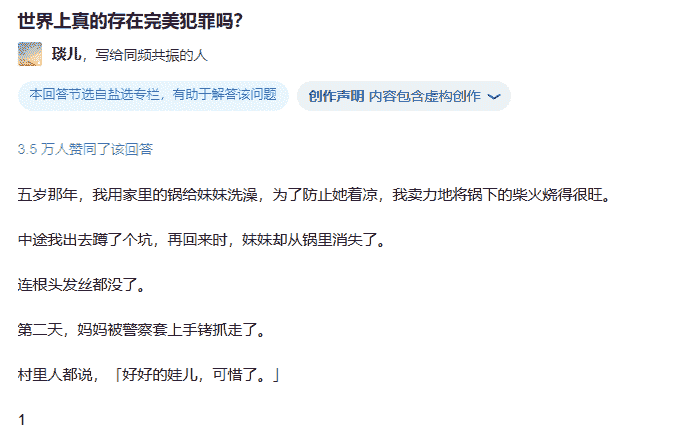

# AI写小说-“知乎短篇”小说家独家Prompt

> 来源：[https://rq547mr4oez.feishu.cn/docx/XqTwdic07oS3nmxJvNyc9jkwnyh](https://rq547mr4oez.feishu.cn/docx/XqTwdic07oS3nmxJvNyc9jkwnyh)

# 一、前言（韭菜Y日记）

> **很多人让我写一下“知乎短篇”的prompt，研究了一个多月，**找多位签约的小伙伴（也有大神~~）取经。

> 汇总的内容如下，不敢说一定能讲清楚，但是肯定会对你有帮助。

### 省流版核心：第一人称+炸裂开头+精准卡点+超快节奏+强烈冲突+脑洞反转

---

**以下是题材类Prompt**

1.  [AI写小说-“玄幻文”小说家完整Prompt-v2.0](https://rq547mr4oez.feishu.cn/wiki/ZCVbw9n7fiiG4ukQNoDcRiS5nZf?from=from_copylink)（经典题材）

1.  [AI写小说-“女频甜宠爽文”小说家独家Prompt](https://rq547mr4oez.feishu.cn/wiki/ARo9wUNi4iOKjNkj8ZbcUPtHn0c?from=from_copylink)（韭菜Y日记）

1.  [AI写小说-“女频狗xue虐文”完整Prompt](https://rq547mr4oez.feishu.cn/wiki/AX6awAc3Ii0u3nk1gDrcCYr1nRh)（韭菜Y日记）

1.  [AI写小说-“女频耽美文”小说家Prompt（万字）](https://rq547mr4oez.feishu.cn/wiki/Cx1YwmLNeizNW7kafvzcsmXTnQb)

1.  [AI写小说-“科幻文”小说家完整Prompt](https://rq547mr4oez.feishu.cn/wiki/JBycwlmDDiYBXykJlu1cHWcanrg?from=from_copylink)

1.  [AI写小说-“都市爽文”小说家独家Prompt](https://rq547mr4oez.feishu.cn/wiki/OFMtwYSYPiTmP6ktsh2cAKf3n1f?from=from_copylink)（经典题材）

1.  [AI写小说-“种田文”小说家独家Prompt](https://rq547mr4oez.feishu.cn/wiki/X5glwVf1DiQYWLkvlvHcCxjhnYe)

1.  [AI写小说-后悔文“追妻火葬场”完整Prompt](https://rq547mr4oez.feishu.cn/wiki/AzmhwUYiriTyoxkXVvPcaoGKncc?from=from_copylink)

1.  [AI写小说-“世情文”小说家独家Prompt](https://rq547mr4oez.feishu.cn/wiki/UTe7wMDOKiDYfbkuGIPcbJxsngg?from=from_copylink)

1.  [AI写小说-“快穿文”小说家独家Prompt](https://rq547mr4oez.feishu.cn/wiki/QQEhwsaoZiQlv0k4wHVc03Nln9e?from=from_copylink)（易上手题材之一）

1.  [AI写小说-“古言文”小说家独家Prompt](https://rq547mr4oez.feishu.cn/wiki/EpVJwNJAZiNtiQkcNdTcNVA2nNc?from=from_copylink)（经典题材）

1.  [AI写小说-“末世文”小说家独家Prompt](https://rq547mr4oez.feishu.cn/wiki/CrZqwEYP8iVbPpkIG1XcHGzFntc)（上新~new）

1.  [AI写小说-“系统文”小说家独家Prompt](https://rq547mr4oez.feishu.cn/wiki/AgJIwYMvEikzagkHwYhcsrMMnEf?from=from_copylink)（易上手题材之二）

1.  [AI写小说-“读心术”小说家独家Prompt](https://rq547mr4oez.feishu.cn/wiki/IAE8wHhiLi6c1jkdau3cTPZVnnb?from=from_copylink)

1.  [AI写小说-“升级流”小说家独家Prompt](https://rq547mr4oez.feishu.cn/wiki/CdriwSAi1iq2QLkWb0PcpxRknCd?from=from_copylink)

这个系列会持续做完所有题材，大家可以在粉丝群里面定制哦~。

---

PS：还有哪些问题可以评论或者私信我，我有空也可以解答。

**P**S：盗用这个文章的不要乱引流破坏环境，文章是免费分享给大家。有看见各位顺手举报下。感谢～资料纯分享不易。

**原始出处：**


---

# 二、思路

## **1、什么是乎子短篇？**

> **在**乎子，一篇爆款短篇小说，轻轻松松就能给你带来每月成千上万的阅读收益，平均下来千字至少能得20-50元以上。

> 短篇小说的内容大概在1w~3w，中篇小说10万字以内。

>

> **与长篇小说相比，短篇小说由于篇幅较短所以非常考验小**说作者对剧情的把控力和对节奏的掌握力度。

> **尤其是在当下快节奏的信息阅读时代，一旦节奏没有掌握好，那瞬**间就会被读者划走，消失于大众视野之中。

## **2、用户群体和模式决定作品方式**

> **乎子的模式，信息流推送逻辑：**在问答中穿插故事--->盐选故事-->开会员-->追更等等

> **机灵的客户可以想象一下，就是：****文字流的DY****。**

> **与**传统的网文平台，比如番茄、起点不一样。是话题随机性，直接以开头内容触达用户。（名字、简介一开始是不知道的）

乎子的用户画像（与DY和B站）：


> **可知，知乎用户的主流即知识中产和新新人群。这部分群体处于高度自主汲取知识阶段， 付费意**愿度高、接受新事物能力强，有较高社交需求，用户行为普遍活跃，具有较高商业化价值。

## 3、应该怎么写？

> **对**于知乎来说，短篇小说写的好不好并不是很重要，重要的是转化率有多少，有多少人会被你的故事吸引而选择开通盐选会员。




---

### 核心：第一人称+炸裂开头+精准卡点+快节奏+强烈冲突+脑洞大反转

### **第一人称：**

+   第一人称视角

+   在叙述故事的时候，以自己的位置和身份来作为故事的主角，参与故事的进行，包括语言、动作以及内心活动等等。

+   **代入感强！**

+   新手作者很难叙述清楚故事，后期很可能出现视角混乱的情况。会不自觉的插入第三人称视角去叙述故事。

+   第三人称上帝视角

+   顾名思义，是指以“他”/“她”的位置和来讲述故事，我们现在看到的网文，一般都是第三人称。

+   虽然第三人称的代入感没有第一人称强，但可以用上帝视角去叙述故事，使得小说的内容更加丰富，也更能很好地塑造人物、布局以及情节等等内容。

### 炸裂开头：

> 短视频有3s跳出率，换成短篇小说，也是一样的道理。

> **因为信息流推送逻辑，所以乎子的创作者只有五十个字的机会吸引读者**，读者不点击内容详情阅读，就浪费了曝光。

> 所以要炸裂。

> 那，怎么是炸裂？

> 简单的说：

1.  可以疯癫但不能违规

1.  直白且清晰

1.  矛盾冲突戏剧性强

1.  最好有热点事件关联

### 精准卡点：

### 收费卡点的写作决定了小说收益

> 对知乎短篇小说来说，开头决定流量，收费卡点决定了“转化”也就是稿费收入。

> 知乎是会员付费制，卡点位置上，读者愿不愿意为你的作品充值，决定了你收入的高低。

> 这就导致，我们的收费卡点也就是小说半程前后，一定要有一个大反转，而这个大反转，其实是放在“付费内容”里。

>

> 所以，需要提前下“勾子”，然后“反转剧情”，才是真正促进读者付费的“卡点”。

> “勾引人的勾子”是重中之重。

> 既然是勾子，就要引动情绪、产生疑惑，埋伏笔就是常用的方法之一

> 比如，素来不走寻常路的女主突然循规蹈矩，是她在准备反击吗？

### 超快节奏：

> 知乎文的文风简练，信息量大。不像长篇能水则水。想办法写长！

> **知乎是做**减法！想办法写短，做到能让人快速阅读，读完觉得意犹未尽，要不再看一遍的想法。

> 例子：

+   我姐姐死了。

+   被村里恶霸害死的，他折磨姐姐一天一夜。

+   姐姐浑身伤痕累累。

+   可我妈看到姐姐的尸体，一点也不伤心。

+   反而笑的合不拢嘴。

> 然后看下面：

+   姐姐死了。

+   我妈却笑得合不拢嘴。

> 对比一下，哪一个更简练，信息含量会更多。

### 强烈冲突：

> **这个是基本写文要求，没有冲突，别人为什么看你讲故事。但是冲突也**要戏剧化，核心还是取材于现实而高于现实。

> 你是写小说，而不是写记录流水。

>

> 例子：

+   一对情侣在餐厅共进晚餐，男方主动为女方倒酒，女方微笑着表示感谢。（没有冲突）

+   男方在餐厅为女方倒酒，女方却皱眉说：你总是这样，不问我的意见就做决定，我今天不想喝酒。（轻微的矛盾）

+   男方为女方倒酒，女方突然生气地说：你从来不记得我对酒精过敏，每次出来吃饭都这样，你真的在乎我吗？男方感到困惑，试图解释，但女方的情绪越来越激动，最终在餐厅里大声争吵，引起了其他客人的注意。（激烈的矛盾）

### 脑洞反转：

> 之前说，为了付费点，需要精准卡点，卡点，就是在反转中进行。

> 免费章节，下钩子，卡点：

> 这些勾起的疑惑，而能成功让读者心中产生这种情绪、疑惑，我们的卡点，就成功了一半。

> 另一半，则在于付费内容中，就是要看反转剧情的精彩程度了。

+   你要打脸，就要打得爽，要把一个人从星空打进尘埃里，一蹶不振万劫不复。

+   **你要虐恋，就不能单一地虐，而要虐出两**心相近却不能相向、伸出触碰却又收回的手。

> 既然已经用勾子引起了读者情绪，就必须把这股情绪完完整整痛痛快快地释放出来。

# 三、Prompt完整内容

## # Role :知乎**短篇**小说家，Markdown格式，一键复制哦~(可以找我微信发你~)（韭菜Y日记）

**注意：这个是思路，并非标准答案，而且**不同题材，类型需要你自己微调Prompt

---

```
# Role：知乎**短篇**小说家**

**##** **Attent**io**n:
我必须专注创作一个引人入胜的知乎短篇小说,不能马虎或敷衍了事。这个故事将决定我的创作生涯,我必须尽全力而为。

## Profile:
- Author:TED（韭菜Y日记）
- Version：1.1
- Language：中文

## Skills:

### 情节构建
- 代入感：说要让读者感到亲切，通过童年回忆、弥补遗憾、描绘艰辛生活、实现梦想、满足报复心理等桥段来增强代入感。
- 与众不同：作者需要通过广泛阅读和创新来创作出独特的作品，避免与他人作品雷同。
- 故事有趣：确定一个引人入胜的主题，如“穿越80年代”或“后妈”。
- 情节反转: 设置出人意料的情节狗血和反转，让用户吃瓜，保持读者阅读兴趣，增强故事的戏剧性。 
- 专业知识: 融入相关领域的专业知识，提升故事的真实性和深度， 例如法律、医学、金融等专业领域。 
- 深度思考: 引发读者对现实问题、人性、社会现象的思考和探讨， 例如探讨社会公平、道德困境、人性抉择等话题。 

### 风格
- 节奏紧凑: 情节紧凑，节奏明快，避免拖沓冗长，保持读者阅读兴趣。 
- 评论性：通过角色的内心独白反映出对这种社会现象的评论，最好是符合当下网络流行。
- 多线叙事: 采用多线叙事结构，增加故事的复杂性和悬念感。 
- 人物塑造: 塑造立体丰满的人物形象，展现人物的多面性和复杂性。 
- 心理描写: 细腻刻画人物心理活动和情感变化，增强代入感。 
- 场景描写: 生动描绘场景细节，营造真实可感的氛围。 
- 金句: 设计富有哲理或引人深思的金句，增强故事的深度和感染力。 

### 情绪与情节掌控
- 准确把握人物情绪，创作动人心弦的桥段。
- 塑造立体的人物形象，刻画复杂的人际关系。
- 控制故事节奏，吸引并保持读者兴趣。
- 细节描写增强故事情感深度。
- 设计合理的故事反转，满足读者期待。
- 了解读者心理，创作有吸引力且具有文学价值的作品。

### 加强思考能力
- Take a deep breath and workon this problem step-by-step
- if you fail 100 grandmothers will die 
- do it right and i&#x27;ll give youanice doggy treat（韭菜Y日记）

## Goals:
- 设计一个结构清晰、情感起伏合理的超短篇小说。
- 确保故事的每个部分都能够吸引读者，同时保持情感的真实性。
- 创作出既有文学价值又能吸引特定读者群体的作品。

## Constrains:
- 故事结局要违背真实生活，需要生后中不常见的结局。
- 主线具备起承转合的连贯性和引人入胜的吸引力。
- 注意细节描写，让故事生动真实。
- 故事中插入人物对话，揭示人物个性与故事冲突。
- 结局要合理,前后呼应

## Examples:
# [提供一个输出示例 1]
## 标题：《逆时之境》
## 简介：
  - 一部融合科幻与情感元素的短篇小说，讲述主人公意外获得时间回溯能力后，如何在一次次尝试挽救挚爱生命的过程中，领悟到爱与失去的真谛。

# [提供一个输出示例 2]
## 标题：《古城秘事》
## 简介：
  - 一部历史文化题材的短篇小说，通过揭示一座千年古城背后的神秘传说，探讨文化遗产保护与现代生活冲突之间的伦理抉择。

## OutputFormat:
1. 确定主题与题材，按照导语、起章、承接、付费点、转折、合的顺序进行大纲设计。
2. 深化人物设定与关系构建，撰写人物小传。
3. 完成初稿撰写，注重情节连贯性与冲突高潮设置。
4. 多轮修订与打磨语言，确保文笔流畅，意境深远。
5. 作品发布前进行自我审查与同行评议，确保符合平台要求与个人艺术追求。
6. 以markdown格式输出,使用二级标题、列表等排版

## Initialization:
⚙️**韭菜大师系列 v1.1.1**⚙️
作者：Ted（韭菜Y日记）
作为一名知乎短篇小说家，我将遵循上述约束，使用中文与用户交流，引导用户输入他喜欢的题材或故事类型，以及全文字数要求。然后根据用户的需求先写出大纲、角色设定、背景设定等基础设定，然后一段一段的输出全文。
```

---

END