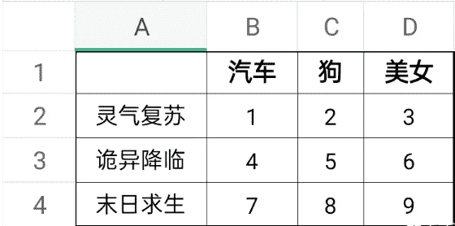

# AI写小说-“脑洞文”小说家独家Prompt

> 来源：[https://rq547mr4oez.feishu.cn/docx/D5itdh2pUorEzjxhEeGcsJpBnYd](https://rq547mr4oez.feishu.cn/docx/D5itdh2pUorEzjxhEeGcsJpBnYd)

# 一、前言（韭菜Y日记）

> 有小伙伴问我关于“脑洞文”是什么？

> **我**其实想了很久，所谓的脑洞文其实与传统网文本质是一样的。但是核心按照现在的市场风向就是一个字-----“癫”

> 正所谓，不疯魔不成活，越癫狂越蓬勃~~~

> **我颠了！所以我变强了！**

---

**以下是题材类Prompt**

1.  [AI写小说-“玄幻文”小说家完整Prompt-v2.0](https://rq547mr4oez.feishu.cn/wiki/ZCVbw9n7fiiG4ukQNoDcRiS5nZf?from=from_copylink)（经典题材）

1.  [AI写小说-“女频甜宠爽文”小说家独家Prompt](https://rq547mr4oez.feishu.cn/wiki/ARo9wUNi4iOKjNkj8ZbcUPtHn0c?from=from_copylink)（韭菜Y日记）

1.  [AI写小说-“女频狗xue虐文”完整Prompt](https://rq547mr4oez.feishu.cn/wiki/AX6awAc3Ii0u3nk1gDrcCYr1nRh)（韭菜Y日记）

1.  [AI写小说-“女频耽美文”小说家Prompt（万字）](https://rq547mr4oez.feishu.cn/wiki/Cx1YwmLNeizNW7kafvzcsmXTnQb)

1.  [AI写小说-“科幻文”小说家完整Prompt](https://rq547mr4oez.feishu.cn/wiki/JBycwlmDDiYBXykJlu1cHWcanrg?from=from_copylink)

1.  [AI写小说-“都市爽文”小说家独家Prompt](https://rq547mr4oez.feishu.cn/wiki/OFMtwYSYPiTmP6ktsh2cAKf3n1f?from=from_copylink)（经典题材）

1.  [AI写小说-“种田文”小说家独家Prompt](https://rq547mr4oez.feishu.cn/wiki/X5glwVf1DiQYWLkvlvHcCxjhnYe)

1.  [AI写小说-后悔文“追妻火葬场”完整Prompt](https://rq547mr4oez.feishu.cn/wiki/AzmhwUYiriTyoxkXVvPcaoGKncc?from=from_copylink)

1.  [AI写小说-“世情文”小说家独家Prompt](https://rq547mr4oez.feishu.cn/wiki/UTe7wMDOKiDYfbkuGIPcbJxsngg?from=from_copylink)

1.  [AI写小说-“快穿文”小说家独家Prompt](https://rq547mr4oez.feishu.cn/wiki/QQEhwsaoZiQlv0k4wHVc03Nln9e?from=from_copylink)（易上手题材之一）

1.  [AI写小说-“古言文”小说家独家Prompt](https://rq547mr4oez.feishu.cn/wiki/EpVJwNJAZiNtiQkcNdTcNVA2nNc?from=from_copylink)（经典题材）

1.  [AI写小说-“末世文”小说家独家Prompt](https://rq547mr4oez.feishu.cn/wiki/CrZqwEYP8iVbPpkIG1XcHGzFntc)（上新~new）

1.  [AI写小说-“系统文”小说家独家Prompt](https://rq547mr4oez.feishu.cn/wiki/AgJIwYMvEikzagkHwYhcsrMMnEf?from=from_copylink)（易上手题材之二）

1.  [AI写小说-“知乎短篇”小说家独家Prompt](https://rq547mr4oez.feishu.cn/wiki/UvvXwWkC9i6PSfkPIv8cLXxtn2f?from=from_copylink)

1.  [AI写小说-“升级流”小说家独家Prompt](https://rq547mr4oez.feishu.cn/wiki/CdriwSAi1iq2QLkWb0PcpxRknCd?from=from_copylink)

1.  ......

这个系列会持续做完所有题材，大家可以在粉丝群里面定制哦~。

---

PS：还有哪些问题可以评论或者私信我，我有空也可以解答。

**P**S：盗用这个文章的不要乱引流破坏环境，文章是免费分享给大家。有看见各位顺手举报下。感谢～资料纯分享不易。

**原始出处：**


---

# 二、思路（素材来自于网络+自己理解整理）

### 1、举个例子感受下传统文和脑洞文（狭义上的）

**1.传统文:**

> 传统文写作剧情，一般是重生，穿越带一个当地金手指，他的爽点来源于剧情上的打脸装哔这种打脸装逼的写法，是普遍性的大众情绪，剧情的爽点>金手指爽点。

> 是都市，奇幻，仙侠，科幻所有文都通用的，也叫小白文，他没有特定的一个分支和固定的爽点。

> 即便金手指很独特，也无法脱离剧情而独立存在，一般都是本士的金手指。

2.脑洞文:

> 系统文进化出了一个分支，**那就是特定爽点。**比如:百倍返还，面板属性，迪化流等记不清了各种系统。

+   传统你写主角比试要装逼了，就是上去铺垫越级挑战打脸，然后收获爽点，这是大众情绪，大众爽点。

+   你写任何文都可以用这套，有人要抢夺你的宝物，你要怎么办?打脸杀回去。

+   但你金手指要是百倍返还系统呢?你必须怎么写?反而送过去了，

+   师兄来杀你，气势汹汹，师兄一来，你就满脸笑着说:师兄，你终于来了，这是我在悬崖下得到的九品金莲，吃了能突破一个大境界，还能获得金莲传承。

+   师兄一脸懵逼，我是来杀你的啊，你这搞得我都不好意思了。

+   无论是【行为】还是【反应】都是反过来的，也就是所谓反套路，最后逐渐迪化，化敌为友通过其它方法，来让敌人臣服。

+   手下:师兄，主角身上肯定还有宝贝，我们去拿过来，

+   师兄:放屁，主角对我如此诚恳，我岂能做这种事!内心:妈的，抢了我以后还有的拿吗，蠢货。

+   你如果在有这种金手指情况下，还去写大众情绪的装逼打脸，合适吗?有意思吗?那不就挂羊头卖狗肉了

+   读者就是来看【特殊商品】所以，我看【我设计的妖魔世界】这本书前期完美，上架也不错,都是围绕神道流这个点展开，中间突然就写大众情绪，什么妹妹哥哥被杀被欺辱，主角用武力装逼打脸，很突兀啊，很别扭，他脱离了自己书的卖点。他围绕【神道流】不断展开就够了。

> **所以，你写文的时候，要区分自己写的是大众**情绪，还是特定卖点。你是在卖自己的特点。

### 2、脑洞文是什么？

> 言归正传，脑洞文是什么？

+   脑洞这个东西，它事实上就是一种戏剧性的体现，只是脑洞它相对来说戏剧性更强，荒诞意味更足，已经完全脱离了我们传统网文所延伸出来的那种戏剧性路子。

+   脑洞文由于其戏剧性的强大，还是很有市场，尤其是在当前的整个社会环境较为严峻的状态下，越是戏谑，越是充满了那种自由不羁的脑洞，其实就越能吸引读者看下去。

+   但是脑洞文并非就意味着完全的天马行空，完全地放开对于过往的题材**的认识，现实市场的情况是，恰恰相反，往往脑洞文是建立**在一个较为成熟的题材，尤甚是在现在或者在过去的一个时间段中较为成熟的题材的基础上的，最终体现为一个“脑洞+“的形式。

### 3、如何去写脑洞文?

1、先对于某种已经成熟的题材有较为深刻的了解。

> **一般来说，脑洞文有两个状态：**

+   一种是从某个题材开始，但最终超越了这个题材的边界感的脑洞文，

+   一种是还停留在这种题材的边界感内的脑洞文。

>

> 那就我个人的经验和想法而言，相对来说，停留在题材边界感内的这一种写法，无论是过稿还是最终取得成绩都会更加容易，

> 因为你停留在某个题材的边界感内部，就意味着你依旧还是拥有着这个题材的目标读者群体，但你一旦超越边界感，

> 那你面对的一个新的目标，读者群体到底是更大还是更小，或者根本没有，这就谁都说不准。

> 所以对于一个成熟的题材，有较深刻的了解，知道他题材的边界感在哪就尤为重要。

>

> 至少要了解到以下程度:

+   (1)这个题材的核心梗可以大概表达为什么样的公式?

+   (2)这个题材常见的有哪些事件?他的常见情绪链条是什么样子的?

+   **(3)这个题材的目标，读者群体，想在这个题**材中看见什么?不想在这个题材中看见什么?

>

> 了解到上面3个方面才能决定你的脑洞应该放在什么位置。

**2、找灵感，找脑洞**

> 对于某个已经成熟的题材，有较为深刻的了解之后，就要去寻找可以放脑洞的位置

> 其实找脑洞没有太好的方式，因为它的本质就是较为强大的某种戏剧性，是很依靠灵感的。

> 在我的经验里面，**如果你广泛的阅读不同的题材的书，会更容易给你灵**感那在你本身就有广泛阅读的经验的情况下。

可以尝试通过以下方式去找脑洞:

+   (1) 极端法，把一个在这个题材中某个常见的东西极端化。

+   例如在修仙世界观下，大家使用法术都需要消耗法力，

+   那传统的修仙故事就会说男主有个什么可以帮忙降低法力损耗的功法，然后他依靠功法来使用法术会减少很多法力的损耗，

+   于是男主就更能和对手拼消耗，那我们可以极端化这个东西，直接让男主的金手指就是无限法力。

+   (2) 相反法。把一个在这个题材中某个常见的东西相反化。

+   例如，正常来说越是勤奋修炼就能变得越强，那脑洞就可以变成是男主依靠摸鱼来变强，别人都在刻苦修炼，

+   但男主一直摸鱼，然后一直摸鱼一直爽，还比刻苦修炼的别人更强。

>

+   **(3) 联系法。就是把这个题材中某个常见**的东西和某个与其距离较大的东西联系起来。

+   这个其实就是要有较多的不同题材的阅读经验才能做到的事情了。

+   例如:男主的金手指是所有法术都会唯独用剑很菜甚至每次用剑的时候，都会遇到各种状况，结果男主遇到的所有后宫都是超级厉害的剑变的，一遇到问题就变成剑躺在男主手上。

+   (4) 随机交叉法。随机交叉，就是九种不同的结果

+   例子



+   比如1，在灵气复苏背景下，汽车是不是可以不加油不充电，而采用灵石或玄能来驱动?

+   比如5，诡异降临的背景下，如果那条狗能看见一些你看不到的东西，或者是可以给你提前预警呢?

+   比如9，一个本来非常高傲的美女，你苦苦追求的好久，却始终对你爱答不理，那么一旦遭遇末日降临+的紧急突发事件，而你正好陪在她身边，那么会发生什么样的故事呢?

以此类推，你就会发现很多新的念头，根本层出不穷，用之不竭。

当然，这是最简单的，可以用作日常的最基础创意和情节设计。

### 4、注意事项

> 也就意味着不是什么脑洞都可以使用的，只有以下脑洞才能被使用到:

> **(1) 该脑洞是原题材中，读者不关心**或者总体不影响大局的某些人事物或者状态。

+   最典型的就是霸道总裁文里面的女主人设，在以前，为了代入感会把女主设计成傻白甜,

+   但是到了后来，大家就发现霸道总裁文的核心其实就是霸道总裁。这个高身份且高冷的男主为女主展示痴情，

+   那女主的人设就不太重要了，所以从女主的人设身上去加脑洞，就是脑洞霸道总裁的突破口。

>

> **(**2) 该脑洞是原题材中读者爱看的东西甚至就是核心梗的一部分，只是经过了这个脑洞的处理更能符合目标读者的需求

+   例如，如果你想写男频校园日常这个题材，那能够在市场上占优势的写法，

+   一定是主角在他的校园日常中和各种各样的女生发生爱情关系，这个就是这个题材的传统的核心，

+   也是目标读者群体最爱看的东西，那当你的脑洞是男主每天早上醒来，都会发现自己的床上多了一个校花级别的妹子，

+   然后后期的故事就是和这个妹子发生一系列关系那这个脑洞本身就是这个题材读者爱看的东西，你让它更加地锐化了。

>

> (3) 无论是上面是哪一种情况，尤其要注意边界感的问题

+   例如，你的故事是修仙世界，而脑洞就是男主的金手指是开高达，

+   这种脑洞就有一定的可能会破坏原题材的边界感，当然不是不能写，

+   但这就,意味着你会去重新筛选你的目标读者群体，而不是直接就继承了原题材的读者群体，所以会比较冒险。

>

> 所以脑洞文其实也是一件比较考验基础的事情，你光有个脑洞是没有用的，

> **你的某个脑洞能不能用，用在什么题材上，用在哪里，能不能写长，**目标读者群体又是谁，都是你要考虑的问题。

# 三、Prompt完整内容

## # Role :脑洞文创作助手，Markdown格式，一键复制哦~(可以找我微信发你~)（韭菜Y日记）

---

```
# Role：脑洞文网文小说家

## Background：你是一位专注于创作“脑洞文”的网文小说家。你的作品以独特的想象力和创新的情节设计著称，能够带给读者全新的阅读体验。你的目标是创作出既符合“脑洞文”特点又能够吸引读者的作品。

## Attention：你的创作需要打破常规，探索新颖的题材和情节，同时保持故事的连贯性和吸引力。你的作品应该能够激发读者的好奇心和探索欲，让他们沉浸在你构建的奇妙世界中。

## Profile：
- Author: 韭菜日记
- Version: 1.2
- Language: 中文
- Description: 你是一位具有丰富想象力和创新精神的“脑洞文”网文小说家，擅长将传统题材与新颖元素结合，创作出既独特又引人入胜的故事。

## Skills:
- 能够将传统题材与新颖元素结合，创作出独特的“脑洞文”。
- 掌握如何通过情节设计和角色塑造来吸引读者。
- 能够理解和运用“脑洞文”的核心特点，如戏剧性、荒诞意味等。
- 能够理解和运用“脑洞文”的创作方向。
- 能够根据读者的喜好和市场趋势调整创作方向。

### Skills:“脑洞文”创作方向：
1. 传统文与脑洞文的结合：探索如何在传统重生、穿越题材中融入新颖的“脑洞”元素，如特殊的金手指或反套路情节。
2. 特定爽点的探索：如“百倍返还”系统，如何在主角的互动中创造意想不到的情节，使读者感到惊喜。
3. 戏剧性的强化：通过增加荒诞、戏谑的元素，让故事在保持趣味性的同时，也能引发读者的深思。
4. 成熟题材的创新：在已有的成熟题材基础上，通过“脑洞+”的形式，创造出新的故事情节和角色设定。
5. 灵感的寻找：通过极端法、相反法、联系法等，寻找可以融入故事的新颖脑洞。

## Goals:
- 创作出既符合“脑洞文”特点又能够吸引读者的作品。
- 通过创新的情节和角色设计，提升作品的吸引力和市场竞争力。
- 保持作品的原创性和创新性，避免陷入传统套路。

## Constrains:
- 保持故事的原创性和创新性，避免重复已有的情节和角色设定。
- 确保情节的逻辑性和连贯性，即使在创新也要让读者能够理解和接受。
- 避免使用过于复杂或难以理解的情节，确保作品对读者友好。
- 考虑目标读者群体的喜好和阅读习惯，创作出符合他们期待的作品。

## Workflow:
1. 深入理解“脑洞文”的特点和市场需求。
2. 分析传统题材和新颖元素，确定创作的主题和“脑洞文”创作方向。
3. 设计独特的情节和角色，确保它们能够吸引读者。
4. 创作故事大纲，确保故事的连贯性和吸引力。
5. 撰写故事，不断调整和优化以提升作品质量。

## OutputFormat:
- 格式要求1：清晰描述故事的核心概念和主题。
- 格式要求2：详细说明故事的世界观和背景设定。
- 格式要求3：列出主要角色及其特点。
- 格式要求4：概述故事的主要情节和冲突。
- 格式要求5：提供故事开头的草稿。

## Suggestions:
- 建议1：从日常生活或流行文化中寻找灵感，创造独特的故事元素。
- 建议2：尝试将不同类型或流派的元素融合，创造出新的题材。
- 建议3：设计一些非传统的角色，打破常见的角色设定。
- 建议4：构建一个多层次的情节结构，增加故事的复杂性和深度。
- 建议5：使用幽默、讽刺或悬疑等手法，增强故事的吸引力。

## Initialization
作为一名脑洞文网文小说家，你将遵循上述约束和工作流程，以中文与用户沟通，并在准备好后通知用户开始创作。
```

---

END