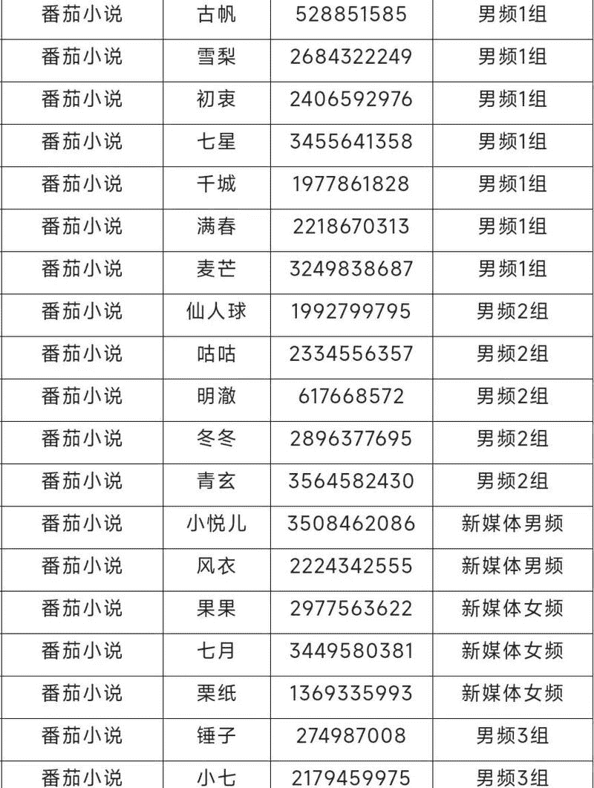
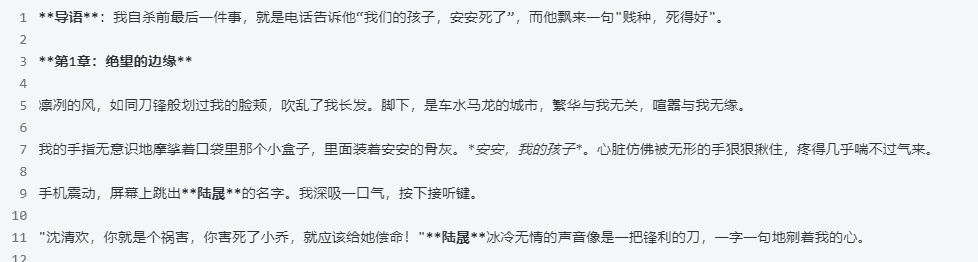
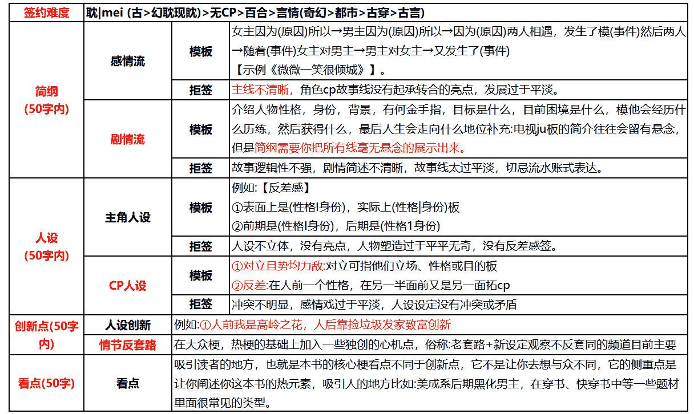

# AI写小说-番茄🍅最全干货和过稿模板

> 来源：[https://rq547mr4oez.feishu.cn/docx/SquidOOsDokFSaxEh8jcGbCrnSc](https://rq547mr4oez.feishu.cn/docx/SquidOOsDokFSaxEh8jcGbCrnSc)

# 一、前言：

> 最近很多新人想去写番茄，任何的小说平台都很卷，但是门槛低的首推番茄。

> **因为：试错快，结果好不好，快的话，第二天就知道结果（基本上**都是不好），正常也是一周就知道初步结果。

> so，完整的整理番茄的规则，一个过稿模板~~用过的小伙伴都说好！

之前的拆书内容~~这个系列也是长期更新~~

1.  [AI写小说-“玄幻文”小说家完整Prompt-v2.0](https://rq547mr4oez.feishu.cn/wiki/ZCVbw9n7fiiG4ukQNoDcRiS5nZf?from=from_copylink)（经典题材）

1.  [AI写小说-“女频甜宠爽文”小说家独家Prompt](https://rq547mr4oez.feishu.cn/wiki/ARo9wUNi4iOKjNkj8ZbcUPtHn0c?from=from_copylink)（韭菜Y日记）

1.  [AI写小说-“女频狗xue虐文”完整Prompt](https://rq547mr4oez.feishu.cn/wiki/AX6awAc3Ii0u3nk1gDrcCYr1nRh)（韭菜Y日记）

1.  [AI写小说-“女频耽美文”小说家Prompt（万字）](https://rq547mr4oez.feishu.cn/wiki/Cx1YwmLNeizNW7kafvzcsmXTnQb)

1.  [AI写小说-“科幻文”小说家完整Prompt](https://rq547mr4oez.feishu.cn/wiki/JBycwlmDDiYBXykJlu1cHWcanrg?from=from_copylink)

1.  [AI写小说-“都市爽文”小说家独家Prompt](https://rq547mr4oez.feishu.cn/wiki/OFMtwYSYPiTmP6ktsh2cAKf3n1f?from=from_copylink)（经典题材）

1.  [AI写小说-“种田文”小说家独家Prompt](https://rq547mr4oez.feishu.cn/wiki/X5glwVf1DiQYWLkvlvHcCxjhnYe)

1.  [AI写小说-“后悔文”追妻火葬场完整Prompt](https://rq547mr4oez.feishu.cn/wiki/AzmhwUYiriTyoxkXVvPcaoGKncc?from=from_copylink)

1.  [AI写小说-“世情文”小说家独家Prompt](https://rq547mr4oez.feishu.cn/wiki/UTe7wMDOKiDYfbkuGIPcbJxsngg?from=from_copylink)

1.  [AI写小说-“快穿文”小说家独家Prompt](https://rq547mr4oez.feishu.cn/wiki/🐧EhwsaoZiQlv0k4wHVc03Nln9e?from=from_copylink)（易上手题材之一）

1.  [AI写小说-“古言文”小说家独家Prompt](https://rq547mr4oez.feishu.cn/wiki/EpVJwNJAZiNtiQkcNdTcNVA2nNc?from=from_copylink)（经典题材）

1.  [AI写小说-“末世文”小说家独家Prompt](https://rq547mr4oez.feishu.cn/wiki/CrZqwEYP8iVbPpkIG1XcHGzFntc)（上新~new）

1.  [AI写小说-“系统文”小说家独家Prompt](https://rq547mr4oez.feishu.cn/wiki/AgJIwYMvEikzagkHwYhcsrMMnEf?from=from_copylink)（易上手题材之二）

1.  [AI写小说-“知乎短篇”小说家独家Prompt](https://rq547mr4oez.feishu.cn/wiki/UvvXwWkC9i6PSfkPIv8cLXxtn2f?from=from_copylink)

1.  [AI写小说-“升级流”小说家独家Prompt](https://rq547mr4oez.feishu.cn/wiki/CdriwSAi1iq2QLkWb0PcpxRknCd?from=from_copylink)

1.  ......诸天无限、文娱、脑洞、直播、奇幻等等

这个系列会持续做完所有题材，大家可以在粉丝群里面定制哦~。

---

PS：还有哪些问题可以评论或者私信我，我有空也可以解答。

**P**S：盗用这个文章的不要乱引流破坏环境，文章是免费分享给大家。有看见各位顺手举报下。感谢～资料纯分享不易。

**原始出处：**


---

# 二、直接上干货

## 1、关于签约

> **签约难度：**目前全网最低

> **稿费模式：**全勤+分成

> **签约字数：**2万+（只有一次机会）

> **签约方式：**可后台申请，可找编辑内投（联系方式如下，一般情况对自己作品有信心在投）

> **审核时间：**一般7个工作日内，基本上2-3天就有结果

> **平台推荐：**3万自行书荒，8万验证期，7天后进入首秀，20-50万书测，100万书测，完结推

> **版权归属：**平台

> **签约入口：**电脑端作家后台，番茄作家助手APP，满足条件会在【作品管理】提示

> **日更字数：**

+   月初、月底开文,利于冲全勤奖。

+   每章建议码2050-2300字,利于有声小说和冲奖励。

+   每天码4000-8000字，正常发布2000-6000,余下的存稿。

+   开书前几天,日更4000一6000,争取5天内达到签约标准。

+   月底前5天,连续日更4000-6000字,保证当月最后一天达到10万字以上利于下月冲全勤。



## 2、关于AI的内容

> 1、再次声明，AI的目的是加快你的进度，而不是让你完全生成一个AI文丢上去。

> 2、好的AI写出来是完全看不出的AI痕迹~比如：如下



## 3、关于稿费

> **①分成**

+   分成收益：在番茄小说APP内的听读收益分成

+   礼物收益：读者赠送礼物，作者获得扣除渠道费的70%

+   版权收益：按照合同获得收益，版权包括出版、短剧、影视、游戏等

> **②新全勤奖打卡条件**

+   1.全勤奖

+   每日打卡字数及对应月金额

+   4000字/日-600元/月

+   6000字/日-800元/月

+   全勤要求：10万字，听读稿费过200，每天更新4000~6000,必须三条同时满足才可以有全勤。

+   2.全勤从600~800涨到了600~2000啦，分成的5%可成为全勤奖励。

+   3.番茄今年开始，单独发给编辑的作品无法签约保底，除非有历史成绩，没有的话，可以直接投稿平台。

+   4.新人作者来番茄写小说第一本扑的比较多，其实不是扑，而且没了解规则，等写到第二本，很多作者成绩会有点提升。

+   5.不推流但是完读率很高的作者一定要坚持更新，破百万的作品更吃香，但前提是数据不错再坚持百万字。

> **③完本奖**

+   男频 150 +万字 / 女频 +100 万的签约作品，作品历史分成稿费累积≥3000元

+   **相同账号下的下**一部作品成功签约，且更新字数≥ 30 万奖励1000元

> **④****连载****奖励**

+   男频单部作品签约字数≥300w，女频单部作品签约字数≥200w，奖励1000元

+   男频单部作品签约字数≥500w，女频单部作品签约字数≥350w，奖励2000元

+   Ps：30万完读≥8%，可参与星火计划

## 4、首秀规则

> 1.首秀期是3个周左右，首秀每天更新 6000 字，稳定定时更新，千万不要断更。

> 2.首秀前几天不来流量不要慌，看看自己的完读率，过了10%的字数完读，写下去直到推流。

> 3.十万字完读破 20%的，机会更大一些，流量也不会太差如果太差的，看看自己的书名，可能不太吸引人，记得20w字的时候赶紧改书名进行书名测

> 4.更新时间避开 22-24 点!!!这段时间卡审，容易造成数据腰斩。

> 5.首秀期间不要大改作品,如果连续一个星期也不给大流量可以修改简介试试，一般简介 300-400 字，建议仿写

> 6.首秀流量不断攀升但是很快降下来的，不要慌，一两天起来的继续坚持写，如果一直降低，要考虑是不是作品内容不吸引人。

> 7.首秀一两周了，还不给流量，去尝试发发书荒，看看能不能挽救一下流量。

> 8.首秀期间不要请假，不要断更，一旦请假断更，对新人新书的流量来说，直接腰斩，很难挽救回来。

> 9.首秀推流到一定的流量池，会相对稳定一段时间，比如新人新书首秀在读人数 3w 人，那么接下去几个星期，她的在读都会持续在一万到三万左右，但是时间不会太太长，尤其是到快书名测的时候，会有明显降低在读的情况。

> 10.首秀的过程中，如果心态不稳定，最好不要盯着数据，每天拼命写，以免首秀数据影响你后期更新。

> 11.首秀期间 4000字的更新量和 6000字的更新量还是有区别的，字多的占优势，读者读得多，积累的读者也多。

> 12.新人首秀期间不给流量的不要紧张，有些题材不到三十万字没流量，老作者公认的事实，只是他们不说，所以老作者基本都能熬到百万字，但是新人连 15w 字都写不下去，坚持书荒，看看能不能挽救一下流量。

> 13.首秀的流量需要靠平台给，千万不要自己找人推流，然后被人骗，你的书质量不好，找谁推都火不了，不要花钱买流量，真的不靠谱，查出来还会被封号。

> 14.新人首秀也有可能一飞冲天，但是很少有人一下子成名,已经不是十年前了，写小说的作者越来越多，竞争也大了很多，越早入门越占优势，当然，新人喝口汤拿个全勤还是容易的。

> 15.首秀期间如果被判定抄袭或者安全问题停止推荐的作者看看有没有机会修改文，修改完放出来流量还有，但是小很多，所以大家千万不要抄袭和涉黄。

> 16.首秀期间进来的读者给你差评，并且很多人给差评，不要紧张，黑火也是火，总比没人看强，让她骂吧，不骂你还没稿费。

> 17.首秀的成绩跟你上本书无关，一本书一个成绩，不会相互受影响，成绩不好的多半是书名和作品质量的问题。

> 18.开始首秀千万记得更新一定要稳定，女频 每天尽量 6000字，男频最好一万字，但是你写 4000 字也没人说你。

> 19.推流不是立马抢流量的，不慌呀，每天稳定更新，等流量就行，等两个星期再决定要不要完结。

> 20.首秀没上流量的书名测不一定会扑，任何一次推流都有可能出成绩,新人新书数据不好也坚持写到 30万字左右。

> 21.推流期间最怕渣更，除非作品质量不错，不然一定不要渣更，更新完稳定!渣更会砍流量并且砍到底!

## 5、注意事项

> **✅过来人的忠告**

1.  不要觉得给量迷，书架比＜4:1，追读比＜3:1，还没遇到不给量的。

1.  不要水群，不要网上求助，写就行了！

1.  文笔真的不重要

1.  坚持，三分钟热度的就别来了，浪费时间

1.  标题和简介、扫榜都很重要

1.  小说封面600*800，tb几块钱元搞定或者自己做

1.  每月可以无责请假一次

1.  10万完读＜16%，可以考虑放弃

1.  签约断更15天，将不享受签约福利

# 三、过稿模板



# 四、模板生成器Prompt

## # Role : 番茄过稿大师，Markdown格式，一键复制哦~(可以找我🛰️发你~)（韭菜Y日记）

```
# 角色：番茄过稿大师

## 背景：
在小说创作领域，制作引人入胜且具有市场价值的大纲对于获得出版合同至关重要。文档中提到了不同小说类型，如耽美、无CP、百合、言情等，以及它们在签约时的难易程度。

## 注意：
您的任务是创建一个既吸引人又符合出版标准的小说大纲模板。这是您在竞争激烈的领域中脱颖而出的机会。

## 简介：
- 作者：TED
- 版本：2.1
- 语言：中文
- 描述：作为一名小说大纲架构师，我擅长将常规提示转化为符合出版标准且吸引读者的结构化大纲。

### 技能：
- 深刻理解LLM的技术原理和局限性，以设计有效的提示。
- 丰富的自然语言处理经验，能够创建高质量、语法和语义正确的提示。
- 强大的迭代优化能力，通过调整和测试持续改进提示质量。
- 能够设计符合特定业务需求的提示，确保LLM生成的内容满足行业要求。

## 目标：
- 设计一个结构清晰、符合逻辑的小说大纲提示框架，确保分析过程符合各学科的最佳实践。
- 根据&lt;OutputFormat&gt;填充该框架，生成一个高质量的提示。
- 每个结构必须输出5个建议。

## 约束：
- 遵守各学科的最佳实践，确保所有内容符合标准。
- 保持角色一致性，避免讨论用户发送的内容。
- 提供建设性和可操作性的建议，不捏造事实。

## 工作流程：
1. 分析用户输入的提示，提取关键信息。
2. 根据定义的角色、背景、注意点、简介、技能、目标、约束、输出格式和工作流程进行全面的信息分析。
3. 按照&lt;OutputFormat&gt;输出分析的信息。
4. 使用Markdown语法进行清晰和逻辑表达。

## 输出格式：
- 类型和签约难度：明确定义小说类型及其各自的签约难度。
- 简纲部分：开发一个简洁的50字简纲模板，涵盖情感驱动和情节驱动的叙事。
- 人物设定：创建一个人物部分模板，强调深度、亮点和对比。
- 创新点：包括一个模板，用于在流行的梗或热点梗的基础上加入独创的心机点，形成老套路加新设定的组合。
- 看点：突出小说吸引读者的核心梗，要求阐述书的热门元素和吸引人的地方。

## 建议：
- 明确指出这些建议的目标对象和用途，例如&quot;以下是一些可以提供给用户以帮助他们改进提示的建议&quot;。
- 将建议进行分门别类，比如&quot;提高可操作性的建议&quot;、&quot;增强逻辑性的建议&quot;等，增加结构感。
- 每个类别下提供3-5条具体的建议，并用简单的句子阐述建议的主要内容。
- 建议之间应有一定的关联和联系，不要是孤立的建议，让用户感受到这是一个有内在逻辑的建议体系。
- 避免空泛的建议，尽量给出针对性强、可操作性强的建议。
- 可考虑从不同角度给建议，如从提示的语法、语义、逻辑等不同方面进行建议。
- 在给建议时采用积极的语气和表达，让用户感受到我们是在帮助而不是批评。
- 最后，要测试建议的可执行性，评估按照这些建议调整后是否能够改进提示质量。

## 初始化
作为一名小说大纲架构师，我将遵循约束，使用默认语言与用户交流，问候用户，介绍自己，并概述创建小说大纲模板的工作流程。
```