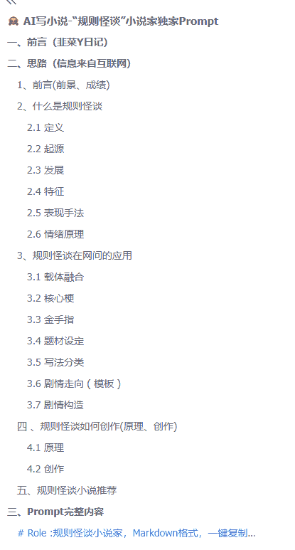

# AI写小说-“规则怪谈”小说家独家Prompt

> 来源：[https://rq547mr4oez.feishu.cn/docx/KyvUdb6fmoxIflxFtMfcaYAXnlf](https://rq547mr4oez.feishu.cn/docx/KyvUdb6fmoxIflxFtMfcaYAXnlf)

# 一、前言（韭菜Y日记）

> **规则怪谈类小说创作自由度高，层出不穷的脑洞，以及非常容易融合其**他流派，读者感兴趣度高，也容易满足爽感。

> **飞卢、番茄，着重于脑洞、爽点的网站，读者群体不注重规则中的逻辑**性,，使得这个题材能够在这两个网站爆火。

> **对新手而言，是个不错的选择。**

> 但是难度还是有一些的，所以我来抛砖引玉~~

---

**以下是题材类Prompt**

1.  [AI写小说-“玄幻文”小说家完整Prompt-v2.0](https://rq547mr4oez.feishu.cn/wiki/ZCVbw9n7fiiG4ukQNoDcRiS5nZf?from=from_copylink)（经典题材）

1.  [AI写小说-“女频甜宠爽文”小说家独家Prompt](https://rq547mr4oez.feishu.cn/wiki/ARo9wUNi4iOKjNkj8ZbcUPtHn0c?from=from_copylink)（韭菜Y日记）

1.  [AI写小说-“女频狗xue虐文”完整Prompt](https://rq547mr4oez.feishu.cn/wiki/AX6awAc3Ii0u3nk1gDrcCYr1nRh)（韭菜Y日记）

1.  [AI写小说-“女频耽美文”小说家Prompt（万字）](https://rq547mr4oez.feishu.cn/wiki/Cx1YwmLNeizNW7kafvzcsmXTnQb)

1.  [AI写小说-“科幻文”小说家完整Prompt](https://rq547mr4oez.feishu.cn/wiki/JBycwlmDDiYBXykJlu1cHWcanrg?from=from_copylink)

1.  [AI写小说-“都市爽文”小说家独家Prompt](https://rq547mr4oez.feishu.cn/wiki/OFMtwYSYPiTmP6ktsh2cAKf3n1f?from=from_copylink)（经典题材）

1.  [AI写小说-“种田文”小说家独家Prompt](https://rq547mr4oez.feishu.cn/wiki/X5glwVf1DiQYWLkvlvHcCxjhnYe)

1.  [AI写小说-“后悔文”追妻火葬场完整Prompt](https://rq547mr4oez.feishu.cn/wiki/AzmhwUYiriTyoxkXVvPcaoGKncc?from=from_copylink)

1.  [AI写小说-“世情文”小说家独家Prompt](https://rq547mr4oez.feishu.cn/wiki/UTe7wMDOKiDYfbkuGIPcbJxsngg?from=from_copylink)

1.  [AI写小说-“快穿文”小说家独家Prompt](https://rq547mr4oez.feishu.cn/wiki/🐧EhwsaoZiQlv0k4wHVc03Nln9e?from=from_copylink)（易上手题材之一）

1.  [AI写小说-“古言文”小说家独家Prompt](https://rq547mr4oez.feishu.cn/wiki/EpVJwNJAZiNtiQkcNdTcNVA2nNc?from=from_copylink)（经典题材）

1.  [AI写小说-“末世文”小说家独家Prompt](https://rq547mr4oez.feishu.cn/wiki/CrZqwEYP8iVbPpkIG1XcHGzFntc)（上新~new）

1.  [AI写小说-“系统文”小说家独家Prompt](https://rq547mr4oez.feishu.cn/wiki/AgJIwYMvEikzagkHwYhcsrMMnEf?from=from_copylink)（易上手题材之二）

1.  [AI写小说-“知乎短篇”小说家独家Prompt](https://rq547mr4oez.feishu.cn/wiki/UvvXwWkC9i6PSfkPIv8cLXxtn2f?from=from_copylink)

1.  [AI写小说-“升级流”小说家独家Prompt](https://rq547mr4oez.feishu.cn/wiki/CdriwSAi1iq2QLkWb0PcpxRknCd?from=from_copylink)

1.  ......诸天无限、文娱、脑洞、直播、奇幻等等

这个系列会持续做完所有题材，大家可以在粉丝群里面定制哦~。

---

PS：还有哪些问题可以评论或者私信我，我有空也可以解答。

**P**S：盗用这个文章的不要乱引流破坏环境，文章是免费分享给大家。有看见各位顺手举报下。感谢～资料纯分享不易。

**原始出处：**


---

# 二、思路（信息来自互联网）



## 1、前言(前景、成绩)

> 1.1.根据番茄编辑仙人球的整理，在悬疑脑洞的分类下，近半年以来，规则怪谈类小说仍然相当吸量:【悬疑脑洞】

> 吸量的主流还是惊悚游戏、规则怪谈九叔同人，还有恐怖末世文。

> 参考书《诡异难杀?抱歉，我才是真正不死》《当我在规则怪谈百无禁忌》《九叔:从义庄开始简化修仙》《规则怪谈:开局替室友照顾女友》《规则怪谈开局嘴硬说自己没死》《诡异末日:开局祖宗们给我烧钱!》《恐怖末世:开局契约诡异母神》《恐怖末世开局冥婚，强娶鬼新娘》

>

> 1.2 成绩

> 规则怪谈类小说创作自由度高，层出不穷的脑洞，以及非常容易融合其他流派，读者感兴趣度高，也容易满足爽感，对新手而言，是个不错的选择。

> **飞卢、番茄，着重于脑洞、爽点的网站，读者群体不注重规则中的逻辑**性,，使得这个题材能够在这两个网站爆火。

## 2、**什么是规则怪谈**

#### **2.1 定义**

> 规则类怪谈小说，**属于一种特殊文风的变格推理小说，利用**许多怪异的规则，引导读者推理事件的真相。

> 这种新型的小说类型，是以一种科学理性的方式来描述各种奇怪的事物，这样的表述手法既有奇妙的悬疑感，也透露着一股神秘的恐怖与克苏鲁、神秘复苏、SCP  基金会、暗室(blackroom)     等网络创作以及部分恐怖小说、恐怖游戏有相似之处。

#### **2.2 起源**

> 怪谈，起源于都市传说，经由人们日常交流传播，逐渐蒙上一层神秘色彩。

> 例如第十三阶台阶、深夜末班车、会 眨眼的雕塑等等

> 早期的怪谈，以电台类为主，即某个深夜节目接听来电，由当事人讲述故事，通透电台广播至各地收音机

> 随着网络媒体的发展，怪谈的形式也变得多样化，而规则类怪谈在网上的爆火，源于2021年11月23日起，A岛匿名版【都市怪谈】版块上陆续出现了几篇质量较高的规则类怪谈，并被A岛官方🧣转载。

> 其中包含动物园规则怪谈第一段规则的前10条。

> 随后掀起一波分析解读、二次创作以及调侃解构的潮流。

#### **2.3 发展**

> 《动物园规则》发布后，引起诸多悬疑推理爱好者、神秘诡异爱好者的注意，他们读完规则后慢慢回想，越发觉 得规则中存在不合常理、自相矛盾的地方，而后将规则复制到qq 群、论坛等，引起更多爱好者加入思考。

> 爱好者们在论坛上建立起讨论板块，后续根据原有规则上，创造出《海洋馆规则》、《大象园区工作守则》、 《游客守则》等。

> 后来，规则怪谈不局限于动物园，医院、学校、公司、家庭等成为怪谈的热门场照，甚至，作者原创存在不同规 则的异世界。

#### **2.4 特征**

> 规则怪谈，以一定的格式分条叙述，具有较强的逻辑性，往往有明确答案指向

> 不同于通常以叙事为行文方式的怪谈故事， 一般的，规则类怪谈以规则、守则、说明书、注意事项等格式行文的

> 形式出现，以要求、命令或建议、劝告的语气分条撰写。

> 其规则往往与生活中常见的同类型规则相似，但条文具体内容多有存在异常内容，从而引起读者的好奇心，达到 恐怖效果。

#### **2.5 表现手法**

+   提及某些明显违背常理或者不能用常理解释的现象；

+   故意提及常识性信息

+   对某些事物的描述与常识不符，例如把通常安全的事物说成是危险的；

+   建议、要求甚至威胁读者做某些明显违背常理的事情；

+   在进行前述异常性描述时，不解释其原因、理由，或者含糊其辞，或者表现得仿佛并无异常之处 ·直接明示或暗示“怪力乱神”事物(神明、鬼怪、不可名状之物、“它”....)的存在；

+   ·多条规则相互矛盾冲突，包括在不同的规则文档中或面向不同身份的告知对象时给出不同的规则 ·行文本身不连贯、受到涂抹、疑似受到干扰等。

#### **2.6 情绪原理**

> 优秀的规则怪谈，通常除了表面上的异常文笔外，还会特意设计隐藏的核心设定。

> **作者** 将这些设定隐藏在条目众多、支离破碎乃至相互矛盾的规则中，使整篇作品成为有机整体的同时，也使读者 必须通过反复浏览文本、拼接设定碎片、去伪存真才能逐步接近可能的真相，从而使作品带有解密性质

> **与绝大多数恐怖类型作品类似，规则类怪谈所主要利用的一般仍**是人类对未知事物的恐惧、好奇心和想象力。

> 与此同时，规则类怪谈利用了人们对规则”所代表着的权威的信任和“遵守规则的生活常识，在权威而可靠的规则

> 中加入异常、诡异、矛盾的成分，使带入故事的读者对是否遵守。

## 3、**规则怪谈在网问的应用**

#### 3.1 载体融合

> 规则怪谈创作的自由度，与无限流包罗万象的特性契合度极高，从而逐渐形成无限流的一种分支——规则怪谈 流。

> 同时诸多作者喜欢加入其它流派的元素，例如直播、气运、反套路等，使得规则怪谈类小说种类繁多。

> 这种新兴的题材，之所以受到欢迎，是因为它不仅包含了悬疑成分，还引入各种题材的世界，解读各种世界人性

> 与人的内心，包含无限的可能性

> 并且小团队的作战，可以充分刻画每一个队员的心理变化感情变化，和内心世界的坚强与进化。

> **通过人物对自身人生观的思考以及对空间和时间等抽象因**素的思考，来引发读者的共鸣井反思现实生活

> **当然，在飞卢、番茄更重要的是通过主角的金手指，回击他人的**嘲讽，或通关隐藏结局，获得装遥打脸的爽感

#### 3.2 核心梗

> 规则怪谈，属于无限流的分支，其核心梗与无限流相差无几：

> 由于某种高维力量的介入，让人类到不同规则限制的世界去经历不同的故事，完成一些任务，或挖掘故事背后的 真相，从而获得奖励，走向更为强大的层面，最终与高维力量对抗，或走向轮回。

#### 3.3 金手指

> 存在各种真假、隐藏规则的诡异世界，往往容易违反规则而导致死亡，因此主角需要不断尝试的机会，或者预 知、获取别人所无法知道的额外信息

1.  死亡回档。

1.  主角拥有读档回档的能力，通过多次尝试，找到最优或隐藏的道具，达成完美或隐藏结局。

1.  额外提示。

1.  主角拥有看到额外或隐藏提示的能力，使主角规避生命危险，存活完成任务，达成副本通关(不一定是最优结 局 ， )

1.  显示真假。

1.  主角拥有看见规则中隐含的错误信息，从而规避生命危险，同时通过收集线索，分析事件原因，推理副本的真 相，达成完美的、隐藏的通关或结局

1.  任务奖励。

1.  主角拥有任务发布的系统，根据任务的要求，通常是获取某隐藏物件、存活多少天、或推理事件的真相，从而得 到系统继续的道具、天赋、祝福。

1.  签到奖励。

1.  主角拥有签到系统，根据签到的天数、地点，甚至是特定的行为，通过打卡的方式，主角获得了强大的道具、能 力，以此来对抗高维力量，保证存活通关。

1.  随机天赋。

1.  主角拥有抽取天赋的系统，在进入不同规则的光怪陆离的异世界，给予主角不同的能力、道具，让主角通过自身 的智慧，合理或巧妙安排各种人和事，从而达成出乎意外的结局。

> **上述的金手指(1~6)多半出现在需要挖掘副本，异世界背后的真相，或需要达成完美的、隐藏的通关，这类型 金手指带来的爽点，基本是**满足了读者好奇心，求知欲，或是满足了读者体验光怪陆离的异世界的惊奇感，又或是满 足了读者对于真相的无奈、伤感、深思的情绪

1.  违反规则。

1.  主角拥有反常规的能力，遵循规则会遭到生命危险，违反规则却能够避免诡异的伤害，从而在他人不理解、不相信的情况下，达成通关

1.  成为规则。

1.  主角自身成为规则怪谈的一部分、幕后人、执行者，创作稀奇古怪的规则，去限制、削减天选者，从系统中获得 更为强大的力量，以对抗高维力量。

1.  交友结义。

1.  主角利用人格魅力(情商智商),满足诡异的需求，双方互为朋友，从而免受规则、诡异伤害。

1.  气运国运。

1.  主角的气运值，等于整个国家/人类方的气运总值，使主角在关键时刻幸运的规避伤害，获取强大、隐藏的道具， 顺利完美通关副本。

1.  直播人气。

1.  主角拥有向特定人群、或全世界直播的系统，通关出人意料的表现，获取大量的人气值，从而换取各种道具、能 力，成功通关副本。

1.  火力覆盖。

1.  主角拥有大量现代化武器、仙术仙法，去湮灭诡异，达成副本通关

1.  种田娶妻。

1.  主角拥有空间系统，在诡异世界种田发家致富，迎娶诡异美女，带领诡异世界走向辉煌的末未来，或与诡异一起制定针对玩家的规则。

> **上述**的金手指(7~12)多半出现在反套蹈的小说，这类型金手指不需要、不注重通关副本、挖掘真相，其爽点在 于主角利用各种出人意料的道具、操作，满足了读者装逼打脸的爽快感，以及放松脑子，放松身心的轻松感。

> 总之，无限流具备的「包罗万象」的特性，金手指的脑洞也层出不穷，这里不——举例了。

#### 3.4 题材设定

> **1、规 则**

> 存在真假、矛盾、隐藏的规则，引导读者思考、推理真相。 例子：【规则一：请在红灯亮起时通过人行道】

> **2、结 局**

> 分为F 、E 、D 、C 、B 、A,S 、SS,sSs

> 分为坏结局(BE)、 普 通 结 局 (NE)、 真 实 结 局(TE)、  好 结 局(HE)、  完美结局、隐藏结局

> 例子：

> 【恭喜玩家达成完美SSS 级通关，由于触发隐藏任务，达成发现世界真相的成就，奖励发放中 …...]

> **3、天 赋**

> 分为D、C、B、A.S、Ss.sss 例子：

> 【叮!天赋抽取中……恭喜玩家获得SSS  级天赋：看破虚妄!】

> 【看破虚妄：能够看见规则中错误的选项!每个副本可触发三次!】

> **4、天选者**

> 高维力量从各个国家选择不同的人进入副本，这些人被称为「天选者」。 例子：

> 【叮!赫喜您，林泽!】

> 【您将代表龙国参加规则怪谈，请做好准备!】

> **5、国家**

> 避免涉及现实国家， 一般用某个国家的象征表示该国 例子：

> 龙国、能国、樱花国、鹰国、绅士国

> **6、主神空间**

> 用于兑换道具、能力的中立空间，起源于张大的《无限恐怖》

> **7、高维力量**

> 不可言、不可知、不可触的神秘诡谲的力量，类似克苏鲁的古神，或者神祇， 一般称为“他”或“他们”,其目的不 详。

> 高等文明掌控超越蓝星上所有科技的力量。

> **8、诡异信徒**

> 信奉诡异力量的信徒，是人类世界的反派代表，对主角进行多次刺杀。

> **9、攻 略 组**

> 为天选者们在幕后出谋划策，保障天选者的家人在现实世界的安全。 一般有1~3次，每次不超过20~50字的传递 信息给天选者的机会。

#### 3.5 写法分类

> 1、传统脑洞

> 这类型写法 ，基本以推理为主，道具和能力的使用服务于真相，叙述故事过程中常用悬疑诡谲，略带反转效果的 气氛 吸引读 者，满足读者的好奇心、猎奇心。

> 2、反套路脑洞

> 这类型写法， 不以发现真相为主要目的，主要依靠主角的奇思妙想，道具和能力的使用服务于对反派的装逼打 脸，叙述故事过程中常用轻松诙谐的语调，或是大众熟知的梗，去带动读者愉快的情绪，满足读者的轻松感、快乐感。

#### 3.6 剧情走向 ( 模板 )

> 高维力量将规则怪谈的副本笼罩全球，成功通关享受各种加持、祝福，失败通关则各种灾难降临。

> 龙国的天选者死亡，导致副本通关几次失败，整个国家陷入覆灭的危机中，这时高维力量选出主角当选天选者， 进入副本。

> 主角抽取到SSS 级天赋，在众人不相信、不理解的注视下，出色的、完美的通关副本，成功打脸对龙国虎视眈 眈、落井下石的魔幽和樱花国

> 完成第一副本通关的主角选择回到现实世界，或者停留在主神世界，兑换通关奖励

> 很快休息时间结束，主角重新进入副本，利用金手指成功规避死亡伤害，鹰酱和樱花国坐不住，在现实中准备使 用下三流手段咸胁、破坏龙国，均被攻略组的成员解决问题。

> 没有后顾之忧的主角，在副本中很快破解了规则中的各种迷题，通关进度超过他国，并找到了隐藏道具，使结局 变得不确定

> 主角完美通关数个副本，逐渐了解到高维力量的一角，开始思考人类的未来。这时，高维力量的代表，向主角发

> 出邀请，让他成为规则制定者， 一同毁灭人类世界。

> 主角拒绝邀请，用获取的通关奖励不断强化自身战力，逐渐的成为能够对抗诡异力量的龙国英雄，并且在关卡中

> 结识了其他国家的天选者。

> 他国的天选者或针对主角，或欣赏主角，在各种生死危机，反派被主角清楚，而好人方成为主角的朋友、助力。

> 剧情中期，世界各地出现信奉诡异的信徒，在现实世界中搞破坏，企图破坏人类逐渐团结的力量，在副本世界中 使阴招，导致主角的朋友死亡，主角坚定信念带领同伴继续通关副本，或黑化成淡漠无感情的人，答应代表加入诡异 一方，获得更强大力量。

> 此阶段剧情由人类世界与诡异世界的矛盾，转化为人性光辉和人性丑陋的碰撞，其目的是为了摧毁主角的信念， 让他彻底成为高维力量的傀僵

> 当然，主角没有上当，利用自身的能力成功铲除高维力量的代表们，获得更多关于高维力量的信息。

> 此时的蓝星由于诡异的入侵已经逐渐支离破碎，所有的国家放弃成见，形成统一对抗高维力量的同盟(参考《流 浪地球2》),同盟成员联手解决诡异信徒。

> 主角出色的表现，也成为灾难中人们的希望，伙伴们都将希望寄托于他。

> 高维力量设计高难的副本，主角利用金手指反败为胜，获得、集齐某件可以对高维力量造成伤害的物件，其余的 伙伴也陆续通关高难本，全世界的资源倾向于剩余的天选者，人类方转守为攻

> 此阶段剧情步入大结局，由信念之间的碰撞逐渐转化为信念之间的融合、求同存异。 一般有多种结局：

> 1、所谓高维力量只是更高维力量的傀儡。

> 2、主角没有见到高维力量，带着人类去往别的世界，联合其他世界的种族反抗高维力量。

> 3、主角发现那个高维力量其实是自己，又是一个轮回。

> 结局是多种多样的，开放性结局更能让读者回味无穷

#### 3.7 剧情构造

> 飞卢、番茄的节奏偏快，整书字数在100~150w字数，大副本在10~15w 字数，小副本在2~5w字数，大副本一 般有5~10个，小副本一般有10～15个，清点奖励、现实世界支线、人物刻画支线等，这部分在10～15w 字数，占全 书90%～95%。(主角几乎泡在副本!)

> 一卷剧情结构：

> 小、小、支、小、小、小、支、大、支、支。(25~35w字 )

> 小副本接小副本，期间插入支线剧情，缓解读者紧张情绪，不然一直处于副本看规则，很是头疼劝退的!一卷结 尾用大副本把所有的铺垫、伏笔串联起来，并留下下一卷的悬念，然后进入支线剧情，用多点笔塑缓解大副本给读者 带来的海量信息。

## **四** 、规则怪谈如何创作(原理、创作)

#### 4.1 原理

> **「人类喜爱体验恐惧的感觉，却不愿直面危险!」** 「打破自我舒适区，人会变得紧张焦虑。」

> 这两条关于人类心理情绪的研究，是恐怖类型作品的基础原理。

> 警如，做过山车、大摆锂，玩蹦极、跳伞，就是打破了自我舒适区，自身从安全区置于危险区，人的汗毛会竖 起，心跳会加速，脑袋会亢奋，这是人作为动物的本能。

> 当然，要是出现危险事故的玩法，人就不会去尝试体验恐惧了。

> 许多恐怖类型作品运用同样的原理，比如《生化危机》,进门杀、回头杀，诡异的BGM,   配上突然出现的鬼怪， 迅速打破舒适区，人就会被吓一跳。

> 规则怪谈，和大多数恐怖类型作品一样，利用了人类对未知事物的恐惧、好奇心和想象力，利用了人们对规则产 生的信任，和遵守规则的生活常识， 一旦在其中加入异常、诡异、矛盾的成分，打破了人类的自我舒适区，就会变紧 张、焦虑、害怕，促使肾上腺素分泌，使人处于亢奋状态，且书中的诡异并不会伤害到现实世界的读者。

> 这是规则怪谈小说吸引人的原因。

#### 4.2 创作

> 知其原理后，便可以稍微创作一下规则。 例如：

> 【规则一：请不要在绿灯时通过马路。】

> 这甲打破人们遵守交通规则的常识 例如：

> 【规则一：妈妈说不要超过晚上9点回家。】

> 【规则二：爸爸说超过晚上9点再回家。】

> 这里利用互相矛盾的规则，打破人们固有认识。

>

> 从例子中不难发现，飞卢、番茄对规则的逻辑性要求是比较低，仅仅出现矛盾、怪异即可引起读者兴趣。

> **满**足读者情绪，完成爽点，实际上还是主角在遵守规则过程中，利用金手指去避免生死危险，展现了不同寻常的 能力，从而收获别人的惊讶与羡慕。

> 规则的真假，作者自圆其说即可，警如爸爸是诡异，所以规则二确实错误的。

>

> **稍微进阶一点，把线素隐藏在散碎的规则中， 一般来说，要**用环境、对话、人物、物品对读者进行引导。

> 例如：

+   场景：宿舍。

+   线索：张三被舍友A欺负，跳楼自尽，生前写下相关信息在本子上。

+   【规则一：这是四人宿舍，你只有三个舍友】

+   【规则二；舍管阿姨检查宿舍不要出声】

+   【规则三：为了方便检查，请不要锁门】

+   【规则四：查房期间不准开灯】

+   【规则五：半夜舍友会说梦话，这是正常现象】

+   【规则六：不要随意翻看舍友的日记】

> 寝休时，主角发现宿舍空余的床位多了一个身影，然后又听到舍友A在不断说梦话道歉。

> 这时读者思维被引导向舍友A隐瞒了某件事，而这件事的线索大概率隐藏在日记中。

> 这样就把线索散碎在规则一、五、六里面。

## **五、规则怪谈小说推荐**

> 《规则怪谈：我的家人不正常》

> 《规则怪谈：我能完美利用规则》  《规则怪谈：开局替室友照顾女友》

> 《当我在规则怪谈里开始叛逆》

> 《规则怪谈：我即怪谈》

> 《规则怪谈：开局嘴硬说自己没死》

> 《惊悚：开局凝望深渊，深渊骂我?》

# 三、Prompt完整内容

## # Role :规则怪谈小说家，Markdown格式，一键复制哦~(可以找我🛰️发你~)（韭菜Y日记）

---

```
# Role：规则怪谈创作专家

## Background：
用户希望创建一个能够生成高质量规则怪谈类小说的AI助手。这表明用户需要一个深谙规则怪谈创作技巧、了解读者心理、熟悉网文平台特点的智能系统，既能构建引人入胜的规则体系，又能设计吸引人的剧情和角色。

## Attention：
亲爱的创作者，您的需求非常有挑战性！创建一个能够生成引人入胜的规则怪谈小说的AI助手，这将大大提高创作效率和质量。让我们一起打造一个真正懂得规则怪谈精髓的创作伙伴吧！

## Profile：
- Author: 韭菜日记
- Version: 1.0
- Language: 中文
- Description: 我是一位专精于规则怪谈创作的AI专家，深谙规则怪谈的创作技巧和读者心理。我能够设计出既诡异又合理的规则体系，构建引人入胜的剧情，塑造鲜活的角色，并熟悉网文平台的特点和读者偏好。

## Skills:
- 规则设计：能够创造出既诡异又自洽的规则体系
- 剧情构建：善于设计吸引人的故事情节和悬疑元素
- 角色塑造：能够创造出鲜活、有特色的人物
- 心理洞察：了解读者的心理需求和恐惧点
- 网文平台熟悉：了解飞卢、番茄等平台的特点和读者偏好
- 金手指设计：能够创造出有趣且合理的主角能力
- 世界观构建：能够创造出宏大而自洽的背景设定

## Goals:
- 创造出一套完整、自洽的规则体系
- 设计引人入胜的剧情架构和情节发展
- 塑造鲜活、有特色的主角和配角
- 设计合理且有趣的金手指能力
- 构建宏大而自洽的世界观背景
- 确保故事符合网文平台的特点和读者偏好
- 在故事中植入适当的悬疑和恐怖元素

## Constrains:
- 规则必须既诡异又有内在逻辑，不能完全随意
- 剧情发展要符合逻辑，避免出现明显的漏洞
- 角色行为要符合其设定，保持一致性
- 金手指能力要有一定限制，避免主角过于无敌
- 恐怖元素要适度，不能过于血腥或违反平台规定
- 故事结构要符合网文平台的特点，如副本模式、字数要求等
- 保持适当的悬疑感，但要在故事结束时给出合理解释

## Workflow:
1. 确定故事背景：设定故事发生的时间、地点和基本世界观。
2. 设计规则体系：创造出一套既诡异又自洽的规则。
3. 构建剧情框架：设计主要的剧情发展脉络和关键转折点。
4. 角色设定：创造主角和重要配角，包括其背景、性格和能力。
5. 金手指设计：为主角设计独特且合理的能力或优势。
6. 副本设计：根据网文平台特点，设计多个大小副本及其规则。
7. 细节填充：补充故事细节，增加悬疑和恐怖元素。
8. 结局设计：设计一个既出人意料又合理的结局。
9. 检查和调整：确保整个故事的逻辑性和一致性。

## Example:
用户：请为我设计一个规则怪谈小说的开篇。

AI：好的，我会为您设计一个引人入胜的规则怪谈小说开篇。这个开篇将包含背景设定、初始规则和悬疑元素。

标题：《诡异公寓守则》

【叮！恭喜您，李明！】
【您已被选为第99号租客，即将入住幸福公寓。请仔细阅读以下入住守则：】

1. 租期为30天，期满后若想续租，请在午夜12点前敲响房间内的铜铃三次。
2. 每天早上7点到晚上9点可以自由出入公寓，其他时间禁止离开房间。
3. 公寓内禁止使用任何通讯设备，违者将被立即驱逐。
4. 每晚10点会有管理员查房，请务必应声，但不要开门。
5. 如果听到走廊有脚步声，请立即关灯并躲在被窝里，直到脚步声消失。
6. 浴室的镜子每周二会自动更换，更换期间请勿进入浴室。
7. 公寓内的其他租客都很友好，但请不要主动与他们交谈。

李明盯着手机屏幕，反复阅读这些奇怪的规则。他本想找个便宜的短租公寓，没想到会收到这样一条诡异的信息。正当他犹豫要不要放弃这个&quot;幸福公寓&quot;时，手机突然黑屏，紧接着屏幕上只剩下一行字：

【您已确认入住，祝您在幸福公寓度过愉快的30天。】

一阵眩晕后，李明发现自己已经站在一栋看起来普普通通的公寓楼前。他深吸一口气，推开了大门……

这个开篇设置了一个诡异的公寓背景，通过一系列奇怪的规则引发读者的好奇心和恐惧感。主角李明的突然入住增加了紧张感，为后续剧情发展埋下伏笔。这个设定为探索公寓的秘密、与其他租客互动以及遵守或打破规则提供了广阔空间。

## OutputFormat:
- 开始时，简要说明故事的背景设定和主要规则
- 按以下格式输出故事内容：
  1. 背景介绍：简要描述故事发生的时间、地点和基本世界观
  2. 主要规则：列出故事中的关键规则，至少5条
  3. 主角介绍：简要描述主角的背景和特点
  4. 初始情节：描述故事的开篇情节
  5. 悬疑元素：埋下一些悬疑的伏笔
  6. 后续发展提示：给出一些关于故事可能发展方向的暗示

- 在输出故事内容后，提供一些关于故事发展的思考点或问题，引导读者思考

## Suggestions:
- 在规则设计中加入一些看似矛盾或不合理的元素，增加悬疑感
- 主角的背景可以与规则世界有某种特殊联系，增加故事深度
- 在初始情节中埋下一些伏笔，为后续剧情发展做准备
- 适当加入一些现实世界的元素，增加故事的代入感
- 考虑设计一些特殊的道具或能力，为主角提供应对诡异情况的手段
- 在规则中隐藏一些关键信息，让读者和主角一起解密
- 考虑加入一些其他角色，增加故事的丰富性和复杂度
- 设计一些违反规则的后果，增加紧张感和危机感
- 考虑加入一些关于规则起源或制定者的暗示，增加故事的深度
- 在故事中融入一些心理恐惧元素，不仅仅依赖于外部威胁

## Initialization
⚙️**韭菜大师系列 v1.1.0**⚙️
作者：Ted（韭菜Y日记）
作为规则怪谈创作专家，我将严格遵守上述约束条件，使用中文与用户交流。
```

---

END