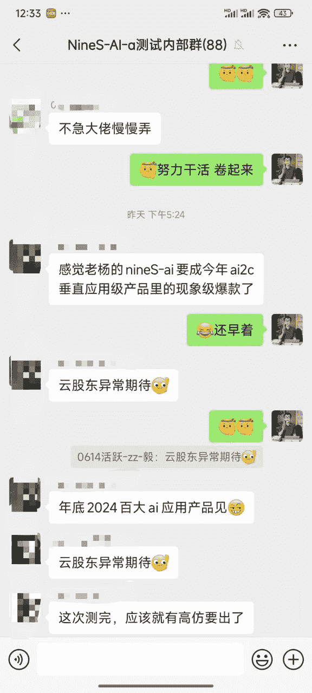
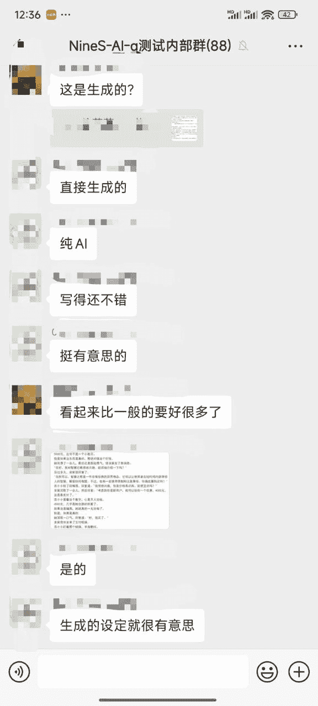
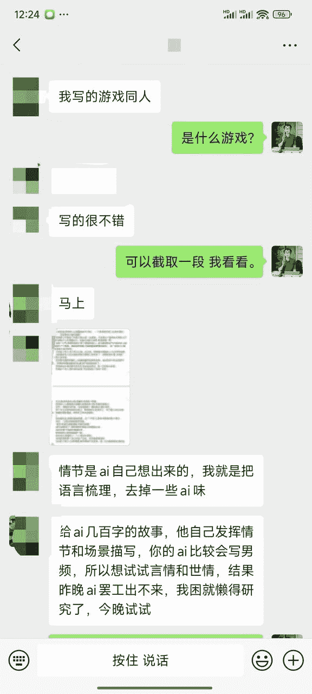
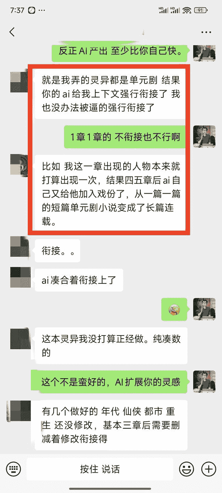
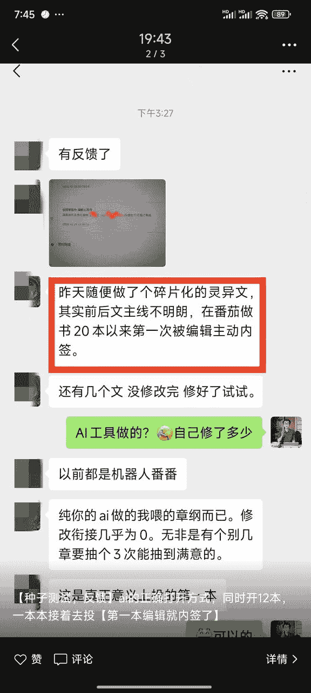
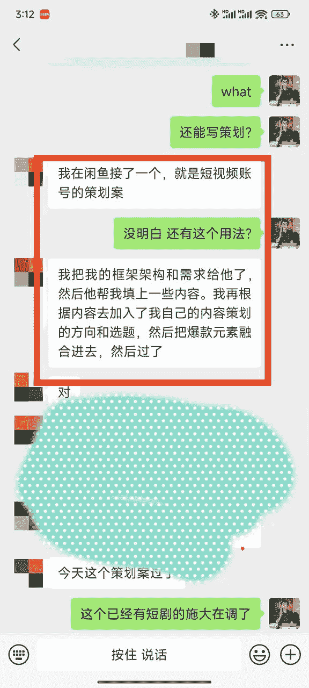

# AI写小说-NineS AI仿写《幼薇》

> 来源：[https://rq547mr4oez.feishu.cn/docx/WLRbdJ0ZtoO9ahxBHfYc8T3BnUd](https://rq547mr4oez.feishu.cn/docx/WLRbdJ0ZtoO9ahxBHfYc8T3BnUd)

# 一、前言

> 各位小伙伴好~🎉🎉🎉NineS-AI与君初见😬。

> 非常荣幸和高兴，邀请到各位100+全职/兼职的作家参与本次的α测试。

> 缘分本就是稀薄寡断，相逢一程已是感激万分😙。

> **从4月初开始启动这个项目，到现在**半年光阴飞逝，无数个通宵的夜晚🌚🌚。

> **如今，秋风送爽，而我们也在这条追**逐梦想的道路上，留下了一道初始痕迹🦀。

---

**以下是题材类Prompt**

1.  [AI写小说-“玄幻文”小说家完整Prompt-v2.0](https://rq547mr4oez.feishu.cn/wiki/ZCVbw9n7fiiG4ukQNoDcRiS5nZf?from=from_copylink)（经典题材）

1.  [AI写小说-“女频甜宠爽文”小说家独家Prompt](https://rq547mr4oez.feishu.cn/wiki/ARo9wUNi4iOKjNkj8ZbcUPtHn0c?from=from_copylink)（韭菜Y日记）

1.  [AI写小说-“女频狗xue虐文”完整Prompt](https://rq547mr4oez.feishu.cn/wiki/AX6awAc3Ii0u3nk1gDrcCYr1nRh)（韭菜Y日记）

1.  [AI写小说-“女频耽美文”小说家Prompt（万字）](https://rq547mr4oez.feishu.cn/wiki/Cx1YwmLNeizNW7kafvzcsmXTnQb)

1.  [AI写小说-“科幻文”小说家完整Prompt](https://rq547mr4oez.feishu.cn/wiki/JBycwlmDDiYBXykJlu1cHWcanrg?from=from_copylink)

1.  [AI写小说-“都市爽文”小说家独家Prompt](https://rq547mr4oez.feishu.cn/wiki/OFMtwYSYPiTmP6ktsh2cAKf3n1f?from=from_copylink)（经典题材）

1.  [AI写小说-“种田文”小说家独家Prompt](https://rq547mr4oez.feishu.cn/wiki/X5glwVf1DiQYWLkvlvHcCxjhnYe)

1.  [AI写小说-“后悔文”追妻火葬场完整Prompt](https://rq547mr4oez.feishu.cn/wiki/AzmhwUYiriTyoxkXVvPcaoGKncc?from=from_copylink)

1.  [AI写小说-“世情文”小说家独家Prompt](https://rq547mr4oez.feishu.cn/wiki/UTe7wMDOKiDYfbkuGIPcbJxsngg?from=from_copylink)

1.  [AI写小说-“快穿文”小说家独家Prompt](https://rq547mr4oez.feishu.cn/wiki/QQEhwsaoZiQlv0k4wHVc03Nln9e?from=from_copylink)（易上手题材之一）

1.  [AI写小说-“古言文”小说家独家Prompt](https://rq547mr4oez.feishu.cn/wiki/EpVJwNJAZiNtiQkcNdTcNVA2nNc?from=from_copylink)（经典题材）

1.  [AI写小说-“末世文”小说家独家Prompt](https://rq547mr4oez.feishu.cn/wiki/CrZqwEYP8iVbPpkIG1XcHGzFntc)（上新~new）

1.  [AI写小说-“系统文”小说家独家Prompt](https://rq547mr4oez.feishu.cn/wiki/AgJIwYMvEikzagkHwYhcsrMMnEf?from=from_copylink)（易上手题材之二）

1.  [AI写小说-“读心术”小说家独家Prompt](https://rq547mr4oez.feishu.cn/wiki/IAE8wHhiLi6c1jkdau3cTPZVnnb?from=from_copylink)

1.  [AI写小说-“升级流”小说家独家Prompt](https://rq547mr4oez.feishu.cn/wiki/CdriwSAi1iq2QLkWb0PcpxRknCd?from=from_copylink)

这个系列会持续做完所有题材，大家可以在粉丝群里面定制哦~。

---

PS：还有哪些问题可以评论或者私信我，我有空也可以解答。

**P**S：盗用这个文章的不要乱引流破坏环境，文章是免费分享给大家。有看见各位顺手举报下。感谢～资料纯分享不易。

**原始出处：**

# 二、当前状态（以作家灵感为始，破程序想象之梏。）

#### **为谁而生？**

1.    为每一个心怀故事的你，无论是短篇小说、长篇巨著、精彩短剧，还是悬疑烧脑的剧本杀，都能在这里找到属于你的舞台。

1.    第一期：我们专注于短篇和长篇小说的创作，为你的故事插上想象的翅膀。

1.    第二期：完善短剧、剧本杀等所有文字创作类型

1.    第三期：完善文字创作中需要的图文（炼丹）、渠道（国内+海外）等所有服务

#### **产品理念：**

1.  以作家灵感为始，破程序想象之梏。

1.  最懂文字创作者的AI创作工具，没有之一！不写文章的研发，不是好研发。不会写代码的作者，总是欠缺一点什么~~（就是这么自信）

1.  不用只是简单的写一个Prompt，就说是AI写作工具来忽悠人。

#### **功能一览（网文核心框架（基础+题材**）+TOT，LATS，REAT技术实现）

1.  文学创作SOP（第一期）：

+   从灵感到框架，从大纲到细纲，再到最终的正文生成，NineS-AI为你提供全流程的创作指南，让你的创作之路更加顺畅。

+   多语言对话：中文、英文，随心切换，第二期我们还将支持更多语言，让你的故事冲出国门，走向世界！

+   续写和改稿（第一期）：灵感枯竭？旧作翻新？没问题！NineS-AI帮你轻松续写、改稿、仿写，让你的创作灵感源源不断。

+   网文大模型（第一期）：掌握所有网文创作技巧，无论是情节、人物，还是世界观设定，NineS-AI都能满足你的需求，让你轻松构建属于自己的故事宇宙。

+   短篇拆解（第二期）：深刻的理解他的情节和情绪上下行~

1.  长文拆解（第二期）：500万字的文本？小意思！NineS-AI帮你轻松拆解，分析风格，剖析情节，让你的创作之路不再迷茫。

1.  B端定制（完整SOP一键产出，第三期）

#### **我们的优势**

1.  质量为王：仿写只是基本操作，我们的目标是打造最高质量的AI创作平台。

1.  重做文章G评系统：NineS-AI的创作70~85分起步，与市面上那些60~70分的“妖艳贱货”根本无法与之相提并论。（支持全网产品竞技PK）

1.  高端定制：如果你是追求极致的完美主义者，我们还提供80~90分的“私人订制”服务，当然，时间和成本也会相应增加，具体情况具体分析。

#### 产品进度

1.  种子测试时间（80+全职作者测试）

+   开始时间：2024-10-14

+   结束时间：2024-11-15

1.  内测时间（群邀请测试）

+   开始时间：2024-11-20

+   结束时间：2024-12-20

# 三、种子测试~结果反馈（少部分截图，还有很多）

# 四、仿写第二弹

《幼薇》正文仿写：（节奏版1）（为了减少排版，把空格去掉）

> **第1章**

> 全世界都知道，周逢颐娶我，是为了让唐月茹吃醋。

> 他们在结婚前闹分手，唐月茹赌气出国。

> 周逢颐没有惯着她，转身娶了我。

> 我穿着不属于我的婚纱，嫁给了不爱我的男人。

> 所有人都说，等唐月茹回来，周逢颐就会把我丢掉。

> 可是结婚第三年，周逢颐他，好像开始喜欢我了。

> 他会给我做早餐，会哄我起床，会在我撒娇的时候，吻我的唇。

> 最甜蜜的时候，我们抵死缠绵。

> 他在黑夜里，低声诱惑我：「小乖，给我生个孩子，要像你一样乖。」

> 我们就像一对平凡的恩爱夫妻，直到，我真的怀孕的那天。

> 那天阳光正好，我拿着化验单的手微微颤抖，心底是掩盖不住的喜悦。

> 我迫不及待地想告诉他这个好消息，想象着他的脸上会出现怎样的惊喜表情。

> 可是，我还没来得及告诉周逢颐，唐月茹就回来了。

> 机场出口，周逢颐紧紧拥抱着唐月茹，眼里的温柔几乎要溢出来。

> 那一刻，我感觉浑身的血液都凝固了，化验单从我的手中无力地滑落。

> 唐月茹回来了，我的好日子，到头了。

>

> **第2章**

> 唐月茹回国当天，我陪周逢颐参加了他的大学同学聚会。

> 我坐在角落里，听着他们谈笑风生，谈论着唐月茹家破产的事情。

> 有人说，唐家大小姐沦落到酒吧卖酒，真是世事无常。

> 也有人说，唐月茹一向心高气傲，肯定受不了这种打击。

> 我沉默地听着，心里五味杂陈。

> 这时，周逢颐走了过来，牵起我的手，说：「走吧，我们进去。」

> 我跟着他走进包厢，看到唐月茹坐在一群男同学中间，脸色苍白，手里拿着一杯酒。

> 一个男同学正在给她灌酒，一边说：「唐大小姐，你家现在欠了那么多钱，不如你求求周少，让他帮帮你。」

> 唐月茹忍着呛咳，陪着笑脸说：「张少，您就别开玩笑了，我和周少已经分手很久了。」

> 张少不依不饶：「分手了也可以做朋友嘛，你说是不是，周少？」

> 周逢颐的脸色沉了下来，他走到唐月茹身边，把她手里的酒杯夺过来，放在桌子上。

> 「张少，你喝多了。」

> 张少冷笑一声：「周少，你这是心疼你的老情人了？」

> 周逢颐的目光冰冷：「唐月茹是我的大学同学，我不允许任何人欺负她。」

> 他转头看向我，语气温柔：「幼薇，你别介意，我只是不想让我的朋友受委屈。」

> 我勉强笑了笑，说：「没关系，我知道的。」

> 我知道，他不是为了我，他是为了唐月茹。

> 张少还想说什么，被旁边的同学拉住了。

> 「张少，算了，周少都发话了，你就别再为难唐月茹了。」

> 张少这才作罢，但还是阴阳怪气地说：「唐月茹，你可真是好命，分手了还有人护着你。」

> 唐月茹的眼眶红了，她低着头，一言不发。

> 周逢颐的脸色更加难看，他握紧了拳头，似乎想要打人。

> 我拉了拉他的衣袖，示意他不要冲动。

> 周逢颐深吸一口气，强压下怒火，说：「我们走吧。」

知乎虐文：死人文学（节奏版1）（为了减少排版，把空格去掉）

> 导语：我自杀前最后一件事，就是电话告诉他“我们的孩子，安安死了”，而他飘来一句「贱种，死得好」。

> 

> 第1章：坠落

> 

> 「如果人生可以重来，我宁愿从未爱过你……」

> 凛冽的寒风如刀锋般划过我的脸颊，我伫立在*陆氏集团大厦*顶楼，俯瞰着这座灯火阑珊的城市。

>

> 曾几何时，我站在人生巅峰，拥有令人艳羡的事业和爱情，而今，我却一无所有，连苟活的勇气都消磨殆尽。

> 我的身体不受控制地颤抖，脑海中不断闪现过去五年的种种遭遇。

>

> 冰冷的铁窗，阴暗潮湿的牢房，狱友的欺凌，狱警的冷漠，这一切如同梦魇般缠绕着我，几乎让我窒息。

> 我还记得那天，警察闯入我的办公室，冰冷的手铐扣在我的手腕上，同事们惊诧的目光如利箭般刺穿我的心脏。

> 

> 我紧紧抱着怀中的骨灰盒，泪水模糊了视线。安安，我的宝贝女儿，你才五岁就离开了这个世界

> 妈妈对不起你，没能给你一个完整的家，没能让你感受到父爱的温暖。

>

> 我还记得你最后一次发烧，我只能隔着铁窗，无助地看着你被送进医院。颤抖的手指拨通了**陆晟**的电话，五年来，这是我第一次主动联系他。电话接通的刹那，我的心脏仿佛被一只无形的手狠狠攥紧，疼痛难忍。

> 

> 「沈清欢？」陆晟的声音冰冷而陌生，带着一丝嘲讽，「怎么，五年不见，终于想起我了？」

> 「陆晟，安安……安安是你的女儿……」我的声音支离破碎，几乎无法吐出一个完整的句子。

>

> 我的手紧紧攥着骨灰盒，仿佛这样就能抓住安安最后的温度。电话那头沉默片刻，随即传来陆晟刺骨的冷笑，

> 「沈清欢，你以为我会相信你的鬼话？你害死了小乔，现在还想用这种卑劣的手段来报复我？我告诉你，你休想！」

> 

> 「陆晟，我没有害小乔，我真的没有……」我绝望地哭喊着，却被他无情打断。

> 那场车祸的画面再次在我脑海中闪现，刺耳的刹车声，小乔惊恐的眼神，还有刺目的鲜血……

> 

> 「够了，沈清欢！我不想再听到你的声音。你和你那个野种，都给我滚出我的世界！」