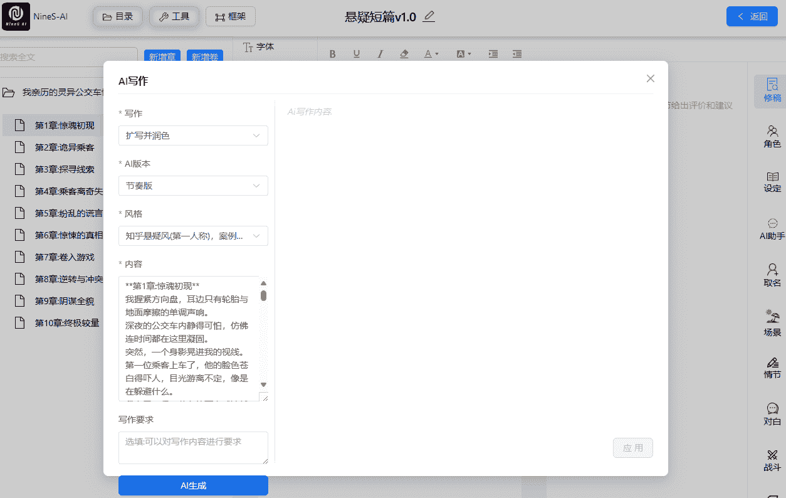
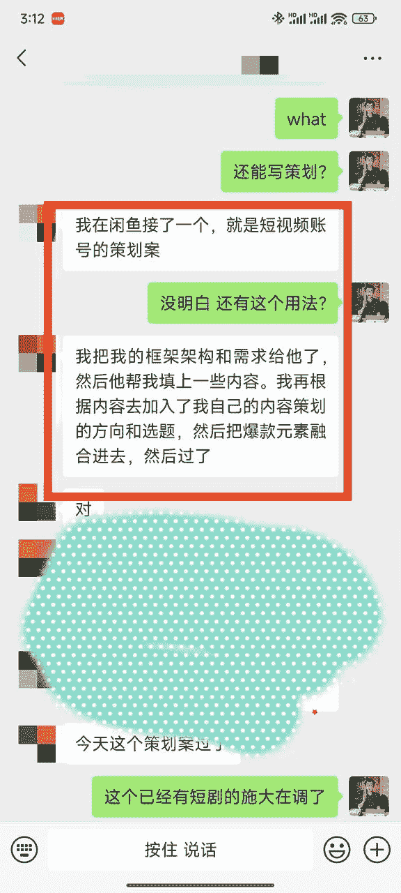

# AI写小说-NineS AI“扩写”功能演示~

> 来源：[https://rq547mr4oez.feishu.cn/docx/CwAhdfGzwozTOpxABrYcN15BnYf](https://rq547mr4oez.feishu.cn/docx/CwAhdfGzwozTOpxABrYcN15BnYf)

# 一、前言

> 各位小伙伴好~🎉🎉🎉NineS-AI与君又见😬。

> 缘分本就是稀薄寡断，相逢一程已是感激万分😙。

> **经过10月份的α测****试，小伙伴们都拿到了很多****好**结果（太多就不一一发图了），但是产品还是不够完善

> 所以第二期，在第一期的基础之上增加大量的优化和更改~

> **如今，部分内部测试的效果一一展现**给大家~~期待小伙伴们11月下旬的尝试！

---

以下是题材类Prompt，无私奉献~~

1.  [AI写小说-“玄幻文”小说家完整Prompt-v2.0](https://rq547mr4oez.feishu.cn/wiki/ZCVbw9n7fiiG4ukQNoDcRiS5nZf?from=from_copylink)（经典题材）

1.  [AI写小说-“女频甜宠爽文”小说家独家Prompt](https://rq547mr4oez.feishu.cn/wiki/ARo9wUNi4iOKjNkj8ZbcUPtHn0c?from=from_copylink)（韭菜Y日记）

1.  [AI写小说-“女频狗xue虐文”完整Prompt](https://rq547mr4oez.feishu.cn/wiki/AX6awAc3Ii0u3nk1gDrcCYr1nRh)（韭菜Y日记）

1.  [AI写小说-“女频耽美文”小说家Prompt（万字）](https://rq547mr4oez.feishu.cn/wiki/Cx1YwmLNeizNW7kafvzcsmXTnQb)

1.  [AI写小说-“科幻文”小说家完整Prompt](https://rq547mr4oez.feishu.cn/wiki/JBycwlmDDiYBXykJlu1cHWcanrg?from=from_copylink)

1.  [AI写小说-“都市爽文”小说家独家Prompt](https://rq547mr4oez.feishu.cn/wiki/OFMtwYSYPiTmP6ktsh2cAKf3n1f?from=from_copylink)（经典题材）

1.  [AI写小说-“种田文”小说家独家Prompt](https://rq547mr4oez.feishu.cn/wiki/X5glwVf1DiQYWLkvlvHcCxjhnYe)

1.  [AI写小说-“后悔文”追妻火葬场完整Prompt](https://rq547mr4oez.feishu.cn/wiki/AzmhwUYiriTyoxkXVvPcaoGKncc?from=from_copylink)

1.  [AI写小说-“世情文”小说家独家Prompt](https://rq547mr4oez.feishu.cn/wiki/UTe7wMDOKiDYfbkuGIPcbJxsngg?from=from_copylink)

1.  [AI写小说-“快穿文”小说家独家Prompt](https://rq547mr4oez.feishu.cn/wiki/🐧EhwsaoZiQlv0k4wHVc03Nln9e?from=from_copylink)（易上手题材之一）

1.  [AI写小说-“古言文”小说家独家Prompt](https://rq547mr4oez.feishu.cn/wiki/EpVJwNJAZiNtiQkcNdTcNVA2nNc?from=from_copylink)（经典题材）

1.  [AI写小说-“末世文”小说家独家Prompt](https://rq547mr4oez.feishu.cn/wiki/CrZqwEYP8iVbPpkIG1XcHGzFntc)（上新~new）

1.  [AI写小说-“系统文”小说家独家Prompt](https://rq547mr4oez.feishu.cn/wiki/AgJIwYMvEikzagkHwYhcsrMMnEf?from=from_copylink)（易上手题材之二）

1.  [AI写小说-“读心术”小说家独家Prompt](https://rq547mr4oez.feishu.cn/wiki/IAE8wHhiLi6c1jkdau3cTPZVnnb?from=from_copylink)

1.  [AI写小说-“升级流”小说家独家Prompt](https://rq547mr4oez.feishu.cn/wiki/CdriwSAi1iq2QLkWb0PcpxRknCd?from=from_copylink)

这个系列会持续做完所有题材，大家可以在粉丝群里面定制哦~。

---

PS：还有哪些问题可以评论或者私信我，我有空也可以解答。

**P**S：盗用这个文章的不要乱引流破坏环境，文章是免费分享给大家。有看见各位顺手举报下。感谢～资料纯分享不易。

**原始出处：**


# 二、当前状态（以作家灵感为始，破程序想象之梏。）

#### **为谁而生？**

为每一个心怀故事的你，无论是短篇小说、长篇巨著、精彩短剧，还是悬疑烧脑的剧本杀，都能在这里找到属于你的舞台。

1.    第一期：我们专注于短篇和长篇小说的创作，为你的故事插上想象的翅膀。

1.    第二期：完善短剧、剧本杀等所有文字创作类型

1.    第三期：完善文字创作中需要的图文（炼丹）、渠道（国内+海外）等所有服务

#### **产品理念：**

1.  以作家灵感为始，破程序想象之梏。

1.  最懂文字创作者的AI创作工具，没有之一！不写文章的研发，不是好研发。不会写代码的作者，总是欠缺一点什么~~（就是这么自信）

1.  不用只是简单的写一个Prompt来忽悠人。

#### **功能一览（网文核心框架（基础+题材**）+TOT，LATS，REAT技术实现）

1.  文学创作SOP（第一期）：

+   续写和改稿：灵感枯竭？旧作翻新？没问题！NineS-AI帮你轻松续写、改稿、仿写，让你的创作灵感源源不断。

+   网文大模型）：掌握所有网文创作技巧，无论是情节、人物，还是世界观设定，NineS-AI都能满足你的需求，让你轻松构建属于自己的故事宇宙。

+   长文拆解：500万字的文本？小意思！NineS-AI帮你轻松拆解，分析风格，剖析情节，让你的创作之路不再迷茫。

1.  B端定制（完整SOP一键产出，第三期）

#### **我们的优势**

1.  质量为王：仿写只是基本操作，我们的目标是打造最高质量的AI创作平台。

1.  重做文章G评系统：NineS-AI的创作70~85分起步（支持全网产品同等情况竞技PK）。

1.  高端定制：如果你是追求极致的完美主义者，我们还提供80~90分的“私人订制”服务。

#### 产品进度

1.  种子测试时间（100+全职作者测试）

+   开始时间：2024-10-14    结束时间：2024-11-15

1.  内测时间（群邀请测试）

+   开始时间：2024-11-20    结束时间：2024-12-20

# 三、**扩写案例~**

### 扩写界面：

+   4个调试AI（集齐市面最强大的写作AI，包括我们微调版本）

+   **二十种通用风格（长篇和短篇~）**



### 原文（字数281）

```
**第1章:惊魂初现**
我握紧方向盘，耳边只有轮胎与地面摩擦的单调声响。
深夜的公交车内静得可怕，仿佛连时间都在这里凝固。
突然，一个身影晃进我的视线。
第一位乘客上车了，他的脸色苍白得吓人，目光游离不定，像是在躲避什么。
我心里一紧，莫名的不安感油然而生。
随着车辆缓缓前行，更多乘客陆续上车。
他们的神态各异，有人低头玩手机，有人目光呆滞地望向窗外，还有人不停地环顾四周。
我从后视镜中观察着这些深夜乘客，总觉得他们每个人都像是在隐藏着不为人知的秘密。
车厢里弥漫着一种诡异的气氛，我听到断断续续的低语声。
那些窃窃私语仿佛暗流涌动，情绪似乎在不断升温。
```

### 细节版（字数1206）

```
**第1章:惊魂初现**

我握紧方向盘，耳边只有轮胎与地面摩擦的单调声响。
深夜的公交车内静得可怕，仿佛连时间都在这里凝固。
冰冷的车厢里，只有仪表盘微弱的绿色光芒，照亮了我紧绷的面庞。

突然，一个身影晃进我的视线。第一位乘客上车了，他的脸色苍白得吓人，目光游离不定，像是在躲避什么。
他的步伐虚浮，仿佛随时会跌倒，却又用尽全力保持着平衡。我心里一紧，莫名的不安感油然而生。

随着车辆缓缓前行，更多乘客陆续上车。他们的神态各异，有人低头玩手机，机械地滑动屏幕；
有人目光呆滞地望向窗外，眼神里仿佛被什么阴霾笼罩；还有人不停地环顾四周，像是在提防着什么。

我从后视镜中观察着这些深夜乘客，总觉得他们每个人都像是在隐藏着不为人知的秘密。
那些秘密似乎在黑暗中蠢蠢欲动，随时可能破土而出。
车厢里弥漫着一种诡异的气氛，我听到断断续续的低语声。
那些窃窃私语仿佛暗流涌动，情绪似乎在不断升温。

我努力集中精神开车，却无法抑制内心涌起的不安。
目光不经意间扫过后视镜，总感觉背后有什么阴影在蠢动。
一个年轻女孩坐在最后一排，她的眼神闪烁不定，时而警惕地看向车窗外，仿佛外面潜藏着什么可怕的存在；
时而又低头摆弄着什么，手指在黑暗中微微颤抖。

我注意到她的手在微微发抗，像是在极力掩饰着内心的恐惧。
那颤抖不仅仅是害怕，更像是某种深藏的秘密即将被揭开时的紧张。
与此同时，一位中年男子开始频繁地查看手表。
起初只是偶尔瞥一眼，但随着时间推移，他看表的频率越来越高，仿佛生怕错过什么重要的时刻。

他的额头上渗出细密的汗珠，眼神中透露出一丝绝望。
那是一种无能为力的绝望，像是被命运紧紧箍住的窒息感。
我的心跳不自觉地加快了。这些乘客的异常行为让我感到莫名的压抑，仿佛整个车厢都被一种看不见的力量笼罩着。

突然，公交车驶入一片漆黑的隧道。
刺眼的车灯照亮了前方狭窄的通道，但更深的黑暗却吞噬了我们。
所有乘客瞬间陷入沉默，空气中弥漫着一种令人窒息的压迫感。仿佛黑暗本身就是一个巨大的、贪婪的生物，正悄无声息地吞噬我们每一个人。

我的手心开始冒汗，紧紧握住方向盘的指节发白。
直觉告诉我，这个夜晚绝对不寻常。我努力平复呼吸，告诉自己要冷静，但内心的恐惧却如潮水般涌来，每一波都比之前更加汹涌。

就在这时，后排传来一声压抑的啜泣。
我从后视镜中看到，那个年轻女孩正用手捂着嘴，肩膀微微颤抖。
她的眼神中充满了恐惧，仿佛看到了什么可怕的东西。那种恐惧不是突如其来的惊慌，而是长期积压、终于无法压抑的绝望。

我深吸一口气，准备开口询问她是否需要帮助。
然而，就在我张嘴的瞬间，整个车厢突然陷入了一片诡异的寂静。
所有的乘客，包括那个啜泣的女孩，都像雕塑一般一动不动，目光呆滞地盯着前方。

我的心跳几乎要跳出胸膛，一种前所未有的恐惧感席卷全身。
我想要喊叫，却发现自己发不出任何声音。
就在这时，后视镜中突然出现了一张苍白的脸，那双漆黑的眼睛直勾勾地盯着我——
```

### 微调版（字数1433）

```
**第1章:惊魂初现**
我握紧方向盘，耳边只有轮胎与地面摩擦的单调声响。
深夜的公交车内静得可怕，仿佛连时间都在这里凝固。
突然，一个身影晃进我的视线。
第一位乘客上车了，他的脸色苍白得吓人，目光游离不定，像是在躲避什么。
我心里一紧，莫名的不安感油然而生。
随着车辆缓缓前行，更多乘客陆续上车。
他们的神态各异，有人低头玩手机，有人目光呆滞地望向窗外，还有人不停地环顾四周。
我从后视镜中观察着这些深夜乘客，总觉得他们每个人都像是在隐藏着不为人知的秘密。
车厢里弥漫着一种诡异的气氛，我听到断断续续的低语声。
那些窃窃私语仿佛暗流涌动，情绪似乎在不断升温。
我努力集中精神开车，却无法抑制内心涌起的不安。

一位老妇人坐在靠窗的位置，她手中的念珠不停地转动，低吟着我听不懂的经文。
她的神情严肃，仿佛在与某种无形的东西对抗。
对面是一个衣着光鲜的商人，他不时地擦拭额头上的汗水，而眼中的焦虑和恐惧却无法被任何动作掩盖。
在这寂静的夜晚，每个人似乎都承载着自己的秘密和恐惧。

车厢的空气变得越来越沉闷，一种无法名状的重压在每个乘客的肩上沉积。
司机的我感到一种前所未有的压迫感，仿佛这车不仅仅是载着乘客，还载着他们的忧愁和恐惧。
我的手心开始冒汗，紧紧握住方向盘的指节发白。

直觉告诉我，这个夜晚绝对不寻常。
我努力平复呼吸，告诉自己要冷静，但内心的恐惧却如潮水般涌来。
就在这时，后排传来一声压抑的啜泣。
我从后视镜中看到，那个年轻女孩正用手捂着嘴，肩膀微微颤抖。
她的眼神中充满了恐惧，仿佛看到了什么可怕的东西。
我深吸一口气，准备开口询问她是否需要帮助。
然而，就在我张嘴的瞬间，整个车厢突然陷入了一片诡异的寂静。

所有的乘客，包括那个啜泣的女孩，都像雕塑一般一动不动，目光呆滞地盯着前方。
我的心跳几乎要跳出胸膛，一种前所未有的恐惧感席卷全身。
我想要喊叫，却发现自己发不出任何声音。
就在这时，后视镜中突然出现了一张苍白的脸，那双漆黑的眼睛直勾勾地盯着我——

我心中一惊，顿时感到一阵寒意，无法再维持镇静。
我立刻踩下刹车，公交车发出刺耳的声响，停在了漆黑的隧道中。
车厢里的人们仍旧一动不动，我开始怀疑自己是否进入了某种不可知的噩梦之中。
就在我以为自己的心脏会因过度紧张而爆裂时，那张苍白的脸突然消失。
我试图重新启动引擎，却发现发动机异常地静默无声，仿佛被什么无形的力量压制。

“司机先生，你似乎很紧张啊？”
一道轻柔的声音打破寂静，我顺着声音的方向转头，发现一位身着黑色长裙的女子正静静地坐在我身旁，她的脸上带着难以捉摸的微笑。

“我...我只是想确保大家的安全。”我努力控制自己的声音，不让颤抖显露。

“安全？”她缓缓地重复我的话，眼神中闪过一丝嘲讽，“在这个城市里，安全只是一个遥不可及的幻想。”

我感到一阵眩晕，眼前的女子仿佛在一瞬间变成了一个透明的存在，她的身影在昏暗的车厢内摇曳着，仿佛随时都会消散在空气中。

“你...你是什么人？”我终于忍不住问出了这个问题，声音中充满了惊慌和迷茫。

“我是谁不重要。”她的声音变得轻柔而遥远，“重要的是，你准备好面对即将发生的一切了吗？”

就在这时，公交车再次启动，发动机的声音恢复了正常，周围的一切仿佛又重新活了过来。
乘客们继续他们之前的动作，仿佛刚才的一切都未曾发生过。

我握紧方向盘，继续前行，但是我知道，这场深夜的旅程才刚刚开始，而我将不得不面对更多的未知和恐惧。
```

### 节奏版（字数2004）

```
**第1章:惊魂初现**
我握紧方向盘，耳边只有轮胎与地面摩擦的单调声响，仿佛一首催眠曲，想要将我拉入无尽的黑暗。

深夜的公交车内静得可怕，连一根针掉在地上都能听见，这种寂静反而让我更加不安。

仿佛连时间都在这里凝固，等待着某个未知的时刻重新流动。

突然，一个模糊的身影晃进我的视线，打破了这令人窒息的寂静。

第一位乘客上车了，他步履蹒跚，像是喝醉了酒，又像是在躲避着什么。

他的脸色苍白得吓人，像是刚从坟墓里爬出来一样，没有一丝血色。

目光游离不定，不敢与我对视，仿佛内心深处隐藏着巨大的恐惧。

我心里一紧，莫名的不安感油然而生，像是有一只无形的手扼住了我的喉咙。

随着车辆缓缓前行，昏黄的路灯灯光断断续续地洒进车厢，照亮一张张陌生的面孔。

更多乘客陆续上车，他们就像是从黑暗中浮现的幽灵，带着各自的故事和秘密。

他们的神态各异，有人低头玩手机，试图用虚拟的世界来逃避现实的压抑。

有人目光呆滞地望向窗外，仿佛对一切都失去了兴趣，只剩下麻木和空洞。

还有人不停地环顾四周，眼神中充满了警惕和怀疑，仿佛周围的一切都充满了危险。

我从后视镜中观察着这些深夜乘客，他们的面孔在昏暗的灯光下显得格外模糊，看不清表情，也猜不透心思。

总觉得他们每个人都像是在隐藏着不为人知的秘密，像是戴着面具的演员，在舞台上扮演着各自的角色。

车厢里弥漫着一种诡异的气氛，像是暴风雨来临前的宁静，让人感到压抑和不安。

我听到断断续续的低语声，像是来自地狱的 whispers，在我的耳边萦绕不去。

那些窃窃私语仿佛暗流涌动，在寂静的车厢里显得格外清晰，像是预示着即将到来的危险。

情绪似乎在不断升温，像是一锅即将沸腾的水，随时可能爆发。

我努力集中精神开车，试图将那些不安的情绪抛诸脑后，但它们却像跗骨之蛆般挥之不去。

一个年轻女孩坐在最后一排，她穿着黑色的连衣裙，像是参加葬礼一样，与这深夜的氛围格外契合。

她的眼神闪烁不定，时而警惕地看向车窗外，仿佛在提防着什么。

时而又低头摆弄着手中的黑色手机，屏幕的光芒映照在她苍白的脸上，显得格外诡异。

我注意到她的手在微微发抖，像是内心深处隐藏着巨大的恐惧，却又努力克制着不让自己表现出来。

与此同时，一位中年男子坐在车厢中部，他穿着西装，打着领带，像是刚下班的白领。

他开始频繁地查看手表，起初只是偶尔瞥一眼，像是赶时间一样。

但随着时间推移，他看表的频率越来越高，脸上的焦虑也愈发明显，像是有什么重要的事情即将发生。

他的额头上渗出细密的汗珠，在昏黄的灯光下闪闪发光，像是恐惧的象征。

眼神中透露出一丝绝望，像是已经预见到了自己的命运。

我的心跳不自觉地加快了，像是有一面鼓在我的胸腔里敲打，越来越快，越来越响。

这些乘客的异常行为让我感到莫名的压抑，像是有一块巨石压在我的胸口，让我喘不过气来。

仿佛整个车厢都被一种看不见的力量笼罩着，这种力量充满了邪恶和不祥，让人不寒而栗。

突然，公交车驶入一片漆黑的隧道，像是进入了一个未知的领域，与世隔绝。

刺眼的车灯照亮了前方狭窄的通道，墙壁上布满了斑驳的痕迹，像是岁月的刻痕，又像是某种神秘的符号。

但更深的黑暗却吞噬了我们，像是要将我们永远困在这个封闭的空间里。

所有乘客瞬间陷入沉默，像是被黑暗夺走了声音，也像是被恐惧扼住了喉咙。

空气中弥漫着一种令人窒息的压迫感，像是有一只无形的手掐住了我们的脖子，让我们无法呼吸。

我的手心开始冒汗，方向盘变得湿滑，我不得不更加用力地握紧它，指节发白。

直觉告诉我，这个夜晚绝对不寻常，将会发生一些意想不到的事情，而我将被卷入其中，无法逃脱。

我努力平复呼吸，告诉自己要冷静，不要被恐惧所支配，但内心的恐惧却如潮水般涌来，将我淹没。

就在这时，后排传来一声压抑的啜泣，像是受伤的小兽发出的呜咽，让人心生怜悯。

我从后视镜中看到，那个年轻女孩正用手捂着嘴，肩膀微微颤抖，像是承受着巨大的痛苦。

她的眼神中充满了恐惧，像是看到了什么可怕的东西，却又不敢说出来，只能默默地承受。

我深吸一口气，准备开口询问她是否需要帮助，打破这令人窒息的沉默。

然而，就在我张嘴的瞬间，整个车厢突然陷入了一片诡异的寂静，像是时间停止了流动。

所有的乘客，包括那个啜泣的女孩，都像雕塑一般一动不动，目光呆滞地盯着前方，像是失去了灵魂的傀儡。

我的心跳几乎要跳出胸膛，像是有一只野兽要破体而出，将我撕成碎片。

一种前所未有的恐惧感席卷全身，像是掉进了冰窟窿里，寒意刺骨。

我想要喊叫，想要打破这诡异的寂静，却发现自己发不出任何声音，像是被某种力量禁锢了。

就在这时，后视镜中突然出现了一张苍白的脸，像是幽灵般凭空出现，与我近在咫尺。

那双漆黑的眼睛直勾勾地盯着我，像是要看穿我的灵魂，让我无处遁形，充满了邪恶和恶意。
```

### 均衡版（字数1603）

```
**第1章:惊魂初现**

我握紧方向盘，耳边只有轮胎与地面摩擦的单调声响。

深夜的公交车内静得可怕，仿佛连时间都在这里凝固。

车窗外，城市的灯光渐渐稀疏，黑暗像无边的海浪，将我们一点点吞没。

我的心跳随着车速的加快而加速，仿佛预感到即将到来的不安。

突然，一个模糊的身影晃进我的视线。

第一位乘客上车了，他的脸色苍白得像纸，目光游离不定，仿佛在躲避什么可怕的东西。

我心里一紧，不安感如同无形的手攥住我的心脏。

随着车辆缓缓前行，更多乘客陆续上车。

他们的神态各异，有人低头专注地盯着手机屏幕，有人目光呆滞地望向窗外，还有人不停地环顾四周，似乎在搜寻着什么。

我从后视镜中观察着这些深夜乘客，总觉得他们每个人都像是在隐藏着不为人知的秘密。

车厢里弥漫着一种诡异的气氛，我听到断断续续的低语声，那些窃窃私语仿佛暗流涌动，情绪似乎在不断升温。

我的心头莫名升起一种压抑的紧张感，仿佛整个车厢都被一种看不见的力量笼罩着。

一个年轻女孩坐在最后一排，她的眼神闪烁不定，时而警惕地看向车窗外，时而又低头摆弄着什么。

她的手微微发抖，像是在极力掩饰着内心的恐惧。

与此同时，一位中年男子开始频繁地查看手表。

起初只是偶尔瞥一眼，但随着时间推移，他看表的频率越来越高，脸上的焦虑也愈发明显。

他的额头上渗出细密的汗珠，眼神中透露出一丝绝望。

我的心跳不自觉地加快了，这些乘客的异常行为让我感到莫名的压抑。

我努力集中精神开车，却无法抑制内心涌起的不安。

突然，公交车驶入一片漆黑的隧道。

刺眼的车灯照亮了前方狭窄的通道，但更深的黑暗却吞噬了我们。

所有乘客瞬间陷入沉默，空气中弥漫着一种令人窒息的压迫感。

我的手心开始冒汗，紧紧握住方向盘的指节发白。

直觉告诉我，这个夜晚绝对不寻常。

我努力平复呼吸，告诉自己要冷静，但内心的恐惧却如潮水般涌来。

就在这时，后排传来一声压抑的啜泣。

我从后视镜中看到，那个年轻女孩正用手捂着嘴，肩膀微微颤抖，她的眼神中充满了恐惧，仿佛看到了什么可怕的东西。

我深吸一口气，准备开口询问她是否需要帮助。

然而，就在我张嘴的瞬间，整个车厢突然陷入了一片诡异的寂静。

所有的乘客，包括那个啜泣的女孩，都像雕塑一般一动不动，目光呆滞地盯着前方。

我的心跳几乎要跳出胸膛，一种前所未有的恐惧感席卷全身。

我想要喊叫，却发现自己发不出任何声音。

就在这时，后视镜中突然出现了一张苍白的脸，那双漆黑的眼睛直勾勾地盯着我——

那张脸带着一种诡异而又让人毛骨悚然的笑容，如同幽灵般在黑暗中浮现。

它嘴角微微上扬，却没有任何生命迹象，那双眼睛仿佛无底洞一般，将我拉入一个无尽的深渊。

我猛地踩下刹车，车子发出刺耳的尖叫声，在隧道内回荡不止。

乘客们被这一突如其来的急停惊醒，他们面面相觑，然后慌乱地看向四周，仿佛刚刚从一场噩梦中惊醒一般。

我喘着粗气，手还在轻微颤抖，那张脸却已消失得无影无踪，只留下脑海中的阴影挥之不去。

「你还好吗？」一道低沉而关切的声音从身后传来，是那个频繁查看手表的中年男子，他不知何时走到了驾驶座旁。

「我……没事。」我努力让自己的声音平静下来，但颤抖依旧透露出内心的不安。

「奇怪，我刚刚好像做了个梦。」他皱着眉头回忆，「梦里有很多奇怪的人……」

「也许是太累了吧。」我故作镇定地回答，但内心深知，这绝不仅仅是疲劳造成的问题。

隧道终于结束，我们驶入了一片灯火通明的街道。

光线驱散了黑暗，也带走了一些压抑感，但那种无法解释的不安依旧如影随形。

中年男子回到了座位上，而那个年轻女孩依旧沉默不语，她低垂着头，看不到表情，只是手中的动作更加急促了些。

很快，我们到达了下一站，大多数乘客下了车，只剩下几个人继续随行。

我松了口气，试图说服自己这不过是一场意外，但直觉告诉我，这绝非偶然。
```

四、种子测试~结果反馈（少部分截图，还有很多）


