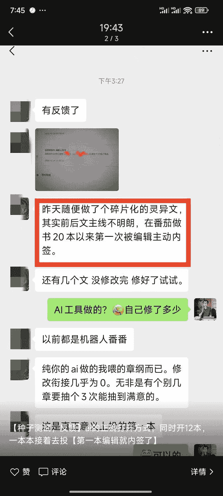
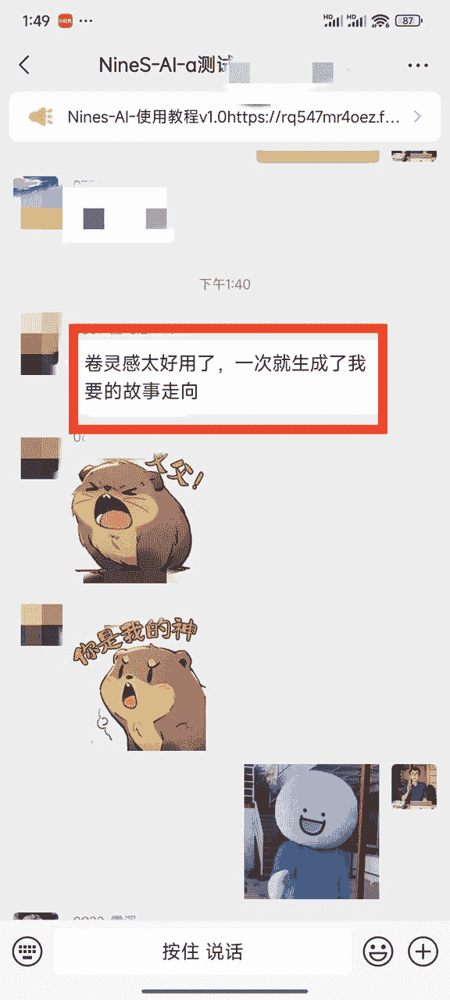
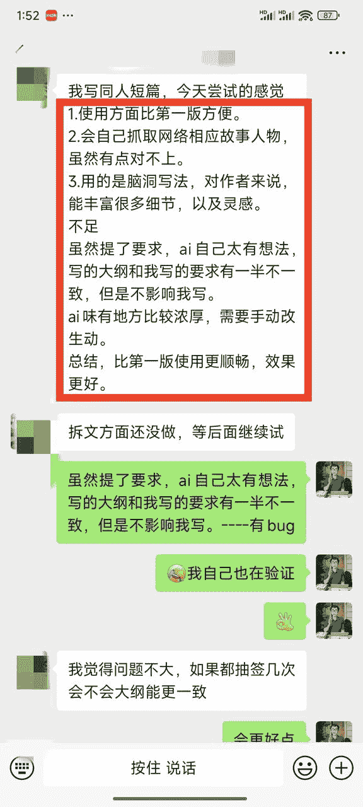
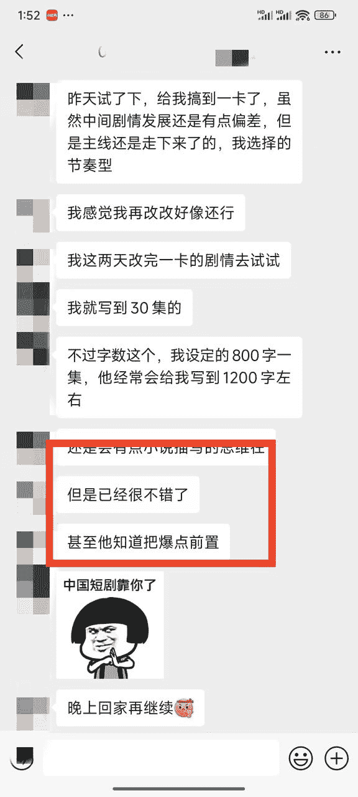
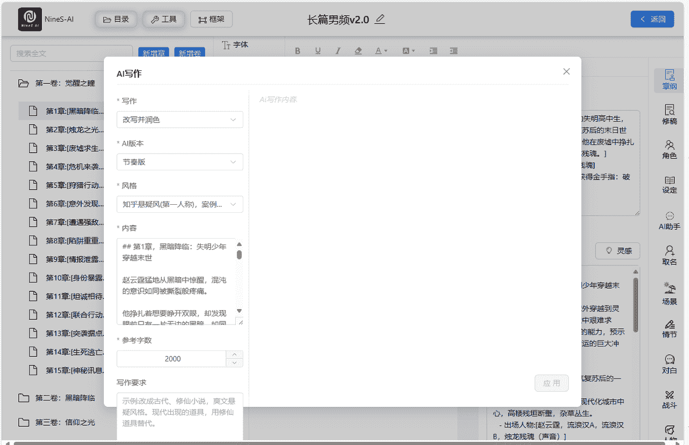

# AI写小说-NineS AI“改写”功能演示~

> 来源：[https://rq547mr4oez.feishu.cn/docx/FWuAdk3EXo5fglxCE5XcL7pjnhg](https://rq547mr4oez.feishu.cn/docx/FWuAdk3EXo5fglxCE5XcL7pjnhg)

# 一、前言

> 各位小伙伴好~🎉🎉🎉NineS-AI与君又见😬。

> 缘分本就是稀薄寡断，相逢一程已是感激万分😙。

> **经过10月份的α测****试，小伙伴们都拿到了很多****好**结果（太多就不一一发图了），但是产品还是不够完善

> **所以第二期，在第一期的基础之上增加大**量的优化和更改~（支持长篇/短篇/短剧）

> **如今，部分内部测试的效果一一展现给**大家~~期待小伙伴们11月22日的尝试！

---

以下是题材类Prompt，无私奉献~~

1.  [AI写小说-“玄幻文”小说家完整Prompt-v2.0](https://rq547mr4oez.feishu.cn/wiki/ZCVbw9n7fiiG4ukQNoDcRiS5nZf?from=from_copylink)（经典题材）

1.  [AI写小说-“女频甜宠爽文”小说家独家Prompt](https://rq547mr4oez.feishu.cn/wiki/ARo9wUNi4iOKjNkj8ZbcUPtHn0c?from=from_copylink)（韭菜Y日记）

1.  [AI写小说-“女频狗xue虐文”完整Prompt](https://rq547mr4oez.feishu.cn/wiki/AX6awAc3Ii0u3nk1gDrcCYr1nRh)（韭菜Y日记）

1.  [AI写小说-“女频耽美文”小说家Prompt（万字）](https://rq547mr4oez.feishu.cn/wiki/Cx1YwmLNeizNW7kafvzcsmXTnQb)

1.  [AI写小说-“科幻文”小说家完整Prompt](https://rq547mr4oez.feishu.cn/wiki/JBycwlmDDiYBXykJlu1cHWcanrg?from=from_copylink)

1.  [AI写小说-“都市爽文”小说家独家Prompt](https://rq547mr4oez.feishu.cn/wiki/OFMtwYSYPiTmP6ktsh2cAKf3n1f?from=from_copylink)（经典题材）

1.  [AI写小说-“种田文”小说家独家Prompt](https://rq547mr4oez.feishu.cn/wiki/X5glwVf1DiQYWLkvlvHcCxjhnYe)

1.  [AI写小说-“后悔文”追妻火葬场完整Prompt](https://rq547mr4oez.feishu.cn/wiki/AzmhwUYiriTyoxkXVvPcaoGKncc?from=from_copylink)

1.  [AI写小说-“世情文”小说家独家Prompt](https://rq547mr4oez.feishu.cn/wiki/UTe7wMDOKiDYfbkuGIPcbJxsngg?from=from_copylink)

1.  [AI写小说-“快穿文”小说家独家Prompt](https://rq547mr4oez.feishu.cn/wiki/🐧EhwsaoZiQlv0k4wHVc03Nln9e?from=from_copylink)（易上手题材之一）

1.  [AI写小说-“古言文”小说家独家Prompt](https://rq547mr4oez.feishu.cn/wiki/EpVJwNJAZiNtiQkcNdTcNVA2nNc?from=from_copylink)（经典题材）

1.  [AI写小说-“末世文”小说家独家Prompt](https://rq547mr4oez.feishu.cn/wiki/CrZqwEYP8iVbPpkIG1XcHGzFntc)（上新~new）

1.  [AI写小说-“系统文”小说家独家Prompt](https://rq547mr4oez.feishu.cn/wiki/AgJIwYMvEikzagkHwYhcsrMMnEf?from=from_copylink)（易上手题材之二）

1.  [AI写小说-“读心术”小说家独家Prompt](https://rq547mr4oez.feishu.cn/wiki/IAE8wHhiLi6c1jkdau3cTPZVnnb?from=from_copylink)

1.  [AI写小说-“升级流”小说家独家Prompt](https://rq547mr4oez.feishu.cn/wiki/CdriwSAi1iq2QLkWb0PcpxRknCd?from=from_copylink)

这个系列会持续做完所有题材，大家可以在粉丝群里面定制哦~。

---

PS：还有哪些问题可以评论或者私信我，我有空也可以解答。

**P**S：盗用这个文章的不要乱引流破坏环境，文章是免费分享给大家。有看见各位顺手举报下。感谢～资料纯分享不易。

**原始出处：**


# 二、当前状态（以作家灵感为始，破程序想象之梏。）

1.  **产品理念：**

1.  以作家灵感为始，破程序想象之梏。奉行长期价值主义~

1.  最懂文字创作者的AI创作工具，没有之一！

+   不写文章的研发，不是好研发。

+   不会写代码的作者，总是欠缺一点什么~~（就是这么自信）

+   专业的微调、专业的知识库、专业的Prompt和工作流~，并非简单的Prompt就说是AI写作工具。

1.  **为谁而生？**

1.   为每一个心怀故事的你，无论是短篇小说、长篇巨著、精彩短剧，还是悬疑烧脑的剧本杀，都能在这里找到属于你的舞台。

1.  **功能一览**

1.  当前内测功能：

+   **AI拆书：**

+   短篇的情节节奏，情绪上下文怎么快速理解？

+   500万字的文本？小意思！NineS-AI帮你轻松拆解，分析风格，剖析情节和节奏，让你的创作之路不再迷茫。

+   **AI创作**

+   短篇、长篇、短剧三大类创作类型。

+   从故事灵感到框架设定，从大纲到细纲，再到最终的正文生成，NineS-AI为你提供全流程的创作指南。

+   润色/扩写/续写/改写：灵感枯竭？旧作翻新？没问题！NineS-AI帮你,让你的创作灵感源源不断。

+   单独的写情节/战斗/对白等，全方位的微调

+   **AI助手**

+   高端玩家必备，物美价廉，自定义角色，四大主流AI

+   除了创作，其他的工作也能用到哦~

1.  下一期：

+   产品交互，模型能力持续增强

+   化身数据爬虫，实时捕捉全网热门题材，助你创作出引爆流量的爆款作品。

+   B端定制（完整SOP一键全自动产出）

1.  **我们的优势**

1.  质量为王：仿写只是基本操作，我们的目标是打造最高质量的AI创作平台。

1.  重做文章G评系统：NineS-AI的创作70~85分起步，与市面上那根本无法与之相提并论（支持全网产品竞技PK哦~）

1.  高端定制：对于美主义者，我们还提供80~90分的“私人订制”服务，当然，时间和成本也会相应增加，具体情况具体分析。

#### 产品进度

1.  种子测试时间（100+全职作者测试）

+   开始时间：2024-10-14    结束时间：2024-11-15

1.  内测时间（群无条件邀请测试）

+   预计开始时间：2024-11-22   结束时间：2024-12-30

# 三、第二轮提前测试~结果反馈（少部分截图，还有很多）









# 三、**改写案例~**

### 改写界面：

+   4个调试AI（集齐市面最强大的写作AI，包括我们微调版本）

+   **二十种通用风格（长篇和短篇~）**

+   **配合《**[AI写小说-洗稿仿写独家Prompt v2.0](https://rq547mr4oez.feishu.cn/wiki/BH01wSe5qiqd4IkCULwcvFsBnz2?from=from_copylink)**》操作，绝对让你惊喜**

+   **比如现代都市，修改成修仙，**

+   **玄幻改都市~~**



### 原文（字数281）

```
第一章：神秘信息

我叫徐晨，是一个程序员。
国家反诈骗 App 就是我做的。
然而我没想到，我居然收到了一条明显是诈骗的短信：
你好，我是秦始皇，我没有死，现在被困在地宫，只要你 V 我 50，我就能带着军队重建王朝，到时候会给你封王。
这条诈骗短信漏洞百出，三岁的孩子都看得出来。
首先，秦始皇不会自称秦始皇，这是后来者对他的称呼。
其次，秦始皇也疯狂星期四？闹呢。
但我还是笑了，这个诈骗的人还挺有梗的。
过年排班，最后一天是我值班，惨。
原本还有我一个女同事，但是她作为跟大领导「有点关系」的人，明显打算直接翘掉。
我的眼和手检查着程序，脑子里却在想着晚上怎么摸鱼。
「辛苦啦，新年快乐！」
「新年快乐！」
公司大部分都是外地的，我是少数的本地人。
快八点的时候，人走光了。
保安进来检查关灯和电器，我和他打了个招呼，闲聊几句。
「过年骗子多，你们的工作还挺重要的。」
......
//由于篇幅，未写完
```

### 细节版（字数616）

```
**第一章：诡异传讯**
我唤作徐晨，乃当代散修。
天师府反妖App正是我亲手炼制。
不曾想，竟收到一道诡异传讯：「吾乃始皇帝，未死，被困地宫，助我五十枚灵石，可助我重建王朝，封尔为王。」
这传讯明显是妖孽把戏，连初入修行的童子都能看穿。
首先，大秦始皇岂会自称始皇帝？其次，堂堂千古一帝，竟如市井小贩般讨要灵石？
荒谬！

值守天师府最后一日，我孤身一人。同门早已各自散去，唯我守夜。
大殿空寂，唯有案几上玉简微微闪烁。
「诸位新年快乐！」我对空气轻语。值夜弟子路过，与我寒暄几句。
「修行路上妖邪众多，反妖App当真是护道利器。」「然也。」我微笑回应。

夜渐深，殿中寂静。忽的，玉简闪烁异常。【吾已脱困，胆敢拒绝者，必将抹杀！】
我凝视传讯，不由失笑。这妖孽倒是好生威风。
正欲收起玉简，师弟传讯而至：【师兄，我遗落法器在值班殿，可否代为取之？】
语气颐指气使，令人不悦。【为兄正在闭关，无暇理会。】

转眼再看传讯，发信人竟是一串玄奥符文。恍惚间，我想起一周前那诡异传讯。
始皇帝现世？荒诞！
将截图传于同道群中，众人或惊或笑。
【莫非始皇真要东山再起？】
【五十枚灵石，说不得可入股大秦帝国！】
【妖孽无赖，连始皇都要众筹？】

我轻笑，顺手将符文发信人驱逐。起身取悟心茶，殿中忽然陷入诡异黑暗。
头顶玉灯「滋滋」作响，旋即熄灭。一股凉意，自脊背悄然升起。
「叮——」熟悉的法器感应声中，
有人，进殿了。
```

### 均衡版（字数1416）

```
# 第一章：神秘信息
我叫徐晨，是一名修仙者，掌管着一座仙山。我的职责是维护这一方仙境的秩序，防止外界的邪念侵扰。
然而，我从未想到，竟有一天会收到一条仿佛来自古代的传讯符：「汝好，吾乃嬴政，未曾陨落，现被困于地宫。汝若能施法相助，吾将率军重建秦朝，封汝为王。」这条传讯符漏洞百出，三岁的孩童都能看出其不妥。

首先，嬴政绝不会以其名自称，那是后人对他的称谓。
其次，嬴政怎可能在这修仙界中随意传讯？
这分明是个笑话。然而，我竟被这信使的大胆创意逗笑了。
新年将至，山门内只有我在轮值，其他同门都已回山闭关。
我本可以与一位女师妹一起，但她因与掌门「关系匪浅」，显然打算直接避开轮值。
我的眼在检查法阵，手中不断打出法诀，但心中却在盘算着夜晚如何偷闲。
「辛苦了，新年快乐！」「新年快乐！」山中的大部分弟子都不是本地人，我是少数留守的。快到戌时，人影已渐稀。巡山的护卫来检查禁制，我与他打了个招呼，闲聊几句。「新年骗子多，你们的职责还挺重要的。」护卫大叔告诉我，他就曾被骗过。

「有个骗子自称是丹药商，有特殊渠道能搞到灵丹妙药，只需施法相助便可加入他们的修炼小组。」
「你入了？」
「嗯，我家有小娃，想着给他弄点小儿灵丹。」
「丹药商怎会直接联络普通修士，这不是常识吗。」我安慰他，又叮嘱他以后遇到这种事要慎重，骗子最会利用人的心理和欲望达到目的。
「可是，徐师兄，你说要是骗子用常识骗人，我们怎么办呢？」心有灵犀般，我忽然想到了那条嬴政的传讯符。「所以才让大家都用防骗法阵嘛，但凡涉及到施法或交易的，一律不理。」

护卫大叔点了点头，再次肯定了我的工作，就继续巡山去了。三层楼禁制已启，二层楼禁制已启，只剩下我这一层。偌大的仙山一时显得有些冷清与寂静。
我正在演练术法，忽然传讯符亮起。「糟！」正准备发动绝招的我怒气冲冲地点开传讯：「我已脱困，不协助者，一律抹杀。」这是什么鬼，垃圾传讯吧。
正准备再修炼一会儿，那翘班的女师妹居然给我发来传音：「我的储物袋落在道场上了，你帮我拿出来一下吧。」这命令式的语气，本就不爽的心情更添不快。
「我这会儿不在道场，出来找灵果了。」我才不会给那个倚仗关系的小三跑腿呢。
返回页面，我又看了眼传讯符发信者，是一串乱码。忽然，我想起了一周前收到的那条信息。嬴政脱困了。这简直无稽之谈。我把这两条信息截图发到了朋友群里，他们一边问我怎么还不回洞府，一边开始对嬴政进行“深入分析”。
「我看这个信息还是很有可信度的，毕竟嬴政都复活好多年了，说不定这次真就出来了。
「我说徐晨，你别这么抠，就施法帮他一下啊，以后赢麻了就能分秦国一杯羹。」
「哎，充分说明如今修仙环境的艰难，就连嬴政都得众筹施法啊！」
「这骗子，骗不到灵石直接破防，顺着法线抹杀你吗？哈哈哈。」
我也笑了，顺便将乱码的发信者拉黑。我放下传讯符，决定先去灵泉边泡个灵果充饥。顺便找个隐蔽的地方躲着，等小三女拿完储物袋再回道场修炼。
走到灵泉旁边，我听见头顶的灵灯传来「滋滋」的声响。正要抬头看，灯灭了。我有一瞬间的慌乱，松开手指，灵泉的水停下。我怕被烫伤，只能先摸索着把灵果放在身后的石台上。一步，两步，终于摸到了。
为什么会突然停电啊？这是从来没有的事情。不过没关系，护卫一定会发现，然后联系阵法师来查看。现在我，只需要静静地坐在这里就好了。
「叮——弟子牌。」黑暗中，我听见了熟悉的女声。有修士进来了。
```

### 微调版（字数1090）

```
第一章：天启之信

吾名为徐晨，乃一介编程师。
国之护法，反诈神兵“辟邪”App即吾所作。
然而，天意难测，吾竟得一纸荒谬之信：
「告诸君，朕乃始皇，未曾长眠，今困于地宫，若得君之五钱银两，朕将率军复起，届时封君为王。」

此信之伪，如稚童皆能辨识。始皇何以自称为始皇？后人之颂也。
始皇何以提及「疯狂星期四」？荒谬绝伦。
吾笑之，此人尚有几分机智，居然玩梗至此。
年终排班，末日由吾值守，苦也。
原本尚有一女同僚，然其与大人物「有染」，自是无踪。
吾目视屏幕，心念鱼儿之乐。
「辛苦你了，新岁安康！」
「新岁安康！」
公司中人多外地，而吾乃少数土著。
近八时，人皆散尽。
保安巡楼熄灯，吾与之问好，闲话几句。
「年终骗子多，尔等工作当真紧要。」
保安大叔言其曾遭骗。
「彼言其为药商，有隐秘门道可得药，银五钱即可入群。」
「尔已入群？」
「唉，家中幼子需药，故而。」
「药商何会直接寻凡人，此乃常识。」
吾慰之，又叮嘱其日后遇此等事需谨慎，骗子最善利用人心与欲望。

「然徐老师，若骗子以常识行骗，吾等何如？」
心有灵犀，吾忽思及那条始皇之信。
「故而众人皆应下载辟邪App，但凡有转账之举，概不应允。」
保安大叔颔首，再次肯定吾之工作，离去。

三楼灯灭，二楼灯灭，唯吾此层留光。
空旷公司，气氛一时冷清。
吾游戏激战正酣，突有短信提示。
「该死！」
错失五杀，吾怒点短信：
【朕已破关而出，拒朕者，杀无赦。】

「岂有此理，垃圾短信。」
正待再战，昔日翘班女同僚忽发微信：
【吾包遗于工位，劳君代取。】
命令之语，本已不悦之心情更显不快。
【吾此刻不在公司，外出觅食。】
吾才不为小三奔波。
翻至短信，发信人乃一串乱码。
忽然，吾忆及一周前之短信。
始皇破关而出。
此乃天方夜谭。
吾将此二信截图发至友群，他们一边问吾何不归家，一边开始调侃始皇。
【看这信甚有信度，始皇复活多年，此次或许真出关矣。】
【徐晨啊，汝莫要如此吝啬，仅五钱投入大秦帝国，富贵可期。】
【此言甚是，亦说明如今创业艰难，连始皇亦需众筹。】
【此骗子，骗钱不成即破防，竟妄想网络杀伐？哈哈。】
吾亦笑之，随手将乱码发信人拉黑。
放下手机，吾决先泡面果腹。
再寻一隅藏身，待小三取包后归工位游戏。
行至饮水机，忽闻头顶灯管「滋滋」作响。
正欲抬头，灯光尽灭。
吾一时惊慌，忙松指脱手，热水止步。
恐烫伤，只得摸索寻吧台而放泡面碗。
一步，两步，触及。
何故突停电？此乃未有之事。
然保安必发现，而后召电工师傅来检。
如今吾，只需静坐于此。
「叮——员工卡。」
黑暗中，吾闻悉熟悉电子女声。
有人进来了。】
```

### 节奏版（字数1489）

```
**续写内容**
我叫徐晨，一个负责维护宗门通讯法阵的修真弟子。
最近宗门开发了一款新的防诈骗法器，就是我负责维护的。

没想到我居然收到了一条诈骗传讯符：
「你好，我是秦始皇，朕没死，现在被困在地宫，只要你给我转 50 块灵石，朕就能带着阴兵重建王朝，到时候封你做异姓王。」
这条诈骗传讯符漏洞百出，三岁小孩都看得出来是假的。

首先，秦始皇不会自称秦始皇，这是后世之人对他的称呼。其次，秦始皇也过疯狂星期四？
但我还是笑了，这骗子还挺有创意的。
过年排班，最后一天是我值班，真倒霉。
原本还有我一个女同事，但她跟掌门关系暧昧，肯定要翘班。
我一边检查着法阵，一边想着晚上怎么偷懒。
「辛苦了，新年快乐！」
「新年快乐！」

宗门里大部分弟子都是外地来的，我是少数的本地人。快到晚上八点的时候，人都走光了。
负责巡逻的师兄进来检查灯火和法器，我和他打了声招呼，闲聊了几句。
「过年骗子多，你们的工作还挺重要的。」巡逻师兄跟我说，他就被骗过。
「骗子说他是炼丹师，有特殊渠道可以搞到丹药，转 50 块灵石就拉我进群。」
「你进群了？」
「嗯，我家小孩想筑基，想给他买点筑基丹。」
「炼丹师怎么会直接联系普通弟子，这不是常识吗？」

我安慰他，又叮嘱他以后遇到这种事要慎重，骗子最会利用人的心理和欲望。
「可是，徐师弟，你说要是骗子用常识骗人，我们怎么办呢？」
心有灵犀一样，我忽然想到了那条秦始皇的传讯符。
「所以才让大家都使用防诈骗法器，但凡是要转账的，一律不理。」
巡逻师兄点了点头，再次肯定了我的工作，就去巡逻了。
三层楼熄灯，二层楼熄灯，只留下了我这一层。
偌大的宗门一下子有点冷清，有点空寂。

我正玩游戏玩得起劲，马上就要五杀了，传讯符亮了。「可恶！」
错失五杀的我气愤地打开传讯符：「我已经出来了，拒绝给我转 50 灵石的，一律抹杀。」
「什么鬼，垃圾传讯符吧。」正准备再开一局游戏，翘班的女同事居然给我发来传讯：
「我储物袋落在工位了，你帮我拿出来一下。」这命令人的语气，让我本来就不爽的心情更不爽了。
「我现在不在宗门，出来买东西了。」我才不要给这个关系户跑腿呢。
返回页面，我又看了眼传讯符发信人，是一串乱码。

忽然，我想到了一周前收到的那条传讯符。
秦始皇出来了？
这简直是无稽之谈。
我把这两条传讯符截图发到了朋友群里，他们一边问我怎么还不下班，一边开始拿秦始皇开玩笑。

「我看这条传讯符还是很有可信度的，毕竟秦始皇都复活好多年了，说不定这次真就出来了。」
「我说徐晨，你别这么抠，就转他 50 灵石呗，50 灵石入股大秦帝国，赚翻了！」
「哎，充分说明如今创业环境艰难，就连秦始皇都得众筹啊！」
「这骗子，骗不到钱直接破防，顺着传讯法阵抹杀你？哈哈哈。」

我也笑了，顺便把乱码的发信人拉黑。我放下传讯玉简，决定先泡碗辟谷面条充饥。
顺便找个角落躲起来，等那个关系户女弟子拿完储物袋再回工位玩游戏。
走到灵泉边的时候，我听见头顶的照明法阵传来「滋滋」的声音。正要抬头看，灯灭了。
我有一瞬间的慌乱，松开手指，灵泉水停止了流动。
我怕烫到自己，只能先摸索着把面碗放在身后的桌子上。
一步，两步，摸到了。
为什么会突然停电啊？这可是从来没有发生过的事情。

不过没关系，巡逻师兄一定会发现，然后通知维护弟子来检查。
现在我，只需要静静地坐在这里就好了。
「叮——身份玉牌。」
黑暗中，我听见了熟悉的电子女声。
有人进来了。
```

###