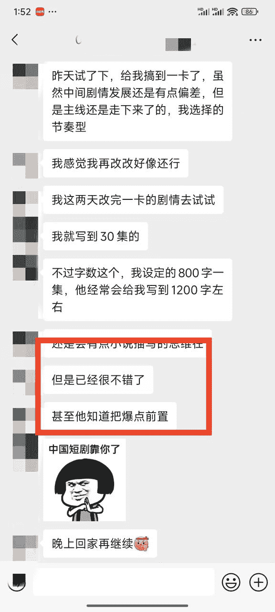

# AI写小说-NineS AI仿写《全网嘲后我绑定了演技系统》

> 来源：[https://rq547mr4oez.feishu.cn/docx/V9S9dmak9oM395xGNwjc7lTCnFb](https://rq547mr4oez.feishu.cn/docx/V9S9dmak9oM395xGNwjc7lTCnFb)

## 一、前言

> 各位小伙伴好~🎉🎉🎉NineS-AI与君又见😬。
>
> 缘分本就是稀薄寡断，相逢一程已是感激万分😙。
>
> 经过10月份的α测试，小伙伴们都拿到了很多好结果（太多就不一一发图了），但是产品还是不够完善
>
> 所以第二期，在第一期的基础之上增加大量的优化和更改~
>
> 如今，部分内部测试的效果一一展现给大家~~期待小伙伴们11月22日晚上19.30的尝试！

---

以下是题材类Prompt，无私奉献~~

1. [AI写小说-“玄幻文”小说家完整Prompt-v2.0](https://rq547mr4oez.feishu.cn/wiki/ZCVbw9n7fiiG4ukQNoDcRiS5nZf?from=from_copylink)（经典题材）
1. [AI写小说-“女频甜宠爽文”小说家独家Prompt](https://rq547mr4oez.feishu.cn/wiki/ARo9wUNi4iOKjNkj8ZbcUPtHn0c?from=from_copylink)（韭菜Y日记）
1. [AI写小说-“女频狗xue虐文”完整Prompt](https://rq547mr4oez.feishu.cn/wiki/AX6awAc3Ii0u3nk1gDrcCYr1nRh)（韭菜Y日记）
1. [AI写小说-“女频耽美文”小说家Prompt（万字）](https://rq547mr4oez.feishu.cn/wiki/Cx1YwmLNeizNW7kafvzcsmXTnQb)
1. [AI写小说-“科幻文”小说家完整Prompt](https://rq547mr4oez.feishu.cn/wiki/JBycwlmDDiYBXykJlu1cHWcanrg?from=from_copylink)
1. [AI写小说-“都市爽文”小说家独家Prompt](https://rq547mr4oez.feishu.cn/wiki/OFMtwYSYPiTmP6ktsh2cAKf3n1f?from=from_copylink)（经典题材）
1. [AI写小说-“种田文”小说家独家Prompt](https://rq547mr4oez.feishu.cn/wiki/X5glwVf1DiQYWLkvlvHcCxjhnYe)
1. [AI写小说-“后悔文”追妻火葬场完整Prompt](https://rq547mr4oez.feishu.cn/wiki/AzmhwUYiriTyoxkXVvPcaoGKncc?from=from_copylink)
1. [AI写小说-“世情文”小说家独家Prompt](https://rq547mr4oez.feishu.cn/wiki/UTe7wMDOKiDYfbkuGIPcbJxsngg?from=from_copylink)
1. [AI写小说-“快穿文”小说家独家Prompt](https://rq547mr4oez.feishu.cn/wiki/🐧EhwsaoZiQlv0k4wHVc03Nln9e?from=from_copylink)（易上手题材之一）
1. [AI写小说-“古言文”小说家独家Prompt](https://rq547mr4oez.feishu.cn/wiki/EpVJwNJAZiNtiQkcNdTcNVA2nNc?from=from_copylink)（经典题材）
1. [AI写小说-“末世文”小说家独家Prompt](https://rq547mr4oez.feishu.cn/wiki/CrZqwEYP8iVbPpkIG1XcHGzFntc)（上新~new）
1. [AI写小说-“系统文”小说家独家Prompt](https://rq547mr4oez.feishu.cn/wiki/AgJIwYMvEikzagkHwYhcsrMMnEf?from=from_copylink)（易上手题材之二）
1. [AI写小说-“读心术”小说家独家Prompt](https://rq547mr4oez.feishu.cn/wiki/IAE8wHhiLi6c1jkdau3cTPZVnnb?from=from_copylink)
1. [AI写小说-“升级流”小说家独家Prompt](https://rq547mr4oez.feishu.cn/wiki/CdriwSAi1iq2QLkWb0PcpxRknCd?from=from_copylink)

这个系列会持续做完所有题材，大家可以在粉丝群里面定制哦~。

---

PS：还有哪些问题可以评论或者私信我，我有空也可以解答。

**PS：** 盗用这个文章的不要乱引流破坏环境，文章是免费分享给大家。有看见各位顺手举报下。感谢～资料纯分享不易。

**原始出处：**


## 二、第二轮提前测试~结果反馈（少部分截图，还有很多）



## 三、当前状态（以作家灵感为始，破程序想象之梏。）

### 产品理念：

以作家灵感为始，破程序想象之梏。奉行长期价值主义~

最懂文字创作者的AI创作工具，没有之一！

- 不写文章的研发，不是好研发。
- 不会写代码的作者，总是欠缺一点什么~~（就是这么自信）
- 专业的微调、专业的知识库、专业的Prompt和工作流~，并非简单的Prompt就说是AI写作工具。

### 为谁而生？

为每一个心怀故事的你，无论是短篇小说、长篇巨著、精彩短剧，还是悬疑烧脑的剧本杀，都能在这里找到属于你的舞台。

### 功能一览

当前内测功能：

- **AI拆书：**

  短篇的情节节奏，情绪上下文怎么快速理解？

  500万字的文本？小意思！NineS-AI帮你轻松拆解，分析风格，剖析情节和节奏，让你的创作之路不再迷茫。

- **AI创作**

  短篇、长篇、短剧三大类创作类型。

  从故事灵感到框架设定，从大纲到细纲，再到最终的正文生成，NineS-AI为你提供全流程的创作指南。

  润色/扩写/续写/改写：灵感枯竭？旧作翻新？没问题！NineS-AI帮你，让你的创作灵感源源不断。

  单独的写情节/战斗/对白等，全方位的微调

- **AI助手**

  高端玩家必备，物美价廉，自定义角色，四大主流AI

  除了创作，其他的工作也能用到哦~

下一期：

- 产品交互，模型能力持续增强
- 化身数据爬虫，实时捕捉全网热门题材，助你创作出引爆流量的爆款作品。
- B端定制（完整SOP一键全自动产出）

### 我们的优势

质量为王：仿写只是基本操作，我们的目标是打造最高质量的AI创作平台。

重做文章G评系统：NineS-AI的创作70~85分起步，与市面上那根本无法与之相提并论（支持全网产品竞技PK哦~）

高端定制：对于美主义者，我们还提供80~90分的“私人订制”服务，当然，时间和成本也会相应增加，具体情况具体分析。

### 产品进度

种子测试时间（100+全职作者测试）

- 开始时间：2024-10-14    结束时间：2024-11-15

内测时间（群无条件邀请测试）

- 开始时间：2024-11-22晚19.30    结束时间：2024-12-30

## 四、仿写案例~

### 仿写思路：

- 4个调试AI（集齐市面最强大的写作AI，包括我们微调版本）
- 二十种通用风格（长篇和短篇~）

### 拆书分析

```
**拆**书《全网嘲后我绑定了演技系统》
========================================================
# 故事梗概
## 一、基本信息
1. 选题: 女演员江觉夏在全网遭遇质疑后，觉醒了演技系统，决定转型的故事。
2. 题材: 都市言情，悬疑犯罪
3. 类型: 女频小说
4. 字数: 16466
5. 期待感: 故事展现了女主在演技系统的帮助下如何逆境求生，逐渐揭开连环杀人案的真相，最终重获事业与自我。

## 二、故事设定
1. 背景设定: 现代都市娱乐圈与刑侦环境交错，围绕江觉夏的职业生涯与一起历史悬案展开。
2. 主角: 
    - 江觉夏：女演员，30岁，清纯外表，演技一直备受争议，目标是打破“资源咖”的标签，实现转型。
    - 人设七步法：
        - **目标**：成为实力派演员，获得认可。
        - **阻碍**：被影帝前任公开Diss，事业停滞不前。
        - **行动**：绑定演技系统，学习不同角色的演绎。
        - **结果**：逐渐获得能力，通过试镜得到好评。
        - **意外**：系统赋予她关于凶手的知识，意外关联到真实案件。
        - **转折**：在剧组中发现真相，陷入凶案对峙。
        - **结局**：揭露凶手，事业成功，获得自我救赎。
3. 配角: 
    - 郑南洲：影帝，江觉夏的前男友，对女主造成负面影响。
    - 温意：竞争对手，与刘导勾结，对江觉夏产生恶意。
    - 刘导：剧组导演，背负秘密的反派角色。
    - 顾唯风：刑侦警官，帮助江觉夏揭开案件真相。
4. 核心梗: 情节围绕江觉夏与演技系统的绑定发展，同时揭示一宗二十年前的连环杀人案。
5. 核心内容: 
    - 危机: 江觉夏面临事业危机与生死威胁。
    - 伏笔: 刘导与温意之间的秘密联系暗示了阴谋的存在。
    - 悬念: 连环杀人案的真相、温意的真实身份。
    - 爽点: 江觉夏最终以智慧与演技反击敌人，成功逆转命运。

## 三、故事脉络
1. 核心冲突: 女主在娱乐圈的生存与被继承的悬案真相。
2. 情感纽带: 竞争、仇恨与爱情错综复杂，特别是与郑南洲和顾唯风的关系。
3. 故事反转: 江觉夏偶然觉醒演技系统，成为反转局面与揭露真相的关键人物。
4. 二次反转: 温意真实身份揭晓，以及刘导的反派本性暴露。
5. 整体节奏: 
    - 江觉夏被Diss → 觉醒演技系统【系统赋予杀手知识】【情感压力】。
    - 尝试试镜，扭转局面【获得导演的认可】【情感波动】。
    - 揭露阴谋，警方介入【面对生死抉择】【紧张悬疑】。
    - 最终成功揭开真相，反转舆论【实现华丽转身】【感动与赞赏】。
6. 写作风格: 结合悬疑与娱乐圈元素，幽默而不失紧张感，人物之间对话生动。
========================================================
# 细纲节奏
====
- [1][总字数612]
1. 情节1： [字数: 180]
      - [内容概括] 官宣江觉夏获得《满分恋爱》女主角，网友反应强烈，纷纷质疑她的演技和人气。
      - [作用] 引入故事背景，展示主角的处境和外界对她的评价，为后续情节的发展奠定基础。

2. 情节2： [字数: 150]
      - [内容概括] 经纪人打电话劝导江觉夏，提到她出道十年没有代表作，质疑她是否在努力提高演技。
      - [作用] 深化角色内心冲突，展现江觉夏对自身状况的无奈与自嘲，同时为角色发展提供动机。

3. 情节3： [字数: 120]
      - [内容概括] 江觉夏回忆自己出道时的形象和角色定位，以及尝试转型失败的经历。
      - [作用] 增加角色背景信息，使读者理解她的职业困境，增强人物立体感。

4. 情节4： [字数: 162]
      - [内容概括] 在节目中，影帝公开批评江觉夏，并暗示她是依靠资源获得角色，引发热议。
      - [作用] 设置主要冲突点，提升情节紧张感，为后续发展埋下伏笔，同时展示娱乐圈的竞争与残酷。

5. 情节5： [字数: 100]
      - [内容概括] 刘导通知江觉夏，《恋爱满分》的女主角可能会重新考虑人选。
      - [作用] 强化故事的危机感，为后续情节的发展铺路，同时引发读者对江觉夏未来命运的关注。
====

```

### 节奏版（字数994）

```
**第一章**
  「恭喜你啊，觉夏，拿下了《满分恋爱》的女主角！」
  经纪人李姐的声音从手机里传来，带着掩饰不住的兴奋。
  我翻了个白眼，语气平静，「哦。」
  「哦？！”
  李姐的声音拔高了八度，「我的姑奶奶，这可是大IP啊，多少小花挤破头都抢不到的角色！」
  「抢不到就对了，这角色……」
  我顿了顿，脑海里浮现出原著里那个恋爱脑女主的人设，胃里一阵翻江倒海，「这角色不适合我。」
  「怎么不适合？！”
  李姐的声音恨不得顺着电话线把我揪起来，「你出道十年，连个代表作都没有，再不抓住机会，就要被后浪拍死在沙滩上了！」
  我揉了揉太阳穴，叹了口气，「李姐，你又不是不知道，我这张脸……」
  「你的脸怎么了？！”
  李姐打断我，「当年你在电影学院，老师都说你天生一张电影脸，可塑性极强，能演清纯小白花，也能演蛇蝎美人！」
  我苦笑，「那是十年前了。」
  十年前，我刚出道，也曾雄心勃勃，想要挑战各种类型的角色。
  我记得我第一次尝试转型，接了一部大女主剧，饰演一个心狠手辣的皇后。
  结果呢？
  我的表演被网友们骂得体无完肤，「面瘫」、「瞪眼」、「毫无演技」……
  「江觉夏，你清醒一点！」
  李姐的声音把我从回忆里拉了回来，「你以为你还是当年那个初出茅庐的小姑娘吗？！”
  「我知道。」
  我深吸一口气，「所以我才更要谨慎。」
  「谨慎什么？！”
  李姐的声音里充满了恨铁不成钢，「你看看现在这些小花，哪个不是削尖了脑袋往上爬？！”
  「你再不努力，就真的要被她们踩在脚底下了！」
  我沉默了。
  李姐说得没错，娱乐圈就是这么残酷。
  你不进，则退。
  「对了，」
  李姐突然换了个语气，小心翼翼地问，「那个……演技提高班的事，你考虑得怎么样了？」
  我闭上眼睛，深吸一口气，「不去。」
  「为什么？！”
  李姐急了，「这可是圈内最好的演技老师，多少人求都求不来的机会！」
  「我……」
  我刚想解释，手机突然响起了另一通电话。
  我看了眼来电显示，是刘导。
  「李姐，我先接个电话。」
  我挂断李姐的电话，接通了刘导的来电。
  「喂，刘导。」
  「觉夏啊，」
  刘导的声音听起来有些疲惫，「关于《恋爱满分》的女主角……」
  我的心猛地一沉。
  不会吧……
  这才刚官宣，就要换人？ 
  「我们可能要重新考虑一下。」
  刘导的声音像是从很远的地方传来，带着一丝难以察觉的犹豫。
```

### 细节版（字数1109）

```
**第1章**
「你拿到这个？」经纪人一脸惊讶地看着手机上的新闻。
我微微皱眉,「是啊,导演刚打电话告诉我,他可能会重新考虑我的女主角人选。」
经纪人沉默了片刻,一脸复杂地说:「那个影帝在节目上对你的评价,你看到了吧?」
我点点头,「看到了。不过我也没太放在心上,毕竟他说的也没错,我这十年一直没有什么代表作。」
「可是觉夏,你的演技大家都有目共睹,评委还夸赞过你有天赋,导演们也一直青睐你,为什么会沦落到这个地步呢?」经纪人满眼担忧。
想到自己的遭遇,我不由叹了口气:「可能是因为我的外表一直给人一种柔弱、温婉的感觉吧。
导演们总是把我定位在一些小女配的角色上,很少让我有机会去挑战大女主的戏份。」
「可恶,这些导演也太不识货了!」经纪人愤愤地说,
「你那么出众的演技,偏偏却被局限在那些小角色上,简直就是在浪费你的才华!」
我苦笑着说:「可能人家也觉得我这样的外表更适合这些角色吧。
不过话说回来,今天这个节目上的事,你觉得我应该怎么办?」
经纪人沉吟片刻,「现在还不是时候。
等《满分恋爱》开机之前,我会去找导演好好沟通的。
你也要尽快把演技提高课上完,等着导演重新肯定你吧!」
「好的,我知道了。」我点点头,突然想起什么,「对了,之前导演让我去演这个角色,说是看中了我的演技,你知道背后有什么猫腻吗?」
「我也不太清楚。不过既然导演说是看中了你的演技,那应该是真的。
不过既然现在又要重新考虑,说明肯定有什么变数出现了。」经纪人推测道。
就在这时,手机突然响了起来。我
看着来电显示,皱了皱眉头,还是接了起来:「喂,导演?」
「喂,江觉夏,我想跟你谈谈这部剧的事。」对方的声音有些沧桑,却带着一丝诡异的冷意。
我感觉心里一紧,「导演,出什么事了吗?」
「没什么大事,就是最近出现了一些变故,所以我想跟你商量一下这部剧的安排。你现在方不方便过来一趟?」
「好的,我现在就过去。」我应了声,挂断电话,
疑惑地看向经纪人,「导演让我去一趟片场,说是有些事需要商量。」
经纪人也皱起眉头,「这么晚了?他这么着急干什么?你小心点,要是有什么不对劲的,就立刻离开,知道吗?」
我点点头,「放心,我知道分寸的。」
坐在出租车上,我的心情有些紧张
。导演的态度似乎有些反常,希望只是我多心了。
直到到达片场,我推开门,映入眼帘的景象让我不由倒吸一口冷气。
原本整洁有序的片场,此刻一片狼藉。
工作人员惊慌失措地在四处奔走,而导演孤零零地站在中央,一脸阴郁地看着我
「怎么回事?导演,发生什么了?」我忍不住问道
导演沉默了片刻,突然开口说:「对不起,江觉夏,我恐怕要让你失望了。这部戏恐怕要换人演了。」
```

### 微调版（字数822）


# 第1章  热搜体质

「恭喜你，觉夏，你拿下了《满分恋爱》的女主角！」经纪人李姐的声音透过手机听筒传来，兴奋得有些颤抖。

我捏着手机，看着窗外灰蒙蒙的天空，嘴角扯出一丝苦笑。

出道十年，终于拿到一个还算看得过去的主角，却引来了一场腥风血雨。

微博评论区已经炸开了锅。

书粉们哀嚎遍野，各种“毁我青春，毁我童年”的言论充斥其中，仿佛我抢了她们的男朋友一样。

李姐在电话里继续喋喋不休：「你不知道，现在网上都在骂你，说你演技烂，配不上这个角色……」

我打断她：「我知道，李姐，不用说了。」

我太了解这种感觉了。

十年龙套生涯，好不容易熬出头，却因为一张“幼态”的脸，总被定义为“甜妹”角色，永远摆脱不了“花瓶”的标签。

我曾经尝试转型，去演那些性格复杂的大女主，结果呢？票房惨败，口碑扑街，全网嘲讽。

「哎，想当初，老师就说你啊，这脸，太吃亏了，不适合演那种气场强大的角色。」

我自嘲地笑了笑，脑海中浮现出当年老师无奈的眼神。

那晚，郑南洲——我的前男友，影帝郑南洲，在某综艺节目上，毫不留情地diss了我。

「我一个朋友为了试镜，准备了三个月，每天都在琢磨角色，而有些人，靠的只是所谓的‘资源’。”

他轻蔑地一笑，那笑容里充满了对我的不屑。

他话里的“有些人”，不用说，就是我。

那一晚，关于我的负面新闻迅速霸占热搜，#江觉夏演技#、#江觉夏资源咖#等话题冲上热榜。

我看着手机屏幕上铺天盖地的谩骂，心里却意外地平静。

或许，我早已习惯了这种被全网嘲讽的感觉。从被郑南洲抛弃的那一刻起，我就已经做好了面对一切的准备。

电话铃声再次响起，是刘导。

「觉夏啊，关于《满分恋爱》的女主角……」他的语气犹豫，带着一丝歉意，「可能…我们得重新考虑一下人选。」

我深吸一口气，平静地回应：「好的，刘导，我理解。」

挂断电话，我看着窗外越来越深的夜色，心里却涌起一股莫名的力量。

十年磨一剑，我江觉夏，绝不会就此沉沦！

## 均衡版（字数605）

### 第1章

我叫江觉夏，过气女演员。

今天，我终于官宣拿下了《满分恋爱》的女主角。

本以为这会是事业的转机，却没想到网上一片哀号，书粉们纷纷表示无法接受我出演他们心中的完美女神。

「江姐，你确定要接这部剧吗？」经纪人张姐的声音从电话里传来，带着几分忧虑。

「出道十年了，你还没有一部真正的代表作。」

我轻轻叹了口气，心里明白她的话并非无中生有。

「或许该考虑参加演技提高课？」

「张姐，我知道你是为我好。」我努力让自己的语气显得轻松些，「但那些老师总说我的外貌不适合大女主剧，只能演些小配角。」

回忆起那段尝试转型的经历，我不禁苦笑。

即便有再高的天赋，也难以突破观众对我固有的印象。

更何况，那位影帝郑南洲在节目上公开diss我，直言我们根本不在同一个水平线上。

他甚至提到自己朋友为了试镜付出的努力，与我这个所谓的资源咖形成鲜明对比。

这种话就像一记重拳，直击我的自尊心。

当晚，我的负面话题迅速登上热搜，引发公众热议。

手机屏幕上的评论如潮水般涌来，每一句都像是一根针扎在心头。

就在这时，刘导打来的电话更是让我如坠冰窟。

「觉夏，《恋爱满分》的女主角人选可能会重新考虑。」

他的声音冷冷淡淡，没有半点情感波动，却让我感到深深的不安和愤怒。

挂断电话，我站在窗前，看着城市灯火辉煌，心中却是一片黯然。

我知道，这条路注定不会平坦，但无论如何，我都要坚持走下去。
