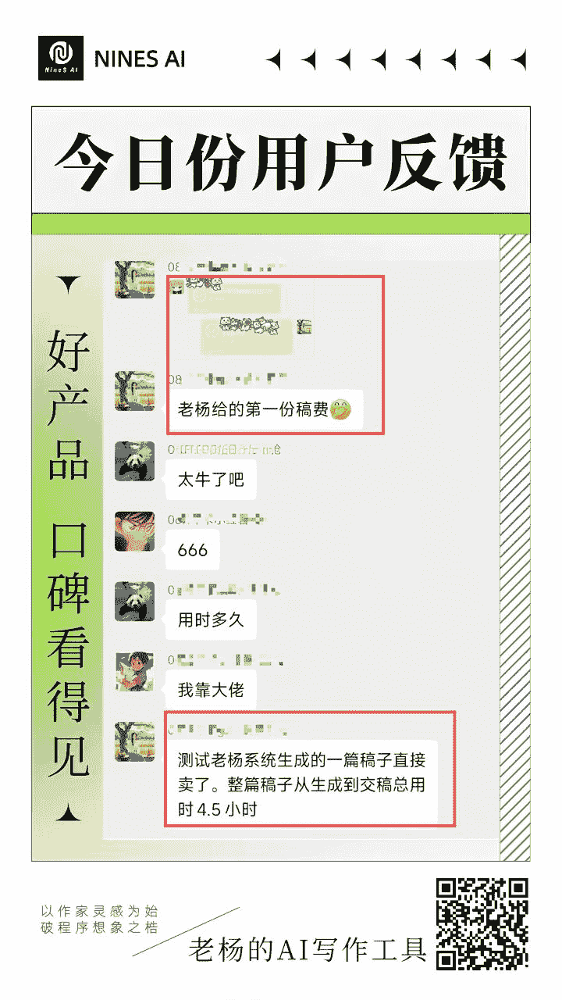
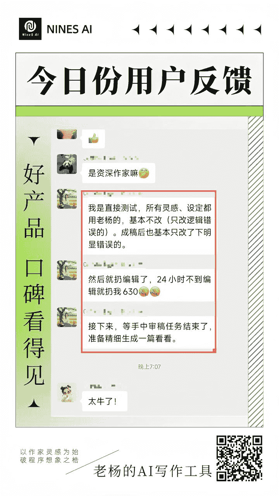
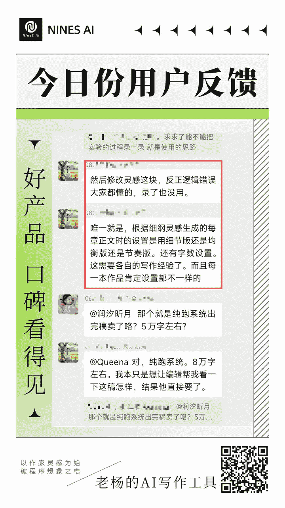
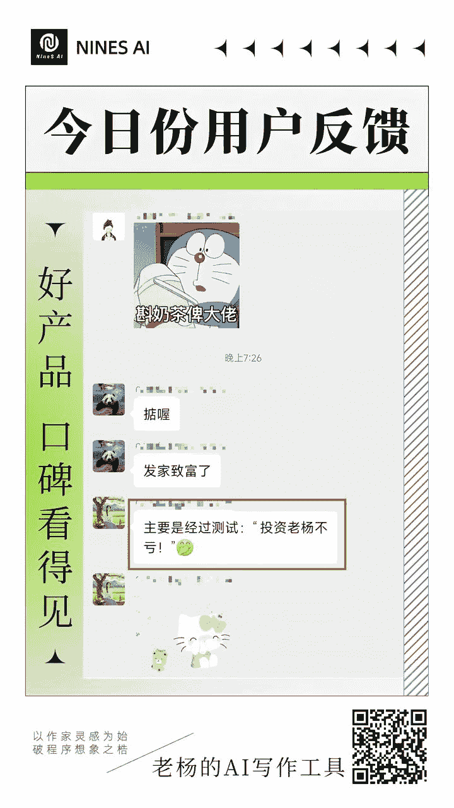

# AI写小说-NineS AI仿写《桃花马上请长缨》

> 来源：[https://rq547mr4oez.feishu.cn/docx/WiwDdR8wPoO0mExXWnTcg5TEn8f](https://rq547mr4oez.feishu.cn/docx/WiwDdR8wPoO0mExXWnTcg5TEn8f)

# 一、前言

> 各位小伙伴好~🎉🎉🎉NineS-AI与君又见😬。

> 缘分本就是稀薄寡断，相逢一程已是感激万分😙。

> **经过10月份的α测****试，小伙伴们都拿到了很多****好**结果（太多就不一一发图了），但是产品还是不够完善

> 所以第二期，在第一期的基础之上增加大量的优化和更改~

> **如今，部分11月内部测试的效果一一展现给大家~~**期待小伙伴们的尝试（送大量字数福利~~）

---

以下是题材类Prompt，无私奉献~~

1.  [AI写小说-“玄幻文”小说家完整Prompt-v2.0](https://rq547mr4oez.feishu.cn/wiki/ZCVbw9n7fiiG4ukQNoDcRiS5nZf?from=from_copylink)（经典题材）

1.  [AI写小说-“女频甜宠爽文”小说家独家Prompt](https://rq547mr4oez.feishu.cn/wiki/ARo9wUNi4iOKjNkj8ZbcUPtHn0c?from=from_copylink)（韭菜Y日记）

1.  [AI写小说-“女频狗xue虐文”完整Prompt](https://rq547mr4oez.feishu.cn/wiki/AX6awAc3Ii0u3nk1gDrcCYr1nRh)（韭菜Y日记）

1.  [AI写小说-“女频耽美文”小说家Prompt（万字）](https://rq547mr4oez.feishu.cn/wiki/Cx1YwmLNeizNW7kafvzcsmXTnQb)

1.  [AI写小说-“科幻文”小说家完整Prompt](https://rq547mr4oez.feishu.cn/wiki/JBycwlmDDiYBXykJlu1cHWcanrg?from=from_copylink)

1.  [AI写小说-“都市爽文”小说家独家Prompt](https://rq547mr4oez.feishu.cn/wiki/OFMtwYSYPiTmP6ktsh2cAKf3n1f?from=from_copylink)（经典题材）

1.  [AI写小说-“种田文”小说家独家Prompt](https://rq547mr4oez.feishu.cn/wiki/X5glwVf1DiQYWLkvlvHcCxjhnYe)

1.  [AI写小说-“后悔文”追妻火葬场完整Prompt](https://rq547mr4oez.feishu.cn/wiki/AzmhwUYiriTyoxkXVvPcaoGKncc?from=from_copylink)

1.  [AI写小说-“世情文”小说家独家Prompt](https://rq547mr4oez.feishu.cn/wiki/UTe7wMDOKiDYfbkuGIPcbJxsngg?from=from_copylink)

1.  [AI写小说-“快穿文”小说家独家Prompt](https://rq547mr4oez.feishu.cn/wiki/QQEhwsaoZiQlv0k4wHVc03Nln9e?from=from_copylink)（易上手题材之一）

1.  [AI写小说-“古言文”小说家独家Prompt](https://rq547mr4oez.feishu.cn/wiki/EpVJwNJAZiNtiQkcNdTcNVA2nNc?from=from_copylink)（经典题材）

1.  [AI写小说-“末世文”小说家独家Prompt](https://rq547mr4oez.feishu.cn/wiki/CrZqwEYP8iVbPpkIG1XcHGzFntc)（上新~new）

1.  [AI写小说-“系统文”小说家独家Prompt](https://rq547mr4oez.feishu.cn/wiki/AgJIwYMvEikzagkHwYhcsrMMnEf?from=from_copylink)（易上手题材之二）

1.  [AI写小说-“读心术”小说家独家Prompt](https://rq547mr4oez.feishu.cn/wiki/IAE8wHhiLi6c1jkdau3cTPZVnnb?from=from_copylink)

1.  [AI写小说-“升级流”小说家独家Prompt](https://rq547mr4oez.feishu.cn/wiki/CdriwSAi1iq2QLkWb0PcpxRknCd?from=from_copylink)

这个系列会持续做完所有题材，大家可以在粉丝群里面定制哦~。

---

PS：还有哪些问题可以评论或者私信我，我有空也可以解答。

**P**S：盗用这个文章的不要乱引流破坏环境，文章是免费分享给大家。有看见各位顺手举报下。感谢～资料纯分享不易。

**原始出处：**


#

# 二、内测结果反馈（一部分结果截图，还有很多）









# 三、当前状态（以作家灵感为始，破程序想象之梏。）

1.  **产品理念：**

1.  以作家灵感为始，破程序想象之梏。奉行长期价值主义~

1.  最懂文字创作者的AI创作工具，没有之一！不写文章的研发，不是好研发。

1.  **功能一览**

+   **AI拆书：**

+   短篇的情节节奏，情绪上下文怎么快速理解？

+   500万字的文本？小意思！NineS-AI帮你轻松拆解，分析风格，剖析情节和节奏，让你的创作之路不再迷茫。

+   **AI创作**

+   短篇、长篇、短剧三大类创作类型。从故事灵感到框架设定，从大纲到细纲，再到最终的正文生成，NineS-AI为你提供全流程的创作指南。

+   润色/扩写/续写/改写：灵感枯竭？旧作翻新？没问题！NineS-AI帮你,让你的创作灵感源源不断。

+   **AI助手**

+   高端玩家必备，物美价廉，自定义角色，四大主流AI除了创作，其他的工作也能用到哦~

1.  **我们的优势**

1.  质量为王：仿写只是基本操作，我们的目标是打造最高质量的AI创作平台。

1.  重做文章G评系统：NineS-AI的创作70~85分起步，与市面上那根本无法与之相提并论（支持全网产品竞技PK哦~）

1.  高端定制：对于美主义者，我们还提供80~90分的“私人订制”服务，当然，时间和成本也会相应增加，具体情况具体分析。

1.  **产品进度**

1.  种子测试时间（100+全职作者测试）开始时间：2024-10-14    结束时间：2024-11-15

1.  内测时间（群无条件邀请测试）**开始时间：2024-11-22晚19.3**0    结束时间：2024-12-30

# 四、仿写**案例~**

### 仿写思路：

+   4个调试AI（集齐市面最强大的写作AI，包括我们微调版本）

+   二十种通用风格（长篇、短篇、短剧~）

### 拆书分析（还有很多拆书内容就不一一展示）

```
拆书-《桃花马上请长缨》
====
# 故事梗概
## 一、基本信息
1. 选题: 一位女子在被迫接受丈夫的平妻后，选择与其和离，追求自我独立与尊严。
2. 题材: 古代言情
3. 类型: 武侠、宫斗
4. 字数: 24470
5. 期待感: 女主在面对婚姻的不公时，如何勇敢追求自己的幸福与尊严。

## 二、故事设定
**1. 背**景设定: 故事发生在古代王朝，战乱不断，武将家族的兴衰。
2. 主角:
    - 宋惜惜：武将侯府出身，性格坚韧，聪慧独立，面临父母的惨死和婚姻的不幸。
    - 主角人设的七步法：
        - 目标：追求个人的幸福和尊严。
        - 阻碍：丈夫的背叛与家庭的压力。
        - 行动：要求和离，与丈夫对抗。
        - 结果：成功获得和离旨意，走向新生活。
        - 意外：丈夫并不愿意放手，产生冲突。
        - 转折：通过自己的努力与智慧逐渐赢得尊重。
        - 结局：最终获得自由与独立。
3. 配角:
    - 战北望：宋惜惜的丈夫，武将，有情有义却因军功而背叛婚约。
    - 易昉：女将军，战北望的平妻，与宋惜惜形成对比。
4. 核心梗: 女子在男权社会中争取自身权利与地位，通过和离实现自我救赎。
5. 核心内容:
    - 危机: 宋惜惜面临丈夫纳妾与家庭破裂的危机。
    - 伏笔: 对于父母惨死的回忆，以及她对自己未来的思考。
    - 悬念: 她能否成功获得和离？
    - 爽点: 她通过智慧与勇气反击家庭的不公。

## 三、故事脉络
1. 核心冲突: 人物之间围绕婚姻、忠诚、权利的冲突（人与人）。
2. 情感纽带: 爱情、亲情、责任等情感交织。
3. 故事反转: 宋惜惜从依附于丈夫到选择独立自主的转变。
4. 二次反转: 战北望对宋惜惜态度的变化，从爱到厌恶，再到无奈与愤怒。
5. 整体节奏:
    - [开篇描述宋惜惜处境] [引入主要矛盾][情绪低落]
    - [宋惜惜决心要求和离] [展现她勇敢的一面][情绪坚定]
    - [战北望愤怒回应] [加深冲突][情绪紧张]
    - [宋惜惜冷静应对] [表现她的智慧][情绪反转]
6. 写作风格: 文笔细腻，情感真挚，有强烈的人物心理描写。
====
```

### 节奏版（字数1046）

```
**第一章  将军难留**
  夜色深沉。
  风灯映照着文熙居的窗棂，投下斑驳的光影。
  宋惜惜端坐在椅子上，指尖轻抚着茶杯，目光却落在了紧闭的房门上。
  她今日特意换了一身石榴红的衣裙，精心描画了眉眼，只为迎接新婚丈夫战北望的归来。
  战北望凯旋已有三日，却一直宿在书房，未曾踏足文熙居半步。
  宋惜惜心中隐隐不安，却又强迫自己保持镇定。
  「吱呀」一声，房门被推开。
  宋惜惜连忙起身，脸上绽放出一抹温柔的笑意，「将军回来了。」
  战北望一身戎装，眉宇间带着掩饰不住的疲惫。
  他径直走到桌边，给自己倒了一杯茶，语气平静，「惜惜，我有事要与你说。」
  宋惜惜的心猛地一沉，预感到即将发生的事情不会简单。
  战北望放下茶杯，目光落在宋惜惜脸上，「易昉将军不日将进府。」
  宋惜惜的笑容僵在脸上，「易昉将军？她……要来做什么？」
  战北望深吸一口气，「她会成为我的……平妻。」
  「平妻？」宋惜惜的声音微微颤抖，「将军，平妻便是妾，您是要纳妾吗？」
  战北望皱起眉头，「惜惜，易昉不是妾，她是我的妻子，与你一样。」
  宋惜惜只觉得一股寒意从脚底直冲头顶，眼前一阵发黑。
  她想起当初战北望信誓旦旦的承诺，说会一生一世一双人，如今却要迎娶别的女子进门，还美其名曰「平妻」。
  「将军，您说过……您说过……」宋惜惜的声音哽咽，泪水在眼眶中打转。
  战北望眼中闪过一丝不忍，「惜惜，我爱上了易昉，我不能没有她。」
  宋惜惜只觉得心中一阵绞痛，仿佛被人狠狠剜去一块肉。
  「父母……父母可知此事？」宋惜惜抓住最后一根稻草。
  战北望沉默片刻，「易昉已经与母亲见过面了。」
  宋惜惜心中最后一丝希望也破灭了。
  她想起自己为了救治身受重伤的易昉，不惜耗费心血，甚至以身试药，到头来却换来了这样的结果。
  「惜惜，我知道你心中委屈，但我希望你能以大局为重，成全我和易昉。」战北望的语气 softened 些许。
  宋惜惜抬起头，目光冰冷，「大局？我的委屈便不是大局了吗？」
  「我想见见易昉将军。」宋惜惜语气坚定。
  战北望犹豫了一下，「她……她性格直爽，不善言辞，恐怕……」
  「将军是在说我善妒，容不下她吗？」宋惜惜打断战北望的话。
  「惜惜，你误会了，我只是……」
  「我要见她。」宋惜惜再次强调，语气不容置疑。
  战北望看着宋惜惜坚定的眼神，最终还是妥协了，「好吧，我明日安排你们见面。」
  宋惜惜深吸一口气，将眼中的泪水逼回去。
```

### 细节版（字数951）

```
**第一章 婚姻的枷锁**
风灯摇曳，柔和的光影在雕花窗棂上跳动。
文熙居内，一片静谧。
宋惜惜端坐椅上，纤纤玉指不自觉地捏紧了衣角。
她凝视着门口，期待又忐忑地等待着新婚夫君战北望的到来。
脚步声渐近，宋惜惜不由得屏住呼吸。
战北望推门而入，目光却未曾落在她身上。
「惜惜，我有事与你商议。」他的声音冷淡疏离，宛如一盆冰水浇在宋惜惜心头。
「夫君请讲。」宋惜惜强压下心中不安，抬眼望向战北望。
战北望深吸一口气，「易昉将军即将进门，你需做好准备。」
宋惜惜愣住，美眸中闪过一丝困惑，「夫君何出此言？难道要纳妾吗？」
「非也。」战北望面无表情，「易将军与你同为平妻。」
「平妻？」宋惜惜蓦地站起，不可置信地望着战北望，「夫君可知平妻之名，实为妾？」
战北望眉头一皱，「易昉绝非妾室。我与她相识多年，情投意合。」
宋惜惜只觉胸口一阵剧痛，往事如潮水般涌来。
「夫君可还记得大婚之日的誓言？你说过，此生只娶我一人。」她的声音微微颤抖，眼中闪烁着愤怒的火光。
战北望沉默片刻，终于直视宋惜惜的眼睛，「惜惜，我爱上了易昉。我恳请你成全我们。」
「成全？」宋惜惜冷笑一声，「父母可知此事？他们怎会同意这般荒唐的婚事！」
「令堂已与易昉交谈甚欢。」战北望淡淡道。
这句话如同一记重锤，狠狠击碎了宋惜惜最后的希望。
她想起自己为易昉开的药方，为她日夜照料的情景。
讽刺的是，那时她还天真地以为是在帮助夫君的战友。
「原来如此。」宋惜惜冷冷道，「我竟不知，我为她开的药方，竟是为自己酿苦酒。」
战北望面露愧色，「惜惜，你我皆知此事难以两全。还请你顾全大局，莫要让外人看了笑话。」
宋惜惜倏地抬头，美眸中闪过一丝寒光，「既然如此，不知妾身可否见见这位易将军？」
「不必了。」战北望断然拒绝，「易昉性格倔强，不屑与他人解释。」
「夫君此言差矣。」宋惜惜冷笑，「我宋惜惜虽为女子，却也是堂堂武将侯府嫡女。难道在夫君眼中，我连见一面的资格都没有？」
战北望沉默不语，宋惜惜继续道：「既然夫君如此看重易将军，那妾身更要当面拜见。若是连这点体面都不给，恐怕外人会说夫君欺侮发妻。」
战北望眉头紧锁，正欲开口，却见宋惜惜已径直走向门口。
她回首，眼中泪光闪烁，却倔强地扬起下巴：「夫君若是真心敬重易将军，又何惧我们相见？除非...」
```

### 均衡版（字数869）

```
**第一章**

文熙居内，灯火阑珊，窗棂上的风灯轻轻摇曳，映出一片静谧的氛围。
室内的陈设简约而不失雅致，墙上挂着几幅古画，书案上摆放着几卷书籍。香炉中袅袅升起的青烟，为这夜增添了几分神秘。
宋惜惜坐在椅子上，目光时而望向窗外，时而凝视着桌上的茶盏。
她的心情如同这夜色一般沉重而复杂。
新婚丈夫战北望迟迟未归，她心中那份期待与不安交织成一股难以言喻的情绪。
终于，门被推开，一阵冷风随之而入。
战北望踏入房间，他那俊美威武的身影在烛光下显得格外挺拔。
他径直走到宋惜惜面前，神情冷峻。
「惜惜，我有件事要告诉你。」他的声音平静，却带着一种无法抗拒的力量。
宋惜惜微微一愣，心中隐隐感到不安。「何事？」
「易昉将军即将进门。」战北望淡淡地说道。
宋惜惜心头一震，这个名字如同一把利剑刺入她的心底。
「平妻？」她轻声问道，语气中充满了疑惑和不解。
战北望摇头，「不是平妻，她是我的爱人。」
宋惜惜只觉天旋地转，她努力回忆起与战北望结婚时的承诺，那些甜蜜的话语如今却显得如此讽刺。「你曾经说过，会对我好。」
「我对易昉是真心实意。」战北望直视着她，「希望你能成全我们。」
宋惜惜深吸了一口气，她想到了自己的父母，他们是否知晓这桩婚事会变成这样。「父母可曾同意？」
战北望沉默片刻，「易昉已与母亲交谈。」
这句话如同一记重击，让宋惜惜感到被彻底忽视与嘲讽。
她回忆起自己为易昉治病时付出的努力，如今却换来了这样的结果。「我从未想过，你会如此待我。」
「为了大局着想，希望你能理解。」战北望语气缓和，却依旧坚定。
宋惜惜抬起头来，「我要见易昉。」
「不必了，她性格直率，不会与你多言。」战北望拒绝道。
「你当我是妾吗？」宋惜惜反驳道，她不甘于被轻视，更不愿意让自己的尊严受损。
「若是见面能解决问题，我愿意。」她的话语中透出一种决然，与其被动接受，不如主动面对。
战北望看着她，那双眼睛里闪过一丝复杂，却终究没有再说什么。
他转身离去，只留下一室冷清与无尽的思绪。
窗外风声渐起，如同宋惜惜此刻翻涌的心潮。
```

### 微调版（字数1101）

```
**第一章**
文熙居的风灯轻轻摇曳，昏黄的灯光透过雕花窗棂洒在屋内，映照出一片静谧的氛围。
宋惜惜端坐在檀木椅上，双手交叠放在膝头，眼神中带着一丝不易察觉的期待与不安。
今晚，她等待着新婚丈夫战北望的到来，心中却充满了复杂的情绪。
终于，门外传来轻微的脚步声，战北望推门而入，俊美的面容在灯光下显得格外威武。
他走到宋惜惜面前，语气平静而坚定：“惜惜，有件事我必须告诉你。”
宋惜惜的心猛地一沉，她抬起头，目光与战北望对视，声音微微颤抖：“是什么事？”
战北望没有回避，直言道：“易昉将军即将进门，成为我的平妻。”
宋惜惜的心如被重锤击打，她皱起眉头，疑惑地问道：“平妻？这到底是怎么回事？”
战北望的眼神中闪过一丝无奈，但语气依然坚定：“易昉与我有深厚的感情基础，她是我心中的重要之人。”
宋惜惜的心中涌起一股强烈的不甘与愤怒，她想起与战北望结婚时的承诺，那是一场由皇帝亲自赐婚的婚礼，他曾许诺会对她好，如今却变成了空话。
她的眼底闪过一抹泪光，但很快被坚定的神情所取代：“你曾对我许下诺言，如今却要迎娶他人，这让我如何甘心？”
战北望的神色有些复杂，他低声说道：“我知道这对你不公平，但我确实爱上了易昉，我希望你能成全我们。”
宋惜惜的心如刀绞，她质问道：“你有没有问过我的父母，他们是否同意这门亲事？”
战北望沉默片刻，缓缓开口：“易昉已经与母亲交谈过，她们之间达成了一致。”
宋惜惜的心彻底凉了，她回想起自己曾经为了易昉的病痛付出的努力，甚至不惜耗费家中的珍贵药材，如今却换来这样的结果。
她的心中充满了不平衡感，愤怒的情绪如同火山般喷发而出：“我为她治病，付出了多少心血，她却如此对我，这公平吗？”
战北望的眼神中闪过一丝愧疚，但他依然坚定地说道：“我知道你不容易，但我希望你能理解，易昉对我而言非常重要。”
宋惜惜冷笑一声，眼中闪烁着坚定的光芒：“我理解不了，我只希望你能给我一个交代。”
战北望的语气中带着一丝恳求：“我希望你能成全大局，这样对我们三人都好。”
宋惜惜的眸中闪过一丝冷冽，她冷冷地说道：“既然如此，我希望见一见易昉，当面问清楚这一切。”
战北望的脸色微变，他摇了摇头：“易昉的性格不屑一顾，她不会见你的。”
宋惜惜的心中涌起一股不服输的念头，她坚定地说道：“我不在乎她是否见我，我要维护自己的尊严和立场。”
战北望的神色变得严肃，他深知宋惜惜的坚韧与智慧，但也明白她的决心不容小觑：“惜惜，你真的要这么做吗？”
宋惜惜站起身来，目光坚定而清澈：“是的，我必须这么做。无论结果如何，我都要为自己争取一次机会。”
战北望沉默了片刻，最终点了点头：“好吧，我会安排你们见面。”
```