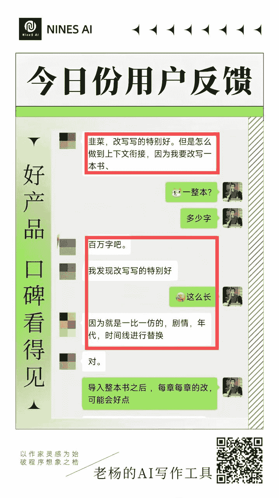
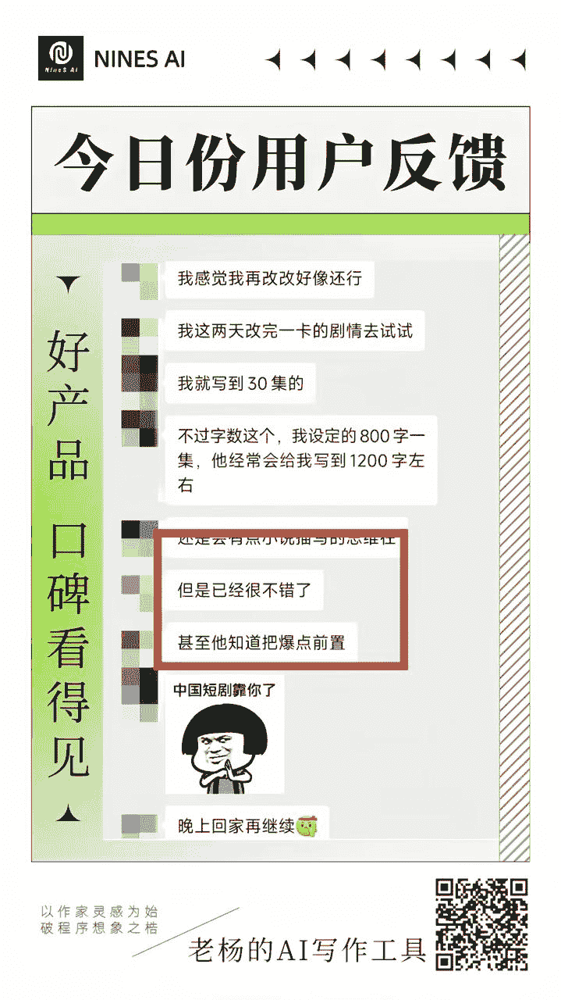
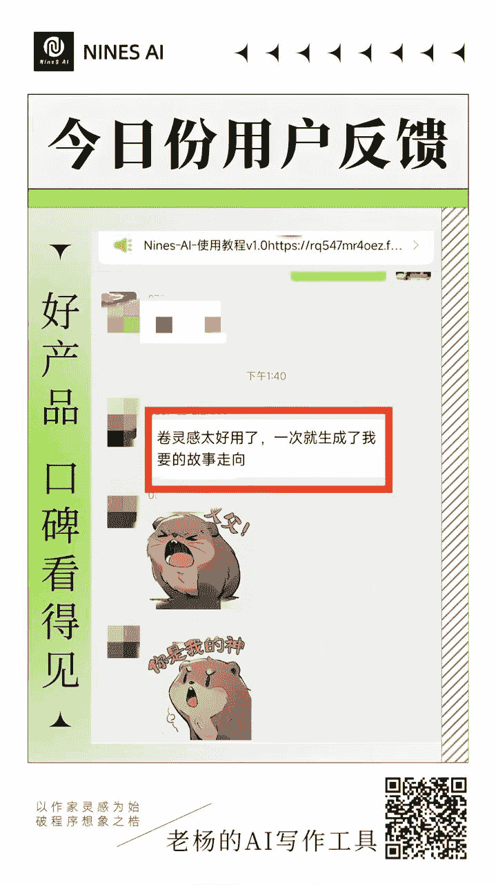

# AI写小说-NineS AI仿写《活在真空里》

> 来源：[https://rq547mr4oez.feishu.cn/docx/RAJldR9nJotkiDxGEq0cONiZnfb](https://rq547mr4oez.feishu.cn/docx/RAJldR9nJotkiDxGEq0cONiZnfb)

## 一、前言

> 各位小伙伴好~🎉🎉🎉NineS-AI与君又见😬。
> 缘分本就是稀薄寡断，相逢一程已是感激万分😙。
> 经过10月份的α测试，小伙伴们都拿到了很多好结果（太多就不一一发图了），但是产品还是不够完善。
> 所以第二期，在第一期的基础之上增加大量的优化和更改~。
> 如今，部分11月内部测试的效果一一展现给大家~期待小伙伴们尝试（送大量字数福利~~）。

---

以下是题材类Prompt，无私奉献~~

1. [AI写小说-“玄幻文”小说家完整Prompt-v2.0](https://rq547mr4oez.feishu.cn/wiki/ZCVbw9n7fiiG4ukQNoDcRiS5nZf?from=from_copylink)（经典题材）
1. [AI写小说-“女频甜宠爽文”小说家独家Prompt](https://rq547mr4oez.feishu.cn/wiki/ARo9wUNi4iOKjNkj8ZbcUPtHn0c?from=from_copylink)（韭菜Y日记）
1. [AI写小说-“女频狗xue虐文”完整Prompt](https://rq547mr4oez.feishu.cn/wiki/AX6awAc3Ii0u3nk1gDrcCYr1nRh)（韭菜Y日记）
1. [AI写小说-“女频耽美文”小说家Prompt（万字）](https://rq547mr4oez.feishu.cn/wiki/Cx1YwmLNeizNW7kafvzcsmXTnQb)
1. [AI写小说-“科幻文”小说家完整Prompt](https://rq547mr4oez.feishu.cn/wiki/JBycwlmDDiYBXykJlu1cHWcanrg?from=from_copylink)
1. [AI写小说-“都市爽文”小说家独家Prompt](https://rq547mr4oez.feishu.cn/wiki/OFMtwYSYPiTmP6ktsh2cAKf3n1f?from=from_copylink)（经典题材）
1. [AI写小说-“种田文”小说家独家Prompt](https://rq547mr4oez.feishu.cn/wiki/X5glwVf1DiQYWLkvlvHcCxjhnYe)
1. [AI写小说-“后悔文”追妻火葬场完整Prompt](https://rq547mr4oez.feishu.cn/wiki/AzmhwUYiriTyoxkXVvPcaoGKncc?from=from_copylink)
1. [AI写小说-“世情文”小说家独家Prompt](https://rq547mr4oez.feishu.cn/wiki/UTe7wMDOKiDYfbkuGIPcbJxsngg?from=from_copylink)
1. [AI写小说-“快穿文”小说家独家Prompt](https://rq547mr4oez.feishu.cn/wiki/🐧EhwsaoZiQlv0k4wHVc03Nln9e?from=from_copylink)（易上手题材之一）
1. [AI写小说-“古言文”小说家独家Prompt](https://rq547mr4oez.feishu.cn/wiki/EpVJwNJAZiNtiQkcNdTcNVA2nNc?from=from_copylink)（经典题材）
1. [AI写小说-“末世文”小说家独家Prompt](https://rq547mr4oez.feishu.cn/wiki/CrZqwEYP8iVbPpkIG1XcHGzFntc)（上新~new）
1. [AI写小说-“系统文”小说家独家Prompt](https://rq547mr4oez.feishu.cn/wiki/AgJIwYMvEikzagkHwYhcsrMMnEf?from=from_copylink)（易上手题材之二）
1. [AI写小说-“读心术”小说家独家Prompt](https://rq547mr4oez.feishu.cn/wiki/IAE8wHhiLi6c1jkdau3cTPZVnnb?from=from_copylink)
1. [AI写小说-“升级流”小说家独家Prompt](https://rq547mr4oez.feishu.cn/wiki/CdriwSAi1iq2QLkWb0PcpxRknCd?from=from_copylink)

这个系列会持续做完所有题材，大家可以在粉丝群里面定制哦~。

---

PS：还有哪些问题可以评论或者私信我，我有空也可以解答。

PS：盗用这个文章的不要乱引流破坏环境，文章是免费分享给大家。有看见各位顺手举报下。感谢～资料纯分享不易。

**原始出处：**


## 二、内测结果反馈（少部分截图，还有很多）








## 三、当前状态（以作家灵感为始，破程序想象之梏。）

### 1. 产品理念

以作家灵感为始，破程序想象之梏。奉行长期价值主义~

最懂文字创作者的AI创作工具，没有之一！

不写文章的研发，不是好研发。不会写代码的作者，总是欠缺一点什么~~（就是这么自信）

### 2. 功能一览

#### AI拆书

短篇的情节节奏，情绪上下文怎么快速理解？500万字的文本？小意思！NineS-AI帮你轻松拆解，分析风格，剖析情节和节奏，让你的创作之路不再迷茫。

#### AI创作

短篇、长篇、短剧三大类创作类型。从故事灵感到框架设定，从大纲到细纲，再到最终的正文生成，NineS-AI为你提供全流程的创作指南。

润色/扩写/续写/改写：灵感枯竭？旧作翻新？没问题！NineS-AI帮你，让你的创作灵感源源不断。

#### AI助手

高端玩家必备，物美价廉，自定义角色，四大主流AI。除了创作，其他的工作也能用到

### 3. 我们的优势

质量为王：仿写只是基本操作，我们的目标是打造最高质量的AI创作平台。

重做文章G评系统：NineS-AI的创作70~85分起步，与市面上那根本无法与之相提并论（支持全网产品竞技PK哦~）

高端定制：对于美主义者，我们还提供80~90分的“私人订制”服务，当然，时间和成本也会相应增加，具体情况具体分析。

### 4. 产品进度

种子测试时间（100+全职作者测试）开始时间：2024-10-14    结束时间：2024-11-15

内测时间（群无条件邀请测试）开始时间：2024-11-22    结束时间：2024-12-30

## 四、仿写案例~

### 拆书分析（还有很多拆书内容就不一一展示）

```
**# 故事梗概**
====
## 一、基本信息
1. 选题: 讲述一个大学生律师经手的一起农民工杀人案，以及案件背后隐藏的真相。
2. 题材: 法律、悬疑
3. 类型: 纪实文学，推理小说
4. 字数: 23736 (此处为估算，实际字数需根据原文计算)
5. 期待感:  揭开农民工杀人案背后的真相，以及案件中隐藏的秘密，最终实现正义。

## 二、故事设定
1. 背景设定: 2014年，中国某地的建筑工地。
2. 主角: 
    -  一位刚毕业的法学系大学生，初入职场的律师。
    -  主角人设的七步法：
        目标：为学弟张和减刑。
        阻碍：铁证如山的证据，被害人家属的强烈反对，缺乏经验。
        行动：研究案卷，会见张和，收集证据，进行庭审辩护。
        结果：第一次庭审张和被判死刑。
        意外：张和翻供，称受项目经理周钱指使。
        转折：发现孙华的遗言视频，证明孙华是自愿被杀。
        结局：张和被判处有期徒刑两年，周钱被判死刑。
3. 配角: 张和（凶手，大学生，家境贫困），孙华（被害人，农民工，身患癌症），周钱（项目经理，幕后主使），张平（张和的哥哥，被害人）。
4. 核心梗: 买凶杀人、嘱托杀人、真相隐藏在多重反转中。
5. 核心内容: 
    - 危机: 张和被判死刑；周钱企图逃避法律责任；真相被掩盖。
    - 伏笔: 张和与孙华的秘密交易；孙华的遗言视频；周钱的异常反应。
    - 悬念:  孙华的遗言视频内容；周钱的真实身份和动机；张和的真实目的。
    - 爽点:  真相逐渐揭开；周钱被绳之以法；张和获得轻判。

## 三、故事脉络
1. 核心冲突:  张和与法律的冲突；张和与周钱的冲突；正义与邪恶的冲突。
2. 情感纽带:  兄弟情谊；对亲人的思念；对正义的追求。
3. 故事反转: 张和翻供，称受周钱指使；孙华遗言视频曝光，证明是嘱托杀人。
4. 二次反转: 张和再次翻供，称自己没杀人，并提供新的视频证据，证明孙华自杀。
5. 整体节奏: 
    - 第一章：案件背景介绍，张和被捕，律师接受委托。（悬念：为什么杀人？）(低落)
    - 第二章：第一次庭审，张和被判死刑。（绝望）
    - 第三章：张和翻供，揭露周钱买凶杀人。（希望）
    - 第四章：警方调查周钱，没有证据。（低落）
    - 第五章：律师试图获得被害人家属谅解，失败。（绝望）
    - 第六章：警方调查周钱无果，案件进入二审。（低落）
    - 第七章：张和提供孙华遗言视频。（希望）
    - 第八章：律师得知真相，孙华是自愿被杀。（震惊）
    - 第九章：律师怀疑张和隐瞒真相。（疑惑）
    - 第十章：律师中止辩护，发现张和隐瞒更多信息。（疑惑）
    - 第十一章：第三次庭审，张和再次翻供。（悬念：真相是什么？)(紧张)
    - 第十二章：张和揭露周钱活埋张平的秘密。（震惊）
    - 第十三章：张和讲述自己寻找哥哥的经历。（同情）
    - 第十四章：张和讲述与孙华的计划。（震惊）
    - 第十五章：张和提供新的视频证据，证明孙华自杀。（真相大白）(解脱)
    - 第十六章：案件真相大白，周钱被捕。（正义）(兴奋)
    - 第十七章：张和被判两年有期徒刑。（圆满）(喜悦)
    - 第十八章：案件后续，周钱被判死刑。（结局）(平静)
6. 写作风格:  纪实风格，穿插推理元素，情感细腻。
====
```

### 节奏版（字数1906）

```
**第1章: 学弟的命案**
  2013年夏，我从法学系毕业。
  我顺利地找到了一家还算不错的律所。
  每天西装革履地游走于这座城市的大街小巷，和形形色色的人打交道。
  我以为我的人生会像大多数毕业生那样，按部就班地工作、结婚、生子。
  然而，命运却给我开了一个天大的玩笑。
  我接到了张和的电话。
  「锋哥，我是张和，你还记得我吗？」
  他声音颤抖，带着一丝哭腔。
  我愣了一下，才反应过来他是我的大学学弟。
  张和是那种丢在人群里就找不到的普通男生，沉默寡言，成绩平平。
  唯一让我印象深刻的是，他有一双清澈的眼睛，像山间的清泉，不染尘埃。
  「当然记得，怎么了？」
  「我……我杀人了。」
  电话那头的声音低沉得几乎听不见。
  我感觉自己的心脏猛地一沉，像是被一只无形的手狠狠攥住。
  「你在开玩笑吧？」
  我努力保持镇定，但声音还是不受控制地颤抖起来。
  「没有，锋哥，我没开玩笑。」
  他顿了顿，继续说道：「我现在被关在看守所，你能来帮我吗？」
  我深吸了一口气，努力让自己冷静下来。
  「好，我明天去看你。」
  挂断电话后，我感觉浑身无力，瘫坐在椅子上。
  我无法相信，那个曾经在我眼中纯净如水的学弟，竟然会杀人。
  第二天，我来到了看守所。
  在冰冷的会客室里，我见到了张和。
  他比以前瘦了很多，脸色苍白，眼神空洞，仿佛失去了灵魂。
  「锋哥……」
  他看到我，眼睛里闪过一丝希冀的光芒。
  我强忍着心中的悲痛，在他对面坐下。
  「到底怎么回事？」
  我尽量用平静的语气问道。
  张和沉默了片刻，然后开始讲述事情的经过。
  2014年8月14日，张和在工地宿舍杀害了他的室友孙华。
  案发前，他提前打电话报警，告知了警方作案时间和地点。
  他用绳子勒死了孙华，然后将他吊在宿舍的房梁上。
  当警方赶到现场时，张和正坐在下铺，神情麻木。
  根据警方的调查，张和的杀人动机是因为与孙华在工作中发生过争执，怀恨在心。
  「锋哥，我不想杀他的……」
  张和的声音哽咽了，「我真的不想杀他……」
  我看着眼前这个曾经阳光开朗的学弟，如今却变成了一个杀人犯，心中充满了悲哀和无奈。
  「案发后五天才想到找我？」
  我问道。
  「法院给我指派了一个律师，但他根本不想管我，说我是铁案，让我直接认罪。」
  张和低下头，声音越来越小，「我不想认罪，我相信法律是公正的。」
  「你家里人呢？」
  「我爸妈都是农民，没什么文化，也不知道该怎么办。」
  张和抬起头，眼中充满了绝望，「锋哥，你一定要帮我，我不想坐牢……」
  我沉默了。
  我当然想帮他，但我知道，这起案件的证据确凿，几乎没有辩护的空间。
  「张和，」
  我深吸了一口气，说道，「我实话告诉你，你的案子很棘手，你很可能会被判无期徒刑。」
  张和的身体猛地一颤，眼神中的光芒瞬间熄灭。
  「怎么会……怎么会这样……」
  他喃喃自语，像是失去了所有的希望。
  我翻阅着案卷，三天三夜没有合眼。
  我努力寻找着案件的突破口，但所有的证据都指向张和就是凶手。
  我甚至开始怀疑，张和是不是真的杀了人。
  我再次来到看守所，和张和见面。
  「张和，」
  我开门见山地说道，「你的案子，我接了。」
  张和抬起头，眼中闪过一丝惊讶。
  「锋哥，你……」
  「但是，」
  我打断了他，「我必须告诉你，你的案子非常困难，我不敢保证一定能让你无罪释放。」
  「我知道，锋哥，」
  张和点点头，「只要你肯帮我，我就很感激了。」
  我叹了口气，继续说道：「根据我的分析，你至少会被判无期徒刑。」
  张和的脸色瞬间变得惨白。
  「你提前报警，并留在现场等待警察，这并不能构成自首。」
  我解释道，「因为你在作案过程中有充分的时间后悔，但你并没有放弃。」
  张和的嘴唇微微颤抖，却没有说话。
  「如果你在狱中表现良好，最快服刑13年就可以出狱。」
  我说道。
  13年，对于一个20多岁的年轻人来说，几乎是半辈子。
  「锋哥，求求你，帮帮我……」
  张和突然跪在我面前，痛哭流涕。
  我心中一酸，将他扶了起来。
  「张和，你告诉我，你为什么要杀人？」
  我问道，「你为什么要杀孙华？」
  张和抬起头，眼神中充满了痛苦和挣扎。
  「我……我……」
  他张了张嘴，却什么也没说出来。
  我看着他，心中充满了疑惑。
  张和的杀人动机，真的只是因为工作上的争执吗？
  这起案件的背后，是否还隐藏着什么不为人知的秘密？
```

### 细节版（字数1074）

```
**第1章: 学弟的命案**

今天是我接手第一起刑事案件的日子。
在法学院毕业不到半年的我，刚刚挂牌开业不久，就接到了一位&quot;金主&quot;的委托。
这位委托人正是我大学时的学弟张和。

「师兄,我真的不是有意杀人的!」张和焦急地抓着我的手臂,眼神充满恳求。
「我那天只是想教训一下老孙,没想到会......」

我沉默地看着他,内心感到无比复杂。2014年8月14日,张和在工地宿舍杀害了自己的室友孙华。
案情简单明了:张和提前告知警方作案时间地点,用绳子勒死了孙华,警察到达时他已将尸体吊起并坐在下铺。

据张和交代,他与孙华平日里工作时发生推搡矛盾,一直怀恨在心。
最终他选择了极端的报复方式。
不难看出,这是一起罪证确凿的铁案。

看着张和焦急的神情,我的心情却异常沉重。
作为他的学长,我无法理解他居然会做出这种事情。
我知道,即便我为他竭尽全力辩护,他也很难逃脱无期徒刑的命运。

「学弟,你知道你的行为会面临什么样的法律后果吗?」我尽量用冷静的语气开口。
「根据现有证据,你最高可能被判无期徒刑。即使最后判两年,出狱后你也会背负终生抹不去的犯罪记录。」

「我..我明白。」张和沮丧地低下头,眼中闪烁着泪光。
「但求师兄你能尽全力帮帮我,我只是想为我母亲报仇...」

我叹了口气,缓缓坐回椅子上。张和家庭贫困,恐怕连律师费都拿不出来。
但是,即便我同情他的处境,这起案件的证据确凿程度也让我很无助。

我在案卷上反复研究了三天,试图寻找任何可以为张和翻案的角度。
但现有证据确凿,几乎没有任何辩护的空间。
最后我只能认清现实,坦白地告知张和:「你的情况确实非常严峻,法庭几乎不可能判你无罪。即使表现良好也只能最快服刑13年出狱。我会尽力为你争取,但你必须做好最坏的准备。」

「不,不可能!」张和绝望地捶打桌子,眼神中充满了恐慌。「这不公平,我只是想为母亲报仇啊!」

我沉默地看着张和失控的样子,内心五味杂陈。
我明白他内心的冲动和绝望,但是法律面前,个人的情绪和动机都无法成为减轻处罚的理由。
这是我作为一名新晋律师必须学会面对的残酷现实。

「张和,我理解你的愤怒和悲伤。但是,即便你的行为出于正义,法律也无法包容。
作为一个合格的律师,我必须提醒你,未来的路只有认罪接受宽恕,这样才能争取到最好的结果。」

我握住他颤抖的双手,试图用温和的语气安抚他的情绪。
「好好思考一下吧,我会全力为你辩护的。只要你表现良好,出狱后或许还有重新生活的可能。」

「出狱?」张和嘲讽地笑了笑,眼神中充满了绝望。「我已经没有什么可失去的了,师兄。」
```

### 均衡版（字数750）


# 第1章: 学弟的命案

我从未想过，自己作为一名刚毕业的律师，所经手的第一起案件竟会如此复杂。

那是一个炎热的夏日，我接到了学弟张和的电话，他的声音透着无助与急切。

「陶哥，我需要你的帮助。」

他的语气让我心头一紧。

我知道他在工地上做事，却不曾料到他会卷入一场命案。

2014年8月14日，张和在工地宿舍杀害了他的室友。

案件发生得如此突然，以至于我还未来得及消化这一切。

他提前告知警方作案时间地点，用绳子勒死了被害人，并将尸体吊起。

当警方赶到时，他正坐在下铺，神情恍惚。

「你为什么要这么做？」我问他，尽量让自己的声音保持平静。

「因为推搡。」他低声回答，眼神游离不定，「我怀恨在心。」

这个理由让我感到难以置信，一个简单的推搡竟能引发如此极端的行为？

五天后，他才找到我寻求法律援助，因为法院指派的律师想推辞此案。

他的家庭贫困，无力承担律师费用，而我接手案件的原因并不明确，或许是出于大学情谊，或许是不相信他会杀人。

案件证据确凿，几乎没有辩护空间，是铁案。

我研究了三天案卷，制定辩护方案，并与张和会面。

「张和，你至少会被判无期徒刑。」我直言不讳，「你的‘自首’行为不成立。」

他的脸色瞬间苍白，那种绝望如潮水般涌来，让我也感到窒息。

「为什么？」他问道，声音有些颤抖。

「因为你在作案过程中有悔过机会却未放弃。」我解释道，「如果表现良好，最快服刑13年可以出狱。」

听完这些，他沉默了很久，然后抬起头，用一种近乎哀求的目光看着我：「陶哥，请帮帮我。」

他的请求让我心中升起一丝不忍，但更多的是对他杀人动机的不解。

一个平日里老实本分的人，为何会做出如此冲动之举？

这是一个充满悬念与矛盾的故事，而答案似乎隐藏在更深层次的真相中。

## 微调版（字数967）

2014年8月14日，我从法学系毕业，成为了一名新人律师。我的第一起刑事案件，竟然是一名学弟的杀人案。张和，曾经的校园风云人物，如今却成了杀人凶手。

案件发生在2014年8月14日，张和在工地宿舍杀害了室友孙华。案情细节令人震惊：张和提前告知警方作案的时间和地点，用绳子勒死被害人，然后将尸体吊起，坐在下铺等待警察的到来。

作案动机简单粗暴：因为与被害人平日里干活时发生推搡，张和怀恨在心。然而，这并非全部真相。张和案发后五天才找到我寻求法律援助，原因是法院指派的律师想推辞此案。

张和的家庭贫困，无力承担律师费用。我接手案件的原因不明确，可能是出于大学情谊，也可能是我不相信他会杀人。无论如何，我决定帮助他。

证据确凿，几乎没有辩护空间，这是一起铁案。我研究案卷三天，制定了辩护方案，并与张和会面。当我告诉他至少会被判无期徒刑时，他的眼神中闪过一丝绝望。

「陶锋，我真的不是故意的。」张和的声音带着颤抖，「我只是想吓唬他一下，没想到……」

「你提前告知警方作案时间和地点，这种行为无法被视为自首。」我冷静地解释道，「你在作案过程中有悔过的机会，但你没有放弃。」

「我知道错了，但我真的不想坐牢那么久。」张和的眼神中充满了恳求，「陶锋，你一定要帮帮我。」

我的心中涌起一股复杂的情绪。张和的杀人动机让我感到不解，他的行为背后隐藏着更多的秘密。我告诉他，如果表现良好，最快服刑13年可以出狱。

「我会尽全力帮你，但你也需要配合。」我坚定地说，「我们需要找到更多的证据，证明你的清白。」

张和点了点头，眼中闪过一丝希望。然而，我知道这起案件远比表面上看起来复杂得多。张和的行为背后，究竟隐藏着怎样的真相？

当我走出看守所，夜幕已经降临。冷风吹过，我心中涌起一股寒意。这起案件不仅关乎张和的命运，更触及了社会底层的黑暗角落。我决定深入调查，揭开真相的面纱。

然而，前方的道路充满了未知和危险。张和的杀人动机究竟是什么？案件的背后，又隐藏着哪些不可告人的秘密？

我的心中充满了疑问，但我知道，只有揭开这些谜团，才能真正帮助张和。未来的路，注定不会平坦，但我已经做好了准备。

在这个充满紧张和压抑的夜晚，我踏上了寻找真相的旅程。而这一切，仅仅是一个开始。
