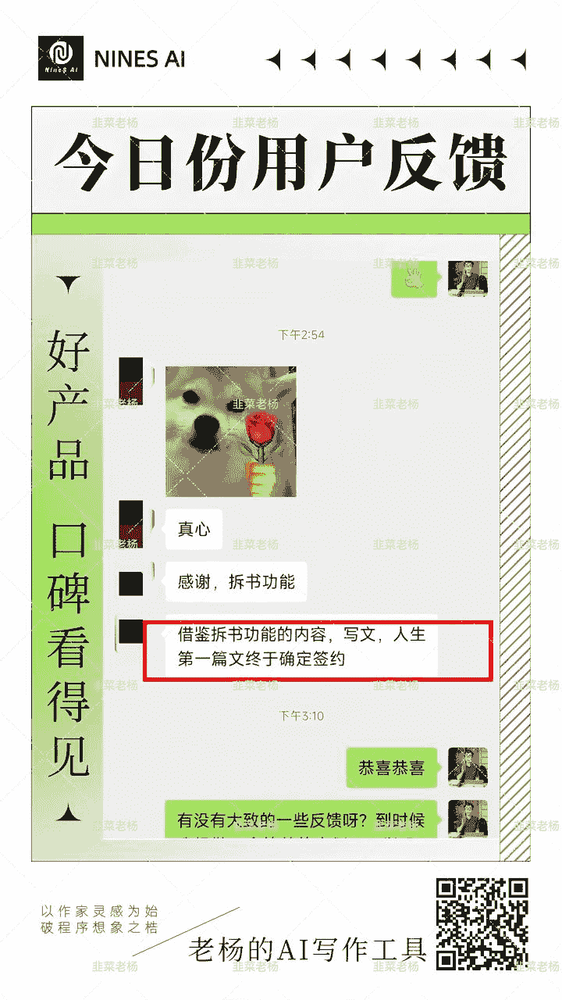
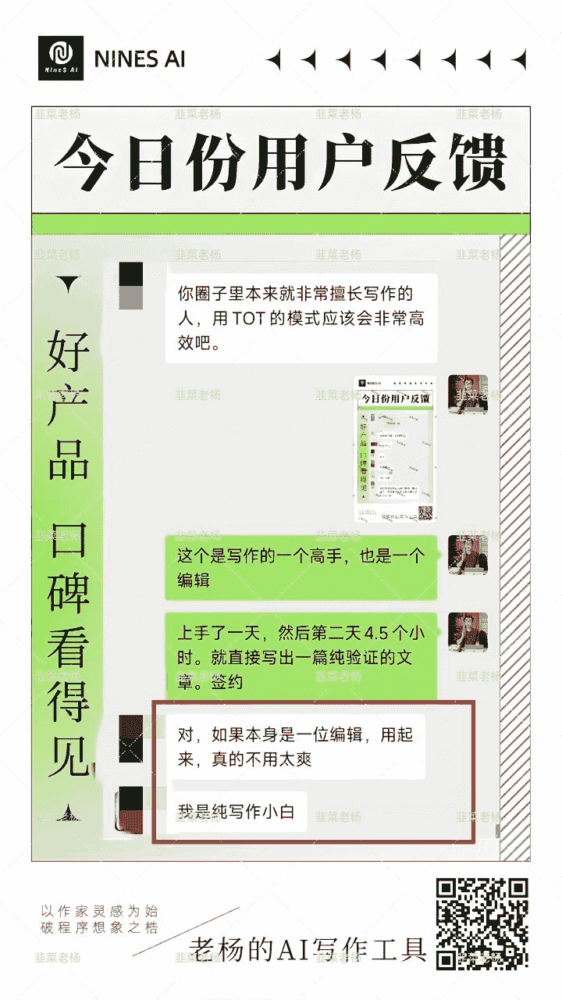

# AI写小说-NineS AI仿写《河清海晏》

> 来源：[https://rq547mr4oez.feishu.cn/docx/FamDd6fLJo1GooxiDmJc9QK6noc](https://rq547mr4oez.feishu.cn/docx/FamDd6fLJo1GooxiDmJc9QK6noc)

# 一、前言

> 各位小伙伴好~🎉🎉🎉NineS-AI与君又见😬。

> 缘分本就是稀薄寡断，相逢一程已是感激万分😙。

> **经过**十月份的α测试和最近10天的内测，很多小伙伴们都拿到了好结果（如：新手短篇K30/长篇签约起点/短剧出售等等）。

> 如今，通过仿写《河清海晏》演示产品的实力~~

>

> PS:《河清海晏》被誉为新的知乎三绝之一~故事虐人又治愈，非常值得一看

---

以下是题材类Prompt，无私奉献~~

1.  [AI写小说-“玄幻文”小说家完整Prompt-v2.0](https://rq547mr4oez.feishu.cn/wiki/ZCVbw9n7fiiG4ukQNoDcRiS5nZf?from=from_copylink)（经典题材）

1.  [AI写小说-“女频甜宠爽文”小说家独家Prompt](https://rq547mr4oez.feishu.cn/wiki/ARo9wUNi4iOKjNkj8ZbcUPtHn0c?from=from_copylink)（韭菜Y日记）

1.  [AI写小说-“女频狗xue虐文”完整Prompt](https://rq547mr4oez.feishu.cn/wiki/AX6awAc3Ii0u3nk1gDrcCYr1nRh)（韭菜Y日记）

1.  [AI写小说-“科幻文”小说家完整Prompt](https://rq547mr4oez.feishu.cn/wiki/JBycwlmDDiYBXykJlu1cHWcanrg?from=from_copylink)

1.  [AI写小说-“都市爽文”小说家独家Prompt](https://rq547mr4oez.feishu.cn/wiki/OFMtwYSYPiTmP6ktsh2cAKf3n1f?from=from_copylink)（经典题材）

1.  [AI写小说-“种田文”小说家独家Prompt](https://rq547mr4oez.feishu.cn/wiki/X5glwVf1DiQYWLkvlvHcCxjhnYe)

1.  [AI写小说-“后悔文”追妻火葬场完整Prompt](https://rq547mr4oez.feishu.cn/wiki/AzmhwUYiriTyoxkXVvPcaoGKncc?from=from_copylink)

1.  [AI写小说-“古言文”小说家独家Prompt](https://rq547mr4oez.feishu.cn/wiki/EpVJwNJAZiNtiQkcNdTcNVA2nNc?from=from_copylink)（经典题材）

1.  [AI写小说-“末世文”小说家独家Prompt](https://rq547mr4oez.feishu.cn/wiki/CrZqwEYP8iVbPpkIG1XcHGzFntc)（上新

1.  [AI写小说-“系统文”小说家独家Prompt](https://rq547mr4oez.feishu.cn/wiki/AgJIwYMvEikzagkHwYhcsrMMnEf?from=from_copylink)（易上手题材之二）

1.  .......

这个系列会持续做完所有题材，大家可以在粉丝群里面定制哦~。

---

PS：还有哪些问题可以评论或者私信我，我有空也可以解答。

**P**S：盗用这个文章的不要乱引流破坏环境，文章是免费分享给大家。有看见各位顺手举报下。感谢～资料纯分享不易。

**原始出处：**


#

# 二、第二轮提前测试~结果反馈（少部分截图，还有很多）





# 三、当前状态（以作家灵感为始，破程序想象之梏。）

> **产品理念：**

1.  以作家灵感为始，破程序想象之梏。奉行长期价值主义~

1.  最懂文字创作者的AI创作工具，没有之一！不写文章的研发，不是好研发。

1.  **功能一览**

+   **AI拆书：**

+   短篇的情节节奏，情绪上下文怎么快速理解？

+   500万字的文本？小意思！NineS-AI帮你轻松拆解，分析风格，剖析情节和节奏，让你的创作之路不再迷茫。

+   **AI创作**

+   短篇、长篇、短剧三大类创作类型。从故事灵感到框架设定，从大纲到细纲，再到最终的正文生成，NineS-AI为你提供全流程的创作指南。

+   润色/扩写/续写/改写：灵感枯竭？旧作翻新？没问题！NineS-AI帮你,让你的创作灵感源源不断。

+   **AI助手**

+   高端玩家必备，物美价廉，自定义角色，四大主流AI除了创作，其他的工作也能用到哦~

1.  **我们的优势**

1.  质量为王：仿写只是基本操作，我们的目标是打造最高质量的AI创作平台。

1.  重做文章G评系统：NineS-AI的创作70~85分起步，与市面上那根本无法与之相提并论（支持全网产品竞技PK哦~）

1.  高端定制：对于美主义者，我们还提供80~90分的“私人订制”服务，当然，时间和成本也会相应增加，具体情况具体分析。

1.  **产品进度**

1.  种子测试时间（100+全职作者测试）开始时间：2024-10-14    结束时间：2024-11-15

1.  内测时间（群无条件邀请测试）**开始时间：2024-11-22晚19.3**0    结束时间：2024-12-30

# 四、仿写**案例~**

### 仿写三个层次：《具体见[《仿写》的三个层次直播详解](https://rq547mr4oez.feishu.cn/wiki/F9gHwbDbni1386kI3ivcC0PSnRb?from=from_copylink)》

+   初级仿写：即“翻译”：中译中不可取、英译中、中译英

+   中级仿写：即“改写”：换元法（背景/人物/等），变成情节卡

+   高级仿写：即“取经”：是仿情绪，节奏，通用情节卡。

### 拆书分析

```
====
## 一、基本信息
1. 选题: 《河清海晏》描绘了主角唐河清在遭遇父亲家暴与校园霸凌后，依靠周海晏的保护与关爱，逐渐成长的故事，同时探讨了家庭暴力、救赎与成长的主题。
2. 题材: 现代现实主义
3. 类型: 青春成长小说
4. 字数: 约 65209 字
5. 期待感: 故事通过河清与海晏的关系发展，揭示了成长中的痛苦与救赎，期待着河清能在困境中找到幸福和力量。
## 二、故事设定
1. 背景设定: 故事发生在现代的一个小镇，90年代末期至21世纪初。反映了家庭暴力、校园生活和青少年的成长困惑，展现了社会的阴暗面与温情的一面。
2. 主角: 
    - 唐河清：14岁，聪明伶俐，性格坚韧，因父亲的家暴和校园欺凌而内心苦痛，有着渴望爱的强烈需求。
    - 人设七步法：
      - 目标：逃离家庭暴力，获得安全感与爱。
      - 阻碍：父亲的暴力、校园霸凌。
      - 行动：求助于周海晏，主动争取自我保护。
      - 结果：依靠周海晏的保护，与母亲的爱对抗暴力。
      - 意外：母亲的自杀，周海晏的牺牲。
      - 转折：从依赖他人到自我成长和坚强。
      - 结局：心灵的成长与对生活的重新审视。
3. 配角: 
    - 周海晏：纹身店老板，曾是混混，深情且有责任感，暗中保护河清，对她如同亲兄妹。
    - 唐河清的父亲：家暴者，赌徒，代表家庭暴力的黑暗。
    - 周妈妈：温柔善良，但因丈夫的去世而精神抑郁，体现母爱的伟大。
4. 核心梗: 家庭暴力与青少年成长，爱与自我救赎。
5. 核心内容: 
    - 危机: 河清面临家庭暴力、校园霸凌等问题。
    - 伏笔: 河清与周海晏之间不断升温的关系。
    - 悬念: 河清能否逃出家庭的阴影，周海晏的命运如何。
    - 爽点: 河清与周海晏的互动与成长。
## 三、故事脉络
1. 核心冲突: 人与父亲之间的冲突，情感的渴望与失落，人与社会的对抗。
2. 情感纽带: 兄妹般的情感依赖，师生情谊，好友间的支持。
3. 故事反转: 河清初期对周海晏的依赖，最终的自我救赎。
4. 二次反转: 母亲的自杀与周海晏的牺牲，对河清情感的沉重打击。
5. 整体节奏: 
    - [引入] 家庭暴力与校园霸凌的背景设置 [情绪张力上升]
    - [发展] 河清向周海晏求助，建立情感纽带 [情绪紧张]
    - [高潮] 母亲自杀与周海晏牺牲 [情绪崩溃]
    - [结局] 河清反思与成长，新的人生起步 [情绪升华]
6. 写作风格: 清新细腻，情感真挚，带有幽默和悲伤的双重色彩。
====
```

### 细节版（字数1075），一次性生成未润色

```
**第1章: 家暴阴影**
夏日的暴雨拍打在窗户上，如同父亲的拳头落在母亲身上。
我蜷缩在床角，十四岁的我已经习惯了这样的夜晚。
屋内弥漫着劣质白酒的刺鼻气味，混合着父亲口中喷出的腐臭。
「臭婆娘，老子辛苦赚钱，你就这么败家！」父亲的怒吼声穿透薄薄的墙壁。
母亲的哭声和求饶声此起彼伏，「老唐，我错了，我再也不敢了...」她的话音未落，又是一声闷响，伴随**着重物倒地的声音。
我紧紧抱住膝盖，眼泪**无声地滑落。
这个家，早已不是家了。
父亲沉迷赌博，母亲为了维持生计，日夜操劳。
我们住在镇上最破旧的棚户区，连顿温饱都难以保证。
雨声渐小，屋内的动静也平息了。
我轻手轻脚地走出房间，看到母亲蜷缩在地上，脸上青一块紫一块。
父亲已经醉倒在沙发上，鼾声如雷。
「妈...」我轻声呼唤，小心翼翼地扶起她。
母亲抬起布满泪痕的脸，勉强挤出一个笑容，「河清，没事的，妈妈没事。」
她颤抖着站起来，拖着疲惫的身子走向厨房。
我跟在她身后，看着她熟练地拿出药膏，开始涂抹伤处。
「妈，我们离开这里吧，」我鼓起勇气说道，「等我长大了，我一定会好好照顾你的。」
母亲停下手中的动作，转过身来，眼中闪烁着复杂的光芒。「
河清，你爸他不是坏人，」她轻声说，「他只是...只是现在遇到了一些困难。你还记得小时候吗？他多疼你啊。」
我低下头，不忍心戳破母亲的幻想。
那些所谓美好的回忆，早已被无数个暴力的夜晚冲刷得一干二净。
「他会好起来的，」母亲继续说，声音里带着一丝不易察觉的颤抖，「我们要相信他，给他时间...」
我默默地握住母亲的手，感受着她手掌上的茧子。这双手曾经抚摸过我的额头，如今却布满了伤痕。
天色渐明，父亲醒来了。
他摇摇晃晃地走进厨房，仿佛昨晚什么都没发生过。「老婆，有钱吗？我今天约了几个朋友...」
母亲立刻换上了笑脸，从口袋里掏出几张皱巴巴的钞票，「有的有的，你拿去吧。」
我站在一旁，看着这荒诞的一幕，心中涌起一阵难以言喻的痛苦。
母亲的眼中闪烁着希望的光芒，仿佛真的相信这一切会好转。
父亲心满意足地离开了，留下我和母亲在狭小的厨房里。
阳光透过脏兮兮的窗户照进来，却驱散不了屋内的阴霾。
「河清，」母亲突然开口，「你今天...还是在家里待着吧。」
我点点头，早已习惯了这样的安排。
从小到大，我连幼儿园都没上过。
在这个家里，我仿佛是个隐形人，被父母的纠葛所忽视。
看着母亲忙碌的背影，我突然意识到，这个家就像是一个巨大的牢笼，将我们全部困在内。
母亲被困在对父亲的幻想中，而我，则被困在这个破碎的家庭里。
```

### 节奏版（字数900），一次性生成未润色

```
**第1章: 家暴阴影**
十四岁那年，我彻底明白了一个道理。
家，不一定是避风港。它也可能，是暴风雨本身。
我们家很穷。穷到什么地步呢？
只有一间破旧的瓦房，一下雨就漏水，冬天冷得像冰窖。
我爸是个泥瓦匠，没活的时候就喝酒赌博。
他脾气暴躁，一言不合就动手打人。
我最害怕的就是他喝醉酒的样子。
眼睛通红，像一头野兽。
他输光了家里所有的积蓄，甚至连我妈的嫁妆也不放过。
他脾气暴躁，稍有不顺心就会对我们母女俩拳打脚踢。
我永远忘不了那个夜晚。
父亲喝得醉醺醺地回到家，他身上散发着刺鼻的酒气，像一头凶狠的野兽。
「钱呢？」他粗暴地推搡着我的母亲。
「都给你了，还要什么钱？」母亲的声音颤抖着。
「放屁！」父亲怒吼一声，一巴掌扇在母亲的脸上。
母亲被打得踉跄了几步，嘴角渗出血丝。
我吓得躲在角落里，瑟瑟发抖。
父亲像疯了一样，对着母亲拳打脚踢。
「我让你不给我钱！」他一边打一边骂。
我不敢出声，只能眼睁睁地看着母亲被打得遍体鳞伤。
终于，父亲打累了，他瘫坐在地上，大口大口地喘着粗气。
母亲蜷缩在墙角，低声啜泣。
我鼓起勇气，走到母亲身边，轻轻地抱着她。
「妈，我们走吧。」我哽咽着说，「离开这个家。」
母亲抬起头，看着我，眼神中充满了无奈和绝望。
「孩子，我们去哪儿？」
「去哪里都行，只要离开这里。」
「你爸他会改的。」母亲的声音很轻，却很坚定。
「他年轻时对我很好很好的。他会存钱给我买金镯子，他还会给我买很多漂亮的衣服，我都穿不完。」
「妈，你醒醒吧！」我哭着说，「他不会改的，他只会越来越过分。」
「我们不能再这样下去了，我们会被他打死的。」
母亲沉默了，她知道我说的是对的，但她仍然不愿意放弃对父亲的希望。
第二天，父亲酒醒了，他像没事人一样，跟母亲有说有笑。
他还向母亲要钱，说是要去城里找工作。
母亲相信了他，把家里仅剩的一点钱都给了他。
我看着父亲的背影，心里充满了愤怒和绝望。
我知道，他不会去找工作，他会拿着这些钱去赌博。
我甚至没有上过幼儿园。
因为家里穷，也因为父亲根本不在乎我。
他只关心他的赌博，只关心他的酒。
我的童年，是在恐惧和暴力中度过的。
```

### 均衡版（字数703），一次性生成未润色

```
**第1章: 家暴阴影**
我十四岁那年，生活在一个贫穷的小镇上，家里总是弥漫着酒精的味道。
父亲唐世国是个好赌成性的人，每天醉醺醺地回家，带着一身的颓废与无能。
母亲常常为了几块钱与他争吵，结果总是以她被推倒在地结束。
每当这个时候，我都蜷缩在角落，心中充满恐惧和无奈。
夜晚的灯光昏黄而摇曳，仿佛映照出我们家庭的破碎不堪。
父亲喝醉后，总会对母亲施暴，那种场景我永远无法忘记。
他的手掌落在母亲瘦弱的肩膀上，像是一把无情的铁锤，而母亲却从未反抗，只是默默承受着一切。
「你为什么不离开他？」我曾这样问过母亲，看着她脸上的淤青，无比愤怒。
「他会变好的。」母亲总是这样回答，眼神中流露出对过去美好时光的怀念。
她告诉我，在他们年轻时，父亲曾是个温柔体贴的人，但赌博和酒精改变了一切。
我知道，她心底里仍抱有一丝希望，希望有一天能重拾旧日的幸福。
「我要离开这里。」我坚定地对母亲说，「将来我会养活你。」
然而，她只是轻轻摇头，「河清，你还小，不懂这些。」
她似乎看不到父亲已经彻底沉沦，而我心中的渴望却愈发强烈，我想要逃离这个充满暴力与绝望的家。
第二天清晨，父亲酒醒后，又恢复了往日的样子，与母亲交谈时温和得让人错愕。
他向母亲索要钱财，那种操控家庭的能力令人窒息，而母亲依旧选择了妥协，把仅剩的钱递给他，希望能换来片刻安宁。
那一刻，我意识到自己被忽视，没有人关心我的感受，也没有人为我的未来担忧。
我没有上幼儿园，只是在家中自学，因为母亲始终沉浸在与父亲之间复杂而扭曲的关系中，无暇顾及我的成长。
这样的生活让我感到无比压抑，我渴望自由，却被困在这座名为“家庭”的牢笼中，无法逃脱。
```

### 微调版（字数1160），一次性生成未润色

```
**第1章: 家暴阴影**
  十四岁那年，我意识到我们家很穷。
  家里只有一张桌子，三条腿是好的，另一条用砖头垫着。
  桌面上坑坑洼洼，像是被老鼠啃过。
  我们家住在镇上最破的筒子楼里，楼道里常年散发着垃圾和尿骚味。
  我爸是个赌鬼，十赌九输，输了就喝酒，喝了就打人。
  我妈是个软包子，只会哭，从来不敢反抗。
  我清晰地记得，那天晚上，我爸又喝醉了，他摇摇晃晃地走进家门，手里拿着一个空酒瓶子。
  他把酒瓶子往桌子上一摔，玻璃碎片飞溅，我吓得躲在墙角，瑟瑟发抖。
  「臭婆娘，钱呢？」
  我爸瞪着血红的眼睛，冲我妈怒吼。
  我妈吓得浑身发抖，从口袋里掏出几张皱巴巴的钞票。
  「就…就这么多…」
  我爸一把夺过钱，狠狠地扇了我妈一个耳光。
  「这点钱够干什么？你个败家娘们！」
  我妈被打倒在地上，捂着脸哭泣。
  我爸还不解气，又踢了她几脚。
  我冲上去，想保护我妈，却被我爸一把推开。
  「滚开，小兔崽子！」
  我爸把我推倒在地上，我的头撞到了桌角，顿时鲜血直流。
  我妈看到我受伤，哭得更厉害了。
  「别打了，求求你别打了…」
  我爸终于停手了，他跌跌撞撞地走到床边，倒头就睡。
  我妈爬起来，抱着我，心疼地帮我擦拭伤口。
  「河清，疼吗？」
  我摇了摇头，眼泪却止不住地流。
  「妈，我们走吧，离开这个家。」
  我妈愣了一下，然后轻轻地抚摸着我的头发。
  「傻孩子，你爸只是一时糊涂，他会改的。」
  「他还记得以前我们一家三口去公园玩的时候吗？
  那时候他对你多好啊…」
  我妈陷入了回忆，仿佛回到了过去那个幸福的时光。
  「妈，你别傻了，他不会改的。」
  我哭着说，「他只会打你，打我。」
  「等以后我长大了，我赚钱养你，我们离开他，好不好？」
  我妈摇了摇头，眼神里充满了无奈。
  「河清，我们是一个家，不能离开你爸。」
  第二天早上，我爸酒醒了，他像没事人一样，坐在桌边吃早饭。
  我妈给他盛了一碗粥，还给他夹了一个鸡蛋。
  「世国，你昨天晚上喝多了，以后少喝点。」
  我爸哼了一声，没有说话。
  「我今天要去打牌，你身上还有钱吗？」
  我妈犹豫了一下，又从口袋里掏出几张钱给了他。
  我爸拿着钱，头也不回地走了。
  我看着我妈，心里充满了失望和愤怒。
  我那时还没有上幼儿园，我妈每天都把我锁在家里，自己去上班。
  我一个人在家，只能看着窗外发呆。
  我渴望上学，渴望和其他小朋友一起玩耍。
  可是，我妈说，家里没钱，让我再等等。
  我多么希望，我妈能带我离开这个家，离开这个噩梦般的地方。
  可是，她却选择了留下，选择了继续忍受我爸的家暴。
  那一年，我失去了对家的希望，也失去了对未来的憧憬。
```