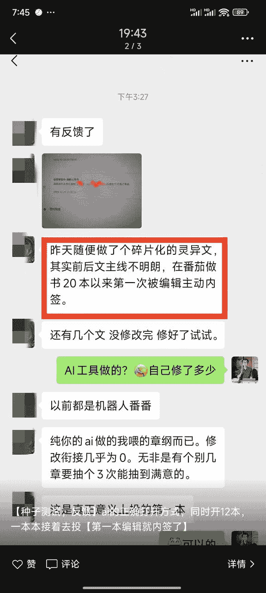

# AI写小说-NineS AI仿写《我不是戏神》

> 来源：[https://rq547mr4oez.feishu.cn/docx/LOWsdJpndoJmCLxlUeZcWn7Onuf](https://rq547mr4oez.feishu.cn/docx/LOWsdJpndoJmCLxlUeZcWn7Onuf)

# 一、前言

> 各位小伙伴好~🎉🎉🎉NineS-AI与君又见😬。

> 缘分本就是稀薄寡断，相逢一程已是感激万分😙。

> **经过**十月份的α测试和最近10天的内测，很多小伙伴们都拿到了好结果（如：新手短篇K30/长篇签约起点/短剧出售等等）。

> 如今，通过仿写《我不是戏神》演示产品的实力~~

---

以下是题材类Prompt，无私奉献~~

1.  [AI写小说-“玄幻文”小说家完整Prompt-v2.0](https://rq547mr4oez.feishu.cn/wiki/ZCVbw9n7fiiG4ukQNoDcRiS5nZf?from=from_copylink)（经典题材）

1.  [AI写小说-“女频甜宠爽文”小说家独家Prompt](https://rq547mr4oez.feishu.cn/wiki/ARo9wUNi4iOKjNkj8ZbcUPtHn0c?from=from_copylink)（韭菜Y日记）

1.  [AI写小说-“女频狗xue虐文”完整Prompt](https://rq547mr4oez.feishu.cn/wiki/AX6awAc3Ii0u3nk1gDrcCYr1nRh)（韭菜Y日记）

1.  [AI写小说-“女频耽美文”小说家Prompt（万字）](https://rq547mr4oez.feishu.cn/wiki/Cx1YwmLNeizNW7kafvzcsmXTnQb)

1.  [AI写小说-“科幻文”小说家完整Prompt](https://rq547mr4oez.feishu.cn/wiki/JBycwlmDDiYBXykJlu1cHWcanrg?from=from_copylink)

1.  [AI写小说-“都市爽文”小说家独家Prompt](https://rq547mr4oez.feishu.cn/wiki/OFMtwYSYPiTmP6ktsh2cAKf3n1f?from=from_copylink)（经典题材）

1.  [AI写小说-“种田文”小说家独家Prompt](https://rq547mr4oez.feishu.cn/wiki/X5glwVf1DiQYWLkvlvHcCxjhnYe)

1.  [AI写小说-“后悔文”追妻火葬场完整Prompt](https://rq547mr4oez.feishu.cn/wiki/AzmhwUYiriTyoxkXVvPcaoGKncc?from=from_copylink)

1.  [AI写小说-“世情文”小说家独家Prompt](https://rq547mr4oez.feishu.cn/wiki/UTe7wMDOKiDYfbkuGIPcbJxsngg?from=from_copylink)

1.  [AI写小说-“快穿文”小说家独家Prompt](https://rq547mr4oez.feishu.cn/wiki/🐧EhwsaoZiQlv0k4wHVc03Nln9e?from=from_copylink)（易上手题材之一）

1.  [AI写小说-“古言文”小说家独家Prompt](https://rq547mr4oez.feishu.cn/wiki/EpVJwNJAZiNtiQkcNdTcNVA2nNc?from=from_copylink)（经典题材）

1.  [AI写小说-“末世文”小说家独家Prompt](https://rq547mr4oez.feishu.cn/wiki/CrZqwEYP8iVbPpkIG1XcHGzFntc)（上新~new）

1.  [AI写小说-“系统文”小说家独家Prompt](https://rq547mr4oez.feishu.cn/wiki/AgJIwYMvEikzagkHwYhcsrMMnEf?from=from_copylink)（易上手题材之二）

1.  [AI写小说-“读心术”小说家独家Prompt](https://rq547mr4oez.feishu.cn/wiki/IAE8wHhiLi6c1jkdau3cTPZVnnb?from=from_copylink)

1.  [AI写小说-“升级流”小说家独家Prompt](https://rq547mr4oez.feishu.cn/wiki/CdriwSAi1iq2QLkWb0PcpxRknCd?from=from_copylink)

这个系列会持续做完所有题材，大家可以在粉丝群里面定制哦~。

---

PS：还有哪些问题可以评论或者私信我，我有空也可以解答。

**P**S：盗用这个文章的不要乱引流破坏环境，文章是免费分享给大家。有看见各位顺手举报下。感谢～资料纯分享不易。

**原始出处：**


#

# 二、第二轮提前测试~结果反馈（少部分截图，还有很多）




# 三、当前状态（以作家灵感为始，破程序想象之梏。）

> **产品理念：**

1.  以作家灵感为始，破程序想象之梏。奉行长期价值主义~

1.  最懂文字创作者的AI创作工具，没有之一！不写文章的研发，不是好研发。

1.  **功能一览**

+   **AI拆书：**

+   短篇的情节节奏，情绪上下文怎么快速理解？

+   500万字的文本？小意思！NineS-AI帮你轻松拆解，分析风格，剖析情节和节奏，让你的创作之路不再迷茫。

+   **AI创作**

+   短篇、长篇、短剧三大类创作类型。从故事灵感到框架设定，从大纲到细纲，再到最终的正文生成，NineS-AI为你提供全流程的创作指南。

+   润色/扩写/续写/改写：灵感枯竭？旧作翻新？没问题！NineS-AI帮你,让你的创作灵感源源不断。

+   **AI助手**

+   高端玩家必备，物美价廉，自定义角色，四大主流AI除了创作，其他的工作也能用到哦~

1.  **我们的优势**

1.  质量为王：仿写只是基本操作，我们的目标是打造最高质量的AI创作平台。

1.  重做文章G评系统：NineS-AI的创作70~85分起步，与市面上那根本无法与之相提并论（支持全网产品竞技PK哦~）

1.  高端定制：对于美主义者，我们还提供80~90分的“私人订制”服务，当然，时间和成本也会相应增加，具体情况具体分析。

1.  **产品进度**

1.  种子测试时间（100+全职作者测试）开始时间：2024-10-14    结束时间：2024-11-15

1.  内测时间（群无条件邀请测试）**开始时间：2024-11-22晚19.3**0    结束时间：2024-12-30

# 四、仿写**案例~**

### 仿写三个层次：《具体见[《仿写》的三个层次直播详解](https://rq547mr4oez.feishu.cn/wiki/F9gHwbDbni1386kI3ivcC0PSnRb?from=from_copylink)》

+   初级仿写：即“翻译”：中译中不可取、英译中、中译英

+   中级仿写：即“改写”：换元法（背景/人物/等），变成情节卡

+   高级仿写：即“取经”：是仿情绪，节奏，通用"情节卡模板”。

### 拆书分析

```
**====**
## 一、基本信息
1. 选题: 一名年轻编导在意外中穿越到一个充满灾厄与阴影的世界，试图寻找自我与生存的意义。
2. 题材: 奇幻、悬疑
3. 类型: 都市奇幻
4. 字数: 100万+
5. 期待感: 主角在穿越后逐渐揭开自己与灾厄的关系，同时面临家庭的背叛与自我认知的挣扎。
## 二、故事设定
1. 背景设定: 故事发生在一个被灰界交汇影响的小城，社会动荡不安，存在着执法者与灾厄之间的斗争。
2. 主角:
    - 陈伶：28岁，京城剧院实习编导，性格内向，追求艺术，对生活有着深刻思考。
    - 人设七步法：
        - 目标：找回自我并生存下去。
        - 阻碍：面临家庭背叛及灾厄的威胁。
        - 行动：努力适应新身份并探索周围环境。
        - 结果：逐渐揭开自己与灾厄的关系。
        - 意外：发现自己成为了观众期待的对象。
        - 转折：意识到父母对弟弟阿宴的背叛。
        - 结局：面对自己的死亡与重生，成为灾厄的一部分。
3. 配角:
    - 陈坛（父亲）：对家庭有强烈责任感，但因爱而犯下错。
    - 李秀春（母亲）：情感脆弱，在家庭危机中迷失自我。
    - 阿宴（弟弟）：心脏病患者，原本是家庭的希望，却成了牺牲品。
4. 核心梗: 灾厄、灰界交汇、观众期待值系统等奇幻元素贯穿整个故事。
5. 核心内容:
    - 危机: 灾厄入侵导致家破人亡，主角被迫面对自身身份和命运的抉择。
    - 伏笔: 主角不断回忆起前世经历，为后续情节埋下伏笔。
    - 悬念: 主角是否能逃离自己的命运，以及观众期待值如何影响现实。
    - 爽点: 主角通过制造精彩情节来提升期待值，从而掌控局面。
## 三、故事脉络
1. 核心冲突: 人与人之间的信任危机，以及人与自我的斗争；同时存在人与自然（灾厄）的冲突。
2. 情感纽带: 家庭之间复杂的情感纠葛，包括亲情、背叛和责任感等元素交织在一起。
3. 故事反转: 陈伶发现自己被父母出卖，而自己又成为了灾厄的一部分，身份认同出现重大转变。
4. 二次反转: 灾厄最终显露出其真实面目，与执法者展开激烈对抗，主角不得不选择站队或逃避。
5. 整体节奏:
    - [第1章] [陈伶穿越后的迷茫][紧张]
    - [第2章] [家庭秘密揭露][悬疑]
    - [第3章] [遭遇灰界交汇][恐惧]
    - [第4章] [寻找帮助][希望]
    - [第5章] [父母背叛][绝望]
    ...
6. 写作风格: 黑暗奇幻风格，结合悬疑与心理描写，通过细腻的文字展现人物内心挣扎。
====
```

### 细节版（字数2323），一次性生成未润色

```
**第1章:暴雨中的重生**
狂风呼啸，暴雨如注。一个身影在昏暗的街道上蹒跚而行，每一步都像是在与整个世界对抗。
他的视线模糊，记忆混沌，唯一能感受到的就是冰冷的雨水不断冲刷着他的身体，像是要将他从里到外彻底洗刷一遍。
这个少年——不，应该说是年轻人，他努力睁大眼睛，试图看清周围的环境。
可是雨幕太过浓重，街道两旁的路灯散发出昏黄的光芒，却像是被蒙上了一层厚厚的纱布，
只能隐约照亮一小片区域。街道上的积水已经没过了脚踝，泛着令人作呕的浑浊，偶尔还能看到一些垃圾在水面上漂浮。
他的脑海中闪过无数碎片般的画面，像是被打碎的镜子，反射出支离破碎的光影，却怎么也无法拼凑出一个完整的自我。
&quot;我是谁？&quot;他喃喃自语，声音却被狂风撕碎，消失在无边的雨夜之中。
突然，一阵眩晕袭来，像是有一只无形的手狠狠地抓住了他的脑袋，将他拽入了一个旋转的漩涡。
年轻人脚下一个踉跄，重重地摔倒在地。
尖锐的疼痛从膝盖传来，他低头一看，鲜血正顺着小腿流下，很快就被雨水冲散，染红了周围的积水。
就在这一刻，一个名字如同闪电般划过他的脑海——陈伶。
&quot;陈伶......&quot;他轻声念出这个名字，仿佛在品味着它的每一个音节，试图从中找到一丝熟悉的感觉。这个名字像是一把钥匙，瞬间打开了记忆的闸门，将尘封的往事一股脑地倾泻出来。
回忆如潮水般涌来，冲击着他的大脑。他想起来了，自己是京城剧院的实习编导陈伶。那
天，他正在剧院为新剧本做准备，修改着剧本中的一些细节，突然间地动山摇，整个剧院都剧烈地晃动起来。
剧院的天花板开始崩塌，发出令人牙酸的声，尖叫声此起彼伏，人们惊慌失措地四处逃窜。
再然后......一片黑暗，像是坠入了一个无底深渊，失去了所有的知觉。
====
//由于篇幅，省略中间内容
====
&quot;我...我先去休息了。&quot;说完，陈伶跌跌撞撞地向卧室走去，留下一地水渍，也留下了一脸惊恐的父母。
&quot;砰&quot;的一声，卧室门关上了。
客厅陷入了死一般的寂静。陈坛和李秀春面面相觑，眼中满是不安和恐惧。
良久，陈坛才开口，声音低沉而颤抖：&quot;秀春...你说...这会不会是......&quot;
&quot;不...不可能的......&quot;李秀春摇着头，声音几乎要哭出来，&quot;我们昨晚...昨晚明明......&quot;
陈坛没有说话，只是紧紧握住妻子的手，手心里全是汗水。
一个可怕的念头在两人心中同时升起——难道，他们昨晚杀死的人，真的回来了？
```

###

### 节奏版（字数2804），一次性生成未润色

```
**第一章:暴雨中的重生**
倾盆大雨如瀑布般倾泻而下，模糊了天地间的界限。
一个瘦弱的身影在泥泞的道路上蹒跚前行，他身上的朱红色戏袍早已被雨水浸透，
紧紧地贴在身上，显得格外狼狈，像一只受伤的鸟，在风雨中绝望地挣扎。
少年踉跄着，每一步都走得异常艰难，仿佛随时都会倒下，
他瘦弱的身躯在狂风中摇摇欲坠，仿佛随时会被这无情的暴雨吞噬。
他不知道自己是谁，也不知道自己要去哪里，只知道内心深处有一个声音在不停地催促他，
让他前进，让他活下去，那声音微弱却坚定，像是在黑暗中指引方向的灯塔。
“我是谁？”
少年在心中一遍又一遍地问着自己，却始终得不到答案，
他的记忆一片空白，就像一张被抹去了所有内容的白纸，
找不到任何关于过去的线索，他拼命地想要抓住些什么，却发现自己抓到的只是一片虚无。
突然，少年的脚下一滑，整个人重重地摔倒在泥泞中，发出一声沉闷的响声，溅起一片浑浊的泥水。
他感到一阵剧痛，仿佛全身的骨头都要散架了，那剧痛如同电流般传遍全身，让他忍不住发出一声痛苦的呻吟。
殷红的鲜血从他的额头缓缓流下，与雨水混合在一起，染红了周围的泥土，那鲜红的血液，如同盛开的彼岸花，妖艳而诡异。
“陈伶……”
一个模糊的名字突然出现在少年的脑海中，伴随着一阵剧烈的头痛，
那名字如同一道闪电，划破了他记忆的黑暗，带来了一丝微弱的光明。
他挣扎着坐起身，用手捂住受伤的额头，努力想要抓住那一丝模糊的记忆，
他的手指颤抖着，仿佛要抓住最后一根救命稻草。
“陈伶……我是陈伶……”
他开始回忆起一些零碎的片段，关于自己身份的片段，那些片段如同破碎的镜子，反射出他过去的点点滴滴。
想起自己是一个编导，在京城剧院实习，他热爱戏剧，梦想着有一天能够成为一名优秀的戏剧导演。
想起自己正在排练一出关于古代英雄的戏剧，那出戏是他倾注了无数心血的作品，他希望能够通过这出戏，展现古代英雄的豪情壮志。
想起那天剧院突然发生了地震，他被道具砸中，失去了意识。
“地震……京城剧院……”
====
//由于篇幅，省略中间内容
====
“他……他真的是伶儿吗？”
中年妇女颤抖着问道，声音几乎听不见，她的内心充满了恐惧和怀疑，她不敢相信自己的儿子还活着。
陈伶没有理会他们，转身向卧室走去，并关上了房门，他需要休息，需要时间来理清思绪。
客厅里再次陷入了死寂，只有中年夫妇急促的呼吸声在空气中回荡，他们的内心充满了恐惧和不安，仿佛有什么可怕的事情即将发生。
“他……他会不会是……”
中年男子没有说完，但他知道妻子明白他的意思，他们心中都有一个可怕的猜测，一个让他们不敢说出口的猜测。
他们怀疑，眼前的少年并不是他们的儿子陈伶，
而是昨晚被他们杀死的那个人……那个被他们埋葬在后院的人……
```

### 均衡版（字数2176），一次性生成未润色

```
**第1章:暴雨中的重生**

狂风呼啸，暴雨如注，天地之间仿佛只剩下了水与风的交响。
在这灰暗的世界中，一个少年踉跄而行。
他浑身湿透，朱红色的戏袍紧贴在身上，像是地狱里爬出来的恶鬼，黑发凌乱地贴在苍白的面庞上，雨水顺着发梢滴落，模糊了他的视线。
雨水打在他的脸上，他却似乎毫无感觉，只是机械地向前走着，像一具失去了灵魂的傀儡。
脑海中一片混沌，他努力想要抓住什么，却又什么都抓不住，就像是在迷雾中寻找出路，却始终找不到方向。
“我是谁？”他喃喃自语，声音被风雨吞噬，像是被巨兽吞没的渺小生灵发出的最后一声哀鸣。
忽然，他脚下一滑，重重摔倒在泥泞的地面上，溅起一片污浊的水花。
剧痛从手臂传来，他感到温热的液体顺着指缝流出，在冰冷的雨水中显得格外刺眼。
就在这一刻，一个名字如闪电般划过他的脑海——“陈伶”。
他猛然睁大了眼睛，心跳加速，仿佛找到了某种归属感，就像是在黑暗中抓住了一根救命稻草。
“我是陈伶。”他低声重复着这个名字，仿佛要将它刻进灵魂深处，像是要以此证明自己的存在。
记忆如潮水般涌来，他看到自己站在京城剧院的舞台上，灯光璀璨，照亮了每一张期待的脸庞，
而他则是那个操控一切的人——实习编导，一个在幕后默默奉献的艺术家。
那是一个梦寐以求的位置，但也是一个充满压力与挑战的角色，他需要用自己的才华和汗水去征服观众，去赢得掌声。
然后，一场突如其来的地震将一切摧毁，剧院变成了废墟，灯光熄灭，尖叫声和哭喊声响彻云霄，
他失去了意识，再次醒来时便是在这无尽的风雨中，仿佛是从天堂坠入了地狱。
陈伶努力消化这些零碎的记忆，却感到脑袋仿佛要裂开一般疼痛，就像是被无数根针扎进了大脑，
而身体则沉重得像是灌了铅一般，每走一步都异常艰难。
====
//由于篇幅，省略中间内容
====
“你是怎么回来的？”父亲终于开口问道，声音颤抖而小心翼翼，仿佛害怕触碰到某个禁忌的话题，像是担心会引来更大的灾难。
陈伶放下手中的杯子，用袖子擦去嘴角残留的水渍，然后含糊地回答：“我走回来的。”
虽然话语简单，但其中蕴含的信息却异常诡异，让人无法轻易相信或理解其中真相，像是隐藏着一个巨大的秘密，等待着人们去揭开。 
喝干了水桶后，陈伶转身朝自己的卧室走去，不再多说一句话。 
房门关闭的一瞬间，客厅陷入死寂，只剩下钟表滴答作响，与外面狂风暴雨形成鲜明对比，像是两个不同的世界。 
父母依旧呆坐在那里，他们彼此对视，却找不到任何可以解释眼前这一切的方法，仿佛掉进了一个巨大的迷宫，找不到出口。 
“这...到底怎么回事？”母亲低声问道，她声音颤抖得几乎听不清，像是害怕惊动某个可怕的存在。 
```

### 微调版（字数1433），一次性生成未润色

```
**第1章:暴雨中的重生**

狂风暴雨中，一个少年孤独地在泥泞的街道上蹒跚而行。
雨水如同锋利的针刺，毫不留情地穿透他单薄的衣物，冰冷地贴在他的皮肤上，激起一阵阵寒意。
路灯昏黄的光芒在风雨中摇曳不定，照亮少年苍白的脸庞，雨水顺着他的头发、脸颊不断滴落，
模糊了他的视线，眼前的一切都变得扭曲而陌生，如同一个光怪陆离的梦境。
他用力地甩了甩头，试图回忆起自己的身份，但脑海中只有零星的片段闪过，像是被这场暴风雨无情撕碎的记忆碎片，拼凑不出完整的画面。
少年突然一个踉跄，身体失去平衡，重重地摔倒在泥泞的地面上。“嘶——” 一阵剧烈的疼痛从额头传来，他忍不住倒吸一口凉气。
雨水混着泥浆无情地溅在他的脸上，他感到额头上火辣辣的疼，伸手一摸，黏糊糊的，是血！
鲜血顺着他的脸颊缓缓滴落，混合着冰冷的雨水，染红了地面，触目惊心。
在这疼痛的瞬间，一个名字如同闪电般划破他混沌的脑海——“陈伶”。
这个名字如同一道曙光，照亮了他迷茫的记忆，让他意识到自己是谁，也让他从混沌的状态中惊醒过来。
“陈伶……我是陈伶……”他喃喃自语着，努力地回忆着与这个名字相关的一切。
陈伶缓缓地站起身，用手抹去脸上的雨水和血迹，深吸一口气，努力平复着剧烈跳动的心脏。
他回想起自己是京城剧院的一名实习编导，对，没错，他热爱戏剧，热爱舞台，梦想着有一天能够创作出属于自己的，震撼人心的作品！
然而，就在不久前，一场突如其来的地震摧毁了剧院，也带走了许多鲜活的生命，包括他的同事，他的朋友……他在废墟中醒来，发现自己躺在一片狼藉之中，四周是断壁残垣，空气中弥漫着灰尘和死亡的气息。
他试图回忆起更多的事情，关于地震，关于逃生，关于一切，但大脑中依然是一片空白，就像被人刻意抹去了一般。
唯一清晰的记忆，就是那个名字——陈伶，他自己的名字。
====
//由于篇幅，省略中间内容
====
“你是怎么回来的？”父亲的声音颤抖着，眼中充满了疑惑和不安，他不敢相信眼前这个浑身湿透，狼狈不堪的少年就是他的儿子。
陈伶含糊地回答：“我……走回来的。”他的话语中带着一丝诡异，仿佛不是他自己在说话，而像是被什么东西控制了一般。
父母对视了一眼，心中的不安更加深了。
他们不知道眼前的这个少年究竟是谁，但直觉告诉他们，这不是他们的儿子，至少，不是他们记忆中的那个儿子。
喝干了水桶里的最后一口水，陈伶转身向卧室走去，随手关上了房门，将父母的担忧和恐惧都关在了门外
客厅里陷入了死寂，父母对视着彼此，不知所措，他们的心中充满了恐惧和不安。
父亲的眼神中闪过一丝恐惧，他低声说道：“这……这是不是我们昨晚杀死的那个人？”
母亲的脸色变得苍白，她摇了摇头，声音颤抖：“不可能，我们昨晚杀死的是阿宴，不是陈伶。”
父亲的表情变得更加阴沉，他喃喃道：“可是，为什么他会出现在这里？而且，他的眼神……”
母亲的眼中闪过一丝绝望，她紧紧抓住父亲的手，低声说道：“不管他是谁，我们都必须小心。不能再出任何差错了。”
```