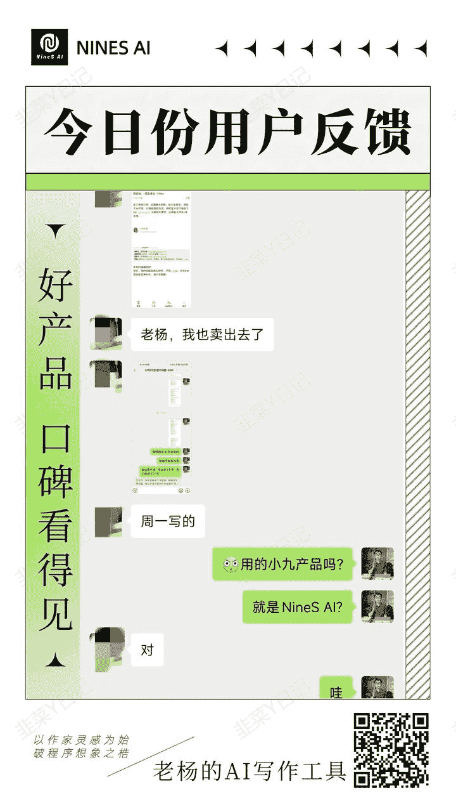
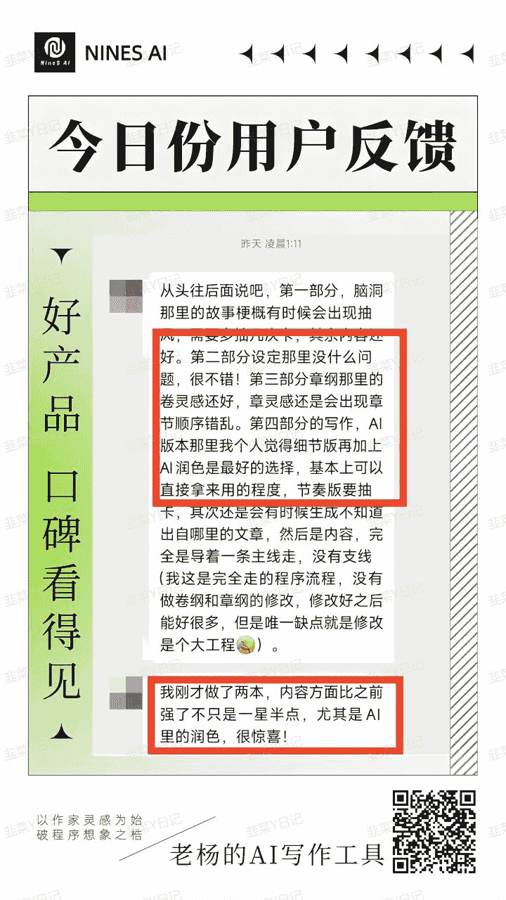

# AI写小说-NineS AI仿写番茄神作《xx斩神》

> 来源：[https://rq547mr4oez.feishu.cn/docx/T2rHdMvsJowW7IxJXXFcbuXAncf](https://rq547mr4oez.feishu.cn/docx/T2rHdMvsJowW7IxJXXFcbuXAncf)

# 一、前言

> 各位小伙伴好~🎉🎉🎉NineS-AI与君又见😬。

> 缘分本就是稀薄寡断，相逢一程已是感激万分😙。

> **经过**十月份的α测试和最近10天的内测，很多小伙伴们都拿到了好结果（如：新手短篇K30/长篇签约起点/短剧出售等等）。

> 如今，通过仿写《我在精神病院学斩神》演示产品的实力~~

> PS：番茄之前的扛鼎之作，现在很多同人的作品也很受欢迎~热门题材，可以尝试

---

以下是题材类Prompt，无私奉献~~

1.  [AI写小说-“玄幻文”小说家完整Prompt-v2.0](https://rq547mr4oez.feishu.cn/wiki/ZCVbw9n7fiiG4ukQNoDcRiS5nZf?from=from_copylink)（经典题材）

1.  [AI写小说-“女频甜宠爽文”小说家独家Prompt](https://rq547mr4oez.feishu.cn/wiki/ARo9wUNi4iOKjNkj8ZbcUPtHn0c?from=from_copylink)（韭菜Y日记）

1.  [AI写小说-“女频狗xue虐文”完整Prompt](https://rq547mr4oez.feishu.cn/wiki/AX6awAc3Ii0u3nk1gDrcCYr1nRh)（韭菜Y日记）

1.  [AI写小说-“女频耽美文”小说家Prompt（万字）](https://rq547mr4oez.feishu.cn/wiki/Cx1YwmLNeizNW7kafvzcsmXTnQb)

1.  [AI写小说-“科幻文”小说家完整Prompt](https://rq547mr4oez.feishu.cn/wiki/JBycwlmDDiYBXykJlu1cHWcanrg?from=from_copylink)

1.  [AI写小说-“都市爽文”小说家独家Prompt](https://rq547mr4oez.feishu.cn/wiki/OFMtwYSYPiTmP6ktsh2cAKf3n1f?from=from_copylink)（经典题材）

1.  [AI写小说-“种田文”小说家独家Prompt](https://rq547mr4oez.feishu.cn/wiki/X5glwVf1DiQYWLkvlvHcCxjhnYe)

1.  [AI写小说-“后悔文”追妻火葬场完整Prompt](https://rq547mr4oez.feishu.cn/wiki/AzmhwUYiriTyoxkXVvPcaoGKncc?from=from_copylink)

1.  [AI写小说-“世情文”小说家独家Prompt](https://rq547mr4oez.feishu.cn/wiki/UTe7wMDOKiDYfbkuGIPcbJxsngg?from=from_copylink)

1.  [AI写小说-“快穿文”小说家独家Prompt](https://rq547mr4oez.feishu.cn/wiki/🐧EhwsaoZiQlv0k4wHVc03Nln9e?from=from_copylink)（易上手题材之一）

1.  [AI写小说-“古言文”小说家独家Prompt](https://rq547mr4oez.feishu.cn/wiki/EpVJwNJAZiNtiQkcNdTcNVA2nNc?from=from_copylink)（经典题材）

1.  [AI写小说-“末世文”小说家独家Prompt](https://rq547mr4oez.feishu.cn/wiki/CrZqwEYP8iVbPpkIG1XcHGzFntc)（上新~new）

1.  [AI写小说-“系统文”小说家独家Prompt](https://rq547mr4oez.feishu.cn/wiki/AgJIwYMvEikzagkHwYhcsrMMnEf?from=from_copylink)（易上手题材之二）

1.  [AI写小说-“读心术”小说家独家Prompt](https://rq547mr4oez.feishu.cn/wiki/IAE8wHhiLi6c1jkdau3cTPZVnnb?from=from_copylink)

1.  [AI写小说-“升级流”小说家独家Prompt](https://rq547mr4oez.feishu.cn/wiki/CdriwSAi1iq2QLkWb0PcpxRknCd?from=from_copylink)

这个系列会持续做完所有题材，大家可以在粉丝群里面定制哦~。

---

PS：还有哪些问题可以评论或者私信我，我有空也可以解答。

**P**S：盗用这个文章的不要乱引流破坏环境，文章是免费分享给大家。有看见各位顺手举报下。感谢～资料纯分享不易。

**原始出处：**


# 二、第二轮提前测试~结果反馈（少部分截图，还有很多）





# 三、当前状态（以作家灵感为始，破程序想象之梏。）

> **产品理念：**

1.  以作家灵感为始，破程序想象之梏。奉行长期价值主义~

1.  最懂文字创作者的AI创作工具，没有之一！不写文章的研发，不是好研发。

1.  **功能一览**

+   **AI拆书：**

+   短篇的情节节奏，情绪上下文怎么快速理解？

+   500万字的文本？小意思！NineS-AI帮你轻松拆解，分析风格，剖析情节和节奏，让你的创作之路不再迷茫。

+   **AI创作**

+   短篇、长篇、短剧三大类创作类型。从故事灵感到框架设定，从大纲到细纲，再到最终的正文生成，NineS-AI为你提供全流程的创作指南。

+   润色/扩写/续写/改写：灵感枯竭？旧作翻新？没问题！NineS-AI帮你,让你的创作灵感源源不断。

+   **AI助手**

+   高端玩家必备，物美价廉，自定义角色，四大主流AI除了创作，其他的工作也能用到哦~

1.  **我们的优势**

1.  质量为王：仿写只是基本操作，我们的目标是打造最高质量的AI创作平台。

1.  重做文章G评系统：NineS-AI的创作70~85分起步，与市面上那根本无法与之相提并论（支持全网产品竞技PK哦~）

1.  高端定制：对于美主义者，我们还提供80~90分的“私人订制”服务，当然，时间和成本也会相应增加，具体情况具体分析。

1.  **产品进度**

1.  种子测试时间（100+全职作者测试）开始时间：2024-10-14    结束时间：2024-11-15

1.  内测时间（群无条件邀请测试）**开始时间：2024-11-22晚19.3**0    结束时间：2024-12-30

# 四、仿写**案例~**

### 仿写三个层次：《具体见[《仿写》的三个层次直播详解](https://rq547mr4oez.feishu.cn/wiki/F9gHwbDbni1386kI3ivcC0PSnRb?from=from_copylink)》

+   初级仿写：即“翻译”：中译中不可取、英译中、中译英

+   中级仿写：即“改写”：换元法（背景/人物/等），变成情节卡

+   高级仿写：即“取经”：是仿情绪，节奏，通用"情节卡模板”。

### 拆书分析

```
**====**
## 一、基本信息
1. 选题: 一名失明少年在精神病院中重拾光明，探索自我与超自然的故事。
2. 题材: 奇幻、悬疑
3. 类型: 都市小说
4. 字数: 200万
5. 期待感: 故事围绕失明少年林七夜的成长与探索展开，读者期待他如何面对内心的恐惧与外界的挑战，以及他与超自然力量的互动。
## 二、故事设定
1. 背景设定: 故事发生在现代都市，充满了社会压力和人际关系的复杂性，同时隐藏着超自然现象。
2. 主角:
    - 林七夜：17岁，性格沉稳，曾因意外失明，后在精神病院接受治疗。
    - 人设七步法：
        - 目标：寻找自我认同与光明。
        - 阻碍：身体残疾与精神创伤。
        - 行动：努力适应新生活，并探索超自然现象。
        - 结果：发现自己拥有特殊能力。
        - 意外：遭遇怪物袭击。
        - 转折：重新获得视力并觉醒潜能。
        - 结局：面对未知的未来与新的挑战。
3. 配角:
    - 杨晋：林七夜的表弟，关心林七夜，支持他的决定。
    - 蒋倩、李毅飞等同学：对林七夜表现出友善，但也体现出校园生活的复杂性。
4. 核心梗: 超能力、精神病院、人与超自然生物的对抗。
5. 核心内容:
    - 危机: 林七夜面临失明、怪物袭击及内心挣扎等多重危机。
    - 伏笔: 林七夜的特殊能力暗示着他与超自然力量之间的联系。
    - 悬念: 林七夜是否能克服内心恐惧并再次睁开双眼？
    - 爽点: 林七夜最终获得光明与力量。
## 三、故事脉络
1. 核心冲突: 林七夜在面对失明和怪物威胁时，与自我内心的斗争以及对未来的不确定感。
2. 情感纽带: 亲情（与姨妈、表弟）、友情（同学间的支持）及对生命意义的追寻。
3. 故事反转: 林七夜从一个被动接受命运的人，逐渐成为掌控自己命运的强者。
4. 二次反转: 在获得视力后，他意识到自己拥有更大的责任和使命感。
5. 整体节奏:
    - [情节1] 林七夜在街道上被围观，引发关注 [剧情推动（爽点）][情绪（紧张）]
    - [情节2] 遇见小女孩牵手过马路 [剧情推动（温暖）][情绪（温馨）]
    - [情节3] 精神病院复查，回忆过去 [剧情推动（回忆）][情绪（沉重）]
    - [情节4] 遭遇怪物袭击 [剧情推动（惊险）][情绪（恐惧）]
    .....
6. 写作风格: 写实与奇幻结合，通过细腻描写展现人物内心世界。
====
```

### 细节版（字数2048），一次性生成、未润色

```
**第一章 盲人少年**
炎炎八月, 蝉鸣声声，像一首催眠曲，在空气中慵懒地流淌。
鸣笛声尖锐地划破这夏日的宁静，为这首催眠曲增添了一丝烦躁的音符。
马路边，阿诺百无聊赖地踢着路边的石子，时不时抬头看看红绿灯，他身旁还站着几个和他年纪相仿的同伴，正有一搭没一搭地聊着天。
“诶，你们说，盲人是怎么过马路的啊？”阿诺突发奇想，随口问道。
“废话，当然是靠导盲犬啊！”小胖不假思索地回答，语气中带着一丝得意，仿佛这个问题的答案是他独家掌握的秘密似的。
“你以为谁都跟你一样，家里有矿啊，养得起导盲犬？”瘦高个毫不留情地戳穿了小胖的炫耀，“大部分盲人不都是靠那种带凸点的盲道吗？”
“嘿，你们看那边！”阿诺突然指着街角，打断了两人之间即将爆发的争吵。
顺着阿诺手指的方向，只见一个十七八岁的少年正孤零零地站在路口。
他身上缠绕着黑色的缎带，仿佛要将自己与这个世界隔绝开来，手里拎着一个装满新鲜蔬菜的塑料袋和一根白色的导盲杖。
少年的样貌清秀，皮肤白皙，在阳光的照射下显得有些透明，但他身上那层层叠叠的黑缎却给人一种说不出的诡异感觉，像是隐藏着什么秘密。
路人们纷纷停下脚步，好奇地打量着这个奇怪的少年，小声议论着。
“这小子是在COS盲僧吗？”一个染着黄毛的青年低声说道，语气中带着一丝嘲讽。
“哪有盲僧拿菜篮子的？”他旁边一个穿着花衬衫的胖子忍不住吐槽道。
这时，一个扎着羊角辫的小女孩挣脱了妈妈的手，蹦蹦跳跳地跑到少年面前，仰起头，用清脆的声音问道：“哥哥，我可以扶你过马路吗？”
少年微微一愣，随即露出一抹温暖的笑容，像冬日里的阳光，驱散了周围的阴霾：“谢谢你，小朋友。”
他伸出手，小女孩小心翼翼地牵起他的手，两人慢慢地走过斑马线。周围的人群见状，都不禁发出赞叹声。
“真是个善良的孩子。”一个中年妇女感慨道。
“这少年长得还挺帅的，可惜是个瞎子。”一个年轻女孩惋惜地说道。
“也不知道是天生的还是后天的？”一个大爷好奇地问道。
==== //由于篇幅，省略中间内容 ====
“林七夜，你好。”李医生翻看着手中的病历，语温和地说道，“你今年多大了？”
“十七岁。”林七夜平静地回答道，声音清澈而沉稳。
“哦，已经十七岁了啊。”李医生推了推鼻梁上的眼镜，镜片上闪过一丝精光，“能跟我说说你是怎么失明的吗？”
林七夜沉默了一会儿，似乎在回忆着什么，然后缓缓开口说道：“十年前的事了。那时候我还小，特别喜欢天文。
有一天晚上，我偷偷跑到阳台上看星星……”
“然后呢？”李医生追问道，语气中带着一丝好奇。
林七夜的声音突然变得有些飘忽，仿佛陷入了某种幻境：“我看到了一个金色的光团，像是一个天使。它越来越亮，越来越亮……”
“然后你就失明了？”李医生皱起眉头，语气中带着一丝怀疑。
林七夜点点头：“是的，从那以后，我的世界就只剩下黑暗了。”
李医生若有所思地看着林七夜，手中的笔在病历上沙沙作响。
“林七夜，你相信这个世界上真的有天使吗？”
林七夜抬起头，黑色的缎带后，他的眼神似乎闪烁了一下，像夜空中划过的一颗流星。
“如果真的有天使，为什么他们要夺走我的光明呢？”
```

###

### 节奏版（字数2792），一次性生成、未润色

```
**第一章  黑暗中的光明**
炎炎八月，柏油路面几乎要被晒得融化，空气中弥漫着令人窒息的热浪，远处的景象都变得扭曲模糊。
街边的梧桐树像是被抽干了水分，叶子无力地耷拉着，知了在枝头发出刺耳的叫声，仿佛在抱怨这该死的酷暑。
十字路口，红灯亮起，车流发出刺耳的刹车声，缓缓停下。
几个穿着时尚的年轻人站在斑马线前，一边擦着汗，一边有一搭没一搭地聊着天，试图在这燥热的天气里寻找一丝乐趣。
“哎，你们说，盲人是怎么过马路的？”一个染着黄毛的男生突然问道，打破了短暂的沉默。
“废话，当然是靠导盲杖啊！”旁边一个身材高挑的女生不耐烦地翻了个白眼，“你没见过吗？COS盲僧啊？”
“见过是见过，不过我总觉得有点危险，万一没注意撞到车怎么办？”黄毛男生挠了挠头，语气中带着一丝担忧。
“所以才会有导盲犬啊，或者有人带着他们过马路。”另一个戴着眼镜的男生推了推眼镜，慢条斯理地解释道。
“也是哦……”黄毛男生似懂非懂地点了点头，目光却飘向了街角。
就在这时，街角出现了一个身影，瞬间吸引了所有人的目光，仿佛一道闪电划破了沉闷的空气。
那是一个少年，看年纪不过十七八岁，身材瘦削，穿着一件简单的白色T恤和黑色牛仔裤，在阳光下显得格外单薄。
他最引人注目的地方，是他那双眼睛——或者说，是被黑色绸缎遮住的眼睛，那黑缎如同深渊一般，让人忍不住想要探究其中的秘密。
少年低着头，手里拎着一袋蔬菜和一根导盲杖，一步一步地朝着斑马线走来，每一步都显得缓慢而谨慎，仿佛在丈量着这个世界。
周围的人纷纷停下脚步，好奇地打量着这个盲人少年，眼神各异。
有些人脸上带着同情，仿佛在怜悯他这不幸的命运；有些人则带着一丝不屑，认为他是在装模作样博取同情。
“这孩子，真可怜……”一个老太太低声说道，语气中充满了惋惜。
“年纪轻轻就瞎了，以后可怎么办啊？”另一个中年妇女也跟着叹息，仿佛看到了少年悲惨的未来。
“说不定是装的呢，现在有些人为了博取同情，什么事都做得出来。”一个年轻男子撇了撇嘴，语气中充满了怀疑。
就在少年走到斑马线前，犹豫着是否该迈出下一步的时候，一个扎着马尾辫的小女孩突然从人群中冲了出来，像一只欢快的小鸟。
“哥哥，我扶你过马路吧！”小女孩的声音清脆悦耳，如同清泉般流淌在众人的心头。
少年愣了一下，抬起头，那被黑缎遮住的眼睛仿佛也感受到了女孩的善意，嘴角露出一丝淡淡的微笑，如同冬日里一抹温暖的阳光。
“谢谢你，小朋友。”少年的声音低沉而柔和，带着一丝感激。
==== //由于篇幅，省略中间内容 ====
第二天上午，林七夜按照约定，来到了市精神病院，那白色的建筑在阳光下显得格外刺眼，仿佛在嘲笑着他内心的黑暗。
他走进李医生的办公室，礼貌地敲了敲门，发出沉闷的响声。
“请进。”一个低沉的声音从房间里传来。
林七夜推门进去，看到一个穿着白大褂的中年男子正坐在办公桌前，低头看着一份文件，眉头紧锁，仿佛遇到了什么难题。
“李医生，您好。”林七夜走到办公桌前，轻声说道，语气中带着一丝恭敬。
“你就是林七夜吧？请坐。”李医生抬起头，示意林七夜坐下，那锐利的目光仿佛要看穿他的一切。
林七夜坐了下来，双手放在膝盖上，显得有些拘谨，李医生开始询问他的病历情况，语气 professional 而冷静。
“林七夜，17岁，十年前因意外事故导致双目失明……”李医生一边看着文件，一边念叨着，语气中带着一丝疑惑。
“你能不能跟我说说，你失明那天晚上，到底发生了什么事？”李医生放下文件，看着林七夜问道，眼中充满了探究的欲望。
林七夜沉默了片刻，仿佛在回忆那段痛苦的过往，然后缓缓开口说道：“那天晚上，我看到了一个天使……”
```

### 均衡版（字数2055），一次性生成、未润色

```
**第一章：盲少年的秘密**
八月的阳光炙热而刺眼，街道上蝉鸣声和车笛声交织在一起，构成了城市的交响乐，空气中弥漫着令人烦躁的热浪。
阿诺和他的同伴们正站在红绿灯前，等待着过马路，汗水浸湿了他们的衣衫。
他们百无聊赖地聊着天，话题不知不觉转到了盲人是如何过马路的，试图在这炎热的天气里寻找一丝消遣。
“你们说，那些盲人怎么知道什么时候能走呢？”阿诺好奇地问，用手抹了抹额头的汗珠。
“可能是靠听觉吧，听着车的声音判断。”一个同伴猜测道，语气有些不确定。
“或者他们有特别的感觉？就像蝙蝠一样，能感知周围的环境。”另一个同伴接话，脑洞大开地补充道。
就在这时，阿诺注意到了街角处，一个身材瘦削的少年正缓缓走来，与周围喧嚣的环境显得格格不入。
的白衬衫牛仔裤，衬衫的衣角微微泛黄，牛仔裤上也有一些磨损的痕迹，手中拎着一袋鼓鼓囊囊的蔬菜和一根黑色的导盲杖。
最引人注目的，是他眼睛上缠着的那条黑缎，仿佛给他平添了一层神秘感，让人忍不住想要探究他背后的故事。
周围的人纷纷驻足，好奇的目光投向这个少年，对他突兀的出现感到好奇和疑惑。
一个小女孩大胆地走上前去，她扎着两个羊角辫，穿着粉红色的连衣裙，天真无邪地主动提出要扶少年过马路。
少年微微一笑，露出洁白的牙齿，点头答应，两人并肩走过斑马线，小女孩的举动像是一缕清风，吹散了周围的燥热。
在人群中，有人开始低声议论起少年的身份来，猜测着他的过往和遭遇。
“他是谁啊？看起来不像普通人，那黑缎带，感觉有点奇怪。”
“也许是个苦命的人吧，说不定经历了什么不幸的事情。”
阿诺却觉得事情并不简单，他直觉告诉他，这个少年并非真正的盲人，他的观察力一向敏锐。
“你们看，他走路的时候脚步很稳，不像是看不见的人，而且他刚才过马路的时候，好像还特意避开了一个水坑。”
阿诺指了指少年的背影说道，语气中带着一丝笃定。
“或许，他只是习惯了这种生活方式，毕竟眼睛看不见，只能依靠其他的感官来感知世界。”
同伴们仍在猜测着，试图为少年的行为找到一个合理的解释。
====//由于篇幅，省略中间内容====
姨妈叹了口气，脸上闪过一丝担忧：“他还小，不懂事，不知道外面的危险，总想着出去玩。你得多照顾他，别让他惹麻烦。”
林七夜点点头，他知道自己不仅要面对失明带来的困难，还要承担起照顾弟弟杨晋的责任，生活的重担压在他的肩上。
这个家庭因为他的失明变得更加艰难，但他从未想过放弃，他是一个坚强的少年，内心深处充满了对生活的渴望。
他心里有一个坚定的信念，那就是保护好身边的人，无论付出什么代价，这是他活下去的动力。
下午的时候，林七夜如约来到精神病院，与李医生见面，医院的环境有些压抑，空气中弥漫着消毒水的味道。
这位医生是他多年来一直信任的人，他们之间有一种特殊的默契，李医生总是耐心地倾听他的烦恼，并给予他一些建议。
李医生翻看着他的病历档案，上面记录着十年前那场意外导致失明的细节，他的眉头微微皱起，似乎在思考着什么。
“你的情况一直没有改善吗？这么多年过去了，你的眼睛……”李医生关切地问道，语气中带着一丝惋惜。
“我已经习惯了，在黑暗中生活也没什么不好，至少可以远离那些纷扰。”
林七夜淡然地回答，但内心深处，他仍然渴望重新获得光明，能够再次看到这个世界的色彩。
十年前，他还是个对世界充满好奇的小男孩，对天文有着无尽的热爱，他梦想着有一天能够成为一名宇航员，探索宇宙的奥秘。
他记得那天晚上，他看到天空中出现了一道金色光辉，如同天使降临一般，美丽而神秘，他被这奇异的景象深深吸引。
然而，那次意外之后，他便失去了视力，只能生活在无尽的黑暗中，他的梦想也随之破灭，他的人生轨迹发生了巨大的改变。
回忆起过去，林七夜心中涌起一股难以言喻的情感，那是对过去的怀念，也是对现实的无奈。
【未完待续】
```

### 微调版（字数1433），一次性生成未润色

```
**第一章：盲少年的秘密**
炎炎八月，街道上蝉鸣声和鸣笛声交织，仿佛整个城市都被炎热包裹。
阿诺和几个同伴站在路口，等待红绿灯的变换。他们闲聊着，话题渐渐转向了一个奇怪的方向。
“你们知道吗？今天早上我看到一个盲人在过马路。”阿诺说道，语气中带着一丝好奇。
“盲人过马路？那得多小心啊。”其中一个同伴插嘴道，“他有导盲犬吗？”
“没有，他手里拿着一根导盲杖，还缠着黑缎遮着眼睛。”
阿诺继续说道，“看起来挺年轻的，不知道是不是真的盲人。”
“说不定是COS盲僧呢。”另一个同伴笑道，引得大家一阵哄笑。
就在他们讨论的时候，不远处的街角，一个少年引起了他们的注意。
他穿着简单的白色T恤和牛仔裤，身上缠着一条黑色的缎带，遮住了双眼。
少年手里拎着几袋蔬菜，另一只手握着导盲杖，小心翼翼地探路，那样子像极了在黑暗中摸索前行的旅人。
“看，就是他！”阿诺指了指那个少年，周围的行人也纷纷投来好奇的目光，像是发现了什么稀奇古怪的事情。
“他看起来真的挺可怜的。”一个女孩走了过去，主动伸出手，“哥哥，我帮你过马路吧。”
女孩的声音清脆悦耳，像是在夏日里带来的一丝清凉。
少年微微一笑，露出一排洁白的牙齿，点了点头：“谢谢。”
他的声音低沉而富有磁性，与他略显单薄的身形形成了鲜明的对比。
两人一起走过马路，周围的人议论纷纷，像是一群麻雀在叽叽喳喳地讨论着什么。
有人猜测他是某个慈善机构的志愿者，体验生活的不易；有人则认为他可能是一个苦命人，命运多舛。
阿诺和同伴们也跟着过了马路，继续他们的讨论，像是在进行一场辩论赛。
“你说他会不会真的是盲人？”阿诺问，语气中充满了疑惑。
“难说，但看他走路的样子，应该是真的。
”一个同伴回答，语气中带着一丝肯定，“说不定他有什么特别的故事，就像小说里写的那样，充满了曲折和离奇。”
“是啊，这个世界总有那么多未知的事情。”另一个人感叹道，语气中充满了对未知的好奇和敬畏。
少年回到家中，关上门，摘下黑缎，露出了一双明亮的眼睛。
他名叫林七夜，今年十七岁，外表俊秀，常年缠着黑缎遮眼，给人一种神秘感。尽管他看起来内向、沉稳，但内心却充满了对生活的渴望和对世界的探索，像是一团即将爆发的火焰。
“七夜，你回来了？”姨妈的声音从厨房传来，带着一丝关切，像是一阵温暖的春风。
“嗯，买了些菜。”林七夜应了一声，走进客厅，脚步轻盈而稳健。
“弟弟呢？”他问道，声音中带着一丝温柔，像是在询问一件珍贵的宝物。
“还在学校，今天有社团活动。”姨妈回答，“你最近过得怎么样？有没有遇到什么困难？”
====//由于篇幅，省略中间内容====
“你记得那道光芒的样子吗？有没有什么特别的特征？”李医生追问，像是要抓住一根救命稻草。
“记得，那是一道金色的光芒，像是天使的翅膀，充满了神圣的气息。”林七夜回答，“我从来没有见过那样的东西，它像是来自另一个世界。”
“你当时有没有感觉到其他异样？比如身体的疼痛，或者情绪的波动？”李医生继续问道，像是要拼凑出一个完整的拼图。
“没有，只是突然间什么都看不见了。”林七夜摇了摇头，“后来我被送到医院，医生说我失明了，原因不明。”
“失明的原因至今还是个谜。”李医生叹了一口气，“但你的病历显示，你并没有受到物理性的伤害，你的眼睛完好无损。”
“那是什么原因？难道是心理因素导致的吗？”林七夜问，语气中充满了困惑和不解。
```