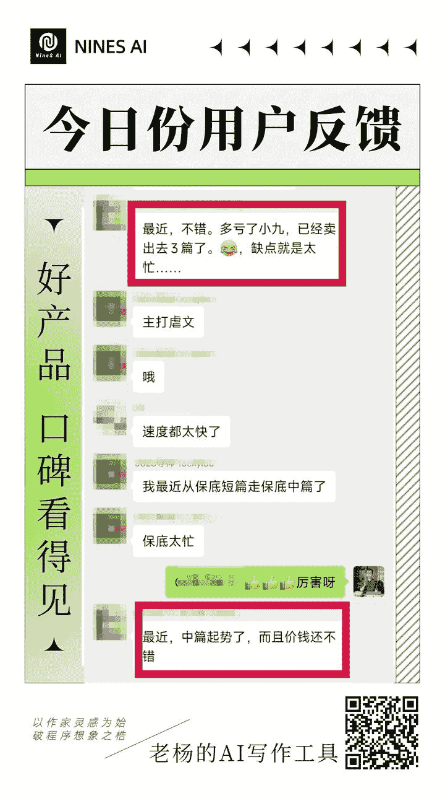
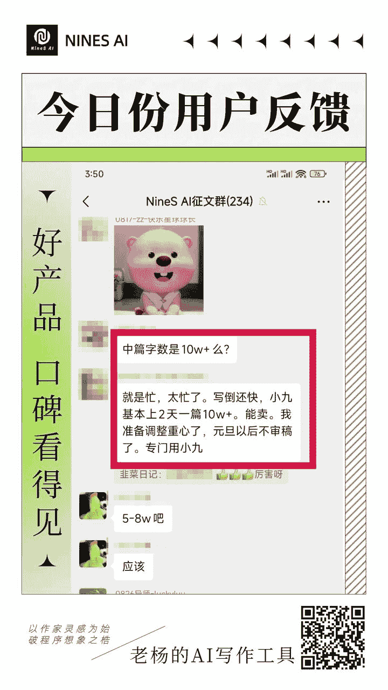

# AI写小说-NineS AI仿写超甜古言《攀高枝》

> 来源：[https://rq547mr4oez.feishu.cn/docx/SQFQd8iRCofuWyxsRANcXWEpnSD](https://rq547mr4oez.feishu.cn/docx/SQFQd8iRCofuWyxsRANcXWEpnSD)

## 一、前言

> 各位小伙伴好~🎉🎉🎉NineS-AI与君又见😬。

> 缘分本就是稀薄寡断，相逢一程已是感激万分😙。

> 经过十月份的α测试和最近2周的内测，很多小伙伴们都拿到了好结果（如：新手短篇K30/长篇签约起点/短剧出售等等）。

> 如今，通过仿写🍅爆款的《攀高枝》演示产品的实力

---

以下是题材类Prompt，无私奉献~~

1. [AI写小说-“玄幻文”小说家完整Prompt-v2.0](https://rq547mr4oez.feishu.cn/wiki/ZCVbw9n7fiiG4ukQNoDcRiS5nZf?from=from_copylink)（经典题材）

1. [AI写小说-“女频甜宠爽文”小说家独家Prompt](https://rq547mr4oez.feishu.cn/wiki/ARo9wUNi4iOKjNkj8ZbcUPtHn0c?from=from_copylink)（韭菜Y日记）

1. [AI写小说-“女频狗xue虐文”完整Prompt](https://rq547mr4oez.feishu.cn/wiki/AX6awAc3Ii0u3nk1gDrcCYr1nRh)（韭菜Y日记）

1. [AI写小说-“女频耽美文”小说家Prompt（万字）](https://rq547mr4oez.feishu.cn/wiki/Cx1YwmLNeizNW7kafvzcsmXTnQb)

1. [AI写小说-“科幻文”小说家完整Prompt](https://rq547mr4oez.feishu.cn/wiki/JBycwlmDDiYBXykJlu1cHWcanrg?from=from_copylink)

1. [AI写小说-“都市爽文”小说家独家Prompt](https://rq547mr4oez.feishu.cn/wiki/OFMtwYSYPiTmP6ktsh2cAKf3n1f?from=from_copylink)（经典题材）

1. [AI写小说-“种田文”小说家独家Prompt](https://rq547mr4oez.feishu.cn/wiki/X5glwVf1DiQYWLkvlvHcCxjhnYe)

1. [AI写小说-“后悔文”追妻火葬场完整Prompt](https://rq547mr4oez.feishu.cn/wiki/AzmhwUYiriTyoxkXVvPcaoGKncc?from=from_copylink)

1. [AI写小说-“世情文”小说家独家Prompt](https://rq547mr4oez.feishu.cn/wiki/UTe7wMDOKiDYfbkuGIPcbJxsngg?from=from_copylink)

1. [AI写小说-“快穿文”小说家独家Prompt](https://rq547mr4oez.feishu.cn/wiki/🐧EhwsaoZiQlv0k4wHVc03Nln9e?from=from_copylink)（易上手题材之一）

1. [AI写小说-“古言文”小说家独家Prompt](https://rq547mr4oez.feishu.cn/wiki/EpVJwNJAZiNtiQkcNdTcNVA2nNc?from=from_copylink)（经典题材）

1. [AI写小说-“末世文”小说家独家Prompt](https://rq547mr4oez.feishu.cn/wiki/CrZqwEYP8iVbPpkIG1XcHGzFntc)（上新~new）

1. [AI写小说-“系统文”小说家独家Prompt](https://rq547mr4oez.feishu.cn/wiki/AgJIwYMvEikzagkHwYhcsrMMnEf?from=from_copylink)（易上手题材之二）

1. [AI写小说-“读心术”小说家独家Prompt](https://rq547mr4oez.feishu.cn/wiki/IAE8wHhiLi6c1jkdau3cTPZVnnb?from=from_copylink)

1. [AI写小说-“升级流”小说家独家Prompt](https://rq547mr4oez.feishu.cn/wiki/CdriwSAi1iq2QLkWb0PcpxRknCd?from=from_copylink)

这个系列会持续做完所有题材，大家可以在粉丝群里面定制哦~。

---

PS：还有哪些问题可以评论或者私信我，我有空也可以解答。

PS：盗用这个文章的不要乱引流破坏环境，文章是免费分享给大家。有看见各位顺手举报下。感谢～资料纯分享不易。

**原始出处：**


## 二、第二轮提前测试~结果反馈（少部分截图，还有很多）





## 三、当前状态（以作家灵感为始，破程序想象之梏。）

> **产品理念：**

1. 以作家灵感为始，破程序想象之梏。奉行长期价值主义~

1. 最懂文字创作者的AI创作工具，没有之一！不写文章的研发，不是好研发。

1. **功能一览**

+   **AI拆书：**

+   短篇的情节节奏，情绪上下文怎么快速理解？

+   500万字的文本？小意思！NineS-AI帮你轻松拆解，分析风格，剖析情节和节奏，让你的创作之路不再迷茫。

+   **AI创作**

+   短篇、长篇、短剧三大类创作类型。从故事灵感到框架设定，从大纲到细纲，再到最终的正文生成，NineS-AI为你提供全流程的创作指南。

+   润色/扩写/续写/改写：灵感枯竭？旧作翻新？没问题！NineS-AI帮你,让你的创作灵感源源不断。

+   **AI助手**

+   高端玩家必备，物美价廉，自定义角色，四大主流AI除了创作，其他的工作也能用到哦~

1. **我们的优势**

1. 质量为王：仿写只是基本操作，我们的目标是打造最高质量的AI创作平台。

1. 重做文章G评系统：NineS-AI的创作70~85分起步，与市面上那根本无法与之相提并论（支持全网产品竞技PK哦~）

1. 高端定制：对于美主义者，我们还提供80~90分的“私人订制”服务，当然，时间和成本也会相应增加，具体情况具体分析。

1. **产品进度**

1. 种子测试时间（100+全职作者测试）开始时间：2024-10-14    结束时间：2024-11-15

1. 内测时间（群无条件邀请测试）开始时间：2024-11-22晚19.30    结束时间：2024-12-30

## 四、仿写案例

### 仿写三个层次：《具体见[NineS AI实操-“仿写”的三个阶段（By 老杨）](https://rq547mr4oez.feishu.cn/wiki/F9gHwbDbni1386kI3ivcC0PSnRb?from=from_copylink)》

+   初级仿写：即“翻译”：中译中不可取、英译中、中译英

+   [NineS AI实操-灵感来源“情节卡”（By 老杨）](https://rq547mr4oez.feishu.cn/wiki/ApJtw9PYbil6pJkF0lhckX3fnrb?from=from_copylink)级仿写：即“改写”：换元法（背景/人物/等），变成情节卡，参考

+   高级仿写：即“取经”：是仿情绪，节奏，通用"情节卡模板”。

### 拆书分析

```
##  一、基本信息
1. 选题: [一名女子在权贵圈中求生存与爱情的故事]
2. 题材: [古代言情]
3. 类型: [穿越重生]
4. 字数: 100万+
5. 期待感: [期待女主在复杂的权力游戏中找到自己的位置和爱情]
##  二、故事设定
1. 背景设定: [故事发生在古代上京，权贵之家，社会等级分明]
2. 主角: 
    - [陈宝香，年轻女子，性格乐观，出身贫寒，目标是嫁入高门大户]
    - [分析主角人设的七步法]
        - 目标：嫁入高门大户，改善生活
        - 阻碍：身份低微，缺乏资源和背景
        - 行动：通过各种手段接近权贵，展示自己的价值
        - 结果：获得一些认可，但仍面临挑战
        - 意外：意外救了裴如珩，引发新的情感纠葛
        - 转折：发现自己对裴如珩的真正感情
        - 结局：努力追求自己的幸福与理想生活
3. 配角: [裴如珩，权贵公子，性格内敛，对陈宝香起初冷淡后逐渐产生好感；王寿，医者，对主角有帮助；孙思怀，药神，对主角施以援手。]
4. 核心梗: [女主通过奇遇获得神仙的庇护与指导，在权贵圈中谋求生存与爱情。]
5. 核心内容: 
    - 危机: [女主身份低微，被误解为刺客；程槐立遭刺杀。]
    - 伏笔: [女主对裴如珩的好感；神仙的存在。]
    - 悬念: [女主能否成功融入权贵圈；程槐立的伤势如何。]
    - 爽点: [女主逆袭救人，与权贵之间的互动与冲突。]
##  三、故事脉络
1. 核心冲突: [人与人之间的身份差异与阶级冲突；个人理想与现实之间的矛盾。]
2. 情感纽带: [爱情、友情，以及对家庭责任的理解和承担。]
3. 故事反转: [女主从被误解为刺客到被权贵接纳；意外救下裴如珩。]
4. 二次反转: [女主从被轻视到得到重视，并且逐渐赢得裴如珩的心。]
5. 整体节奏:
    - 第一章：引入角色及危机（身份误解）[情绪：紧张、绝望]  
    - 第二章：展开人物关系（陈宝香与裴如珩）[情绪：期待、渴望]  
    ...
6. 写作风格: [幽默、轻松，同时带有一定的戏剧性和悬念]
```

### 细节版（字数1921），一次性生成未润色

```
**第1章 神秘声音**

夏夜的牢房里散发着潮湿的霉味，陈宝香蜷缩在稻草堆上，眼泪无声地从脸颊滑落。

「哭什么？」突如其来的男声吓得她差点从稻草堆上滚下来。

陈宝香警惕地环顾四周，漆黑的牢房里空无一人，只有老鼠吱吱的叫声和着铁链的碰撞声，更添几分阴森。

「别找了，我就在你的脑子里。」那个声音带着几分调侃，仿佛洞悉了她的一切心思。

陈宝香下意识捂住了耳朵，心乱如麻，「我该不会是被关傻了吧？莫不是这牢狱的阴气太重，竟生出了幻听？」

「放心，你没疯，我是真实存在的。」那个声音轻笑一声，带着一丝安抚，「不过，你要是继续这么自暴自弃下去，恐怕真的要完蛋了。」

陈宝香抹了把眼泪，小声抽泣道：「反正都这样了，还能怎么办？我连自己为什么会被抓都不知道，如同坠入迷雾，不知所措。」

「说说看，你是怎么进来的？」那个声音不急不缓地问，如同一位耐心的长者。

陈宝香咬了咬嘴唇，思绪飘回到那个灯火辉煌的夜晚，「我只是想去宴会上看看热闹，谁知道突然就被人当成刺客抓了起来，真是冤枉啊！」

「就这么简单？」那声音明显带着几分质疑，「你一个平民百姓，是怎么混进戒备森严的贵族宴会的？莫非有什么隐情？」

陈宝香低下头，脸上有些发烫，羞愧难当，「我……我是跟着送菜的马车混进去的。」她支支吾吾地说着，不敢吐露实情。

「说实话。」那个声音突然严厉起来，如同一道惊雷，在她脑海中炸响。

沉默片刻，牢房里静得只剩下她怦怦的心跳声，陈宝香终于鼓起勇气，如同破釜沉舟一般，「我是跟着倒泔水的车混进去的，想去看看贵族们的生活是什么样子，也好做个念想。」

「终于肯说实话了。」那个声音突然变得温和，如同春风拂过脸庞，「既然想知道贵族的生活，那你见到什么人了？可有什么特别之处？」

陈宝香回想着宴会上的情形，那些衣香鬓影，觥筹交错的景象，「我看到好多穿着华贵的人，他们谈笑风生，举止优雅，还有……还有一个特别好看的公子，如同谪仙一般，让人难以忘怀。」

「是裴如珩吗？」那个声音一语道破，仿佛早已知晓一切。

「你怎么知道？」陈宝香惊讶地问，心中充满了疑惑，这个人究竟是谁？为何如此了解她？

「因为我知道的比你想象中要多得多。」那个声音带着几分深意，如同一个谜团，让人捉摸不透，「现在，你想不想活命？是否愿意抓住这最后一根稻草？」

陈宝香连连点头，眼中燃起了一丝希望，「想！当然想！只要能活下去，我什么都愿意做！」

「那就听我的，我会指引你走出这困境。」那个声音冷静而沉着，「等会有人来审问你，你就说你是张家的远房表妹，是来找张知序的，记住，你必须表现得镇定自若，才能取信于人。」

「可是……这不是撒谎吗？」陈宝香犹豫道，内心充满了矛盾，她从小就被教导要诚实，如今却要为了活命而说谎。

「你现在还有选择吗？与其坐以待毙，不如放手一搏。」那个声音冷静地反问，点醒了她。

正说着，牢房的门被打开了，沉重的“吱呀”声打破了牢房的寂静，几个官差走了进来，他们面色冷峻，如同索命的无常。

「贱民，跟我们走一趟！」为首的官差一脸不屑，语气中充满了鄙夷。

陈宝香被带到一间审讯室，屋内灯火通明，如同白昼，几位官员正襟危坐，气氛凝重而压抑。

「说！你是何人派来的刺客？胆敢行刺朝廷命官，罪不容恕！」一个尖嘴猴腮的官员厉声喝问，如同审判的号角。

就在陈宝香犹豫的时候，一个衣着华贵的女子走了进来，她步履轻盈，姿态优雅，却带着一丝冷傲。

「大人，让我来认一认这个人。」那女子正是陆清容，她冷笑着走近陈宝香，眼中充满了恶意，「我认得她，她是醉月楼的一个舞女，整天做着攀龙附凤的春秋大梦，妄想飞上枝头变凤凰。」

众人哄堂大笑，如同看戏一般，陈宝香感觉脸上火辣辣的，羞愤难当，如同被剥光了衣服示众。

「怎么？被我说中了吧？」陆清容得意地说，如同打了胜仗的将军，「就凭你这种下贱的身份，也配混进贵族的宴会？简直是痴心妄想！」

就在这时，那个神秘的声音又在陈宝香脑海中响起，如同黑暗中的一盏明灯，「记住我教你的话，不要慌乱，这是你唯一的机会。」

陈宝香深吸一口气，挺直了腰板，如同焕然新生，「陆小姐此言差矣，我虽然在醉月楼待过，但那只是为了等待家里人的消息，并非你所说的那般不堪。」她顿了顿，语气坚定，「我是张家的远房表妹，此次是特地来寻张知序表哥的，并非有意混入宴会。」

此话一出，审讯室内顿时安静下来，如同时间静止一般，众人面面相觑，议论纷纷。

「张家？张知序？」一个穿着绫罗绸缎的官员皱着眉头，若有所思地看着陈宝香，「你可有什么证据？空口无凭，难以取信于人。」

「这……」陈宝香刚要说话，突然感觉脑海中一阵剧痛，如同针扎一般，让她难以忍受。

```

### 节奏版（字数2252），一次性生成未润色


# 第1章 神秘声音

冰冷的牢房里，空气中弥漫着刺鼻的霉味，仿佛要把人的肺腑都侵蚀掉。陈宝香蜷缩在角落，单薄的身子瑟瑟发抖，像一只受惊的小鸟。

她不明白，为什么自己会沦落至此，这阴暗潮湿的地方，与她梦寐以求的光鲜亮丽，简直是天壤之别。

明明只是想混进宴会，远远地瞧一眼上流社会觥筹交错的景象，偷偷地尝一口珍馐美味，满足一下她那卑微的愿望。

怎么就成了刺客？这罪名，犹如一块巨石，压得她喘不过气来。

「有人吗？」陈宝香带着哭腔，声音颤抖，如同风中飘零的落叶，脆弱不堪。

回应她的，只有空荡荡的回声，在牢房里来来回回地碰撞，更增添了她的绝望。

绝望如同冰冷的潮水般涌来，将她淹没，让她感到窒息，仿佛坠入无底深渊。

就在她快要放弃希望，任由黑暗吞噬她的时候，一个声音在她脑海中响起，如同一道闪电，划破了绝望的夜空。

「别哭了，蠢货。」

这声音低沉而磁性，带着一丝戏谑，像一根羽毛，轻轻撩拨着她的心弦。

陈宝香猛地抬起头，惊恐地四处张望，试图找到声音的来源。

「谁？谁在说话？」她颤抖着问道，声音里充满了恐惧和疑惑。

「我在你脑子里。」那声音再次响起，带着一丝安抚，「别害怕，我可以帮你。」

陈宝香愣住了，脑子嗡嗡作响，一时之间无法理解这匪夷所思的事情。

脑子里？这怎么可能？

难道是神仙显灵？在她最绝望的时候，来拯救她于水火之中？

「你……你是神仙？」她试探性地问道，语气中带着一丝希冀。

「神仙？」那声音似乎轻笑了一声，带着一丝嘲讽，「我可不是什么神仙。不过，我的确可以帮你。」

一丝希望的火苗在陈宝香心中燃起，微弱却执着，如同黑暗中的一盏明灯，照亮了她前行的路。

「你真的能帮我？」她紧紧抓住这根救命稻草，生怕它会突然消失。

「当然。」那声音肯定地说，语气中充满了自信，「不过，你得先告诉我，你为什么会被关在这里。」

陈宝香犹豫了一下，心中百感交集，但最终还是决定将事情的经过娓娓道来。

她如何躲进散发着恶臭的泔水车，如何小心翼翼地混进戒备森严的宴会，如何被侍卫误认为刺客，一五一十地说了出来，没有丝毫隐瞒。

「泔水车？」那声音的语气中充满了难以置信，带着一丝嫌弃，「你居然躲在泔水车里？」

陈宝香羞愧地低下头，脸颊泛起一阵红晕，恨不得找个地缝钻进去。

「我……我也是没办法。」她低声说道，语气中充满了无奈。

「为了混进宴会，你连脸都不要了？」那声音继续追问，语气中带着一丝责备。

「我……我只是想看看……」陈宝香的声音越来越小，细如蚊蝇，「我只是想看看上流社会是什么样子的，哪怕只是一眼。」

「就为了这个，把自己弄进牢房？」那声音的语气变得严厉起来，带着一丝恨铁不成钢的意味。

陈宝香咬着嘴唇，没有说话，泪水在眼眶里打转，但她强忍着没有让它们流下来。

「好吧。」那声音叹了口气，语气中充满了无奈，「看来你真是个蠢货。不过，看在你这么可怜的份上，我就帮你一把。」

「真的？」陈宝香的眼中重新燃起了希望的光芒，如同夜空中闪烁的星辰，明亮而耀眼。

「不过，你得听我的。」那声音顿了顿，语气变得严肃起来，「而且，你得撒谎。」

撒谎？这两个字，如同一道惊雷，在陈宝香的脑海中炸响。

陈宝香有些犹豫，从小到大，她都被教导要诚实，撒谎是不对的。

「我不喜欢撒谎。」她低声说道，语气中充满了抗拒。

「不喜欢也得撒。」那声音的语气变得更加严肃起来，「这是你唯一的出路，你明白吗？」

就在这时，牢房外传来一阵沉重的脚步声，由远及近，越来越清晰。

「有人来了。」那声音提醒道，语气中带着一丝 urgency，「记住我的话，照我说的做，否则后果不堪设想。」

狱卒打开了沉重的牢门，发出刺耳的吱呀声，身后跟着一个衣着华丽的女子，雍容华贵，如同众星捧月般耀眼。

那女子正是陆清容，她趾高气扬地走到陈宝香面前，脸上带着嘲讽的笑容，如同看着一只可怜的蝼蚁。

「哟，这不是陈宝香吗？怎么沦落到这步田地了？」她用尖酸刻薄的语气说道，每一个字都像一把利刃，狠狠地刺痛着陈宝香的心。

周围的狱卒也跟着起哄，发出阵阵嘲笑，如同看戏一般，欣赏着陈宝香的狼狈模样。

陈宝香紧紧地攥着拳头，指甲深深地嵌入肉里，努力控制着自己颤抖的身体。

她不想在这些人面前示弱，不想让他们看到自己的脆弱。

「陆清容，你别得意。」陈宝香强作镇定，语气中带着一丝倔强，「我很快就会出去的。」

「出去？」陆清容像是听到了什么笑话，笑得花枝乱颤，「就凭你？一个过气的舞女，也想飞上枝头变凤凰？」

陆清容的话像一把利刃，狠狠地刺痛了陈宝香的自尊，让她感到无地自容。

「我不是舞女！」陈宝香大声反驳，语气中充满了愤怒和委屈。

「哦？不是舞女？」陆清容挑了挑眉，语气中充满了不屑，「那你是什么？别告诉我，你是哪家的大小姐。」

陈宝香深吸一口气，努力平复自己激动的心情，脑海中回荡着那个神秘声音的话。

「我……我是张家……」她犹豫了一下，最终还是说出了那个神秘声音教她的话。

陆清容笑得前仰后合，眼泪都快要笑出来了。

「张家？你是张家的什么人？丫鬟？还是……」她故意停顿了一下，语气中充满了戏谑。

「我是张家未来的少夫人！」陈宝香鼓起勇气，大声说出了那个神秘声音教她的话，语气坚定而自信。

牢房里瞬间安静下来，仿佛时间都停止了流动。

所有人的目光都集中在了陈宝香身上，充满了震惊和怀疑，如同看着一个疯子。

这……是真的吗？

这过气舞女，竟然是张家未来的少夫人？

## 均衡版（字数2004），一次性生成未润色

### 第1章:惊魂初现

我握紧方向盘，耳边只有轮胎与地面摩擦的单调声响，仿佛一首催眠曲，想要将我拉入无尽的黑暗。

深夜的公交车内静得可怕，连一根针掉在地上都能听见，这种寂静反而让我更加不安。

仿佛连时间都在这里凝固，等待着某个未知的时刻重新流动。

突然，一个模糊的身影晃进我的视线，打破了这令人窒息的寂静。

第一位乘客上车了，他步履蹒跚，像是喝醉了酒，又像是在躲避着什么。

他的脸色苍白得吓人，像是刚从坟墓里爬出来一样，没有一丝血色。

目光游离不定，不敢与我对视，仿佛内心深处隐藏着巨大的恐惧。

我心里一紧，莫名的不安感油然而生，像是有一只无形的手扼住了我的喉咙。

随着车辆缓缓前行，昏黄的路灯灯光断断续续地洒进车厢，照亮一张张陌生的面孔。

更多乘客陆续上车，他们就像是从黑暗中浮现的幽灵，带着各自的故事和秘密。

他们的神态各异，有人低头玩手机，试图用虚拟的世界来逃避现实的压抑。

有人目光呆滞地望向窗外，仿佛对一切都失去了兴趣，只剩下麻木和空洞。

还有人不停地环顾四周，眼神中充满了警惕和怀疑，仿佛周围的一切都充满了危险。

我从后视镜中观察着这些深夜乘客，他们的面孔在昏暗的灯光下显得格外模糊，看不清表情，也猜不透心思。

总觉得他们每个人都像是在隐藏着不为人知的秘密，像是戴着面具的演员，在舞台上扮演着各自的角色。

车厢里弥漫着一种诡异的气氛，像是暴风雨来临前的宁静，让人感到压抑和不安。

我听到断断续续的低语声，像是来自地狱的 whispers，在我的耳边萦绕不去。

那些窃窃私语仿佛暗流涌动，在寂静的车厢里显得格外清晰，像是预示着即将到来的危险。

情绪似乎在不断升温，像是一锅即将沸腾的水，随时可能爆发。

我努力集中精神开车，试图将那些不安的情绪抛诸脑后，但它们却像跗骨之蛆般挥之不去。

一个年轻女孩坐在最后一排，她穿着黑色的连衣裙，像是参加葬礼一样，与这深夜的氛围格外契合。

她的眼神闪烁不定，时而警惕地看向车窗外，仿佛在提防着什么。

时而又低头摆弄着手中的黑色手机，屏幕的光芒映照在她苍白的脸上，显得格外诡异。

我注意到她的手在微微发抖，像是内心深处隐藏着巨大的恐惧，却又努力克制着不让自己表现出来。

与此同时，一位中年男子坐在车厢中部，他穿着西装，打着领带，像是刚下班的白领。

他开始频繁地查看手表，起初只是偶尔瞥一眼，像是赶时间一样。

随着时间推移，他看表的频率越来越高，脸上的焦虑也愈发明显，像是有什么重要的事情即将发生。

他的额头上渗出细密的汗珠，在昏黄的灯光下闪闪发光，像是恐惧的象征。

眼神中透露出一丝绝望，像是已经预见到了自己的命运。

我的心跳不自觉地加快了，像是有一面鼓在我的胸腔里敲打，越来越快，越来越响。

这些乘客的异常行为让我感到莫名的压抑，像是有一块巨石压在我的胸口，让我喘不过气来。

仿佛整个车厢都被一种看不见的力量笼罩着，这种力量充满了邪恶和不祥，让人不寒而栗。

突然，公交车驶入一片漆黑的隧道，像是进入了一个未知的领域，与世隔绝。

刺眼的车灯照亮了前方狭窄的通道，墙壁上布满了斑驳的痕迹，像是岁月的刻痕，又像是某种神秘的符号。

但更深的黑暗却吞噬了我们，像是要将我们永远困在这个封闭的空间里。

所有乘客瞬间陷入沉默，像是被黑暗夺走了声音，也像是被恐惧扼住了喉咙。

空气中弥漫着一种令人窒息的压迫感，像是有一只无形的手掐住了我们的脖子，让我们无法呼吸。

我的手心开始冒汗，方向盘变得湿滑，我不得不更加用力地握紧它，指节发白。

直觉告诉我，这个夜晚绝对不寻常，将会发生一些意想不到的事情，而我将被卷入其中，无法逃脱。

我努力平复呼吸，告诉自己要冷静，不要被恐惧所支配，但内心的恐惧却如潮水般涌来，将我淹没。

就在这时，后排传来一声压抑的啜泣，像是受伤的小兽发出的呜咽，让人心生怜悯。

我从后视镜中看到，那个年轻女孩正用手捂着嘴，肩膀微微颤抖，像是承受着巨大的痛苦。

她的眼神中充满了恐惧，像是看到了什么可怕的东西，却又不敢说出来，只能默默地承受。

我深吸一口气，准备开口询问她是否需要帮助，打破这令人窒息的沉默。

然而，就在我张嘴的瞬间，整个车厢突然陷入了一片诡异的寂静，像是时间停止了流动。

所有的乘客，包括那个啜泣的女孩，都像雕塑一般一动不动，目光呆滞地盯着前方，像是失去了灵魂的傀儡。

我的心跳几乎要跳出胸膛，像是有一只野兽要破体而出，将我撕成碎片。

一种前所未有的恐惧感席卷全身，像是掉进了冰窟窿里，寒意刺骨。

我想要喊叫，想要打破这诡异的寂静，却发现自己发不出任何声音，像是被某种力量禁锢了。

就在这时，后视镜中突然出现了一张苍白的脸，像是幽灵般凭空出现，与我近在咫尺。

那双漆黑的眼睛直勾勾地盯着我，像是要看穿我的灵魂，让我无处遁形，充满了邪恶和恶意。

## 微调版（字数2727），一次性生成未润色

### 第1章 神秘声音

陈宝香醒来时，发现自己躺在一个阴暗潮湿的牢房里。

四壁冰冷，空气中弥漫着刺鼻的霉味和铁锈的味道，仿佛要把人吞噬进去。

她挣扎着坐起身，头痛欲裂，全身无力。

她记得自己是在一场宴会上，衣香鬓影，觥筹交错，她满怀希望，期盼着能见到心心念念的裴如珩大人。

可突然之间，一切都变了。

一群卫兵不知从何而来，将她团团围住，粗暴地拖拽着，一路拖到了这个暗无天日的地方。

一切发生得太快，她甚至来不及反应，更来不及发出一声求救的呼喊。

「这是哪里？」陈宝香低声自问，声音在空荡荡的牢房里回荡，显得格外孤单无助。

绝望的情绪如潮水般涌来，将她紧紧包围。

就在这时，一个低沉而神秘的声音在她耳边响起，像是一根救命稻草，让她在绝望的深渊中看到了一丝微光。

「你叫陈宝香，对吗？」

陈宝香吓了一跳，猛地环顾四周，却空无一人。

「谁……谁在说话？」她声音颤抖，心中充满了恐惧和疑惑。

「别怕，我是来帮你的。」那个声音再次响起，仿佛从四面八方传来，让人无法辨别来源。

这声音，虽然低沉，却意外地带着一丝让人安心的力量。

「帮我？」陈宝香有些怀疑，但还是忍不住问道，「你是谁？为什么帮我？」

「我是你的守护者，你可以叫我……知序。」那个声音停顿了一下，似乎在思考，接着问道，「你为什么会在这里？」

陈宝香叹了口气，一股酸楚涌上心头，开始讲述自己的遭遇。

「我只是一个过气舞女，根本不是什么刺客。」

「我听说那场宴会裴如珩大人会出席，所以才想方设法地混进去，希望能见他一面。」

「这一切都是误会。」

「裴如珩？」那个声音似乎有些惊讶，「你为什么要见他？」

陈宝香脸上泛起一丝红晕，心中涌起一股甜蜜的苦涩。

「我喜欢他。」她坦诚道，「我想改变自己的命运，希望他能给我一个机会。」

「原来如此。」那个声音沉默了一会儿，似乎在消化这个信息，「你真的不是刺客？」

「当然不是！」陈宝香急切地辩解，「我只是想混进去看看他，没想到会被误会成刺客。」

「那你又是怎么进去的？」那个声音追问，语气中带着一丝探究。

「我……我是通过泔水车进去的。」陈宝香羞愧地低下头，窘迫得恨不得找个地缝钻进去。

「我知道这样做很愚蠢，很丢人，但我真的别无选择。」

「通过泔水车？」那个声音似乎有些好笑，「你真是个大胆的姑娘。」

陈宝香抬起头，眼中闪过一丝倔强。「我虽然出身卑微，但我不甘心就这样一辈子被人看不起。」

「这一点我很欣赏。」那个声音再次响起，「但你现在的问题是如何脱身。」

「我……我不知道怎么办。」陈宝香感到绝望，她绞尽脑汁，也想不出任何办法。

「他们肯定会审问我，把我当成真正的刺客。」

「如果你愿意，我可以帮你。」那个声音说道，语气中带着一丝诱惑，「但你需要按照我的指示去做。」

「你说吧，我愿意试试。」陈宝香咬了咬牙，心中燃起了一丝希望，哪怕只有一丝，她也想要抓住。

「首先，你要表现得更加镇定，不要显得慌张。」那个声音继续说道，「其次，你要编一个合理的谎言，让他们相信你并不是刺客。」

「谎言？」陈宝香有些犹豫，「这不太好吧……」她从小就被教导要诚实，撒谎让她感到不安。

「在这个险恶的环境中，有时候谎言是为了保护自己。」那个声音冷静地说道，「只要你能活着出去，一切都值得。」

陈宝香点了点头，心中渐渐有了主意。

「好吧，我试试看。」

牢门突然被推开，几个卫兵走了进来，将陈宝香押解到审讯室。

她深吸一口气，强忍着内心的恐惧，努力让自己看起来更加镇定。

审讯室里光线昏暗，气氛压抑，审讯官居高临下地坐在桌案后，眼神冰冷，仿佛能看穿一切。

「说，你究竟是谁？」审讯官冷冷地问道，眼中闪烁着不信任的光芒。

「我……我叫陈宝香，只是一个普通的舞女。」陈宝香尽量让自己的声音听起来平静，不带一丝颤抖，「我确实参加了那场宴会，但我绝对不是刺客。」

「那你又是怎么进去的？」审讯官继续逼问，语气咄咄逼人。

「我是通过朋友的关系进去的。」陈宝香按照那个神秘声音的指示，编了一个谎言，「我的一个朋友是府上的仆人，他偷偷带我进去的。」

「朋友？」审讯官冷笑一声，显然对这个答案并不满意，「你的朋友是谁？叫什么名字？在府上做什么？」

陈宝香心头一紧，额头渗出细密的汗珠。

「他……他叫李明，是府上的厨子。」她硬着头皮说道，心中默默祈祷这个名字不会被识破。

审讯官皱了皱眉头，显然对这个答案并不满意。

「我们会调查你的说法，如果发现你在撒谎，后果自负。」

陈宝香点了点头，心中默默祈祷那个神秘声音的计策能够奏效。

审讯结束后，陈宝香被重新押回牢房。

她坐在冰冷的地面上，心中充满了不安。

这时，陆清容趾高气扬地走了进来，眼神中充满了轻蔑和嘲讽。

「陈宝香，你真是个笑话。」陆清容冷笑道，「你一个过气舞女，竟然敢冒充刺客混进宴会，真是不知天高地厚。」

陈宝香强忍着心中的怒火，努力保持镇定。

她知道，在这个时候绝对不能乱了阵脚。

神秘的声音再次在她耳边响起，指引着她该如何应对。

她灵机一动，反唇相讥，巧妙地将陆清容也牵扯进来，让众人对她们二人都产生了怀疑。

官员注意到了牢房里的争吵，开始调查陈宝香和陆清容的关系，以及她们与张家的关系。

牢房外，陆清容站在走廊上，眼神中充满了嫉妒和愤怒。

她知道，陈宝香的出现，将会给她带来更多的麻烦。

但无论如何，她都不会轻易放过这个乡下丫头。

陈宝香的心中充满了坚定的信念，她知道，未来的路还很长，充满了未知和挑战。

但她相信，只要她坚持下去，总有一天，她会实现自己的梦想。

就在这时，牢房的门再次被推开，一个年轻的贵族公子走了进来。

他的眼神中带着一丝好奇和审视，正是陈宝香心中的梦中情人——裴如珩。

「你就是陈宝香？」裴如珩的声音低沉而有磁性，「我听说你对我的事情很感兴趣。」

陈宝香的心跳加速，她抬头看着裴如珩，眼中充满了期待和紧张。「是的，我是陈宝香。我……我一直都很仰慕您。」

裴如珩的眼神中闪过一丝复杂的情绪，但他并没有立刻回应。他转身对旁边的官员说道。「把她暂时放出来，我要亲自审问。」

官员点了点头，示意卫兵打开牢门。陈宝香走出牢房，心中充满了不安和期待。她知道，这一刻，将是她命运的转折点。

陈宝香的心中燃起了一丝希望，她知道，这一刻，将是她命运的转折点。但她也知道，未来的路还很长，充满了未知和挑战。她深吸一口气，坚定地迈出了第一步。

就在她迈出第一步的那一刻，她突然意识到，未来的路虽然充满了未知，但只要她坚持下去，总有一天，她会实现自己的梦想。

而这一切，都只是刚刚开始。
