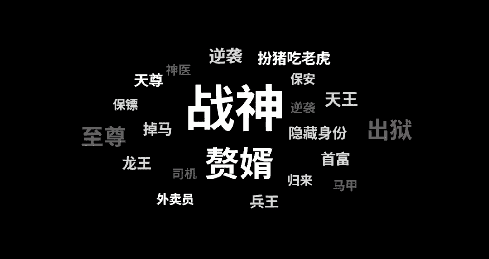
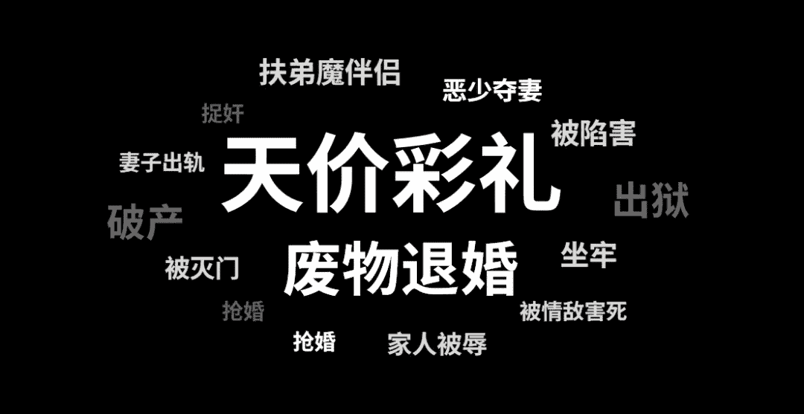
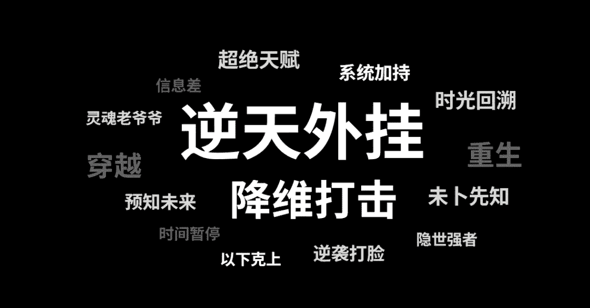
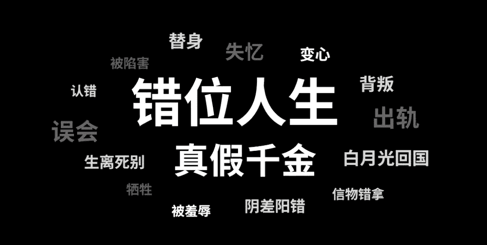
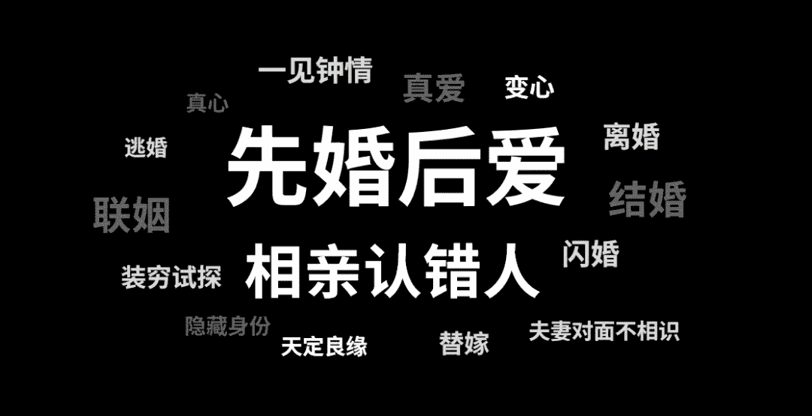
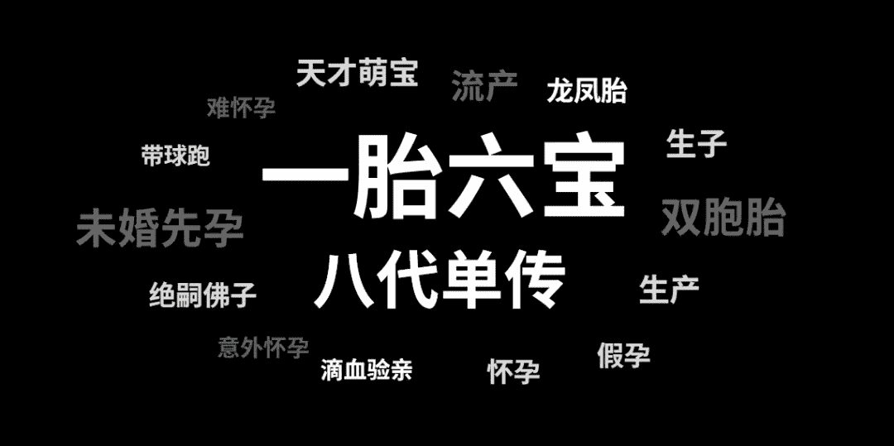

# NineS AI-爆单的50+短剧梗详解

> 来源：[https://rq547mr4oez.feishu.cn/docx/Vcv6dWQhgotBdlx2qJ2cxfIynSe](https://rq547mr4oez.feishu.cn/docx/Vcv6dWQhgotBdlx2qJ2cxfIynSe)

# 一、前言：

> **男频专注逆袭金手指大杀四方，**

> **女频沉迷爱情婚姻是主力话题，**

> **终是套路得人心！**

> **短剧经常会出现一些经典桥段**，比如男女主第一次亲密时双方都被下了药，古装剧主角被追杀一定逃到一个废弃寺庙，男主大身份掉马一定是一圈人都在场，然后大家表示震惊拜服……

> 梗可以作为情节发展的催化剂，一些特定的梗还能展现人物角色的性格特点，今天盘点一下男频和女频常见的梗，看看这些梗为什么经典？

以下是题材类Prompt，无私奉献~~PS：NineS AI产品+投稿全链路的创作者社群~

1.  [AI写小说-“玄幻文”小说家完整Prompt-v2.0](https://rq547mr4oez.feishu.cn/wiki/ZCVbw9n7fiiG4ukQNoDcRiS5nZf?from=from_copylink)（经典题材）

1.  [AI写小说-“女频甜宠爽文”小说家独家Prompt](https://rq547mr4oez.feishu.cn/wiki/ARo9wUNi4iOKjNkj8ZbcUPtHn0c?from=from_copylink)（韭菜Y日记）

1.  [AI写小说-“女频狗xue虐文”完整Prompt](https://rq547mr4oez.feishu.cn/wiki/AX6awAc3Ii0u3nk1gDrcCYr1nRh)（韭菜Y日记）

1.  [AI写小说-“女频耽美文”小说家Prompt（万字）](https://rq547mr4oez.feishu.cn/wiki/Cx1YwmLNeizNW7kafvzcsmXTnQb)

1.  [AI写小说-“科幻文”小说家完整Prompt](https://rq547mr4oez.feishu.cn/wiki/JBycwlmDDiYBXykJlu1cHWcanrg?from=from_copylink)

1.  [AI写小说-“都市爽文”小说家独家Prompt](https://rq547mr4oez.feishu.cn/wiki/OFMtwYSYPiTmP6ktsh2cAKf3n1f?from=from_copylink)（经典题材）

1.  [AI写小说-“种田文”小说家独家Prompt](https://rq547mr4oez.feishu.cn/wiki/X5glwVf1DiQYWLkvlvHcCxjhnYe)

1.  [AI写小说-“追妻火葬场”完整Prompt](https://rq547mr4oez.feishu.cn/wiki/AzmhwUYiriTyoxkXVvPcaoGKncc?from=from_copylink)

1.  [AI写小说-“世情文”小说家独家Prompt](https://rq547mr4oez.feishu.cn/wiki/UTe7wMDOKiDYfbkuGIPcbJxsngg?from=from_copylink)

1.  [AI写小说-“快穿文”小说家独家Prompt](https://rq547mr4oez.feishu.cn/wiki/🐧EhwsaoZiQlv0k4wHVc03Nln9e?from=from_copylink)（易上手题材之一）

1.  [AI写小说-“古言文”小说家独家Prompt](https://rq547mr4oez.feishu.cn/wiki/EpVJwNJAZiNtiQkcNdTcNVA2nNc?from=from_copylink)（经典题材）

1.  [AI写小说-“末世文”小说家独家Prompt](https://rq547mr4oez.feishu.cn/wiki/CrZqwEYP8iVbPpkIG1XcHGzFntc)（上新~new）

1.  [AI写小说-“系统文”小说家独家Prompt](https://rq547mr4oez.feishu.cn/wiki/AgJIwYMvEikzagkHwYhcsrMMnEf?from=from_copylink)（易上手题材之二）

1.  [AI写小说-“读心术”小说家独家Prompt](https://rq547mr4oez.feishu.cn/wiki/IAE8wHhiLi6c1jkdau3cTPZVnnb?from=from_copylink)

1.  .....这个系列会持续做完所有题材，大家可以在粉丝群里面定制哦~。

---

PS：NineS AI产品+投稿全链路的创作者社群~~

# 二、男频：一切为逆袭打脸服务

1.  **角色永远有两层马甲**

> 男频大部分的梗都和男主的身份有关。

+   **扮猪吃老虎梗**：男主本是战神/龙王，隐姓埋名当保安或保镖，在关键时刻力挽狂澜，显露真实力量打脸反派。

+   **隐藏身份梗**：男主通常有个不为人知的强大身份，碍于一些原因不公开，比如怕女主觉得配不上自己，或者和师傅有三年之约。

+   **赘婿梗**：身居高位的男主被女主救了以后，为爱当赘婿，被人看不起，最后男主打脸反派，亮出自己的真实身份震惊众人。

+   **神医梗**：男主拥有超绝医术，却被反派质疑或贬低，最后男主用医术实现逆袭和打脸。

> 男频男主通常会有两个身份，一个在明的身份是外卖员、保安和出租车司机等小人物身份，或者是被人看不起的赘婿身份，这类身份用来增加观众带入感和进行剧情打压。

> 另一个处在暗里的身份一般是战神、龙王、首富和神医之类的大人物身份，这类身份通常用于“打脸”环节，在关键时刻揭露男主真实身份，展现男主惊人的力量，保证剧情的爽感。

> 身份转换类型的梗能满足男性观众对力量、智慧和成功的幻想，同时也能拉扯观众的情绪，让他们持续观看，还保证了剧情的丰富性。

1.  部分男频短剧身份梗，**打压剧情永远少不了另一半**男频的打压剧情一大半和女主角或跟男主有关系的女配角有关。

+   **扶弟魔伴侣梗**：男主未婚妻、妻子是扶弟魔，经常挪用小家庭资金扶持弟弟，还逼迫男主出钱出力扶持弟弟。

+   **天价彩礼梗**：男主婚礼当天新娘子反悔，要求增加彩礼，或者新娘子家里人拦着不让结婚，要求增加彩礼。

+   **废物退婚梗**：男主曾是天才，一朝修为尽毁，未婚妻上门退婚，或者结婚前夕未婚妻出轨阔少，要和男主这个废物退婚。

+   **恶少夺妻梗**：女主是第一美女，和男主相知相恋，恶少逼迫女主家人把女主嫁给他。

> 男频男主的伴侣要么是对男主一心一意的女主，要么就是看不起男主的女二，如果伴侣是女主，那么打压剧情大部分是靠反派来完成，比如恶少抢婚、女主家人势利眼逼迫女主改价等，这类剧情让观众感到憋气，期待男主逆袭打脸。

> 如果伴侣是女二，那么打压剧情大部分由女二完成，比如婚礼变卦要加彩礼、当扶弟魔、婚礼前退婚甚至出轨等，这类剧情会让观众感到愤怒，想看到后续反转。

> 这类打压梗主要是为了制造紧张感和矛盾冲突，挑起观众的情绪，让观众上头，同时也为接下来男主逆袭的剧情埋下悬念。

（部分男频短剧打压梗）

1.  **金手指越大越爽**

> 大部分男频的男主角都拥有独属于自己的金手指。

+   **灵魂老爷爷梗**：在修仙类短剧中，男主总有一个大能导师，他们可能以灵魂状态栖息在男主的储物戒里，指导男主修炼，帮男主提升修为。

+   **穿越重生梗**：男主穿越到古代用现代知识或科技征服古人，打脸反派；男主重生后用后世的信息差对反派进行降维打击，震惊众人。

+   **系统梗**：男主获得系统，能帮助男主预知未来/时间回溯/获得任务和奖励，这类设定能让男主不断提升实力，实现逆袭。

+   **逆天外挂梗**：在男频短剧中，男主总能拥有“外挂”一样的天赋或能力，在挑战反派时完成以下克上，这样的天赋能让男主力挽狂澜逆转败局，给观众带来爽感。

> 男频男主要么能轻易获取各种资源实现自我突破，要么就是**本身就是大佬，满级大佬回新**手村降维打击。不管什么时候男主都是最强的，在他弱的时候，他能以下克上，最少也能和比自己能力强的反派拼成平手，在他强的时候，他就是剧里的战力天花板。

> 这类金手指相关的梗能增强男频短剧的观赏性，还能满足观众对男主逆袭的期待，给观众带来成就感和爽感。

（部分男频短剧金手指梗）

# 三、女频：绕不开的爱情、婚姻和家庭

1.  **花样百出的虐点**

> **大部分的女频虐点都自带狗血**。

+   **错位人生梗**：女主是真千金被掉包或身份被替换，属于她的身份被他人占据，她还因为小人物身份被打压，富豪父母知道真相后，后悔莫及。

+   **信物梗**：女主家族每个人都有信物（一般是玉佩），女主不小心走失，之后信物被反派女二捡到冒领自己的身份；或者女主和男主自幼相识，互换信物，长大后女主信物丢失，被女二捡到，男主认错人。

+   **替身梗**：女主知道男主心有所属还自愿当替身，或者女主以为自己在和男主恋爱，之后发现自己其实是替身。

+   **白月光梗**：男主有白月光，一般都出国了，随着白月光回国，男主态度暧昧不明，女主心灰意冷，双方不断拉扯，上演我爱你，你着爱她，我不爱你了你却说爱我的戏码。

> 女频虐**向短剧里的主角一般都没长嘴**，明明一句话就可以说清楚的事情，可以拉扯几十集，总是阴差阳错的错过或者因误会产生矛盾，比如身份被冒领、和爱在心中口难开就是女频虐向剧情里的经典桥段。这类虐点剧情往往涉及情感纠葛和家庭矛盾，为观众提供了情感释放的出口，这些情节是观众现实生活中可能遇到的情节，观众对这类剧情更能感同身受。

（部分女频短剧虐心梗）

1.  **婚姻关系变化是吸睛的法宝**

> 女频短剧里有不少经典梗涉及主角的婚姻状态变化。

+   **相亲梗**：男女主被催婚，被迫相亲，两人一见钟情或者认错了相亲对象之后闪婚。

+   **闪婚梗**：男女主因为各种原因迅速闪婚，在相处中逐渐对对方产生好感。

+   **联姻梗**：女主凭借权势逼迫男主联姻，男主厌恶女主，之后虐身又虐心；或者男女主家族联姻，男女主先婚后爱/男女主逃婚后爱上对方。

+   **离婚梗**：男主变心或女主误会男主变心，女主心灰意冷选择离婚，男主在离婚后发现自己真爱是女主，追妻火葬场。

> 女频女主的婚姻状态变化一般是剧情发展的重要催化剂，女主婚姻状态的变化让女主进入了一个新的环境，她必须马上做出应对，这样的情节更为紧凑，能为观众提供高强度的情感刺激。

> 婚姻相关的梗更贴近现实，能让观众快速代入剧情。

（部分女频短剧婚姻梗）

1.  **生孩子也要与众不同**

> 女频短剧有不少梗涉及生育，女主要么不生，要么特别能生。

+   **一胎六宝梗**：女主和男主被下药之后一夜情，女主离开后发现自己怀孕了，一胎生了六个宝宝，每个宝宝都是天才。

+   **八代单传梗**：男主家里是八代单传，女主一次生了双胞胎，震惊众人。

+   **绝嗣佛子梗**：男主不近女色，还被判定难以生育，女主出现打破这个诅咒，一发入魂生了男孩或龙凤胎。

+   **流产梗**：女主因为误会男主出轨变心，决定打掉孩子离婚，男主知道后追悔莫及。

> 对一部分女性观众而言，孩子就是一切，天才萌宝的设定可以助攻主角爱情发展，也能让女主处于“团宠”的位置，让女性观众能带入孩子出人头地报效父母的心态。而女主生育双胞胎打破八代单传的魔咒则是一个爽点，至于流产梗，一般用于虐心环节，激发人物的矛盾。

> 这类和生育相关的梗往往是剧情的重要转折点，能引发角色之间的情感冲突，比如男女主因为双胞胎萌宝的降世不得不一起相处，一胎多宝的设定可以满足特定观众的喜好，这些观众通常对多子多福和大家庭这样的传统观念充满向往。

（部分女频短剧生育相关的梗）

# 三、**短剧经典梗的类型小结  **

1.  **角色设定梗**

> 短剧里的人物设定是故事的核心元素，观众主要通过人物实现剧情代入。

> 一些经典的短剧梗会围绕角色身份设定展开，比如“战神”“赘婿”“神医”“霸道总裁”“小娇妻”等等。

> 大部分短剧的人物设定具有鲜明的特征，能加深观众对角色的印象，还能推动剧情发展。

> 人物设定梗除了要符合短剧的主题，还需要有足够的发展空间，让观众对角色进行情感投射和认同。

> 比如战神有小人物身份，掉马后实现打脸，为观众提供爽感，又或者主角本身是小人物，通过提升实力逆袭，给观众呈现出角色的成长，增加角色的复杂性和吸引力。

1.  **情节发展梗**

> 短剧中有不少推动情节发展的经典桥段，比如“废物退婚”“大佬掉马”“相亲认错人”等等。

> 这些**情节发展梗一般为剧情制造了冲突、误会或成为剧情的转折点，从而推**动剧情发展，还能为后续剧情的悬念埋下伏笔，通过增强故事的戏剧性来吸引观众的注意力。

> 一些特定的桥段还能展现角色关系变化，这些变化能带来一系列的连锁反应，丰富剧情的层次感。

> 整体而言，短剧梗有不少已经形成了一定套路，当这些梗出现能快速吸引特定的观众，也能让观众迅速代入剧情。

> 但是**同一个梗用多了，同质化就会非常明显，观众看到开头**就能猜到结尾，这时候或许需要反套路而行之，比如大家都在采用“男强女弱”的CP设定时，可以改为“双强”或者“女强男弱”的CP设定。