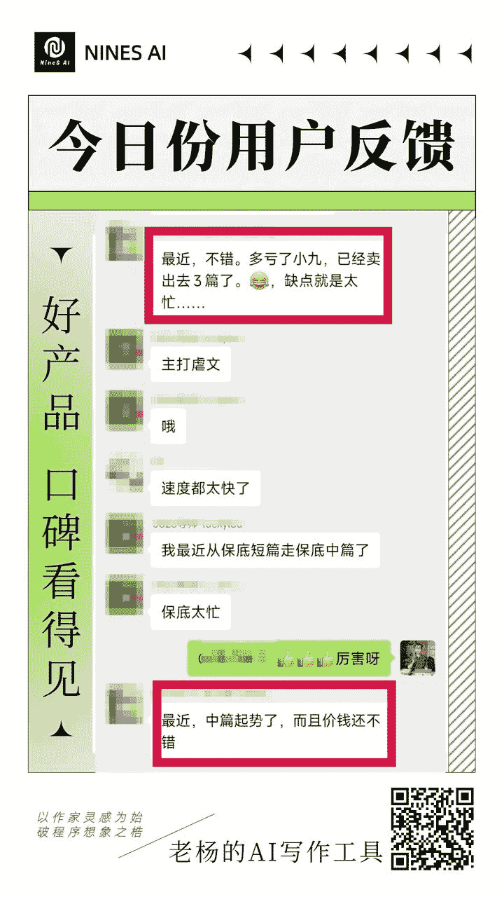

# AI写小说-NineS AI仿知乎三绝《宫墙柳》

> 来源：[https://rq547mr4oez.feishu.cn/docx/Yiakded3ZouZsuxcVf0cXMIrnng](https://rq547mr4oez.feishu.cn/docx/Yiakded3ZouZsuxcVf0cXMIrnng)

# 一、前言

> 各位小伙伴好~🎉🎉🎉NineS-AI与君又见😬。

> 缘分本就是稀薄寡断，相逢一程已是感激万分😙。

> **经过**十月份的α测试和最近2周的内测，很多小伙伴们都拿到了好结果（如：新手短篇K30/长篇签约起点/短剧出售等等）。

> 如今，通过仿写知乎曾经的三绝之一《宫墙柳》演示产品的实力~~

---

以下是题材类Prompt，无私奉献~~

1.  [AI写小说-“玄幻文”小说家完整Prompt-v2.0](https://rq547mr4oez.feishu.cn/wiki/ZCVbw9n7fiiG4ukQNoDcRiS5nZf?from=from_copylink)（经典题材）

1.  [AI写小说-“女频甜宠爽文”小说家独家Prompt](https://rq547mr4oez.feishu.cn/wiki/ARo9wUNi4iOKjNkj8ZbcUPtHn0c?from=from_copylink)（韭菜Y日记）

1.  [AI写小说-“女频狗xue虐文”完整Prompt](https://rq547mr4oez.feishu.cn/wiki/AX6awAc3Ii0u3nk1gDrcCYr1nRh)（韭菜Y日记）

1.  [AI写小说-“女频耽美文”小说家Prompt（万字）](https://rq547mr4oez.feishu.cn/wiki/Cx1YwmLNeizNW7kafvzcsmXTnQb)

1.  [AI写小说-“科幻文”小说家完整Prompt](https://rq547mr4oez.feishu.cn/wiki/JBycwlmDDiYBXykJlu1cHWcanrg?from=from_copylink)

1.  [AI写小说-“都市爽文”小说家独家Prompt](https://rq547mr4oez.feishu.cn/wiki/OFMtwYSYPiTmP6ktsh2cAKf3n1f?from=from_copylink)（经典题材）

1.  [AI写小说-“种田文”小说家独家Prompt](https://rq547mr4oez.feishu.cn/wiki/X5glwVf1DiQYWLkvlvHcCxjhnYe)

1.  [AI写小说-“后悔文”追妻火葬场完整Prompt](https://rq547mr4oez.feishu.cn/wiki/AzmhwUYiriTyoxkXVvPcaoGKncc?from=from_copylink)

1.  [AI写小说-“世情文”小说家独家Prompt](https://rq547mr4oez.feishu.cn/wiki/UTe7wMDOKiDYfbkuGIPcbJxsngg?from=from_copylink)

1.  [AI写小说-“快穿文”小说家独家Prompt](https://rq547mr4oez.feishu.cn/wiki/🐧EhwsaoZiQlv0k4wHVc03Nln9e?from=from_copylink)（易上手题材之一）

1.  [AI写小说-“古言文”小说家独家Prompt](https://rq547mr4oez.feishu.cn/wiki/EpVJwNJAZiNtiQkcNdTcNVA2nNc?from=from_copylink)（经典题材）

1.  [AI写小说-“末世文”小说家独家Prompt](https://rq547mr4oez.feishu.cn/wiki/CrZqwEYP8iVbPpkIG1XcHGzFntc)（上新~new）

1.  [AI写小说-“系统文”小说家独家Prompt](https://rq547mr4oez.feishu.cn/wiki/AgJIwYMvEikzagkHwYhcsrMMnEf?from=from_copylink)（易上手题材之二）

1.  [AI写小说-“读心术”小说家独家Prompt](https://rq547mr4oez.feishu.cn/wiki/IAE8wHhiLi6c1jkdau3cTPZVnnb?from=from_copylink)

1.  [AI写小说-“升级流”小说家独家Prompt](https://rq547mr4oez.feishu.cn/wiki/CdriwSAi1iq2QLkWb0PcpxRknCd?from=from_copylink)

这个系列会持续做完所有题材，大家可以在粉丝群里面定制哦~。

---

PS：还有哪些问题可以评论或者私信我，我有空也可以解答。

**P**S：盗用这个文章的不要乱引流破坏环境，文章是免费分享给大家。有看见各位顺手举报下。感谢～资料纯分享不易。

**原始出处：**


# 二、第二轮提前测试~结果反馈（少部分截图，还有很多）




# 三、当前状态（以作家灵感为始，破程序想象之梏。）

> **产品理念：**

1.  以作家灵感为始，破程序想象之梏。奉行长期价值主义~

1.  最懂文字创作者的AI创作工具，没有之一！不写文章的研发，不是好研发。

1.  **功能一览**

+   **AI拆书：**

+   短篇的情节节奏，情绪上下文怎么快速理解？

+   500万字的文本？小意思！NineS-AI帮你轻松拆解，分析风格，剖析情节和节奏，让你的创作之路不再迷茫。

+   **AI创作**

+   短篇、长篇、短剧三大类创作类型。从故事灵感到框架设定，从大纲到细纲，再到最终的正文生成，NineS-AI为你提供全流程的创作指南。

+   润色/扩写/续写/改写：灵感枯竭？旧作翻新？没问题！NineS-AI帮你,让你的创作灵感源源不断。

+   **AI助手**

+   高端玩家必备，物美价廉，自定义角色，四大主流AI除了创作，其他的工作也能用到哦~

1.  **我们的优势**

1.  质量为王：仿写只是基本操作，我们的目标是打造最高质量的AI创作平台。

1.  重做文章G评系统：NineS-AI的创作70~85分起步，与市面上那根本无法与之相提并论（支持全网产品竞技PK哦~）

1.  高端定制：对于美主义者，我们还提供80~90分的“私人订制”服务，当然，时间和成本也会相应增加，具体情况具体分析。

1.  **产品进度**

1.  种子测试时间（100+全职作者测试）开始时间：2024-10-14    结束时间：2024-11-15

1.  内测时间（群无条件邀请测试）**开始时间：2024-11-22晚19.3**0    结束时间：2024-12-30

# 四、仿写**案例~**

# 仿写三个层次：《具体见[NineS AI实操-“仿写”的三个阶段（By 老杨）](https://rq547mr4oez.feishu.cn/wiki/F9gHwbDbni1386kI3ivcC0PSnRb?from=from_copylink)》

+   初级仿写：即“翻译”：中译中不可取、英译中、中译英

+   [NineS AI实操-灵感来源“情节卡”（By 老杨）](https://rq547mr4oez.feishu.cn/wiki/ApJtw9PYbil6pJkF0lhckX3fnrb?from=from_copylink)级仿写：即“改写”：换元法（背景/人物/等），变成情节卡，参考

+   高级仿写：即“取经”：是仿情绪，节奏，通用"情节卡模板”。

### **NineS**拆书分析

```
#  故事梗概
##  一、基本信息
1. 选题: [宫廷权力斗争与后宫生活]
2. 题材: [宫廷、权谋]
3. 类型: [言情、历史]
4. 字数: 73465
5. 期待感: [通过主角江映柳的视角，展现宫廷中的权力斗争和复杂的人际关系，以及她如何在其中生存并最终成为太后]
##  二、故事设定
1. 背景设定: [故事发生在古代某朝代，皇帝登基初期，外戚势力强大，宫廷内外矛盾重重。江映柳出身书香门第，十四岁意外入宫，逐渐卷入宫廷斗争中]
2. 主角: 
    - 江映柳：十四岁进宫，出身书香门第，性格温婉但内心坚强，目标是保护自己和家人，阻碍是皇帝的心机深沉，行动包括巧妙周旋于各妃嫔之间，结果是成为皇后并最终成为太后。
    - 分析主角人设的七步法：
        - 目标：保护自己和家人，维持家族地位。
        - 阻碍：皇帝的心机深沉，宫廷斗争复杂。
        - 行动：巧妙周旋于各妃嫔之间，利用智慧和人际关系。
        - 结果：成为皇后并最终成为太后。
        - 意外：意外入宫，多次面临生死考验。
        - 转折：逐渐看清宫廷真相，学会保护自己。
        - 结局：成功成为太后，见证子孙后代的成长。
3. 配角: 
    - 淑妃：将门虎女，性格直爽，对江映柳如母如姐，帮助她适应宫中生活。
    - 温贵妃：擅长刺绣，不喜欢孩子，却因艺术才华而备受尊敬。
    - 纯妃：清冷孤傲，皇帝的表妹，最终因谋反被赐死。
    - 先皇后：温柔善良，因宫廷斗争早逝，留下深刻影响。
4. 核心梗: [穿越、重生、宫廷斗争、权谋、亲情、友情等]
5. 核心内容: 
    - 危机: [宫廷斗争、外戚干政、谋反事件、宠妃争宠等]
    - 伏笔: [先皇后的悲剧、淑妃的过去、纯妃的真实身份等]
    - 悬念: [皇帝的真实意图、各妃嫔之间的暗斗、未来继承人的选择等]
    - 爽点: [江映柳逐步掌握权力，化解危机，最终成为太后]
##  三、故事脉络
1. 核心冲突: [宫廷权力斗争，外戚干政，皇帝与妃嫔之间的复杂关系]
2. 情感纽带: [江映柳与淑妃、温贵妃等人的深厚友谊，以及她对孩子们的母爱]
3. 故事反转: [从意外入宫到成为皇后，再到经历谋反事件，最后成为太后]
4. 二次反转: [皇帝对江映柳的感情变化，以及她对宫廷生活的态度转变]
5. 整体节奏: 
    - 第一章 意外：[选秀前夕姐姐出事，江映柳意外入宫，情绪：惊讶、迷茫]
    - 第二章 侍君：[初承宠，感受到宫廷生活的复杂，情绪：紧张、不安]
    - 第三章 滋事：[陈贵妃挑衅，江映柳开始参与宫斗，情绪：愤怒、坚定]
    - 第四章 风起：[护国公谋反，江映柳逐渐理解宫廷斗争的本质，情绪：担忧、冷静]
    - 第五章 月落：[先皇后去世，江映柳成为新皇后，情绪：悲伤、责任感增强]
    - 第六章 月沉：[继续处理后宫事务，面对新的挑战，情绪：平静、从容]
    - 第七章 新人：[新人进宫，江映柳逐渐适应皇后身份，情绪：无奈、宽容]
    - 第八章 双生：[生下龙凤胎，后宫生活更加忙碌，情绪：幸福、压力增大]
    - 第九章 立后：[正式成为皇后，处理后宫事务，情绪：自豪、责任更重]
    - 第十章 育儿：[抚养子女，感受为人母的喜悦与艰辛，情绪：温馨、忧虑]
    - 第十一章 仙人：[了解纯妃的背景，感受到宫廷的孤独，情绪：同情、思考]
    - 第十二章 冬至：[经历孙婕妤的挑衅，巩固自己的地位，情绪：坚定、自信]
    - 第十三章 逆鳞：[护国公谋反，江映柳展现出领导才能，情绪：紧张、果断]
    - 第十四章 寻常：[日常生活中感受到岁月流逝，情绪：感慨、平和]
    - 第十五章 宫斗：[应对孙婕妤的挑衅，最终化解危机，情绪：焦虑、释然]
    - 第十六章 谋反：[再次经历谋反事件，江映柳展现出强大的应变能力，情绪：惊恐、冷静]
    - 第十七章 婚丧：[长女嘉乐出嫁，淑妃病逝，情绪：不舍、伤感]
    - 第十八章 嫁娶：[为长思和长忆安排婚事，情绪：欣慰、牵挂]
    - 第十九章 驾崩：[皇帝驾崩，江映柳成为太后，情绪：悲痛、释怀]
    - 第二十章 终老：[晚年生活，回忆往昔，情绪：平静、满足]
6. 写作风格: [细腻描写人物心理，情感真挚，情节跌宕起伏]
```

### 细节版（字数3206）

```
**第一章 意外**
江映柳站在那古色古香的黄花梨木雕花铜镜前，镜中映出一张年轻而略显稚气的脸庞，
那是一张不施粉黛却依旧清丽脱俗的面容，只是眉宇间笼罩着一层淡淡的忧愁，让她原本灵动的双眸显得有些黯然。
“小姐，吉时快到了，咱们该出发了。”
丫鬟小翠轻手轻脚地走进房间，声音如同黄鹂般清脆，却又带着几分小心翼翼。
她的手中捧着一件崭新的湖蓝色襦裙，那颜色如同雨后初晴的天空，清新而雅致。
江映柳轻轻叹了口气，像是要把心中的郁结都吐出来似的。她缓缓转身，任由小翠为她更衣。
那湖蓝色的襦裙上，绣着一朵朵细密的芙蓉花，针脚细腻，栩栩如生，这是姐姐江映雪亲手为她绣的。
一想到姐姐，江映柳的心就像被一只无形的手紧紧揪住，疼痛难忍。
三日前，原本应是姐姐江映雪参加秋闱选秀的日子。江映雪，京城有名的才女，不仅容貌出众，更是琴棋书画样样精通，是此次选秀的热门人选。
然而，天有不测风云，就在前往京城的路上，江映雪乘坐的马车突然遭遇意外，翻覆在崎岖的山路上，她不幸摔断了腿，无法再参加选秀。
为了不辜负圣恩，保全家族的颜面，父亲江远道思虑再三，最终决定让年仅十四岁的江映柳代替姐姐入选。
“小姐，您别担心，您生得这般标致，一点也不输给姐姐，定能入选的。”
小翠一边麻利地为江映柳梳着头发，一边柔声安慰道。她知道，自家小姐虽然平日里温婉娴静，但内心却极为敏感，此刻定是害怕极了。
江映柳勉强挤出一丝笑容，那笑容却比哭还难看。她从未想过要入宫，更从未想过要成为皇帝的妃嫔。
她只想过着平淡安稳的日子，与家人相伴，与诗书为友。可如今，命运却将她推向了这条未知的道路，那个深不可测的皇宫，就像一张巨大的网，正等着她自投罗网。
马车缓缓驶入繁华的京城，街道两旁人声鼎沸，热闹非凡。
今年的秋闱选秀格外引人注目，据说是因为皇上近年来膝下子嗣单薄，有意选拔新人充实后宫，为皇室开枝散叶。
江映柳透过车窗的绸帘，偷偷向外望去，只见街道上人来人往，车水马龙，不少与她年龄相仿的少女在家人的陪同下，或紧张、或兴奋、或忐忑地往宫门口走去，她们的脸上写满了对未来的憧憬和不安。
“小姐，到了。”随着马车缓缓停稳，小翠轻声说道，打破了江映柳的思绪。
江映柳深吸一口气，她轻轻整理了一下衣裙，然后跟随着其他秀女鱼贯而入。
宫门高耸入云，朱红色的大门上镶嵌着闪亮的铜钉，在阳光的照耀下熠熠生辉，显得格外威严肃穆。
选秀的地点设在掖庭宫。数百名秀女按照家族的官职和地位依次排队，等待着太监们的检查和记录。
江映柳静静地站在队伍中，耳边充斥着周围人的窃窃私语，那些细碎的声音像是一群嗡嗡叫的苍蝇，扰得她心烦意乱。
“哎，你听说了吗？今年皇上特别看重才艺，尤其是音律方面……”
“可不是么，我家小姐为了这次选秀，可是特意请了宫里的乐师指点，苦练了好几个月呢！”
“我倒是听说，皇上最近偏爱会烹饪的女子，说是能做出美味佳肴的女子，必定心灵手巧，贤惠淑德……”
江映柳听着这些议论，心中暗自叹息。她自幼虽然也学过琴棋书画，但并不精通，更别提什么烹饪了。她最擅长的，不过是些针线女红，而这些在宫廷之中，恐怕是最不值一提的技能了。若非为了替姐姐解围，保全家族的名声，她根本就不该出现在这里。
“江家小姐，江映柳。”一个尖细的声音突然响起，打断了江映柳的思绪。她抬头望去，只见一个面容和善的老太监正站在不远处，朝她招手示意。
//...由于篇幅太长，省略中间段落...
温昭仪突然被传召侍寝，淑妃娘娘和江映柳都为她感到担忧。
“皇上今夜召温昭仪侍寝，不知是福是祸……”淑妃娘娘说完。
```

### 节奏版（字数3193）

```
****第一章 意外**
十四岁的江映柳从未想过自己会入宫。
她自幼长在江**南水乡，家中世代书香，本应过着平静安宁的生活。
春日里，她最爱与姐姐一同泛舟湖上，采莲嬉戏；夏日炎炎，便躲在屋中读书习字，听蝉鸣阵阵；秋风起时，赏满园金桂，闻香品茗；冬雪飘落，则围炉煮茶，共话家常。
这样的日子，如诗如画，岁月静好。
然而，命运的捉弄总是突如其来。姐姐江映梅生得一副好相貌，身段窈窕，柳眉杏眼，肌肤胜雪，是远近闻名的大美人。
早早便被选为秀女，只待及笄之年便要入宫参选。
江家上下对江映梅寄予厚望，盼她能一朝得选，光耀门楣。可谁知，天有不测风云，人有旦夕祸福。
就在选秀前夕，江映梅竟意外坠湖，香消玉殒。噩耗传来，江家如遭晴天霹雳，悲痛欲绝。
江映柳的母亲终日以泪洗面，几度哭晕过去。父亲也是一夜之间白了头，仿佛老了十岁。
江映柳更是心如刀绞，她与姐姐感情深厚，亲密无间，姐姐的离去，如同剜去了她心头的一块肉，痛彻心扉。
然而，逝者已矣，生者如斯。
江家不能就此沉沦，家族的荣耀还需要有人来延续。
于是，年仅十四岁的江映柳，被推上了风口浪尖，代替姐姐入宫选秀。
这对于一个从小在江南水乡长大的少女来说，无异于天塌地陷。她从未想过自己会踏入那高墙深院，去面对未知的命运。
可事已至此，她别无选择。为了家族，她必须舍弃自己的幸福，踏上这条充满荆棘的道路。
盛京的繁华与喧嚣，与记忆中温柔的江南小镇截然不同。
鳞次栉比的商铺，熙熙攘攘的人群，车水马龙的街道，一切都让江映柳感到陌生和不安。
特别是那巍峨的宫墙，高耸入云，像一只巨大的怪兽，要将一切都吞噬进去。
森严的规矩，更是让江映柳感到窒息，仿佛有一双无形的手，紧紧地扼住了她的喉咙。
选秀那日，江映柳身着一袭素雅的衣裙，那是她亲手缝制的，绣着几朵淡雅的兰花，正如她此刻的心情，素净而淡然。
她忐忑不安地站在众多秀女之中，这些女子个个花枝招展，争奇斗艳，唯有她，像一朵开在幽谷的兰花，静静地散发着自己的芬芳。
她容貌秀丽，虽不惊艳，却也清丽脱俗，自有一股出尘的气质。
举止端庄，进退有度，一看便是受过良好教养的大家闺秀。
皇帝高高在上，只匆匆扫了一眼，便赐封她为美人，赐居长乐宫。
长乐宫，宫如其名，却并非真正的快乐之地。
初入宫廷，江映柳处处小心谨慎，生怕行错一步，说错一句话。
//...由于篇幅太长，省略中间段落...
一日，皇后娘娘邀请江映柳、淑妃娘娘和温昭仪一起用膳。
温昭仪才艺出众，琴棋书画样样精通，但性格冷淡，不喜与人交往。
然而，在与江映柳的接触中，温昭仪渐渐被她的真诚善良所打动。
四人相谈甚欢，气氛融洽，江映柳也逐渐融入了皇后的小圈子。
就在这看似平静的日子里，宫中却暗流涌动。
温昭仪突然被传召侍寝，淑妃娘娘和江映柳都为她感到担忧。
“皇上今夜召温昭仪侍寝，不知是福是祸……”淑妃娘娘说完。她望着窗外漆黑的夜空，眼神中充满了忧虑。
```

### 均衡版（字数2004）

```
**第一章 意外**
十四岁的江映柳从未想过自己会踏入这深宫禁苑。
盛夏的阳光透过雕花窗棂，在地面上投下斑驳的光影，映照着少女略显苍白的脸庞。她紧紧攥着手中的帕子，指节泛白，不安地打量着周围富丽堂皇却又陌生的陈设。鎏金香炉里袅袅升起的沉香，非但没有让她感到放松，反而更加重了心中的惶恐。
“姐姐……”她低声呢喃，声音细若蚊蝇。
如果不是姐姐意外坠湖，她此刻应该还在家中，与姐姐一起学习女红，一起在花园里追逐嬉戏。可如今，姐姐香消玉殒，而她，却被送入宫中，参加选秀。
“映柳，别怕。”一个温柔的声音在她耳边响起。
江映柳抬起头，看到一个身着宫装的嬷嬷正慈祥地看着她。“你是个好孩子，以后要好好听话，知道吗？”
嬷嬷的话语如同冬日里的一缕阳光，稍稍温暖了江映柳冰冷的心。她点点头，努力挤出一个笑容，却比哭还难看。
选秀的过程漫长而煎熬。一个又一个精心打扮的少女被带到皇帝面前，展示才艺，接受评判。江映柳默默地站在角落里，看着那些或娇艳或清丽的女子，心中充满了自卑。她既不会吟诗作对，也不会弹琴跳舞，更没有显赫的家世背景，她不知道自己有什么资格站在这里。
“江映柳。”尖细的嗓音划破了殿内的寂静。
江映柳深吸一口气，缓缓走到皇帝面前，屈膝行礼。“民女江映柳，参见皇上。”
皇帝的目光在她身上停留了片刻，然后淡淡地说道：“抬起头来。”
江映柳依言抬起头，与皇帝四目相对。那是一双深邃而冷漠的眼睛，仿佛能洞悉一切。
“封为美人。”皇帝的声音不带一丝感情。
江映柳愣住了，她没想到自己竟然会被选中。她本以为自己会落选，然后默默地回到家中，过着平静的生活。
成为美人的消息很快传遍了后宫。有人羡慕，有人嫉妒，也有人不屑。江映柳对这些都漠不关心，她只想安安静静地度过宫中的日子，不争不抢，不惹是非。
然而，宫中的生活远比她想象的要复杂得多。
她第一次见到淑妃，是在御花园里。当时，淑妃正站在一棵桂花树下，手里拿着一本书，静静地翻阅着。阳光透过树叶的缝隙，洒落在她的身上，仿佛给她镀上了一层金色的光辉。
江映柳被这一幕深深吸引，不由自主地停下了脚步。她从未见过如此优雅高贵的女子，仿佛是从画中走出来的一般。
“你是新来的美人？”淑妃抬起头，目光落在江映柳身上，嘴角微微上扬，“过来坐吧。”
江映柳有些拘谨地走到淑妃身边坐下。淑妃合上书，转头看着她，眼神中带着一丝探究。
“你叫什么名字？”
“江映柳。”
“映柳，”淑妃重复了一遍她的名字，“好名字。”
淑妃的声音温柔而悦耳，让江映柳感到一阵莫的亲切。她开始向淑妃倾诉心中的不安和惶恐。
淑妃静静地听着，不时地点头，给予她安慰和鼓励。
“宫中的生活确实不易，但只要你保持一颗善良的心，就一定能克服一切困难。”淑妃说道，“以后，你就跟着我吧，我会保护你的。”
江映柳感激地望着淑妃，眼中闪烁着泪光。她终于找到了一个可以依靠的人，一颗漂泊的心终于找到了归宿。
接下来的日子里，江映柳一直跟在淑妃身边，学习宫中的规矩，也逐渐了解了后宫的尔虞我诈。
她亲眼目睹了陈贵妃的嚣张跋扈，也感受到了皇后的威严和温昭仪的温柔。
//...由于篇幅太长，省略中间段落...
```

### 微调版（字数1603）

```
**第一章 意外**
十四岁的江映柳从未想过自己会入宫。
她自幼生长在江南水乡，家中世代书香，本应过着平静安稳的日子。然而，命运的齿轮在她姐姐江映桃的及笄礼上发生了偏转。
江映桃是远近闻名的美人，本已和青梅竹马的表哥定下婚约。却意外被选为秀女，送入宫中。
突如其来的变故让江家措手不及，更让江映柳陷入了深深的恐惧。她不明白为什么命运会如此捉弄人。
父母的叹息，都像一根根尖刺，扎在她年幼的心上。为了家族的荣誉，为了不让父母伤心，江映柳代替姐姐踏上了进京的马车。
她知道，这一去，便是与过去彻底告别。
宫墙高耸，红墙黄瓦，气势恢宏。初入宫门，江映柳便被这森严的氛围所震慑。
她不知道等待自己的将会是什么，但她知道，自己必须坚强。最终，江映柳被意外选中，封为美人。
这对她来说，既是幸运，也是不幸。
幸运的是，她不必像其他落选的秀女一样，被送回原籍，或者嫁给朝中大臣。
不幸的是，她将从此被困在这金碧辉煌的牢笼之中，再也无法回到自由自在的生活。
入宫后，江映柳被安排住进了景阳宫。宫殿虽然华丽，却处处透着冰冷的气息。
她整日待在房间里，很少外出。宫女太监们对她毕恭毕敬，却也保持着一定的距离。
江映柳感到无比的孤单和寂寞。
一日，江映柳在御花园散步，无意中闻到了一股诱人的香味。她循着香味走去，发现是一处小厨房。
厨房里，一位身着华服的女子正在忙碌着。她便是淑妃娘娘，宫中有名的贤惠能干，厨艺精湛。
江映柳从未见过如此亲切的妃嫔，她鼓起勇气上前，向淑妃娘娘请安。
淑妃娘娘见她举止端庄，容貌秀丽，便心生好感。
两人聊了一会儿，江映柳发现淑妃娘娘的性格十分直爽开朗，与她想象中的宫妃完全不同。
她渐渐放下了心中的戒备，开始向淑妃娘娘倾诉自己的心事。
淑妃娘娘听后，对江映柳的遭遇深表同情。
她决定将江映柳纳入自己的羽翼之下，保护她免受宫中其他妃嫔的欺凌。
此后，江映柳便经常去淑妃娘娘的宫里请安，两人也逐渐成为了无话不谈的好友。
淑妃娘娘不仅教导江映柳如何处理宫中的人际关系，还经常为她做一些家乡的菜肴，让她感受到家的温暖。
从未央宫回来后，淑妃娘娘语重心长地对江映柳说：“孩子，在这个宫里，不要轻易相信任何人，也不要轻易喜欢上皇上。”
江映柳不明白淑妃娘娘的意思，她疑惑地问道：“为什么？”
淑妃娘娘叹了口气，说道：“皇上的宠爱，就像天上的浮云，变幻莫测。今天他喜欢你，明天可能就喜欢上别人了。你若是把真心交给他，最终只会落得一场空。”
江映柳似懂非懂地点了点头。
//...由于篇幅太长，省略中间段落...
皇后娘娘继续说道：“皇上政务繁忙，无暇顾及后宫之事。况且，你年纪尚小，皇上也想让你多一些时间适应宫中的生活。”
然而，就在江映柳逐渐融入这个小圈子的时候，一个突如其来的消息打破了宫中的平静。
温昭仪被传召侍寝……
```

#