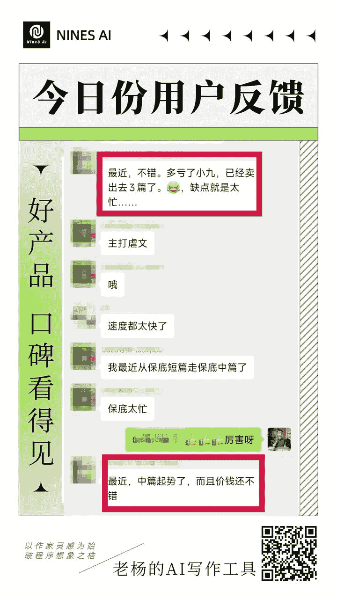
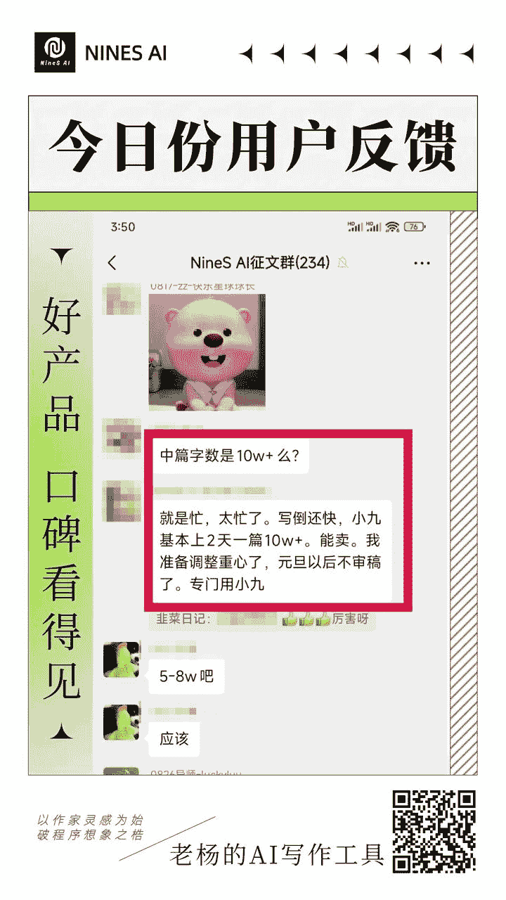

# AI写小说-NineS AI仿治愈《抗痔恋爱笔记》

> 来源：[https://rq547mr4oez.feishu.cn/docx/LPuFdJq90oEPPbx2Bo5cBpg3nRe](https://rq547mr4oez.feishu.cn/docx/LPuFdJq90oEPPbx2Bo5cBpg3nRe)

# 一、前言

> 各位小伙伴好~🎉🎉🎉NineS-AI与君又见😬。

> 缘分本就是稀薄寡断，相逢一程已是感激万分😙。

> **经过**十月份的α测试和最近2周的内测，很多小伙伴们都拿到了好结果（如：新手短篇K30/长篇签约起点/短剧出售等等）。

> 如今，通过仿写🍅爆款的《抗痔恋爱笔记》演示产品的实力~~

---

以下是题材类Prompt，无私奉献~~

1.  [AI写小说-“玄幻文”小说家完整Prompt-v2.0](https://rq547mr4oez.feishu.cn/wiki/ZCVbw9n7fiiG4ukQNoDcRiS5nZf?from=from_copylink)（经典题材）

1.  [AI写小说-“女频甜宠爽文”小说家独家Prompt](https://rq547mr4oez.feishu.cn/wiki/ARo9wUNi4iOKjNkj8ZbcUPtHn0c?from=from_copylink)（韭菜Y日记）

1.  [AI写小说-“女频狗xue虐文”完整Prompt](https://rq547mr4oez.feishu.cn/wiki/AX6awAc3Ii0u3nk1gDrcCYr1nRh)（韭菜Y日记）

1.  [AI写小说-“女频耽美文”小说家Prompt（万字）](https://rq547mr4oez.feishu.cn/wiki/Cx1YwmLNeizNW7kafvzcsmXTnQb)

1.  [AI写小说-“科幻文”小说家完整Prompt](https://rq547mr4oez.feishu.cn/wiki/JBycwlmDDiYBXykJlu1cHWcanrg?from=from_copylink)

1.  [AI写小说-“都市爽文”小说家独家Prompt](https://rq547mr4oez.feishu.cn/wiki/OFMtwYSYPiTmP6ktsh2cAKf3n1f?from=from_copylink)（经典题材）

1.  [AI写小说-“种田文”小说家独家Prompt](https://rq547mr4oez.feishu.cn/wiki/X5glwVf1DiQYWLkvlvHcCxjhnYe)

1.  [AI写小说-“后悔文”追妻火葬场完整Prompt](https://rq547mr4oez.feishu.cn/wiki/AzmhwUYiriTyoxkXVvPcaoGKncc?from=from_copylink)

1.  [AI写小说-“世情文”小说家独家Prompt](https://rq547mr4oez.feishu.cn/wiki/UTe7wMDOKiDYfbkuGIPcbJxsngg?from=from_copylink)

1.  [AI写小说-“快穿文”小说家独家Prompt](https://rq547mr4oez.feishu.cn/wiki/🐧EhwsaoZiQlv0k4wHVc03Nln9e?from=from_copylink)（易上手题材之一）

1.  [AI写小说-“古言文”小说家独家Prompt](https://rq547mr4oez.feishu.cn/wiki/EpVJwNJAZiNtiQkcNdTcNVA2nNc?from=from_copylink)（经典题材）

1.  [AI写小说-“末世文”小说家独家Prompt](https://rq547mr4oez.feishu.cn/wiki/CrZqwEYP8iVbPpkIG1XcHGzFntc)（上新~new）

1.  [AI写小说-“系统文”小说家独家Prompt](https://rq547mr4oez.feishu.cn/wiki/AgJIwYMvEikzagkHwYhcsrMMnEf?from=from_copylink)（易上手题材之二）

1.  [AI写小说-“读心术”小说家独家Prompt](https://rq547mr4oez.feishu.cn/wiki/IAE8wHhiLi6c1jkdau3cTPZVnnb?from=from_copylink)

1.  [AI写小说-“升级流”小说家独家Prompt](https://rq547mr4oez.feishu.cn/wiki/CdriwSAi1iq2QLkWb0PcpxRknCd?from=from_copylink)

这个系列会持续做完所有题材，大家可以在粉丝群里面定制哦~。

---

PS：还有哪些问题可以评论或者私信我，我有空也可以解答。

**P**S：盗用这个文章的不要乱引流破坏环境，文章是免费分享给大家。有看见各位顺手举报下。感谢～资料纯分享不易。

**原始出处：**


#

# 二、第二轮提前测试~结果反馈（少部分截图，还有很多）





# 三、当前状态（以作家灵感为始，破程序想象之梏。）

> **产品理念：**

1.  以作家灵感为始，破程序想象之梏。奉行长期价值主义~

1.  最懂文字创作者的AI创作工具，没有之一！不写文章的研发，不是好研发。

1.  **功能一览**

+   **AI拆书：**

+   短篇的情节节奏，情绪上下文怎么快速理解？

+   500万字的文本？小意思！NineS-AI帮你轻松拆解，分析风格，剖析情节和节奏，让你的创作之路不再迷茫。

+   **AI创作**

+   短篇、长篇、短剧三大类创作类型。从故事灵感到框架设定，从大纲到细纲，再到最终的正文生成，NineS-AI为你提供全流程的创作指南。

+   润色/扩写/续写/改写：灵感枯竭？旧作翻新？没问题！NineS-AI帮你,让你的创作灵感源源不断。

+   **AI助手**

+   高端玩家必备，物美价廉，自定义角色，四大主流AI除了创作，其他的工作也能用到哦~

1.  **我们的优势**

1.  质量为王：仿写只是基本操作，我们的目标是打造最高质量的AI创作平台。

1.  重做文章G评系统：NineS-AI的创作70~85分起步，与市面上那根本无法与之相提并论（支持全网产品竞技PK哦~）

1.  高端定制：对于美主义者，我们还提供80~90分的“私人订制”服务，当然，时间和成本也会相应增加，具体情况具体分析。

1.  **产品进度**

1.  种子测试时间（100+全职作者测试）开始时间：2024-10-14    结束时间：2024-11-15

1.  内测时间（群无条件邀请测试）**开始时间：2024-11-22晚19.3**0    结束时间：2024-12-30

# 四、仿写**案例**

### 仿写三个层次：《具体见[NineS AI实操-“仿写”的三个阶段（By 老杨）](https://rq547mr4oez.feishu.cn/wiki/F9gHwbDbni1386kI3ivcC0PSnRb?from=from_copylink)》

+   初级仿写：即“翻译”：中译中不可取、英译中、中译英

+   [NineS AI实操-灵感来源“情节卡”（By 老杨）](https://rq547mr4oez.feishu.cn/wiki/ApJtw9PYbil6pJkF0lhckX3fnrb?from=from_copylink)级仿写：即“改写”：换元法（背景/人物/等），变成情节卡，参考

+   高级仿写：即“取经”：是仿情绪，节奏，通用"情节卡模板”。

### **NineS**拆书分析

```
## 一、基本信息
1. 选题:  都市女性因痔疮手术与医生邻居产生感情纠葛的故事。
2. 题材: 都市、爱情、轻喜剧
3. 类型: 短篇小说
4. 字数: 9536 
5. 期待感:  读者期待看到女主角与医生邻居之间感情发展，以及手术后恢复过程中的幽默情节。最终期待感是两人最终走到一起。
## 二、故**事设定
1. 背景**设定:  现代都市，普通小区。
2. 主角: 
    - 女主角：25岁左右，单身，普通职业女性，性格直率，略显粗线条。
    - [分析主角人设的七步法]
        目标：找到男朋友，摆脱单身。
        阻碍：害羞，缺乏自信，以及与王天麒之间尴尬的相处模式。
        行动：主动联系王天麒，约他吃饭，表白，最终坦诚相待。
        结果：表白失败，但最终获得王天麒的回应。
        意外：与王天麒成为邻居，以及公司同事的误解。
        转折：王天麒主动上门，坦白感情。
        结局：两人最终走到一起。
3. 配角: 王天麒（30出头，肛肠科主治医师，单身），闺蜜，女主角父母，肛瘘大娘等。
4. 核心梗:  因痔疮手术结缘，邻居身份带来的巧合，以及由此产生的爱情故事。
5. 核心内容: 
    - 危机: 女主角术后疼痛，以及与王天麒之间沟通不畅，以及公司同事的误解。
    - 伏笔: 王天麒对女主角的关注，以及他与其他女性的关系的误会。
    - 悬念:  王天麒对女主角的真实感情，以及两人最终能否走到一起。
    - 爽点:  女主角与王天麒的互动，以及最终两人感情的确定。
## 三、故事脉络
1. 核心冲突:  女主角与王天麒之间从医患关系到邻居关系再到恋人关系的转变过程中的冲突和误解。
2. 情感纽带:  爱情，友情，亲情。
3. 故事反转: 女主角表白被拒，但最终王天麒坦白心意。
4. 二次反转: 公司同事误解女主角做了流产手术。
5. 整体节奏: 
    - 第一章：痔疮手术，痛苦经历。[剧情推动：手术过程，疼痛描写] [情绪：痛苦，害怕，尴尬]
    - 第二章：术后恢复，与王天麒初次接触。[剧情推动：查房，放屁] [情绪：痛苦，尴尬，好奇]
    - 第三章：出院，加微信，发现是邻居。[剧情推动：加微信，发现是邻居] [情绪：惊喜，意外]
    - 第四章：王天麒上门查看伤口。[剧情推动：上门查看伤口] [情绪：尴尬，害羞]
    - 第五章：王天麒查看伤口，并纠正女主角的饮食习惯。[剧情推动：查看伤口，饮食建议] [情绪：尴尬，羞涩，好感]
    - 第六章：上班，同事误解。[剧情推动：同事误解] [情绪：尴尬，无奈]
    - 第七章：同事持续误解，与王天麒持续联系。[剧情推动：同事持续误解，与王天麒持续联系] [情绪：无奈，心动]
    - 第八章：女主角表白失败。[剧情推动：表白，被拒] [情绪：失落，沮丧]
    - 第九章：王天麒吃火锅，误会消除。[剧情推动：王天麒吃火锅，误会消除] [情绪：尴尬，无奈，释然]
    - 第十章：王天麒解释误会，两人关系缓和。[剧情推动：误会解释] [情绪：尴尬，释然，心动]
    - 第十一章：持续联系，王天麒多次来访。[剧情推动：持续联系，王天麒多次来访] [情绪：心动，纠结]
    - 第十二章：女主角与王天麒坦诚相待，表白成功。[剧情推动：坦诚相待，表白成功] [情绪：激动，喜悦]
    - 第十三章：父母见面，父亲也做了痔疮手术。[剧情推动：父母见面，父亲也做了痔疮手术] [情绪：喜悦，幽默]
6. 写作风格:  轻松幽默，略带诙谐。
```

### 细节版（字数721），一次性生成未润色

```
**第1章：痔疮手术的痛苦经历**
我躺在手术台上，双腿被固定在支架上，整个人呈现出一个极其羞耻的姿势。
手术室里明亮的无影灯打在我身上，让我感觉自己就像是被架在烤架上的烤鸭。
这是我第二次见到王医生。
第一次见面时，他那双带着金丝边眼镜的眼睛认真地盯着我的病历，白皙的皮肤和长长的睫毛让我一度怀疑他是不是整容医院跑错科室的医生。
「内痔脱垂，需要手术。」他的声音很温和，但说出的话却让我如坠冰窟。
「能不能全麻？」我紧张地问道，生怕一会儿疼得满手术室乱窜。
「局麻就可以，全麻风险太大。」他一边戴手套一边说，「放心，我技术很好的。」
我心想这话怎么听着这么别扭，正要开口，就感觉到一阵刺痛。「啊！」我惊叫出声。
「第一针麻药。」他平静地说。
「等等！我还没准备好！」
「第二针。」
「你这是谋杀！」我咬牙切齿。
「第三针。」他仿佛没听见我的抗议。
到第五针时，我已经放弃了挣扎，开始怀疑人生。
这种痛苦简直比失恋还要命，而我竟然在25岁的年纪，母胎单身的状态下，就经历了这种事。
手术开始后，我感觉自己像是被人用烙铁在身上烫。
我紧紧抓住手术台的边缘，指节发白。
王医生的声音不时传来：「放松，马上就好。」
这话他说了至少十遍，我都快背下来了。终于，在我觉得自己快要昏过去的时候，手术结束了。
「手术很成功，病人表现得很好。」小护士推着我出手术室时这样说。
我翻了个白眼，心想这话一定是客套话。就我刚才那副要死不活的样子，要是这都算表现好，那其他病人岂不是得把手术室给拆了。
「天呐！你可算出来了！」闺蜜在手术室外焦急地等待，看到我的第一眼就笑出了声，「你这脸色，跟调色盘似的。」
我无力地瞪了她一眼，却听见身后传来王医生的声音：「记得按时换药，我会安排护士...」
话还没说完，我就感觉到一阵剧痛袭来，整个人瞬间绷直了身子。
```

### 节奏版（字数883），一次性生成未润色

```
**第1章: 痔疮手术的痛苦经历**
我躺在手术台上，冰冰凉凉的触感让我更加紧张。
头顶刺眼的手术灯晃得我有点想吐。
「准备好了吗？」一个低沉的声音在我耳边响起。
我猛地想起，这是我和这个医生的第二次见面。
第一次见面，他戴着口罩，只露出一双深邃的眼睛，专注地检查我的……患处。
我当时羞耻得恨不得找个地缝钻进去，现在想想，那场面真是尴尬到极致。
「内痔脱垂，需要手术。」他言简意赅，语气里带着不容置疑的权威。
我哆哆嗦嗦地点了点头，感觉自己像待宰的羔羊。
消毒、铺巾，一切准备就绪。
「开始吧。」医生淡淡地说。
我闭上眼睛，祈祷这一切快点结束。
突然，一股剧痛从我的……后方传来。
「啊——」我忍不住叫出声来。
「放松。」医生的声音依然平静。
放松？说得轻巧！我感觉自己像被撕裂了一样。
「能不能全麻？」我带着哭腔问道。
「不行。」他干脆地拒绝了我。
「为什么？」我委屈地问。
「局麻手术更安全。」他解释道，语气依旧波澜不惊。
安全？我现在只关心疼不疼！
我感觉他又在我……那个地方扎了一针。
两针，三针，四针，五针！
他到底要在我屁股上扎多少针？！
每一针都像一把小刀，在我的……尊严上狠狠地戳了一下。
我疼得眼泪止不住地流。
「好了。」医生终于开口了。
好了？我感觉自己已经去了半条命。
接下来的时间，我仿佛置身于地狱之中。
我听到剪刀的声音，听到器械碰撞的声音，更听到自己压抑的呻吟声。
我的身体仿佛不是自己的了，只有那难以忍受的疼痛，清晰地提醒着我，这一切都是真的。
终于，手术结束了。
我被推出手术室，浑身无力，感觉身体被掏空了。
「恢复得不错。」小护士笑着对我说。
恢复得不错？她一定是瞎了！
我感觉自己像被卡车碾过一样，哪哪都疼。
等我终于可以下床走动时，我的闺蜜来看我了。
「怎么样？还能走路吗？」她一脸坏笑地问我。
「你觉得呢？」我白了她一眼，感觉自己像个笑话。
「我听说那个医生长得不错。」她突然神秘兮兮地说。
「谁？」我一头雾水。
「就是给你做手术的那个医生啊！」她一脸兴奋。
我脸一下子就沉了，她不会以为我……
我的天，我该怎么跟她解释？
```

### 均衡版（字数704），一次性生成未润色

```
**第1章: 痔疮手术的痛苦经历**
我躺在手术台上，心里一阵忐忑。
手术室的灯光刺眼，空气中弥漫着消毒水的味道，让我不由得紧张起来。
医生王天麒正准备手术，他的白大褂在灯光下显得格外耀眼。
这是我第二次见到他。
第一次是在诊室，他冷静地告诉我，我患有内痔脱垂，需要手术。
当时我只觉得天旋地转，没想到自己会因为这种尴尬的病症躺在手术台上。
「放松，手术很快就会结束。」王天麒的声音温柔而坚定。
我努力让自己放松，但心里还是忍不住胡思乱想。
手术室的环境让我感到无比特殊，仿佛自己是个被解剖的青蛙。
「我能全麻吗？」我小声抗议，心里对即将到来的疼痛充满恐惧。
「不行，全麻对身体负担太大。」他拒绝得干脆利落。
接着，我感受到五针麻药注射进体内，疼痛如潮水般涌来。
我咬紧牙关，努力不让自己发出声音。
手术过程中的每一秒都像是一个世纪，疼痛感在身体里蔓延，仿佛有无数只蚂蚁在啃噬。
终于，手术结束了。我被推出手术室，心里松了一口气。
小护士在一旁轻声说：「你很勇敢。」
我苦笑，心里却觉得自己像个被打败的战士。
闺蜜在门口等着我，她的眼神充满关切。
「怎么样？是不是很痛？」她急切地问。
「痛得要命。」我无奈地回答，心里却有些自嘲，觉得自己像个被生活捉弄的小丑。
闺蜜拍拍我的肩膀，安慰道：「没事，过几天就好了。对了，那个医生长得不错哦。」
我脸一下子就沉了，心里却不由得浮现出王天麒的模样。
或许，这次手术并不是那么糟糕，至少让我遇见了他。
```

### 微调版（字数1127），一次性生成未润色

```
**第1章: 痔疮手术的痛苦经历**

我感觉自己像一块任人宰割的肉，躺在冰冷的手术台上。
白色的灯光晃得我眼晕，周围的一切都显得那么不真实。
我忍不住开始胡思乱想，这该不会是什么新型的诈骗手段吧？
把我骗到这里，然后嘎我的腰子？
但转念一想，应该不会，毕竟这可是正规医院，而且我还穿着病号服呢。
「别紧张，放松。」
一个低沉的声音在我耳边响起，把我从神游中拉了回来。
我这才想起，自己并不是一个人在这里。
哦，对了，还有医生。
这已经是我和这位肛肠科主治医师王天麒的第二次见面了。
回想起第一次见面，我就恨不得找个地缝钻进去。
那天，我因为便血来医院检查。
他戴着口罩，只露出一双眼睛，眼睫毛又长又翘，皮肤也白得不像话。
简直像极了那些言情小说里的男主角。
要不是他让我脱裤子趴在检查床上，我差点就以为自己的爱情来了。
「内痔脱垂，需要手术。」
他用毫无感情的语调说道，打破了我的粉红泡泡。
「我建议你尽快安排手术，越拖越严重。」
今天，我终于鼓起勇气，躺在了这该死的手术台上。
「医生，我能不能打全麻啊？」
我用近乎哀求的语气问道，声音都在发抖。
「局麻就可以了，全麻对身体不好。」
他一边说着，一边拿着工具朝我走来。
我甚至能听到金属碰撞发出的清脆声响。
那声音，就像催命符一样，让我浑身汗毛倒竖。
「可是我怕疼啊！」
我试图做最后的挣扎。
「放心，不疼的。」
他安慰道，然后...然后我就感觉到屁股上传来一阵剧痛！
「啊！」
我惨叫一声，差点从手术台上跳起来。
「疼疼疼！医生你不是说不疼吗？」
「麻药还没起效呢，稍微忍耐一下。」
他的声音依旧平静，仿佛我只是一个没有感情的手术器械。
接下来，我又挨了四针。
每一针都像一把刀子，狠狠地扎进我的肉里。
我感觉自己像一只被开膛破肚的鱼，只能任人摆布。
整个手术过程中，我一直在惨叫。
我发誓，我这辈子都没这么丢脸过。
什么淑女形象，什么女神包袱，统统见鬼去吧！
我只想快点结束这场酷刑。
不知道过了多久，这场噩梦终于结束了。我被护士推出了手术室。
//...由于篇幅太长，省略中间段落...
王天麒...
我默默地在心里念了一遍这个名字。真是冤家路窄！
我叹了口气，看来这场孽缘，还没那么容易结束啊...
闺蜜突然又神神秘秘地凑近了些，压低了声音。
「而且我还打听到，他...就住在我们小区！」
什么？！我猛地睁大眼睛，一脸的难以置信。住我们小区？这...这怎么可能！
「真的！就在我们隔壁楼！你说巧不巧？」
闺蜜一脸的兴奋，仿佛发现了什么惊天大秘密。
我却感觉眼前一黑，差点晕过去。老天爷，你这是要玩死我吗？！
「小美，小美，你怎么了？」
耳边传来闺蜜焦急的呼喊声。我却什么都听不到了。我的脑海里只有一个念头：我以后...该怎么面对我的邻居，我的...主治医生啊？
```

#