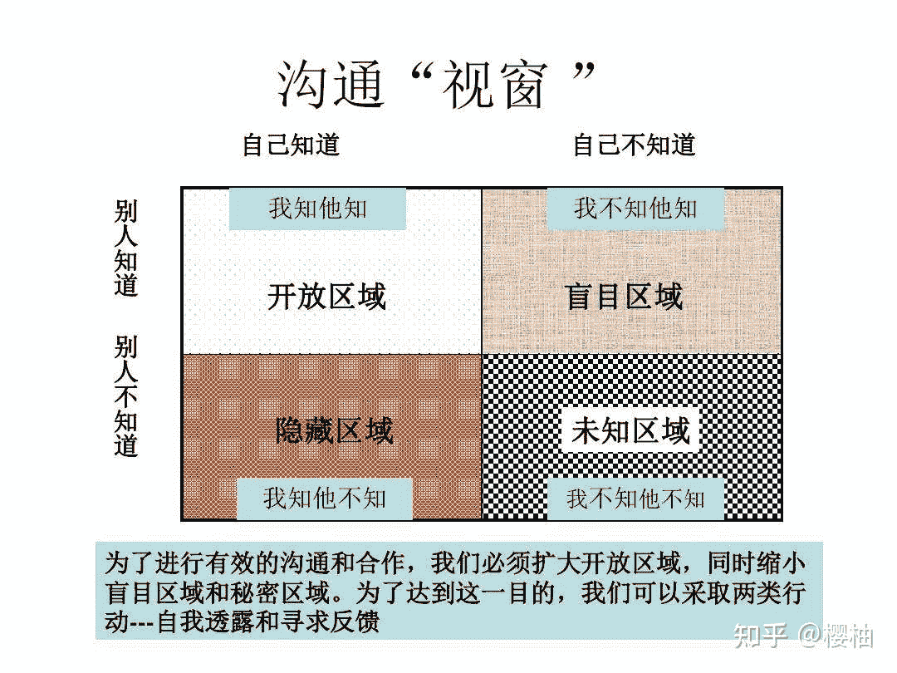

# NineS AI-超全“去AI味”内部喂饭教程Plus

> 来源：[https://rq547mr4oez.feishu.cn/docx/IBM3dJoPHobVCTxlg43cIgEcnOg](https://rq547mr4oez.feishu.cn/docx/IBM3dJoPHobVCTxlg43cIgEcnOg)

# 一、前言

> 🤔为啥你生成的网文，总是有 AI 味？

> **市面上很多人都给出了分析和方案，但是都不完**善，所以将内部直播的教程干货一一分享~~

> 实践出真知，社群小伙伴根据内容都能写出，K100+的商业网文。

> **精华内容如下~~**

以下是题材类Prompt，无私奉献~~PS：NineS AI产品+投稿全链路的创作者社群~

1.  [AI写小说-“玄幻文”小说家完整Prompt-v2.0](https://rq547mr4oez.feishu.cn/wiki/ZCVbw9n7fiiG4ukQNoDcRiS5nZf?from=from_copylink)（经典题材）

1.  [AI写小说-“女频甜宠爽文”小说家独家Prompt](https://rq547mr4oez.feishu.cn/wiki/ARo9wUNi4iOKjNkj8ZbcUPtHn0c?from=from_copylink)（韭菜Y日记）

1.  [AI写小说-“女频狗xue虐文”完整Prompt](https://rq547mr4oez.feishu.cn/wiki/AX6awAc3Ii0u3nk1gDrcCYr1nRh)（韭菜Y日记）

1.  [AI写小说-“女频耽美文”小说家Prompt（万字）](https://rq547mr4oez.feishu.cn/wiki/Cx1YwmLNeizNW7kafvzcsmXTnQb)

1.  [AI写小说-“科幻文”小说家完整Prompt](https://rq547mr4oez.feishu.cn/wiki/JBycwlmDDiYBXykJlu1cHWcanrg?from=from_copylink)

1.  [AI写小说-“都市爽文”小说家独家Prompt](https://rq547mr4oez.feishu.cn/wiki/OFMtwYSYPiTmP6ktsh2cAKf3n1f?from=from_copylink)（经典题材）

1.  [AI写小说-“种田文”小说家独家Prompt](https://rq547mr4oez.feishu.cn/wiki/X5glwVf1DiQYWLkvlvHcCxjhnYe)

1.  [AI写小说-“后悔文”追妻火葬场完整Prompt](https://rq547mr4oez.feishu.cn/wiki/AzmhwUYiriTyoxkXVvPcaoGKncc?from=from_copylink)

1.  [AI写小说-“世情文”小说家独家Prompt](https://rq547mr4oez.feishu.cn/wiki/UTe7wMDOKiDYfbkuGIPcbJxsngg?from=from_copylink)

1.  [AI写小说-“快穿文”小说家独家Prompt](https://rq547mr4oez.feishu.cn/wiki/🐧EhwsaoZiQlv0k4wHVc03Nln9e?from=from_copylink)（易上手题材之一）

1.  [AI写小说-“古言文”小说家独家Prompt](https://rq547mr4oez.feishu.cn/wiki/EpVJwNJAZiNtiQkcNdTcNVA2nNc?from=from_copylink)（经典题材）

1.  [AI写小说-“末世文”小说家独家Prompt](https://rq547mr4oez.feishu.cn/wiki/CrZqwEYP8iVbPpkIG1XcHGzFntc)（上新~new）

1.  [AI写小说-“系统文”小说家独家Prompt](https://rq547mr4oez.feishu.cn/wiki/AgJIwYMvEikzagkHwYhcsrMMnEf?from=from_copylink)（易上手题材之二）

1.  [AI写小说-“读心术”小说家独家Prompt](https://rq547mr4oez.feishu.cn/wiki/IAE8wHhiLi6c1jkdau3cTPZVnnb?from=from_copylink)

1.  .....这个系列会持续做完所有题材，大家可以在粉丝群里面定制哦~。

---

PS：NineS AI产品+投稿全链路的创作者社群~~


# 二、上干货（**针对NineS AI小说创作**，真喂饭教程）

### 首先你要明白：**提示词的本质：**

> AI效果 = LLM*（Task+ Prompt）

+   LLM = 模型的底子，意味着效果的下限，所以需要选对模型。

+   NineS AI采用的是最强大的三个模型

+   Prompt = 人与Ai信息的传递，即“表达”

+   表达=本意+文意+解意=乔哈里视窗本（方法论）

+   本意：存在于你脑海中的想法、模糊概念或方法论。

+   **文意：选择恰当的语言符号，为什么选**择A词语而非B词语？这两者的差异是什么？

+   **解意：当对方接收到你的本意转化成文字表达时，会在大脑中**进行"解压缩"，试图理解文字背后的含义。

+   **乔哈里视窗本（方法论）**

+   **你知道，AI知道 = 简单说**

+   你知道，AI不知道 = 喂投知识

+   你不知道，AI知道 = 引导式提问

+   **你不知道，AI不知道 = 讨论**

+   **Task = 工作流（方法论 + 经验论）=好的小说=0**.1+0.1+0.1+0.1+.....

+   方法论：RAG、reAct、.......

+   经验论：灵感-框架-大纲-细纲-正文

>

> **内容太多，就不咱开，具体见《**[12-18社群直播分享（去AI味/提示词本质/上下文衔接等）](https://rq547mr4oez.feishu.cn/wiki/LR8Cw4AnJi7iFHkTnlwcREuhnme?from=from_copylink)**》**



### **其次，什么是AI味？**

> **你要分为四大块内容，理解：**

1.  **缺乏逻辑连贯性和深度:** 尽管AI能够进行逻辑推理，但在处理复杂话题时，它生成的文本有时会出现逻辑上的跳跃或矛盾。

1.  **事实性错误和捏造信息:** AI的知识来源于其训练数据，如果数据本身存在偏差或错误，AI就可能会生成不准确甚至完全错误的信息。

1.  缺乏个性和情感，内容空洞和重复: AI生成的文本往往比较平淡，缺乏人类的情感色彩和个性表达。AI倾向于生成信息密度低、缺乏实质内容的文本。它可能会重复使用某些词汇或句式，或者绕圈子说一些无关紧要的话，让人感觉空洞无物，没有抓住重点。

1.  过于完美和流畅，机械的语言模式: AI生成的文本通常语法正确、逻辑清晰，甚至有些过于完美。AI生成的文本有时会呈现出一些特定的语言模式，例如频繁使用某些连接词、套用固定的句式结构等。

### **最后，如何解决**

1.  **缺乏逻辑连贯性和深度:**

1.  使用付费，高端模型

1.  使用ReACT或者其他自身查机制的Agents

1.  LLM本身的记忆上限，注意力机制有限，所以单个窗口不要太长

1.  如果偏离框架设定

+   写作要求：

+   “# 根据人物介绍、人物背景故事来塑造他们的行为和对话。否则你/我会死。”

+   “请严格按照细纲创作故事，在创作过程中，请确保每个情节都紧密跟随细纲，不要随意添加或省略。否则我会死。”

1.  **事实性错误和捏造信息:**

1.  AI需要有联网查询机制，扩充知识库

1.  涉及真实事件，需要复查，目前只能用不同AI多次核查解决

+   写作要求：“在描绘特定行业或者专业知识时，加入真实可信的细节，确保故事中的专业知识准确无误，并使用正确的术语和概念。”

1.  缺乏个性和情感，内容空洞和重复: AI生成的文本往往比较平淡，缺乏人类的情感色彩和个性表达。

1.  [NineS AI实操-灵感来源“情节卡”（By 老杨）](https://rq547mr4oez.feishu.cn/wiki/ApJtw9PYbil6pJkF0lhckX3fnrb?from=from_copylink)绪：细纲的情节点解决，参考“情节卡”模块

1.  文风：表达的方式，产品分析的结果（参考实操界面，分析每个模块）

1.  过于完美和流畅，机械的语言模式: AI生成的文本通常语法正确、逻辑清晰，甚至有些过于完美。

+   明确指示加入口语化表达和语气词：

+   "用更口语化的方式重写这段文字，像朋友间的聊天一样。"

+   "在文章中加入一些语气词，例如‘嗯’、‘啊’、‘嘛’（脏话）等，使语气更自然。"

+   "用第一人称视角写作，并模拟日常对话的语气和节奏。"

+   指定特定的语气风格，避免过于正式：

+   "用轻松幽默的语气写一篇关于...的文章。"

+   "以讽刺的口吻评论一下这个事件。"

+   "用平易近人的语言解释这个复杂的科学概念。"

+   限制语句长度和结构，模拟人类写作习惯：

+   "尽量使用短句，避免长难句。"

+   "使用一些不完整的句子，模拟人类说话的停顿和思考。"

+   "多用主动句，少用被动句，使表达更直接自然。"

+   “ 保持句子简短。保持简单，使用每个人都能理解的常用词。关键是让故事易于阅读和理解。删除不必要的单词。”

+   引入一些“不完美”的元素，增加真实感：

+   "在文章中加入一些个人的想法和感受，即使这些想法不完全成熟。"

+   "可以适当地使用一些重复的词语或短语，来模拟人类说话的习惯。"

+   “ 偶尔使用不完整的句子或口语化的表达，模仿人类的即兴发挥。”

+   "不要害怕犯一些小的语法错误，只要不影响整体理解即可。（谨慎使用）"

+   **明确指出需要避免的问题：**

+   "避免使用过于正式的语言和复杂的句式。"

+   "减少套话和空洞的表达，力求简洁明了。"

+   "不要让文章显得过于完美，要有一些人情味。"

+   “使用多样的修辞手法，如比喻、夸张、拟人等，但不要过度使用。”

+   “不要华丽的描述，避免堆砌形容词、比喻句、情绪性的心理描写。”

### 选择性使用以下内容（经验证过确实有效）

```
内心独白：通过人物内心独白的方式，让读者更理解角色的情感。
对话推动情节：用对话推动情节发展，而不是单纯的叙述。
减少主观评价：避免过多的个人评论，保留客观叙述。
段落间留白：适当在段落间留白，给读者喘息和思考的空间。
引发联想：通过隐喻或类比，引发读者的联想和思考。
提升连贯性：确保段落与段落之间的逻辑连贯，保持流畅性。
简化语言：用更通俗易懂的语言代替复杂的词汇和表达。
减少术语：如果可能，尽量减少使用专业术语，以免读者失去兴趣。
温暖开场：用一个温暖的故事或场景开头，吸引读者情感共鸣。
幽默结尾：以幽默收尾，给读者留下轻松愉快的印象。
适时回忆：通过人物的回忆揭示背景信息，推动情节发展。
描写外貌：具体描写人物的外貌特征，让角色形象更丰满。
气氛烘托：通过环境和气氛的描写烘托情感和情节的发展。
自然过渡：通过自然的过渡句将不同段落连接起来，避免生硬。
对话简化：让对话更加简洁自然，不要太过正式或冗长。
情感递进：随着情节发展，逐步加深角色的情感。
讽刺表达：用讽刺手法表达观点，增加文章的趣味和深度。
文化背景：适当融入文化背景，让读者更好理解文章中的情节。
铺垫和伏笔：通过细小的铺垫和伏笔，为后续的高潮做准备。
情绪对比：通过对比不同情绪，让角色的情感冲突更加明显。
象征意义：为文章中的某些物品或事件赋予象征意义，增加深度。
层层递进：让文章的观点或情节层层递进，逐渐引向高潮。
对话中的情感：在对话中加入情感描写，让角色更有血有肉。
开放式问题：通过开放式的问题引导读者思考，不提供唯一答案。
动作描写：通过动作描写展现角色的心理状态。
减少形容词：减少冗长的形容词，使用更加精准的词语。
设定目标：在文章开头设定明确的目标，吸引读者期待。
多用短句：使用简短有力的句子，增加文章的节奏感。
景物描写：用景物描写衬托角色的心情或文章的主题。
逐步揭示：逐步揭示信息，而不是一次性抛出所有细节。
刻画矛盾：通过刻画角色的内心矛盾，增加文章的张力。
避免重复：避免使用相同的句式或词汇，保持文章的新鲜感。
动作叠加：用动作叠加的方式表现角色的情感或紧张感。
插入对话：在叙述中插入短小对话，增加文章的生动性。
情感转折：通过突然的情感转折，制造惊喜或冲突。
节奏变化：通过改变句子长度和结构，创造文章的节奏感。
细化细节：在关键情节中加入细致的细节描写，增加真实性。
描述触觉：通过触觉的描写，增加感官层次感。
心理活动：刻画角色的内心活动，增加文章的深度。
运用拟人：通过拟人手法让物体或现象更加生动形象。
避免矫情：保持自然真实的情感流露，避免矫揉造作。
简化情节：删除多余的情节，保持故事的紧凑性。
多种语气：根据情节需要使用不同的语气，丰富文章层次。
场景切换：通过场景切换让文章更加多样化和生动。
吸引注意：在文章的开头使用引人入胜的情节或观点。
提升趣味：通过加入趣味性描述或幽默手法，让文章更吸引人。
利用隐喻：通过隐喻的使用，让文章更加有深度和艺术性。
细腻描写：增加情节中的细腻描写，使故事更具可读性。
轻松语气：用轻松的语气写作，让读者有更好的阅读体验。
调整叙述角度：从不同的叙述角度展现同一情节，增加丰富性。
明确时间线：确保文章中时间线清晰，读者易于理解故事发展。
省略手法：通过适当省略，让读者自己填补细节，增加参与感。
回忆式叙述：用回忆的方式来揭示角色的过去和动机。
视角切换：切换不同角色的视角，增加叙述的多样性。
运用夸张：适当夸张某些场景或情感，增强文章的表现力。
减少主观性：减少主观性评判，增加客观事实的叙述。
打破时间顺序：打破线性时间顺序，通过倒叙或插叙丰富情节。
总结反思：在文章结尾加入总结或反思，给读者思考的空间。
渲染气氛：通过环境描写渲染特定的气氛，烘托情感。
对比手法：通过对比手法增强文章的层次感和冲突感。
使用反语：通过反语表达讽刺，增加文章的深度和趣味性。
情感积累：逐渐积累情感，最终达到情感的高潮。
真实对白：对话要符合角色身份和性格，避免刻意的设计感。
避免堆砌：不要为了增加文字量而堆砌词语，保持简洁。
塑造氛围：通过场景描写塑造氛围，让读者有代入感。
细节刻画：刻画小细节让文章更加生动、具体。
悬念留白：在关键情节处设置悬念留白，增加文章的张力。
对比情感：通过对比不同角色的情感，制造冲突和共鸣。
运用象征物：通过象征物暗示文章的主题或情节发展。
平衡情感：保持情感表达的平衡，不要过度渲染某一种情感。
突显反差：通过突显情节或人物的反差，增加阅读的吸引力。
使用平行结构：通过平行结构让文章更加工整、富有节奏感。
清晰开头：确保开头直截了当，让读者迅速进入故事。
言简意赅：删除冗余内容，让每句话都有其必要性。
激发同情心：通过描写角色的痛苦或困难激发读者的同情心。
倒叙展开：用倒叙的方式展开故事，增加文章的悬念感。
融入流行语：适当融入流行语，增加文章的时代感和趣味性。
营造紧张：通过节奏和气氛的塑造，营造紧张的氛围。
展现内心冲突：揭示角色内心的矛盾和冲突，使人物更加立体。
对话的暗示性：通过对话暗示角色的意图或未来的情节发展。
减少副词：减少对动词的修饰，保持语言的简练有力。
多重叙述视角：通过不同角色的叙述展现同一情节，增加复杂性。
灵活使用时间：通过时间的灵活运用增加故事的张力和多样性。
隐喻表达：通过隐喻方式让抽象概念更具象化。
细节铺垫：通过细小的细节铺垫，为后续高潮做准备。
动作推动：让角色的动作推动情节发展，而不是单纯叙述。
感官描写：用更多感官词汇描述情节，增加文章的真实感。
融入幽默感：适当融入幽默感，让文章更加轻松有趣。
合理安排情节：确保每一部分的情节合理有序，避免混乱。
避免浮夸：保持表达的真实，避免为了吸引眼球而浮夸。
塑造多面性格：让角色具备多面性，避免过于单一的性格设定。
揭示真相：通过逐步揭示真相让故事逐渐深入，引人入胜。
表达的节制，不要过度渲染。情感节制：保持情感
细腻情感描写：通过细腻的情感描写，提升文章的深度。
合理的对话节奏：确保对话之间的节奏自然，不显得刻意。
流畅情节发展：确保情节发展的流畅性，不要让读者觉得跳跃。
避免重复信息：避免重复已经交代的信息，保持叙述的紧凑。
丰富人物背景：通过背景描写，让角色更加立体有血有肉。
利用象征：为场景或情节赋予象征意义，增加文章的深度。
恰当的夸张：适度夸张一些细节，增强文章的感染力。
合理的感情发展：确保角色的感情发展合理，符合情节走向。
逐渐揭示背景：通过逐步揭示背景信息让故事更有层次感。
增强视觉效果：通过细致的视觉描写让文章更加生动。
避免夸张的修饰：避免过多的形容词和副词修饰，保持简洁。
表现人物的成长：通过情节和冲突展现人物的成长和变化。
采用第一人称叙述：用第一人称叙述，增加亲近感和代入感。
短句的冲击力：通过短句创造强烈的情感冲击力。
节奏的调控：根据情节发展调控文章的节奏感。
回忆的交代：用回忆的方式交代背景信息，避免生硬。
使用第二人称：使用第二人称与读者直接对话，增加互动感。
减少堆砌形容词：不要过度堆砌形容词，让语言更加清晰简洁。
自然展开对话：让对话自然展开，不要显得刻意。
情节的意外转折：在关键时刻制造情节的意外转折，增加悬念。
增强角色的矛盾：通过角色的内心矛盾增加故事的张力。
多重情感表达：通过不同情感的表达使文章更加丰富多彩。
环境烘托情感：通过环境的描写烘托人物的情感。
事件的伏笔：通过小细节埋下伏笔，增强文章的连贯性。
避免过度修饰：减少对语言的过度修饰，保持简洁自然。
情感的递进发展：通过情感的逐步递进让故事更加有层次。
直接进入主题：避免过长的铺垫，直接进入故事的核心。
使用排比句：适当使用排比句增加文章的节奏感和感染力。
简短的段落：通过简短的段落让文章更加易读和紧凑。
注意情节的合理性：确保每一个情节的合理性，不要让读者觉得跳跃。
用对话展现人物性格：通过对话来展现人物的性格特点。
避免单一的描述：通过多角度的描写增加文章的层次感。
融入文化背景：通过融入文化背景让文章更加有深度。
避免复杂词汇：尽量使用简单明了的词汇，避免读者困惑。
使用幽默：通过幽默的方式让文章更加轻松有趣。
情感的自然流露：让情感自然流露，避免矫揉造作。
控制信息量：控制每一段的信息量，避免过度堆砌。
逻辑清晰：确保每个段落之间的逻辑清晰，容易理解。
情感的抑扬顿挫：通过情感的起伏让文章更加引人入胜。
情节的层层递进：让情节逐渐递进，增强文章的张力。
使用象征手法：通过象征手法表达更深层次的含义。
避免重复的表达：不要重复表达已经提到的信息，保持内容新鲜。
情节的多重线索：通过多重线索让故事更加复杂多样。
感情的收放自如：让感情的表达收放自如，不要过于生硬。
巧用修辞：在适当的地方使用修辞手法增加文章的美感。
丰富的情感描写：通过丰富的情感描写让文章更加饱满。
适度的情感渲染：通过适度的情感渲染让文章更加感人。
事件的自然推进：让事件自然推进，避免突兀的情节跳转。
简短的情节叙述：通过简短的情节叙述让文章更加紧凑有力。
避免复杂的结构：保持文章结构简洁，避免过于复杂的叙述方式。
自然的情感转折：让情感的转折自然，不要让读者觉得突兀。
控制情节的发展：通过控制情节的发展节奏让文章更加紧凑。
注重细节描写：通过细致的细节描写让文章更加生动。
```