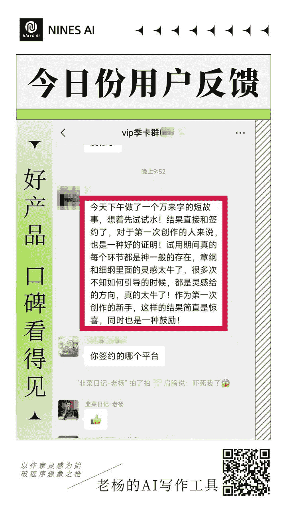
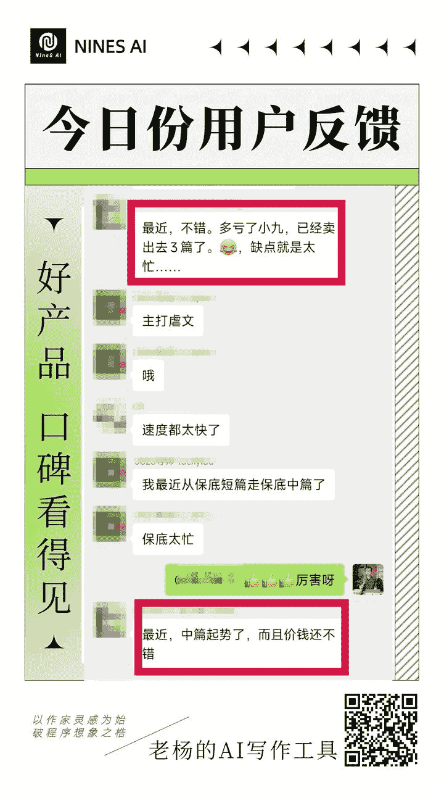

# AI写小说-NineS AI仿《大奉打更人》

> 来源：[https://rq547mr4oez.feishu.cn/docx/TmVjdbafEoR2uvxfZNTcLzAwnSb](https://rq547mr4oez.feishu.cn/docx/TmVjdbafEoR2uvxfZNTcLzAwnSb)

# 一、前言

> **宝子们，最近《****大奉打更人》**的电视剧可太火啦👏，热度居高不下，看得人那叫一个上头！

> **我深挖了一下，好家伙，原著作者小郎君的稿费居然超 1500 **万 +，这是妥妥一本书就原地起飞呀🛫。

> 好多人看剧也就图一乐，但咱要是懂点门道，这里面可全是写网文的干货✨。

> **《**[《大奉打更人》拆书，新人也能写网文.docx](https://rq547mr4oez.feishu.cn/wiki/MVh7wPdguimOV8k5elUczC4anZb?from=from_copylink)》，扒拉出来发现，它用的不少都是咱常见的网文套路。

> **可为啥它能火出圈？还得是小郎君文**笔太绝啦👍，把那些套路写得鲜活又有趣。

> 既然摸清了点门道，咱不得实操一下？

> 用 NineS AI，打算让它仿仿《大奉打更人》，瞅瞅能整出啥效果。

---

以下是题材类Prompt，无私奉献~~

1.  [AI写小说-“玄幻文”小说家完整Prompt-v2.0](https://rq547mr4oez.feishu.cn/wiki/ZCVbw9n7fiiG4ukQNoDcRiS5nZf?from=from_copylink)（经典题材）

1.  [AI写小说-“女频甜宠爽文”小说家独家Prompt](https://rq547mr4oez.feishu.cn/wiki/ARo9wUNi4iOKjNkj8ZbcUPtHn0c?from=from_copylink)（韭菜Y日记）

1.  [AI写小说-“女频狗xue虐文”完整Prompt](https://rq547mr4oez.feishu.cn/wiki/AX6awAc3Ii0u3nk1gDrcCYr1nRh)（韭菜Y日记）

1.  [AI写小说-“女频耽美文”小说家Prompt（万字）](https://rq547mr4oez.feishu.cn/wiki/Cx1YwmLNeizNW7kafvzcsmXTnQb)

1.  [AI写小说-“科幻文”小说家完整Prompt](https://rq547mr4oez.feishu.cn/wiki/JBycwlmDDiYBXykJlu1cHWcanrg?from=from_copylink)

1.  [AI写小说-“都市爽文”小说家独家Prompt](https://rq547mr4oez.feishu.cn/wiki/OFMtwYSYPiTmP6ktsh2cAKf3n1f?from=from_copylink)（经典题材）

1.  [AI写小说-“种田文”小说家独家Prompt](https://rq547mr4oez.feishu.cn/wiki/X5glwVf1DiQYWLkvlvHcCxjhnYe)

1.  [AI写小说-“后悔文”追妻火葬场完整Prompt](https://rq547mr4oez.feishu.cn/wiki/AzmhwUYiriTyoxkXVvPcaoGKncc?from=from_copylink)

1.  [AI写小说-“世情文”小说家独家Prompt](https://rq547mr4oez.feishu.cn/wiki/UTe7wMDOKiDYfbkuGIPcbJxsngg?from=from_copylink)

1.  [AI写小说-“快穿文”小说家独家Prompt](https://rq547mr4oez.feishu.cn/wiki/🐧EhwsaoZiQlv0k4wHVc03Nln9e?from=from_copylink)（易上手题材之一）

1.  [AI写小说-“古言文”小说家独家Prompt](https://rq547mr4oez.feishu.cn/wiki/EpVJwNJAZiNtiQkcNdTcNVA2nNc?from=from_copylink)（经典题材）

1.  [AI写小说-“末世文”小说家独家Prompt](https://rq547mr4oez.feishu.cn/wiki/CrZqwEYP8iVbPpkIG1XcHGzFntc)（上新~new）

1.  [AI写小说-“系统文”小说家独家Prompt](https://rq547mr4oez.feishu.cn/wiki/AgJIwYMvEikzagkHwYhcsrMMnEf?from=from_copylink)（易上手题材之二）

1.  [AI写小说-“读心术”小说家独家Prompt](https://rq547mr4oez.feishu.cn/wiki/IAE8wHhiLi6c1jkdau3cTPZVnnb?from=from_copylink)

1.  [AI写小说-“升级流”小说家独家Prompt](https://rq547mr4oez.feishu.cn/wiki/CdriwSAi1iq2QLkWb0PcpxRknCd?from=from_copylink)

这个系列会持续做完所有题材，大家可以在粉丝群里面定制哦~。

---

PS：还有哪些问题可以评论或者私信我，我有空也可以解答。

**P**S：盗用这个文章的不要乱引流破坏环境，文章是免费分享给大家。有看见各位顺手举报下。感谢～资料纯分享不易。

**原始出处：**


# 二、**内测结果反馈（一部分反馈）**





# 三、仿写**案例~**

# 仿写三个层次：《具体见[NineS AI实操-“仿写”的三个阶段（By 老杨）](https://rq547mr4oez.feishu.cn/wiki/F9gHwbDbni1386kI3ivcC0PSnRb?from=from_copylink)》

+   初级仿写：即“翻译”：中译中不可取、英译中、中译英

+   [NineS AI实操-灵感来源“情节卡”（By 老杨）](https://rq547mr4oez.feishu.cn/wiki/ApJtw9PYbil6pJkF0lhckX3fnrb?from=from_copylink)级仿写：即“改写”：换元法（背景/人物/等），变成情节卡，参考

+   高级仿写：即“取经”：是仿情绪，节奏，通用"情节卡模板”。

### **NineS**拆书分析

```
**====
#  故事梗概
##  一、基****本信息
1. 选题: 许七安穿越到古****代后，凭借现代刑侦知识破解税银案，并在复****杂的人际关系中生存。
2. 题材: 穿越、仙侠、推理
****3. 类型: 言情、武侠
4. 字数****: 未提供具体字数，但章节内容丰富
5.**** 期待感: 主角如何利用现代知识在古代环境中****破案并改变命运

##  二、故事设定
1. 背****景设定: 大奉王朝，封建社会，有修****炼体系和妖族存在，官场腐败，儒家衰弱。****
2. 主角: 
    - 许七安：****原为警校毕业生，现穿越成京兆府下辖长乐县衙捕快。****性格机智、冷静，目标是生存并改变现****状。
    - 分析主角人设的七步法：****
        - 目标：破案自救，改善家族处境
  ****      - 阻碍：官场黑暗，修炼****资源匮乏
        - 行动****：利用现代知识推理案件，结交权贵
  ****      - 结果：成功破案，获得大****儒和司天监重视
        - 意外****：卷入更大阴谋，面临更多挑战
        ****- 转折：通过诗词和炼金术获得支持
     ****   - 结局：暂时化解危机，继续****面对新的挑战
3. 配角: 
    ****- 许平志（二叔）：御刀卫百户，武****夫出身，对侄儿许七安有深厚感情
    - 李****茹（婶婶）：美妇人，曾对许七安不友好，逐渐改变****态度
    - 许新年（堂弟）****：云鹿书院举人，聪明但傲娇，与许七安关系复杂
    -**** 许玲月（妹妹）：十六岁少女，清丽脱俗，对大****哥产生敬意
    - 许铃音（幺妹）：年幼天真，可****爱单纯
    - 褚采薇（黄裙少女）：司天监弟子，活****泼可爱，对许七安有好感
4. 核心梗****: 穿越、现代刑侦知识、炼金术、诗词创作****
5. 核心内容: 
    -**** 危机: 税银被劫案导致全家入狱，周侍郎报复威胁****
    - 伏笔: 许七安捡到银**子的奇特现象，暗示他有特殊体质或系统
    - 悬念: 户部侍郎背后的真正动机，许七安能否顺利开天门
    - 爽点: 成功破案，获得大儒和司天监重视，化解家庭矛盾

##  三、故事脉络
1. 核心冲突: 许七安与官场黑暗势力的对抗，以及自身修炼瓶颈的突破
2. 情感纽带: 家庭亲情（尤其是与妹妹们的关系），爱情萌芽（与褚采薇）
3. 故事反转: 许七安从阶下囚到成为大儒和司天监重视的人物
4. 二次反转: 发现税银案背后涉及更高层次的党争，周侍郎可能再次报复
5. 整体节奏: 
    - 第一章 牢狱之灾 [剧情推动：发现穿越，思考自救方法][情绪：焦虑]
    - 第二章 妖物作祟 [剧情推动：获取卷宗，初步推理][情绪：紧张]
    - 第三章 仙侠世界一样能推理 [剧情推动：揭示假银真相][情绪：振奋]
    - 第四章 是时候表演真正的技术了 [剧情推动：展示化学知识，赢得信任][情绪：惊喜]
    - 第五章 解开谜题 [剧情推动：进一步解释案件细节][情绪：释然]
    - 第六章 懵逼的二叔 [剧情推动：家人得知真相后的反应][情绪：复杂]
    - 第七章 这个妹妹好漂亮 [剧情推动：与妹妹互动，改善关系][情绪：温馨]
    - 第八章 妹子，你偷看为兄做啥 [剧情推动：调侃妹妹，展现幽默][情绪：轻松]
    - 第九章 暴走的婶婶 [剧情推动：婶婶态度转变][情绪：戏剧性]
    - 第十章 县衙命案 [剧情推动：街头斗殴，引发新危机][情绪：紧张]
    - 第十一章 摸鱼 [剧情推动：摸鱼日常，探讨青楼文化][情绪：诙谐]
    - 第十二章 一顿操作猛如虎 [剧情推动：推理命案，提出关键线索][情绪：震撼]
    - 第十三章 审问 [剧情推动：心理博弈，揭露真凶][情绪：激动]
    - 第十四章 心理博弈 [剧情推动：审讯过程中的策略运用][情绪：紧张]
    - 第十五章 古往今来人类不变的劣根 [剧情推动：揭示人性弱点，完成审讯][情绪：感慨]
    - 第十六章 许七安的日记 [剧情推动：记录内心变化][情绪：反思]
    - 第十七章 日常怼婶婶 [剧情推动：婶婶态度转变][情绪：戏谑]
    - 第十八章 带着妹子逛街去 [剧情推动：街头遭遇恶霸][情绪：愤怒]
    - 第十九章 送行诗 [剧情推动：帮助堂弟写诗][情绪：自豪]
    - 第二十章 半阙七律惊大儒 [剧情推动：诗歌惊艳大儒][情绪：惊讶]
    - 第二十一章 自古恶霸多嚣张 [剧情推动：街头斗殴事件][情绪：愤怒]
    - 第二十二章 教公子一个道理 [剧情推动：反击恶霸，揭示真相][情绪：畅快]
    - 第二十三章 刑部缉拿人犯 [剧情推动：被刑部带走，随后获救][情绪：惊险]
    - 第二十四章 蓝皮书 [剧情推动：分享炼金术知识][情绪：期待]
    - 第二十五章 救兵 [剧情推动：获得司天监和大儒支持][情绪：欣慰]
    - 第二十六章 德行 [剧情推动：讨论未来方向][情绪：沉思]
    - 第二十七章 提人 [剧情推动：前往云鹿书院求援][情绪：紧张]
    - 第二十八章 拍死我这只蝼蚁 [剧情推动：反击恶霸，揭示真相][情绪：愤怒]
    - 第二十九章 辞旧，大哥待你不薄 [剧情推动：与家人商议对策][情绪：感动]
    - 第三十章 化学课 [剧情推动：传授炼金术知识][情绪：兴奋]
    - 第三十一章 这不是薅羊毛，这是等价交换 [剧情推动：与宋卿交流炼金术][情绪：深思]
    - 第三十二章 [未提供章节名] [剧情推动：与堂弟同榻而眠][情绪：无奈]
    - 第三十三章 我站在，烈烈风中 [剧情推动：拜访云鹿书院，讨论诗词][情绪：豪迈]
    - 第三十四章 许玲月：这辈子要好好报答大哥 [剧情推动：妹妹感激之情][情绪：温暖]
    - 第三十五章 书房议事 [剧情推动：讨论下一步行动][情绪：严肃]
    - 第三十六章 捣蛋鬼 [剧情推动：与妹妹互动][情绪：轻松]
    - 第三十七章 劝学 [剧情推动：作劝学诗，调动学子情绪][情绪：振奋]
    - 第三十八章 诗成 [剧情推动：劝学诗广受好评][情绪：喜悦]
    - 第三十九章 那许平志不当人子 [剧情推动：大儒对许平志的批评][情绪：不满]
    - 第四十章 争斗 [剧情推动：大儒之间发生争执][情绪：戏剧性]

6. 写作风格: 幽默、沉重、写实、浪漫相结合，既有现代刑侦的严谨，又有古代仙侠世界的奇幻。
====
```

### 细节版（字数2206）

```
**第1章：监牢初醒，穿越危机**

许七安睁开眼睛，映入眼帘的是一片昏暗。
潮湿的空气中弥漫着霉味和排泄物的臭气，他躺在一张散发着霉味的稻草堆上，身上盖着一件破旧的囚衣。
“这是哪？”许七安下意识地摸了摸脑袋，昨天他还在加班审讯一个嫌疑人，怎么一觉醒来就到了这种地方？真是活见鬼了！
随着意识逐渐清醒，大量陌生的记忆如同潮水般涌入脑海，冲击得他头疼欲裂。
他叫许七安，大奉王朝京兆府衙门的一名九品捕快，因为二叔许平志押送税银失踪一案被牵连入狱。
“穿越了？”许七安苦笑一声，这可真是老套的开局，还是老套的穿越者。
他环顾四周，发现自己身处一间阴暗潮湿的牢房。牢房的墙壁是用青石砌成的，上面爬满了青苔，铁栅栏外是昏暗的走廊，墙壁上每隔一段距离就挂着一盏油灯，发出微弱的光芒，像极了鬼片里的场景。
根据原主的记忆，他得知二叔许平志是京兆府的一名六品主簿，负责押送一批税银前往京城。但在途中，税银和二叔一同失踪了。朝廷震怒，京兆府尹陈汉光为了平息圣上怒火，将许家上下全部抓捕入狱。
“这下麻烦大了。”许七安揉了揉太阳穴，他深吸一口气，努力让自己冷静下来，根据大奉律例，贪污税银是重罪，一旦定罪，不仅二叔要问斩，全家都要被流放边疆，这可不是闹着玩的。他站起身，活动了一下筋骨。
原主的身体素质不错，常年习武的缘故，肌肉结实有力，虽然比不上他前世那副熬夜冠军的身躯，但也算得上是个练家子。
“系统？金手指？”许七安尝试呼唤，但没有得到任何回应，看来这次穿越是个纯粹的替身，没有任何外挂加持，这可真是让人头秃。
他叹了口气，开始思考如何自救。按照目前的情况来看，想要洗清冤屈，就必须找到二叔和那批失踪的税银。
可是，他现在身陷囹圄，连牢房都出不去，又谈何查案呢？
就在这时，牢房外传来一阵脚步声，打断了他的思绪。
一个身材魁梧的狱卒带着一个身穿儒衫的少年走了过来。少年身形清瘦，面容俊秀，只是脸色有些苍白。
“七安哥！”少年看到许七安，立刻红了眼眶，声音中带着一丝颤抖。
许七安认出这是自己的堂弟许新年，今年十六岁，在国子监读书。记忆中，这个堂弟一直都很崇拜他，两人关系十分亲近。
“新年，你怎么来了？”许七安走到铁栅栏前，关切地问道。
许新年从怀中掏出一个油纸包，递给许七安：“七安哥，我给你带了些干粮，还有……”他压低声音，凑到许七安耳边说道，“我已经打点好了狱卒，等押送你们去边疆的时候，他们会照看着你，保你一路平安。”
//...由于篇幅太长，省略中间段落...
看着许新年离去的背影，许七安若有所思。
作为一名现代刑警，他对这种案件再熟悉不过。只要能拿到卷宗，或许就能找到突破口，还二叔和许家一个清白。
就在这时，隔壁牢房传来一个阴恻恻的声音：“这位小哥，看来你对这个案子很感兴趣啊……”
```

### 节奏版（字数2593）

```
**第一章 监牢初醒，穿越危机**
“哐当！”
生锈的铁门被粗暴地推开，一道刺眼的光线猛地扎进昏暗的牢房，直直地刺向蜷缩在稻草堆里的许七安。他猛地睁开眼，光线让他一阵眩晕。
接着，一股难以言喻的恶臭扑鼻而来，让他胃里一阵翻江倒海，差点没把隔夜饭都吐出来。
“妈的，这什么鬼地方？”许七安下意识地爆了一句粗口。
然后他才意识到自己身处何地——一间阴暗潮湿，散发着令人作呕气味的牢房。
斑驳的墙壁上爬满了湿漉漉的青苔，像是长满了绿毛的怪物，狰狞地注视着他。
地面上散落着腐烂的稻草和不知名的污秽物，几只肥硕的老鼠肆无忌惮地在上面爬来爬去，发出吱吱的叫声。
他低头看了看自己身上破烂的囚衣，灰扑扑的，散发着一股馊味，也不知道多久没洗过了。
再看看手上和脚上沉重的镣铐，冰冷的触感让他浑身一激灵，一股寒意从脚底直窜头顶。
“穿越？COS盲僧？这什么鬼开局？”
许七安努力回忆着昏迷前发生的事情，他只记得自己正在熬夜肝原神，为了抽到心仪的角色，他已经连续奋战了几个通宵。
然后眼前一黑，就失去了意识，醒来后就来到了这个鬼地方。
他依稀记得自己穿越到了一个叫大奉王朝的古代世界，成为了一个九品捕快，名叫许七安。
这个身份倒是和他前世的职业有点相似，只不过，前世他是维护社会治安的人民警察，而现在，他却成了一个阶下囚。
而他之所以沦落到这个地步，是因为他的二叔许平志贪污了税银，而他作为许平志的侄子，也受到了牵连，被关进了大牢，即将被流放边疆。
“流放边疆？我堂堂二十一世纪的大好青年，怎么能沦落到这种地步？”
许七安心中充满了不甘，他可是警校毕业的高材生，擒拿格斗样样精通，还曾经获得过市里的散打冠军。
要不是因为家里条件不好，他也不会选择当一名普通的警察。可现在倒好，居然要被流放到那鸟不拉屎的边疆去，这让他怎么能忍受？
他拼命地想要找到传说中的系统，希望能像小说里写的那样，金手指一开，逆天改命。
毕竟，穿越不带系统，就像炒菜不放盐，毫无灵魂。
他尝试了各种方法，从默念“系统”到呼唤“老爷爷”，甚至还学着小说里的主角咬破手指，将血滴在地上、抹在墙上，然而，除了引来几只贪婪的老鼠之外，没有任何反应。
“看来，这金手指是没戏了。”许七安无奈地叹了口气，看来小说里都是骗人的，现实中哪有那么多好事。
他知道自己必须依靠自己的力量来改变命运，否则，等待他的将是无尽的黑暗和绝望。
他开始思考自救的方法，脑海中闪过无数种可能性，越狱？劫法场？还是买通狱卒？但最终都被他一一否决。
在这个等级森严的古代社会，他一个身陷囹圄的九品小捕快，无权无势，根本没有任何反抗的资本。而且，根据他脑海中的记忆，这个世界的武力值似乎并不低，那些江湖高手飞檐走壁，杀人于无形，他这点三脚猫的功夫，恐怕连人家一根手指头都挡不住。
//...由于篇幅太长，省略中间段落...
许七安沉默了，他知道许新年说的是事实。
在这个皇权至上的时代，贪污可是重罪，更何况是税银这种关系到国家命脉的东西。一旦被查实，轻则抄家流放，重则满门抄斩。
但是，他心中仍然抱有一丝希望。他觉得这件事情一定有蹊跷，因为根据他的记忆，他的二叔虽然为人有些贪财，但绝不是那种胆大包天的人，怎么敢去动税银？
而且，他总觉得许新年似乎隐瞒了什么，他看向许新年，缓缓说道：“新年，你是不是知道些什么？告诉我，或许事情还有转机！”
许新年看着许七安，眼神闪烁，似乎在犹豫要不要说出来。
如果能从许新年口中得知税银丢失的真相，或许就能找到破局的关键！
他深吸一口气，看向许新年，缓缓说道：“新年，我想看看税银丢失的案卷宗。”
```

### 均衡版（字数2204）

```
******第1章：监牢初醒，穿越危机**

许七安是被一阵刺鼻的霉味唤醒的。
他艰难地睁开眼，视线模糊中，首先映入眼帘的是一根粗大的木梁，上面爬满了岁月的痕迹和几只懒散的蜘蛛。
再往下看，是一张破旧的草席，草席上有些地方甚至露出了尖锐的稻草头，像是在嘲笑他的狼狈。
“这是什么地方？我不是在加班吗？”许七安试图坐起来，却发现浑身酸痛，像是被卡车碾过。
他环顾四周，只见四面墙壁由粗糙的石块堆砌而成，墙角还流淌着一条不明来源的小水沟。空气中弥漫着汗臭、霉味以及某种说不清道不明的腥味。
他皱了皱眉头，下意识摸了摸自己的脑袋，结果摸到了一块厚实的布巾绑着额头。他低声嘟囔了一句：“我这是……穿越了？”
就在这时，一段陌生又熟悉的信息涌入脑海，如同电影般播放起他的“新人生”。
原来，他现在是大奉王朝的一名捕快——许七安。
更糟糕的是，这具身体刚刚被人揍得半死，还因为二叔许平志押送税银失踪案，被牵连进了牢狱之灾。
“好家伙，这穿越套餐也太全了吧！身份、背景、危机三件套齐活。”许七安咧嘴一笑，但随即感到牙齿隐隐作痛，“不过这开局也太地狱模式了吧！”
他抬手想揉揉自己的脸，却发现手腕上竟然戴着沉重的铁镣。这冰冷触感让他彻底清醒过来。
环顾四周，他终于确认：没错，他现在正身处牢房，而且还是那种标准版古代监牢——阴暗潮湿，墙上挂着几盏昏黄油灯，偶尔有老鼠从脚边窜过。
“真是大奉版‘豪华单间’啊！”许七安忍不住吐槽了一句。
就在他努力理清思绪的时候，牢门外传来了脚步声。
一个身材肥硕、满脸横肉的狱卒走了过来。他手里提着一盏油灯，灯光晃动间，那张脸显得格外狰狞。
“喂，新来的！醒了吗？”狱卒用粗哑的嗓音喊道。许七安勉强坐起身来，用手撑着墙壁站稳。
他抬头看向狱卒，挤出一个尴尬的微笑：“大哥，这里是哪个剧组？我是不是穿越到《甄嬛传》的监牢篇了？”
狱卒显然没听懂他说什么，只是冷哼一声：“少废话！你二叔贪污税银，被圣上下令严查，你这小子也跑不了！等着流放边疆吧！”
“流放边疆？”许七安心里咯噔一下。他虽然对这个世界还很陌生，但从脑海中的记忆来看，大奉王朝的边疆可不是什么好地方，那可是九死一生的大型野外生存现场！
“不对，我不能坐以待毙。”许七安心念急转，“既然我是捕快，那一定有办法自救。”
接下来的时间里，他开始尝试寻找自己作为穿越者必备的金手指。然而，不管他怎么努力，都没有任何系统提示音，也没有什么神秘空间开启。他甚至尝试喊了几句“系统爸爸”、“外挂君”，但回应他的只有角落里的蟋蟀叫声。
//...由于篇幅太长，省略中间段落...
听到这话，许新年愣了一下，但很快点头答应：“好，我会尽力而为。”
两人商量好计划后，时间已近深夜。临别时，许新年握住哥哥的手，用力点点头：“大哥，一切小心。”
目送堂弟离开后，许七安重新坐回草席上。他抬头看向昏黄油灯发出的微弱光芒久久不能入睡。
```

### 微调版（字数2603）

```
**第一章 监牢初醒，穿越危机**

昏暗潮湿的牢房里，弥漫着一股令人作呕的霉味。
许七安缓缓睁开眼睛，宿醉般的头痛让他忍不住呻吟了一声。
“嘶……这是哪？”
他费力地撑起身子，环顾四周，那斑驳的墙壁像是年久失修的老人脸上的皱纹，诉说着岁月的沧桑；
“我不是在家里睡觉吗？怎么会在这种鬼地方？”
他努力地回忆着，记忆如潮水般涌来。他想起了自己正舒舒服服地躺在床上，熬夜追更那本让人欲罢不能的《大奉打更人》，那跌宕起伏的剧情让他沉迷其中，无法自拔，直到一阵突如其来的眩晕感袭来，他便失去了意识，醒来后发现自己身处古代牢房的震惊。
“穿越？我居然穿越了！”
这个念头让他既兴奋又恐惧。
兴奋的是，他终于可以体验一把梦寐以求的穿越生活，这可是无数小说迷的终极梦想啊！他可以像那些小说主角一样，在这个陌生的世界里，开启一段属于自己的传奇人生，想想就让人热血沸腾；
他努力回忆着关于这个世界的信息，这是一个名为大奉王朝的古代国家，而他，则是一个名叫许七安的小捕快，因为二叔许平志押送税银失踪而被牵连入狱，即将面临流放边疆的命运。
“流放边疆？开什么玩笑！”
他可不是来体验古代流放生活的，他得想办法自救。
“系统？系统你在吗？”
他在心中默念了几遍，却没有任何回应。
“看来金手指是没戏了。”
他叹了口气，开始思考自救的方法。
根据他有限的记忆，这个世界的律法森严，想要脱罪，只有两种办法：一是找到真凶，二是立功赎罪。
“看来只能靠自己了。”
他决定先从破案入手，毕竟他前世看过无数侦探小说，多少也积累了一些破案经验。
但问题是，他现在身陷囹圄，根本无法展开调查，而且他对这个世界的了解也极其有限，连案件的具体情况都不清楚。
这可真是巧妇难为无米之炊啊！
//...由于篇幅太长，省略中间段落...
“不会的，我不会让你连累我们的。”
许七安安慰道，心中却更加坚定了要查清此案的决心。他暗暗发誓，一定要尽快找到真凶，还二叔一个清白，也还许家一个安宁！
他放开许新年，目光坚定地望着他，像是一座巍峨的山峰，给人以依靠和力量。
“新年，你告诉我，你都知道些什么？”
```

#