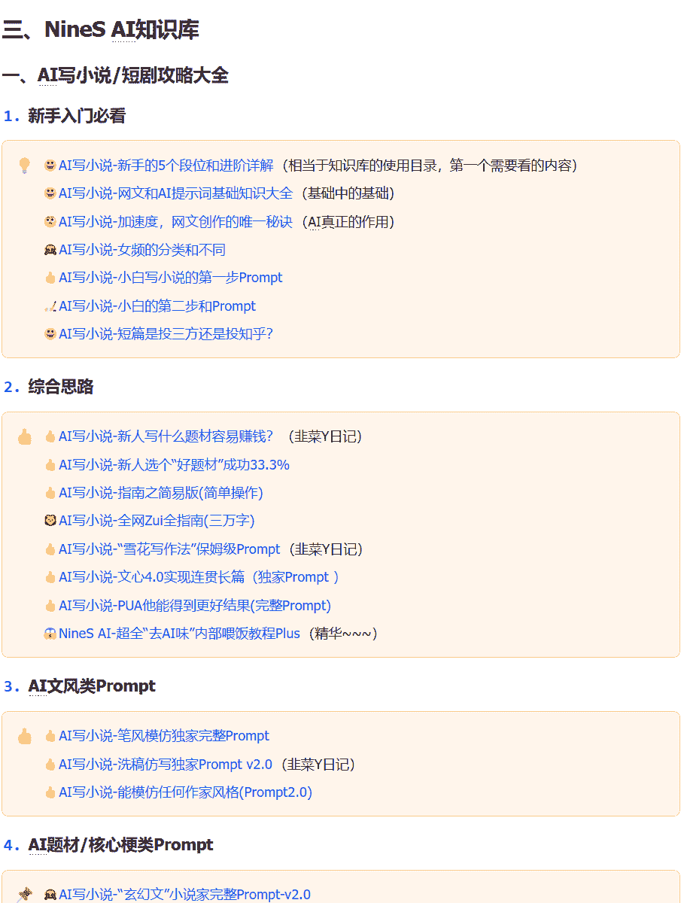
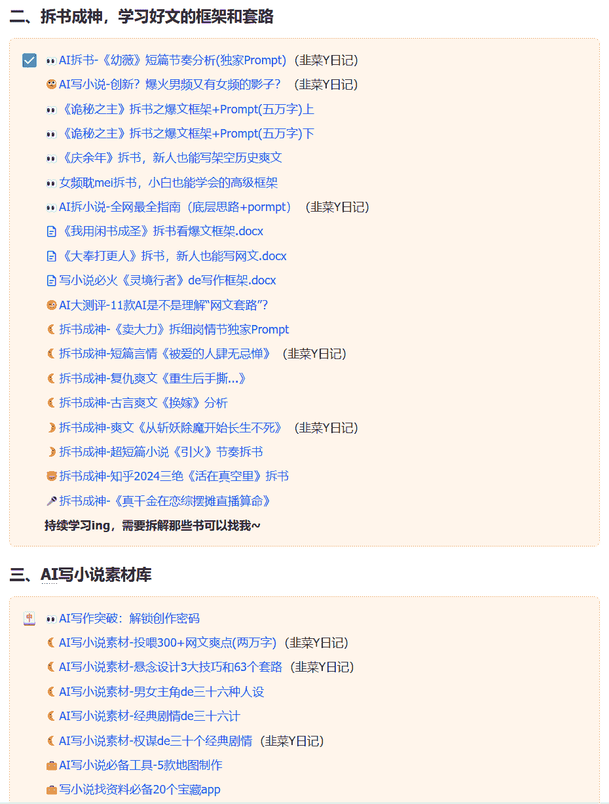
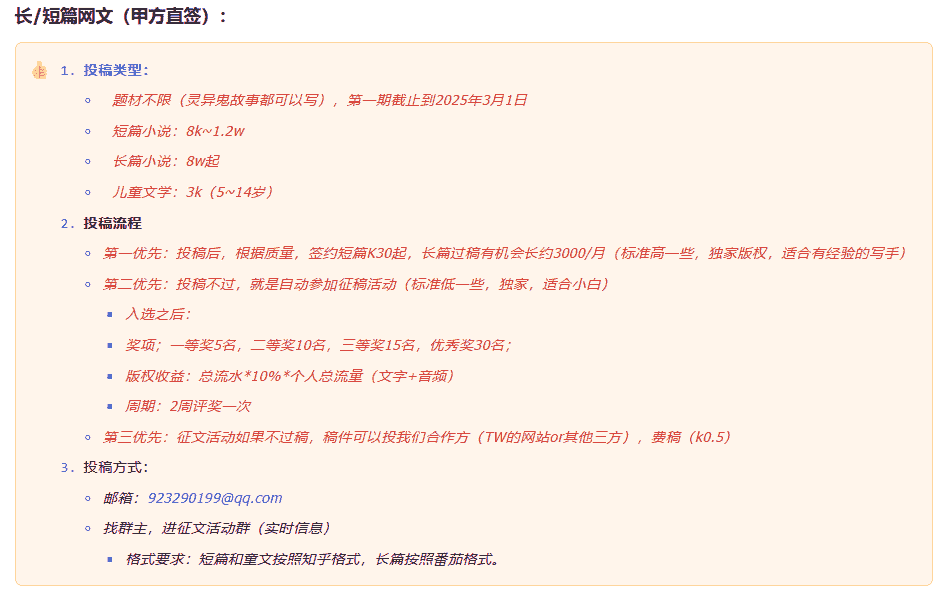
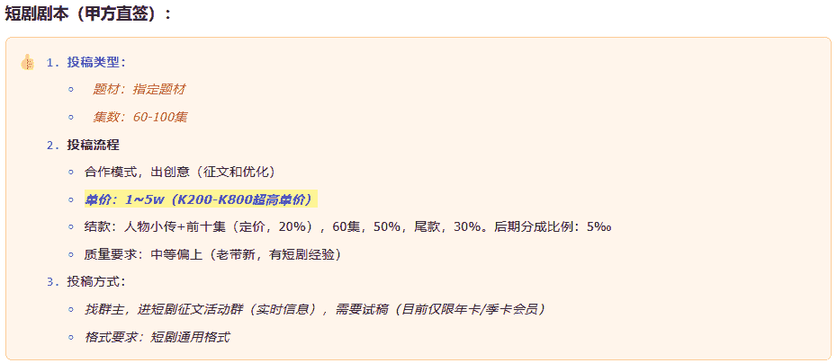

# NineS AI-DeepSeed R1写文效果-惊艳

> 来源：[https://rq547mr4oez.feishu.cn/docx/IqKhd8ZHDo23gzxuRx4c9VrZn3c](https://rq547mr4oez.feishu.cn/docx/IqKhd8ZHDo23gzxuRx4c9VrZn3c)

## 一、前言：

> 最近被深度求索正式推出DeepSeek R1模型刷屏，

> **我**测了一把写文效果，可以说，国内的第一梯队~~品质可以和Gemini、Claude掰掰手腕，真的是惊艳！

> **验证方式：对比之前仿写的《****抗痔恋爱笔记****》作品上，**

> **NineS AI不通过任何的提示词可以达到~~朱**雀模型0%的AI率（不太可能是AI生成）

**目录：**

> 一、前言：

> 二、以下是验证思路

1.  Nines AI基于《[AI写小说-NineS AI仿治愈《抗痔恋爱笔记》 ](https://rq547mr4oez.feishu.cn/wiki/HYFvwvqvBiDv1qkTKRTczyJCnDh?from=from_copylink)》

1.  第一章的章纲和细纲（拆书）

1.  正文版本（SD R1版本，一次性生成没有任何优化）

1.  朱雀大模型检测（AI率0%）

1.  综合

> **三、NineS AI【****AI知识库+AI**产品+投稿渠道+干货交流=全链路】的创作者社群~

---

**PS：NineS AI【****AI知识库+AI**产品+投稿渠道+干货交流=全链路】的创作者社群~


## 二、以下是验证思路

### Nines AI基于《[AI写小说-NineS AI仿治愈《抗痔恋爱笔记》 ](https://rq547mr4oez.feishu.cn/wiki/HYFvwvqvBiDv1qkTKRTczyJCnDh?from=from_copylink)》

```
## 一、基本信息
1. 选题:  都市女性因痔疮手术与医生邻居产生感情纠葛的故事。
2. 题材: 都市、爱情、轻喜剧
3. 类型: 短篇小说
4. 字数: 9536 
5. 期待感:  读者期待看到女主角与医生邻居之间感情发展，以及手术后恢复过程中的幽默情节。最终期待感是两人最终走到一起。
## 二、故**事设定
1. 背景**设定:  现代都市，普通小区。
2. 主角: 
    - 女主角：25岁左右，单身，普通职业女性，性格直率，略显粗线条。
    - [分析主角人设的七步法]
        目标：找到男朋友，摆脱单身。
        阻碍：害羞，缺乏自信，以及与王天麒之间尴尬的相处模式。
        行动：主动联系王天麒，约他吃饭，表白，最终坦诚相待。
        结果：表白失败，但最终获得王天麒的回应。
        意外：与王天麒成为邻居，以及公司同事的误解。
        转折：王天麒主动上门，坦白感情。
        结局：两人最终走到一起。
3. 配角: 王天麒（30出头，肛肠科主治医师，单身），闺蜜，女主角父母，肛瘘大娘等。
4. 核心梗:  因痔疮手术结缘，邻居身份带来的巧合，以及由此产生的爱情故事。
5. 核心内容: 
    - 危机: 女主角术后疼痛，以及与王天麒之间沟通不畅，以及公司同事的误解。
    - 伏笔: 王天麒对女主角的关注，以及他与其他女性的关系的误会。
    - 悬念:  王天麒对女主角的真实感情，以及两人最终能否走到一起。
    - 爽点:  女主角与王天麒的互动，以及最终两人感情的确定。
## 三、故事脉络
1. 核心冲突:  女主角与王天麒之间从医患关系到邻居关系再到恋人关系的转变过程中的冲突和误解。
2. 情感纽带:  爱情，友情，亲情。
3. 故事反转: 女主角表白被拒，但最终王天麒坦白心意。
4. 二次反转: 公司同事误解女主角做了流产手术。
5. 整体节奏: 
    - 第一章：痔疮手术，痛苦经历。[剧情推动：手术过程，疼痛描写] [情绪：痛苦，害怕，尴尬]
    - 第二章：术后恢复，与王天麒初次接触。[剧情推动：查房，放屁] [情绪：痛苦，尴尬，好奇]
    - 第三章：出院，加微信，发现是邻居。[剧情推动：加微信，发现是邻居] [情绪：惊喜，意外]
    - 第四章：王天麒上门查看伤口。[剧情推动：上门查看伤口] [情绪：尴尬，害羞]
    - 第五章：王天麒查看伤口，并纠正女主角的饮食习惯。[剧情推动：查看伤口，饮食建议] [情绪：尴尬，羞涩，好感]
    - 第六章：上班，同事误解。[剧情推动：同事误解] [情绪：尴尬，无奈]
    - 第七章：同事持续误解，与王天麒持续联系。[剧情推动：同事持续误解，与王天麒持续联系] [情绪：无奈，心动]
    - 第八章：女主角表白失败。[剧情推动：表白，被拒] [情绪：失落，沮丧]
    - 第九章：王天麒吃火锅，误会消除。[剧情推动：王天麒吃火锅，误会消除] [情绪：尴尬，无奈，释然]
    - 第十章：王天麒解释误会，两人关系缓和。[剧情推动：误会解释] [情绪：尴尬，释然，心动]
    - 第十一章：持续联系，王天麒多次来访。[剧情推动：持续联系，王天麒多次来访] [情绪：心动，纠结]
    - 第十二章：女主角与王天麒坦诚相待，表白成功。[剧情推动：坦诚相待，表白成功] [情绪：激动，喜悦]
    - 第十三章：父母见面，父亲也做了痔疮手术。[剧情推动：父母见面，父亲也做了痔疮手术] [情绪：喜悦，幽默]
6. 写作风格:  轻松幽默，略带诙谐。
```

### 第一章的章纲和细纲（拆书）

```
##  [第1章][788]
##  故事概述：讲述了“我”第一次进行痔疮手术的经历，以及手术前后与医生的互动和闺蜜的反应。
##  故事线：
 1.  【情节点1】“我”躺在手术台上，医生准备手术。
 2.  【情节点2】“我”回忆起这是和医生的第二次见面，并对当时的场景进行描述，突显手术环境的特殊性。
 3.  【情节点3】医生诊断“我”患有内痔脱垂，并开始手术。
 4.  【情节点4】“我”因疼痛而抗议，要求全麻，但医生拒绝。
 5.  【情节点5】医生为“我”注射了五针麻药。
 6.  【情节点6】手术过程中的痛苦感受描写。
 7.  【情节点7】手术结束，“我”被推出手术室。
 8.  【情节点8】小护士的评价与“我”的感受形成对比。
 9.  【情节点9】“我”与闺蜜重逢，闺蜜的反应和评价。
```

### 正文版本（SD R1版本，一次性生成没有任何优化）

> **第1章: 痔疮手术的痛苦经历**

> 消毒水的气味像针尖戳进鼻腔。我趴在手术台上，听见橡胶手套摩擦的咯吱声。

> 冰凉的手指突然触到后腰，我差点从台子上弹起来。

> 「放松。」

> 白大褂下摆扫过小腿，医生弯腰时口罩边缘漏出一线瓷白皮肤。  手术灯骤然亮起。

> 三天前这个声音也说过同样的话。那天他戴着金丝眼镜，睫毛在病历本投下扇形阴影：「脱裤子，侧卧。」

> 我当时死死揪着牛仔裤抽绳，硬是把金属扣拽成了死结。

> 止血钳碰倒碘伏瓶的脆响把我拽回现实。无影灯下手术刀闪着银光，我盯着托盘里五支麻醉剂突然腿软。

> 「现在后悔来得及吗？」我的尾音在发颤。

> 「内痔脱垂四级。」镊子夹着棉球划过皮肤，「现在知道害羞了？吃特辣火锅配白酒的时候想什么了？」

> 他手腕一抖，我后腰瞬间炸开冰锥刺入般的疼痛。  「谋杀啊！」

> 我反手抓住手术床栏杆，金属支架发出不堪重负的哀鸣。

> 麻醉针头退出时带出血珠，在蓝布上洇出暗色梅花。

> 第五针扎进来时我已经哭出声：「我要全麻！电视剧里都这么演！」

> 「全麻影响肠道蠕动。」

> 手术刀划开皮肤的滋啦声混着他的解释，「而且...」剪刀清脆的咔嚓声截断后半句，我疼得眼前炸开七彩光斑。

> 止血纱布按上来时，我后知后觉闻到烤肉味。

> 「正常现象。」他换镊子的动作行云流水，「电刀止血都这样。」

> 我盯着天花板上的霉斑，终于明白为什么术前须知要强调「不建议化妆」。

> 轮子碾过地胶的闷响宣告刑期结束。

> 经过护士站时听见小护士轻笑：「王医生今天居然用了五支利多卡因。」

> 我裹着蓝条纹病号服蜷成虾米，终于看清他胸牌——肛肠科主治医师王天麒。

> 电梯门映出个披头散发的女鬼。

> 闺蜜举着奶茶愣在走廊尽头，吸管啪嗒掉在地上。「宝，你选的这个医美项目...挺别致啊？」

> 「这叫置之死地而后生。」冰凉的塑料杯壁凝出水珠，「等这个疤长好了...」

> 「但你有没有想过——」闺蜜突然凑近，睫毛膏结块的睫毛像蜘蛛腿，「给你做手术的帅哥医生，就住我们对门？」

> 电梯数字突然跳到18层。

> 我手一抖，奶茶准确浇在刚缝好的伤口上。

### 朱雀大模型检测（AI率0%）


### 总结

> **相比国内模型有质的提升！**

> **优点；脑洞好，碎片化、高速度、信**息点密度特别高、节奏较好，适合短篇，短剧

> 缺点：逻辑容易混乱，喜欢堆砌概念，但是不细节，喜欢科幻题材

## **三、NineS AI【****AI知识库+AI**产品+投稿渠道+干货交流=全链路】的创作者社群~







