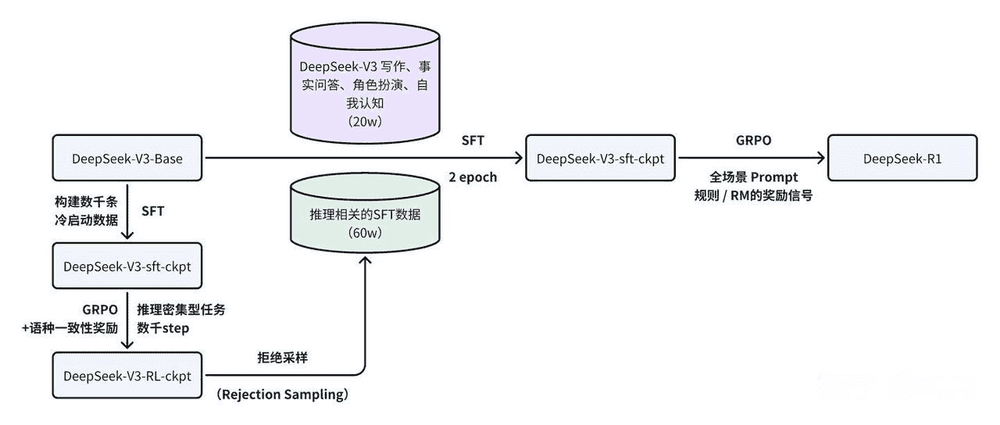
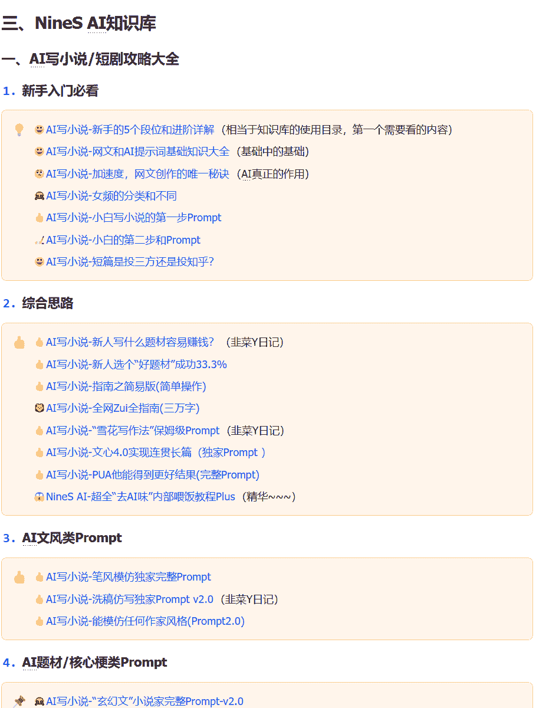
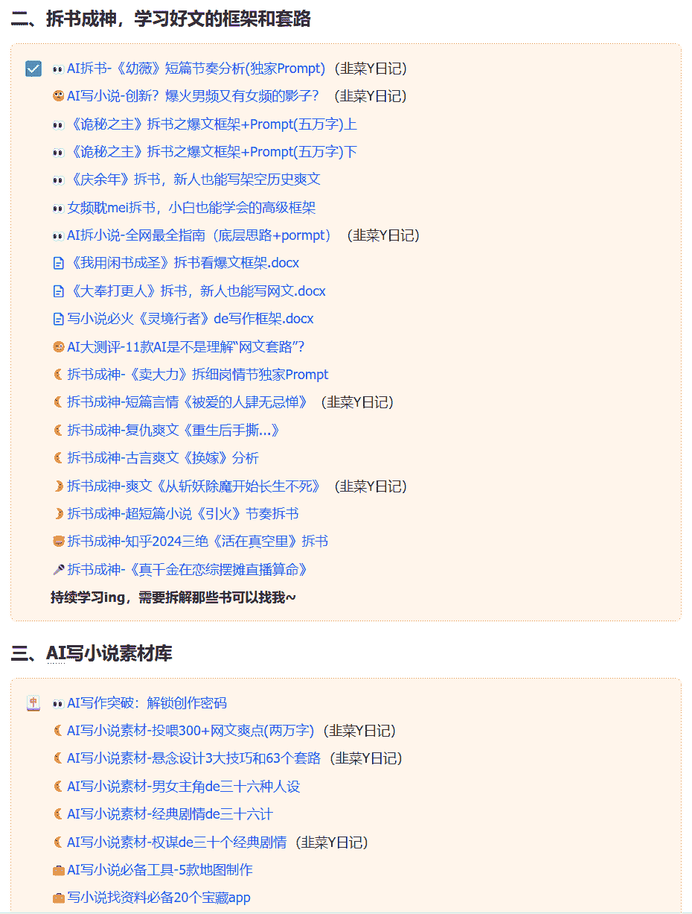
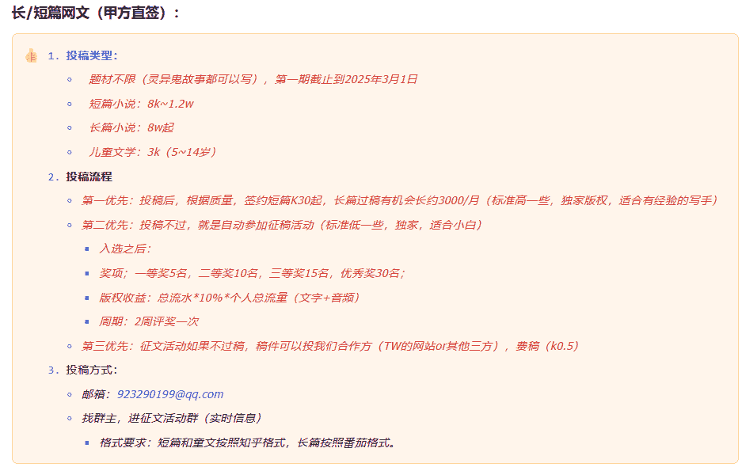
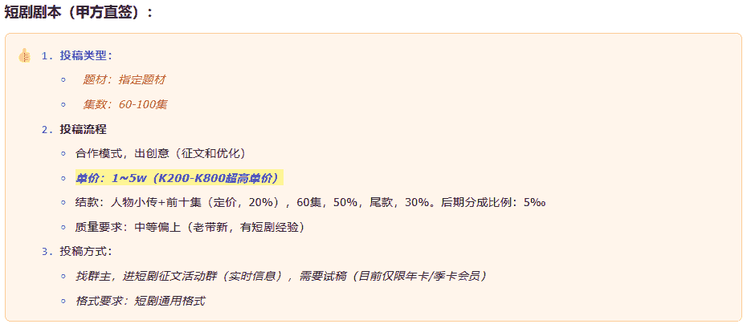

# AI写小说-DeepSeek R1技巧全指南(精华)

> 来源：[https://rq547mr4oez.feishu.cn/docx/GArEdiddoolq4Ex7d53cCuolnae](https://rq547mr4oez.feishu.cn/docx/GArEdiddoolq4Ex7d53cCuolnae)

## 一、前言：

> **DeepSeek R1模型都可以**自己思考了，之前的提示词还有没有作用？

> **先说结论：**

> 完整的提示词可能不如片段有效，甚至可能干扰模型的思考流程。

> 过长提示带来了大量的Token浪费和上下文污染，特别是在多轮对话中。

> **deepseek时代，或者说模型有能力深度思考的时代，用户只**需要在关键点进行引导，让模型自主发挥。

>

### 「乔哈里视窗本+关键词」模式是新一代LLM的正确打开方式。

---

**PS：NineS AI【****AI知识库+AI**产品+投稿渠道+大神分享=全链路】的创作者社群~

## 二、R1推理的本质

> **DeepSeek R1 确实很厉**害。但媒体炒作过度了，很多人反应过度了。

> **其核心贡献在于： **

> 1. 验证了RL驱动自我进化的可行性；

> 2. 开源模型及蒸馏技术推动技术民主化；

> 3. 为小模型高效迁移推理能力提供了范例。

> 训练过程：主要包含四个大步骤，冷启动sft、推理任务强化学习、拒绝采样与sft、全场景强化学习。

>

> 第一步，Cold Start（冷启动）。

> 与 DeepSeek-R1-Zero 不同，为了避免预训练 base 直接 RL 早期不稳定，于是构建几千条 long CoT 数据来微调模型作为 RL 的初始化 actor。设计了可读性高的 pattern，定义输出格式为 |special token|<思考过程>|special token|<答案总结>。探索了几种方法来构建数据：

+   使用 long CoT 作为 example 的 few-shot 提示

+   通过 prompt 让模型生成包含反思（reflection）和验证（verification）的详细答案

+   收集 DeepSeek-R1-Zero 的可读格式输出，并通过人工标注后处理来完善结果

>

> **第二步，推理任务RL训练。**

> 在使用冷启动数据对 [DeepSeek-V3](https://zhida.zhihu.com/search?content_id=253129944&content_type=Article&match_order=1&q=DeepSeek-V3&zhida_source=entity)-Base 进行微调后，使用与DeepSeek-R1-Zero 相同的 RL 策略进行训练直到收敛。这一阶段专注于提升模型在推理密集型任务（如编码、数学、科学和逻辑推理）中的推理能力，这些任务涉及定义明确的问题和清晰的解决方案。

> 奖励建模的 trick：

+   在训练过程中，观察到 CoT 经常出现语言混用，特别是 prompt 涉及多种语言时。

+   为了缓解语言混用问题，我们在强化学习训练中引入了语言一致性奖励，该奖励计算为链式推理中目标语言单词的比例。

+   尽管消融实验表明，这种对齐会导致模型性能略有下降，但该奖励与人类偏好一致，使模型输出更具可读性。

+   训练的时候将推理任务的准确性奖励与语言一致性奖励直接相加，形成最终奖励。

>

> **第三步，拒绝采样与sft。**

> 拿上一步RL收敛的ckpt用于生成sft数据。与冷启动主要关注推理任务不同，这一阶段纳入了其他领域的数据，以增强模型在写作、角色扮演等通用任务中的能力。具体来说，按照以下方式生成数据并微调模型。

+   推理数据：通过 reasoning prompts 用拒绝采样生成推理轨迹。在前一阶段，仅纳入了可以通过基于规则的奖励进行评估的数据。然而，在这一阶段，通过纳入额外的数据扩展了数据集，其中一些数据使用生成式奖励模型，将真实结果和模型预测输入 DeepSeek-V3 进行判断。此外，由于模型输出有时混乱且难以阅读，于是过滤掉了语言混用、长段落和代码块的链式推理。每个提示采样多个回答，并仅保留正确的回答。总共收集了约 60万条推理相关的训练样本。

+   非推理数据：对于非推理数据，如写作、事实问答、自我认知和翻译，重用 DeepSeek-V3 的部分监督微调数据集，通过提示 DeepSeek-V3 生成 CoT 然后回答问题。对于更简单的问题，如“你好”，不会在回答中提供 CoT。最终收集了大约20万条与推理无关的训练样本。

+   使用这 80w 数据集直接对于训练模型 DeepSeek-V3-Base 进行 2 epoch 的微调。

>

> **第四步，全场景强化学习。**

> 为了进一步使模型与人类偏好对齐，这里再进行强化学习，旨在提升模型的有用性和无害性，同时优化其推理能力。具体使用了组合的奖励信号和多样化的提示分布来训练模型。

+   对于推理数据，遵循 DeepSeek-R1-Zero 中概述的方法，利用基于规则的奖励来指导数学、编码和逻辑推理领域的学习过程。

+   对于通用数据，采用奖励模型来捕捉复杂且微妙场景中的人类偏好。

> 数据方面，基于 DeepSeek-V3 的流程，并采用类似的偏好对和训练集的 prompt 分布。

+   有用性方面，专注于最终总结，确保评估强调响应对用户的实用性和相关性，同时尽量减少对底层推理过程的干扰。

+   无害性方面，评估模型的整个答案，包括推理过程和最终答案总结，以识别和减轻在生成过程中可能出现的任何潜在风险、偏见或有害内容。

> 最终通过组合奖励和多样化的数据分布，训练出在推理方面表现出色的、优先考虑有用性和无害性的、震惊了一把整个AI圈子的、性能比肩 OpenAI o1 的 DeepSeek-R1。

## 三、方法（**乔哈里视窗本+关键词**）

### 无论是什么AI，在问问题前，都要判断AI的状态

> 参考《[NineS AI社群直播-去AI味/提示词本质/上下文衔接等](https://rq547mr4oez.feishu.cn/wiki/LR8Cw4AnJi7iFHkTnlwcREuhnme?from=from_copylink)》

+   **人知道，AI知道的-简单说****（大部分使用R1场景）**

+   **人不知道，AI知道-提问题****（大部分使用R1场景）**

+   **人知道，AI不知道的-喂知识**（写作遇到的部分，比如节奏、情绪曲线、脑洞等等）

+   **人不知道，AI也不知道-开放聊**

### 新旧提示法对比

#### **传统方法：**

> 🔹 像唠叨家长： "写一篇关于小红书分析的文章，每部分有案例，案例要近一年的，开头用疑问句，结尾精彩，字数在800字..."

> → **模型**：忙于数要求清单，创造力被框死

#### 新型技巧：

> 🔹 像对聪明助理打暗号： "主题：小红书 | 要最新案例 | 结尾有力道"

> → **模型**：自动调用知识库中最相关数据，自主组织最佳结构

### 怎么只说「在意点」就能行？

### 1. 现代LLM的隐藏能力

+   **需求解译2.0**：能通过关键词联想完整场景（如"要数据"→自动用图表+最新统计）

+   **上下文缝补**：当你说"和上次格式一样"，它能关联历史对话找到模板

#### 2. 用户省力秘诀

+   **痛点标记法**：用❗️标注核心需求 *"介绍秦始皇 ❗️别写焚书坑儒"_ → 模型自动规避敏感点

+   **负面清单优先**：明确不要什么比说要什么更高效 *"推荐电影 → 不要恐怖片"_

### 日常场景

#### 场景1：点外卖

> ❌ 旧方法： "找家人均50以下的川菜馆，要4.8分以上，有午市套餐，配送时间小于30分钟..."

> ✅ 新思路：

> *"川菜 | ❗️辣度可选 | 别太油"_

> → 模型自动排除重油馆子，优先显示有「微辣/免辣」选项的店铺

#### 场景2：改作文

> ❌ 旧方法： "把这篇作文改生动些，多用比喻句，开头加悬念，结尾要点题..."

> ✅ 新思路：

> *"作文润色 → ❗️别改掉孩子语气 | 加点奇幻元素"_

> → 保留"太阳像爸爸的光头"这类童趣表达，只增补魔法细节

#### 场景3：买衣服

> ❌ 旧方法： "找适合梨形身材的大衣，长度过膝，V领，材质高端，预算300内..."

> ✅ 新思路：

> *"大衣 ❗️遮胯 ❗️高端 | 预算←300"_

> → 模型直接推荐

### 高级技巧：符号说明书（参考markdown语法）

### 用特定符号代替长说明，建立个人密码本：

+   #急 = 要简洁版+重点标红

+   💰↑ = 优先高价质优选项

+   (?) = 需要解释原因

+   → = 对比优缺点

> **实例**： *"三亚攻略 #急 💰↑ (?) → 自由行/跟团"_ → 输出：高端酒店对比表 + 自由行适合人群分析

### 常见问题应对

#### **模型理解偏差**：

+   补救指令：*"方向OK，但X部分要更..."_

#### **需求变更**：

+   追加符号：*"+ ❗️增加二手市场评价"_

#### **多需求冲突时**：

+   优先级标记：*"❗️防水 > 颜值 > 价格"_

### **最终心法**： 把LLM当作会读心术的聪明朋友——

+   你不用解释「怎么呼吸」，只说「想要栀子花香」

+   不用担心它不懂，只要标记你的雷点和嗨点

+   越放松的表达，越能激发它的真正实力

> **就像给画家说「要夏天的海」，而不是规定「蓝色占比30%**+浪花画法」——留白处才是艺术诞生地。

## 四**、NineS AI【****AI知识库+AI**产品+投稿渠道+大神分享】的创作者社群~

