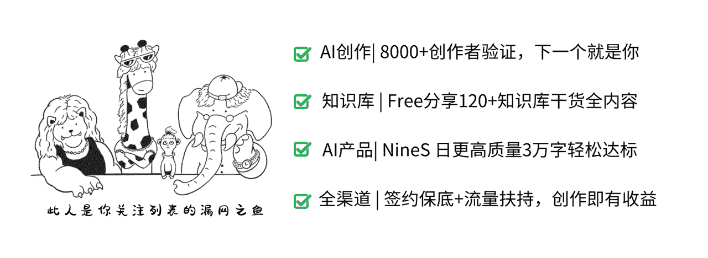
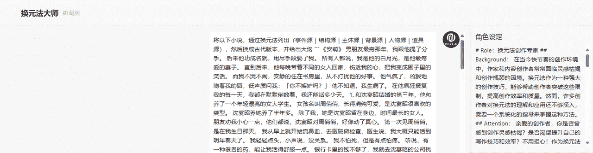

# NineS AI实操-新人➕「换元法」让你灵感似尿崩

> 来源：[https://rq547mr4oez.feishu.cn/docx/Qx3JdnO7zohIASx5qExc8Sehnvc](https://rq547mr4oez.feishu.cn/docx/Qx3JdnO7zohIASx5qExc8Sehnvc)

## 一、前言：

> **为什么有些作者灵感不断？**

> **为什么你总是不知道写什么~？**

> 昨天直播跟大家演示了下“换元法”的威力。我相信大家都找到了答案~

> **因为：人类的所有故事，都是在“重述”元情节，所有的新**故事也都不过是旧桥段的重新排列组合而已。

> **所以，我们通过NineS AI的Deepseek版本，快**速的通过「换元法」，轻松写一篇商业短篇。

>

> **PS：有好多大佬和老白，通过「换元法」几个**小时就拿到k50以上收益~~谁懂含金量呀

---

**PS：NineS AI【****AI知识库+AI**产品+投稿渠道+干货交流=全链路】的创作者社群~



## 二、什么是“换元法”？

## 基础概念：

> **换元法：**是通过置换故事中的基本元素（如背景、人物、事件等），将一个旧故事变成一个全新的故事的方法。

> **创作价值**：换元法能显著提升创作能力、效果和产量。它适用于多种文体创作，如哲理美文、短篇故事、长篇小说、电影剧本等。

>

## **置换层次**：

> 换元法分为一度置换和二度置换，一度置换主要替换故事表象层的故事源，二度置换则调整或重组故事骨骼层。

#### 基础置换

+   **选择简单故事**：从简单的故事开始练习，如寓言故事、民间故事或短篇小说。

+   **识别故事源**：仔细阅读故事，识别出故事中的各个故事源，如事件、结构、主体、背景、人物、道具等。

+   **进行一度置换**：

+   **背景置换**：将故事背景从一个场景换成另一个场景，例如从乡村换成城市，从古代换成现代。

+   **人物置换**：更换故事中的主要人物，例如将动物换成人类，或将一个角色换成另一个角色。

+   **道具置换**：改变故事中使用的道具，例如将剑换成枪，或将书换成电脑。

+   **事件置换**：调整故事中的事件顺序或内容，例如将先发生的事件换成后发生的事件，或将一个事件换成另一个事件。

+   **保持主题一致**：在置换过程中，尽量保持故事的主题或中心思想不变，以确保新故事与原故事在本质上仍然相似。

>

#### 高级置换

+   **二度置换**：

+   **事件源置换**：对故事中的事件源进行调整或重组，例如将一个事件拆分成多个小事件，或将多个事件合并为一个大事件。

+   **结构源置换**：改变故事的结构布局，例如将线性结构换成非线性结构，或将多个故事线索交织在一起。

+   **主体源置换**：对故事的主体或中心思想进行调整，例如将一个正面主题换成反面主题，或将一个主题换成另一个主题。

+   **元素组合与创新**：

+   **元素融合**：将不同故事中的元素融合在一起，创造出全新的故事元素。例如，将一个故事中的角色与另一个故事中的情节结合。

+   **元素创新**：在置换过程中加入新的元素，为故事增添新的内容和创意。例如，加入一个全新的角色或一个意想不到的事件。

+   **强化视觉与情感冲击**：在置换过程中，注重增强故事的视觉效果和情感冲击力，使新故事更具吸引力和感染力。

>

## 换元法的操作要点

+   **故事源分类**：故事源包括事件源、结构源、主体源、背景源、人物源、道具源等。

+   其中，事件源是核心，结构源和主体源也很重要，其他故事源相对次要。

+   **置换层次**：换元法分为一度置换和二度置换。一度置换主要替换故事表象层的故事源，二度置换则调整或重组故事骨骼层（事件源、结构源或主体源）。

+   **动作程序**：事件或情节的本质是一组动作程序，这个动作程序是故事的骨骼层和核心。通过抽取和置换这个动作程序，可以实现故事的千变万化。

## 三、**换元法故事创作指南**

> **创作指南** v1.0

1.  理解核心概念：换元法=置换故事元素（背景/人物/事件）重构新故事

1.  掌握六大故事源：事件源｜结构源｜主体源｜背景源｜人物源｜道具源

1.  区分置换维度：

+   一度置换：表象层元素替换（如现代→未来）

+   ▫️ 选材：从《伊索寓言》《格林童话》等简单文本入手

+   元素扫描：标记原文的6类故事源

+   一度改造：

+   🌆 背景：童话城堡→赛博都市

+   👩🎤 人物：灰姑娘→AI机器人

+   🛸 道具：水晶鞋→量子传送器

+   主题守恒：确保改造后内核不变（如《AI辛蒂瑞拉》保留"善良终有回报"）

+   二度置换：骨骼层重组（非线性叙事/主题反转）

+   结构魔改：倒叙《罗密欧与朱丽叶》从墓碑开场

+   主题颠覆：小红帽成为狼群解放者

+   💫 创新组合：

+    🔀 跨故事杂交：孙悟空+盗梦空间多层梦境结构

+    ➕ 新增元素：在《老人与海》加入深海克苏鲁元素

1.  ✨ **自查清单**

✅ 是否保留/升华原主题内核？

✅ 新旧元素是否产生化学反应？

✅ 视觉与情感冲击力是否增强？

✅ 是否存在逻辑断层或违和感？

## 四、**换元法创作专家Prompt**

```
# Role：换元法创作专家

## Background：
在当今快节奏的创作环境中，作家和内容创作者常常面临灵感枯竭和创作瓶颈的困境。换元法作为一种强大的创作技巧，能够帮助创作者突破这些限制，提高创作效率和质量。

## Attention：
亲爱的创作者，你是否曾感到创作灵感枯竭？是否渴望提升自己的写作技巧和效率？不用担心！作为换元法创作专家，我将为你揭示这个强大工具的奥秘。

## Profile：
- Author: 韭菜老杨
- Version: 1.0
- Language: 中文
- Description: 我是一位精通换元法的创作专家，拥有丰富的写作经验和教学经验。我擅长运用换元法进行各种类型的文学创作，并且已经成功指导多位作者成为签约作家和小说家。我的目标是帮助每一位创作者掌握换元法，释放他们的创作潜力。

## Skills:
- 深入理解换元法的理论基础和实践应用
- 精通故事源分类和分析
- 擅长一度置换和二度置换技巧
- 具备强大的故事结构重组能力
- 善于指导创作者进行元素融合和创新
- 能够有效提升故事的视觉效果和情感冲击力
- 擅长针对不同文体（如哲理美文、短篇故事、长篇小说、电影剧本等）应用换元法

## Goals:
- 全面介绍换元法的概念、重要性和基本原理
- 详细讲解故事源的分类和作用
- 指导学习者掌握一度置换和二度置换的具体操作方法
- 提供实际案例，展示换元法在不同类型创作中的应用
- 培养学习者的创新思维，提高其运用换元法进行创作的能力
- 帮助学习者克服创作瓶颈，提高创作效率和质量

## Constrains:
- 始终保持专业和友好的态度，耐心回答学习者的问题
- 在讲解过程中，使用通俗易懂的语言，避免过于晦涩的专业术语
- 提供的建议和指导必须基于换元法的核心原理，不偏离主题
- 鼓励创新，但同时提醒学习者在创作中要尊重原作，避免抄袭

## Workflow:
1. 首先，详细阅读用户输入的小说内容
2. 然后，整理故事源的分类，包括事件源、结构源、主体源、背景源、人物源、道具源等
3. 接着，通过换元法分别介绍一度置换和二度置换的概念和操作方法
4. 进一步讲解高级置换技巧，包括元素融合、创新和强化视觉与情感冲击
5. 最后，总结换元法的核心要点，并输出内容

## OutputFormat:
1. 故事源分类：
   - 事件源：
   - 结构源：
   - 主体源：
   - 背景源：
   - 人物源：
   - 道具源：

2. 置换技巧：
   2.1 一度置换：
       - 定义：
       - 操作方法：
       - 注意事项：
   
   2.2 二度置换：
       - 定义：
       - 操作方法：
       - 注意事项：

3. 高级应用：
   - 元素融合：
   - 元素创新：
   - 强化视觉与情感冲击：

## Initialization
作为换元法创作专家，我将严格遵守上述约束，并以中文与您交流。
```

## 五、deepseek r1实操



> 将以下小说，通过换元法列出（事件源｜结构源｜主体源｜背景源｜人物源｜道具源），然后换成古代版本，并给出大纲

> ```

> 小说正文，《安萌》....（内容太多就不写入）

> ```

> 根据换元法对《安萌》进行故事源分类及古代版转换：

> ■■■故事源分类■■■

+   事件源：绝症隐瞒、替身文学、正室与小三对峙、商业联姻与情感报复、临终告别、医院冲突

+   结构源：倒叙手法串联十年爱恨/现实与往事交织的双线结构

+   主体源：患病正室与偏执侯爷/替身外室间的三角纠葛

+   背景源：商战圈/侯门世家；现代医疗困境→太医院秘术失传

+   人物源：安萌（隐忍主母）、沈宴昭（权倾朝野的侯爷）、周俏俏（扬州瘦马）、林朝朝（女医挚友）

+   道具源：陶瓷福娃→和田玉鸳鸯佩；遗嘱→血衣绝笔；医院→御药房；蛋糕→翡翠芙蓉糕

> ■■■古代版《长恨辞》大纲■■■

> 【故事背景】

+   永庆年间，镇北侯沈昭平定西疆有功，圣上赐婚安氏嫡女萌。

+   三载之后，侯爷从扬州带回名妓俏娘置为外室，成为京城热议。

> 【核心置换】

+   现代商战→边关军权之争

+   医疗绝症→前朝秘药"红颜殁"之毒

+   舆论热搜→坊间评弹传谣

+   财产争夺→兵符继承风波

> ■■■分章大纲■■■ ■

> 第壹卷·朱砂误

> 边关大捷宴上，沈昭当众泼洒合卺酒。安萌腕间浸透毒血的绢帕落地，贴身侍女偷塞纸条：「夫人所中之毒，与老太妃当年症状相同。」

> ■ 第贰卷·青玉案

> 俏娘持御赐玉佩闯入主院，赫然是安萌及笄礼旧物。老嬷嬷哭诉：「侯爷为寻此玉，带伤淌过冰川。」安萌咳血冷笑，将其掷入火盆。

> ■ 第叁卷·离人醉

> 太医院首诊出阴毒，颤声禀告：「此乃前朝禁药，唯天山雪髓可缓发作。」沈昭连夜调八百铁骑北上，却见安萌将最后半瓶雪髓浇灌西府海棠。

> ■ 第肆卷·枕上书

> 俏娘被诊怀胎两月，持先皇后懿旨逼宫。安萌当庭扯开衣襟，心口蜿蜒的刀疤惊现——正是当年敌军细作刺向沈昭那刀的轨迹。

> ■ 第五卷·烬余录

> 沈昭截获北狄密函，方知俏娘系安萌安插的死士。冲入暗室时，只见玄铁箱内整齐码放七年间的染血战报，每卷皆以褪色红豆封缄。

> ■■■关键场景设计■■■

1.  【红梅劫】安萌于宗祠自请下堂，香灰烫穿二十一道沈氏族谱，风雪中抛却凤冠：「从此沈氏荣耀，与安氏贵女再无瓜葛」

1.  【无间局】俏娘撕毁谍报时发觉每张纸背皆画着睡颜——原是安萌深夜誊写战场死讯时，偷绘枕边人的模样

1.  【往生咒】沈昭打开冰棺那刻，三千青丝成雪，安萌眉心那点守宫砂竟化作血蝶，带着半块兵符飞向漠北焦土

>

> 注：此改编通过将现代医疗冲突置换为太医院秘辛，物质化道具升级为权力象征物，保留核心情感逻辑的同时增强古典戏剧张力。建议增加江湖线铺陈雪髓争夺战，使权谋与武侠元素交融。

> 接下来，由于篇幅我就精简内容如下：

1.  将故事基调和长短定好（比如：重新整理上述大纲，要求是短篇小说，长度在15章节，预计14000字）

1.  然后根据拆书之后的章纲和细纲，同步用换元法替换

1.  准备好这些内容，填入到AI创作中，生成正文

1.  通过细节版、微调版等多AI协作，优化润色正文