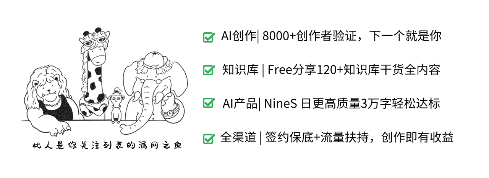

# NineS AI-“追妻火葬场”内部喂饭教程Plus

> 来源：[https://rq547mr4oez.feishu.cn/docx/AorVd10d4oIny2xrFVscHGgTn2Y](https://rq547mr4oez.feishu.cn/docx/AorVd10d4oIny2xrFVscHGgTn2Y)

# 一、前言

> 俗话说，虐妻一时爽，追妻火葬场！

> **网文著（万）名（恶）套路——追妻火葬场**！绝对是新手小伙伴入门女频的最好题材~~

> [AI写小说-“追妻火葬场”完整Prompt](https://rq547mr4oez.feishu.cn/wiki/AzmhwUYiriTyoxkXVvPcaoGKncc?from=from_copylink)有很多小伙伴不会写，so结合《 》分享内部de喂饭教程plus。

>

> 该套路伴随着网文的发展，不仅没有走向没落，甚至愈发红火。

> **究其原因，核心为：**男女主关系的转变带来持续性期待。

> **每一个关系的转变节点，都是一个大的期待点，这些期**待点串联起来，就成了吊着读者追读的勾子。

---

**PS：NineS AI【****AI知识库+AI**产品+投稿渠道+干货交流=全链路】的创作者社群~

# 二、上干货（超详细完整套路，真喂饭教程）

### 核心梗（可以融de梗）

> “**追妻火葬场**”是包罗万象，基本上你见到的都是可以融梗的~

> 常用：死人文学、逼怀孕、逼打胎、逼抽血、认错梗、陷害杀人、囚禁、监yu、癌症、逼破产、误会梗、抢孩子、假死梗。

### 人设（模板化，抓住核心衍生）

+   【女主】

+   性格：前期弱，后期强，外柔内刚。

+   身份：千金（失忆，破产，被亲人逼嫁）；

+   【男主】

+   **性格：霸道偏执，冷酷无情，**心狠手辣。但是不是死坏！（千万注意）

+   身份：霸总等

+   男二对女主千般好，让男主吃醋！

+   【女配】

+   （**男主白月光，女二**）替身（1，真替身；2，自己是自己替身，认错梗）

### 开篇前3章/小节（也适用短篇）

#### 核心公式：女主现状+男主态度+虐点+钩子

#### 女主现状=身体+对男主态度（内因）+家庭情况（外因）

+   （1）身体=怀孕、患病、失忆、残疾（傻、哑）、进监狱

+   （2）对男主的态度（内因）=1，暗恋N年、明知男主有白月光还嫁；2，心死提离婚；

+   （3）家庭情况（外因）=破产、欠债、因双方长辈嫁人、有亲人在男主手上

#### 男主态度=行为+语言+双标（不能是绝对的坏，总在不经意间给女主希望）

+   （1）行为=QJ、打人、逼下跪磕头、灌绝子汤/避孕药、踩手、捂枕头、伪出轨、虐孩子（抽血，责骂）、让女主家破产。

+   （2）语言=打胎、侮辱女主人格。

+   （3）双标=女主和女配的区别对待.

#### 钩子（开篇前三章/1~2小节抛出）总结：误会梗、认错梗、藏萌宝、藏病

+   1，女配陷害让男女主产生误会？

+   2，男主什么时候能发现认错人了？

+   3，男主什么时候知道女主要死了？

+   4，男主什么时候发现萌宝？

+   5，男主什么时候发现萌宝是自己的孩子？

#### 虐点A：无娃版本：

+   女主被囚禁（1，男主虐女主；2，男主和女配一起虐。虐心为主）；

+   女主患癌（1，被QJ；2，被逼抽血；3，被逼下跪；4，被逼灌酒。虐身为主。）；

+   女主怀孕（1，假死带球跑；2，被QJ；3，被逼抽血；4，被逼下跪；5，被逼灌酒。虐身为主。）；

+   替身、失忆（Qj，陷害，入狱，胃癌。虐身为主。）；

+   被陷害杀人（男主妈，女配，女配妈），入狱（墓地磕头/下跪，误会+认错梗，虐亲儿女。）；

+   共同点：1，女主有病+怀孕；2，男主虐女主身（QJ，灌酒，抽血，下跪磕头，扇巴掌）；3，女配装病（1，女主的血；2，女主孩子的血；）

### 虐点B：有娃版本：

> **1、怀孕：**

+   女主瞒怀孕，逃离男主，男主得知，抓女主回去，方便女配用孩子搞事，（对标：南风过境）；

+   女主瞒怀孕，逃离男主，男主不知，持续虐待女主，女配得知，利用女主怀孕搞事（换孩子、流产）（对标：总裁，夫人胃癌晚期）；

+   女主怀孕，男主得知，逼打胎，有三个方案：

+   A方案：打胎成功女主恨上男主，相爱相杀，女主持续被虐，成功怀上第二个；

+   B方案：男主反悔，留下孩子，促使女配嫉恨搞事；

+   C方案：男主并没有让女主打胎，女配让女主误以为是男主的决定，又让男主以为女主想打胎，借此挑拨两个人关系，推动男主虐女主的进程；

> **2、萌宝：**

+   孩子自己养：带娃回归，藏娃不被男主发现，方案：

+   A方案：女配先得发现，阻止男主和萌宝相认；

+   B方案：男主得知，和女主抢孩子/为了孩子要娶女主，进而促使女配搞事；

+   C方案：男主误会孩子是野种，女主独自带孩子，夜店卖酒/陪酒，继续和男主暧昧纠缠；

+   孩子男主养：

+   A方案：女主生孩子被告知孩子死了，实则男主带走，几年后女主和孩子巧遇，帮助，产生联系，孩子喜欢女主，助攻男女主感情；

+   B方案：男主娃表面是女配的，实则是女主的，孩子对女主和女配的态度有所不同，进而促使女配搞事，推动男女主发现真相；

+   C方案：因为女配，男主误会女主的娃不是自己的，男主虐亲生孩子，女主带孩子逃离（以虐孩子为主，孩子死，男女主矛盾彻底爆发）

+   孩子各自养：女主藏娃，无意中发现男主的娃，两个方案：

+   A方案：男主娃是女主的，两方的娃一起助攻男女主感情；

+   B方案：男主娃不是女主的，是女配的，但不是女配和男主的，被女配用来拴住男主，男女主重逢，女主藏萌娃，促使女配搞事，推动剧情发展；

### 常用场景：医院、酒吧、监yu、家、墓地。

+   【医院】

+   1，女配装病，男主强迫女主（生病/怀孕）抽血、照顾、下跪、被打、道歉；

+   2，女配怀孕，男主陪女配产检，女主（生病/怀孕）独自离开；

+   【家】

+   女配挑衅，男主维护，虐女主（打、骂）；

+   【监yu】

+   入yu：女配陷害女主，女主被男主送进监yu（男主眼盲心瞎）；

+   出yu：男主宠女配，继续虐女主。

+   【墓地】

+   女主被女配陷害杀人，男主让女主墓地下跪道歉；

+   女主被女配1陷害杀女配2，男主和女配1让女主墓地下跪道歉；

+   【酒吧】

+   男主和女配去酒吧，女主是工作人员，女配灌女主酒，男主冷眼旁观；

+   虐点：详见有娃虐与无娃虐部分。

### 开篇前两万字平均几个虐点（剧情点）

> 长篇：平均10个

> 短篇：根据字数，一般是3~10个

### 开篇虐女主是否有助攻?助攻几人？

> 男主主虐，女配、原生家庭、男主家庭，亲孩子助攻

### 开篇前两万字女主变化。

> 心理：1，出狱后；2，流产后（胎儿）；3，回国后；4，伤害孩子（萌宝）；5，伤害女主在意的人（除孩子）；6，父母死；

> 行为：1，强迫打胎；2，伤害孩子；

### 女配虐女主的方式。

> 女配身份：假千金、闺蜜、同父异母/亲姐妹、男主白月光的双胞胎姐妹、娱乐圈二线小明星。

> 虐女主方式：

> 1，陷害：陷害女主杀人、陷害女主出轨，陷害女主虐自己；

> 2，暴力：扇巴掌、头撞墙、泼开水、灌酒、xxxx。

> 3，精神伤害：辱骂，误会，虐孩子。

### 男配的行为和身份。

> 男配身份：医生最多，律师。

> 男配行为：安抚女主情绪，隐瞒女主病情，帮女主逃离男主，帮女主打官司（监yu、离婚）