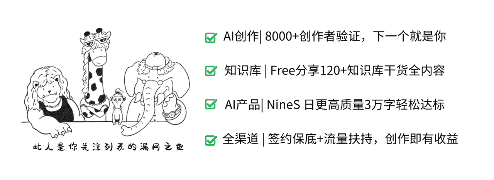
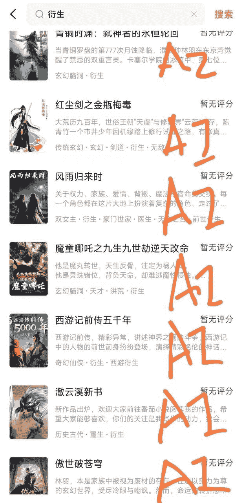
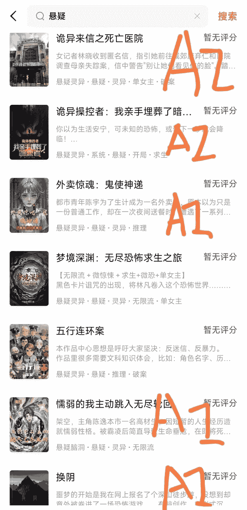
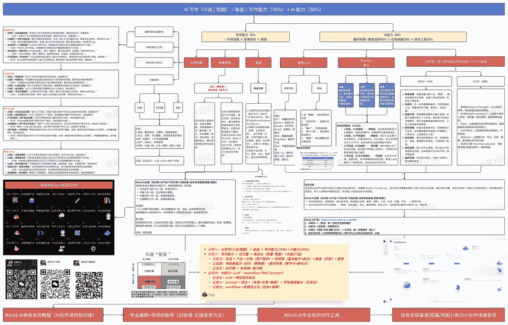

# NineS AI-番茄又又又被AI文占领了？

> 来源：[https://rq547mr4oez.feishu.cn/docx/TT6LdmVcno4sXexcho4c2myonqg](https://rq547mr4oez.feishu.cn/docx/TT6LdmVcno4sXexcho4c2myonqg)

# 一、前言：

> 一觉醒来，网文作者的天又又又塌了~~

> **番**茄小说平台于昨日刷新历史记录，单日新增首秀作品5605部（男频3549+女频2056），较前日激增近2000部。

> 导致流量极大的分散，何处是出头之日？

>

> NineS AI内部社群大神分享：帮你分析趋势，解决焦虑。

---

**PS：NineS AI【****AI知识库+AI**产品+投稿渠道+干货交流=全链路】的创作者社群~

# 二、行业异变

> **遥**想2023~2024年，有些醒悟早的作者，已经使用AI产出作品（社区4群的小伙伴举例，双开4本，月入3w+）

> 当时，还有很多人不相信。囧囧囧囧囧

>

> 自从2025年deepseek发布，这个事情让全国广大人民都发现了，可以用AI创作。

> 导致**番**茄小说平台于昨日刷新历史记录，单日新增首秀作品5605部（男频3549+女频2056），较前日激增近2000部。

>

> 更值得警惕的是，这一增速已呈现不可逆态势。

> 业内人士对8万字待验证作品库进行抽样调查，发现AI生成内容已形成规模化生产态势，单账号可同时运作数十部作品。

**与传统创作模式对比可见：**

+   创作周期：人工创作8万字需15-30天 vs AI生成仅需1天

+   操作规模：人工单线程创作 vs AI多线程量产（30-50部/人）

+   收益逻辑：单部作品日收益不足10元的"彩票式"期待，通过规模效应实现收益叠加

**导致危机**

1.  创作者层面：真人作品流量腰斩，收益断崖式下跌

1.  读者体验：内容质量坍塌式下滑，形成"标题党-劣质内容"恶性循环

1.  平台困境：内容池质量稀释引发的用户流失风险

>

> 历史镜鉴：今日头条前车之鉴，2016-2018年今日头条经历相似困境：

+   自媒体数量激增300%（易观数据）

+   标题党内容占比峰值达42%（新榜监测）

+   用户月活流失率最高达25%（QuestMobile）

+   优质创作者流失率37%（平台内部数据）

**当前番茄小说已出现：**

+   头部作者流失潮（典型案例：月入过万作者转投七猫占比31%）

+   用户差评率月环比上升58%（应用商店数据）

+   广告主投放单价下降19%（第三方监测）

# 三、新人破局指南

#### **一、认知重塑：**

1.  入门要方向+方法都正确，才不会走弯路

+   [AI写小说-新手的5个段位和进阶详解](https://rq547mr4oez.feishu.cn/wiki/TjLkwdb6Kidkq5k8E3UcOSAynOf)（定位自己，才知道合不合适）

+   [AI写小说-网文和AI提示词基础知识大全](https://rq547mr4oez.feishu.cn/wiki/TsShwKmo7ierrJkVWM6csF5MnRe?from=from_copylink)（基础中的基础）

+   [NineS AI-长篇/短篇/短剧新人如何开始？](https://rq547mr4oez.feishu.cn/wiki/Bc8gwj9XuijYKiklTp8coBbDn4e?from=from_copylink)（给迷茫的小白解答）

+   [AI写小说-愤怒的香蕉-以情绪为核心](https://rq547mr4oez.feishu.cn/wiki/NLKcwfCdPiSOGdkYMgJcu3aonUc?from=from_copylink)

1.  **平台算法真相**

+   番茄"零门槛"背后是"高淘汰"机制：首秀淘汰率超85%（平台内部数据）

+   AI文核心优势：高频次冲击算法（单账号日均上传量是人工的30-50倍）

+   真实收益模型：

+   头部5%作品占据70%流量池

+   尾部50%作品日均收益＜3元

+   AI规模化套利逻辑：50部×2元/天=百元日收（需承担90%作品被腰斩风险）

1.  AI创作真正的核心本质（见下图-NinesAI创作知识导图）

+   创作是难者不会，会者不难

#### **二、差异化生存策略**

**1. 内容构建（质量第一）**

+   **情绪价值强化**

+   设计"AI难以复制的共情点"：

+   地域文化细节（方言/民俗场景）

+   特定职业深度描写（医生/考古等专业领域）

+   **交互式创作实验**

+   在传统网文中嵌入：

+   多结局读者投票机制

+   角色养成社区互动

2. AI技术工具的正确打开方式

+   **AI辅助三阶应用法**

+   基础层：灵感激发（关键词→脑暴大纲）

+   进阶层：数据校准（热词分析→章节节奏优化）

+   警戒线：严禁直接生成超过1000字连续文本

+   **AI特征避雷清单**

+   禁用"意识流环境描写"（例：月光如水般倾泻在...）

+   警惕"三段式万能对话"：

+   "你终究还是来了。"

+   "这一切都是你设计的？"

+   "是又如何？"（AI生成对话TOP1模板）

+   **必备专业工具：  **

+   Nines AI创作工具

+   GLTR文本熵值检测（可视化AI生成概率）

+   最快入门

+   [NineS AI实操-“仿写”的三个阶段（By 老杨）](https://rq547mr4oez.feishu.cn/wiki/F9gHwbDbni1386kI3ivcC0PSnRb?from=from_copylink)             PS：核心方法，洗稿-->换元法仿写-->融梗

+   [NineS AI实操-灵感来源“情节卡”（By 老杨）](https://rq547mr4oez.feishu.cn/wiki/ApJtw9PYbil6pJkF0lhckX3fnrb?from=from_copylink)             PS：积累的最快办法

+   [NineS AI实操-小白入门流程(by 鹤凤w)](https://rq547mr4oez.feishu.cn/wiki/ICfIwYFR3i19nokvL05cMG28nHd?from=from_copylink)                    PS：纯萌新的参考实录，第一次就签约了~

+   [NineS AI实操-DeepSeek➕「换元法」让你灵感似尿崩](https://rq547mr4oez.feishu.cn/wiki/J0pNwmZiliR1SKkhmcQcYRCvnOD?from=from_copylink)PS：换元法 实操教程

+   [NineS AI实操-「短篇工作室」使用deepseek批量过稿~秘籍](https://rq547mr4oez.feishu.cn/wiki/Jqy1w9TkTijvAbkKirdcRZPFnif?from=from_copylink)       PS：王大人工作室快速变现办法

+   [NineS AI实操-拆书获取情节卡(by 星如雨)](https://rq547mr4oez.feishu.cn/wiki/G85ewmlk5iNO0nkytLTcs64KnQh?from=from_copylink)                PS：情节卡的获取方式实操

+   [NineS AI实操-仿写入门流程(by 变成胖虎)](https://rq547mr4oez.feishu.cn/wiki/C2N4w0C2sir82Pk1G2ncAKrlntb?from=from_copylink)                PS：仿写短篇4小时轻松K30，到K50

#### **三、平台技巧** （网文自媒体化）

+   错峰更新：避开AI文集中上传时段（监测显示每日20:00-24:00为AI文高峰期）

+   标题加密：在标准书名后增加【】注释（例：《总裁的替嫁新娘》【90年代粤港茶楼实录】）

+   阶梯式平台组合

+   主战场：番茄（流量池）+ 七猫（保底） + 起点/晋江

+   潜力股：知乎故事（高溢价短篇）+ 豆瓣阅读（小众精品）

+   建立私域书友群（至少3个200人以上社群）

> **总结：**

+   在AI工业化写作的阴影下，新人作者的核心竞争力在于打造「不可自动化的情感连接」。

+   当机器在堆砌文字时，人类创作者要聚焦于缔造那些让读者深夜辗转反侧的故事记忆点。

+   **记住：**

+   **新**人入坑什么时候都不算晚，只要坚持提高内功（积累+实践+坚持），把作品质量做好自媒体化，就一定会有出路！

+   等热度过去，就知道谁在裸奔，谁在passion~~