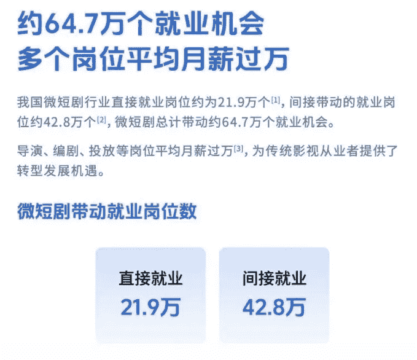
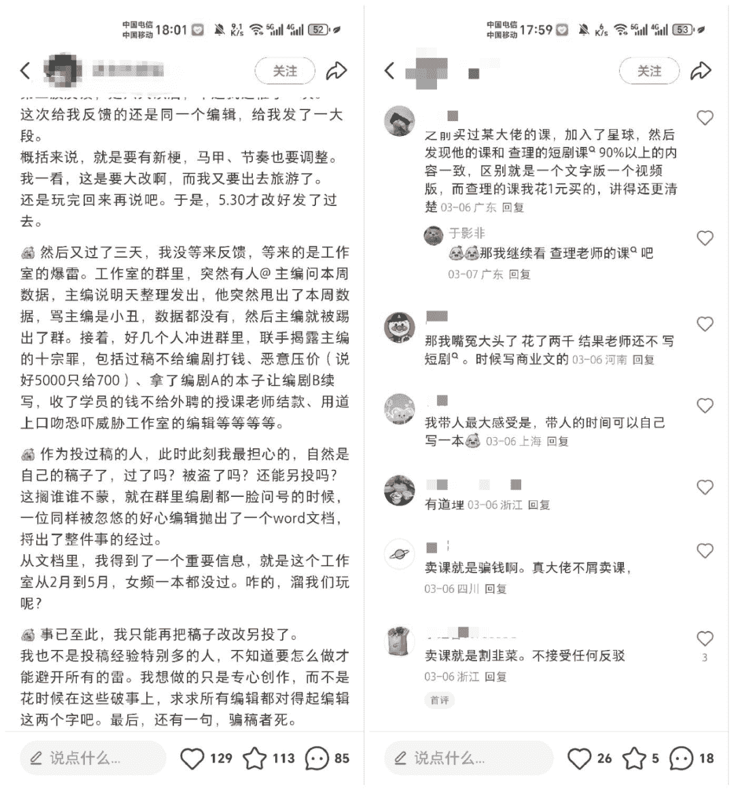
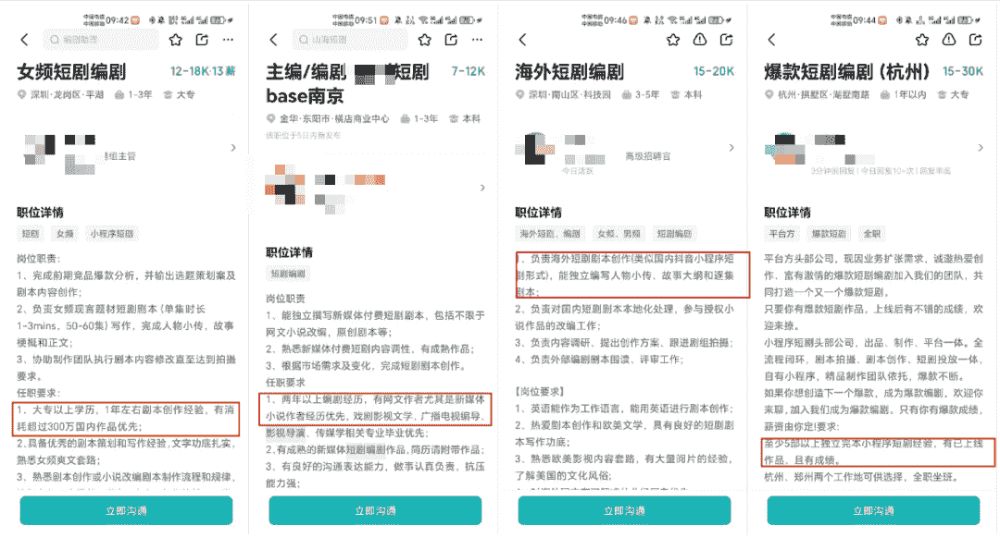
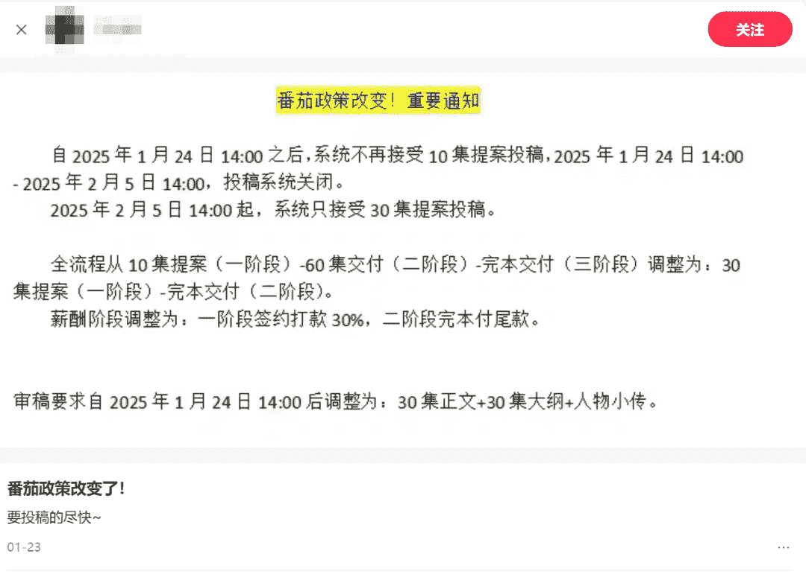
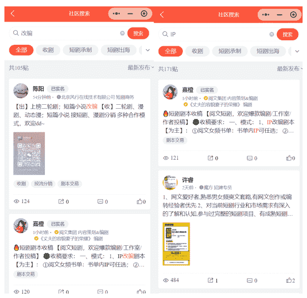

# NinesAI-短剧编剧香吗？(万字大揭秘)

> 来源：[https://rq547mr4oez.feishu.cn/docx/C1YtdXVRzo9Cq6xNy6JcaAmynae](https://rq547mr4oez.feishu.cn/docx/C1YtdXVRzo9Cq6xNy6JcaAmynae)

本文转载自DataEye短剧观察：

# 一、前言：

> 社群很多新人小伙伴，告诉我说想去写短剧~~都被高收益吸引。

> **但是，大部分人都有没有想过，为什么短剧剧本高，过稿率多少等**等~~因为世界上最公平的就是“等价交换”

> 所以，今天我们来给新人~泼一泼冷水，想创作，先从短篇开始~~

**PS：NineS AI【****AI知识库+AI**产品+投稿渠道+干货交流=全链路】的创作者社群~

> 《2024微短剧行业生态洞察报告》报告显示，

> 目前我国微短剧行业直接就业岗位约为21.9万个，间接就业42.8万，涵盖剧本创作、拍摄制作、后期编辑、市场推广等多个环节。

> 截至3月14日，剧查查后台数据显示，行业内可统计的个人编剧人数有17265人，剧本工作室及版权方共253家。

> “剧本决定60%的成功”这句话一直在业内流传，但透过十余位短剧编剧的故事，我们看到了短剧行业飞速奔腾的另一面。

## 二、“没有地位的编剧”

> 在社交平台上，搜索“短剧编剧”或“剧本投稿”弹出的帖子里，除了收稿和经验帖最多的“被骗”“避雷”等相关的帖子。

> 虽然大家都在说“剧本占60％”，但是依旧有非常多的编剧感到不被重视，没有地位。

### **被职场“霸凌”**

> DataEye短剧观察进入了3个名为“短剧编剧交流群”的📕社群和2个🛰️社群发现，群内最常分享的事情是“xx公司恶意辞退编剧”“xx公司一卡骗稿，面试偷创意”。

> 被压本、被毁约、被骗稿似乎已经是非常常见的现象，且编剧基本上很难维权。

>

> 网文作者转型短剧编剧的亚楠在📕上分享了自己入职某短剧平台坐班编剧期间遭受的不公平待遇。

> 他向我们透露，当初选择坐班一是看重了公司重视内容创作的理念，二是希望能够获得手把手的教学。

> **“没有系统培训，一开始有主编带我，他离职后我都属于自由状态，**自己琢磨”，亚楠向我们讲述他的工作经历。

> 在坐班期间，亚楠也曾经被主编手把手带过，主编离职后他经过自我摸索产出了第一个剧本，之后亚楠被公司以“抄袭、原创能力不足”等理由延长试用期，最后无奈离职。

>

> 离职后，亚楠开始在📕组织编剧交流群，发帖维权，分享自己的坐班经历。坐班的经历给他带来了不好的体验，他表示，“应该不会再坐班了,以后还是选择回归自由职业状态。”

> 另一位有同样经历的编剧在自己的维权帖上留下这样一句话，“除了让大家避雷，我们也做不到更多了。”

> 截至发稿前亚楠还没有追回公司拖欠的工资和提成。

### **拿不到的署名权**

> 影视剧、网剧和电影等影视作品，是被观众主动选择的，即便观众不想看片头片尾，拖动进度条也不会影响观看的完播率。

> 短剧不同于长剧，短剧依靠投流和算法进入观众的视野，更需要在开头的几秒内快速抓住观众的眼球，而不被划走，提高完播率和用户留存。

> 如果增加了片头片尾，会大大影响观众的观看体验，因此大多数的短剧不会在片头片尾出现署名字条，但在宣传海报上会体现出品方、平台方、承制方等合作方的公司名字。

> 另一方面，制作成本也是一个考虑因素。

> **短**剧的制作周期短，成本相对较低，如果每集都要制作高质量的片头和片尾，可能会增加成本。对于一些低成本制作的制作团队来说，这可能不太划算。

> **编**剧不像演员一样有露脸的机会，也不像导演摄制等人员可以提供片场记录，如果片中没有署名，那么很难证明自己的劳动成果。

> 编剧小满向我们表示，编剧在片中没有署名权，目前只能通过在剧查查小程序上传合同等资料获得认证，来证明自己是某部短剧的编剧，甲方也会将剧查查上的累计数据作为签约的考量。

> 署名权，即表明作者身份，在作品上署名的权利。

> 《中华人民共和国著作权法》第十七条明确规定视听作品（如电影、电视剧）的著作权由制作者享有，编剧、导演、摄影等作者享有署名权。

### **分账不透明**

> 分账透明化也是大多数编剧在呼吁的。

> 红果、腾讯、爱奇艺、优酷都曾经公布过短剧的分账战报，但市场上大部分平台的分账情况依旧是不对外公布的。

> 编剧小满向我们自嘲道，“编剧辛苦干半个月，可能不如爆款演员一天的工资。”

> 在收益上，编剧无法查看后台的真实数据和收入。

> 不少承制方、导演和编剧都曾经发帖表示，“xx平台篡改数据，恶意拖欠尾款”等。

> **编剧沧时九曾合作过多家平台，他表示，目前只有番茄在分账上是有比较透明的收益后台，**大多数时候编剧们只能拿到剧本的完本费用，有时候即便是爆款作品编剧也很难拿到分账。

> 24年毕业的编剧菜菜，一毕业就入职了杭州的一家剧本工作室，她向我们透漏，入职前公司告诉求职者，会将产生爆款后的分账作为绩效提成，“但实际上我们也很少能够拿到这部分的绩效，公司不会向我们透漏具体分账，大多数时候还是拿底薪+完本费，除非是非常爆款的剧才会获得奖金。”

## 三、“交钱都是割韭菜！”

> “交钱都是割韭菜！”这是许多编剧交流群内反复被提到的一句话。

> 短剧走红的两年时间里，社交网络上涌现出越来越多的类似于“交费报班学习写短剧”“短剧训练营”的帖子，但大多数关联的话题都是“避雷”等关键词。

> 去年，DataEye编辑通过“潜水”的方式进入多个所谓的编剧培训学习群，了解发现，培训的价格在2000-5000不等，课程内容包含写作技巧、修改辅导、答疑研讨等，部分训练营还会宣传“包过稿，包帮投”等。

> 大学生小欣在某编剧的评论区留言称，自己花了5000元进入一个宣传“可带写爆款，可代投稿”的线上剧本训练营，最后通过训练营带教老师“成功签约剧本”但稿费仅500元。

> 通过报班系统学习写剧本似乎是一件不太可能的事情。我们很好奇，如果不报班，一位新人编剧如何才能成为“爆款编剧”呢？

> 编剧沧时九分享，“短剧刚兴起时会有编辑手把手培养新人编剧，现在工作量大，编辑们基本上更倾向选择熟悉的编剧进行合作。

> 其实大多数资料通过📕、🛰️等公开渠道都可以获得，也可能添加一些编剧互助群大家一起交流学习，一些热情的前辈会给你传授经验，大多数还是自己摸索。”

>

> 不仅自由编剧会遇到没有专业指导的困境，许多坐班的编剧也存在这一问题。

> 曾经入职过两家TOP5平台方的编剧阿玖表示，“前辈同事和主编也很忙，基本上不可能老带新。”

> “编剧是一个创意工作，有些同事可能自己也不知道能够指导我们什么，能分享两句经验已经很不错了”编剧交流群内哈秋回复一位网友。

> **对于中尾部编剧群体而言，编辑只合作有经验的编剧，大量的资源集中于头部的编剧手中**，中尾部编剧的上升通道变窄。爆款的大编剧和成熟编剧一般不缺本子，但小编剧难出头。

>

> 当问及是否会越晚越难出头时，编剧沧时九表示，“有实力，有天赋，肯努力的人什么时候入行都能出头，当然也需要运气遇到好编辑。但天赋一般，不努力，都会被淘汰。”

> 新入行的编剧无法获得规范的专业的指导，成长速度远无法跟上行业发展的速度，可能也是越来越多的编辑选择只合作有爆款编剧或头部编剧的原因之一。

> “没有人会不喜欢合作爆款编剧吧，有经验总是比没经验的要好。

> **新人编剧剧本要反复改，有时候改完这个本子都过**气了，但是有经验的稍微指导一下就可以了。

> 只能说行业太快了，我们也没办法等新人成长。”某剧本工作室编辑回复我们。

## 四、哪条路才是出路？

> 2023年底小程序短剧爆火，不少网文作者、中长剧编剧，以及传媒相关专业的大学生选择成为一名短剧编剧。

> **“全职or兼职？”**

> DataEye短剧观察通过在BOSS直聘等招聘网站搜索“编剧”一职，发现，工作地主要集中在北京、深圳、西安、杭州、郑州、等一二线城市。

> 通过浏览招聘网站，结合采访交流，可知，头部短剧平台方的全职短剧编剧岗位薪资普遍在8-12k，经验较为丰富的成熟编剧或主编可达到15-20K及以上，部分二线城市、规模较小的承制方和剧本工作室的薪资在6-8k，在招聘启事内均要求有短剧经验或网文写作经验。

> **坐班的编剧通常要求每月产出1-2个剧本，薪酬由固定底薪+完本费**组成，完本费大约在0.5-1.2W之间。

> **自**由编剧的主要收入来源就是剧本稿费，普通原创剧本的稿酬在税前2W左右，有更多爆款经验的剧本可以卖到5W以上。

> 24年戏文专业毕业的阿杰，毕业后在朋友的介绍下当起了短剧编剧。

> “电影行业和传统电视剧行业能够落到我们毕业生手中的项目很少，大家都会选择用短剧入行。”阿杰的一些同学和师姐目前都在从事短剧相关的工作。

>

> 毕业后，阿杰一直是自由编剧的状态。

> 今年年初，其入职了一家短剧行业的头部平台方，成为一名坐班编剧。

> 聊到选择坐班的原因，阿杰坦言“收入上没有太大差别，个人编剧会自由舒服一些，但不稳定，坐班编剧的工作内容跟一个人干其实没有区别，但是相对稳定，产出的剧本公司都有机会上线。”

> “如果没有所谓的拖欠、骗稿等状况，一切顺利的话，只要稳定产出，编剧每月到手的稿费收入是比较稳定和可观的。”编剧沧时九回复我们。

**“做IP剧还是做原创剧？”**

> 拥有小说IP的平台方一边支持IP改编的，一边拉高IP改编剧本的投稿门槛。

> **1月23日，番茄的飞书群内向编剧们发布了一则剧本投稿政策改变的公告**，系统将不再接受10集提案投稿，24日起调整未30集正文+30集大纲+人物小传。

> 这一消息在编剧群和📕上相关帖子下掀起巨浪。

> 从平台角度来看，**提高投稿的准入门槛和要求，能够剔除掉一部分碰运气和只赚一卡保底费用的“投机派”**编剧，筛选出更多合适平台风格的剧本和编剧，精益求精，减少大浪淘沙带来的精力消耗。

> **另一方面，也可以更好地判断作品的质量，故事的走向，对**于保证作品质量和提高完播率都有很大意义。

> 此外，上游平台的变革传递到下游的结果是，部分主攻番茄平台的剧本工作室同样收紧选稿标准，或尽快找准时机将手上“10集一卡”的项目签给其他平台方。

> 编辑春生在剧本交易群内发表了自己的担忧“头部平台有动作，其他平台可能也会模仿。”

>

> 从目前的征稿启事来看，其他平台依旧是以10集起征稿为主，在这一政策影响下番茄以外的平台方也将获得更多的编剧合作机会。

> 虽然这一政策并非只针对于番茄IP改编的剧本，但大多数编剧都表示，以后可能只对番茄投稿原创剧本而不选择改编番茄的IP。

> 原因是，对于编剧而言，沉没成本提高了。

> **如**果改编番茄IP的剧本没有通过的话，这一剧本也不可以转投其他平台，而只对番茄投稿原创剧本则没有这一“麻烦”，剧本的版权依旧属于编剧。

> 但编剧暖妞有不同的看法，“改编如果做得好，是双赢的，小说和短剧的热度是互补的。

> 而且IP改编同样可以加入自己的原创，可以在新的剧本中完善小说留下了的BUG，让角色更丰满。”目前暖妞主攻的方向还是以客户定制的剧本和IP改编为主。

> 同样的，对于购本方来说，IP改编本也是更加有购买欲的。

> 小说IP本身已经经过了市场的验证，采购改编本的风险是更小的。

> 就目前剧查查社区内的交易帖来看，对于IP改编剧本的热情依旧。

## 五、精品化背后，是生态健康化

> 春江水暖鸭先知，剧本作为影视作品的基石，编剧是最先感受到行业动向的一环，编剧的处境也对照了行业的冷暖。

> 如果编剧群体连自身的权益都无法保障，感到很难生存下去，如此循环，受影响的不仅仅是整个行业，更包括观众。

> 理想要有，面包也要有。

> 短剧的精品化，不应该只有表面作品的精品化，更要创作生态的健康化，行业发展的健康化。

> 从根基处好起来，短剧行业才能在如今多元竞争的格局中，走得更宽，走得更远。

>

> 注：本文中采访对象春生、阿杰、阿玖、菜菜、小杨等采访对象均为化名。

> 更多素材、榜单数据，可以联系我们，免费试用ADXray行业版，掌握一手短剧数据。

> ADXray行业版，能实时监控全网最新、最火的短剧广告数据，为从业者提供全平台、多维度的数据洞察、素材策略参考，助您第一时间掌握行业趋势，提升投放效果！