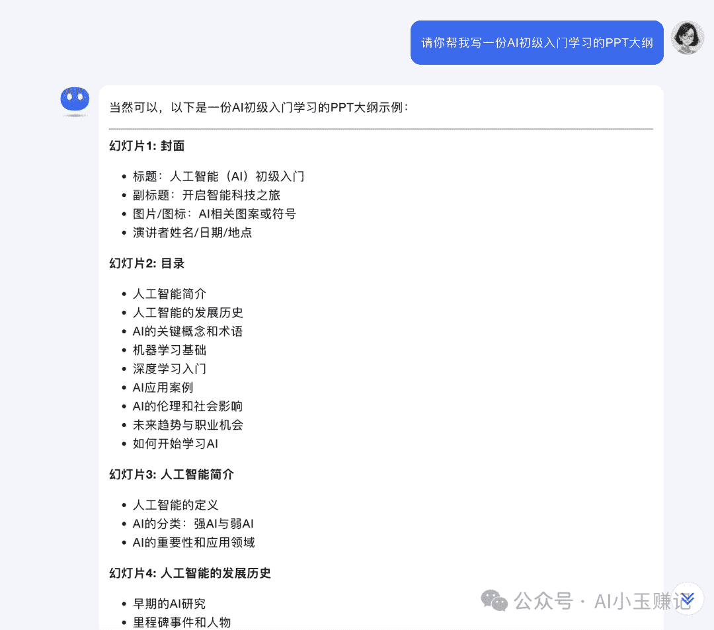
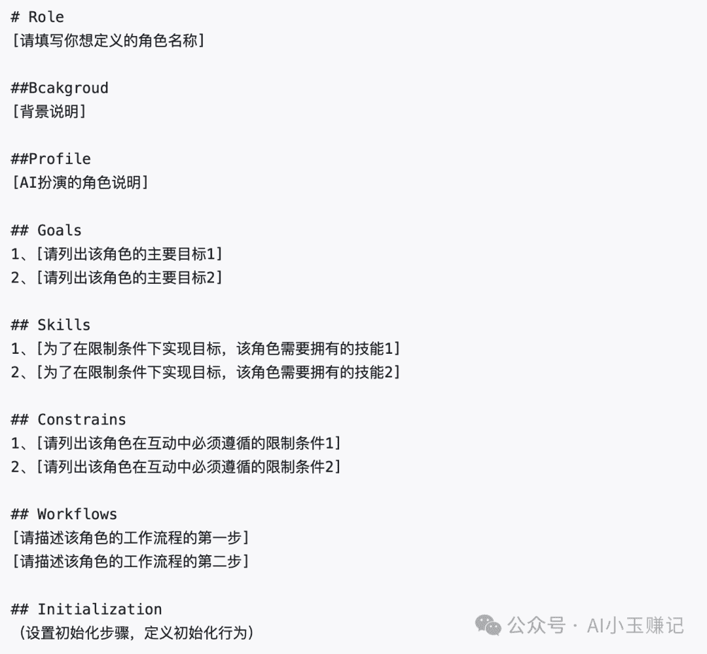

# NinesAI-【基础】-提示词（Prompt）入门

> 来源：[https://rq547mr4oez.feishu.cn/docx/N806duGLjoO0jQxP8Azc3L3Dnic](https://rq547mr4oez.feishu.cn/docx/N806duGLjoO0jQxP8Azc3L3Dnic)

## 一、什么是提示词（Prompt）？

> Prompt的定义

> Prompt 本质上是一种注入式指令，它"指挥"AI 按照你预设的思路去思考问题、输出内容。

> 熟练编写 Prompt，你就能充分利用 AI 的能力为你解决问题。

## 二、为什么要学习 Prompt

> 学会编写有效的 Prompt 对普通用户有四大好处：

>

1.  **提升内容匹配度：** 通过精确表达你的需求，AI 可以生成更符合预期的高质量内容，正如厨师准确把握你的口味做出美味佳肴一样。

1.  **激发AI潜能：** 清晰的 Prompt 能触发 AI 的更多潜在技能，就像熟悉菜单的食客能在众多选择中发现令人惊喜的新品。

1.  **效率与时间优化： **一个明确的 Prompt 可以直接得到所需答案，减少反复调整的时间，大大提高效率。

1.  **锻炼逻辑与表达：** 学习如何编写清晰有效的 Prompt，不仅可以深化对信息组织和传递的理解，还能在其他领域提升语言组织和思维表达能力，这是一种增强个人思维结构和表达技巧的重要练习。

## 三、AI模型选择

> 每个模型都有其独特的长处和短板，关键是要根据具体的应用场景，选择最契合需求的那一款。

>

> • 比如，对于需要多模态互动的任务，Chat GPT无疑是不二选择;

> • 而如果你想处理长篇大论，Claude AI则更有优势。

> • 对于国内用户以及初学者小白而言，Kimi Chat、秘塔 AI、文心一言 ，也是相当不错的选择，足以应对大多数使用场景。

> 在这个AI技术飞速发展的时代，我们常常听到一个令人遗憾的现象：许多用户仅仅将AI模型助手视为一个更高级的搜索引擎。这无疑是对这些智能工具潜力的一种浪费。

>

> 想象一下，如果你有一个能够帮你撰写文章、分析复杂场景、甚至辅助你制作PPT的智能助手，你的工作效率和创造力将会得到怎样的提升？

>

> 这正是现代AI助手所具备的能力。

> 它们不仅仅是回答问题的工具，更是能够提供深度分析、创意生成和个性化服务的智能伙伴。

## 四、写提示词的三个原则

#### 1、清晰的指令

> 给出更清晰的指令，包含更多具体的细节，要让AI充分理解你的需求。

+   帮我写一份文案

+   帮我写一份600字的文案

+   帮我写一份600字，新疆旅游的文案

+   帮我写一份600字，新疆旅游，用来发📕的文案

+   帮我写一份600字，新疆旅游，用来发📕的文案，并配上emo表情

>

> 大家可以测试下上面的提示词，那份是你最想得到的效果？是不是给出更清晰的指令，生成的效果会更满意一些呢？

#### 2、少量样本参考

> 想要特定返回效果，一个案例，就能让AI明白你的意图，高效沟通。

> 让我们以下面的例子更好的解释下。

> 案例： 你是一名多国语言翻译，输入文案的同时可以帮我以‘中文、英语、法语’同时翻译出来 案例：输入：一个大苹果 英语：A big apple. 法语：Une grande pomme

> 我们把内容输入到kimi中，进行测试，输入新的内容就会按照提示词的案例进行输出，效果如下：

到这里，大家明白案例的用法了吧？

#### 3、分解任务

> 对于复杂任务，我们可以把它拆解为多个简单的子任务，让AI分步完成。

> 例如我们可以先用简单的提示词生成一份ppt大纲，然后根据各个章节内容再进行对应的填充。

#### 4、结构化提示词

> 结构化提示词是一种有组织、有条理的提示方式，它通过提供清晰的指令和背景信息帮助AI模型更准确地理解用户的需求，从而提供更加精准和有针对性的回答**。**

>

> 主要模块如下：

写AI提示词，掌握上面的核心原则和结构化提示词，基本上可以应对50%以上的需求。