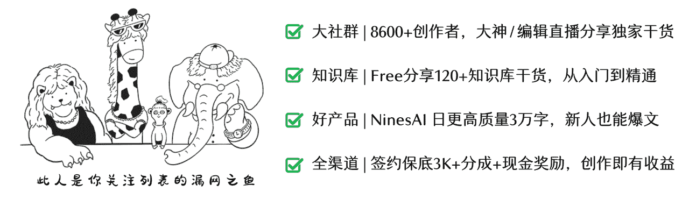

# NinesAI-5招让故事超流畅！小白秒变大神

> 来源：[https://rq547mr4oez.feishu.cn/docx/VjHcdv0iAo8hCQxDOqtcrK8RnKf](https://rq547mr4oez.feishu.cn/docx/VjHcdv0iAo8hCQxDOqtcrK8RnKf)

# 一、前言

> **最近，一些小伙伴说投稿（无论长篇还是短篇）**，编辑给的回复“故事太平淡，不流畅”~~

> **经过与社群大神们、编辑的沟通，得出**以下绝密的秘籍！许多小伙伴都过稿无忧~~

> **口诀**：

+   动作分解像镜头，短句分段别念经。

+   主角必须先吃瘪，对比反差情绪灵。

**PS：NineS AI【****AI知识库+AI**产品+投稿渠道+干货交流=全链路】的创作者社群~

# 二、完整解决方案

## 一、逻辑与口语化：让故事自然易懂

#### 1. **多角度描述同一场景**

+   **AI辅助**：让不同AI生成同一场景的描述，对比选择最生动的版本。

+   **人工优化**：将生硬描述转化为口语化表达。

> **例子**：

> 原句：夜晚的村庄被月光笼罩，显得宁静。

> 优化后：月光像一层银纱，轻轻盖在沉睡的村庄上，连马厩里的老马都安静地打着盹。

#### 2. 多AI润色，去AI味

+   **AI辅助**：让不同AI润色，对比选择AI味最少的版本。

+   **人工优化**：将AI味转化为口语化表达。

+   **参考：《**[NineS AI-超全“去AI味”内部喂饭教程Plus](https://rq547mr4oez.feishu.cn/wiki/D3I4wYg6hinykgkp07ocVhbVnBv?from=from_copylink)**》**创作思路、文本润色和叙事技巧三方面入手

> **例子**：

+   麦克尤恩式的病理细节："他道歉时总揉左耳垂，那里有童年链球菌感染的疤痕"

+   金宇澄式的方言节奏："弄堂雨落得横七竖八，像小菜场里杀鱼的刀功"

## **二、排版：提升阅读舒适度**

#### 1. **段落排版**

+   **长度**：每段45-48字（约三行半），避免视觉疲劳。

+   **分段技巧**：按动作、情绪、场景切换分段。

> **例子**：

> 密集段落：张三跳进田里，抬爪刨土，拔出一个萝卜，咬了一口，汁水顺着嘴角流下。

> 优化后：

> 张三跳进田里，后腿一蹬，爪子飞快地刨开松软的泥土。

> 一颗沾着泥的萝卜露了出来。

> 他张嘴咬下，清甜的汁水“滋”地溅到鼻尖上。

#### 2. **句子排版**

+   **短句为王**：长句拆分为短句，增加节奏感。

> **例子**：

> 长句：她抬头看他时鼻尖触到他温热的唇瓣，他赶忙扬起下巴却又顶到了她的额头。

> 短句优化：

> 她抬头，鼻尖蹭过他的唇。

> 他一慌，下巴猛地抬起，却撞上了她的额头。

## 三、描写逻辑顺序：让读者“看见”画面

### 1. **动态顺序（动作分解）**

+   **按动作轨迹描写**：分解连续动作，增强画面感。

> **例子**（小兔子偷萝卜）：

> 后腿一蹬 → 跳进菜园 → 爪子刨土 → 叼住萝卜 → 拔腿就跑。

### 2. **静态顺序（空间层次）**

+   **方向原则**：由远及近、从上到下。  画面即场景是由什么决定的(走向是由什么决定的)我想由情绪来带动刻意的未必是好的，小孩的涂鸦才是最灵动的

+   1、特写

+   (人体肩部以上)：主要展示人物的面部细节或特定物体的细微之处用于深入揭示人物的情感和内心世界，或者突出物体的质感、特征等。

+   面部细节、细微、情感、内心、质感、特征、强化印象

+   例子：

+   “斗之力，三段!”--强化印象

+   指甲深深刺入掌心--内心、特征

+   稚气未脱的小脸--特征

+   缓缓闭上眼睛--特征

+   实堆起的肌肉、灵活多智的眼睛、高挺笔直的鼻梁、浑圆的颧骨、国字形的脸庞配合棱角分明的嘴旁那丝充满对女性挑逗意味、懒洋洋的笑意有使任何女性垂青的条件。

+   2、近景

+   (人体胸部以上)：主要展示人物的上半身或物体的较大范围，用于进步展现人物的表情、情绪、动作，或者物体的整体形态。

+   表情、情绪、整体形态

+   例子：

+   少年面无表情--情绪

+   3、中景

+   (人体膝部以上)：展示人物的大部分身体或场景的一部分，注重表现人物的动作和姿态，以及与周围环境的关系。

+   动作、姿态、形态

+   4、全景

+   (人体的全部和周围背景):完整地展示人物和周围的背景环境，强调人物与环境的融合，展现场景的整体氛围。

+   一个人与部分环境的关系

+   5、大全景

+   用于表现人物之间、人与环境之间的关系。通常用来作环境介绍。

+   一群人与周围环境的关系

+   例子：

+   人头汹涌的广场上---群人与周围环境的关系

+   6、远景

+   展示广阔环境或场景，强调空间感和地理特征，常用于交代故事发生的背景或营造特定的氛围。

+   空间感、地理特征、背景、氛围

例子《我在精神病院学斩神》第五章：

+   此刻，沧南市的老城区。**一时间、地点**

+   一个男人正扛着一块告示牌(形态)，不不忙的行走在寂寥而昏暗的街道上(神态)，老旧的路灯酒下暗淡的光芒，将他的背影不断拉长(环境与人物的交流，情景交融)一一人体的全部和周围背景一一全景

+   **他瞥了眼手机(中景--动作)，**走到某个狭窄的街道口，停下了脚步。(全景) 一一先中景再拉成全景

+   **“就是这了…“他嘀咕**了一声，将肩上扛的告示牌放下，摆正。一一展示动作--中景

+   闪**烁的路灯下，告示牌的影**子忽隐忽现(物与部分环境的关系)，而在那黑色的底纹之上，鲜红的几个大字醒目至极!(特写)一一全景转特写

+   前方禁行!男人倚靠在路灯下，给自己点上**了一根烟，狠狠的吸了一**口后，打开了耳麦。一一动作、姿态--中景

+   “**队长，第三块告示牌已就位。“收**到，开始吧。“嗯。男人叼着烟，迈步走到告示牌的面前，将大拇指放在牙尖，用力一咬一一一个人与部分环境的关系--全景

+   滴血珠从伤口溢出，男人蹲下身，用染着鲜血的大拇指在”**前方禁行“四个**大字上划了一道长长的横线!一一特写转中景

+   **他的眼神一凝，一**股莫名的气势以他为中心爆发而出!一一特写转大全景

+   **他抬头仰望黑色的夜空，用只**有他自己能听见的声音呢喃…一一动作、姿态、形态-中景

+   下一刻，他身前的告示牌上鲜红的血痕飞速褪色，像是被吸收了一**般紧接着**，“前方禁行“四个大字红芒乍闪!一一特写

+   然后逐渐恢复原样。男人一屁股坐在**地上，长长的舒了一口气，有些**抱怨的开口。一一动作、姿态、形态--中景

+   “妈的，又被掏空了…此刻，若是有人从天空之中俯视沧南市，便会发现在老城区的附**近，三点光芒闪烁，然后以这三**处光芒为顶点，飞速的勾勒出一个暗红色的等边三角形!一一空间感、背景、氛围--远景

## **四、节奏感：让故事跌宕起伏**

### 1. **解决“情节平淡”**

+   **原因：**人物的行动过于顺利，故事没有戏剧冲突，无法勾起读者的期待感。

+   **公式**：目标 → 阻碍 → 行动 → 奖励（附加意外波折）。

**例子**：

> **平淡版****：**张三想吃饭 → 买菜 → 做饭 → 吃饱。

> **升级版****：**  张三饿到胃疼（目标） → 冰箱空空如也（阻碍） → 翻窗偷邻居家的泡面（行动） → 被邻居家的狗追出三条街（意外） → 最终靠半包泡面续命（奖励）。

> **再次升级版****：**

> 张三想要守护兽的妖丹(欲望目标)

> 张三武力值不够，也没有搭档帮忙，无法猎杀守护兽，(缺失与阻碍)

> 张三将一个低阶灵器放到了守护兽的山洞里，打算诱骗李四、王五、赵六说守护兽的山洞有传世秘宝(行动) 死对头冯七意外发现张三行踪，跟踪张三，准备趁张三猎杀守护兽时偷袭张三(阻碍)

> 李四、王五、赵六被张三诱骗， 一起来猎杀守护兽。猎杀过程中，冯七对张三出手，张三误导众人，以为冯七是来抢 夺秘宝的，遂合力杀死冯七(行动)

> 众人杀死守护兽发现低阶灵器十分愤怒，纷纷讨伐张三(阻碍) 张三祸水东引，甩锅冯七，死无对证，众人只好作罢(行动)

> 张三靠着一个低阶灵器，搞死了死对头冯七，并且拿到了守护兽的妖丹(收获奖励)

> **这里还要记住一点：为难主角是为了**让主角成功收获奖励，满足读者的情绪需求。

> 主角遇到阻碍(读者情绪缺口：期待主角解决阻碍)

> 主角做出行动，解决阻碍(满足读者情绪缺口的过程)

> 主角收获奖励(满足读者的情绪需求：爽甜苏虐燃笑 … .)

### 2. **解决“人物平淡”**

+   **记忆点设计**：标志性台词/动作/反差行为。  记忆点通常表现在人物性格特质、台词、标志性物件、习惯性动作上。 情绪通常借由人物在事件中的思维、选择、行动去传递给读者。当人物的选择行动与他的人物标签相反时，情绪最容易被放大。

> **例子**：

> 标签：贪财小道士。

> 反差：平时见钱眼开，却为救孤儿散尽家财。

### 3. **解决“叙事平淡”**

+   **原因：**词穷，不会表达，不会营造氛围；

+   网文小说主打一个“轻松阅读”,想要读起来轻松，你遣词造句就不能太累赘，不要写长句子，不要绕弯说话。

+   你得明白，读者是来“看故事”的，不是来做阅读的，不用整的花里胡哨的。说人话，把人话说通顺，把动词用准确，说 的生动一点，就行了。

+   其次，你尽量把叙述性的内容，转变成人物的行动。利用人物的五感，从动作神态、心理活动、台词这些方面去传递信息。

+   **五感描写**：用视觉、听觉、触觉等传递情绪。

> **例子**：

> 张三跟随李四来到了太虚宗。

> 太虚宗是五宗之首，宗门建在玉清山上。山门格外恢弘，足足有三丈九尺，门前，两根 用灵石掉成的盘龙柱挺拔如剑，直插云霄。

> 只一眼，就让人望而生畏。

> 到了玉清山，李四指着山顶方向说道：“前面就是我们太虚宗的山门了。”

> 张三仰头望了望，只一眼，就酸得冒泡：不愧是五宗之首，别的不谈，这钱是真多啊，就连山门都修的比其他门派高!

> 李四看她那没见过世面的样子，忍不住显摆：“这山门是我们太虚祖师亲手建的，足足有三丈九尺高。还有这门前的盘 龙柱，用的全是上古灵石。”

## **五、高级技巧：对比与反差**

### 1. **人物多反应**

> **人物反应：**每个人物的动作神态、心理活动、台词要根据他的情绪变化而变化。

> **人物情绪：**你笔下的人物他不是块木头，他要有情绪变化。(原本...此刻……)

> **多角度展示：** 一个场景中，人物不只有主角，还有反派和配角(气氛组)。所有人物的情绪都是在变化的。你要把这 些流动的情绪用文字表达出来。

+   **例子**：

+   简单举例子：张三生气了， 一剑灭了李四，散修吓得求饶。(这是想写的场景)

> 思考：张三生气的行为表现，李四面对张三攻击时的反应， 李四被灭后，散修的反应。

> 张三眼中寒光一闪，猛地拔剑，冷声喝道：“找死!”剑刃在半空中划出一道银光，直指李四。

> 李四从未将张三放在眼里，但此刻，他的心中涌起一股前所未有的恐慌。本能地，他向后退去。 想退?晚了!

> 张三的剑气破空而至，如同死神的镰刀带着凛冽的寒意，无情劈下。

> 李四只觉眼前一花，还没来得及闪避，身体瞬间便被剑气撕裂，化作一团血雾。

### 2. **对比反差**

+   **将不同人物的境遇做对比， 从而形成反差感。这里多**用于主角与配角，主角团与反派团的对比。

> 比如：配角一手好牌打个稀烂，主角一手烂牌打出春天。

>

+   同一人物，处境改变时，他人态度的反差。

> 比如：

> 风光时的众星捧月与落魄时的落井下石。 这是旁观者对同一人物前后态度的反差。 这种反差常用的手法就是衬托。

> 正衬：以美衬美美更美，以强衬强强更强。 反衬：以丑衬美美更美，以强衬弱弱更弱。

> 从旁观者对弱者的鄙夷，对强者的追捧，以及对天才的仰慕，来展现人物的处境。这种多用于催化反派黑化和刺激主 角逆袭。

>

+   同一人物，处境改变时，对于某人或某事的态度反差

> 比如：

> 前期：男主冷脸：“离我远点。”

> 后期：男主红着眼跪地：“求你再看我一眼。”

## **总结：让故事流畅的终极心法**

1.  **说人话**：避免华丽辞藻堆砌，用口语化表达。

1.  **动起来**：人物要有动作，场景要有镜头感。

1.  **虐主角**：阻碍越大，胜利越爽。

1.  **多练习**：每天仿写一个经典场景，积累手感。

#

#