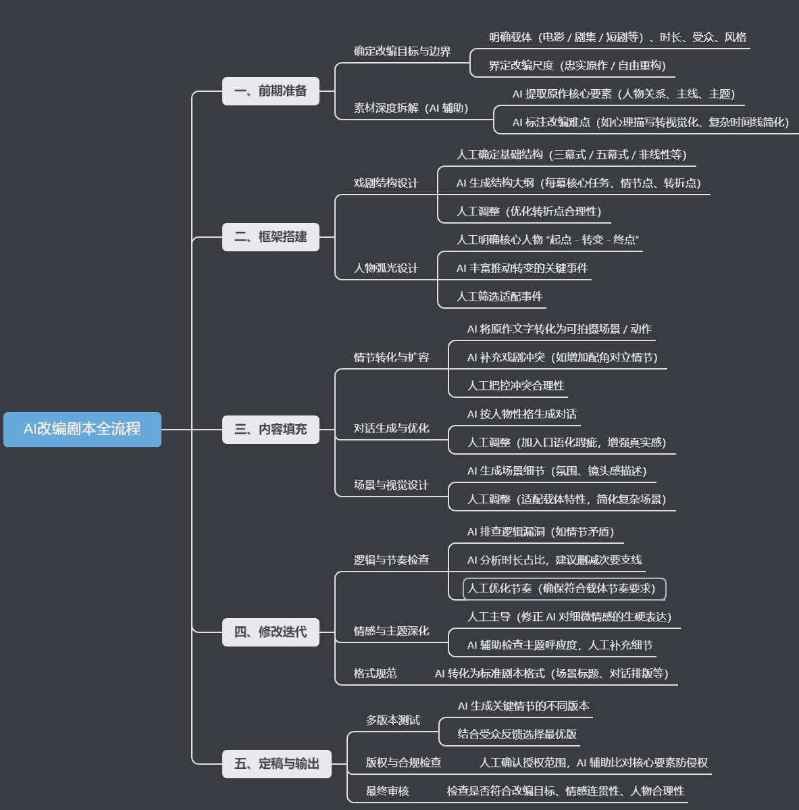
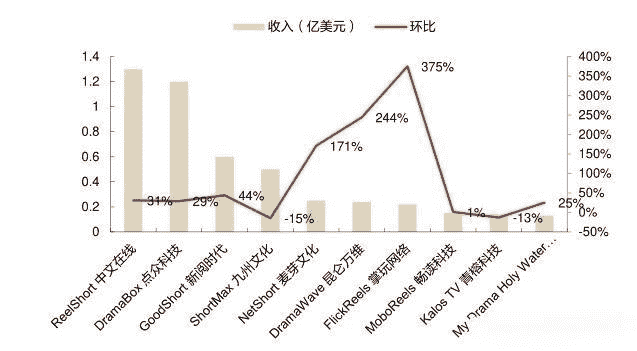
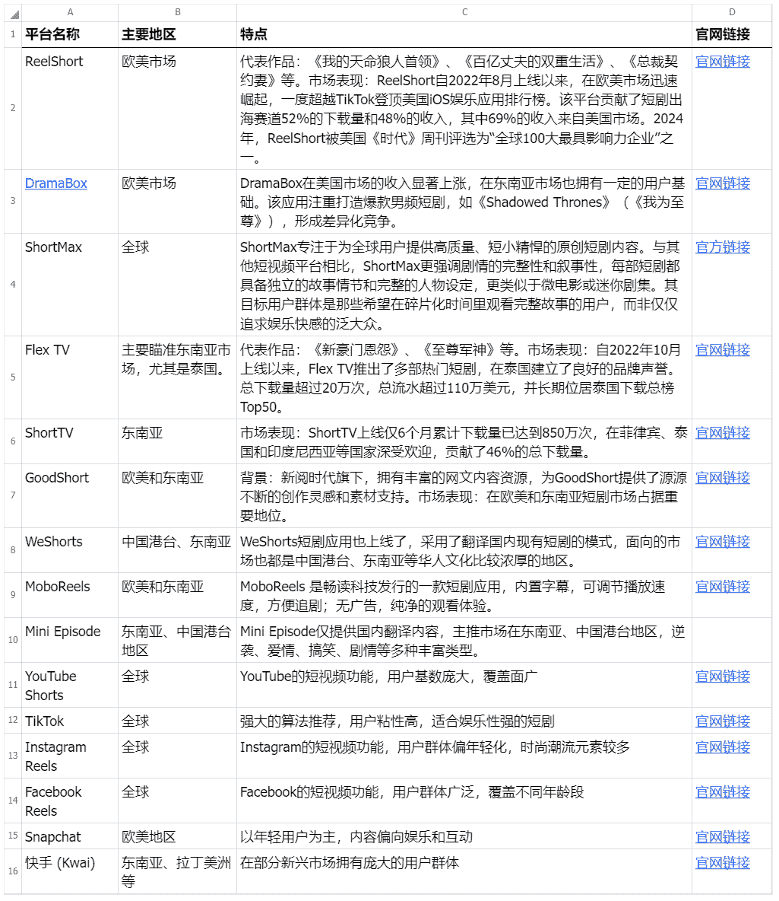

# 短剧出海赚美金！改编剧本单集$1000(附渠道)

> 来源：[https://rq547mr4oez.feishu.cn/docx/UcJddiHdIoNu5LxYLRwcGkSMn4e](https://rq547mr4oez.feishu.cn/docx/UcJddiHdIoNu5LxYLRwcGkSMn4e)

## 🚀 为什么现在是短剧出海最佳时机？

1.  **需求爆炸：**ReelShort、Drama Box 等平台单剧播放量破亿，单月分成超 87 万美元的案例。

1.  **收益高：** 头部平台如 ReelShort（分成 65%）、Drama Box（分成 70%）、FlexTV（中东市场覆盖率 60%）等，单集播放量破千万即可轻松月入过万美金。

1.  **竞争小：** 相较国内白热化竞争，海外市场剧本相比国内是1年前的样板（有参考答案），赚钱更容易！

## 🧠 AI 改编剧本全流程，5步搞定爆款！PS：详细流程见知识库

#### **一、前期准备**

1.  **确定改编目标**

+   明确改编载体、时长、受众（如青少年向 vs 成人向）、核心风格（霸总/悬疑/狼人/爽文等)

+   明确尺度：是忠实原作（新手推荐），还是自由重构（如仅用原作核心设定），避免后期偏离方向

1.  素材深度拆解（AI 辅助提取关键信息）

+   用 AI 提取核心要素：输入 “分析《边城》的人物关系、主线剧情、核心主题”，AI 可生成结构化总结，避免遗漏关键信息。

+   标注改编难点：如小说中大量心理描写（需转化为视觉化表达）、复杂时间线（需简化为线性叙事），让 AI 列出 “需重点处理的问题”。

>

#### 二、框架搭建

1.  框架结构设计

+   人工确定基础结构（如三幕式、五幕式、非线性叙事），结合载体特性（如短剧更依赖强钩子 + 密集反转）。

+   让 AI 生成结构大纲：输入 “基于《XXX》（原作），改编为 90 分钟悬疑电影，用三幕式结构，列出每幕核心任务、关键情节点、转折点”，AI 会生成初步框架（如 “第一幕：铺垫背景，触发事件（主角发现父亲死因可疑）；第二幕：调查深入，遭遇阻碍（被反派威胁）；第三幕：真相揭露，最终对决”）。

+   人工调整：优化转折点的合理性（如 AI 可能设置过于突兀的反转，需简化或铺垫）。

1.  人物弧光设计

+   基于原作人物，人工明确核心人物的 “起点 - 转变 - 终点”（如懦弱的主角→勇敢对抗反派）。

+   用 AI 丰富细节：输入 “主角李华，30 岁，性格内向，因母亲去世被迫回乡，需设计 3 个关键事件推动他从逃避到面对”，AI 可能生成 “事件 1：发现母亲日记中的秘密；事件 2：被村民误解时选择解释；事件 3：独自对抗破坏家乡的开发商”，人工筛选适配的事件。

### 三、内容填充

1.  情节转化与扩容

+   针对原作情节：AI 将文字描述转化为 “可拍摄的动作 / 场景”。例如小说中 “主角愤怒”，AI可生成 “主角攥紧拳头，指甲嵌进掌心，猛地将桌上的水杯扫到地上，玻璃碎片溅到脚边（特写）”。

+   补充原作缺失的戏剧冲突：若原作节奏平缓，人工提出 “增加配角与主角的对立”，AI生成具体情节（如 “配角暗中泄露主角的调查进度给反派”）。

1.  对话生成与优化

+   让 AI 模仿人物性格写对话：输入 “角色 A（暴躁的退休警察）对角色 B（年轻记者）说‘别多管闲事’，语气要带不屑和警告”，AI 可能生成 “小子，这水太深，你那点能耐不够呛的，趁早滚回城里写你的八卦去 —— 少在这儿碍眼。”

+   人工调整：避免 AI 对话 “过于工整”，加入口语化瑕疵（如重复、停顿），增强真实感（如 “你… 你别乱来… 我已经报警了” 比 “你不要乱来，我已报警” 更符合紧张情境）。

1.  场景与视觉设计

+   AI 辅助场景细节：输入 “场景：暴雨夜的废弃医院走廊，主角寻找线索”，AI 生成 “走廊灯忽明忽暗（电流声），积水倒映着主角的影子，远处传来拖把拖地的‘吱呀’声（镜头从主角脚边积水摇到尽头的黑影）”。

+   人工把控 “镜头感”：根据载体（如电影侧重宏大场景，短剧侧重近景特写）调整，避免 AI 生成过于复杂、难以拍摄的场景。

>

### 四、初稿生成

1.  逻辑与节奏检查

+   AI 排查漏洞：输入 “检查第二幕是否有逻辑矛盾（如主角明明被监视，却能顺利拿到证据）”，AI 可能指出 “需补充‘主角利用监控死角’的铺垫”。

+   节奏优化：让 AI 分析 “每幕时长占比”（如短剧第一幕建议 25-30 分钟），若某部分过长，AI 可建议删减次要支线（如 “删除主角与邻居的日常对话，保留与主线相关的冲突”）。

1.  情感与主题深化

+   人工主导：AI 难以精准把握 “细微情感”（如角色的愧疚、隐忍），需手动修改台词或动作（如将 AI 生成的 “主角哭了” 改为 “主角别过脸，喉结滚动，袖口蹭了下眼角”，更含蓄有张力）。

+   主题呼应：确保情节围绕核心主题（如 “救赎”），让 AI 检查 “关键场景是否体现主题”，若缺失，人工补充细节（如主角在结局时的一个小动作 —— 放下复仇的刀，捡起象征希望的信物）。

1.  格式规范

+   AI 转化为标准剧本格式：将内容自动调整为行业格式（场景标题需注明 “内 / 外”“时间”，对话需左对齐，动作描写需简洁等），避免格式错误影响投递。

>

### 五、定稿与输出：

1.  多版本测试

+   用 AI 生成关键情节的不同版本：如 “主角发现真相的场景，生成 2 个版本（A：突然看到证据；B：通过对话暗示后顿悟）”，结合受众反馈（如测试观众更喜欢 “对话暗示” 的悬疑感）选择最优版。

1.  版权与合规检查

+   人工确认：确保改编未偏离原作授权范围（如不可擅自更改核心设定），AI 可辅助比对原作与剧本的核心要素，避免侵权风险。

1.  最终审核

+   通读剧本，检查是否符合 “改编目标”（如短剧需每 5 分钟一个钩子）、情感是否连贯、人物行为是否合理，完成定稿。

## 💰16大高分成平台 + 申请入口（附避坑指南）

#### 🌟 北美市场首选，大女主悬疑复仇

1.  ReelShort（中文在线旗下）

+   分成 65%，单剧播放量破亿轻松月入 10 万 +

+   注意：需独家授权，需配英语 / 西语字幕，版权审核严格。

1.  Kalos TV（欧洲高端市场）

+   单集保底 500 欧元，还有欧盟创意基金补贴

+   要求：提交英式剧本大纲。

>

> **用户画像呈现以下特征：**

+   年龄分布：25-44岁用户占比达58%

+   性别比例：女性用户占72%

+   付费习惯：60%用户偏好订阅制，平均订阅时长4.2个月

+   内容偏好：豪门商战、超自然题材(吸血鬼、狼人)、悬疑复仇类内容最受欢迎

#### 🌟 中东土豪最爱：高ARPU的特需市场

1.  Drama Box（Crazy Maple Studio）

+   CPM（千次播放收益）高达 28 美元，分成 70%

+   平台提供免费阿拉伯语配音工具，适合 “逆袭”“虐恋” 题材。

+   注意：女性角色着装需符合伊斯兰规范，强制加平台片头。

1.  FlexTV（欢聚时代 YY）

+   中东市场覆盖率超 60%，斋月期间流量翻倍

+   分成 58%，支持沙特货币直接结算。

>

> **该地区特点包括：**

+   文化审查严格：需避免酒精、暴露着装等敏感内容

+   偏好题材：豪门恩怨、沙漠传奇、家族荣誉等

+   用户习惯：斋月期间使用时长增长40%

#### 🌟 东南亚：高速增长，亚太文化圈，改编难度小

1.  Sereal+（东南亚黑马）

+   日本市场用户付费能力（ARPU）达 9.7 美元，分成 60%

+   独家宗教合规检测工具，避免印尼等国的文化雷区。

1.  DreameShort（阅文集团合作）

+   可直接改编阅文小说库 IP，额外获得 IP 改编奖金

+   东南亚女性用户占比 85%，适合 “甜宠”“重生” 题材。

>

> **该地区市场特点包括：**

+   用户基数大：总用户数突破4000万

+   增长速度快：同比增速达220%

+   变现方式：以广告变现为主(占比65%)，付费习惯正在培养

+   内容偏好：当地用户对"狗血"剧情的接受度极高，虐恋、复仇等强情绪内容往往能引发病毒式传播。一个典型案例是某平台推出的《My Husband's Secret》

> 投稿渠道：

> •        DramaBox：由点众科技推出，覆盖全球200多个国家和地区，月活用户达3000万。收日本市场短剧剧本，投稿需提供大纲、人物小传和一卡正文（国内剧本格式即可），收稿邮箱为2517895820@qq.com。

> 

> •        Future Magic：一家影娱内容出海专业团队，长期征集海外短剧剧本。语言中文或英文均可，格式为Word或Pdf，投递邮箱为zhuwenjing@kukancc.com，命名格式为【海外短剧投稿】姓名-类型-电话，必附材料为故事大纲、人物小传和前10集剧本。

> 

> •        snackshort：海外创意短视频平台，征集豪门总裁、狼人、吸血鬼等女频剧本，要求中英双语剧本，每集1-2分钟，共80集。邮件附件需包括剧情大纲、重要人物小传和剧本前3-5集（标注paywall），邮件标题为剧本名+姓名+联系方式，投稿链接为https://www.xiaohongshu.com/discovery/item/65fa7a89000000001203d6c2。

> 

> •        国际数字影像产业园：国内首个聚焦海外短剧制作与发行的产业聚合平台，与YouTube Shorts、TikTok、ReelShort等30余家海外平台建立合作，提供精准渠道分发，网址为https://blog.csdn.net/cdsmjt/article/details/148846505。

> 

> •        WriteMovies：专门接收剧本的平台，每年举办国际剧本比赛，并提供将剧本推荐给电影、电视剧制片方的机会，网址为https://www.writemovies.com。

> 

> •        Boomerang：专门为喜剧剧本而设的平台，接收搞笑、讽刺、喜剧等类型的短剧本，并提供将剧本推荐给电视网和线上平台的机会，网址为https://boomerang.com。