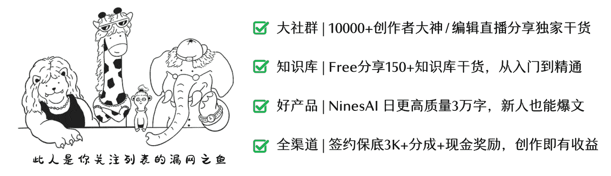
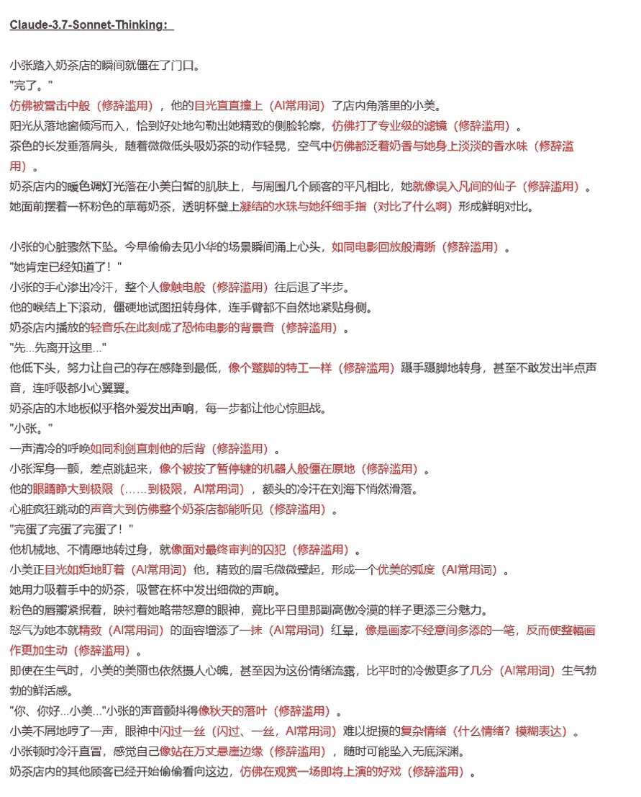
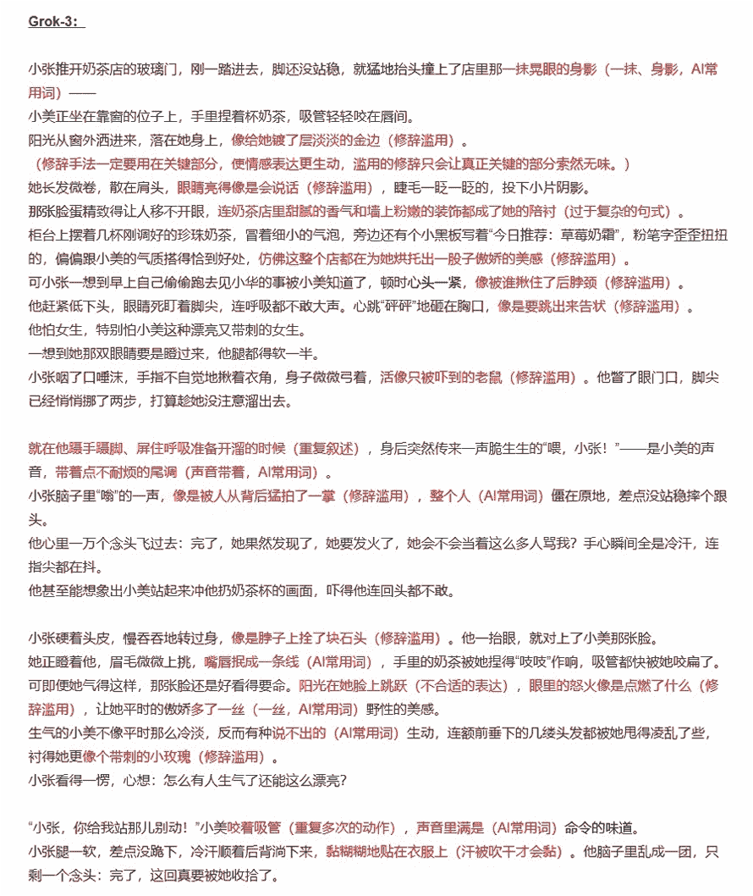
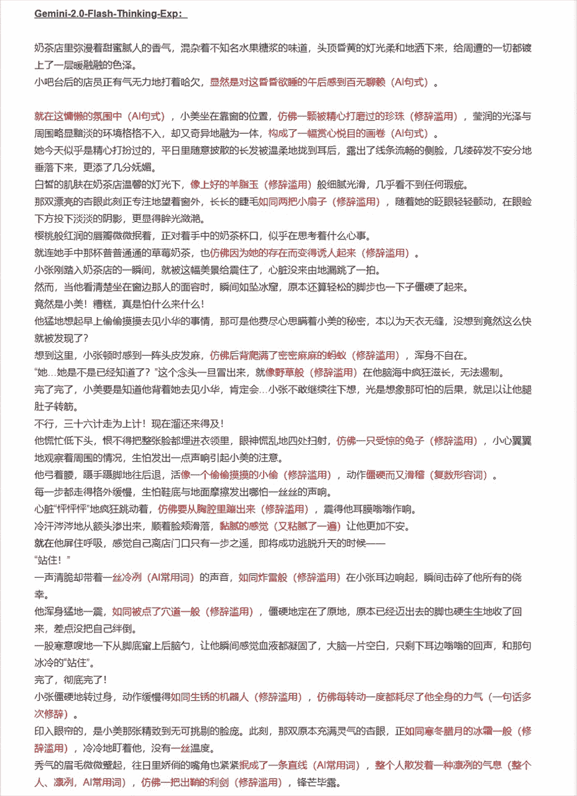

# Nines写作宝典-【新手必看】编辑到底怎么看AI味？

> 来源：[https://rq547mr4oez.feishu.cn/docx/X7ygd6ab4oL1UGxlRhIcLC9un1e](https://rq547mr4oez.feishu.cn/docx/X7ygd6ab4oL1UGxlRhIcLC9un1e)

## 一、前言

> 最近有个新入行的【编辑】小伙伴~再问老编辑，怎么看AI味~~

> 后面我跟她沟通过后，除了使用工具（如朱雀），都是自己总结！

>

> **他们看AI文的一些套路，分享给大家~**~让大家自己看文的时候知道怎么手动修稿！

> **总结起来就是：**

1.  **修辞滥用：** “像...一样”的比喻句， “仿佛...”的虚拟句

1.  **常用词重复：**比如“一丝”、“直直的”、“闪过”等

1.  **缺乏个性情感:** 比较平淡，缺乏人类的情感色彩和个性表达。可能会重复使用某些词汇或句式，或者绕圈子说一些无关紧要的话，让人感觉空洞无物，没有抓住重点

1.  **行文过于流畅:** 通常语法正确、逻辑清晰，甚至有些过于完美。例如频繁使用某些连接词、套用固定的句式结构等。

1.  **情节设计老套**：都是一些常见的场景，不够癫、不够炸裂！

**PS：NineS AI【****AI知识库+AI**产品+投稿渠道+干货交流=全链路】的创作者社群~

## 二、编辑怎么看出来的？-部分示例（社群小伙伴提供）

PS：当然AI还有其他更多的方式，但是核心还是围绕上述的5大方面！

