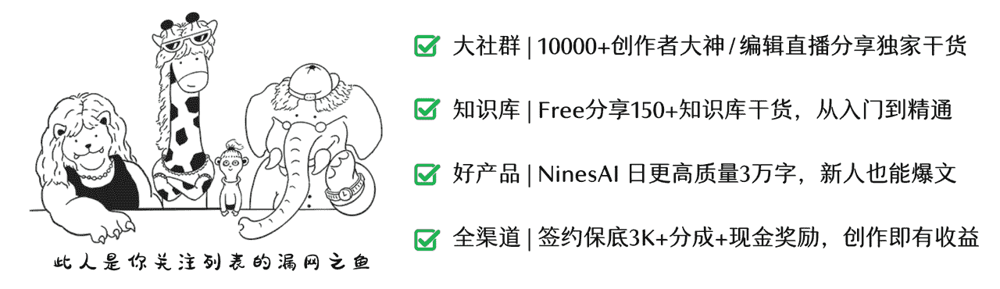

# Nines写作宝典-【情节卡】常用20类“爽”点详解

> 来源：[https://rq547mr4oez.feishu.cn/docx/PJeGdP64Qo4b0fxqix0cUgpsnTc](https://rq547mr4oez.feishu.cn/docx/PJeGdP64Qo4b0fxqix0cUgpsnTc)

## 一、前言

> 宝子们！是不是每次打开文档就大脑空白❓

> **拆书少、没灵感，写两句就卡壳❓**

> **别**慌！！！熬夜整理基于咱们一直说的【核心情绪】，将爽/虐/甜/猜/燃/恐等一些的常用【情节卡】梳理~~让你写作中灵感无限~~~

>

1.  [Nines写作宝典-【情节卡】常用20条“虐”点详解](https://rq547mr4oez.feishu.cn/wiki/Eb4hwXBz5i5HF6k0i05cAHFgnag?from=from_copylink)

1.  [Nines写作宝典-【情节卡】常用20条“爽”点详解](https://rq547mr4oez.feishu.cn/wiki/W72sw7xAuigBxlkHHUOc7lr7nZd?from=from_copylink)**（第二弹）**

1.  [Nines写作宝典-【情节卡】常用20条“甜”点详解](https://rq547mr4oez.feishu.cn/wiki/BeJ9wLWheigfTQkgpvrcUFounKb?from=from_copylink)

1.  [Nines写作宝典-【情节卡】常用20条“悬”点详解](https://rq547mr4oez.feishu.cn/wiki/IcLawXudliIJu7kzMJ4c8cjxnfD?from=from_copylink)

1.  [Nines写作宝典-【情节卡】常用50种情绪链](https://rq547mr4oez.feishu.cn/wiki/ZZshwplvCiMdOukyYTscCIrenLf?from=from_copylink)

>

> **掌握这些【情节卡】你也能做到：****👇**

✅ 下笔如开外挂，再也不怕灵感枯竭

✅ 篇篇戳中情绪爽点，轻松收割读者

✅ 流量密码拿捏住，下一个爆款小说就是你！

**PS：NineS AI【****AI知识库+AI**产品+投稿渠道+干货交流=全链路】的创作者社群~

## 二、内容

#### **身份逆转**

> 公式：废柴人设+隐藏底牌+认知颠覆

> 例：《赘婿》宁毅以赘婿身份入局，后显现代商人手段

+   **场景：**苏府布行危机，众人轻视上门女婿

+   **冲突：**绸缎庄掌柜刁难"无用赘婿"，要求三日内解决库存

+   **情感曲线：**

+   【压抑】宁毅被讽"吃软饭"，深夜在账本画现代营销图

+   【伏笔】现代商业知识梳理，暗通漕帮拓宽商路

+   【爆发】推出"买布送胭脂"活动，三日倾销千匹绸缎，掌柜跪地道歉

+   对比：与"实力碾压"依赖武力不同，身份逆转通过思维降维和社会角色颠覆制造爽感，更易引发对阶层逆袭的共情

#### 身份嫁接

> 公式：跨界身份+认知错位+价值颠覆

> 例：《大奉打更人》许七安以现代警察思维破解修仙界谜案

+   **场景：**吏部衙门，修仙者皱眉："凡人也敢查仙人命案？"

+   **冲突：**仵作报告被甩在脸上："这点尸检水平还敢当捕快？"

+   **情感曲线：  **

+   【轻蔑】御史甩袖："让这小子滚去扫茅房"

+   【伏笔】许七安悄悄戴上橡胶手套，掏出指纹采集粉

+   【爆发】通过血迹喷溅角度锁定真凶，用"不在场证明"理论让渡劫期老怪当场认罪，刑部尚书跪地求收徒

+   对比：将现代职业技能嫁接到玄幻世界，通过"跨维度知识碾压"制造爽感，满足对"现代思维吊打古代规则"的YY，常见"警察/医生/律师"等职业金手指

#### 实力碾压

> 公式：越阶战斗+绝对压制+视觉冲击

> 例：《斗罗大陆》唐三越级吸收万年魂环，蓝银皇领域震慑全场

+   **场景：**落日森林魂兽暴动，魂圣强者束手无策

+   **冲突：**万年曼陀罗蛇暴走，魂师团队伤亡过半

+   **情感曲线：**

+   【紧张】奥斯卡重伤倒地，唐三魂力透支至临界点

+   【伏笔】唐门玄玉手掐诀，紫极魔瞳锁定魂兽弱点

+   【爆发】蓝银皇突变异变成金色，万年魂环强行吸收，魂兽当场石化

+   对比：区别于"策略智取"，实力碾压靠数值鸿沟和视觉化战斗描写直接刺激肾上腺，满足对"绝对力量"的幻想

#### 信息差碾压

> 公式：信息垄断 + 预判布局 + 降维打击

> 例：《赘婿》宁毅在杭州商战中预判苏檀儿对手的陷阱

+   **场景：**苏氏布行新品发布会，竞争对手联合商会施压要求降价

+   **冲突：**苏檀儿被指责 “妇人之仁不懂商道”，会场舆论一边倒

+   **情感曲线：**

+   【压抑】苏檀儿攥紧账本，指节发白却无人支持

+   【伏笔】宁毅提前收购江南半数生丝，暗地联络漕帮封锁水路

+   【爆发】对手突然发现生丝断供，宁毅亮出 “岁布” 朝廷订单，商会会长当场失态

+   对比：力量碾压依赖数值差距，而信息差碾压通过 “我看透你却一无所知” 的智力博弈，实现更长效的爽感回甘

#### **扮猪吃虎**

> 公式：伪装示弱+反差爆发+围观震撼

> 例：《全职高手》叶修用"君莫笑"小号在新区吊打职业选手

+   **场景：**第十区竞技场，"新手"君莫笑挑战全明星选手

+   **冲突：**职业圈嘲讽"退役选手炒冷饭"，世界频道刷满"辣鸡"弹幕

+   **情感曲线：**

+   【隐忍】故意露出"错误连招"，对手放松警惕

+   【伏笔】千机伞切换战斗形态，银武流光一闪而过

+   【爆发】一套龙抬头连招带走对手，世界频道瞬间静音，职业战队私聊窗口爆炸

+   对比：比普通逆袭多了"主动伪装-诱导轻敌-打脸啪啪"的三层反转，通过"扮弱-打脸"的节奏控制，将爽感周期拉长至数章，持续调动期待值

#### **奇遇开挂**

> 公式：逆天金手指+机缘收割+成长加速

> 例：《凡人修仙传》韩立偶得掌天瓶，加速灵草培育突破瓶颈

+   **场景：**七玄门后山，韩立误触发光小瓶

+   **冲突：**底层杂役面临门派考核淘汰，灵根资质平庸

+   **情感曲线：**

+   【绝望】深夜偷练长春功，经脉刺痛几乎晕厥

+   【转折】掌天瓶灌溉灵草瞬间成熟，意外发现加速修炼秘密

+   【爆发】三个月突破三层炼气期，考核时徒手捏碎中品法器，长老惊掉胡子

+   对比：与"努力成长"不同，奇遇开挂依赖"非对称资源获取"（如系统、神器），满足对"捷径成功"的潜意识渴望，金手指设定需兼顾独特性与合理性

#### 反杀打脸

> 公式：反派挑衅+伏笔埋设+瞬间逆转

> 例：《斗破苍穹》萧炎三年之约，佛怒火莲炸碎纳兰嫣然佩剑

+   **场景：**云岚宗广场，万人见证"废柴"与天才的赌约

+   **冲突：**纳兰嫣然持地级宝剑"岚月"，放言"跪下认错可饶你一命"

+   **情感曲线：**

+   【屈辱】萧战低头攥紧拐杖，萧炎嘴角溢血仍挺直腰板

+   【伏笔】药老暗中输送异火能量，戒指纹路闪烁红光

+   【爆发】青莲地心火与骨灵冷火融合，紫色火莲瞬间吞没宝剑，云岚宗护山大阵龟裂

+   对比：核心在"反派装逼程度与打脸力度成正比"，通过前期反派的傲慢铺垫（如退婚、家族嘲讽），让爆发时的"反差冲击"形成情绪核弹，常见"十倍奉还"式爽感

#### 轻松解压

> 公式：反差萌 + 无厘头恶搞 + 情绪释放

> 例：《大王饶命》吕树用 “毒鸡汤” 怼穿校园霸凌者

+   **场景：**校霸堵截勒索，要求吕树 “识相点”

+   **冲突：**对方五大三粗拎着棒球棍，吕树瘦小身板抱着练习册

+   **情感曲线：**

+   【压抑】练习册内页被汗水洇湿，指腹掐进掌心

+   【伏笔】口袋里装着昨夜捡废品攒的钢镚，突然想起系统奖励的 “嘴炮技能”

+   【爆发】“你这样的废物，连我捡瓶子赚的钱零头都没有 —— 毕竟废品还能卖钱呢”，校霸当场气到结巴

+   对比：硬核爽感依赖战斗描写，轻松解压爽感通过 “以柔克刚” 的脑洞反转，用笑点替代痛点实现情绪宣泄

#### 反套路爽感

> 公式：常规剧情预判 + 逆向操作 + 智商碾压

> 例：《诡秘之主》克莱恩在 “欺诈之神” 教会陷阱中反设局

+   **场景：**伪装成信徒的克莱恩被要求喝下 “虔诚信仰之血”（实则毒药）

+   **冲突：**祭坛周围二十名神职者合围，毒药生效倒计时 10 秒

+   **情感曲线：**

+   【压抑】指尖划过袖中匕首，发现退路已被封锁

+   【伏笔】提前在鞋底刻下 “假死” 魔纹，喝血时悄悄咬破藏毒牙（装死专用）

+   【爆发】倒地后突然睁眼抓住主教脚踝，“您刚才说的‘神选者’，是指我这样的吗？”，教会成员集体瞳孔地震

+   对比：传统套路依赖 “主角光环硬接”，反套路爽感通过 “敌人算到第一层，我早已在第五层” 的多层博弈，满足年轻用户对 “智商在线” 的核心诉求

#### 平凡英雄

> 公式：市井小人物 + 危机时刻 + 逆袭担当

> 例：《朝阳警事》社区民警张景山徒手制服持刀歹徒

+   **场景：**老小区便利店突发抢劫，歹徒挥舞匕首威胁人质

+   **冲突：**围观群众退缩，保安躲在货架后颤抖，警察支援 3 分钟抵达

+   **情感曲线：**

+   【压抑】张景山攥紧对讲机，发现自己是现场唯一穿制服的人

+   【伏笔】镜头闪过他日常巡逻时记住的便利店逃生路线图

+   【爆发】假装摔倒撞翻货架阻挡歹徒视线，反手用警用腰带锁喉制服，全程 17 秒

+   对比：超级英雄依赖超能力设定，平凡英雄爽感源于 “普通人也能成为光” 的真实共鸣，危机越贴近生活，爽感越具感染力

#### 势力掌控

> 公式：收服强者+团队养成+势力扩张

> 例：《雪中悍刀行》徐凤年组建北凉铁骑，白衣案旧部纷纷来投

+   **场景：**凉州城校场，老卒质疑"纨绔世子"能否治军

+   **冲突：**徐骁旧将暗中观察，徐凤年首次点兵遭将领刁难

+   **情感曲线：**

+   【质疑】老骑兵摔酒碗："徐某在时，可没见过这般细皮嫩肉的将军"

+   【伏笔】深夜独自擦拭北凉刀，默背三千铁浮屠姓名

+   【爆发】点兵时精准叫出每个老兵籍贯，旧将李翰林当场下跪，三十万铁骑齐呼"北凉徐凤年"

+   对比：区别于个人英雄主义，势力掌控侧重"从孤狼到领袖"的蜕变，通过团队忠诚（如手下以死相护）和势力崛起（如从家族到帝国），满足对"权力构建"的爽感

#### **智斗布局**

> 公式：信息差利用+长线伏笔+全局掌控

> 例：《赘婿》宁毅设局让乌启豪囤积生丝，最终血本无归

+   **场景：**杭州生丝市场，乌启豪高调收购，众人跟风

+   **冲突：**宁毅表面劝阻苏檀儿，暗中联络江南各大织户

+   **情感曲线：**

+   【焦虑】苏府账房报"生丝价格暴涨三倍"，檀儿急得落泪

+   【埋线】密信送往金陵，林缚船队正在海上运输免税生丝

+   【收网】新丝船抵港，价格暴跌七成，乌家当铺被挤兑，宁毅在茶楼品茗看报

+   对比：区别于武力爽感，智斗布局依赖"策略碾压"和"伏笔回收"，通过主角的"上帝视角"布局（如经济学原理、人心算计），满足对"智力优越感"的需求，爽感来自"一切尽在掌握"的掌控欲

#### **危机反哺**

> 公式：绝境求生+因祸得福+实力突破

> 例：《诡秘之主》克莱恩在"风暴之海"沉船，意外获得"歌颂之诗"魔药

+   **场景：**幽灵船甲板，水手被海妖撕成碎片，克莱恩坠入深海

+   **冲突：**序列9"占卜家"面对序列6海妖，毫无还手之力

+   **情感曲线：**

+   【窒息】海水倒灌进肺，魔药配方在脑海中疯狂闪烁

+   【转折】源堡虚影浮现，海妖血液被神秘力量净化

+   【爆发】苏醒后魔药自动融合，占卜能力突破至序列8，海妖核心晶核在掌心化作星尘

+   对比：核心是"危险即机遇"的闭环设计，通过生死边缘的"强制进化"，让主角的成长充满宿命感，同时满足对"绝境逆袭"的刺激需求

#### 宝物运用

> 公式：变废为宝+资源垄断+价值颠覆

> 例：《大道争锋》张衍将普通木剑祭炼成绝仙剑，震惊修真界

+   **场景：**论道大会，各大门派展示镇派之宝

+   **冲突**：散修张衍持无名木剑上台，遭正道魁首嘲笑"拿砍柴刀充数"

+   **情感曲线：**

+   【轻视】掌门甩袖："我观此剑，连凡铁都算不上"

+   【伏笔】木剑纹路暗合天道法则，张衍指尖血珠融入剑柄

+   【爆发】木剑划破虚空，显化出三千剑道虚影，所有法宝当场失灵，论道台石砖寸寸龟裂

+   对比：区别于"直接获得神器"，宝物运用强调主角的"改造能力"（如化腐朽为神奇），通过"他人眼中的废物→主角手中的至宝"的反差，强化"伯乐式"爽感

#### **隐藏大佬**

> **公**式：身份伪装+血脉压制+绝对臣服

> 例：【魔教围攻+噬魂剑认主+护剑宗】面具碎裂现神纹，魔剑高呼"恭迎剑主"

+   **场景**：魔教围攻正道山门

+   **冲突**：魔尊轻视女主挡路

+   **情感曲线**：

+   【轻视】"让开，你挡着本尊杀人了"

+   【显威】硬接杀招面具碎裂

+   【认主】噬魂剑颤抖认主

+   【传说】魔教改名"护剑宗"

#### **专业吊打**

> **公**式：技术羞辱+跨维炫技+行业重塑

> 例：【调香大赛+凝香成凤+评委鼻癌】徒手抓三千香气凝实体金凤

+   **场景**：国际调香决赛现场

+   **冲突**：评委摔碎作品辱骂"垃圾"

+   **情感曲线**：

+   【羞辱】"这种垃圾也配参赛？"

+   【炫技】熔炼碎片徒手凝香

+   【碾压】金凤现世评委失嗅

+   【彩蛋】三月后评委自曝患鼻癌

#### **情感逆袭**

> 公式：情感忽视+反差示好+关系颠覆

> 例：《嫡女重生记》前世被庶妹陷害的女主，今生让皇子当众求婚

+   场景：中秋宴，庶妹故意打翻女主羹汤，众人偷笑

+   冲突：前世此时女主被父亲斥责"不懂规矩"，今生却收到意外礼物

+   情感曲线：

+   【压抑】袖中指甲掐入掌心，面上仍保持浅笑

+   【伏笔】暗处皇子观察月余，命人准备九鸾金钗

+   【爆发】宴后皇子携圣旨而来，金钗落地时所有贵女屏息，庶妹当场晕倒

+   对比：侧重情感关系中的地位反转（如从被轻视到被争抢），通过"打脸对象为曾经的加害者"（如亲人、恋人），让爽感更具针对性，常见"前世遗憾今生补"的剧情设计

#### 规则颠覆

> 公式：打破设定+自创体系+世界震撼

> 例：《大道争锋》张衍开创"心剑之道"，无视境界限制越级杀敌

+   场景：九嶷山论道，各脉长老嗤笑："无灵根也敢谈剑道？"

+   冲突：守山长老催动护山大阵："滚下山去，莫污了圣地"

+   情感曲线：

+   【嘲讽】弟子们指着张衍的素衣："瞧，又是个妄想自创功法的疯子"

+   【破局】指尖凌空一画，心象世界显化出万丈剑影

+   【爆发】护山大阵六十四个阵眼同时爆裂，所有长老的本命法宝不受控制地飞向张衍，圣地石碑当场崩裂出"心剑至尊"四字

+   对比：核心是"颠覆世界规则"的创造力爽感，通过主角自创体系（如无灵根修仙、非魔法职业吊打魔法师），满足对"打破常规"的终极幻想

#### **群体膜拜**

> 公式：声望积累+信仰凝聚+集体臣服

> 例：《雪中悍刀行》徐凤年拒当太子，三十万北凉军集体上表请命

+   场景：太安城午门，群臣看着如山的表章颤抖

+   冲突：皇帝拍案："逆子竟敢抗旨？"，却见表章上每个将军都按了血手印

+   情感曲线：

+   【对峙】徐凤年负手站在城墙上，北凉军旗在身后猎猎作响

+   【伏笔】暗中递给老将军的密信，开头写着"免跪"二字

+   【爆发】第一位老卒跪下："请世子登位！"，三十万铁骑同时抱拳，声浪震落午门铜钉，皇帝面色惨白地瘫在龙椅上

+   对比：将个人威望升华为群体信仰，通过"军队/宗门/国家"级别的集体臣服，满足对"领袖魅力"和"万人拥戴"的巅峰爽感，常见"黄袍加身""全服跪拜"等剧情

#### **反权威碾压**

> 公式：底层挑战+权威崩塌+群体爽感

> 例：《诡秘之主》克莱恩在廷根教堂，用"愚者"权柄让大主教下跪

+   场景：忏悔室，大主教冷笑："异端也敢来祷告？"

+   冲突：圣徽光芒笼罩克莱恩，试图强行净化

+   情感曲线：

+   【压迫】圣光灼痛肩膀，耳中响起七神颂歌

+   【反转】指尖在胸前画出逆五芒星，背后浮现源堡虚影

+   【爆发】大主教的圣徽当场碎裂，在信徒注视下磕头至血流满面："宽恕您的仆人吧，愚者先生"

+   对比：核心是"挑战并颠覆权威"的群体爽感，尤其针对宗教、皇权等传统权威，通过权威的崩塌满足对"打破等级制度"的潜意识渴望

#### **危机顿悟**

> 公式：生死绝境+规则突破+境界跃升

> 例：《斗破苍穹》萧炎在陨落心炎焚天练体，强行突破斗王瓶颈

+   **场景：**焚天炼气塔底层，萧炎被异火灼穿三条经脉

+   **冲突：**药老急呼："再撑下去必死！"，骨灵冷火即将失控

+   **情感曲线： **

+   【剧痛】指甲抠入岩墙，体表浮现黑色灼痕

+   【顿悟】突然想起陀舍古帝玉纹路，异火在丹田摆出相同阵型

+   【爆发】体表火焰骤变金色，斗王强者专属的斗气铠甲凭空凝结，炼气塔塔身出现蛛网般的裂纹

+   对比：区别于常规升级，强调"置之死地而后生"的顿悟式突破，通过生理痛苦与规则顿悟的双重刺激，让爽感充满"涅槃重生"的仪式感

#### **资源垄断**

> 公式：变废为宝+稀缺控制+价值碾压

> 例：《诡秘之主》克莱恩垄断"亵渎之牌"绘制，成为非凡者黑市庄家

+   **场景：**贝克兰德暗巷，非凡者竞价"命运之轮"卡牌

+   **冲突：**某议员冷笑："一张破纸也敢开价千镑？"

+   **情感曲线：  **

+   【轻视】烛火映出卡牌上模糊的命运符号，众人交头接耳

+   【伏笔】克莱恩指尖划过隐秘符号，卡牌突然浮现金色边框

+   【爆发】当晩三大教会特使齐聚小屋，愿以"半神材料"交换独家绘制权，议员跪在巷口等到天亮

+   **对比：**区别于单纯获得宝物，强调主角对稀缺资源的"创造与掌控"，通过市场垄断和价格颠覆，满足对"资源支配权"的深层欲望