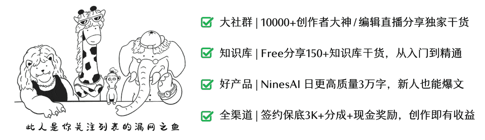

# Nines写作宝典-【写作素材】10大类350+爽点情节

> 来源：[https://rq547mr4oez.feishu.cn/docx/CxDGdBremoLYXLxx4A7c4qprnRC](https://rq547mr4oez.feishu.cn/docx/CxDGdBremoLYXLxx4A7c4qprnRC)

## 一、前言

<https://rq547mr4oez.feishu.cn/sync/VSI3dWa8CsqNjhbP36EcrWx4nsb>

**PS：Nines【写作知识库+AI产品+投稿渠道+干货交流=全链路】的创作者社群~**



## 二、干货内容

### 身份揭露与反转10

```
在别人眼里都是尊敬，忌怕羡慕的强人，在主角面前，却对主角毕恭毕敬。
幕后大佬，培养出一群大人物，别人却不知道，而嘲笑他。
隐藏身份，别人不知道，都当他是小人物，可那些人又期待他可以来。
两重身份，超人般的身份（穷小子陈凡北玄仙尊）
设一个强大的组织，让主角成为组织里的头号通缉犯或是拉拢对象，或是那个组织惧怕的人物。神秘的身份。
主角身边不起眼的人其实不简单。扫地的是大师，算卦的是大神。捡垃圾是是老板。送快递的是首富。
误以为主角是老头或难看，实际是帅哥。
谁都不知道那个势力明面上的掌控者，其实是听命于主角的傀儡。
没有名气的时候（或许只是个扫地的，看图书馆的。）却有很多大的帮派或者人物对他毕恭毕敬。（隐藏身份）可是顶头上司却看不上他。最后出事的时候站出来，遭到上司呵斥，可是对方的敌人却被他吓的慌张撤退。
一个个别人都很尊敬的人物，可是一看到主角的出现就都乖乖的低首，与之前的叱咤风云的高傲大相径庭。可以是一个大地方的小老大，去到一个小地方，却在那里败得心服口服。一直都期待着主角可以出去带领他们。而后主角来到他们门派，刚好在收人，却被他们的手下当成是拜师门的新人没好气的对待。
```

### 实力碾压与战斗爽点10

```
说自己的武功有多厉害要把别人打成残废，结果却在那做热身运动。
对战的时候主角只是拿了一把破刀子，而对手拿的却是一把削铁如泥的宝刀。大家都以为主角会败，不成想那刀却被主角给搞断了。一把厉害的刀厉害的不在与它本身，而在于使用它的人。
同级无敌越阶不败，主角就是牛逼，反派就是弱鸡。
主角关键时候总能反败为胜，并且屡试不爽。主角总是能创造奇迹，反派再厉害还是敌不过主角的最后一击。
被人打死之后，别人都以为他已经死了，没想到他却再一次复活了过来，全体巨震，士气打到巅峰。
快到连电子摄像头拍摄下来都需要用超高的速度才可以破解，而在外人看来他的出手只是动都没动。
用对方最得意的技能、装备、技巧轰杀对方
配角表现出强大的实力，然后主角的强大远远胜过其无数倍
虐高手，就是总在一个游戏厅无敌，很无聊了，去别的游戏厅挑场子，把他们的第一高手干掉，别的高手也有小弟，那些小弟们在你挑战之前，会怀疑你然后着重描写对方高手的情绪变化，一般来说，你赢了第一局的话，对方小弟会使用卑鄙战术，比如语言轰炸，然后你再赢，一直赢。
主角跟一个比他高很多很多等级的人打架，只为了闯进去救一个兄弟或者是自己的女人。殊不知女主角或兄弟并非被绑架，而是因为那个传说的门派是他们自己的家族。被拉回来当接班人的。（尽管兄弟或女人自己并不想继承家族。只想和主角在一起。）
打到激烈的时候，主角根本不是对手，几乎被人抬抬手就放倒了，放倒后，主角依旧站起来，在被打倒，又站起来，如此反复，周围的人开始哄堂大笑，女人或者是兄弟在暗中看的两眼含泪。到了最后笑声越来越小，当主角第 101 次站起来的时候，四周鸦雀无声，那个打人的人手都有些抖，他对眼前的人执着的信念和顽强的生命力震撼了。
质不行，就以量取胜，人海政策也能堆死你。【对付强敌时】
```

### 情感关系与冲突13

```
误解生情，误会结缘。认错人系列，认错房间，认错地方。认错东西。认错人包括：认错亲戚，认错亲生父母，认错朋友，认错亲生女儿，认错真正帮助自己的人，认错真正爱自己的人。
父母反对两人在一起，甚至全世界反对。两个人相爱，有一堆人排队反对，比如父母，亲戚，朋友，同事，情敌，同学，路人，上司，甚至全世界的人都反对。
医病医出感情，医不好的病主角就是能医，还能医出感情。
救命救出爱情救出婚姻，救人一命，把被救的人的心顺手偷走。救了以后不久就是自己的人。
兄弟情姐妹恩，兄弟齐心，甚至好到互相让女人。姐妹同穿一条裙子，甚至好到互相让男人。
骨肉相残，师徒反目。
亲情爱情之争，姐妹同时爱上男主。兄弟同样爱上女主。姐妹同样爱上一个男人，争得你死我活。兄弟同时爱上一个女人。抢得头破血流。最后谁也没有得到爱的人。（争一个东西，宝物称为名次）
爱人是仇人，是爱人也是仇人。
开始不爱主角的最后还是爱上主角。女主开始不爱男主，男主怎么追都没用。后来男主得神器得高人指点，得奇遇，得以一飞冲天，女主马上爱得死去活来。
和主角抢女人没有好下场，和主角抢女人的反派最后不是身败名裂，就是死不瞑目。往往都不会有好下场。最后的下场就是为女主而死。或者戴真爱牌绿帽。
配角为主角死，爱主角的配角没有好一场。总有配角为自己心爱的主角死，牺牲自己，成全主角或成就主角。
曾救过谁一次，那人很优秀，是别人崇拜的，或是景仰，或是每个男人都想要得到的女人，也因为那一次，所以那人一直都对他念念不忘。后来主角又以一种搞笑，或是巧合下出现。
为了从主角身上得到什么好处，一些大的组织或者是人物，纷纷都让自己手下的美女，或者是儿女去纠缠着主角。儿女却是被逼无奈，撒气到主角身上，最后主角明白了以后，找到了解决办法，让他们不用再被迫和自己在一起，可是那时候他们却爱上了主角。
```

### 资源与能力获取14

```
主角有奇遇，主角随便遇到的不是美女，就是一个大机缘，一场大造化。
主角拥有变废为宝的能力，从别人手中获取破烂再转手变成宝物高价卖出
变废为宝。什么东西到了主角手中价值可以成倍增加，废物到主角手中就可能变成古董神器秘籍宝藏。别人就是不懂怎么用，别人就是不懂宝。在主角手里才是包。才能发挥作用。
劫掠恶人的物品不但可以不劳而获，还能收获好评
主角必定有一个及以上的金手指，有过人的地方。主角天赋异禀，出身不范，师父牛逼，爱的人牛逼，和主角关系不错的人都牛逼，功法逆天，一身神器，牛气冲天。
有一种东西在别人眼里看来危险致命，但主角可以轻松化解
主角在宝贝的帮助下，一定可以越级杀人。这样，至少能够战胜同等级两个以上，这样才能将扮猪吃老虎进行到底。
主角随便制造出来的一些东西，却成为后来最为珍贵的东西，一下子，很多有钱人，有势力的人，都争着抢着要去买。
最烂最没用的东西，到了他手里却全成了宝，或是改成了宝，拿去坑人，或是扭转乾坤改造成真正具有价值的东西。
莫名其妙，偶然得到的小东西，最后却都有大用，或是是别人梦寐以求，救命的东西。
主角拥有变废为宝的能力，从别人手中获取破烂再转手变成宝物高价卖出
获得了一只宠物，本以为是普通的小动物，没想到另有秘密
对别人很珍贵的宝物对主角而言唾手可得
主角手里有一种自己虽然没什么用但可以跟神秘商人换取宝物的物品
```

### 打脸与装逼套路45

```
明明是被主人费尽心思请来的贵宾，但主角却被看门的 / 其他客人为难
被家族人嘲笑，看不起，贬低，冷眼直视，不待见，其后利用身份反打脸（陈凡回家祝寿）　　
关于各个大城市的公子哥，已经家族，详细介绍，怎么怎么强，（还是被打脸）
武道高手，问鼎天下，（最装逼振奋人心，天榜第一，暗榜第三）
出门遇大人物，最好是位高权重的高手老者，而且受伤，主角出现指点迷津，略施小手段震惊他们，成为做上宾，救命大恩人，为接下来的装逼打脸做铺垫（剧情，陈凡救楚老爷子，其后收拾他儿子楚老三）　　
主角的厉害要周围人去评论，周围人吹的越厉害越有效果，另外引起其他高手注意，高手不相信主角那么厉害，以为被神化，然后上前挑战，挑衅，被无情击杀，求饶没用。（剧情太多）
经常和同学去度假村，游玩，然后遇上一些家里很有实力的公子哥，各种吹嘘，最后被无情打脸（马术，游泳池，云千千）
出丑了还说得自己很厉害，还很臭 P 的说只要大家肯用心努力，总有一天会到达他那样的出色，不学无术的家伙，但是却很有钱，别人说唐太宗姓李，他说是姓唐，说别人骗他，痛扁。
小人无赖的行为，敲诈点别人的东西，耍一耍比他聪明的人，爱占小便宜，无所谓别人所说的话，只做自己想做的事，做一些别人看不上眼的事结果出来都让人为之一惊，利用无赖的性格做出一件件常人联想不到的事情（紫川，晚上出去，别人以为是偷情，实则找大商人骗他们同行，为日后做好打算，长远的目光），在战争中创立各种公司，把别人玩得团团转。
在配角赞叹、炫耀某物时，主角突然拿出更好的东西（时空走私之鲍鱼宴）。
用对方最得意的技能、装备、技巧轰杀对方
主角完全无意的举动，因为误会在配角眼里引起无数波澜（例谋国中主角锻炼回来，在侍女的服侍下处理下政务，却让主教看到一个执掌大权、勤于政务、杀伐决断的浪荡子）
从旁人的只眼片语发现对方的缺点
在一堆废话之后，让对方降低期望，突然单刀直入，拿出对方无法拒绝的代价，令其大出血。
对方内部的矛盾，相互争执，表明自己计划的周密，智者出现（时空走私卖给康布斯生物战舰）
对方费尽心力，周密布置，却被主角利用历史知识趁虚而入，捡了全部便宜（1911 攻取上海）
对方前来联络的代表，主动要求投效，还带来人马和物资（街头相遇，招揽来绝好人才）
在压抑之后，突然将肉脚的金主致之绝境（1911 年绑票平汉章），大事敲榨
众人一致评价主角的愚蠢，只有智者才能看出主角的目的
配角在主角的成功面前，疲于奔命，处处失败
敌人在主角面前强硬，用强，辩解，服软
主角开出高价后，双方之间用尽全心的竞争，一方高明的计划，另一方更高明的胜出（1911 年卖上海）
主角的无意之举，只是捞点小便宜，引发无尽波澜，天下震动（如恶明的试汤）
主角开出很高的价格，配角以为是占了天大的便宜，不料主角实际才是占了天大的便宜（时空走私的买入，或可相反，配角毫不在意，主角趁虚而入）
主角虚张声势，配角严重高估主角的实力，把主角的实力想象到不可思议的程度（有时是重视主角，随时随地对主角的每一句话、每一个行动都加以极度重视）
配角重视主角，全力以付对付主角，然后被主角轰杀
配角对主角的表现出来的一切都大流口水
主角无关紧要的东西，却因为配角急需，逼得配角不得不出天价
旁人很难学会的东西，主角的学习进度远胜常人
小弟在人前的威风，显露出主角的牛 B
配角一致认为主角肯定失败的场合，主角毫无质疑地取得完胜，而且配角投入更强的实力，以为自己取得完胜的时候，再次被彻底轰杀
配角虽然实力强大，但一无所知，被主角一语点通，获得丰厚的回报
打擂，你个人轮流上场，你的重要性药强过所有队友，达到一种你是王牌的效果
释放绝技时，周围人的震撼，可是结束以后却淡淡的一句：一会去哪嫖娼？
小有名气的时候被人冒名顶替，结果被主角遇到，其中幽默情节自不必说。
高人费九牛二虎之力才能完成的事，主角轻松完成。
主角财力，能力无法匹及，高人替他撑腰。
侧面装逼，主角随意指点某小弟两招，小弟瞬间成神吊打天才。
公益装逼，主角练武大家观看后能力直接突破，并感激主角。
粉丝装逼，主角有拥趸，自己被嘲笑后，粉丝出手摆平。
主角先装，配角打脸主角，主角再打回去。
配角觉得自己的主子牛逼，结果主角的主子更甚。
人际关系装逼，主角菜鸡但朋友众多。
演习时一塌糊涂，真的遇到事，主角大放异彩，还在别的方面碾压对手，让大家惊为天人。
别人为求一件上刀山，下油锅的宝物，主角那里摆地摊似地送，要多少有多少，一群大官贵族艳羡，眼气，嫉妒的要死，但是还不能不巴结。
```

### 组织与势力操控

```
相互敌对的势力因为主角的影响而联合到一起
善待下属，为手下谋福利，偏袒维护，护短。让别人对他的态度从不服到畏惧到敬畏，再到依赖，最后发展到到发自内心的产生出以跟他为荣的心理。
反派和主角的女人有千丝万缕的关系。不是暗恋主角的女人，就是女主的前任。女主的亲生父母。女主的师父。
设定一个强大的组织，让主角成为组织里的头号通缉犯或是拉拢对象，或是那个组织惧怕的人物。神秘的身份。
收服一票子的女杀手，个个如花似玉的，个个性情古怪，嗜血成性（一个个的收服，从中又产生很多的误会，差点就自己人杀了自己人）
拥有一些强力的手下，组合或是门派，或是特殊，难找的人
让主角帮自己的属下提升，让他们获得优厚的条件跟好处，而那些属下却是那种低级的，或者说是那种已经达到了上限的，永远无法突破的上限，却在主角的帮助下提升。
强者或者是低级者，为了巴结主角或是感谢主角，或是为了能让那东西发挥出真正的威力，我求着主角收下什么宝贝，而那又是别人不惜用命去抢的宝贝。
很多强大的个体，却是一个隐蔽帮派下的产物。而这些都默默之中让主角拥有，让主角去揭开，或者可以预先渲染下那些个体的强大
一个小小的头领，被邀请来参加主角的一个什么典礼，刚进来的时候还自以为是，觉得是他给了主角面子，不可一世的样子，后来很多强大的人物出来，打压下那人的嚣张气焰。（或者是一个小老大，想收主角为徒）
借力打力，让一些原本轻视，在主角面前飞扬跋涉的，想羞辱主角的家伙，在主角手下的几个低级小弟来到后一脸的吃惊跟不可思议。让他们后悔轻视了主角
```

### 成长与突破9

```
命中注定有大劫，劫后余生，九死一生，死的永远是别人，生的永远是主角。劫都是别人的，主角就是天生抗劫能力强，多少个劫，多大的劫就是死不了。（遇到危险，主角解救大家）
大难不死必有后福，主角武功因此突破瓶颈，学到绝世武功，被不普通的美人所救。
经过努力，付出血汗去得到的回报更有看头，更加有说服力。
短时间内完成别人快要绝望的事
设下陷阱等待结果，或是什么事等待结果
夸大那件事的不可能性困难性，误导读者进入那种感觉（越真实越好），使其自己也觉得失望，1 轻而易举的使用别人想不到的方法去完成。让别人都觉得他做的事很荒唐，可最后却出人意料，带给别人意想不到的效果或是成绩。
刻苦是 YY 最重要的部分。只要刻苦，出关以后所做的大事是读者第一期待的要务。
自己有着强大的背景，可是隐瞒身份从底层做起。。发展了自己的势力，最后在家族有难的时候，施以援手。
变不可能为现实，变废为宝，变被动为主动，变落魄为尊贵。（陈二狗的妖孽人生中有一句话，咬过，跪过，低头过，所以荣耀！）
```

### 剧情反转与意外21

```
认错人包括：认错亲戚，认错亲生父母，认错朋友，认错亲生女儿，认错真正帮助自己的人，认错真正爱自己的人。
反派想要让老大教训主角的小弟反过来被知情的老大教训了一遍。
别人拿自己儿子的优点来鄙视主角，却不知道他儿子的能力却是主角的功劳。
被主角帮助的人带来了意料之外的丰厚回报
设置一些隐藏的危险，让主角和读者一同着急，迫切的想要让主角变强来解决事情
事情发生一半，然后发生变化，着重描写一下，后面再引出一个情节，让人最后说一句原来如此。
一些重要的人物高调，或神秘的出现，的人物先后分开，然后再需要的时候再度重聚。
设一些隐藏的危险，或无奈或无法解决的事，让主角着急，读者也着急，迫切的想让主角变强来解决事情。
安排一些人物出场客串，或小角色形象出现，然后设置一些恐怖的或是隐秘的人出现，让这些人之间都有那么一点迹象可以让人猜测，而后又让读者想象不到。
一人得道鸡犬升天，就连他养的一只不起眼的小东东，都让人奉承着。
不管是谁都不知道原委，而主角早就知道了这一切，正看小丑一样的看着他们的表演。
他们的出现改变了别人以往的懦弱，也让他们抬起头做人，得到重用或重视，天差地别的身份转换
背后拥有着一些强大的人物称腰，而知道这一切的就只有几个比较强大的存在，就连主角自己都还不知道，很多人都因此拉拢，巴结他，让他得到的一切在一些人眼里很是不快，或是不解。
做什么事之前一定要先强调别人想不到，或是做不到，着重描写他们困难性或是深奥性，然后让主角来完成，让别人都自叹不如，或是看走眼。以此提高读者对主角的成就感。与一些事情的前后效果影响同意。
设置出几个强大的门派，一开始可以是敌对，后来想要仰仗主角的力量而归顺。
爱玩皮鞭的小辣妹，手法虽然独到，可是本门的内功心法却已丢失，无内力的皮鞭威力弱了百倍不止。而主角获得的力量或是心法可以帮她拥有，让人迫切的想要主角动手。
短时间内完成别人快要绝望的事。
夸大那件事的不可能性困难性，误导读者进入那种感觉（越真实越好），使其自己也觉得失望，可是主角却突破云层，破釜沉舟，直看的人心血沸腾。
角色被人瞧不起 —— 其实角色拥有大能 —— 对他人的恶意，角色只是淡淡一笑，对他来说，这就好像蚂蚁挑衅人类一样 —— 坏人谋害猪脚 —— 猪脚随手反驳一击，但不杀死坏人，让他们活着永受煎熬 —— 猪脚又开始装不起眼的小人物。
美女，花五万字的剧情，写某个美女和猪脚互动，着重描绘出美女与众不同的个性，等读者觉得这妞不再是花瓶了，在安排推到
给主角安排一个特长，如烹饪，如雕塑，等等…… 这个特长也许平时不会有什么，但是关键时刻总能帮主角一把。例如《冰火魔厨》中，天堂的样子最缺乏的就是食物。
```

### 人际关系与影响87


感动间谍或敌人，被派到主角身边打探情报、不情不愿的小弟或者美女，主角得知真相以后让其离开，前者却不愿分离。

与主角亲近的，必定全都风光无限，和主角作对的，必定全部死绝。帮助主角的，主角一定会十倍百倍地反馈，利用主角的，往往会被主角反过来挖到更多好处，所以，当配角的人物，一定要有先见之明，一定要长眼睛。

肯定有为了美女和主角结仇的反派给主角找麻烦，然后被主角搞定。

主角遇到的美女里面，至少有一个美女来头很大且这美女自己的力量一般来说不会比主角强大，就算比主角强大，也没主角升级快，最后只会成为附属品。

会有人看中主角能力，邀请或者强逼主角一起到他们事先知道却还没去的副本里面刷怪寻宝，然后主角在这一个又一个的副本里面快速升级，翻身做主，化险为夷。

人物做一些事必须让别人欣赏，佩服，为他骄傲，让读者也想交到那种朋友。

平时为人很是和善的帮了很多人，真诚结交好友，到他落难的时候，无数的朋友都赶来相助，YY 朋友数量，义气。

多给主角灌几个牛逼的身份，还有他存在的重要性，益处，让别人渴望结交，或是极力想要挽留的对象。

傻傻的用蚂蚁之力斗大象，看得别人都在取笑他的不自量力，最后不但没有受到伤害，还得到好处。

只知其一不知其二，都知道他有钱，却不知道他还有另外的能力，或者拥有很多的高手手下。

隐藏身份，别人不知道，都当他是小人物，可那些人又期待他可以来。（当着陈轩的面说，如果陈轩在就小菜一碟了）

善待下属，为手下谋福利，偏袒维护，护短。让别人对他的态度从不服到畏惧到敬畏再到依赖再到发自内心的产生出以跟他为荣视为造化的心理

出人意料这点是最重要的，主角看似危机，却又从危机中得到强大的能力

挑战别人能接受的范围，让更多人吃惊出乎意料，一次次的突破，也让一些人引以为傲，炫耀，兴奋。

一人得道鸡犬升天，就连他养的一只不起眼的小东东，都让人奉承着。

不管是谁都不知道原委，而主角早就知道了这一切，正看小丑一样的看着他们的表演。

他们的出现改变了别人以往的懦弱，也让他们抬起头做人，得到重用或重视，天差地别的身份转换

背后拥有着一些强大的人物称腰，而知道这一切的就只有几个比较强大的存在，就连主角自己都还不知道，很多人都因此拉拢，巴结他，让他得到的一切在一些人眼里很是不快，或是不解。

做什么事之前一定要先强调别人想不到，或是做不到，着重描写他们困难性或是深奥性，然后让主角来完成，让别人都自叹不如，或是看走眼。以此提高读者对主角的成就感。与一些事情的前后效果影响同意。

别人拿自己儿子的优点来鄙视主角，却不知道他儿子的能力却是主角的功劳。

两三章就需要一个高潮，所写的一定是要为高潮铺垫，不能是无价值之物。

一些曾经他以及别人都敬畏的绝对强者，在主角学得什么很难的功法，或者是做出了什么表现的时候，那些人都全部单膝跪地奉他为尊。

所学，所拥有的都是失传的，或者是传说中的东西，而对别人看到的，却只是主角无意暴露出来的其中几个，主角还拥有着更多，让读者都期待主角的再一次曝光。

在大部分低级人物面前他只不过是一个小角色，或者根本不被看中，只有少数强者的智慧可以知道主角隐藏的力量。

主角的实力，或者一个很牛的称谓或是势力，不时的出现，让别人惊讶。

收服的手下最好都是拥有强大的势力，实力，钱财，，绝不收废物

身边的朋友都是最为神秘，最为强大，最为厉害的角色。

帮人的时候，只是扶了他一把，不是帮他出手，而是让他自己变强。

带领着什么人去完成什么任务，或者获得什么重大荣誉，然后主角得到的，别人得到的着重描写（强调难度，价值）

拥有一些强力的手下，组合或是门派，或是特殊，难找的人

让主角帮自己的属下提升，让他们获得优厚的条件跟好处，而那些属下却是那种低级的，或者说是那种已经达到了上限的，永远无法突破的上限，却在主角的帮助下提升。

强者或者是低级者，为了巴结主角或是感谢主角，或是为了能让那东西发挥出真正的威力，我求着主角收下什么宝贝，而那又是别人不惜用命去抢的宝贝。

很多强大的个体，却是一个隐蔽帮派下的产物。而这些都默默之中让主角拥有，让主角去揭开，或者可以预先渲染下那些个体的强大

一个小小的头领，被邀请来参加主角的一个什么典礼，刚进来的时候还自以为是，觉得是他给了主角面子，不可一世的样子，后来很多强大的人物出来，打压下那人的嚣张气焰。（或者是一个小老大，想收主角为徒）

徒弟的徒弟嘲笑主角，等师傅过来揭穿，打脸徒弟

为了从主角身上得到什么好处，一些大的组织或者是人物，纷纷都让自己手下的美女，或者是儿女去纠缠着主角。

为了巴结主角，去做一些突破的东西，比如，为了巴结主角，去生产出全世界最好的跑车，而且全是超越了公司一贯以来的要求或者是规则，超过了两三个星什么的，还是全世界的限量级。

很多人都因为主角的接见，或者主角给了点什么东西，而觉得很是光荣，到处炫耀。让别人眼红。

借力打力，让一些原本轻视，在主角面前飞扬跋涉的，想羞辱主角的家伙，在主角手下的几个低级小弟来到后一脸的吃惊跟不可思议。让他们后悔轻视了主角

设置几个大神秘的禁地，让读者揭开真面目，着重写下难度，还有神秘性。

神秘的真相，被欺的压迫感，感人的救助，杀人的残忍跟快感，能力的重要跟提升的难度，古怪二新鲜的方法，读者的期待，败家般的浪费，处境的危险。

把上位者的一些好处加给主角，比如权利让一些商人巴不得把女儿嫁给他，多想点强人或者官员的好处，而主角却还不想要。

一些被看做神器的法宝，在大陆上就只有那么几个强者可以使用，那些人都嘲笑主角不自量力，但是对主角来说却不过是轻而易举的动作而已。

能让读者感兴趣的不管是主角还是情节，只要让人有一种激动迫切想知道结果的心去追看，这就是代入感

对别人很珍贵的宝物对主角而言唾手可得

有一种东西在别人眼里看来危险致命，但主角可以轻松化解

被主角帮助的人带来了意料之外的丰厚回报

设置一些隐藏的危险，让主角和读者一同着急，迫切的想要让主角变强来解决事情

即使面对强敌、困境，主角也坚守着某种底线和信念，让读者为之钦佩

主角跟一群性格古怪但实力高强的人称兄道弟

主角获得了暂时用不上但当他提升实力后能够使用的装备

同伴被强者欺压，主角为其出头，不被看好，却出乎意料的影响巨大

主角隐藏身份，不知道的人当他是小角色，但知道真相的人期待他可以站出来

劫掠恶人的物品不但可以不劳而获，还能收获好评

善待小弟，为小弟谋福利，护短，让小弟的态度由不服逐渐变为敬畏、臣服、引以为荣

在别人看来是遭遇了危机，但主角非但没有大碍，还能从中获取好处

不知情者用小弟的强大贬低主角，却不知小弟的力量是主角赐予的

被派到主角身边打探情报、不情不愿的小弟或者美女，主角得知真相以后让其离开，前者却不愿分离

一直轻视主角的人被为主角办事的小弟、朋友或者关系所震惊

只有主角得知了真相、事情原委，一直都在看一场好戏

别人感觉深奥到无法完成、解开的谜题，主角可以完成

相互敌对的势力因为主角的影响而联合到一起

来自神秘世家的美女获得了残缺的传承，而主角可以帮她完善能力、功法。

短时间内完成让别人绝望的事情

被欺骗的忠犬至死都在等待将它抛弃的人归来

主角对敌人阴险狡诈、不择手段、玩弄心术，但对朋友诚挚且慷慨

将别人视为不可抵挡的致命一击轻松化解，甚至拿来做烧烤

主角的某个特长在某个关键时刻可以派上大用场

不单是奇遇和外挂，主角通过付出远超常人的努力和汗水得到的回报更有说服力和期望

在别人看来好笑的蚍蜉撼树，对主角来说其实是有好处

平凡中见不平凡，比如每次考试都一分不差的考到 60 分

主角每次都只赢别人一点点，但别人怎么也追不上

小弟想要让老大教训主角，反过来被知情的老大教训了一遍

聪明人会让自己的手下不去招惹主角，不聪明的人要么消失了，要么在尝试过后也变聪明了

无人能及的高岭之花，因为一件小事对主角产生了好感，但主角并不知情

打脸徒弟，师傅不服又被打脸。

师傅看出主角是高人，徒弟不服被打脸。

众人打脸，大家都瞧不起主角，遇到危机后主角轻松化解。

高人费九牛二虎之力才能完成的事，主角轻松完成。

主角财力，能力无法匹及，高人替他撑腰。

侧面装逼，主角随意指点某小弟两招，小弟瞬间成神吊打天才。

公益装逼，主角练武大家观看后能力直接突破，并感激主角。

粉丝装逼，主角有拥趸，自己被嘲笑后，粉丝出手摆平。

主角先装，配角打脸主角，主角再打回去。

配角觉得自己的主子牛逼，结果主角的主子更甚。

人际关系装逼，主角菜鸡但朋友众多。

演习时一塌糊涂，真的遇到事，主角大放异彩，还在别的方面碾压对手，让大家惊为天人。

### 特殊设定与趣味103


# 网络小说写作素材与情节设计

## 身份隐藏与反差设定

自己家族的事业得到一股让人羡慕又神秘的力量的协助，家族的人仰或是家族的对手无不想要抓紧这股力量的势力，在家族中一直是被人看不起，一直被欺负的人，在家族数次危机中，不顾个人的得失，一直都在暗中相助，而他竟然就是这股势力的掌门人。

主角所做的一切不需要让别人知道，或是身份也不需要暴露，但是就是有那么几个人都已猜到大半，而他们中有正亦有邪，让人为主角的身份担忧。

所有人都认为主角是一个小白，一直瞧不起他，而一群人正处于困境，后主角发威，稍露一点实力，让所有人对他的看法一下改观，仰仗他。

原本是受一群人取笑羞辱，最后那群人背后所仰仗的人物，却是主角的下手。

谁都以为主角是个老头，或着很难看，却没人知道他是个帅哥，出人意料才爽

隐藏身份，别人不知道，都当他是小人物，可那些人又期待他可以来。（当着陈轩的面说，如果陈轩在就小菜一碟了）

只知其一不知其二，都知道他有钱，却不知道他还有另外的能力，或者拥有很多的高手手下。

有钱却不知，别人都惧怕的，比不上的，被骂也不敢开口，他出头，人人都以为他自不量力，同伴对他也没信心，看不起他，后来他表现的实力，却出人意料的强。

在大部分低级人物面前他只不过是一个小角色，或者根本不被看中，只有少数强者的智慧可以知道主角隐藏的力量。

其他人眼里的神秘高手，其实就是被他们一直忽视 / 轻视 / 嘲笑的主角

隐藏身份时被小弟挑衅，老大连忙出来道歉赔礼

扮猪吃老虎，就象皇帝微服一样，去异界开个制服诱惑的鸡店，或是服装店。

自己有着强大的背景，可是隐瞒身份从底层做起。。发展了自己的势力，最后在家族有难的时候，施以援手。

背后拥有着一些强大的人物称腰，而知道这一切的就只有几个比较强大的存在，就连主角自己都还不知道，很多人都因此拉拢，巴结他，让他得到的一切在一些人眼里很是不快，或是不解。

很多强大的个体，却是一个隐蔽帮派下的产物。而这些都默默之中让主角拥有，让主角去揭开，或者可以预先渲染下那些个体的强大

## 因祸得福与逆袭成长

不是每次都需要主角特意去做，而是写手刻意的安排，可以是意料之外发生的事，或者是别人的出现帮他 Y（详如学校的私人舞会，请得具星出场并献吻，）最主要的是 Y 之前跟之后的效果，写成一个天差地别的效果，感染到越多越牛的人才好，同时感染的人物情绪也是一重点，不需要每个人都相信，不可思议，以外，惊喜。。。更具效果，欺负的人越多越牛越残忍手段越独特越爽，不欺负小辈去降身份。

无意，巧合，随意，顺手。。。去做的事，然后引出一大串的后果，更具效果，影响越大越好，无论是帮人，整人，杀人，害人，欺人，泡妞，钱财，权利，威信，利益，手下，朋友，力量。。。

无意，巧合，善意的救了一个落迫，无望的人，没想到最后他却帮自己搞了个极有威信的门派，还奉他为尊。而主角一直都还不知道。

别人每次有点难都是死，而他却每次都因祸得福。

让主角每次惨淡后都是因祸得福。反派却因福生祸。

危难每次都必须要得到点好处，绝处逢生，大难不死，后福也随之而来。

莫名其妙，偶然得到的小东西，最后却都有大用，或是是别人梦寐以求，救命的东西。

出人意料这点是最重要的，主角看似危机，却又从危机中得到强大的能力

不管是谁都不知道原委，而主角早就知道了这一切，正看小丑一样的看着他们的表演。

傻傻的用蚂蚁之力斗大象，看得别人都在取笑他的不自量力，最后不但没有受到伤害，还得到好处。

## 势力建设与手下培养

设一个主角要全力或是用一种残忍的方法来训练一个人，在方法上要出众，让人期待着这种方法下训练出来的实力。

把一个人从最低位，拉到最高位，无疑是最爽的，多帮一些人等着他们报恩，主角的强大不一定要是他自己，帮别人变强也爽。一个在别人面前呼风唤雨的最他一手提拔上来的。

带着一群一直被欺负的低群人物，或是改造他们，去反一些高级的。（把一个音乐废物培养成天才）

收服的手下最好都是拥有强大的势力，实力，钱财，，绝不收废物

让主角帮自己的属下提升，让他们获得优厚的条件跟好处，而那些属下却是那种低级的，或者说是那种已经达到了上限的，永远无法突破的上限，却在主角的帮助下提升。

身边的朋友都是最为神秘，最为强大，最为厉害的角色。

带领着什么人去完成什么任务，或者获得什么重大荣誉，然后主角得到的，别人得到的着重描写（强调难度，价值）

拥有一些强力的手下，组合或是门派，或是特殊，难找的人

善待下属，为手下谋福利，偏袒维护，护短。让别人对他的态度从不服到畏惧到敬畏再到依赖再到发自内心的产生出以跟他为荣视为造化的心理

帮人的时候，只是扶了他一把，不是帮他出手，而是让他自己变强。

主角用全力或者极其严格的方法来训练小弟，让人期待小弟训练出师之后的实力和表现。

## 非正道修炼与实力展示

别人想都不敢想，练都不敢练，可主角却一次次的不按常理去修炼，不知道就盲目的乱试，可是每次都还是让他给成功。

主角一出手，别人看到了，功法也得到了提升

一些曾经他以及别人都敬畏的绝对强者，在主角学得什么很难的功法，或者是做出了什么表现的时候，那些人都全部单膝跪地奉他为尊。

所学，所拥有的都是失传的，或者是传说中的东西，而对别人看到的，却只是主角无意暴露出来的其中几个，主角还拥有着更多，让读者都期待主角的再一次曝光。

主角的实力，或者一个很牛的称谓或是势力，不时的出现，让别人惊讶。

设一个人们已经习惯的思维，或是约束，让主角破戒，如法师，却拥有强大的武技，而且很强，相当强。拥有别人想都不敢想的东西，矛盾的存在。

旁人很难学会的东西，主角的学习进度远胜常人

主角拿着所有人都不看好的武器 / 宠物 / 功法 / 其他对战同等条件比他好的敌人，出乎所有人的预料取胜

## 情节反转与高潮铺垫

事情发生一半，然后发生变化，着重描写一下，后面再引出一个情节，让人最后说一句原来如此。

一层层的叠加高手，最少存在两个目标，才能有前进的动力跟分明，或是装备等级的限制，需要主角提高等级，描述下装备的重要用途，跟价值。

做什么事之前一定要先强调别人想不到，或是做不到，着重描写他们困难性或是深奥性，然后让主角来完成，让别人都自叹不如，或是看走眼。以此提高读者对主角的成就感。与一些事情的前后效果影响同意。

两三章就需要一个高潮，所写的一定是要为高潮铺垫，不能是无价值之物。

挑战别人能接受的范围，让更多人吃惊出乎意料，一次次的突破，也让一些人引以为傲，炫耀，兴奋。

主角虚张声势，配角严重高估主角的实力，把主角的实力想象到不可思议的程度（有时候是重视主角，随时随地对主角的每一句话、每一个行动都加以极度重视）

配角重视主角，全力以付对付主角，然后被主角轰杀

配角对主角的表现出来的一切都大流口水

主角无关紧要的东西，却因为配角急需，逼得配角不得不出天价

配角表现出强大的实力，然后主角的强大远远胜过其无数倍

小弟在人前的威风，显露出主角的牛 B

配角一致认为主角肯定失败的场合，主角毫无质疑地取得完胜，而且配角投入更强的实力，以为自己取得完胜的时候，再次被彻底轰杀

配角虽然实力强大，但一无所知，被主角一语点通，获得丰厚的回报

做出惊天动地的事情后轻描淡写的跟围观群众谈笑风生

## 人物关系与装逼打脸

用手上拥有的兵力，权利，势力。。。也可是一个外号打下来的各种名号，胜绩，以次来埋下他们所拥有的实力 YY，名声可好可坏，正者敬之，邪者惧之，装 B 不一定需要让人知道是他干的，读者知道就行，或者是都隐晦着，不说白。

跟一群性格古怪，实力强悍，别人一直都尊敬的老头称兄道弟的。

平时为人很是和善的帮了很多人，真诚结交好友，到他落难的时候，无数的朋友都赶来相助，YY 朋友数量，义气。

多给主角灌几个牛逼的身份，还有他存在的重要性，益处，让别人渴望结交，或是极力想要挽留的对象。

一人得道鸡犬升天，就连他养的一只不起眼的小东东，都让人奉承着。

聚会时，一个个看起来威风八面的人物见到主角路过后纷纷放下颜面，去向主角请教 / 拜师 / 称赞

一些重要的人物高调，或神秘的出现，的人物先后分开，然后再需要的时候再度重聚。

一个小小的头领，被邀请来参加主角的一个什么典礼，刚进来的时候还自以为是，觉得是他给了主角面子，不可一世的样子，后来很多强大的人物出来，打压下那人的嚣张气焰。（或者是一个小老大，想收主角为徒）

对方内部的矛盾，相互争执，表明自己计划的周密，智者出现（时空走私卖给康布斯生物战舰）

对方前来联络的代表，主动要求投效，还带来人马和物资（街头相遇，招揽来绝好人才）

众人一致评价主角的愚蠢，只有智者才能看出主角的目的

配角在主角的成功面前，疲于奔命，处处失败

敌人在主角面前强硬，用强，辩解，服软

小弟在人前的威风，显露出主角的牛 B

反派装逼失败

## 道具与宝贝的反差价值

拿着很多很便宜的东西，把它说得意义很重大很贵重而且是独一无二，一副非常舍不得的表情，让人感动不敢乱接，又要为他做事。最后才知道，那玩意，主角已经不知道送出了多少。

一个连主角都羡慕的组织，可主角却怎样都比不上，最后却成了这组织的主力，带着这个组织创造更多的辉煌。可是一个乐团之类的。

主角随便制造出来的一些东西，却成为后来最为珍贵的东西，一下子，很多有钱人，有势力的人，都争着抢着要去买。

设一些别人用得着的东西，对他来说却是九牛一毛，或是相当简单没有重大价值的东西，到处送。

最烂最没用的东西，到了他手里却全成了宝，或是改成了宝，拿去坑人，或是扭转乾坤改造成真正具有价值的东西。

所拥有的东西对自己来说并没多大用处，或自己不懂得他的价值，但是却是别人一生苦苦追求的东西。别人求都求不到，可是那些拥有的人切强求他要收下

强者或者是低级者，为了巴结主角或是感谢主角，或是为了能让那东西发挥出真正的威力，我求着主角收下什么宝贝，而那又是别人不惜用命去抢的宝贝。

## 巧合安排与无心插柳

别人杀得头破血流，争得天昏地暗，想要得到的东西，却被主角在机缘巧合之下得到，而主角还一直嫌弃。

变不可能为现实，变废为宝，变被动为主动，变落魄为尊贵。（陈二狗的妖孽人生中有一句话，咬过，跪过，低头过，所以荣耀！）

主角的无意之举，只是捞点小便宜，引发无尽波澜，天下震动（如恶明的试汤）

主角开出很高的价格，配角以为是占了天大的便宜，不料主角实际才是占了天大的便宜（时空走私的买入，或可相反，配角毫不在意，主角趁虚而入）

他人寄希望于主角出手救治绝境、病痛，但主角并不知晓。

在别人手中名不见经传的技能，在主角手里能派上大用场

## 反派塑造与冲突设计

至于谋杀、诬陷、阴谋等等，只要加入了 “为了自己的利益”，就只是写出了个阴险的小人。用俯视众生的视角，将所有人当成提供乐趣的工具，无关爱恨善恶，这样的疯子，才让人觉得是最阴暗的人。

聪明人都会叫自己身边的人或主人别去惹主角，推出一个强大的人物说宁愿得罪那强大的人也不能去惹到主角。

其他人不解，跃跃欲试，回来以后死活不肯说自己的经历，从此以后他也这样教导所有手下。

扶起一个阿斗效忠自己，但是其实谁也不知道背后的主导者是主角。

对方费尽心力，周密布置，却被主角利用历史知识趁虚而入，捡了全部便宜（1911 攻取上海）

小有名气时撞到假装自己招摇撞骗的冒牌货

## 其他YY写作技巧

恶搞法术或武或是人名绝招名，将好好的一个大名改得不伦不类。

说别人的手段方法恶毒，他却高兴的的用那个。

设一些隐藏的危险，或无奈或无法解决的事，让主角着急，读者也着急，迫切的想让主角变强来解决事情。

人物做一些事必须让别人欣赏，佩服，为他骄傲，让读者也想交到那种朋友。

帮助那种刻苦修炼，却不得其法或是身体素质而不能修炼的可怜老实人。

让人对主角抱最后一丝希望，也让读者对主角抱希望。

做势要惩罚自己，可最后却是让别人替自己受罪，让别人哭笑不得。

能力不怕多，东西不怕多，最重要的是他们的价值，爽快，YY，往大处去利用。

曾救过谁一次，那人很优秀，是别人崇拜的，或是景仰，或是每个男人都想要得到的女人，也因为那一次，所以那人一直都对他念念不忘。后来主角又以一种搞笑，或是巧合下出现。

每场战役的信念，信条，方法，朋友多，兄弟多，钱多，女人多

傻子也是可以装的，平凡也是可以装的。。。各种能力不一定要用在正道上，也可以歪用，小用，乱用，。。。如超人用飞翔送快餐。

他们的出现改变了别人以往的懦弱，也让他们抬起头做人，得到重用或重视，天差地别的身份转换

别人拿自己儿子的优点来鄙视主角，却不知道他儿子的能力却是主角的功劳。

设计一个厉害的女人当女主，从一开始这个女人就声名远播，是所有男人心中的神，可是却由于太过厉害没有人能碰得，最后却被主角降服。

刻苦是 YY 最重要的部分。只要刻苦，出关以后所做的大事是读者第一期待的要务。

从旁人的只眼片语发现对方的缺点

在一堆废话之后，让对方降低期望，突然单刀直入，拿出对方无法拒绝的代价，令其大出血

主角和人斗，每次都只赢别人一点点，仅仅是那么一点点。别人却无论如何也追不上。【只差 0.5 分】

无论用何种代价，哪怕是在旁人眼中直呼不值当的代价也要救下小弟、亲人、朋友等等

明明是被主人费尽心思请来的贵宾，但主角却被看门的 / 其他客人为难

为国家做一些重要的事，为中国争得脸面权威，而别人又完成不了。【国际音乐大赛、主角提升国家的某一方面，华流】

经过努力，付出血汗去得到的回报更有看头，更加有说服力。而不是一味的狗屎运和一味的巧合。

让主角以及旁人陷入困境，然后引出一个解决的办法，扭转困境，但是办法又需要时间，或是其他难以得到的东西。

利用一些最普通的东西，手段，能力。。。去做一些别人极难完成的事，而这些只是对主角而言才是普通，对他没有多大价值，或是随手抓都大把，物尽其用，或是扭曲一些东西的用途，歪打正着。

别人不安好心的给他好处，明知如此，也知道无力拒绝，主角便欣然接受，还反过来不停的利用那些好处，最后得到的却是比失去的还多。抢了甜头让自己强大起来。
