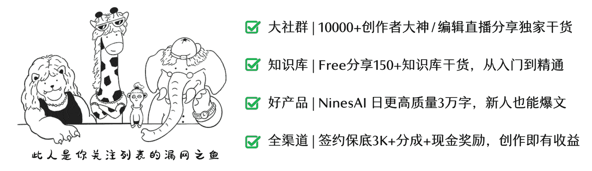

# Nines写作宝典-【情节卡】常用20类“甜”点详解

> 来源：[https://rq547mr4oez.feishu.cn/docx/MXqWdBNuRouXI0xych4cixJ3nGb](https://rq547mr4oez.feishu.cn/docx/MXqWdBNuRouXI0xych4cixJ3nGb)

## 一、前言

> 宝子们！是不是每次打开文档就大脑空白❓
>
> **拆书少、没灵感，写两句就卡壳❓**
>
> **别慌！！！**
>
> **熬夜整理基于咱们一直说的【核心情绪】，将爽/虐/甜**/猜/燃/恐等一些的常用【情节卡】梳理~
>
> 1. [Nines写作宝典-【情节卡】常用20条“虐”点详解](https://rq547mr4oez.feishu.cn/wiki/Eb4hwXBz5i5HF6k0i05cAHFgnag?from=from_copylink)
> 1. [Nines写作宝典-【情节卡】常用20条“爽”点详解](https://rq547mr4oez.feishu.cn/wiki/W72sw7xAuigBxlkHHUOc7lr7nZd?from=from_copylink)
> 1. [Nines写作宝典-【情节卡】常用20条“甜”点详解](https://rq547mr4oez.feishu.cn/wiki/BeJ9wLWheigfTQkgpvrcUFounKb?from=from_copylink) **（第三弹）**
> 1. [Nines写作宝典-【情节卡】常用20条“悬”点详解](https://rq547mr4oez.feishu.cn/wiki/IcLawXudliIJu7kzMJ4c8cjxnfD?from=from_copylink)
> 1. [Nines写作宝典-【情节卡】常用50种情绪链](https://rq547mr4oez.feishu.cn/wiki/ZZshwplvCiMdOukyYTscCIrenLf?from=from_copylink)
>
> **掌握这些【情节卡】你也能做到：****👇**
>
> ✅ 下笔如开外挂，再也不怕灵感枯竭
> ✅ 篇篇戳中情绪爽点，轻松收割读者
> ✅ 流量密码拿捏住，下一个爆款小说就是你！

**PS：NineS AI【****AI知识库+AI**产品+投稿渠道+干货交流=全链路】的创作者社群~**

## 二、发糖的5个阶段

> **我们按照整个恋爱过程划分：初识期一动摇期一拉扯期一确认期一深情期；分别整理一些【经典】的情节卡；**
>
> **注意：**
>
> 1. 不同阶段，两人的情感指数不一样，比如开局是0or负值（偏见开局）
> 1. 情感指数可以根据剧情需要，重新创作，不是标准答案。
> 1. 初识期：「意外相遇，初印象的化学反应」
>
> **重点：** 制造「非典型相遇」打破常规，用**强冲突、强记忆点**的场景让男女主产生交集，奠定情感基调（或甜或虐或搞笑）。
>
> **关键词：** 意外接触、身份错位、误会开端、宿命感伏笔
>
> **核心目标：** 让双方在读者心中「绑定」，产生「他们注定有关联」的认知。
>
> 1. 动摇期：「暗流涌动，心动的自我怀疑」
>
> **重点：** 双方对彼此产生**模糊的好感**，但因性格、身份或过往经历，不敢直面心意，表现为「克制的关注」。
>
> **关键词：** 不自觉的关心、细节悸动、吃醋萌芽、自我说服
>
> **核心目标：** 用「微表情」「小动作」展现角色内心的动摇，让读者捕捉到「他/她好像不一样了」的信号。
>
> 1. 拉扯期：「推拉博弈，暧昧的极限试探」
>
> **重点：** 情感进入「进三步退两步」的博弈阶段，双方**明知心动却刻意回避**，用「试探」「反话」「误会」制造张力。
>
> **关键词：** 言语交锋、肢体越界、误会升级、第三方介入
>
> **核心目标：** 通过「虐点」与「糖点」交织，让读者产生「急死我了快表白」的迫切感。
>
> 1. 确认期：「破窗时刻，双向的勇气奔赴」
>
> **重点：** 打破暧昧僵局，通过**关键事件**（危机/误会解除/走心对话）让双方直面心意，完成「双向表白」。
>
> **关键词：** 生死危机、真心话大冒险、醉酒断片、前任助攻
>
> **核心目标：** 给读者「终于等到这一天」的爽感，用强情绪冲击（如哭着告白、霸气护短）定格名场面。
>
> 1. 深情期：「共生模式，爱意的具象化」
>
> **重点：** 确认关系后进入「稳定甜蜜+共同成长」阶段，用**细节糖**（日常互动）和**危机共担**展现感情深度，避免平淡。
>
> **关键词：** 同居日常、见家长、职业困境、未来规划、双向救赎
>
> **核心目标：** 让读者感受到「爱是软肋也是铠甲」，角色因彼此成为更好的人。

**总结：情感曲线的核心逻辑**

> 初识期：用「意外」勾住读者；
>
> 动摇期：用「细节」让读者共情心动；
>
> 拉扯期：用「推拉」制造阅读爽感；
>
> 确认期：用「爆发」满足读者期待；
>
> 深情期：用「陪伴」让读者相信永恒。
>
> 每个阶段需搭配「外在事件」（如职场竞争、家族矛盾）与「内在情绪」（自卑、骄傲、过往阴影），让感情发展既自然又充满张力。

## 三、干货内容整理（20个经典情节卡）

### 一、初识期（偶然碰撞与细节悸动）

#### 1. 意外邂逅

> **公式**：日常错位+物理接触+感官觉醒+留白伏笔
>
> **例**：【图书馆+检索屏相撞+指尖按在同个书名+咖啡渍晕染书页】
>
> 女主查资料时撞上正在输入密码的男主，两人指尖同时按在屏幕“《宇宙漫游指南》”上，他保温杯的咖啡渍恰好渗湿她记满公式的草稿纸

+ 场景：大学图书馆顶楼电子检索区，阳光从百叶窗漏成琴键状
+ 冲突：她为抢最后一本考研资料加速，他为护母亲留的钢笔急刹
+ 情感曲线：
+ 【触碰】她手腕骨硌到他手表齿轮，金属凉意混着雪松香水涌进鼻腔
+ 【凝滞】他低头替她捡滑落的眼镜，睫毛在眼下投出蝴蝶阴影
+ 【余韵】三天后她在书页间发现夹着的银杏叶，背面写着“201室有你要的孤本”

#### 2. 共享耳机杀

> **公式**：通勤空间+分线耳机+旋律共振+肢体微颤
>
> **例**：【公交车末排+降噪耳机+《夜空中最亮的星》+耳垂擦过衣领】
>
> 暴雨天女主没带耳机，男主分她右耳耳机，公交车颠簸时她的耳垂蹭过他校服衣领的洗衣皂味

+ 场景：晚八点的33路末班车，雨刷器在玻璃上画着不规则弧线
+ 冲突：她因社团活动错过校车，他默默计算她等车的频率已三周
+ 情感曲线：
+ 【僵硬】耳机线在交叠的膝盖间打了三个结，她数着他校服第二颗纽扣
+ 【融化】副歌时他突然转头，路灯光切过他侧脸，喉结随旋律轻轻滚动
+ 【暗涌】下车前他快速摘下耳机，她掌心残留他耳尖的温度

#### 3. 英雄救美（反套路版）

> **公式**：危险场景+误判形势+双向错愕+呼吸交错
>
> **例**：【便利店+劫匪假枪+女主反手锁喉+男主举着饭团愣住】
>
> 女主误会劫匪拿真枪，反手将其按在冰柜上，却发现是来拍短视频的男主，他手里的金枪鱼饭团还滴着酱汁

+ 场景：凌晨一点的24小时便利店，冷柜蓝光映着她发抖的指尖
+ 冲突：他为涨粉策划“英雄救美”剧本，却低估她散打黑带实力
+ 情感曲线：
+ 【惊诧】她虎口抵着他喉结，感受到他吞咽时的震动频率失常
+ 【窘迫】便利店广播突然响起：“请购买过期饭团的顾客到前台”
+ 【萌芽】他递来创可贴时，她发现他手机壳是她随手画的卡通鲨鱼

#### 4. 同框即糖（路人视角）

> **公式**：公共场景+第三方抓拍+氛围感拉满+细节伏笔
>
> **例**：【校园论坛热帖《惊！校草校霸在奶茶店做这种事》】
>
> 配图里男主（校草）替女主（校霸）擦掉嘴角奶盖，她指尖勾着他校服第二颗纽扣，背景墙的光斑恰好拼成爱心

+ 场景：午后奶茶店，阳光透过绿植在瓷砖上洒下斑驳光影
+ 冲突：她为抢最后一杯杨枝甘露差点掀翻桌子，他默默替她付了钱
+ 情感曲线：
+ 【定格】他指腹擦过她唇峰的瞬间，她后颈汗毛突然立起
+ 【发酵】论坛评论区炸锅：“校霸居然会乖乖仰头让人擦嘴？！”
+ 【伏笔】男主手机锁屏是这张抓拍截图，马赛克掉的右下角有她手写的“谢了”

### 二、动摇期（本能偏爱与克制失控）

#### 1. 双向保护

> **公式**：危机时刻+同步反应+肢体交缠+呼吸紊乱
>
> **例**：【街头飞车+同时扑向对方+滚进巷口+他的西装划破她掌心】
>
> 摩托车失控冲向女主，男主和她同时伸手推对方，两人在垃圾箱后抱成一团，他领带夹划伤她锁骨下方

+ 场景：晚高峰的步行街，夕阳把他的影子拉得老长
+ 冲突：她是他的甲方爸爸，他是她的合作律师，本该保持职业距离
+ 情感曲线：
+ 【灼热】她指尖插进他后腰的肌肉，感受到他剧烈的心跳频率
+ 【破防】“你流血了”他哑着嗓子扯下领带，喉结在汗湿衬衫下滚动
+ 【余震】三天后他递来文件，指尖刻意避开她结痂的伤口

#### 2. 醉酒撒娇

> **公式**：聚会场景+酒精催化+无意识依赖+清醒者失控
>
> **例**：【公司年会+香槟塔旁+女主挂在男主颈间+咬他喉结处的痣】
>
> 女主误喝掺了白酒的香槟，醉后把男主当成人形靠垫，指尖绕着他锁骨处的痣打转，他握着酒杯的指节泛白

+ 场景：五星酒店宴会厅，水晶灯在她发间碎成细碎光斑
+ 冲突：他是她的直属上司，平时总穿一丝不苟的三件套
+ 情感曲线：
+ 【隐忍】她鼻尖蹭过他Adam's apple时，他听见自己袖口崩线的声音
+ 【破防】“陆总这里…像小月亮”，她含混的话让他瞳孔骤缩
+ 【失控】抱她上车时她突然亲他唇角，他在后视镜里看见自己发红的耳尖

#### 3. 习惯成自然（暗戳戳宠）

> **公式**：日常细节+长期养成+无意识流露+旁人点破
>
> **例**：【食堂窗口+阿姨调侃“还是不要香菜多放醋”+男主耳尖发红】
>
> 女主打饭时，窗口阿姨笑着递过餐盘：“你男朋友早交代过了，第三勺醋要悬停三秒——瞧瞧，荷包蛋煎成了爱心形”

+ 场景：大学二食堂，不锈钢餐盘碰撞声混着麻辣烫香气
+ 冲突：他是隔壁班高冷学霸，她是总踩点进教室的美术生
+ 情感曲线：
+ 【惊诧】她看见他餐盘里的糖醋排骨，恰好是她上周提过的家乡做法
+ 【温热】阿姨补刀：“这孩子连你生理期喝的红枣茶，都算着卡路里配的”
+ 【暗涌】他转身时校服口袋掉出便签，上面记着“她讨厌芹菜叶，喜欢把豆腐泡戳破”

#### 4. 温差梗（脱外套/暖手）

> **公式**：温度差场景+肢体接触+感官放大+呼吸可见
>
> **例**：【雪天操场+女主冻得跺脚+男主把她手塞进自己羽绒服+睫毛挂霜】
>
> 体育课自由活动，男主看见女主在雪地里搓手，直接把她的手拽进自己羽绒服内袋，他的白衬衫还带着体温

+ 场景：北方中学的冬季操场，篮球架上积着半尺厚的雪
+ 冲突：她是转学生，他是学生会主席，本该只负责登记考勤
+ 情感曲线：
+ 【僵硬】他掌心的薄茧硌着她冻疮的虎口，羽绒服里的雪松味更浓烈
+ 【融化】“笨蛋，要贴紧肋骨才暖”，他耳尖通红却直视前方
+ 【余韵】放学后她在储物柜发现他的围巾，毛线里缠着两根他的银发

### 三、拉扯期（误会试探与反套路推拉）

#### 1. 破镜重圆

> **公式**：久别重逢+信物触发+回忆闪回+呼吸停滞
>
> **例**：【机场安检+行李箱撞色+他挂着她送的鲨鱼挂坠+她攥紧当年撕碎的录取通知书复印件】
>
> 女主在国际出发口撞见男主，他的登机箱挂着七年前她送的手工鲨鱼挂坠，而她口袋里装着他当年未寄出的情书草稿

+ 场景：浦东机场T3航站楼，海关广播混着行李箱滚轮的咔嗒声
+ 冲突：当年他因家庭变故爽约留学，她带着误会成为战地记者
+ 情感曲线：
+ 【冰封】他抬头时，镜片反光挡住了她曾熟悉的琥珀色瞳孔
+ 【灼痛】她注意到他腕表内侧刻着她生日，倒过来是“LOVE”
+ 【决堤】“你没去伊斯坦布尔”他说，身后传送带吐出她掉了拉链的旧书包

#### 2. 替身反套路

> **公式**：日常错位+习惯觉醒+细节崩塌+呼吸灼热
>
> **例**：【书房深夜+女主批注《红楼梦》+男主发现她用他教的簪花小楷+而非白月光的瘦金体】
>
> 男主看见女主在《葬花吟》旁的批注，笔迹是五年前他亲手教的簪花小楷，而他一直以为她是白月光的替身

+ 场景：侯府西厢房，梨花木书架映着烛台暖光
+ 冲突：他每月初七送她的玉镯，是亡妹的生辰，她却默默刻上他的生肖
+ 情感曲线：
+ 【裂痕】她递来的桂花酒，是他母妃独有的秘方，从未告诉过任何人
+ 【崩塌】发现她为他准备的药箱里，有他幼年才用的鹅梨帐中香
+ 【重构】他抓住她正要研墨的手，在满室墨香里吻她腕间的朱砂痣

#### 3. 极限反撩

> **公式**：主动撩拨+突然反杀+胜负欲燃爆+呼吸交缠
>
> **例**：【车内+男主摸头杀+女主突然咬他指尖+“哥哥的指尖…比草莓还甜”】
>
> 红灯时男主抬手替女主理刘海，她突然咬住他指尖，舌尖划过他指纹，他踩刹车的力度让安全带勒进她肩膀

+ 场景：暴雨夜的隧道，前车尾灯在玻璃上拖成红色光带
+ 冲突：他是她的房东，平时总穿丝绸睡袍在阳台煮咖啡
+ 情感曲线：
+ 【惊诧】她牙齿的温度混着草莓唇膏味，让他方向盘打偏五度
+ 【沉沦】“再咬下去…哥哥要失控了”，他喉结滚动时车灯恰好切过侧脸
+ 【反转】她松开嘴却把他手指含在唇间轻吮，隧道广播突然响起《恋爱循环》

#### 4. 伪兄妹暗恋

> **公式**：重组家庭+刻意避嫌+细节露馅+呼吸凝滞
>
> **例**：【暴雨夜+两人挤在一张床+哥哥背对着她突然说“明天我搬出去”+妹妹拽住他睡衣后摆】
>
> 父母出差留他们独处，暴雨导致电路跳闸，女主拽住要去客厅打地铺的男主，黑暗中他听见自己心跳盖过雷声

+ 场景：二楼阁楼卧室，老式挂钟在墙角敲着十二下
+ 冲突：他是继兄，大她两岁，衣柜里藏着她初中毕业照
+ 情感曲线：
+ 【僵硬】她脚尖不小心碰到他小腿，他肌肉瞬间绷紧如琴弦
+ 【破防】“我不怕黑…你别走”，她带着哭腔的话让他攥紧床单
+ 【决堤】闪电划过瞬间，他看见她睫毛上的泪珠，低头吻在她眉心

### 四、确认期（明目张胆与双向奔赴）

#### 1. 摩天轮告白

> **公式**：高空密闭+信物呈现+光影催化+呼吸停滞
>
> **例**：【游乐园星空舱+升到顶点时男主碰倒香槟杯+戒指随气泡上浮+舱外烟火炸开】
>
> 女主以为是闺蜜的单身派对，却在摩天轮里看见男主穿着她设计的高定西装，玫瑰金戒指躺在冰镇香槟桶里

+ 场景：七夕夜的梦幻乐园，十万盏灯笼映红人工湖
+ 冲突：他是她暗恋十年的竹马，总说“我把你当妹妹”
+ 情感曲线：
+ 【眩晕】舱体轻微晃动时，她抓住他手腕，摸到熟悉的烫伤疤痕
+ 【滚烫】“九岁你说要嫁给会折星星的人，我学了三千六百种折法”，他单膝跪地时烟火照亮他发红的耳尖
+ 【永恒】戒指内侧刻着“20080729”，是她第一次说“好看”的日期

#### 2. 醉酒误吻

> **公式**：庆功场景+酒精催化+错位索吻+呼吸交缠
>
> **例**：【电影节后台+女主错把男主当经纪人+踮脚堵住他的话+奖杯掉在地毯无声响】
>
> 女主获得新人奖后被灌酒，看见西装革履的男主走来，误以为是来接她的经纪人，直接吻住他正在说话的嘴

+ 场景：星光大剧院化妆间，镜前灯在她发间碎成银河
+ 冲突：他是她的顶头上司，总板着脸说“职场要专业”
+ 情感曲线：
+ 【触电】她唇膏的樱桃味混着香槟气泡，在他舌尖炸开
+ 【沉沦】他扣住她后颈加深这个吻，手指划过她后颈的小痣
+ 【破晓】“其实…我等这个‘误会’，等了七百三十天”，他抵着她额头数心跳

#### 3. 天台告白

> **公式**：夜晚独处+氛围催化+破釜沉舟+呼吸共振
>
> **例**：【毕业晚会后+女主躲天台哭+男主递纸巾+远处烟花绽放时说“我从高一就喜欢你”】
>
> 女主因高考失利躲在天台，男主默默递来印着她名字的手帕，烟花炸开时他扯开领带，露出里面她送的星星项链

+ 场景：教学楼天台，夜风掀起她校服裙摆
+ 冲突：他是学霸，她是美术特长生，总说“我们目标不同”
+ 情感曲线：
+ 【惊诧】他指尖擦过她眼角泪痕，温度比烟花余温更烫
+ 【滚烫】“数学竞赛满分那天，我最想告诉的人是你”，他耳尖红过天边残霞
+ 【永恒】她踮脚吻他唇角时，远处传来同学的起哄声，而他手环住她腰不再松开

#### 4. 危机定情

> **公式**：灾难场景+生死瞬间+本能告白+呼吸交缠
>
> **例**：【地震时+男主用身体护住女主+天花板坠落瞬间说“活着出去我就追你”】
>
> 图书馆突遇地震，男主把女主护在阅览桌下，混凝土块砸中他后背时，他在她耳边用气音说完最后半句话

+ 场景：午后三点的社科阅览室，阳光曾在他发梢跳跃
+ 冲突：她总躲着这个总借她笔记的高冷学长
+ 情感曲线：
+ 【震颤】他渗血的校服染红她的白衬衫，血腥味混着纸墨香
+ 【决堤】“我数到十就睁眼…一”，她吻住他正在颤抖的唇
+ 【新生】救援队破拆时，看见他护着她的姿势像守护珍宝的蚌壳

### 五、深情期（细节宠溺与宿命承诺）

#### 1. 专属宠溺

> **公式**：公众场景+特殊对待+反差萌点+呼吸停滞
>
> **例**：【时装周秀场+女主裙摆勾住台阶+男主从第一排冲上台+全球直播前替她系水晶鞋】
>
> 女主作为设计师谢幕时被高定裙摆绊倒，男主（国际影帝）从嘉宾席冲上台，单膝跪地在镜头前调整她的鞋扣

+ 场景：巴黎大皇宫，穹顶玻璃映着十二月的初雪
+ 冲突：他曾拒绝所有公开场合互动，却为她打破惯例
+ 情感曲线：
+ 【惊诧】他西装裤膝头沾上她裙摆的银线，在聚光灯下格外显眼
+ 【沸腾】“我的设计师，不该被鞋带绊倒”，他指尖划过她脚踝的临时纹身（他名字的缩写）
+ 【定格】谢幕照里他仰头看她的眼神，让时尚圈重新定义“绅士手”

#### 2. 备忘录细节

> **公式**：日常物件+习惯记录+心事曝光+呼吸灼热
>
> **例**：【手机相册+女主发现男主备忘录+“她喝咖啡要转三圈才喝”“第100天，她笑时会露出虎牙”】

### 2. 备忘录引物与情感铺垫

> 女主偶然翻开男主手机，看见标着“秘密”的备忘录，每一条都记着她的生活细节，最新一条是“求婚戒指该选梨形钻石，因为她喜欢《泰坦尼克号》”

+ 场景：居家客厅，他正在厨房煮她爱喝的罗宋汤
+ 冲突：他是表面高冷的医生，私下却像个碎嘴的老父亲
+ 情感曲线：
+ 【温热】看见“她生理期会腰痛，要准备暖宝宝和红糖水”，她眼眶突然发酸
+ 【滚烫】翻到三年前的记录：“今天她救了只流浪猫，像小太阳一样发光”
+ 【回应】她把自己的备忘录打开递给他，首页写着“周延礼的过敏清单：芒果、紫外线、没有我的夜晚”

### 3. 婚礼细节

> **公式**：仪式场景+信物呼应+记忆锚点+呼吸共振
> **例**：【海底婚礼+交换戒指时女主发现内侧刻着初遇坐标+男主戒指刻着她的潜水安全词】
> 在大堡礁水下教堂，女主的婚戒内侧刻着“20190715/北纬23°26′”，正是他们在三亚第一次潜水的日期和坐标，而男主的戒指刻着“别怕，有我”——她每次下潜前他必说的话

+ 场景：透明海底穹顶，珊瑚在光影中舒展如孔雀开屏
+ 冲突：筹备时她坚持不要传统誓词，他却偷偷定制了潜水石板
+ 情感曲线：
+ 【震颤】他掀开潜水面镜念誓言，气泡模糊了他泛红的眼角
+ 【永恒】“你第一次潜水攥紧我手腕的力度，现在还在我骨头上”，他吻她时咸涩海水渗进口腔
+ 【轮回】牧师宣布礼成时，五年前放生的海龟恰好游过，贝壳形光斑落在他们交叠的手上

### 4. 习惯成自然

> **公式**：日常场景+长期习惯+无意识流露+宿命感拉满
> **例**：【厨房做饭+男主接过女主手里的刀+“你切胡萝卜还是喜欢摆成星星形”】
> 结婚十年，女主切胡萝卜时习惯性摆成星星形，男主看见后自然地接过菜刀：“今天做你爱吃的罗宋汤，多放两勺你藏在冰箱最下层的糖”

+ 场景：美式开放式厨房，晨光透过百叶窗洒在她围裙上
+ 冲突：曾经的厨房杀手，现在能记住她所有细微习惯
+ 情感曲线：
+ 【温热】他指尖划过她手背的刀疤（十年前为他挡菜板留下的）
+ 【沉淀】橱柜第三层永远摆着她专用的星空碗，抽屉里是按颜色分类的烘焙手套
+ 【永恒】烤箱提示音响起时，他在她后颈落下一吻：“从你在便利店撞翻我咖啡那天起，我的生活就全是你的味道”

### 甜文创作趋势总结

1. 反套路化：拒绝工业糖精，通过“不完美人设”（如吝啬、暴躁）增加真实感；
2. 女性力量：女主独立成长线并行感情线，如《我要上学》中卫三的“兵师双修”；
3. 交互感增强：融入游戏化叙事（如任务系统、等级设定），提升读者代入感；
4. 类型跨界：甜文与硬核题材（科幻、悬疑）融合，拓展叙事边界；
5. 群像塑造：配角不工具化，如《第九农学基地》中女性团队的互助成长。
