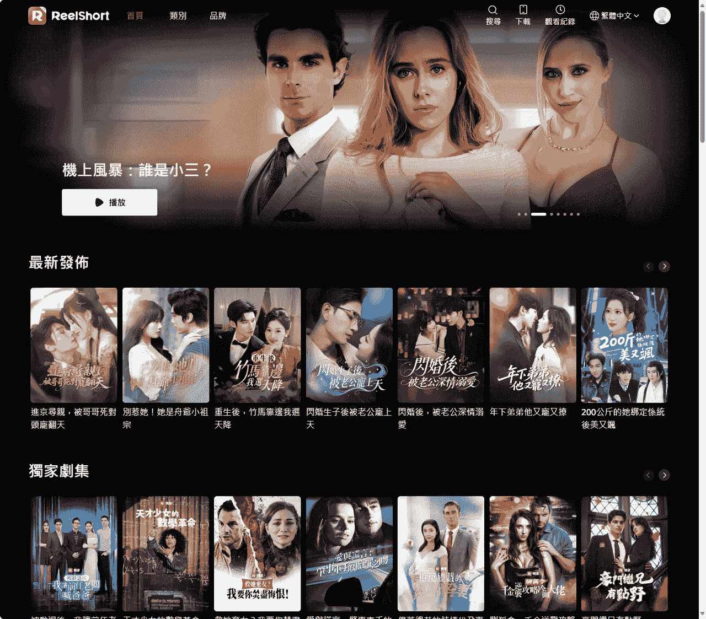
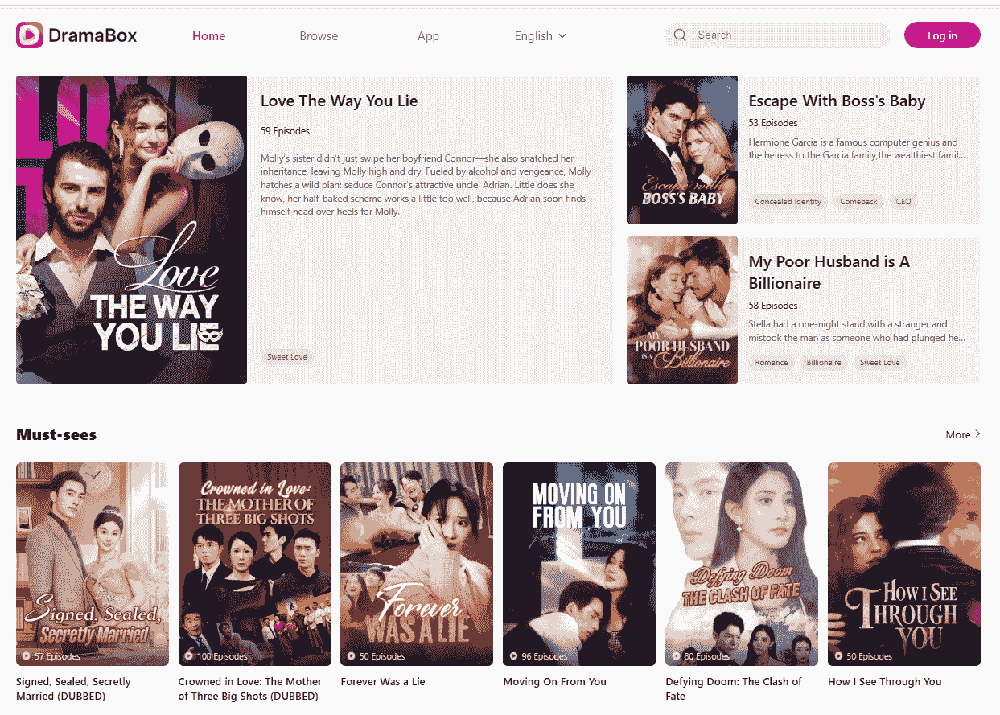

# 海外短剧推广🔥从0到变现1万美金完整指南

> 来源：[https://rq547mr4oez.feishu.cn/docx/U4RhdIUbMoMMkQxf9nmcAx7KnNf](https://rq547mr4oez.feishu.cn/docx/U4RhdIUbMoMMkQxf9nmcAx7KnNf)

# 一、前言

> 最近社群很多小伙伴在问类似的事情，所以老杨找了几个朋友打听：

>

1.  **海外短剧市场正处于【爆发期】**，其中北美、东南亚、中东为核心增量市场。

1.  盈利模式为 CPS（按销售分成），即通过推广短剧平台（如 ReelShort、Drama Box）的专属链接，引导用户下载 APP 并充值，按用户实际消费金额获得分成（比例 55%-70%）。

1.  以头部平台 ReelShort 为例，单部爆款短剧可带来超 2500 万美元票房，推广者单月分成最高可达 87 万美元。

1.  **【核心指标】**只要看千次播放出单率（CPM→Sale Ratio）≥0.3% 即及格，≥1.5% 即爆款模板。

>

> **因为有一定的门槛，所以在做的从业者不多**，老杨也拿到他们内部的教程分享给大家~~

# 二、平台选择与对比

不同平台的用户画像、引流规则及分成政策差异显著，需根据目标市场选择适配平台：

# 三、实操干货：从 0 到月入 1 万美元的实操路径

## Step 1：冷启动（1-3 周）

| ### 步骤 | ### 动作清单 | ### 工具/链接 | ### 关键细节 |
| --- | --- | --- | --- |
| 1. 选平台+开后台 | ① 选 1-2 家高佣平台注册 | 电脑+邮箱 | 优先选结算周期≤7 天、佣金≥50% 的平台 |
| 2. 账号矩阵 | TikTok：3-5 个号/人； | Gmail 批量注册+GV 接码 | 头像、Bio 统一剧名+Linktree |
| 3. 素材下载 | 登录分销后台→Resource Center→S 级剧集→下载 1080P 无水印整集 | 谷歌云盘/迅雷 | 优先选已验证爆款（平台榜单前 20） |
| 4. 二次创作 | ① 用 CapCut 剪 25-35 秒高能片段 | CapCut PC+剪映国际版 | 保证去重：镜像+变速+抽帧≤0.3 秒 |
| 5. 挂链发布 | TikTok：主页挂 Linktree→剧集链接；IG：Story+Reels 双发；FB：Page 置顶+Group 群发 | Linktree、Bitly 短链 | 文案模板：Hook+悬念+“Full episode in bio” |
| 6. 数据回传 | 发布后 2 小时在后台「回传」视频链接，系统才计佣 | 手机备忘录登记 | 漏回传=白做 |

### **3.1.1 关键要点：**

1.  平台优先级

+   新手首选Facebook：易起号、用户付费意愿强，适合冷启动

+   增量选TikTok/Instagram：TikTok适合爆款引流，Instagram在日本的渗透率达34%

+   注册 3 个账号（TikTok/Instagram/Facebook），每日发布 2 条 ReelShort 官方素材（去重处理），目标粉丝 1000+。

1.  养号核心步骤

+   环境隔离：使用指纹浏览器（如AdsPower）为每个账号分配独立IP，避免关联封号10

+   养号周期：

+   第1-3天：浏览短剧内容，点赞评论（每日5-10条）

+   第4-7天：发布非推广类视频（如影视剪辑），提升账号权重

+   主页搭建：封面用冲突性剧照+多语言标题（如“Who Killed Her? 🔍”），简介嵌入推广链接

### 3.1.2 ReelShort 账号注册与资质准备

1.  **注册入口**：可以选择语言：繁体中文

1.  **访问推广后台：**[打开浏览](https://www.reelshort.com)器输入 ReelShort 推广后台地址（点击链接），点击右上角 "Sign Up" 按钮。

1.  **填写注册信息：**使用 Gmail/Outlook 等海外邮箱（国内邮箱可能收不到验证邮件）

1.  **身份验证：**上传护照 / 驾照照片（仅支持英文证件）绑定 PayPal 账户（需与注册邮箱一致）

1.  **资质要求**：年满 18 岁，无不良记录，需绑定手机号（支持海外号码）及 PayPal 账户（用于提现）。

1.  **后台功能**：

1.  注册后进入 “资源广场”，选择 S 级爆款剧集（如《The Double Life of My Billionaire Husband》）生成专属推广链接，下载官方素材（含无水印片段、海报、台词文案）。

1.  后台功能区详解

### 3.1.3 推广素材获取与处理

#### **步骤 1：筛选爆款剧集**

> 进入 Resource Hub，通过以下维度筛选高转化素材：

+   标注 "S" 级的剧集（平台推荐，转化率比普通剧集高 30%）

+   选择 "Past 7 Days" 下载量 TOP10 的素材（实时热点）

+   优先下载带 "Vertical Video" 标签的竖屏素材（适配移动端）

#### **步骤 2：素材下载与授权**

> 点击剧集封面进入详情页，可下载：

+   完整片源（MP4 格式，1080×1920 分辨率）

+   多语言字幕包（英 / 西 / 阿语等，SRT 格式）

+   官方海报与剧情简介（用于制作图文推广）
注意：下载时需勾选 "素材使用协议"，同意不得剪辑关键剧情转折点

#### **步骤 3： 视频去重处理技巧**

> 直接发布原始素材会被平台判定重复，需用以下方法处理：

1.  **画面调整**：

+   裁剪边缘 10% 画面（保留核心内容）

+   水平翻转 + 轻微缩放（缩放比例 1.05-1.1）

+   添加滤镜（推荐 "鲜明" 或 "反差色" 滤镜，强度 20%）

1.  **字幕优化**：

+   用 Canva 制作动态字幕（字体选 Arial Bold，字号 36px）

+   添加双语字幕（上英文下中文，针对华人观众）

1.  **音频处理**：

+   替换背景音乐（使用 TikTok 音乐库的无版权音乐）

+   人声增强（Audacity 软件放大音量至 - 6dB）

+   **工具推荐**：

+   手机端：剪映国际版（CapCut）→ 内置 "短剧去重模板"

+   电脑端：BoomCut AI → 自动生成 10 种去重版本（需付费订阅 $19.9 / 月）

#### **步骤 4：创建推广链接**

> 进入 "My Links" 页面：

1.  选择剧集（支持同时绑定多部剧集）

1.  设置追踪参数（如?source=tiktok-us，便于分析渠道效果）

1.  勾选 "Enable Deep Link"（用户点击直接跳转至对应剧集页面）

1.  **短链接转换：**用 ReelShort 内置的短链工具（Bitly 接口），将长链接转换为reelshort.com/abc123格式，提升点击率。

### 3.1.4 内容创作：爆款公式（与国内相似）

**TikTok 平台为例**：

+   **3 秒钩子设计**（必选其一）：

+   冲突型：“She married a janitor, but he’s actually a billionaire”（豪门替身梗）

+   悬念型：“He dumped her for a model… until she showed up as CEO”（逆袭反转梗）

+   数据型：“93% of viewers cried at the ending”（情感共鸣梗）

>

+   **中段留存技巧**：

+   每 15 秒设置剧情反转（耳光、车祸、失忆等），使用 ASMR 音效（如玻璃破碎声）提升点击率 41%；

+   动态字幕（无衬线字体，字号≥32px），关键帧卡点（如人物对话时放大面部表情）。

>

+   **结尾转化指令**：

+   视频结尾弹出倒计时浮窗 +“Watch full episodes in bio” 字幕，评论区置顶 “点击链接享限时解锁”。

>

+   **去重处理**（避免平台限流）：

+   裁剪画面保留核心剧情（如只保留对话场景）；

+   水平反转视频 + 调整播放速度（1.1 倍速）；

+   叠加自制水印（如 “Clip by [你的账号名]”）。

### 3.1.4 推广策略：分平台流量技巧

#### TikTok （核心渠道）

+   **账号要求**：需 1000 + 粉丝才能在主页挂链接

+   **内容形式**：24-31 秒高光片段，前 3 秒必须出现 "狼人变身"" 豪门冲突 " 等强冲突画面

+   **发布技巧**：

+   文案含关键词：#ForbiddenLove #BillionaireDrama #ReelShort

+   评论区置顶：Watch full episodes in bio 👇

+   发布时间：北美市场下午 3-5 点（用户活跃高峰）

>

#### Instagram

+   **内容形式**：Reels（30 秒竖屏）+ Stories（5 段 15 秒连续投放）

+   **互动设计**：Stories 添加 "投票" 贴纸（如 "Will she choose revenge or love?"）

+   **合规要点**：避免使用 "免费"" 最火 "等违禁词，用"Trending Now" 替代

>

#### Facebook

+   **受众定位**：兴趣标签组合（"Romance Novels"+"Korean Dramas"+"TikTok Users"）

+   **广告形式**：选择 "Reels Ads"，单条预算 $50 起投

+   **数据优化**：当 CTR<2% 时，立即更换素材；CVR<1% 时，调整落地页至免费试看 3 集

## Step 2：放量期（4-7 周）

| 模板 | 受众 | 前 3 秒钩子 | 中段节奏 | 结尾 CTA |
| --- | --- | --- | --- | --- |
| 霸总契约 | 欧美 18-35 女 | “She signed a \$1M contract…to marry a stranger!” | 闪回+对峙+壁咚 | “Watch how she turns the tables-Link in bio” |
| 复仇虐渣 | 全球通用 | “Betrayed wife is back with a new face!” | 车祸+整容+回归 | “Full revenge in comments” |
| 狼人虐恋 | 拉美/东南亚 | “The Alpha rejected his mate…until she found her real powers” | 变身+打斗 | “See the final battle- swipe up” |

### **3.2.1 关键要点**

+   聚焦 TikTok 单平台，每周更新 10 条原创剪辑（用 BoomCut 生成多语言字幕）

+   测试不同剧情标签**：**#BillionaireDrama（霸总）、#WerewolfRomance（狼人爱情），筛选 CTR 超 5% 的素材。

+   参与 #MyForbiddenAlpha 挑战赛，单条视频播放量破 10 万后申请 “创作者基金”（额外收益）

### 3.2.2 分成规则与结算

+   **基础分成**：用户充值金额的 65%（ReelShort），例如用户充值 100 美元，推广者得 65 美元。

+   **团队奖励**：邀请下级推广者，可获得其收益的 10% 提成（二级分销，合规安全）。

+   **结算周期**：T+2 日显示收益，每月 10 日结算上月收益，最低提现 100 美元，支持 PayPal、Stripe 绑定。

### 3.2.3 收益提升策略

+   **选品优先**：推广 S 级爆款剧（平台标注 “Hot”），如《Fated to My Forbidden Alpha》（狼人题材，北美播放量破 5 亿）。

+   **投流放大**：用 10% 收益投放 TikTok Ads，定向 “25-35 岁女性 + 奇幻题材兴趣标签”，单次获客成本控制在 12 美元内（ReelShort 可接受上限）。

+   **数据复盘**：通过后台 “推广明细” 分析高转化素材特征（如 “霸总 + 追妻火葬场” 剧情点击率超 7%），复制成功模板。

## **Step 3：稳定期（8周后）**

| 平台 | 佣金比例 | 结算周期 | 提现方式 | 备注 |
| --- | --- | --- | --- | --- |
| ReelShort | 50%-60% | T+7 | PayPal、Wise | 需美国税表 W-8BEN |
| ShortTV | 60%-65% | T+3 | PayPal、银行卡 | 支持国内身份证 |
| SHORT ADS | 35%-70% 动态 | T+2 | PayPal、支付宝 | 中国区代理有合规通道 |

### **3.3.1 关键要点**

> **避坑指南**

1.  版权：只用平台官方素材，切勿自行录屏或搬运抖音。

1.  账号：同一手机切换≤3 个号；违规后立刻弃号换新，别申诉。

1.  收费课程：所有分销后台注册、素材下载、授权均为免费；凡收“授权费”“陪跑费”>500 元即割韭菜。

1.  合规：推广页需含 Privacy Policy & Terms；欧盟流量需 GDPR Cookie 提示。

>

> 每日 30 分钟执行清单（兼职版）

1.  早 9 点：后台下载 3 条新素材 → 剪 3 条视频

1.  午 12 点：TikTok/IG/FB 各发 1 条 → 评论区置顶链接

1.  晚 8 点：查看后台出单 → 记录 ROI → 次日砍掉 ROI<1 的素材

1.  坚持 14 天，单号日佣金 20-50 美元可预期；跑正后可招聘兼职剪辑，矩阵放大。

1.  搭建 5 账号矩阵，覆盖 “霸总 / 奇幻 / 复仇”3 大题材，月均引流 5000 + 用户，按 ARPU 4 美元计算，月收益 = 5000×4×65%=1.3 万美元。

### 3.3.2 版权与内容合规

+   **素材授权**：仅使用平台提供的官方素材，禁止剪辑未授权片段（如 YouTube 长剧切片），ReelShort 资源广场素材均含版权证明。

+   **文化适配**：

+   中东市场：删除酒精、赌博镜头，女性角色戴头巾；

+   欧美市场：增加 “狼人 / 吸血鬼” 等奇幻元素，避免 “霸总贬低女性” 剧情（改为独立大女主设定）。

### 3.3.3 账号安全与防关联

+   **多账号管理**：使用 AdsPower 指纹浏览器，为每个账号配置独立 IP（住宅 IP 优先）、设备指纹（IMEI、GPU 型号差异化），避免同一设备登录多个账号。

+   **防封技巧**：新账号前 7 天 “养号”（模拟真人浏览，不发推广内容），发布频率控制在每日 2-3 条，互动率低于 5% 的视频及时隐藏。