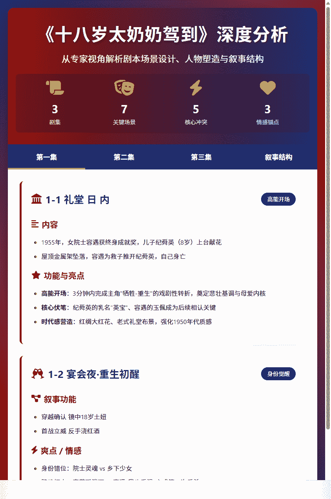

# 《十八岁太奶奶驾到》拆解附「完整剧本」

> 来源：[https://rq547mr4oez.feishu.cn/docx/V4mRdg0umombvXxeTtKcZjrpn8b](https://rq547mr4oez.feishu.cn/docx/V4mRdg0umombvXxeTtKcZjrpn8b)

# 一、前言：

> 前一段短剧的黑马是谁？必须是《十八岁太奶奶驾到》。

> 某音原生端播放量三日破3亿，相关话题量突破20亿次传播；

> 某果平台预约人数飙升至430万，连续霸榜多个短剧热力榜TOP1

>

> so爆款的剧本，我们必须要好好的学习改编思路！

> **附《完整剧本哦~》**

# 二、上干货（前三集拆解）

### **第一集：重生与初露锋芒**

#### **1-1 礼堂 日 内**

> **内容**：

+   1955年，女院士容遇获终身成就奖，儿子纪舜英（8岁）上台献花。

+   屋顶金属架坠落，容遇为救子推开纪舜英，自己身亡。

> **功能与亮点**：

+   **高能开场**：3分钟内完成主角“牺牲-重生”的戏剧性转折，奠定悲壮基调与母爱内核。

+   **核心伏笔**：纪舜英的乳名“英宝”、容遇的玉佩（闪回提及）成为后续相认关键。

+   **时代感营造**：红绸大红花、老式礼堂布景，强化1950年代年代质感。

#### **1-2 宴会 夜 内**

> **内容**：

+   2025年，容遇在容家宴会重生为18岁少女。

+   继妹容若瑶假意敬酒，故意泼红酒羞辱其“乡下人”。

+   容遇冷静反击，反泼红酒回击。

> **功能与亮点**：

+   **身份反差最大化**：通过宾客台词（“乡下长大的女儿”）快速建立容遇在容家的底层地位。

+   **主角人设亮相**：容遇的冷静反击（“不好意思，我也手滑”）瞬间立住其“不好惹”的智慧型人格。

+   **核心冲突引入**：容若瑶的挑衅成为家族线矛盾的起点。

### **第二集：与纪家初遇**

#### **2-1 宴会 夜 内**

> **内容**：

+   宾客指责容遇“没教养”，容遇犀利回怼：“方才她欺负我时你们在哪？”

+   纪止渊登场，容遇直呼其祖父“纪舜英”名讳，震惊全场。

+   容父怒斥容遇，纪止渊冷脸离开。

> **功能与亮点**：

+   **金句塑人格**：容遇对宾客的质问（“这就是你们口中的有教养？”）强化其通透三观与气场。

+   **身份炸弹引爆**：直呼“纪舜英”制造三重冲突——宾客震惊（阶级冒犯）、容父恐慌（得罪纪家）、纪止渊疑心（她是谁？）。

+   **情感伏笔**：纪止渊对容遇的“熟悉感”初现端倪。

#### 2-2 礼堂门口 日 外（闪回）

> **内容**：

+   1945年容遇与丈夫纪斯年婚礼，提及丈夫为护学生牺牲。

> **功能与亮点**：

+   **补充背景**：解释纪家渊源（爱国世家）、容遇的婚姻悲剧，铺垫她对家族的责任感。

+   **强化时代烙印**：留洋博士、战乱牺牲等细节增强历史厚重感。

### **第三集：母子线索与家族疑云**

#### **3-1 宴会 夜 内**

> **内容**：

+   容遇追问“纪舜英是否活着”，容父怒斥其“诅咒董事长”。

+   纪止渊确认祖父健在，容遇激动晕倒。

> **功能与亮点**：

+   **情感爆发点**：容遇晕倒非因体弱，而是得知儿子活着的情绪冲击，深化母子羁绊。

+   **纪家态度铺垫**：纪止渊的戒备（“容总养了个大胆的女儿”）为后续冲突埋线。

#### **3-2 容遇卧室 日 内**

> **内容**：

+   容遇用手机查纪舜英资料，发现其海外疗养及颈部胎记，确认是儿子。

+   抚摸照片落泪：“英宝怎么变成老人了……”

> **功能与亮点**：

+   **科技融入叙事**：手机成为穿越者认知新世界的工具（查资料），自然不突兀。

+   **催泪高光**：胎记细节与前文呼应，容遇的泪与独白将“时空错位”的悲剧感推向高潮。

#### **3-3 容家客厅 日 内**

> **内容**：

+   容父与容若瑶被容遇的眼神震慑，疑其“与年龄不符的阅历”。

> **功能与亮点**：

+   **配角视角强化主角神秘感**：通过他人反应侧面烘托容遇的灵魂厚度。

+   **家族矛盾升级**：容若瑶的忌惮（“眼神好可怕”）预示后续更激烈陷害。

### **总结**

1.  **效率至上**：3集完成“穿越-立人设-树敌-寻亲-埋疑”全链条，节奏拉的飞快。

1.  **情感扎实**：母子线（胎记/晕倒/落泪），情感共鸣强

1.  **冲突多维**：家族（容若瑶）、阶级（纪家）、时代（三观差）三重矛盾交织。

1.  **细节控场**：玉佩、胎记、密码（后续）、儿歌（后续）伏笔精准无闲笔。

### 可视化html版本，全剧本找老杨要把~~