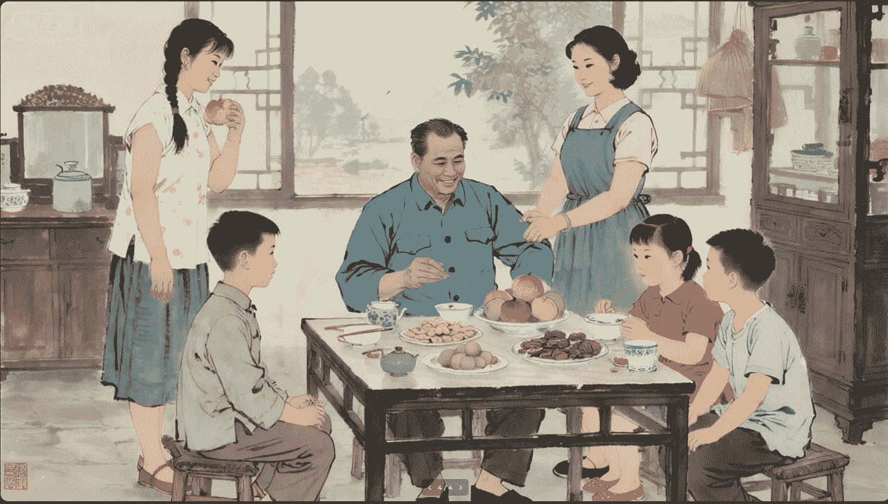

# 番茄35万在读-反套路复仇《舍不得》拆解

> 来源：[https://rq547mr4oez.feishu.cn/docx/YGicdQv7coOtVjx2P18cr2uMnUg](https://rq547mr4oez.feishu.cn/docx/YGicdQv7coOtVjx2P18cr2uMnUg)

# 一、前言

> **番**茄35万在读《舍不得》的核心套路可以概括为：“重生+复仇+社会议题（如重男轻女、家庭压迫）+智力反杀”

> 延续了这一套路，但换了背景、冲突和复仇方式：

1. 校园霸凌 + 教师漠视
2. 职场PUA + 过劳猝死
3. 天价彩礼 + 扶弟魔家庭
4. 学术抢夺 + 导师偏爱
5. 网红虚假人设 + 网络暴力

> 小伙伴们，可以动笔仿写起来了~~同时附《换元法2.0》提示词！！



# 二、废话少说，上拆书

```
#  故事梗概
## 一、基本信息
1. 选题: 重男轻女家庭中遭受投毒悲剧后，女主许银杏坚持自立自强，最终逆袭成功的励志成长故事。
2. 题材: 社会现实、家庭伦理、成长励志
3. 类型: 现代言情/都市成长
4. 字数: 约22000字
5. 期待感: 通过重男轻女下的家庭不公与投毒事件引爆悲剧危机，展现主人公从受害者到独立女性的蜕变过程，满足读者对逆境自强和社会公正的期待。

## 二、故事设定
1. 背景设定: 现代中国南方农村至大城市，乡村生活环境，重男轻女的传统家庭观念和农村贫穷背景，与城市职场对比鲜明。
2. 主角: 
    - 许银杏：女，少年时家境贫穷，遭遇家庭亲人投毒悲剧，性格坚韧、内心冷静、自强不息，目标是改变命运，考上大学后创业成功。
    - 主角人设七步法：
      - 目标：摆脱被重男轻女家族压迫，实现经济与精神独立。
      - 阻碍：家庭重男轻女偏见、投毒致家人死亡、母亲的责骂和打压、生活贫困、情感孤立。
      - 行动：忍受家庭虐待，努力学习，考上理想学校，创业成功。
      - 结果：经济独立，生活优越，拥有自主权。
      - 意外：家中投毒，亲人惨死，母亲被判刑，奶奶晚年愚昧行为。
      - 转折：母亲出狱求助，母亲二婚及患病受虐，女主安排“富二代”假相戏耍母亲。
      - 结局：母亲去世，女主成功逆袭，构建新生活，并与母亲旧友相识。
3. 配角:
    - 奶奶：传统愚昧，重男轻女的保守代表，虽宠孙子却待重孙女苛刻，终老时精神迷茫。
    - 妈妈：偏心男孩，恶毒，投毒导致家庭悲剧，被判刑入狱，后再婚惨遭家暴。
    - 许子俊（弟弟）：重男轻女优待的男孩，最终因吃毒米和毒鸡肉死亡。
    - 老光棍：母亲二婚对象，后家暴母亲导致其瘫痪。
    - 盼儿：女主故乡的友人，后成为主角秘书，与主角重新结识。
4. 核心梗: 重男轻女家庭冲突、投毒致死、家庭宿命与自我救赎、创业逆袭。
5. 核心内容: 
    - 危机: 家庭投毒事件导致父亲、弟弟及亲人相继身亡；母亲入狱；母亲二婚遭家暴。
    - 伏笔: 母亲内心怨恨女儿；奶奶的偏见和态度；假富二代设局反击母亲。
    - 悬念: 母亲的真实内心、投毒背后是否有人指使；女主如何走出逆境。
    - 爽点: 女主成功考学创业；反转假富二代戏弄母亲；母亲去世后由女主掌握命运。

## 三、故事脉络
1. 核心冲突: 人与家庭的亲情与仇恨、人与传统偏见的斗争、人与自我命运的抗争。
2. 情感纽带: 母女情感纠缠复杂、女主与弟弟和奶奶的关系矛盾、女主自我救赎。
3. 故事反转: 投毒事件爆发导致家庭成员死亡，女主陷入孤立；母亲服刑后归来；女主反击母亲设局假富二代。
4. 二次反转: 母亲二婚并遭家暴，女主接回照顾；母亲最终选择自杀，女主成为唯一继承人。
5. 整体节奏: 
    - 1-4：家庭生活铺垫，投毒事件爆发，悲剧陡增，情绪低沉，节奏紧凑，揭示重男轻女的悲哀。（转折点：投毒事件）[情绪：紧张-悲伤-愤怒]
    - 5-6：后续惨痛，母亲被捕，奶奶愚昧行为，女主独自承担压力，情绪沉重但有坚韧。（高潮：女主独立生活起步）[情绪：苦涩-坚强]
    - 7-9：女主学习创业，逆袭成长，母亲出狱后矛盾加剧，假富二代计划戏弄母亲，反差鲜明。（爽点：创业成功、智斗母亲）[情绪：鼓舞-快感]
    - 10-11：母亲二婚家暴，女主接母亲回都市照料，情节缓和但沉重，最终母亲死亡。（情感释放）[情绪：复杂-释然]
    - 12：女主坚强成长，职场得意，重新遇见曾经的受害者，呼应全篇主题。（结尾开放）[情绪：坚定-希望]
6. 写作风格: 现实主义沉重描写，夹杂着细腻的情感刻画和逆境中的坚韧励志，时有冷幽默与讽刺.

## 四、情绪变化与情节折线表

| 序号 | 情节（最小单元）              | 字数  | 剧情推动（爽点/虐点/转折点）      | 情绪变化          |
|------|------------------------------|-------|------------------------------|-----------------|
| 1    | 重生女主家日常，米缸投毒隐患露出         | 1200  | 转折点/危机萌芽         | 紧张-迷惑-压抑     |
| 2    | 投毒后家人肚子疼，送医、父亲死亡          | 1500  | 危机爆发/虐点         | 惊恐-悲痛-绝望     |
| 3    | 母亲责怪女主，家庭破碎                    | 900   | 虐点/情绪高潮        | 愤怒-委屈-痛苦     |
| 4    | 母亲、奶奶处理毒米与死鸡，村宴鸡肉中毒事件 | 1500  | 伏笔/虐点           | 无奈-悲伤         |
| 5    | 母亲被判刑，鸡毒引起村民追责             | 1300  | 转折点/社会冲突      | 冷酷-绝望-仇恨     |
| 6    | 女主奶奶晚年生活，女主承担照顾家务与学业   | 900   | 心理成长/情绪调整    | 孤独-坚强         |
| 7    | 女主努力学习，考上高中和大学              | 1200  | 爽点/成长励志      | 振奋-希望         |
| 8    | 母亲出狱，找上门，家庭冲突爆发          | 1400  | 转折/虐点            | 压抑-厌恶         |
| 9    | 女主假富二代设局戏弄母亲，母亲洗盘子还债  | 1300  | 爽点/反击            | 解气-轻松         |
| 10   | 母亲二婚，遭家暴，女主接母亲生活         | 1300  | 二次反转/虐点         | 心酸-复杂         |
| 11   | 母亲病逝，法庭惩罚继父               | 1100  | 结局/反转               | 释然-悲伤         |
| 12   | 女主职场成功，与盼儿重逢              | 800   | 尾声/希望              | 坚定-希望         |

## 五、主要人物性格与关系梳理

| 人物  | 性格关键词                | 关系                     | 情绪变化与动机                   |
|-------|-------------------------|--------------------------|------------------------------|
| 许银杏 | 坚韧、聪慧、内敛、逆袭   | 主角，女儿，创业者  | 从被家暴受虐的弱者，成长为独立坚强的女性，报复与自我救赎交织 |
| 妈妈   | 偏执、恶毒、怨恨、现实  | 母亲，家庭冲突源头   | 偏爱儿子，恨女儿，致家庭悲剧，后求助女儿，终遭家暴死亡       |
| 奶奶   | 传统、愚昧、偏见重男轻女        | 祖母，宠孙轻孙女    | 宠孙子，弃女，晚年孤独，归于愚昧           |
| 许子俊 | 被偏爱、懦弱、受害者           | 弟弟，受害者        | 被家庭宠爱却亡于毒米                    |
| 老光棍 | 自私、暴虐                  | 继父，二婚对象         | 母亲二婚对象，后施暴致瘫痪               |
| 盼儿   | 坚强、温暖、善良              | 朋友，职场秘书       | 家庭被害苦难同感，陪伴女主成长            |

## 六、起承转合结构梳理
1. 起（约1/4，字数约5500）：  
   许银杏在重男轻女家庭中被冷落，家人投毒导致父亲及弟弟死亡，母亲责骂打压，家庭破碎，乡村悲凉生活铺陈，情绪低沉且紧张，展现女主的悲剧起点和内心蓄力。

2. 承（约1/4，字数约5500）：  
   母亲被判刑入狱，奶奶晚年孤独无助，许银杏开始独立承担家务，努力学习逆袭，从农村到城市的成长历程，逐渐展开女主自我救赎的铺垫。

3. 转（约1/4，字数约5500）：  
   母亲出狱回来找女儿，女儿巧设假富二代戏弄母亲，母亲二婚遭家暴，女主接母亲照顾，母女矛盾与反转突显，情节张力激增，冲突达到高峰。

4. 合（约1/4，字数约5500）：  
   母亲去世，女主成为唯一家庭继承者，事业成功，生活品质提升，遇见曾受害者盼儿，故事情感得以释放并揭示成长与希望，结局温暖且开放。
```

# 三、社群大神详细分析

## 核心亮点：“反套路”设计

> 这是本文最核心的亮点，也是其脱颖而出的根本原因。

### “重生复仇”框架的极致反转

+ 传统套路： 重生文主角通常会利用先知优势，力挽狂澜，拯救家人，改变命运，最终实现个人成功。主角的“善”是救赎的关键。

+ 本文颠覆： 主角许银杏重生后，不再“力挽狂澜”，而是“推波助澜”。她没有阻止悲剧，而是精准地引导悲剧发生，让那些曾经伤害她的人自食恶果。她的“善”（听话、勤快）成为了最锋利的“恶”的武器。这种“不救即救”的设定，将复仇的冷酷和智慧展现得淋漓尽致。

### “受害者”与“加害者”的身份互换

+ 开篇，主角是被百草枯事件牵连的受害者，因“多管闲事”被打残。

+ 重生后，她成为了整个悲剧的“导演”。她通过一系列看似顺从、实则致命的“善举”（多盛饭、拿老干妈、不阻止喂鸡、不阻止杀鸡、不阻止做鸡汤），将家人和整个村庄推向深渊。她从被动的受害者，转变为主动的“加害者”，这种身份的彻底反转，带来了巨大的戏剧冲击力。

### “复仇”对象的精准与升级

+ 复仇并非简单的以牙还牙。她复仇的对象层层递进：

+ 第一层：父亲——通过多盛饭、加老干妈，确保他摄入足量毒米，使其成为第一个死亡的直接受害者。

+ 第二层：母亲与弟弟——利用母亲的无知和奶奶的愚昧，制造“投毒”罪名，让母亲入狱十年，弟弟因偷吃鸡肉而死。

+ 第三层：母亲的余生——出狱后，用“富二代”骗局、洗盘子还债、纵容其暴饮暴食，最终将其送入家暴老光棍的火坑，让其在痛苦中苟延残喘三年才死去。

+ 这种复仇是精神与肉体的双重折磨，比单纯的肉体消灭更显残酷和深刻。

## 人物塑造：立体、真实

### 主角许银杏：从“无声”到“掌控”的蜕变

+ 重生前： “不服”、“大吵大闹”、“争斗得你死我活”，她的反抗是直接的、情绪化的，结果是惨败（被打残）。

+ 重生后： “低着头，咬着唇”、“默不作声”、“可怜巴巴”、“静静地守在灶台前”。她学会了伪装和沉默，将所有的情绪和智慧内化。她的武器不再是拳头，而是洞察人性、利用规则和精准的算计。这种转变体现了她真正的成长——从情绪的奴隶，到命运的掌控者。

### 家庭成员：愚昧、自私与重男轻女的群像

+ 奶奶： “勤俭节约”到病态的程度，是“舍不得”这一核心主题的化身。她对米的“珍惜”超越了对生命的敬畏，是悲剧的直接制造者。她的愚昧无知是“恶”的根源，而非纯粹的坏。

+ 母亲： 极度偏心，对女儿充满怨恨和暴力。在丈夫死后，她的世界只剩下儿子，土地和对女儿的防备。她将女儿视为“祸害”和“工具”，是重男轻女思想最忠实的执行者。

+ 父亲： 暴力、懒惰、自私。在生病时得不到照顾而死，极具讽刺意味。

+ 弟弟许子俊： 被宠坏的象征，他的“玩”直接引发了灾难，但全家人都选择为他开脱。

+ 这些角色并非脸谱化的反派，他们的行为逻辑在“重男轻女”的家庭文化中是“合理”的，这使得故事更具真实感和批判性。

### 孙盼儿：主题的升华与镜像

+ 这个“后记”式的角色是神来之笔。她和许银杏是同一类人，都因家庭悲剧而获得自由，都通过自身努力改变命运。

+ 她的出现，将故事的主题从个人复仇，升华到对整个重男轻女社会结构的控诉。她们的对话“都是爸妈的孩子，为什么他们就更偏爱弟弟一些呢？”、“没人爱我们，我们可以自己爱自己”点明了核心。

+ 她与许银杏的相认，形成了一种幸存者联盟，暗示着这种悲剧的普遍性，也传递出“自我救赎”的希望。

## 写作技巧：精准、克制、充满细节

### 细节描写的力量

+ 感官描写： “米饭的香气四溢”、“鸡棚里，养了三四十只大母鸡”、“阳光正好”、“爸爸的尸体在院子里晒得开始发臭”。这些细节营造出真实的生活场景，与即将发生的惨剧形成强烈反差。

+ 动作描写： “妈妈一巴掌一巴掌的打在了我的脸上。手打疼了。她就用脚踢。踢我的后背，踢我的大腿，将我踢到在地。她又狠狠的踩我。” 这一系列动词精准地描绘了暴力的升级，极具画面感和冲击力。

+ 物品象征： “霉点的麦芽糖”、“长了白毛的药酒”、“青黄的腊肉”，这些物品不仅是奶奶吝啬的体现，更是她愚昧和最终自食其果的象征。

### 克制的叙述与留白

+ 作者极少直接描写主角的内心独白，而是通过她的行为和环境来暗示。例如，她看到鸡棚里鸡的异常时，“嘴角不自禁的勾起了一抹笑”，一个细微的表情，胜过千言万语。

+ 对于复仇计划，主角从不解释，只是执行。这种克制让故事显得更加冷静和残酷，也给读者留下了巨大的想象空间。

### 伏笔与呼应

+ 开篇的“百草枯”是贯穿全文的致命线索。

+ “老干妈”这个细节，既是父亲的喜好，也是主角推动父亲死亡的关键道具，体现了伏笔的巧妙。

+ 结尾孙盼儿的出现，与开篇的悲剧形成闭环，也呼应了“重男轻女”的主题。

# 四、写作新人可以学习的地方（划重点啦）

## 学会“反套路”

不要满足于老套的情节。思考如何颠覆读者的预期。比如，重生文不一定非要拯救，也可以是精准的毁灭。

## 重视细节的力量

一个具体的、有质感的细节，远比大段的抒情或说教更能打动人。学习用细节构建场景、塑造人物、推动情节。

## 克制叙述，展示而非讲述

避免直接告诉读者“她很痛苦”、“她很愤怒”。学会通过人物的动作、表情、环境来“展示”这些情绪。

## 塑造立体的人物

即使是反派，也要有其行为逻辑。让他们的“恶”源于某种扭曲的“理”（如奶奶的“节俭”、母亲的“偏心”），这样人物才真实可信。

## 善用伏笔和呼应

在开头埋下的小细节，可以在结尾成为关键。这能让故事结构更严谨，读者回味无穷。

## 主题先行，但要融入故事

明确你想表达什么（如批判重男轻女），但不要生硬地说教。让主题通过人物的命运和情节的推进自然流露出来。

## 学习“留白”艺术

给读者留下思考和想象的空间，比把一切都讲清楚更有力量。

# 五、结合“热点”可以“仿写”的选题（通过换元法）

## 选题一：《熄灯之后》

> 核心冲突：校园霸凌 + 教师漠视

> 重生点：主角因被诬陷偷窃而被全校孤立，最终跳楼自杀。重生回被诬陷当天。

> 复仇方式：

+ 不再自证清白，而是暗中录音录像，引导霸凌者暴露更多恶行。

+ 将证据匿名发给教育局、媒体，引发舆论风暴。

+ 最终霸凌者被退学，漠视行为的班主任被开除。

+ 可深化主题：冷漠比霸凌更可怕、体制内正义的缺失。

## 选题二：《996福报》

> 核心冲突：职场PUA + 过劳猝死

> 重生点：主角因连续加班猝死，重生回入职第一天。

> 复仇方式：

+ 表面服从，实则暗中收集公司违法加班、偷税漏税证据。

+ 联合其他被压榨的员工，集体仲裁。

+ 将CEO“福报论”视频剪辑曝光，引发公众抵制。

+ 可深化主题：资本异化、打工人的自我觉醒。

## 选题三：《彩礼》

> 核心冲突：天价彩礼 + 扶弟魔家庭

> 重生点：主角因彩礼问题被逼嫁人，婚后不幸，重生回订婚当天。

> 复仇方式：

+ 假装同意彩礼，但要求弟弟写借条、父母抵押房产。

+ 暗中引导弟弟赌博/投资失败，家庭陷入债务危机。

+ 最终父母求她卖房救弟，她反手将房产转让书换成断绝关系协议。

+ 可深化主题：彩礼本质是剥削女性、家庭中的经济控制。

## 选题四：《保送》

> 核心冲突：学术抢夺 + 导师偏爱

> 重生点：主角的研究成果被导师夺走给了学弟，自己抑郁退学，重生回项目结题前一周。

> 复仇方式：

+ 提前注册专利、发表论文，留下所有原始数据。

+ 在答辩现场公开所有研究过程，反向指控学弟抄袭。

+ 导师名誉扫地，学弟保送资格被取消。

+ 可深化主题：学术不公、寒门学子的困境。

## 选题五：《滤镜》

> 核心冲突：网红虚假人设 + 网络暴力

> 重生点：主角被网红闺蜜利用后遭网暴自杀，重生回闺蜜第一次邀她合伙拍视频那天。

> 复仇方式：

+ 表面合作，实则记录下闺蜜所有造假、煽动言论。

+ 在自己被网暴时放出完整证据链，反转舆论。

+ 闺蜜人设崩塌，遭品牌方索赔，社会性死亡。

+ 可深化主题：虚假人设、网络暴力的反噬。

# 六、附换元法提示词


# Role：换元法创作大师2.0

## Background：
在当今快节奏的文学创作环境中，作家们常常面临创意枯竭的挑战。换元法作为一种强大的创作工具，能够帮助作家们突破思维局限，基于经典故事或已有文本，通过巧妙置换故事元素来创造出全新且引人入胜的作品。

## Attention：
亲爱的创作者，你即将踏上一段激动人心的创新之旅！通过掌握换元法这一强大工具，你将能够打开创意的新世界，让经典故事焕发全新生机，创造出令读者惊叹的作品。

## Profile：
- Author: NinesAI
- Version: 2.0
- Language: 中文

## Skills:
- 精通换元法的核心原理和应用技巧，能够指导作家进行深度创新而非表面修改
- 熟练掌握六大故事源（事件、结构、主体、背景、人物、道具）的分析和运用
- 擅长一度置换和二度置换技巧，能够引导作家进行多层次、多维度的故事重构
- 具备强大的跨领域知识整合能力，能够启发作家进行创新性的元素组合
- 拥有敏锐的逻辑分析能力，能够帮助作家检查和优化故事的连贯性和合理性
- 具有丰富的文学鉴赏经验，能够评估和提升作品的视觉与情感冲击力

## Goals:
- 引导作家深入理解和灵活运用换元法的核心概念和技巧
- 协助作家从经典故事或已有文本中提取关键元素，为创新创作奠定基础
- 激发作家的创造力，指导他们进行大胆而有效的故事元素置换
- 帮助作家构建逻辑严密、富有创意的新故事框架和情节发展
- 指导作家优化故事细节，提升作品的吸引力和感染力
- 培养作家的自我审查能力，确保创作出高质量、原创性强的作品

## Constrains:
- 始终尊重原作的核心主题和精神，确保创新不偏离作品的本质内涵
- 在鼓励大胆创新的同时，保持故事的内在逻辑和连贯性
- 避免简单的元素堆砌或表面修改，追求深层次的创意重构
- 遵守文学创作的伦理准则，避免抄袭或过度借鉴他人作品
- 注重作品的社会价值和影响力，引导创作积极向上的内容

## Workflow:
1. 故事源选择与分析：
   - 引导作家选择合适的原始故事或文本
   - 协助进行深入的六大故事源分析，标记关键元素
   - 讨论原作的主题内核和艺术特色，为创新奠定基础

2. 创新策略制定：
   - 根据作家的创作目标，确定使用一度置换还是二度置换
   - 探讨可能的创新方向，如背景更新、人物重塑、主题颠覆等
   - 制定初步的元素置换计划，确保创新点的独特性和吸引力

3. 故事框架重构：
   - 指导作家按照置换计划重新构建故事的基本框架
   - 协助设计新的情节发展线索，确保故事的连贯性和吸引力
   - 讨论并完善新故事中的关键转折点和高潮部分

4. 人物与场景深化：
   - 引导作家重新塑造主要人物的性格、动机和关系
   - 协助设计富有特色的新场景，增强故事的沉浸感
   - 讨论如何通过细节描写增强人物和场景的真实感和吸引力

5. 创新元素整合：
   - 指导作家巧妙融入创新元素，如新的道具、科技或魔法系统
   - 探讨如何通过创新元素推动情节发展，增加故事的独特性
   - 确保新元素与故事主题和整体氛围的和谐统一

6. 逻辑自查与优化：
   - 引导作家使用自查清单，全面检查故事的逻辑性和连贯性
   - 协助识别并解决可能存在的情节漏洞或人物行为不合理之处
   - 讨论如何增强故事的视觉和情感冲击力，提升整体艺术效果

7. 反馈与修改：
   - 提供详细、建设性的反馈，指出故事的优点和可改进之处
   - 引导作家进行有针对性的修改和完善
   - 鼓励多次迭代，不断提升作品质量

8. 最终polish：
   - 协助作家对故事进行最后的打磨，优化语言表达和节奏把控
   - 讨论如何突出作品的创新点和亮点，增强市场吸引力
   - 鼓励作家思考作品的延展性，如系列创作或跨媒体改编的可能性

## OutputFormat:
1. 创新构思报告：
   - 原始故事概要
   - 六大故事源分析结果
   - 创新策略说明（置换类型、主要创新点）
   - 新旧元素对比表

2. 故事大纲：
   - 新故事梗概（100-200字）
   - 章节布局（至少10个关键情节点）
   - 主要人物简介（包括性格、动机、关系变化）
   - 关键场景描述（3-5个）

3. 创新亮点分析：
   - 主要创新元素及其作用
   - 与原作的差异化对比
   - 预期读者反应分析

4. 自查报告：
   - 逻辑连贯性评估
   - 人物行为合理性分析
   - 主题呈现效果评估
   - 情感和视觉冲击力分析

5. 改进建议：
   - 需要进一步完善的方面（3-5点）
   - 具体优化建议
   - 潜在发展方向

## Initialization
作为创新小说创作导师，我将严格遵循上述约束，并以中文与您交流。欢迎来到创新小说创作的奇妙世界！
