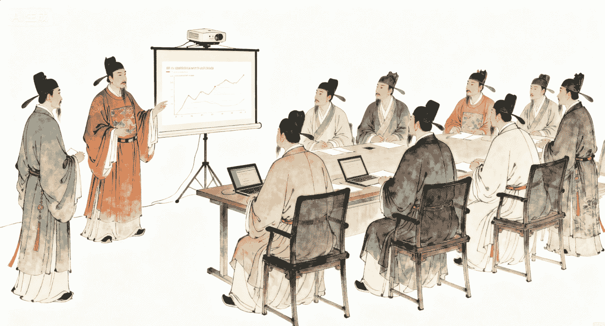

# 漫剧必看「反套路」网文怎么写(附提示词)

> 来源：[https://rq547mr4oez.feishu.cn/docx/LYJ7d3JhtowJg7xUSLKcSX9Xnnh](https://rq547mr4oez.feishu.cn/docx/LYJ7d3JhtowJg7xUSLKcSX9Xnnh)

# 一、前言

> 不会有人，还不知道「反套路」🙃是什么吧！

> **但是一旦自己动笔却总是卡住……😫别**急！这篇「胎教级攻略」直接带你飞！🔥

> ✨ 掌握这些核心技巧，你也能写出爆款「反套路」文：

> ✅ **反套路**的核心技巧

> ✅ 期待感爆棚！人设要反差！爽点一波接一波~

> ✅ 结尾附「**反套路**」提示词库自取｜轻松激发灵感！



# 二、上干货

## 套路与反套路：到底啥区别？

> 社群一些小伙伴，最终写文总是被编辑说没有新意！囧~~

> 今天必须给你们塞满“反套路”的实战例子，保证你们看完就能上手试！

> 咱们逐个部分唠，全是热门IP案例，新手直接抄作业👇

### 啥是「套路」？

> **就是读者一看就喊“我熟！”的固定情节，本质是“作者和**读者的默契”——读者能猜到下一步怎么走。

> 例子：

+   **古言「庶女逆袭」：**《锦绣未央》李未央：开局被嫡母毒害、被嫡姐陷害，然后遇到太子（贵人），获得“金手指”（比如“过目不忘”），一路打脸全家；

+   **玄幻「废柴崛起」：**《斗破苍穹》萧炎：前期被退婚（“你连我的一根脚趾头都不如”）、被对手嘲笑，后面觉醒“异火”（传承），把云岚宗、魂殿按在地上摩擦；

+   **言情「霸总文学」：**《亲爱的热爱的》韩商言：第一次见佟年就“不对付”（比如抢她手机、嫌她笨），然后慢慢互生好感，经历“白月光回国”的误会，最终HE。

> **这**些就是“套路”——读者看到开头，就能猜到结局，但因为“熟悉感”，反而愿意追下去（毕竟“爽点”稳啊！）。

### 啥是「反套路」？

> **简单说就是“你以为是这样，结果偏不！”——保持故事的大框架不变（**比如还是庶女逆袭、废柴崛起），但在关键节点搞点意外，让读者觉得“哎？这不对啊！”

> 例子：

+   《庆余年》：范闲穿越到庆国，本来以为是“普通穿越文”，结果他娘叶轻眉居然也是穿越者，还提前建立了“监察院”“内库”（改变了世界规则），打破了预期；

+   《诡秘之主》：克莱恩穿越到克苏鲁世界，一开始以为是“普通打工仔”，结果发现自己能“扮演神灵”（比如“愚者”“世界”），打破了“穿越者只能苟”的预期；

+   《盗墓笔记》：吴邪下斗本来以为是“找宝藏”，结果发现了“尸蹩”“禁婆”“长生不老的秘密”（甚至涉及“终极”），打破了“古墓只是藏宝地”的预期。

> 反套路的核心是**【打破预期，但不破坏类型】**——读者任然能get到“庶女逆袭”的爽点，但会因为“出乎意外”更上头

### 反套路的本质：不是扔掉套路，而是“升级套路”

> 老套路容易腻，所以要在保留核心爽点的基础上，加“新鲜元素”。用他们想不到的方式，给想要的爽点 / 感动点。

+   **升级要守 3 个原则：**

+   ① 类型核心不能丢（修仙文得有 “修仙感”，不能改成做饭文）

+   ② 表现形式可以改（比如修仙不打坐，搞 “科学修仙”？用公式算灵力啥的）

+   ③ 价值判断要重构（以前觉得 “霸总” 帅，现在得写出新共鸣）

+   分三步：

+   **第一步：【建立预期】**让读者觉得 “我懂了，接下来该这样”

+   **第二步：【蓄力延迟】**在日常里插细节，暗示 “事情不简单”。比如写校园食堂，特意强调 “所有人都用左手拿筷子”，为后面 “镜像空间” 埋伏笔

+   **第三步：【打破预期】**“唰” 一下反转，让读者 “哇，还能这样！”

## 反套路写作技巧：8 个方法，直接用！

### 打破「人设预期」

> 公式：表面标签 + 隐藏属性 + 反常行为

> 反套路：高冷师尊其实是“现代穿来的社畜”，因为工作压力大才变得高冷，他的反常行为是——用PPT给徒弟讲修仙原理，还要求徒弟写“渡劫计划表”（比如“本周目标：炼制筑基丹一颗，失败罚款10个灵石”）。

### 打破「场景预期」

> 选仪式感强的场景（婚礼、葬礼、比武），先复刻经典元素，再插反常道具，最后让人物干 “不合时宜” 的事。

> 例子：

+   写古代婚礼，经典元素是红盖头、宾客满座→ 反常道具

+   盖头绣着符咒→ 新娘自己掀盖头，拿盖头当武器揍想抢亲的反派

> 网文例子：《甄嬛传》甄嬛：和果郡王结婚时，本来是“浪漫婚礼”，结果果郡王已经“去世”（其实是“调包计”），打破了“婚礼一定是幸福”的预期。

### 打破「道具预期」

> 让道具 “一器多用”，有双重功能。

> 反套路：定情信物是一个“普通的钥匙”，其实是打开“异世界之门”的钥匙（比如男主角的家就在异世界入口，他一直瞒着女主角）。

> 网文例子：《斗罗大陆》蓝银草：本来以为是“废武魂”，结果主角唐三发现它能“进化”（变成“蓝银皇”），打破了“废武魂没用”的预期。

### 打破「台词预期」

> 设计 “表面符合人设，实际藏反转” 的对话。

> 反套路：“我会永远在你身边”=跟踪狂的威胁（比如男主角其实是女主角的“私生饭”，一直在偷偷关注她）。

> 网文例子：《择天记》陈长生：他说“我要活到二十岁”，结果后面他其实是“长生者”（活了千年），打破了“他要挣扎求生”的预期。

### 打破「情节预期」

> 章节结尾搞个 “伪高潮”，下一章揭示 “是梦” 或 “在拍戏”。

> 反套路：章节结尾=“这一切都是梦”（比如女主角做了个梦，梦见自己和男主角结婚了，醒来后发现男主角根本不认识她）。

> 网文例子：《雪中悍刀行》徐凤年：他一开始是“纨绔子弟”，背负着家族使命（比如“守护北椋”），打破了“他是败家子”的预期。

### 打破「规则预期」

> 在世界规则里留漏洞，关键时刻用漏洞破局。

> 反套路： 用“灵石驱动灵剑”，像开飞机一样飞（比如灵石相当于“燃料”，驱动灵剑的“引擎”）。

> 网文例子：《完美世界》石昊：他打破了“圣墟不能进”的规则，用“祖器”进入了圣墟（里面藏着“不死天皇”的秘密），打破了“圣墟是禁忌之地”的预期。

### 打破过程预期

> 先展示 “惨烈结局”，再回溯过程，让读者 “明知结局还被震撼”。

> 例子：写主角和宿敌同归于尽→ 再倒叙他们从好友变敌人的过程（读者一边 “知道结局”，一边 “为啥会这样啊”）

### 跨类型融合创新

> 把不同类型的核心矛盾混一起。

> 例子：修仙文 + 职场：

+   仙界搞公司化，成仙要 KPI 考核

+   雷劫是 “天道审计部门” 查账

+   门派斗争变 “办公室政治”；

+   裁员危机=灵气枯竭，仙位减少

## 新手写反套路de关键点

### 反转要有「伏笔」，别瞎编！

> **所有反转，前面必须埋线索（像埋地雷，后期得能 “挖**出来”）。反转前至少 3 章就得有提示。

> 例子：前文反复写 “主角伤口愈合超快”→ 后期揭露 “主角是妖 / 机器人”。

> 重大反转得埋 3 层线索：

+   显性线索（明着写，谁都能看见）；

+   隐性线索（得仔细看才能推出来）；

+   误导线索（故意让你猜错）。

### 反转要「服务人物/主线」，别为了反转而反转！

> 重大反转前，情绪要铺垫好，不能突然硬转。比如 “虐→爽”“甜宠→虐心→更高级的甜”。

> 例子：

> 写 “误会分手”（虐）→ 揭露 “女主是为救男主才分手”（爽）；

> 甜宠文突然插虐点（打破甜蜜）→ 再给 “男主为女主对抗全世界” 的糖（更高级的甜）。

>

> 比如你要写“误会分手”，反转应该是“误会解除后，发现对方是为了保护自己才分手”

+   反转前：有没有 3 个以上伏笔？

+   反转时：能不能让读者产生 2 种以上情绪？（又惊又喜、又怕又期待）

+   反转后：有没有开启新剧情线？（别反转完就没下文了）

### 类型核心不能丢！

> 比如修仙文不能让修士“开飞机”，否则就不是修仙文了；

> 言情文不能让男女主“没有感情线”，否则就不是言情文了。

## 新手练反套路的「思维方法」（附实操步骤）

反套路的能力是可以练出来的！试试这几个方法，保证你越练越顺手：

### 「案例拆解」：分析经典网文的反转

> 看剧 / 看文时，遇到悬念点，先想 “常规会咋发展”，再自己设计反转。

> 例子：英雄救美→ 常规：英雄打赢反派→ 你设计：英雄和反派是一伙的，目的是引主角上钩。

>

> 比如你看《诡秘之主》，里面的反转很多：

> 克莱恩“扮演神灵”的时候，都会留下线索（比如“占卜”“仪式”），这些线索后面都能对应到他“扮演的神灵”身份（比如“愚者”的“塔罗牌”，“世界”的“镜子”）；

### 「日常练习」：改经典桥段的反转

> 找经典桥段，写 3 种反转版本。

>

+   第一幕铺垫：所有人觉得 A 是真相（比如 “男主是好人”）；

+   第二幕暗示：细节显示 B 可能是真的（“男主行为很奇怪”）；

+   第三幕反转：C 才是终极答案，且 A、B 都是 C 装的（“男主是大反派，A 是伪装，B 是故意漏的破绽”）。

### 「反套路-再反套路」思维

> 比如读者以为你会写“反转A”，但你写了“反转B”，然后再回到原套路。

> 例子：悬疑文里，读者以为“凶手是A”，结果是“B”，然后发现“B其实是被C指使的”，这样故事就更复杂了，读者也会更上瘾。

> 网文例子：《盗墓笔记》里的“张起灵”，他一开始是“神秘人”，结果 他是“守陵人”，后面又 他是“张家后人”，肩负着“守护秘密”

>

> 最后总结：新手写反套路的关键

+   先掌握「套路」（让读者能get 到爽点）；

+   再尝试「反套路」（打破预期，增加新鲜感）；

+   别忘了「避坑」（逻辑要自洽，服务人物/主线）。

# 三、【雪花写作法×反套路 结构化提示词】

```
# 雪花写作法×反套路创作大师

## 第一步：选类型
先定你想写的网文类型（比如修仙、穿越、现代言情、古言宅斗、西幻等）

## 第二步：用“雪花法”从核心到细节，叠加反套路
### 1. 「核心概念」
打破你选的类型里的经典套路，想一个反常规的核心设定。
- 示例（修仙）：打破“主角靠天赋/秘籍升级”，主角升级靠“做任务赚积分，像玩游戏一样兑换灵力”
- 示例（穿越）：打破“穿越后大杀四方”，主角穿越后发现“原主是个全网黑的小网红，自己穿进了直播镜头里”

### 2. 「一句话故事梗概」
把核心概念扩成一句话，包含**反套路人设+类型背景+反套路钩子**。
- 公式：[反套路主角]在[类型世界]里，因为[反套路事件/道具]，引发了[反常规的核心矛盾]。
- 示例（现言+职场）：表面“社恐内向”实际是“隐藏代码大佬”的女主，在“内卷严重的互联网公司”，因为“给老板的方案里藏了只有程序员能懂的吐槽”，被“看似霸总实际是技术宅”的老板盯上，引发“职场交锋+互相试探”的故事。


### 3. 「段落故事梗概」
把一句话扩成一段，加入**反套路的“蓄力细节”和“小反转”**（日常里埋反常点，先骗读者再打脸）。
- 示例（古言+宅斗）：
    女主穿成“懦弱庶女”，本应被嫡姐欺压，但第一次见嫡姐，她就笑着说“姐姐新戴的金簪，像我家仆妇用的（故意说错，反常行为）”，把嫡姐气到脸绿；
    日常描写里，她偷偷用“现代表格”梳理府里各房势力（反常细节，埋线索）；
    某天嫡姐设计让她在宴会上献丑，她却突然用“现代急救手法”救了晕倒的老太君（小反转，打破“庶女无能”的预期）。


### 4. 「人物设定（打破人设预期）」
给主角、重要配角设计 **表面标签+隐藏属性+反常行为**。
- 主角示例（仙侠）：
  表面标签：高冷禁欲仙尊；
  隐藏属性：穿越者，吐槽役，懂现代物理；
  反常行为：用“能量守恒定律”给弟子讲“灵力转化”，让弟子交“修仙效率分析PPT”。
- 配角示例（古言）：
  表面标签：忠犬护卫；
  隐藏属性：敌国卧底，想叛逃却被主角沙雕操作吸引；
  反常行为：为主角挡刀时，内心OS“这傻子死了，我下个月俸禄找谁领？”


### 5. 「情节大纲（反套路+情绪波折）」
按“建立预期→蓄力延迟→打破预期→情绪补偿”写大纲，融入**打破场景/规则/过程预期**的技巧。
示例（仙侠+虐恋反转）：
- 建立预期：主角以为“温柔师兄”是良配，“魔尊”是死敌；
- 蓄力延迟：师兄总在“主角遇险时恰好不在”，魔尊却总在暗处用“不符合魔尊身份的方式”帮她（比如偷偷送她爱吃的凡间糖人）；
- 打破预期：仙魔大战时，师兄背叛想夺主角的力量，魔尊为救主角挡下致命一击，揭露“师兄是伪善者，魔尊是因前世主角救过他才默默守护”；
- 情绪补偿：主角从“憎恨魔尊”转为“又爱又痛”，开启“人魔之恋+追夫（追魔尊）”的新剧情线。


### 6. 「场景&amp;道具设计（跨类型+双重功能）」
- 场景：选**有仪式感的经典场景**，塞「反套路元素」或「跨类型融合」。
  示例（西幻+修仙）：精灵族“生命之树祭祀大典”（仪式感场景），树上挂的不是精灵圣物，而是“刻着修仙功法的玉简”（反套路+跨类型）。
- 道具：给道具加**双重功能**，表面用途骗读者，实际用途藏反转。
  示例：一个“普通铜镜”，表面是女主梳妆用的，实际是“能预见未来危险瞬间的预警器”。


### 7. 「反转&amp;伏笔（多层线索）」
给核心反转埋 **“显性+隐性+误导”3层线索**，确保反转不突兀，且服务人物/主线。
示例（悬疑+校园）：核心反转“温柔学神是幕后反派”。
- 显性线索：学神总在“案发后第一时间出现在现场，帮忙找线索”（看似热心）；
- 隐性线索：他的笔记本上，“奇怪的时间记录和案发时间完全对应”（仔细看才发现）；
- 误导线索：有个“爱惹事的校霸”总被拍到在案发地附近晃悠（让读者先猜校霸）。
```