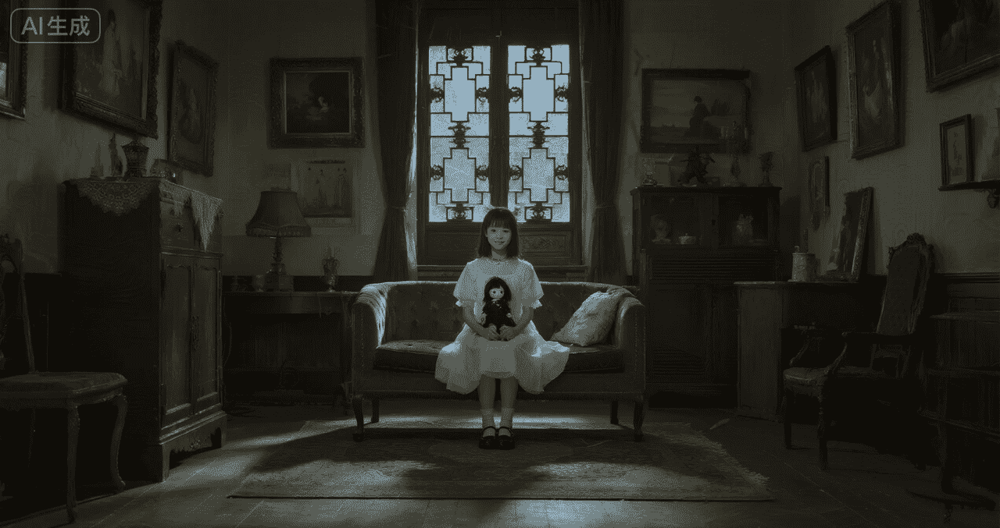
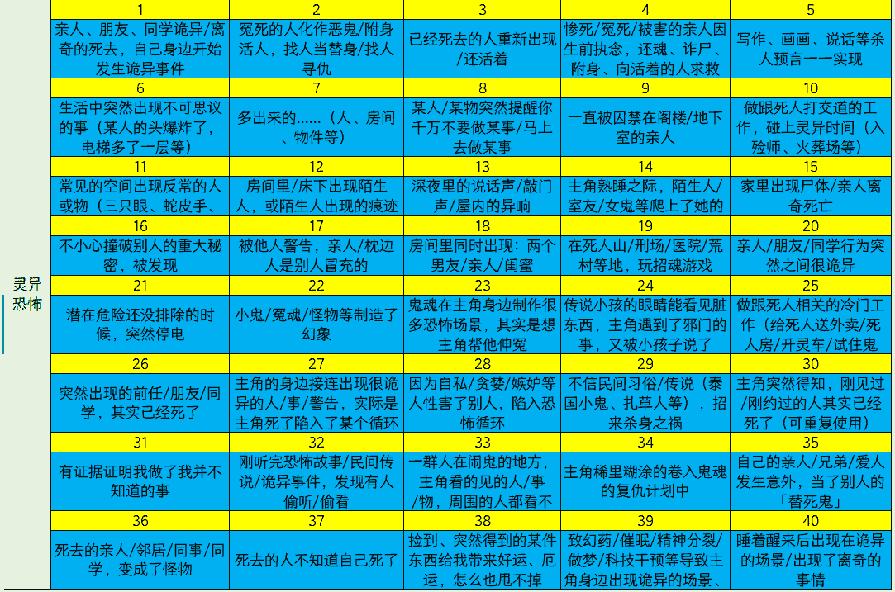
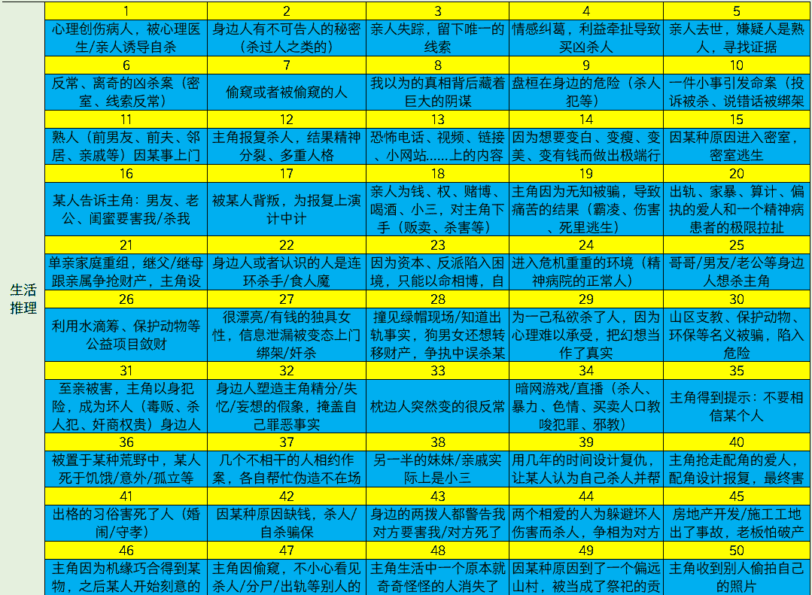
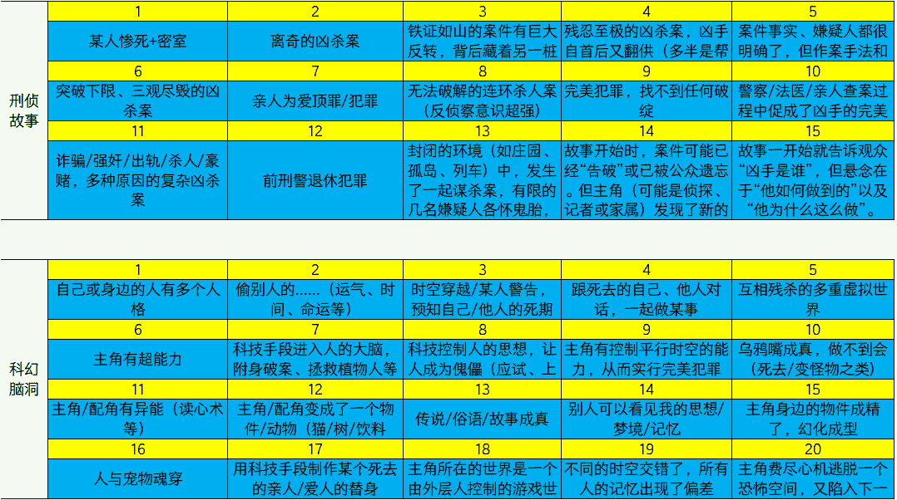

# 【写作素材】悬疑推理经典灵感130+

> 来源：[https://rq547mr4oez.feishu.cn/docx/DqaOdlxd8oE9eKxchoAcevl5nbg](https://rq547mr4oez.feishu.cn/docx/DqaOdlxd8oE9eKxchoAcevl5nbg)

# 一、前言

> **目前**悬疑类型的小说，单价是持续高走~~社群的一个大神悬疑短篇可以持续K400+（羡慕嫉妒恨~~~）🔥

> 是不是也眼红心热，但自己下笔却总是卡住？

> 这次我直接给你们打包了130+个悬疑推理经典灵感🎁！

>

> 从灵异恐怖，到推理，从细微破绽到惊天反转…统统帮你们整理好了！

> **灵感130+拿走不谢~~**

# 二、上干货

## 悬疑题材都有哪些？

> 很多小伙伴，对哦悬疑大类的题材分类不是太了解。

> 所以，第一部分我们将简述悬疑小说的不同的分类，以及子分类大致讲了什么故事，并给出一些市面上的作品参考。

### 刑侦

> 我们将刑侦分为两个子分类：

1.  **刑侦破案：它侧重破案视角，常常是公检法职员追查案件；**有时特殊职业背景人员也是侦破的关键角色。

> 这一类书籍的作品代表有：《长夜难明》（主角为检察官）、《无证之罪》（主角为派出所警员）、《白夜追凶》

>

1.  **犯罪故事：侧重展现罪案发生的前因后果，常常表现受害**者或罪犯的状态。故事的主线不一定是破案。

> 此类作品可以看看：《怒》、《摩天大楼》、《十八年后的终极告白》等

### 社会派悬疑

> 这个分类，会更加注重关注社会问题。可以有人性的闪光点，也有人性的黑暗面。

> **社会派悬疑强调的，更多的是人、事件背后的**故事，以悬疑的特质，关照社会、揭示人性。后者是目的，前者是途径。

>

> 你写一个故事既可以是犯罪故事，同时也是社会派悬疑，当然可以有交集。

> 区别就是视角不同，一般犯罪故事的主视角就是罪犯或者受害者。

> 推荐阅读作品：紫金陈《坏小孩》、凑佳苗《告白》、东野圭吾《白夜行》、郑执《生吞》、高野和明《消失的13级台阶》等。

### 女性悬疑

> **女性主视角，关注女性困境、成长的悬疑故**事。可以融合女性的虐文、言情、大女主等。

> 推荐阅读书籍作品：

+   《鱼猎》：虽然有一个噱头“借尸还魂”，但它实际讲的是女孩帮助女孩这样一个题材。

+   《江照黎明》：准确的说不是以「悬疑」这样的类型来定位的，而是以「勇敢」这样的精神力来定位。

+   《非自然死亡》，女主是一个法医，通过解剖尸体推理破案的剧集，里面也有一些关于女性职场的话题。

>

> **整体能举的例子很少，可以说就是一片蓝海，你如果能有好的**立意，好的想法，就可以动笔了，时不我待。

### 幻想悬疑

> 科幻悬疑：科幻元素与悬疑的结合。

> 影视作品：《开端》（今年很火的）《电话》（韩国电影）《西部世界》《怪奇物语》《十二猴子》《端脑》

> 这一类型的作品更加注重设定和悬念感，所以多数是外国的电影和电视剧，如果你能写出一定的热点和社会情绪那可能就火了。

>

> 奇幻脑洞：新奇的点子与悬疑的结合。

+   《少数派报告》，他这个设定就是未来世界，人们为了避免过多的犯罪，发明了可以预见犯罪的高科技，当犯罪事实未发生时就直接逮捕抓人。这就属于脑洞。

### 古代悬疑

> 古代悬疑：具体可以分为古装架空和历史悬疑，历史关系微弱的悬疑故事。

> 影视作品：《长安十二时辰》，马伯庸的作品可以都看一看，都是历史悬疑 。

### 心理惊悚

> **心理惊悚：**以角色内心的复杂变化为核心，通过扭曲的心理活动、道德困境、记忆错乱或身份危机制造紧张感。恐惧来源并非外部威胁，而是人性的阴暗面、精神崩溃或认知偏差，强调 “心理层面的惊悚”。

> **核心特征：**

+   **心理压迫**：通过压抑的氛围、不可靠的叙事者（如记忆混乱的主角）制造不确定性。

+   **道德模糊**：角色常在善恶间挣扎，观众难以判断其动机。

+   **身份危机**：人格分裂、记忆篡改或自我认知崩塌（如 “我是受害者还是加害者？”）

### 怪谈

> 怪谈：我们会把一些地方怪谈、民俗灵异故事等都分到这个分类里面来。

+   **定义：**以超自然现象、民间传说或都市怪谈为基底，通过诡异设定和未知恐惧制造悬疑。核心是 “对不可解释之物的敬畏”，常涉及诅咒、怨灵、禁忌或因果报应。

+   **核心特征**

+   **民俗元素**：如神社、巫女、诅咒仪式、怨灵复仇（如 “贞子” 源于井中冤魂）

+   **规则恐怖**：触发死亡的条件（如《咒怨》进入凶宅必死）

+   **集体恐惧**：文化中共通的禁忌（如 “拍照禁忌”“午夜电话”）

### 推理小说

> **注重理性逻辑，以逻辑至上的解谜为主，有惊险离奇的情**节与耐人寻味的诡计，通过推理展开情节的。

> 比如常见的密室死亡或孤岛杀人等都属于推理题材范畴之内。

> 用正确的方法解开谜团：这一点极为重要。

> 像是阿加莎，岛田庄司，江户川乱步，埃勒里·奎因的作品，都可以看看。

## 悬疑经典灵感130+

> 以下是根据市场上，整理的部分悬疑推理的灵感~~130+（完整表格找老杨要就好啦~）

