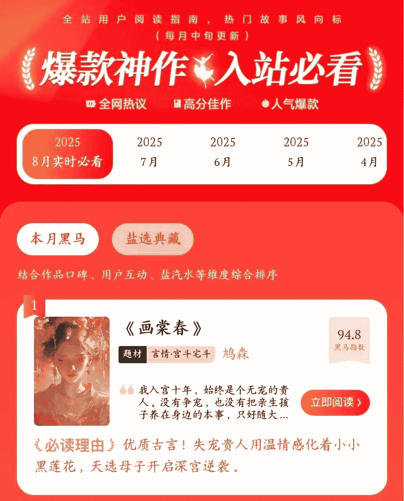
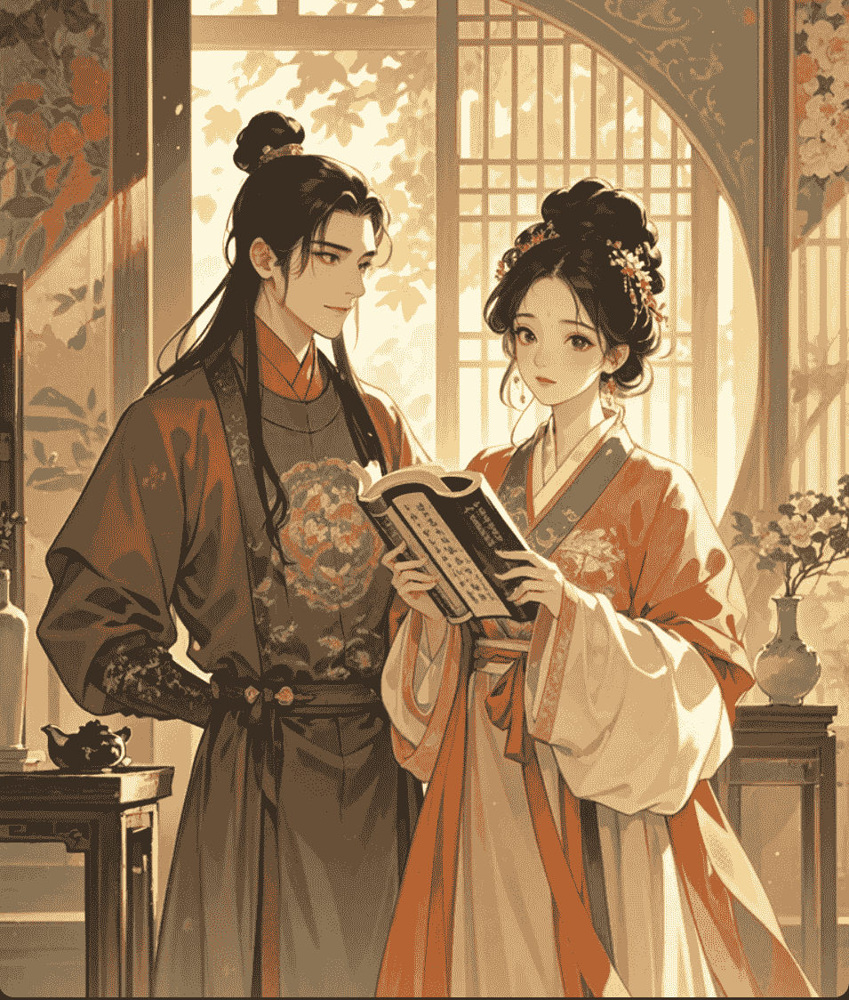

# 知乎8月黑马《画棠春》全拆解+换元方案

> 来源：[https://rq547mr4oez.feishu.cn/docx/DW9ndxU8GodmxgxqIECcBkoMn9g](https://rq547mr4oez.feishu.cn/docx/DW9ndxU8GodmxgxqIECcBkoMn9g)

# 一、前言

> ✨爆款密码终于被挖到了！✨

> 知乎8月最炸小说《画棠春》，短短几天冲上盐选TOP，到底凭什么？

> 9月份的黑马，我没有get到点，所以不推荐了~

>

> 有人说它靠“强冲突开局”钩住读者，但其实背后的套路比你想的更细致！

> 这篇笔记带你从开篇钩子、节奏把控，到情感爆发点的设计！

>

> **不吹牛，看完你也能摸懂下次爆款该怎么**写！快来抄作业，下一个热搜作者就是你💪





# 二、一一拆解（重点还是，看导语，拆大纲、情绪和节奏~~）

> **首先，逐字逐句的看导语/第1节，的**每句话！理解是什么意思，作者的目的是啥？

```
**导语**：

我入宫十年，始终是个无宠的贵人**。//开门见山，用时**长+身份+核心处境三要素快**速立人设！
没有争宠，也**没**有把亲生孩子养在身边的**本事，只好随大流站队，以求保全一条性命。//否定式铺垫+动机拆解，塑造性格+埋伏笔
贵**妃被废离宫，人人踩上一脚时，我**也被迫欺负她的三皇子。//核心**冲突事件来了
可是在这****宫里，从来都是旁人**欺负我，我不知道怎么欺负人。//暴露主角 “被欺负者**” 的本质，形成性****格反差
我挠挠头，只好把我亲手做的枣**花糕给了三皇子：//具象化主角让虚张声**势有画面感
「你只**配吃这种下等点心！」//塑**造主角,制造记忆点
九岁的三皇**子攥着那块枣花糕，**安安静静站在树影里，乌**黑的眼珠直勾勾盯了我很久，好像看破了我虚张声势**的草包性子。//侧**面描写，从三皇子的视角，加强主角性**格
欺负三皇子是对的，因为当晚****陛下就翻了我的牌子。//交代****主角被迫作恶的直接回报，让****行为有合理性,引出人物
半年没有承宠的我又惊**又喜，慌得去收拾落灰的妆台。//具象化主角久不受宠
晚间裴容来时，没有瞧我仔细擦拭过的珠花，并不在意我旧得跑了线的罗裙，更没注意我手上快拧烂的帕子。//三个并列否定，强化皇帝对主角的 无视
他倦怠地合上书页，揉了揉眉心。//代替直白的他很累，让人物更立体
喜怒不形于色的帝王，罕见地朝我温温一笑：
「你入宫这些年，一直不争不抢，温和安分，很好。//明确皇帝选择主角的核心原因
「朕问你，想不想养一个孩子。」//推动剧情进入新冲突

1
我心里一喜，险些端不稳手上茶盏：//失控动作表情绪
「是臣妾的瑜儿要回来了么？」
裴容放下书，没有追究我言语里的僭越，只沉声道：
「胡闹，瑜儿是皇后的孩子。//快速打破主角的期待，制造强烈情绪
「况且瑜儿并不愿亲近你，这样的话以后不要再说了。」//PUA，先否定归属，再否定孩子意愿（不愿亲近）
说话间，外头雪簌簌落了，灯花一炸更显屋内寂静。//用环境氛围强化情绪（主角的心情 = 雪的冷 + 寂静的压抑）
看在这场雪的面子上，裴容也愿意和缓脸色：
「朕记得那年你入宫，也是这么大的雪。」//自然过渡皇帝的情绪，为后续“回忆”做铺垫

十年前我入宫，人人称羡我的好命好福气。
陛下独宠贵妃，前几日的秀女们都落了选。
直到最后一日，陛下与贵妃拌嘴赌气，心烦时随手指了家世平平，容貌也并不出众的我，而我第一次承宠就有孕，生下了瑜儿。
//先扬后抑,详细交代主角 “好命” 的具体内容（被选、得孕、生皇子）
我的好福气，也就到此为止。//转折,承上启下
宫里的人都说，瑜儿不像温贵人木讷寡言，他很聪明。
聪明到夫子夸赞，裴容圣心大悦。
聪明到不愿亲近我，甚至不愿认我。//将 “聪明” 与 “不愿认母” 对比，用 “甚至” 强化程度，制造悲剧感
两年前瑜儿被送去坤宁宫养时，我跪在地上抱着瑜儿掉眼泪，生怕今后看一眼就少一眼。//场景动作表情绪
可是六岁的瑜儿满眼不解地推开我：
「三哥的母妃是周贵妃，你只是个贵人，并不配做我的母亲。」
瑜儿说这话，我也心寒难过。// 童言伤人比成人的话更扎心,记笔记
可是天下有哪个母亲会记恨自己的孩子？//强化母爱无私的态度,做对比

我就想办法升位分。//交代主角的后续行动
可是升位分很难，后宫的妃子如御园的花儿争奇斗艳，还有皇后持铰剪，注视着不安分的枝丫。
我既不像周贵妃那样擅歌舞，也没有皇后娘娘那样出众的家世。
非要说出一点好处，就是我随我阿娘，做得一手好羹汤。//在否定优势后，引出唯一优势（做羹汤），既真实又为后续剧情埋伏笔
可宫中有膳房，裴容若是熬夜批个奏折，各宫娘娘小厨房送上去的汤食满得连奏折都放不下。
实在想瑜儿的时候，我就省下月例银子，连着自己做的枣花糕一并讨好地塞给照看瑜儿的仇公公。//细节动作表母爱
仇公公是个八面玲珑的体面人，满面春风笑着把银子收了，客客气气把枣花糕推了。//主角都入不了太监的眼,卑微
瑜儿也总躲着我。
我花了不少银子，却没能见到几次。//让 “见不到瑜儿” 的失落更具体

后来瑜儿忽然病了，要亲生母亲的血肉入药。//夸张了，还有这个药方吗？
我没想过要瑜儿认我，只想他的身体好起来就够了。
可瑜儿听说是我的血入药，将药打翻在地，死也不肯吃：
「好恶心。
「瑜儿只有母后一个娘亲，你算什么东西？」//激烈动作 + 伤人台词
我跪在宫门口请罪时，皇后将哭累睡着的瑜儿搂在怀里，头也不曾抬：
「这些年四皇子的衣物吃食你送了不少，本宫见你可怜不愿与你计较。
「温棠，论位份你只是个贵人，要是真为四皇子好，就不要再见他了。」//塑造皇后伪善的人设（看似宽容，实则轻视），肯定是反派没错了
说话间瑜儿醒了，撒娇闹着要皇后停我半年的月例长长记性。
我不敢再还嘴，只低着头嗯了一声。//具象化主角在皇后、瑜儿面前的彻底屈服,加深人物的悲剧
是啊，再升位分，哪有比皇后还高的位分？

我渐渐熄了领回瑜儿的心思。
回神时，裴容笑得温和，却不容我拒绝：
「温棠，朕问你，想不想抚育三皇子琰儿。」//回忆衔接 + 关键问句结尾，将视角拉回现实（结束回忆），抛出核心决策，结尾留悬念
```

> **导语知道，是古言宫斗题材作品，但是跳出了 “狠辣**女主升级流” 的常见套路！（满满正能量）

> 比较少见的 “以柔克刚” 的后宫世界，人设讨喜~

> 同时这个开篇~信息量极多：快速搭建故事框架、立稳核心人物、埋下关键伏笔，并制造初始冲突

#### （1）叙事效率高：

> 开篇用 “道具细节” 传递信息：

+   用 “落灰的妆台” 说明 “久未承宠”，比我已经半年没见到皇帝了更具象；

+   用 “跑线的罗裙” 说明 “位份低、用度差”，比我很穷更符合场景；

+   用 “瑜儿打翻药碗说‘好恶心’” 说明 “母子关系破裂”，比瑜儿很恨我更有冲击力。

>

> **让**开篇在短短几千字内，既交代了温棠的十年处境、后宫规则，又埋下多组伏笔，信息密度大却不杂乱，是个极好的参考。

#### （2）情感共情强：

> 选择温棠的第一人称视角，是开篇的 “点睛之笔”：

+   读者能直接代入她的 “无奈”（被迫欺负三皇子时的手足无措）、“期待”（以为能要回瑜儿的狂喜）、“心碎”（被瑜儿嫌弃时的寒心），情感共鸣门槛极低；

+   尤其突出 “弱势者的善良” 这一共情点 —— 温棠自己已是后宫底层，却仍对更弱的三皇子（被欺负、无依靠）保留善意（送枣花糕），极易让读者产生 “心疼” 的情感倾向，为后续人物行为铺垫 。

#### （3）线索闭环紧：“现状 - 回忆 - 伏笔” 无闲笔

> 导语与第一节的所有内容都围绕 “温棠的生存与情感” 展开，无多余情节：

+   导语的 “承宠” 是第一节 “皇帝提养孩子” 的前提；

+   第一节的 “瑜儿回忆” 是导语 “无宠” 的原因，也是后续 “接受裴琰” 的心理铺垫；

+   道具 “枣花糕”“雪” 贯穿始终，让片段式内容形成 “闭环感”，避免了 “开篇松散、后续难圆” 的问题

# 三、换元法方案

> 《画棠春》原作核心：**弱**势者以善意打破 “权力场的冰冷规则”，非血缘羁绊（温棠 & 裴琰）的救赎，以及 “拒绝同流合污” 的坚守。

### 方案一：都市职场言情・编辑 × 新人作者

### 方案二：《恶女配不想洗白，只想养大未来反派》

+   换元核心： 人物视角 + 背景设定。将故事置于“穿书/恶女配觉醒”的流行框架下。

+   故事梗概： 我穿成了一本宫斗文里的恶毒女配，原主因虐待未来将成为暴君的三皇子，最终被其凌迟处死。看着眼前这个瘦弱阴郁的未来反派，我决定放弃所有洗白攻略。我给他做枣花糕，熬夜缝冬衣，不是出于母爱，而是为了活命。我教他：“想要什么，就得不择手段去抢。”他乖巧点头。后来，他弑兄弑父，踏血登基，却将凤印塞进我手里，红着眼说：“母妃，现在全天下都是我们的了。您……能不能只疼我一个人？”