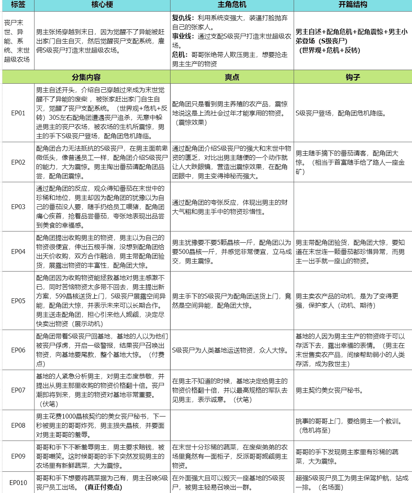

# 爆款漫剧《我在末日当老板》拆解(附剧本)

> 来源：[https://rq547mr4oez.feishu.cn/docx/J4jMdvn08owQGsx9AVtcnVrcnIh](https://rq547mr4oez.feishu.cn/docx/J4jMdvn08owQGsx9AVtcnVrcnIh)

# 一、前言

> 最近社群和编辑小伙伴们正在全力冲刺漫剧项目！机会稍纵即逝，必须抓紧⏳

> **社群有小伙伴想看指**定的漫剧拆解——《我在末日当老板》

> 这个剧本的「**震惊流**」设计精准踩中了 “**反差、叠加、共鸣****” 三大核心，用低**成本铺垫撬动强情绪冲击，非常适合新人模仿。

###

> PS：漫剧还在井喷发展~~老杨知识库，相关内容见：

> 《[邪修宝典-漫剧改编野路子(完整-实操版)](https://rq547mr4oez.feishu.cn/wiki/Q1PZwLpgtigrw3kK2XYcFlEYnmf?from=from_copylink)》

> 《[漫剧编剧从0到1‼️必看的超全指南（附模板）](https://rq547mr4oez.feishu.cn/wiki/PhuIwqtGoiPK6xkxcb1coSt0nAf?from=from_copylink)》

> 《[爆款黑马漫剧《洪荒代管截教》拆解(附原剧本)](https://rq547mr4oez.feishu.cn/wiki/DwX5wKVdzipn66k8b4LcvLgVn5T?from=from_copylink)》

> 《[爆款漫剧《全民诡异xx》拆解(附剧本)](https://rq547mr4oez.feishu.cn/wiki/LElfwBNV8i1YAvkewVkcQssXntg)》

> 《[炸裂番剧《师兄太稳健》拆解(附30集剧本)](https://rq547mr4oez.feishu.cn/wiki/W1uuwnjVZi9oRSkm9C2cigpWn6f?from=from_copylink)》

> 《[爆款「震惊流」漫剧《神文时代xx》拆解(附剧本)](https://rq547mr4oez.feishu.cn/wiki/UzvAweYOgi2RqGk0plKcP8ZknRg)》

# 二、上干货（原剧本卡付费点，找老杨要把）

### 拆解前10集xls（剧本就不放了）

### 研究总结，可学习的关键！

#### 每一集都要“挖坑”有钩子！

+   技巧： 在写每一场戏或每一集的结尾时，问自己一个问题：“如果观众看到这里，他有什么理由非要看下一集？”

+   例子：

+   设置悬念： 一个神秘人出现（SS级丧尸）。

+   制造危机： 主角被逼入绝境（被家人围攻）。

+   抛出反转： 珍贵的番茄竟然很难吃。

+   预告爽点： “下班了，都别干活了，出来！”

+   公式： 本集解决一个小问题 + 抛出一个更大的问题/悬念 = 成功的钩子。

#### 每集要有核心“爽点”

+   技巧： 熟练运用“压抑-释放”的节奏。先让主角或观众的情绪被压抑到极点，然后通过一个颠覆性的行为瞬间释放。

+   打脸公式：

1.  铺垫（压抑）： 反派/路人甲轻视、嘲讽、侮辱主角。（“废物不配待在张家”）

1.  转折（展示）： 主角不经意间或被迫展示出压倒性的实力/资源。（S级丧尸恭敬地站在他身后）

1.  爆发（释放）： 反派/路人甲震惊、恐惧、后悔，形成强烈反差。（“这家伙是什么怪物？”）

1.  收尾（巩固）： 主角获得实际利益或地位提升。（卖出高价，获得基地合作意向）

#### 给角色贴个“标签”

+   技巧： 不要试图在开头就写一个人物的方方面面。给他一个最核心、最鲜明的“标签”，然后用言行去不断强化它。

+   实践：

+   想写一个“扮猪吃老虎”的主角？那就让他平时看起来平平无奇，甚至有点怂，但在关键时刻说出最霸气的话，做出最牛的事。

+   想写一个“傲慢”的反派？那就让他的每一句台词都充满优越感和轻蔑，让他看不起所有人。

+   记住： 在爽剧里，一个鲜明的标签胜过一万字的背景故事。

#### 世界观“规则”要定好

+   技巧： 在动笔之前，先为你的故事建立一个简单的“规则表”。比如：这个世界最珍贵的东西是什么？力量如何划分等级？主角的金手指有什么限制？

+   实践：

+   规则1： 末世食物最珍贵。→ 剧情： 主角种出番茄。

+   规则2： S级丧尸无人能敌。→ 剧情： 主角让S级丧尸当快递员。

+   规则3： 主角系统需要晶核。→ 剧情： 主角必须出售物资换取晶核。

+   好处： 有了规则，你的剧情发展就有了逻辑支撑，主角的行为就有了动机，观众也更容易代入。

#### 台词很重要！ 一句话干三件事

+   技巧： 好的台词和动作，应该同时完成多个任务：推动剧情、塑造人物、提供信息。

+   实践：

+   台词示例： “和你说了多少遍，别在菜地里打架，吓到客人怎么办？本月KPI考核扣你10颗晶核的奖金。”

+   推动剧情： 结束了这场战斗。

+   塑造人物： 展现了张扬作为“老板”的淡定、幽默和权威。

+   提供信息： 暗示了丧尸有“KPI”和“奖金”体系，深化了“丧尸农场”的设定。

+   动作示例： S级丧尸伸出一只手，全息支付界面出现，说出“尾款结一下”。

+   推动剧情： 完成了交易。

+   塑造人物： 将S级恐怖存在和“打工人”身份结合，创造了巨大反差和喜剧效果。

+   提供信息： 展示了主角农场商业模式的成熟度。