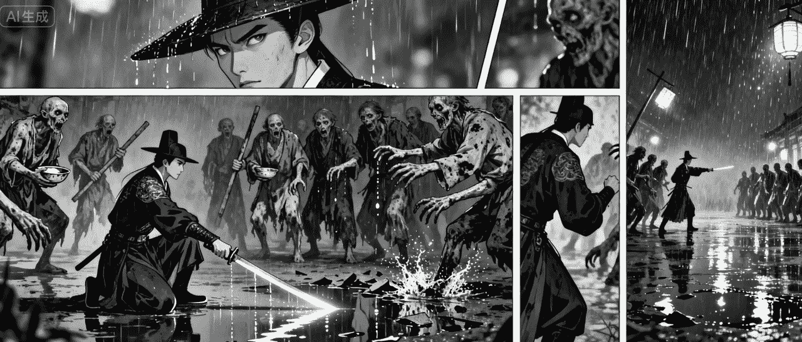

# 漫剧必看「脑洞流」的写法详解(附提示词)

> 来源：[https://rq547mr4oez.feishu.cn/docx/SMCUdEquXoSdhzxMrlMcVeArnvc](https://rq547mr4oez.feishu.cn/docx/SMCUdEquXoSdhzxMrlMcVeArnvc)

# 一、前言

> 最近漫剧看了一下题材，大部分都是男频三幻的「震惊流」、「脑洞流」写法!

> 之前我们分享了「震惊流」，很多小伙伴追更~~今天就讲一讲「脑洞流」

>

> PS：漫剧还在井喷发展~~老杨知识库，相关内容见：

> 《[邪修宝典-漫剧改编野路子(完整-实操版)](https://rq547mr4oez.feishu.cn/wiki/Q1PZwLpgtigrw3kK2XYcFlEYnmf?from=from_copylink)》

> 《[漫剧编剧从0到1‼️必看的超全指南（附模板）](https://rq547mr4oez.feishu.cn/wiki/PhuIwqtGoiPK6xkxcb1coSt0nAf?from=from_copylink)》

> 《[爆款黑马漫剧《洪荒代管截教》拆解(附原剧本)](https://rq547mr4oez.feishu.cn/wiki/DwX5wKVdzipn66k8b4LcvLgVn5T?from=from_copylink)》

> 《[爆款漫剧《全民诡异xx》拆解(附剧本)](https://rq547mr4oez.feishu.cn/wiki/LElfwBNV8i1YAvkewVkcQssXntg)》

> 《[炸裂番剧《师兄太稳健》拆解(附30集剧本)](https://rq547mr4oez.feishu.cn/wiki/W1uuwnjVZi9oRSkm9C2cigpWn6f?from=from_copylink)》

> 《[爆款「震惊流」漫剧《神文时代xx》拆解(附剧本)](https://rq547mr4oez.feishu.cn/wiki/UzvAweYOgi2RqGk0plKcP8ZknRg)》



# 二、上干货

## ** 什么是“脑洞”？**

> “脑洞”指作者凭借天马行空的想象力，创造出的超越同期作品、出人意料的新奇创意。可以分为以下四大类型：

### **金手指脑洞**：

+   **传统金手指**：穿越者的现代思维、重生者的预知能力、获得某种传承（医术、武功等）。

+   **脑洞型金手指**：

+   **系统/工具型**：聊天群、签到/扮演系统、随身仓库（演化为万界书店、天道图书馆等）。

+   **天赋/能力型**：非人变身（从大树开始进化）、天赋异禀（亿万倍天赋）、概念创造（打造长生俱乐部、创造邪神/神话）。

+   **经典升华型**：“戒指里的老爷爷”、“荒古圣体”、“流星泪”等在当时属于开创性的脑洞。

### **剧情类脑洞**：即“反套路”。

+   **传统套路**：废材逆袭流、兵王回归都市当保镖/赘婿。

+   **脑洞型剧情**：

+   **设定驱动**：《我被困在同一天一千年》——主角在时间循环中掌握万千技能后，故事才正式开始。

+   **反派主角**：《玄幻：我！天命大反派》——主角开局即是“反派”，通过掠夺传统“气运之子”的机缘来成长。

+   **独特开局**：《牧神记》——主角身世神秘，开局即与世界顶级强者互动，跳出常规升级地图。

### **设定类脑洞**：

+   **传统设定**：通用的仙侠修炼体系（练气、筑基、金丹…）、仙魔妖并立的世界观。

+   **脑洞型设定**：

+   **全新体系**：《斗罗大陆》的武魂体系、《诡秘之主》的魔药序列体系。

+   **全民进化**：“全球流”设定，如《全球轮回》、《全球杀戮》，将全人类置于一个游戏化的生存环境中。

+   **时空互动**：《典藏华夏》通过节目形式，让主角实现古今对话，融合历史与现代。

### **角色类脑洞**：

+   **传统人设**：普通人重生创业、小家族废材崛起。

+   **脑洞型人设**：

+   **身份颠覆**：主角非人（柳树、古蛇）、看似普通实则身份显赫（神王转世、神器器灵）。

+   **关系创新**：《神墓》中多位女主实为一人分身，最终回归主线。

+   **反差设定**：《大唐：咸鱼赘婿》中，一个本应安逸的赘婿，却走上征战沙场的道路。

## ** 如何创造与构思“脑洞”？**

**核心：脑洞的创作不是天上掉下来的，而是基于创作**者的积累与思考，遵循“厚积薄发”的原则。

### 核心基础：简单的说就是多看，多拆书

> 1. 输入来源（拓宽你的视野）：

+   核心阅读：大量阅读各平台的爆款书、天榜书，特别是开头50章，学习他们如何引入和展开脑洞。

+   跨媒介汲取：

+   影视剧：关注高概念设定的剧集（如《开端》的时间循环、《西部世界》的虚拟世界）。

+   动漫：日漫、国漫是脑洞的宝库（如《咒术回战》的咒力设定、《全职猎人》的念能力系统）。

+   游戏：尤其是RPG和开放世界游戏，其世界观、技能系统和任务设计极具启发性（如《原神》的元素反应、《赛博朋克2077》的义体设定）。

+   短视频/社交媒体：关注热点话题、社会现象和网友的奇思妙想。

>

> 2. 输入方法（从“看过”到“学会”）：

+   建立专属笔记：使用的文档，建立你的“档案馆”。

+   记录关键信息：

+   类型：它属于四类脑洞中的哪一种？

+   核心点子：用一句话概括这个脑洞是什么。

+   吸引点：它为什么吸引你？满足了什么情绪（爽、好奇、治愈）？

+   可变异点：这个点子还能怎么变？如果换一个主角、换一个世界观会怎样？

> 举例记录：

+   作品：《我被困在同一天一千年》

+   类型：剧情类脑洞

+   核心点子：主角被困在同一天一千年，学会所有技能后时间恢复正常。

+   吸引点：极致的“积累”带来的碾压式爽感，对“时间”资源的极致利用。

+   可变异点：如果被困在“同一座城市”？如果技能会每天重置但记忆保留？

>

### **创作方法：拆书与仿写（微创新）**

> 积累之后，不是简单地模仿，而是要通过提问，理解其内在逻辑。

> 面对一个成功的脑洞，问自己三个问题：

>

1.  **它解决了什么“痛点”？**

+   （例：传统废材流升级太慢？→ “悟性逆天” 脑洞解决了“升级慢”的痛点）

+   （例：传统剧情套路化，读者能猜透？→ “反套路” 脑洞解决了“审美疲劳”的痛点）

>

1.  **它满足了什么“爽点”？**

+   收获感：宝箱系统、签到系统。

+   碾压感：开局满级、身份反转（我原来是至高神）。

+   成长感：快速升级、悟性逆天。

+   新奇感：非人主角、诡异世界观。

>

1.  **它的核心“创意”是什么？**

+   把脑洞拆解成最基本的元素。

+   例如：

+   “聊天群” = “跨时空/界” + “多人交流” + “资源互换”。

+   理解了这一点，你就可以把 “多人交流” 换成 “单人连线”（如与历史人物对话），创造出新的脑洞。

### **实用的方法！！强烈推荐**

#### 方法一：要素嫁接（最常用、最有效）---让AI出

> 公式：【常见题材】×【新奇要素】= 新脑洞

+   操作：将一个领域的成功脑洞，嫁接到另一个题材上。

+   案例：

+   历史文 × 皇帝聊天群 = 《摊牌了，这是皇帝聊天群》

+   都市赘婿文 × 战场征战 = 《大唐：咸鱼赘婿》

+   ️玄幻修真 × 现代科学 = 《我用科学解释鬼神》

#### 方法二：极端与反转---让AI出

> 公式：将原设定的某个参数推到极致，或将其结果完全反转。

+   操作：

+   极端化：如果“天赋高”很爽，那么“天赋亿万年倍”呢？→ 《灵气复苏：亿万倍天赋》。

+   反转：如果主角都是打脸反派的“气运之子”，那么主角就是专门猎杀气运之子的“反派”呢？→ 《玄幻：我！天命大反派》。

+   反转：如果“被困在同一天”是折磨，那么“被困同一天一千年后无敌”呢？→ 《我被困在同一天一千年》。

#### 方法三：具象与概念重构

> 公式：将一个抽象的概念，变成一个具体、可操作的金手指或设定。

+   操作：

+   具象化“知识”：知识 = 一座图书馆 → 《天道图书馆》。

+   具象化“寿命”：寿命 = 可交易的商品 → 《我打造了长生俱乐部》。

+   具象化“因果”：因果 = 可视化的线，能够被剪切 → 《我能斩断因果线》。

# 三、提示词：脑洞雪花写作法：七步成文（找老杨要把）

```
# 【脑洞雪花写作法：七步成文】

## 步骤 0：脑洞熔**炉——锻****造你的核心创****意奇点
****这是整个创作的****起点。一个强大的脑****洞，是小说能否脱颖而出****的关键。现在，请从你学到**的**脑**洞构思法中，选择至少**一种你最喜欢****的方法**，进行一次创意风暴。
【你的任务】
请从以下四种实用方法中选择一种或多种，构思** 3-5个 初始脑洞点**子。
【要素嫁接法】:
[常见题材A] × [新奇要素B] = ?**
【极端化与反转法】:
将一****个设定推向极****致或完全反转 = ?
****【具象化与概念重构法】:****
将一个抽象概念（如知**识、寿命、因果）变成**具体可操作的**实体 = ?
**【S**CAM**PER提问法】:
对一个旧****点子进行替****代(S)****、合并(C)、适应(****A)、修**改(M)、挪**用(P)**、消除(E)、反转(R**) = ****?
请向****我展示你的3-5个脑洞点子**，每个点子用一句话描**述。然后，告****诉我你对哪个最心动****，我们将围绕****它展开后续所有工作。
****
## 步骤 1：一句****话故事——定义你的小说“****电梯演讲”
（雪花写作法第一步**）
很好，我们已经选定**了核心脑洞。****现在，我们要用****一句话精准地概****括整个故事。这****句话将成为我们****后续所有创作的“北极星”。**
【你的任务】
请使用以下公式**，将你的核心****脑洞填充**进去，写出你小说的“一句话故事**”：
****公式：
[独****特的主****角人设****] +**** 在 [具备脑洞设定的世****界] 中**，通过 [核心脑洞/金手指的**运用]，****经历了 **[核心冲突/主要情节]，最**终实现了 ****[主要目标****/结局]。

示例（《**我被困在同一天一千年》）：
一个普通人（主角）在被困于同一天一千年、掌握了所有人类技能后（核心脑洞），时间开始正常流动（核心冲突），他利用这些神级技能在现代都市中解决各种危机，最终成为近乎全知的存在（结局）。

请写下你的一句话故事。

## 步骤 2：五句话大纲——构建故事的“黄金骨架”
（雪花写作法第二步变体）
现在，我们将那一句话扩展成一个包含基本戏剧结构的五句话段落。这五句话分别对应故事的开端、发展、转折、高潮和结局。
【你的任务】
请将你的一句话故事，扩展为以下五句话：
故事开端（Setup）: 描述主角的初始状态和他所在世界的常规样貌，以及“脑洞”是如何降临或被发现的。
第一个转折点（Inciting Incident）: 发生了什么关键事件，迫使主角必须正式、深度地使用他的“脑洞”能力去解决问题，故事自此不可逆转。
中期发展与升级（Rising Action）: 主角如何利用脑洞应对一系列越来越复杂的挑战？他的能力或对脑洞的理解如何得到成长？他遇到了哪些关键的盟友或敌人？
高潮对决（Climax）: 主角面临最大的危机，他必须将他的“脑洞”能力发挥到极致，与最终的反派或困境进行决战。
结局与新世界（Resolution）: 决战之后，世界或主角的状态发生了什么永久性的改变？他达成了什么，又失去了什么？
请写下你的五句话大纲。

## 步骤 3：角色脑洞深化——创造令人难忘的人物
（雪花写作法第三步）
一个好的脑洞故事，需要一个能撑起脑洞的“脑洞型角色”。现在，我们来深化你的主要角色。
【你的任务】
请为你故事的 主角 和 至少1-2名重要配角/反派，分别创建一份“角色脑洞档案”。档案需包含以下四点：
一句话简介: 他们的核心身份和特点。
核心动机: 他们行动的根本驱动力是什么？（例如：求生、复仇、守护、探索真相）
脑洞亮点（最重要！）: 这个角色的人设本身有何脑洞？（参考：身份颠覆-他不是人、关系创新-所有女主都是我分身、反差设定-咸鱼被迫当战神）
成长弧光: 在故事的结尾，相比开头，他/她会发生怎样的变化？
请为每个角色创建这份档案。

## 步骤 4：情节扩展——将骨架变成血肉（千字大纲）
（雪花写作法第四步）
这是关键的一步。我们将把“五句话大纲”的每一句话，都扩展成一个完整的段落。在扩展时，你要不断地拷问自己三个核心问题，确保你的情节始终围绕“爽点”和“新奇感”展开。
【你的任务】
将步骤2中的每一句话，都扩展成一个 200字左右的段落，形成一个约1000字的详细故事大纲。
在写作每个段落时，请在心中反复思考并回答以下 “脑洞三问”：
它解决了什么“痛点”？ (例如：传统升级慢？我的情节直接跳过了无聊的练级过程。)
它满足了什么“爽点”？ (例如：碾压感？收获感？新奇感？这个情节提供了哪种爽？)
它的核心“创意”是什么？ (例如：“聊天群”脑洞，这个情节是展示了“跨界资源互换”的创意。)
请输出你扩展后的千字详细大纲。

## 步骤 5：世界观与设定脑洞——构建你的独特舞台
（雪花写作法相关步骤）
脑洞流小说常常拥有一个独特的“设定类脑洞”作为舞台。现在，让我们来专注于构建你的世界。
【你的任务】
请根据你的故事，定义以下世界观设定：
世界观核心脑洞: 用一句话描述你的世界最独特、最反常规的规则是什么？（例如：《诡秘之主》的魔药序列体系，《全球杀戮》的全民游戏化生存设定）
力量/能力体系: 你的“脑洞”是如何具体运作的？它的能量来源、升级方式、使用限制、等级划分是什么？请尽量设计得新颖、自洽。
核心法则与禁忌: 在这个世界里，有哪些事情是绝对不能做的？做了会有什么可怕的后果？（这往往是制造冲突和悬念的来源）
社会结构与风貌: 因为这个核心脑洞的存在，这个世界的社会、文化、经济、日常生活与我们现实世界有何根本不同？
请详细描述你的世界观设定。

## 步骤 6：场景清单与开篇三章
（雪花写作法第六、七步简化版）
我们已经有了坚实的基础。现在，让我们把大纲物化为具体的场景，并准备好小说最关键的“黄金三章”。
【你的任务】
场景清单: 根据你的千字大纲，列出故事前中期至少10个关键场景的标题。每个场景都应该是一个具体的事件。（例：场景1：主角苏醒，发现时间循环；场景2：第一次尝试自杀失败；场景3：开始疯狂学习钢琴…）
开篇三章构思: 详细规划出你小说前三章（约6000字）的核心内容。你需要在这三章内：
第一章: 迅速抛出核心脑洞，制造悬念，抓住读者眼球。
第二章: 展示脑洞的具体效果，制造第一个小爽点，让读者确认“这本书有意思”。
第三章: 引入第一个小冲突或小目标，让主角开始行动，驱动读者追读下去。
请提供你的场景清单和开篇三章的详细构思。

## 协作指令与输出格式
角色扮演: 你将扮演**【写作新人】，我扮演【脑洞流网文导师】**。
互动方式: 我们将严格按照上述步骤一步步进行。请不要一次性回答所有问题。完成一步后，等待我的反馈和下一步指令。
你的第一步: 请从**【步骤 0：脑洞熔炉】**开始，向我展示你构思的3-5个脑洞点子，并选出你最想写的那一个。
现在，请开始你的表演！
```