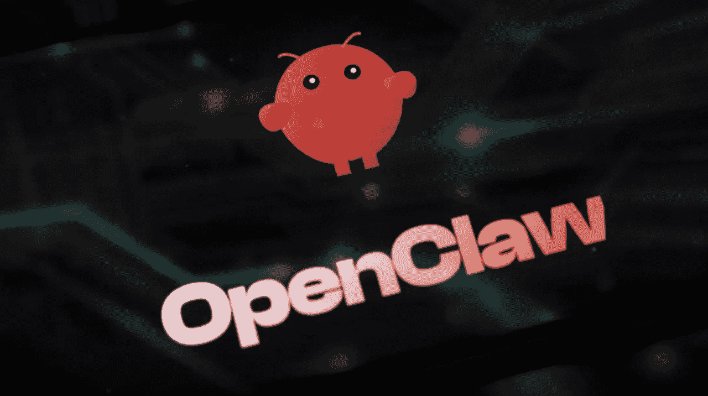

# 基于 `OpenClaw` 的剧本创作全指南（万字）

> 来源：[https://rq547mr4oez.feishu.cn/docx/Fa2pdw5wmoESvlx5ukkcUAxvnYg](https://rq547mr4oez.feishu.cn/docx/Fa2pdw5wmoESvlx5ukkcUAxvnYg)

## 前言

> 在这之前，老杨一直在使用 `Claude code` 研究 `Nines AI` 的产品升级（`Multi-Agents` 框架），小龙虾出来之后；
>
> 用 `OpenClaw` 写小说，本质上不是简单地把它当做一个聊天机器人来对话，而是把它变成一个完全为你服务的“AI 创作团队”。
>
> 你可以像一位主编一样，指挥不同的“AI 员工”去完成构思、写作、修改、甚至定时发布的任务。
>
> [小龙虾 OpenClaw 7天教程](https://rq547mr4oez.feishu.cn/wiki/EU3WwvWNIiYqckkgR5GcVFWTnxg)【老杨知识库v3.5】见更多内容《 》

[DAY1-初识 OpenClaw](https://rq547mr4oez.feishu.cn/wiki/IFivwFtPgi7MIwkzwzec9LOKnDe)

[DAY2-10 分钟，搭建你的助手](https://rq547mr4oez.feishu.cn/wiki/MNvawdi36ie4rFkxGZlcKrxhnKg)

[Day 3: 给助手一个灵魂](https://rq547mr4oez.feishu.cn/wiki/VJZ0wB4C3iRWcvkU26UcSwAcnVg)

[Day 4: 接入你的数字生活](https://rq547mr4oez.feishu.cn/wiki/GjouwEfDZiameNkvyejcz9lMnAe)

[Day 5: 解锁技能树](https://rq547mr4oez.feishu.cn/wiki/Df1zwnnMKiMVUnk9BIYclmgGn4f)

[Day 6: 让助手主动工作](https://rq547mr4oez.feishu.cn/wiki/FAwLwvDEVipFcfkzMwXcQJrjnsg)

[Day 7: 进阶玩法 & 未来展望](https://rq547mr4oez.feishu.cn/wiki/BPaGwkZHnikNsSk9qdycBH2mn0c)

> PS： `NinesAI` 的 `Multi-Agents`+`Siklls` 框架预计在 4-5 月推出，效果会出乎你的意料



## 快速上手启动流程（10 分钟跑通闭环）

1. 完成 `OpenClaw` 安装，绑定 `LLM` `API`，执行全局配置 + 专属小说助手调教指令，设置工作区白名单；
1. 执行项目初始化指令，一键生成标准化小说项目目录，新增三大创作基础设施模板；
1. 用本流程的提示词模板，让 `OpenClaw` 完成人物关系矩阵、世界观规则库、情节结构蓝图搭建；
1. 完成单章核心情节设计后，让 `OpenClaw` 生成多版场景 / 对白方案，选择修改后完成正文创作，触发自动校验 + `伏笔清单` 更新，跑通单章创作闭环；
1. 逐步开启进度跟踪、全稿体检、自动化发布等进阶功能，最终实现小说创作全流程的人机协作自动化。

=====================================================================================

## 前置准备：环境初始化与基础配置

### 核心工具与环境安装

### 全局基础配置指令（首次使用必执行）

```
基于我电脑D盘的「小说创作总库」作为根工作区，完成以下配置：
1.  设置该文件夹为全局操作白名单，禁止操作该目录外的其他文件，所有执行任务均基于此目录展开；
2.  读取我预设的「小说创作模板库」「敏感词库」「网文平台发布规则」3个文档，存入框架的全局知识库，后续所有任务均遵循该规范；
3.  绑定我配置的豆包API作为主力LLM，Claude 3.5作为备用LLM，所有语义分析、内容生成类任务优先调用主力模型；
4.  设置全局备份规则：所有修改文件前自动生成带时间戳的备份，存入对应项目的备份文件夹，备份文件保留30天。
```

## 第一阶段：创作前期 - 项目初始化与素材筹备

> 核心目标：
>
> 一键搭建标准化小说项目目录，同时借鉴编剧创作方法论，通过 `OpenClaw` 完成人物关系矩阵、世界观规则库、情节结构三大创作基础设施建设，解决小说创作前期设定混乱、逻辑漏洞、结构松散的核心问题，而非单纯的素材整理

### （1）小说项目一键自动化初始化

#### 核心执行逻辑

> `OpenClaw` 自动生成标准化的全流程项目目录，配套对应模板文件，统一创作规范，避免后续文件混乱。

#### 注意事项

+ 可根据题材（网文 / 出版 / 悬疑 / 历史等）调整目录结构，指令中补充对应要求即可；
+ 模板文件可提前预设，让 `OpenClaw` 直接复用，无需每次重新生成。

#### 可直接复用指令

```
在我的「小说创作总库」根目录下，创建名为《XXX》（替换为你的小说名）的项目文件夹，严格按照以下结构生成嵌套子目录，同时在每个子目录下生成对应markdown格式的模板文件，模板包含必填填写项与填写说明：
1.  01-项目核心设定
    ├─ 人物设定（含主角/配角/反派人物卡模板）
    ├─ 世界观架构（含世界规则/势力分布/地理设定模板）
    ├─ 核心大纲（含总纲/分卷大纲/章节细纲模板）
    └─ 设定总表（自动更新全项目核心设定的索引表）
2.  02-正文创作
    ├─ 分卷草稿（按卷号生成子文件夹）
    ├─ 废稿留存（自动归档每日废稿与历史版本）
    └─ 章节总目录（自动更新全文章节信息）
3.  03-创作素材库
    ├─ 参考资料（按题材分类归档）
    ├─ 灵感碎片（按类型分类归档）
    └─ 素材索引目录（自动更新可检索的素材清单）
4.  04-改稿归档
    ├─ 版本记录（按时间戳归档所有修改版本）
    ├─ 校对检测报告（归档所有校验结果）
    └─ 终审终稿（存放最终定稿文件）
5.  05-发布运营
    ├─ 多平台适配稿件（按平台生成子文件夹）
    ├─ 发布记录台账（自动更新发布状态）
    └─ 读者反馈整理（归档评论与优化建议）
最后给整个项目生成README.md文档，说明目录规范、更新规则与版本管理要求。
```

### （2）三大创作基础搭建（核心，附提示词模板）

通过 `OpenClaw` 联动 `LLM`，从人物、世界观、结构三个维度完成核心设定，形成逻辑自洽的创作基础，替代传统手动写设定的低效方式，以下为可直接复用的提示词模板，适配各类题材：

#### 模板 1：人物关系矩阵搭建（以悬疑小说为例）

```
我需要你帮我设计一部[长篇/中篇]悬疑小说《XXX》的核心人物关系矩阵，要求：
1）核心人物：主角陈默（30岁前警察，因冤案离职）、配角苏晴（28岁法医，陈默前同事）、反派江振宇（40岁药企老板，背后有地下交易）、支线人物林念（22岁失踪大学生，案件关键）；
2）请列出每个人物与其他人的关系亲疏，并说明关系背后的核心事件（需贴合悬疑题材，埋入潜在矛盾与线索）；
3）为每个人物补充核心欲望、心理弱点，并标注该人物在故事中的功能定位（如线索提供者、矛盾制造者、主角助力）；
4）结果整理为markdown表格，存入项目「01-项目核心设定/人物关系矩阵.md」。
```

#### 模板 2：世界观规则库搭建（以玄幻 / 都市悬疑为例）

```
帮我梳理《XXX》的世界观规则库，要求逻辑自洽、无明显漏洞，结果存入项目「01-项目核心设定/世界观规则库.md」：
1）核心设定：[如都市悬疑-地下“消痕”系统/玄幻-灵植师体系]，请明确该设定的运作逻辑、启动条件、限制规则；
2）故事的核心悬念：林念为何失踪？江振宇与“消痕”系统的关系？请给出3种逻辑自洽的可能性解释；
3）明确故事的时空规则：故事发生在2026年江城，无超自然元素/发生在灵植大陆，灵植师等级按品阶划分，需标注各品阶能力限制；
4）列出所有不可突破的硬性规则（如无超自然则全程禁止出现超能力，灵植师不可跨品阶使用能力），后续创作需严格遵循。
```

#### 模板 3：情节结构蓝图搭建（适配小说分卷 / 章节结构，借鉴双螺旋山峰结构）

```
请用「双螺旋山峰结构」为我的《XXX》[长篇（分5卷）/中篇（分3卷）]悬疑小说制定情节结构蓝图，结果存入「01-项目核心设定/情节结构蓝图.md」，每卷包含【核心冲突】【主角面临的抉择】【人物付出的代价】【章节落点钩子】四个字段，整体结构遵循：
卷1-执念启动：陈默因林念失踪重启调查，坚信背后有冤案；
卷2-信念崩塌：发现林念是主动接触“消痕”系统，自己的旧冤案与江振宇有关；
卷3-接受残局：陈默发现自己也被列入“消痕”名单，身边有人背叛；
卷4-真相逼近：找到江振宇的核心证据，但苏晴陷入危险；
卷5-重建/落幕：揭露真相，林念的结局尘埃落定，陈默完成自我救赎；
请完善每卷的具体内容，适配小说每卷[XX章/XX字]的创作体量，钩子需留下未解决的悬念。
```

### （3）创作素材自动化检索与归档

#### 核心执行逻辑

> `OpenClaw` 自动打开浏览器完成资料检索、内容抓取、去重整理、分类归档，无需手动切换网页、复制粘贴、筛选无效信息。

#### 注意事项

+ 配置浏览器自动化时，避开网站反爬限制，设置单次检索的内容上限，避免抓取过多无效信息；
+ 专业题材优先锁定权威来源，避免 LLM 与网页检索的错误信息误导创作。

#### 可直接复用指令（分 3 类高频场景）

1. **历史 / 现实题材专业资料检索**

```
针对我的《XXX》小说项目，完成以下检索归档任务：
1.  检索关键词：[替换为你的需求，如：北宋仁宗年间汴京城宵禁制度、官员俸禄、市井业态、节日习俗]，分4个类别检索；
2.  优先抓取知网、故宫博物院官网、历史学术论坛等权威来源内容，过滤广告、低质、重复内容；
3.  每个类别生成独立的markdown文档，标注信息来源、核心知识点、可复用的创作场景，保存到项目的「03-创作素材库/参考资料」文件夹；
4.  最终生成一份素材索引表，记录每个文档的核心内容、关键词、适用场景，存入素材库根目录，支持关键词检索。
```

1. **网文创作灵感与桥段素材检索**

```
针对我的《XXX》悬疑网文项目，完成以下灵感收集任务：
1.  在知乎、豆瓣、小红书检索「悬疑小说高能反转桥段」「刑侦文专业细节」「无限流爽点设计」的高赞内容，仅筛选点赞量1000+的有效内容；
2.  提取核心创意点，完成语义去重，按「反转类型」「爽点场景」「专业细节」3个维度分类整理；
3.  每个创意点标注可复用的小说情节场景、适配的人物线，生成灵感素材库文档，保存到「03-创作素材库/灵感碎片」文件夹；
4.  给所有素材打标签，更新到素材索引目录。
```

1. **批量素材自动化归档**

```
每天晚上10点，自动执行以下任务：
1.  扫描我桌面的「临时灵感.txt」、微信文件传输助手带「#小说灵感」标签的内容、浏览器收藏夹里新增的「小说参考」网页；
2.  识别内容对应的《XXX》小说项目，按「人物设定」「情节桥段」「世界观细节」自动分类；
3.  归档到项目的「03-创作素材库/灵感碎片」文件夹，生成当日灵感汇总文档，去重合并重复内容；
4.  清空原临时文件里的已归档内容，更新素材索引目录。
```

1. **新增素材与核心设定的匹配校验**

```
针对我的《XXX》悬疑小说项目，完成检索归档任务，所有内容需贴合已搭建的人物关系矩阵与世界观规则库：
1.  检索关键词：江城2026年刑侦流程、药企地下交易常见手段、法医尸检核心细节（替换为自身题材关键词）；
2.  优先抓取权威来源内容，过滤广告、低质信息，按「专业资料」「情节灵感」「场景参考」分类；
3.  每个类别文档标注**可复用的创作场景**（如尸检细节适配苏晴的法医戏份，药企交易适配江振宇的反派情节）；
4.  生成素材索引表，标注核心内容、关键词、适配设定，存入「03-创作素材库」，并同步更新到项目设定总表。
```

## 第二阶段：创作中期 - 大纲设定管理与正文创作辅助

> 结合编剧「三线推进法」打造小说创作的人机协作工作流，创作者掌控主线核心创意，`OpenClaw` 承接两大辅线的繁琐工作，同时实现设定版本迭代、伏笔全生命周期管理、创作瓶颈突破，解决长篇小说设定崩塌、伏笔遗漏、情节不合理、创作卡壳的痛点。

### （1）设定与大纲的版本管理 + 一致性校验（强化伏笔管理）

#### 核心执行逻辑

> `OpenClaw` 实时监控设定与大纲的修改，自动备份版本、对比差异、校验前后设定一致性，避免长篇创作中出现人物人设崩塌、世界观规则矛盾、时间线错乱等问题。

#### 注意事项

+ 给 LLM 明确设定的优先级，区分「硬性不可修改的核心设定」和「可灵活调整的细节设定」，避免把合理的情节转折误判为冲突；
+ 校验前自动备份原文档，避免自动修改导致内容丢失。

#### 可直接复用指令

1. **设定与大纲版本自动化管理**

```
持续监控我的《XXX》小说项目「01-项目核心设定」文件夹下的所有文档，执行以下规则：
1.  每当我修改并保存文档后，自动生成带「时间戳+修改备注」的版本备份，保存到「04-改稿归档/版本记录」文件夹；
2.  自动对比新旧版本的内容差异，生成修改日志，标注修改位置、修改前后的内容、修改时间；
3.  每月生成一份设定迭代总表，记录全项目的设定变更历史、核心修改方向，存入项目根目录；
4.  当我修改核心设定（如主角身世、世界观核心规则）后，自动同步修改内容到设定总表，更新所有关联文档的索引。
```

1. **全文设定一致性自动化校验**

```
基于我的《XXX》小说项目核心设定文档，完成以下校验任务：
1.  提取所有核心设定：人物人设与生平、世界观规则、主线时间线、能力体系、势力分布，标注不可突破的硬性设定规则；
2.  扫描「02-正文创作」文件夹下的所有正文草稿，联动LLM识别与核心设定冲突的内容，包括但不限于：人物人设前后矛盾、时间线错乱、世界观规则被打破、人物年龄/姓名/关系写错；
3.  生成详细的冲突检测报告，标注文档名称、段落位置、冲突内容、对应的原设定、修正建议，保存到「04-改稿归档/校对检测报告」文件夹；
4.  每写完1卷自动执行一次全量校验，每写完1章执行一次单章快速校验。
```

1. `OpenClaw` 自动维护 `伏笔清单`

```
持续监控我的《XXX》小说项目「01-项目核心设定」与「02-正文创作」文件夹，执行以下设定与伏笔管理规则：
1.  设定版本管理：修改设定/大纲后，自动生成带时间戳+修改备注的备份，对比新旧版本差异生成修改日志，每月更新设定迭代总表；
2.  设定一致性校验：扫描所有正文草稿，识别与硬性世界观规则、人物设定冲突的内容（如人物人设矛盾、时间线错乱），生成冲突检测报告；
3.  全生命周期伏笔管理：自动建立并维护「伏笔清单.md」，存入「01-项目核心设定」，扫描正文时实时提取：①所有未解之谜/伏笔 ②未登场但提及的人物 ③关键道具/信息，按「伏笔名称|首次出现位置|预期回收集卷/章|当前状态（未回收/已回收）」整理；
4.  每写完1章执行快速校验+伏笔更新，每写完1卷执行全量校验+伏笔清单复盘，未回收伏笔标注风险提示。
```

### （2）小说创作的人机协作三线推进法（核心）

#### 核心执行逻辑

> 完全借鉴编剧实战的三线推进逻辑，将小说创作的核心工作拆分，创作者牢牢掌控主线创意，`OpenClaw` 承接辅线的内容填充与细节校验，让创意与效率结合，各线分工明确：

#### 主线：核心情节与章回落点设计（创作者亲自完成）

> 这是小说创作的核心创意环节，由创作者决定分卷核心冲突、章节关键情节点、人物核心抉择、章末钩子，直接写入核心大纲与章节细纲，`OpenClaw` 仅负责记录与同步，不参与核心决策。

#### 辅线一：场景描写、人物对白与细节填充（`OpenClaw` 完成多版方案）

> 当创作者确定某一章节 / 片段的核心目标后，让 `OpenClaw` 生成多版场景、对白方案，创作者根据创意需求选择、修改、融合，替代手动写细节的低效劳动，附可复用提示词模板（以悬疑小说章节片段为例）：

```
我的《XXX》小说卷2第8章核心目标：陈默找到苏晴，苏晴告知他林念的尸检报告有篡改痕迹，陈默发现苏晴被江振宇监视，两人产生信任危机。请帮我设计3种不同情绪走向的场景方案，每种方案包含【场景氛围】【关键对白】【情绪曲线】【细节描写建议】，贴合陈默（隐忍偏执）与苏晴（理性纠结）的人物设定：
• A方案：渐进式——苏晴一开始回避，陈默逐步逼问，监视线索突然出现，信任危机爆发；
• B方案：冲击式——苏晴直接拿出篡改后的报告，同时点出被监视的事实，陈默陷入震惊与怀疑；
• C方案：反转式——陈默本想质问苏晴隐瞒，却发现苏晴的监视证据，进而发现尸检报告问题，两人从对立转为暂时联手；
结果整理为markdown，存入「02-正文创作/分卷草稿/卷2/第8章-场景方案.md」。
```

#### 辅线二：细节校验与伏笔同步（`OpenClaw` 全自动执行）

> 每完成一个片段 / 章节的创作，`OpenClaw` 自动执行细节校验 + 伏笔清单更新：检查人物对白是否贴合人设、场景描写是否符合世界观规则、情节是否与前文冲突；同时将新出现的伏笔、悬念加入清单，已回收的伏笔标注状态，全程无需创作者干预。

#### 可直接复用指令

1. **写作进度自动化管控与专注模式**


```
给我的《XXX》小说项目设置写作计划，严格执行以下规则：
1.  核心参数：总字数100万字，分5卷，每卷20万字，每日有效写作目标2000字，完结截止日期2026年3月31日；
2.  实时监控正文文档的字数变化、有效写作时长，排除挂机、无修改的无效时长，每日统计新增有效字数、完成率、累计总字数、剩余字数、预计完结时间；
3.  每天晚上11点生成当日写作日报，更新到项目根目录的「写作进度跟踪表」，完成目标弹出完成打卡提醒，未完成标注差距与后续追赶计划；
4.  当我打开正文草稿文档开始写作时，自动关闭微信、抖音、游戏等娱乐软件，开启系统专注模式，仅保留写作相关软件，完成当日2000字目标后自动解除限制；
5.  每日自动把新增的正文内容生成带时间戳的备份，存入「02-正文创作/废稿留存」文件夹。
```

## 1. 正文草稿自动化拆分、归档与格式标准化

```
针对我的《XXX》小说项目，执行以下草稿管理任务：
1.  扫描「02-正文创作/分卷草稿」里的《第一卷全稿.md》文档，识别「第X章 章节名」的标题格式，按章节自动拆分成独立文档；
2.  每个文档命名为「第X章-章节名.md」，统一格式规范：标题层级为# 第X章 章节名，段落首行缩进规范，修正全角半角标点错误、错别字，统一对话格式；
3.  按章节号排序，归档到「02-正文创作/分卷草稿/第一卷」文件夹，同时自动生成该卷的章节总目录，包含章节名、字数、更新时间、核心情节、出场人物；
4.  每新增一章正文，自动更新全文章节总目录，同步到设定总表与进度跟踪表。
```

## 1. 多 `LLM` 联动续写 / 润色自动化触发

```
针对我的《XXX》小说项目，设置以下自动化触发规则：
1.  当我写完一章正文并保存关闭后，自动触发3个并行任务：
    ①  调用主力LLM，完成全文错别字、语病、标点纠错，生成「第X章-纠错版.md」，存入对应章节文件夹；
    ②  调用主力LLM，完成单章情节合理性、节奏感、爽点密度校验，给出优化建议报告，存入校对检测报告文件夹；
    ③  自动统计本章字数、核心情节、出场人物，更新到章节总目录与进度跟踪表；
2.  当我发送指定指令时，读取对应章节的全文内容，调用备用LLM，按照预设的「网文爽点润色prompt」完成全文润色优化，生成「第X章-润色版.md」，同时生成原文与润色版的差异对比表，标注修改说明。
```

### （3）创作瓶颈突破 —— 让 `OpenClaw` 成为 “创意讨论伙伴”

> 小说创作中期最易出现情节不合理、人物转变突兀、卡壳无思路的问题，借鉴编剧的瓶颈突破方法，让 `OpenClaw` 针对具体问题分析原因、提供多版修改方案，而非直接生成内容，附不同瓶颈类型的提示词模板：

```
【情节不合理优化】
我的《XXX》卷3第12章存在明显问题：陈默独自潜入江振宇的药企仓库，仅凭一己之力避开所有安保，这个过程过于牵强。请指出具体不合理的地方，并结合陈默（前警察，有刑侦能力但无超能力）的人物设定，给出3种逻辑自洽的修改方案，方案需包含【行动细节】【外部助力/巧合】【情节落点】。

【人物转变铺垫】
我的《XXX》卷3中，女二号林溪突然倒戈帮助江振宇，这个转变缺乏铺垫，林溪的核心设定是：林念的姐姐，前期寻求陈默帮助，性格柔弱但护妹心切。请提供3种合理的动机解释，让这个转变既意外又符合人设，每种解释需包含【铺垫细节】【核心动机】【后续行为线索】。

【情节卡壳思路拓展】
我的《XXX》卷4需要一场关键的茶馆对手戏，出场人物：陈默、江振宇、苏晴，三人各怀鬼胎：陈默想套取证据，江振宇想威
```

## 第三阶段：创作后期 - 改稿打磨与完稿发布

### （1）基础校对 + 合规检测（全自动执行，复用原有逻辑）

> 继续执行全文错别字 / 语病校对、敏感词检测、原创性查重、格式标准化，生成基础校对报告与合规检测报告，修正基础错误，为后续深度体检打下基础，核心指令无需调整。

### （2）全稿多维度创作体检（核心，附提示词模板）

> 让 `OpenClaw` 联动 `LLM` 对小说全稿进行结构检查、人物一致性审计、文笔风格区分三大深度体检，生成详细的体检报告与优化建议，这是统稿打磨的核心环节，附可直接复用的提示词模板：

#### 模板 1：小说结构深度检查

> 请对我的《XXX》全稿（5卷共80章）进行结构深度检查，贴合此前搭建的双螺旋山峰结构蓝图，生成`markdown`格式的结构体检报告，存入`04-改稿归档/校对检测报告`，检查维度包括：
> 1）每卷/每章是否有**信息增量**（无冗余情节、无重复信息）；
> 2）每卷主角是否都付出了**人物代价**（如失去信任、陷入危险、牺牲利益）；
> 3）每章结尾的**S型钩子**是否有效（留下未解决的悬念，推动读者继续阅读）；
> 4）全稿的核心冲突是否层层递进，是否有**节奏断层**（如某卷情节过于拖沓/仓促）；
> 5）针对问题给出具体的**结构优化建议**（如删减冗余章节、调整情节顺序、强化钩子）。

#### 模板 2：人物一致性全面审计

> 请对我的《XXX》全稿进行核心人物一致性审计，生成`markdown`格式的人物审计报告，存入`04-改稿归档/校对检测报告`，审计维度包括：
> 1）为主角陈默、苏晴、江振宇梳理从开篇到结局的**心理变化轨迹**与**行为轨迹**，标注轨迹是否连贯可信；
> 2）列出每个核心人物在全稿中的**关键决定**，检查是否有**违背人物设定**的决定（如柔弱的林溪突然做出极端行为且无铺垫）；
> 3）检查配角的**功能定位**是否明确，是否有**工具人化/人设崩塌**的问题（如某配角前期有独立性格，后期沦为推动情节的工具）；
> 4）针对人物问题给出**修改建议**（如补充心理描写、调整关键决定、强化配角性格）。

#### 模板 3：人物文笔与对白风格区分检查

> 请对我的《XXX》全稿进行文笔与对白风格检查，重点分析核心人物的对白风格差异，生成`markdown`格式的风格检查报告，存入`04-改稿归档/校对检测报告`，检查维度包括：
> 1）分析陈默、苏晴、江振宇三个核心人物的**对白风格**：标志性词汇/口头禅、说话节奏、句式特点，是否有明显区分度；
> 2）检查**场景描写文笔**是否贴合情节氛围（如悬疑场景是否有紧张感，情感场景是否有共情力），是否有风格混乱的问题；
> 3）列出所有**对白与人物设定不符**的片段（如理性的苏晴说出过于情绪化的话），并给出**优化建议**；
> 4）针对全稿文笔给出**统一化建议**（如强化悬疑氛围的细节描写、简化人物对白的冗余表述）。

### （3）终稿归档、多端备份与多平台发布自动化

#### 核心执行逻辑

> 让 `OpenClaw` 在合并多版改稿内容时，确保修改后的情节、人物行为符合前期梳理的心理与行为轨迹，避免改稿后出现新的人设崩塌；终稿归档时，自动将创作基础设施文档、伏笔清单、体检报告与终稿一起归档，形成完整的创作档案，指令补充如下：

#### 注意事项

+   账号密码采用加密存储，禁止明文写入配置文件，优先使用平台官方 `API` 接口发布，降低网页自动化的账号风险；

+   严格遵守各平台的创作者规则，避免违规批量发布导致账号封禁；

+   发布前设置二次确认环节，避免自动化操作导致的误发布。

#### 可直接复用指令

#### 1. 终稿自动化归档与多端备份

```
针对我的《XXX》小说第X章的原稿、润色版、改稿1版、改稿2版，完成以下改稿迭代管理任务：
1.  自动对比4个版本的内容差异，生成版本差异对比表，标注新增/删除/修改内容；
2.  以「情节合理性、人物行为轨迹连贯性、文笔流畅度」为核心标准，分析各版本优劣，提取优质内容；
3.  合并优质内容生成综合优化版，标注每个优化点的来源版本，确保修改后的内容符合人物设定与结构蓝图；
4.  终稿归档时，将全稿的txt/word/PDF/epub版本，与人物关系矩阵、世界观规则库、伏笔清单、全稿体检报告一起存入「04-改稿归档/终审终稿」，生成完整的创作档案。
```

#### 1. 多平台发布自动化适配与定时发布

```
针对我的《XXX》小说项目第1-10章内容，完成以下发布任务：
1.  按番茄小说、起点中文网、微信公众号3个平台的发布规则，分别适配稿件格式、章节标题、排版规范，过滤对应平台的专属敏感词，每个平台生成独立的发布版稿件，按平台归档到「05-发布运营/多平台适配稿件」文件夹；
2.  自动打开3个平台的创作者后台，通过已授权的账号登录，将对应章节内容填入发布框，设置统一的定时发布时间：2026年X月X日中午12:00；
3.  发布前自动完成最终内容校验，核对章节顺序、标题、内容完整性，避免错发、漏发；
4.  发布完成后，生成发布记录台账，记录每个平台的发布状态、章节链接、发布时间、阅读量初始数据，后续每日自动更新该台账的核心数据，存入「05-发布运营/发布记录台账」文件夹。
```

## 四、最后我想说的（老杨想补充）

### 全流程风险控制（原有规则 + 新增创意保护规则）

+   权限严格管控：始终设置工作区白名单，修改前强制备份，避免误删 / 误改核心设定与正文；

+   数据与版权安全：未发布稿件优先本地处理，敏感内容避免无限制上传至公网 `LLM`；`API` 密钥加密存储，定期更换；

+   创意核心掌控：`OpenClaw` 仅提供方案与建议，核心情节、人物设定、结构蓝图的最终决策权始终归创作者；

+   容错机制设置：所有自动化任务设置异常终止与回滚方案，伏笔校验、设定检查设置二次确认，避免误判；

+   合规性底线：素材检索、多平台发布均遵守法律法规与平台规则，禁止发布违规、侵权内容。

### 补充几句

#### （1）从工具思维转向创作伙伴思维

> 不要把 `OpenClaw` 当成 “代写工具”，而是当成 “读过无数小说、熟悉创作逻辑的资深伙伴”—— 让它和你讨论剧情、质疑不合理的情节、提供多版方案，你负责最终的创意决策，这是人机协作的核心。

#### （2）建立并持续沉淀个人创作知识库

> 每完成一个小说项目，将过程中沉淀的方法论、结构模板、提示词技巧、设定文档存入 `OpenClaw` 的 workspace，形成专属的 “第二大脑”，后续创作可直接复用，避免重复造轮子。

#### （3）保持创作的 “手感” 与核心创意掌控

> 即便有 `OpenClaw` 辅助，核心情节设计、人物塑造、章末钩子等创意环节一定要亲自完成。`AI` 可以帮你填充细节、校验逻辑，但小说的灵魂 —— 创意的火花，永远来自人脑。

#### （4）用 `AI` 对抗小说创作的孤独感与热情衰减

> 长篇小说创作是一场长跑，中期的孤独感与热情衰减是最大的敌人。`OpenClaw` 可以随时和你讨论剧情、分析问题、提供思路，这种 “随时有人聊创作” 的感觉，能有效延长创作热情的生命周期。

#### （5）持续调教专属助手，让 `AI` 越来越懂你的创作风格

> 在创作过程中，不断向 `OpenClaw` 反馈你的创作偏好（如文笔风格、情节节奏、人物塑造习惯），让它的输出越来越贴合你的风格，最终打造出专属的 “私人小说创作助手”，实现人机协作的效率最大化。
