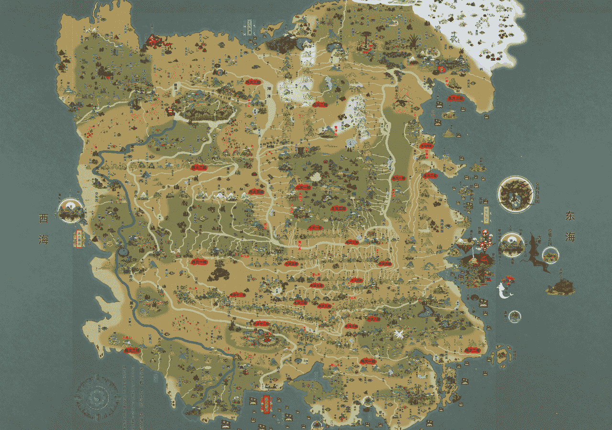
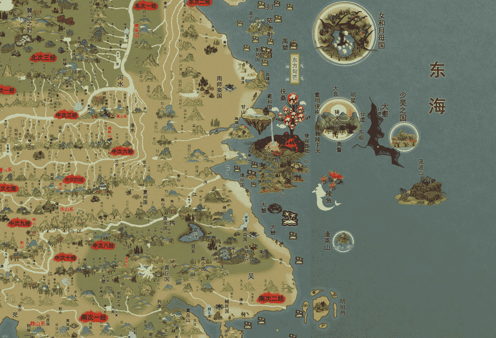
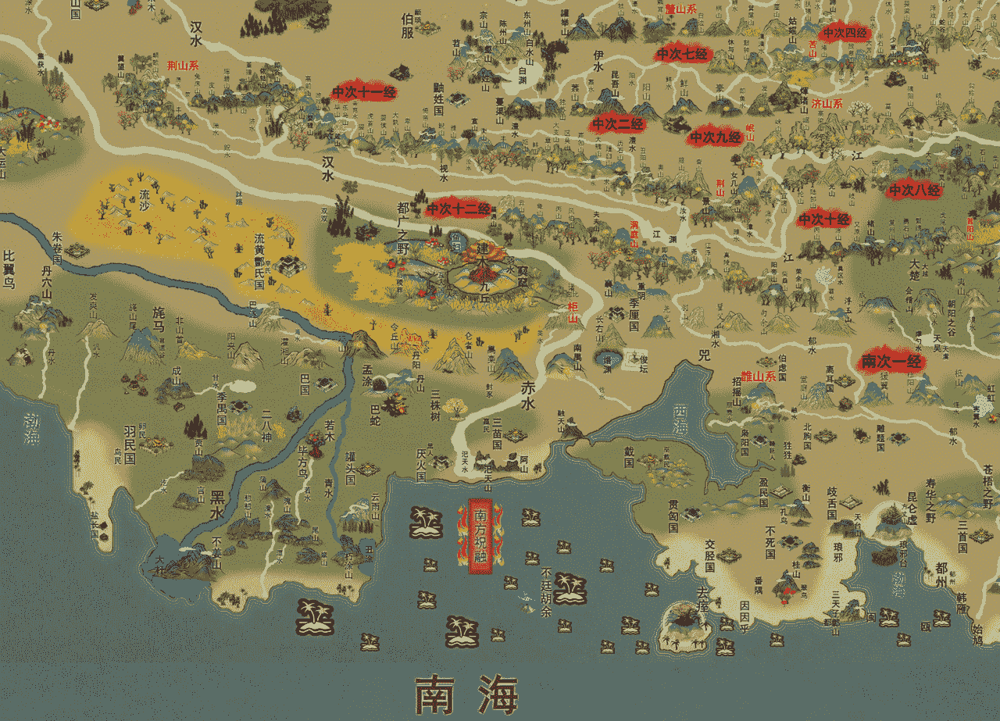
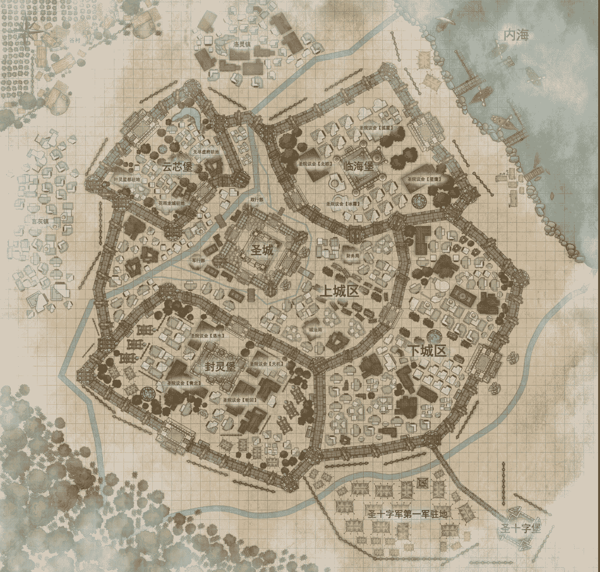
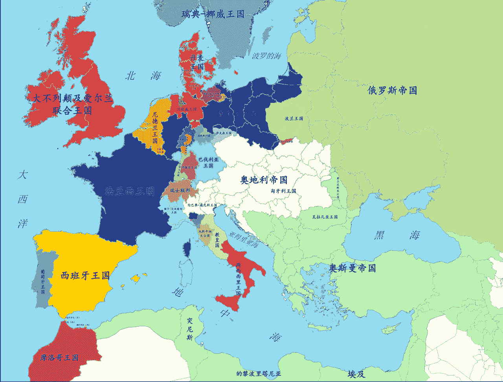

# AI写小说必备工具-5款地图制作

> 来源：[https://rq547mr4oez.feishu.cn/docx/ZdMIdLXphoBkM9xnD8bcvPD4nBf](https://rq547mr4oez.feishu.cn/docx/ZdMIdLXphoBkM9xnD8bcvPD4nBf)

✌有小伙伴私信问我，有没有地图的生成工具？

> **有，必须有。**

> **地图的目的是快速的帮你完善世界观，**可以设置各种风俗文化，避免空间上的混乱。

> 同时，有地图的网文，读者更加受宠若惊，追更更多哦~

如果是用AI生成，其实难度调试起来与直接用工具生成更难，而且可控性完全没法比。

所以，先不推荐用AI。

几个常用的工具分享给大家。

---

# 一、 易制地图

我自己在用，是一款自由的地图绘制的老牌工具，可以在线创作，操作易，素材全，风格多；链接自行百度。

## 类型：

+   小说地图

+   架空世界地图

+   跑团地图

+   游戏地图

+   桌游地图

+   剧本杀地图

+   区域地图

可以通过以下方法，**绘制大陆架**

+   截取真实世界大陆形状。

+   自动随机生成大陆架。

+   绘制自己设定的大陆架。

+   然后绘制地形、河流，添加山、树、房屋，添加文字注记

## 【划重点！】**素材可以免费直接用：**

### 1、东方玄幻，山海经系列大地图

我都看花眼了（内容细致程度爆炸！！）

### 2、圣虚的地图，可以用到其他东方玄幻小说

### 3、1815年欧洲现实地图

## 二、World Anvil

在线架空世界生成器，它提供了丰富的地理、文化和历史工具

[**链接直达**](https://www.worldanvil.com/)

## 三、Fantasy Map Generator

专门为奇幻小说创作的地图生成器，提供了各种地形、城市和符号，可以自由组合

有中文汉化

[**链接直达**](https://mywis.cn/wisl/map)

## 四、Donjon

可以生成各种类型的地图，包括世界地图、地区地图和城市地图

[**链接直达**](https://donjon.bin.sh/)

## 五、Medieval Fantasy CityGenerator

专门用于生成中世纪城市的工具，它提供了许多城市元素，如建筑、道路、河流等，可以根据黄要自由组合

[**链接直达**](https://fantasycities.watabou.ru/)