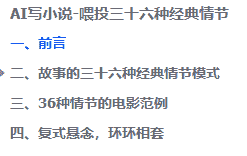

# AI写小说素材-经典剧情de三十六计

> 来源：[https://rq547mr4oez.feishu.cn/docx/McgOdRRkfoupNvxf7gpcrrKtnDb](https://rq547mr4oez.feishu.cn/docx/McgOdRRkfoupNvxf7gpcrrKtnDb)

# 一、前言

> 世界上所有的剧情，真的只有36种。

> 在现代网络长篇小说中，这36种剧情模式，被任意打散组合，使得小说更加跌宕起伏，吸引眼球。

> 当然，如果我们能够从就任意一种剧情模式写出一篇小说，那么写小 说的水平自然是水涨船高的。

尽管，AI 的出现，让小说写作门槛大大降低。

但是，想**让它们写出一本****水准在线****的作品**，仍旧很难！

那，怎样让 AI 帮我们写出一本这样的小说呢？

具体步骤见之前的笔记《[AI写小说-全网zui全指南(三万字) ](https://rq547mr4oez.feishu.cn/wiki/AGN5w9IXeiQvPbkcvHgc3mpynzc?from=from_copylink)》

**同时，基于以上思路将这些情节，喂投给A**I，让它能够跟你的要求组合成流畅的故事。

---

PS：还有哪些问题可以评论或者私信我，我有空也可以解答。

**P**S：盗用这个文章的不要乱引流破坏环境，文章是免费分享给大家。有看见各位顺手举报下。感谢～资料纯分享不易。

**原始出处：**

---

今天文章很长，字数很多~目录如下

# 二、故事的三十六种经典情节模式

+   种类

+   主要人物

+   其它必要人物

+   细目

## 1、求告

> 求告者

> 逼迫者

> A：⑴帮助他去对付敌人

⑵准许他去举行一件他应做而被禁止做的事

⑶给与他一个可以终其天年的地方

> B：⑴舟行遇灾的人，请求收留帮助

⑵行事不端，被自己人斥逐而祈求别人的慈悲

⑶祈求恕罪

⑷请求收取葬骨和取回遗物

> C：⑴替自己亲爱的人求情

⑵在亲戚面前替另一亲戚求情

⑶在母亲的情人面前替母亲求情

## 2、援救

> 不幸的人

> 1援救者

> 2天降救星

A：⑴救援一个被认为有罪的人

B：⑴子女援助父母 ⑵受过恩惠的人报恩失救

## 3、复仇

> 复仇者

> 作恶的人

> A：

⑴为被害的祖宗或父母复仇

⑵为被害的子女或后人复仇

⑶为被害的妻子或丈夫复仇

⑷为被侮辱的子女复仇

⑸为妻子受侮辱（或几乎受侮辱）而复仇

⑹为被害者的情夫复仇

⑺为朋友被杀或者受损害而复仇

⑻为姐妹被奸污而复仇

> B：

⑴为了存心做对，故意为难而复仇

⑵为了趁人不在，暗加攘夺而复仇

⑶为了蓄意谋害而复仇

⑷为了故入人罪而复仇

⑸为了逼奸强暴而复仇

⑹为了夺取所有而复仇

⑺为了一两个人的奸诈，对整个团体的复仇

> C：⑴职业的追捕有罪的人

## 4、骨肉抱复

> 复仇者

> 作恶的人

> A：⑴父亲的死，报复在母亲身上  ⑵母亲的死，报复在父亲身上

> B： ⑴弟兄的死，报复在儿子身上

> C： ⑴父亲的死，报复在丈夫身上

> D： ⑴丈夫的死，报复在父亲身上

## 5、捕逃者

> 捕逃者

> 追捕或惩罚的势力

> A： ⑴违反法律（有时为不得已）的或因其他政治行为而逃

> B： ⑴为因恋爱的过失而逃

> C： ⑴好汉对这位大势力的抗争

> D： ⑴半疯狂的人对着阴谋的整治的抗争

>

## 6、灾祸

> 受祸人

> 胜利的人

> A：⑴战败 ⑵亡国 ⑶人类的灭亡 ⑷天灾

> B：⑴君位被夺

> C：⑴旁人的忘恩负义 ⑵不公道的被惩罚或受敌视 ⑶遭遇横逆和暴行

> D：⑴被情人或丈夫遗弃 ⑵丧失子女

## 7、不幸

> 不幸的人

> 制约者

> A：⑴无辜的人，为野心者的阴谋所牺牲

> B：⑴无辜的人，为了那应该保护他的人而受伤害

> C：⑴能人，有力的人在困苦贫乏中  ⑵一向被宠爱的人，或一向备受亲昵的人，发现此刻他是被遗忘了

> D： ⑴失去了唯一的希望

## 8、革命

> 革命者

> 暴行者

> A：⑴一个人的反抗 ⑵很多人的反抗

> B：⑴一个人的革命，影响了很多人  ⑵许多人的革命

>

## 9、壮举

> 勇敢领袖

> 敌人

> A：⑴备战

> B：⑴战事 ⑵争斗

> C：⑴劫夺一个所欲的对象和人物 ⑵夺回那所欲的对象和人物

> D：⑴冒险的远征 ⑵为夺回所爱的人而冒险

## 10、绑架

> 被绑架者

> 1绑架者

> 2被绑架者保护人

> A：⑴绑架一个不愿顺从的女子

> B：⑴绑架那愿意顺从的女子

> C：⑴夺回那被绑的女子，但没有杀死绑架者 ⑵夺回那被绑的女子，但同时杀死暴行者

> D：⑴救出那被绑的朋友 ⑵救出一被绑的小孩 ⑶救出一信仰错误的人

## **11、解释 **

> 解释者

> 谜

> A：⑴必须寻得谋人，否则处死

> B：⑴必须解释谜语，否则遇祸 ⑵同前，但迷为所爱的女子所作

> C：⑴悬赏以寻出人的名字 ⑵悬赏以寻出人的性别 ⑶试验一个人是否疯狂

## 12、取求

> 取求者

> 1拒绝者

> 2判断者

> A：⑴用武力或诈术，获取目标

> B：⑴用巧妙的言辞，获取目标

> C：⑴用言语打动判断的人

## 13、骨肉仇恨

> 仇恨者

> 1被恨者

> 2互恨者

> A：⑴兄弟间一人被诸人所嫉视 ⑵兄弟间互相仇视 ⑶为了自利，亲戚间互相仇视

> B：⑴子仇视父 ⑵父与子互相仇视 ⑶女恨父

> C：⑴祖仇视孙

> D：⑴岳父仇视女婿

> E：⑴婆婆仇视儿媳

> F：⑴婴儿的杀戮

## 14、骨肉竞争

> 得胜者

> 被拒者

> A：⑴恶意的竞争者为自己的手足 ⑵两兄弟间，彼此恶意的竞争 ⑶两兄弟间的竞争，其中一人犯了奸淫 ⑷两姐妹间的竞争

> B：⑴为了一个未嫁的女子，父与子的竞争 ⑵为了一个已嫁的女子，父与子的竞争 ⑶同前，但此女已为前父之妻 ⑷母与女间的竞争

> C：⑴庶堂手足或者姑表间的竞争

> D：⑴朋友间的竞争

## 15、奸杀

> 有奸情者

> 被害者

> A：⑴请人杀害丈夫，或为了情人杀害丈夫 ⑵杀害一个“推心置腹”的情人

> B：⑴为了情妇或者私利，杀害妻子

## 16、疯狂

> 疯狂者

> 被害者

> A：⑴因为疯狂而杀害了骨肉 ⑵因为疯狂而杀害了恋人 ⑶因为疯狂而杀害了无辜的人

> B：⑴因为疯狂而受耻辱

> C：⑴因为疯狂而失去了亲人

> D：⑴因为怕有遗传的疯狂，而导致疯狂

## 17、鲁莽

> 鲁莽者

> 1受害者

> 2失去的对象

> A：⑴因鲁莽而自致不幸 ⑵因鲁莽而自致耻辱

> B：⑴因好奇而自致不幸 ⑵因好奇而丧失所爱的人

> C：⑴因好奇而致别人死亡或不幸 ⑵因鲁莽而致亲族死亡 ⑶因鲁莽而致爱人死亡 ⑷因轻信而致骨肉死亡

## 18、无意中的恋爱的罪恶

> 恋爱者

> 1被恋者

> 2说明者

> A：⑴误娶自己的母亲 ⑵误以自己的姊妹为情妇

> B：⑴误娶自己的姊妹为妻 ⑵同上，唯系受人陷害 ⑶几乎以自己的姊妹为情人

> C：⑴几乎奸淫自己的女儿

> D：⑴几乎在无意中犯了奸淫的罪 ⑵无意中犯了奸淫的罪（如误以为丈夫已死而改嫁，其实未必等）

## 19、无意中伤残骨肉

> 被害者

> 杀人者

> A：⑴受神命，几乎在无意中杀了自己的女儿 ⑵同前，但因政治的必要 ⑶同前，但因与人作恋爱上的争宠 ⑷同前，但因怨恨他那所不认得的女儿

> B：⑴无意中杀害了或几乎杀害了自己的儿子 ⑵同前，但系受奸人的拨弄 ⑶同前，同时并有对其他骨肉的仇视

> C：⑴无意中杀害了或几乎杀害了自己的手足 ⑵为了职务的关系，无意中杀害了自己的姊妹

> D：⑴无意中杀害了自己的母亲 ⑵受奸人拨弄，无意中杀害了自己的父亲

> E：⑴为了报仇或者受拨弄，无意中杀了自己的祖父或其他长辈 ⑵迫于不得已的杀害

> F：⑴无意中杀害了一个所爱的女子 ⑵几乎杀害了一个不认识的情人 ⑶没有去救一个不认识的儿子的性命

## 20、为了主义而牺牲自己

> 牺牲者

> 主义

> A：⑴为了诺言而牺牲自己的生命 ⑵为了种族的成功或者幸福而牺牲性命 ⑶为了孝道而牺牲而牺牲生命 ⑷为了自己的信仰而牺牲生命

> B：⑴为了信仰而牺牲恋爱与生命 ⑵为了事业而牺牲恋爱与生命 ⑶为了国家的利益而牺牲

> C：⑴为了义务而牺牲自己的幸福

> D：⑴为了信仰而牺牲了自己的荣誉

## 21、为了骨肉而牺牲自己

> 牺牲者

> 骨肉

> A：⑴为亲戚或所爱的人的生命而牺牲自己的生命 ⑵为亲戚或所爱的人的幸福而牺牲自己的生命

> B：⑴为了父母的幸福而牺牲自己的前途 ⑵为了父母的生命而牺牲自己的前途

> C：⑴为了父母的生命而牺牲了自己的恋爱 ⑵为了子女的幸福而牺牲了自己的恋爱

> D：⑴为了父母或一个所爱的人的生命而牺牲了自己的生命与荣誉 ⑵为了亲戚或所爱的人的生命而不顾自己的贞操

## 22、为了情欲的冲动而不顾一切

> 恋爱者

> 1对象

> 2被牺牲者

> A：⑴为了爱欲而破坏了宗教上的贞操与誓言 ⑵破坏了普通的贞操的自誓 ⑶为了热欲而毁坏了自己的前程 ⑷为了热欲而毁坏了自己所有的权利 ⑸热欲毁坏了脑力，健康，甚至生命 ⑹热欲毁坏了富贵，荣誉，若干人的性命

> B：⑴因遇诱惑而忘了义务

> C：⑴因为情欲的罪恶而丧失了生命、地位、荣誉 ⑵为了别种的罪恶，得到同前的结果

## 23、必须牺牲所爱的人

> 牺牲者

> 被牺牲的所爱的人

> A：⑴为了公众的利益，必须牺牲一个女儿 ⑵因为遵守对神所立的誓言，有牺牲她的义务 ⑶为了个人信仰，有牺牲恩人或所爱人的义务

> B：⑴在必要的情形下，牺牲人家所不知道而实在是他的儿女 ⑵在同样的环境下，牺牲他的父亲 ⑶在同样的环境下，牺牲自己的丈夫

> ⑷为了公众的利益，而牺牲自己的女婿 ⑸为了公众的利益，对付自己的亲戚 ⑹为了公众的利益，对付自己的朋友

## 24、两个不同实力的竞争（为了恋爱和女人）

> 两个不同势力的人

> 对象

> A：⑴神与人

⑵有妖术者与平常人

⑶得胜者与被征服者、主与奴，上司与下属

⑷上国的君王与属国的君王

⑸君王与贵族

⑹有权威者与新兴之人

⑺父人与穷人

⑻有荣誉的人与犯嫌疑的人

⑼两个差不多势均力敌的人

⑽同前，而起中一个人以前犯过奸淫

⑾一个被爱的人与一个“没有权利去爱”的人

⑿离过婚的妇人的前后两个丈夫

> ***以上是两个男人之间

> B：⑴一个妖妇和一个平常女人

⑵得胜者与囚徒

⑶皇后与臣民

⑷皇后与奴隶

⑸女主和仆人

⑹高贵的女子和低微的女子

⑺两个差不多地位相等的人，一个纵行恣情

⑻对于高贵女子的理想或记忆，一个不如她的真的人

⑼神与人

> ***以上是两女之间

> C：重复的竞争—（甲爱乙，乙爱丙，丙爱甲）

> D： ⑴神与神

> ⑵人与人

> ⑶法律上的两个妻子

> ***以上是东方式的

## 25、奸淫

> 两个有淫行的人

> 被欺骗的丈夫或妻子

> A： ⑴为了另一少妇、欺骗了情妇

> ⑵为了自己妻子，欺骗了情妇

> ⑶为了一个少女，欺骗了情妇

> B： ⑴为了那个他所爱但并不爱他的女仆，欺骗了妻子

> ⑵为了纵欲，欺骗了妻子

> ⑶为了已婚的少妇，欺骗了妻子

> ⑷意欲重婚，欺骗了妻子

> ⑸为了那个他所爱但并不爱他的少女，欺骗了妻子

> ⑹妻子为那个爱她的丈夫的少女所嫉妒

> ⑺妻子为一个娼妓所嫉妒

> ⑻一个冷淡的妻子和一个热情的情夫间的竞争

> C： ⑴为了一个“相投”的情人，牺牲了那“不合”的丈夫

> ⑵忘记了自己的丈夫（以为他是死了）去和他的情敌要好。

> ⑶为了一个能够同情她的情人，牺牲了他平凡的丈夫

> ⑷欺骗了好的丈夫，为了一个不如他的情敌

> ⑸同前，为了一个怪癖的情敌

> ⑹同前，为了一个讨厌的情敌

> ⑺热恋的妻子，欺骗一个好的丈夫，为了一个平凡的情人

> ⑻欺骗丈夫，为了一个虽不如他那样好，但更加有用的情人

> D： ⑴被欺骗的丈夫的复仇

> ⑵为了主义，打消了嫉妒的念头

> ⑶丈夫被那失败的情敌陷害

## 26、恋爱的罪恶

> 恋爱者

> 被恋爱者

> A：⑴母恋子 ⑵女恋父 ⑶父对女施暴行

> B：⑴少妇恋其丈夫的前妻之子 ⑵少妇与前妻之子彼此爱恋 ⑶一个女子同时为父与子的情夫

> C：⑴为嫂或妗的恋人 ⑵兄妹恋爱

> D：⑴同性恋

## 27、发现了所爱的人的不荣誉

> 发现者

> 有过失者

> A：⑴发现了父有可羞耻之事 ⑵发现了母有可羞耻之事 ⑶发现了女儿有可羞耻之事

> B：⑴发现了未婚夫或妻的家庭中有不荣誉的事

⑵发现了自己的妻子在未婚前被人侮辱过

⑶发现他从前有过“失足”

⑷发现自己的妻子从前是娼妓

⑸发现了自己的情人有不荣誉的事

⑹发现自己的情妇以前本来是作娼妓的，又恢复了旧生涯了

⑺发现自己的情人是个无赖，或者情妇是个坏女人

⑻发现自己的妻子是一个坏女人

> C：⑴发现了自己的儿子是一个杀人犯

> D：⑴儿子是一个卖国贼

⑵儿子违反了他自己定的法律

⑶儿子是被认为有罪的

⑷立誓欲除暴君此时才知道暴君就是他

⑸发现了自己的手足是一个杀人犯

⑹发现了自己的母亲是害死父亲的人

## 28、恋爱被阻碍

> 两个恋爱的人

> 阻碍

> A：⑴因为门第或地位不和而不能结为婚姻

⑵因为财富不和而不能结为婚姻

> B：⑴因有仇人从中阻挠而不能成为婚姻

> C：⑴因该女子先许为他室

⑵同前，并误会所爱的对象已和别人结婚

⑶为了一个能够同情她的情人，牺牲了他平凡的丈夫

> D：⑴亲戚们的反对

⑵亲戚间不合

> F：⑴男女间性情不合

## 29、爱恋一个仇敌

> 被爱恋的仇敌

> 1爱他的人

> 2恨他的人

> A：⑴被爱者为爱人的亲族所憎恨

⑵爱人为被爱者的亲族所憎恨

⑶被爱者（男）是爱她的女子伙伴的仇人

> B：⑴爱人（男）是杀死被爱者父亲的人

⑵被爱者（男）是杀死她的另一爱人的父亲的人

⑶被爱者（男）是杀死她的另一爱人的兄弟的人

⑷被爱者（男）是杀死那爱她的女子的丈夫

⑸被爱者（男）是杀死那爱她的女子的原来爱人的人

⑹被爱者（男）是杀死妻子为那个爱她的女子的一个亲族的

⑺被爱者（女）是杀死爱人的父亲的人的女儿

## 30、野心

> 野心者

> 阻挡者

> A：⑴野心为自己的亲族——兄弟——所阻止

⑵野心为自己的亲戚或受恩的人所阻止

⑶为自己的党羽所阻止

> B：⑴反叛的野心

> C：⑴野心与贪婪连续地造成罪恶

⑵枭獐似的野心

## 31、人与神的斗争

> 人

> 神

> A：⑴和神斗争

⑵和信仰某一种神的人斗争

⑶为自己的党羽所阻止

> B：⑴和神争论

⑵因为侮辱神道而受罚

⑶因为神前傲慢而受罚

⑷狂妄的和神竞争

⑸鲁莽的和神竞争

## 32、因错误而产生的嫉妒

> 嫉妒者

> 被嫉妒者

> A：⑴错误因为嫉妒者的疑心而生出来

⑵错误的嫉妒，因为凑巧而生出来

⑶误以为友谊的爱是男女的爱

⑷嫉妒为恶意的造谣所引起

> B：⑴嫉妒为怀恨的叛徒所引起

⑵同前，但是叛徒是为了自己的利益

⑶同前，叛徒同时为了自己的嫉妒

> C：⑴夫妻间的相互嫉妒，为情敌所挑起

⑵丈夫的嫉妒，为失败的情敌所挑起

⑶丈夫的嫉妒，被一个爱他的女人所挑起

⑷妻子的嫉妒，被一个受过斥逐的情敌所挑起

⑸得意的情人的嫉妒，被那一向受欺的丈夫所挑起

## 33、错误的判断

> 错误者

> 1受害者

> 2错误原因

> A：⑴需要信托的地方，发生了错误的疑嫉

⑵误疑自己的情妇

⑶误会爱人的态度而生疑忌

⑷因对方冷淡而生错误的疑忌

> B：⑴为救一个友人，故意使人怀疑自己

⑵打击一个冤枉无辜的人

⑶同前，但冤枉的人因曾生过邪念，而自觉有罪恶感

⑷一个目击罪恶的人，为了救一个另外的人，而听任别人责备那冤枉的人

> C：⑴听任旁人责备一个敌人

⑵错误是由一个仇敌故意引起的

⑶错误是由他的兄弟故意引起的

> D：⑴犯罪者嫁祸于他的仇人

⑵犯罪者早就布置好的，嫁祸于他的第二个被害的人

⑶嫁祸于一个情敌

⑷嫁祸于一个无辜的人，因为此人不肯和他共同作恶

⑸一个被遗弃的情妇，嫁祸于她从前的情人，因为她不肯去欺骗她的丈夫

⑹受了人家的故意陷害（错误的判罪之后），努力恢复地位并设法报复

## 34、悔恨

> 悔恨者

> 1受害者

> 2罪恶

> A：⑴为了一件人家所不知道的罪恶而悔恨

⑵为了轼父而悔恨

⑶为了谋杀而悔恨

⑷为了谋杀丈夫或妻子而悔恨

> B：⑴为了恋爱的过失而悔恨

⑵为了犯了奸淫而悔恨

## 35、骨肉重逢

寻觅者

寻得的人

## 36、丧失所爱的人

> 眼见者

> 死亡者

> A：⑴眼看骨肉被残而不能救助

⑵为了职务的需要，以不幸加到自己人身上

> B：预见一个所爱的人的死亡

> C：⑴得知了亲族或挚友的死亡

> D：⑴得知所爱的人的死，因失望而发作蛮性

# 三、36种情节的电影范例

模式1、求告 《淘金记》（1925）、《关山飞渡》（1939）、《星球大战》（1977）

模式2、援救 《党同伐异》之“母与法”（1916）

模式3、复仇 《伊万的童年》（1962）

模式4、骨肉间的报复 《狮子王》（1994）

模式5、逋逃 《筋疲力尽》（1959）、《邦尼和克莱德》（1967）、《天生杀手》（1994）

模式6、灾祸 《鸟》（1963）、《幼儿园》（1983）《圣诞快乐，劳伦斯先生》（1983）

模式7、不幸《西鹤一代女》（1952）、《活下去》（1952）、《雁南飞》（1957）、《早春二月》（1963）、《稻草人》（1983）、《末代皇帝》（1987）、《芙蓉镇》（1987）、《活着》（1994）、《钢琴师》（2002）

模式8、革命 《战舰波将金号》（1925）、《母亲》（1926）、《农奴》（1963）、《黄土地》（1984）

模式9、壮举 《阿拉伯的劳伦斯》（1962）、《巴顿将军》（1970）、《出租车司机》（1976）、《红高粱》（1987）

模式10、绑劫 《完美世界》（1993）

模式11、释迷《公民凯恩》（1941）、《后窗》（1954）、《放大》（1967）、《对话》（1974）、《现代启示录》（1979）、《鸟人》（1984）、《谁陷害了兔子罗杰》（1988）

模式12、取求 《林家铺子》（1959）、《去年在马里安巴德》（1961）、《星探》（1995）

模式13、骨肉间的仇视 《呼喊与细雨》（1972）、《乱》（1985）、《野战排》（1986）

模式14、骨肉间的争竞 《高跟鞋》（1991）

模式15、奸杀 《天国车站》（1984）

模式16、疯狂 《幻觉》（1979）

模式17、鲁莽 《飞越疯人院》（1975）

模式18、无意中恋爱的罪恶 《小城之春》（1948）、《玛丽亚?布劳恩的婚姻》（1979）

模式19、无意中伤残骨肉 《楢山节考》（1983）

模式21、为了骨肉而牺牲自己《神女》（1934）、《一江春水向东流》（1947）、《克莱默夫妇》（1979）、《楢山节考》（1983）

模式22、为了情欲的冲动而不顾一切 《魂断威尼斯》（1971）、《卡门》（1983）、《危险的交往》（1988）

模式23、必须牺牲所爱的人 《要热爱人》（1973）

模式24、两个不同势力的争竞（为了恋爱） 《野山》（1985）

模式25、奸淫 《玛丽亚?布劳恩的婚姻》（1979）

模式26、恋爱的罪恶 《月亮》（1979）、《蜘蛛女之吻》（1985）、《霸王别姬》（1993）

模式27、发现了所爱的人的不荣誉 《远山的呼唤》（1980）

模式28、恋爱被阻碍《瑞典女王》（1933）、《马路天使》（1937）、《音乐之声》（1965）、《毕业生》（1967）、《花边女工》（1976）、《愿望树》（1976）、《奇怪的女人》（1978）、《莫斯科不相信眼泪》（1980）、《法国中尉的女人》（1981）

模式29、爱恋一个仇敌 《罗密欧与朱丽叶》（1996）

模式30、野心 《美国往事》（1984）

模式31、人和神的斗争 《裸岛》（1960）、《罗丝玛丽的婴儿》（1968）

模式32、因为错误而生的嫉妒 《似水流年》（1985）

模式33、错误的判断 《黑炮事件》（1985）

模式34、悔恨 《德克萨斯州的巴黎》（1984）

模式35、骨肉重逢 《金色池塘》（1981）

模式36、丧失所爱的人 《城南旧事》（1982）、《走出非洲》（1985）

# 四、复式悬念，环环相套

> 小说，尤其以故事擅长的武侠侦探类小说，都要设置和利用悬念。然而其间成就的高低上下，却不可以道里计。

> 中国古典小说常用悬念，担较多用在两回之间或故事中间，这与说书人吊听众胃口有关。

> 金庸的悬念是近代小说家的用法：不仅用在故事中间，更用在小说开头。《侠客行》、《天龙八部》都是一开头就进入矛盾，令人关切。

《笑傲江湖》更是一上来就有异常紧张的场面：

> 福威嫖局的少爷林平之与人斗殴，在被迫无奈杀死一个姓余的四川人之后，当夜，漂局里就不断死人，一个个嫖师被人杀死，而且全身没有一点伤痕。全嫖局竟接连死了二十多人。敌人在地上写血字：“出门十步者死！”一片恐怖气氛。

> 总嫖头林震南解剖死者尸体，才发现对手原来是青城派高手，使用了很厉害的“摧心掌”：能在不伤皮肤外表的情况下，把心脏震成许多碎片。林震南夫妇在这种情况下只得弃家外逃，很快就被青城派抓了起来，只剩下少爷林平之被人救出后逃走。

> 小说第一章就摆出了一大堆悬念：林家嫖局这种悲惨局面的出现，到底是怎么回事？背后的原因是什么？林平之逃走以后结果又怎样？他能够在将来练就武功，报仇雪恨吗？——这一些悬念促使读者迫不及待地要读下去，想了解事情的究竟。

而在故事展开的过程中，原有的悬念尚未完全解开，小说作者又制造和安排了一连串新的悬念：大名鼎鼎的衡山派高手刘正风金盆洗手，想摆脱江湖上的是非，却受到嵩山派等五岳剑派的坚决阻拦，甚至刘正风全家都会被杀，这到底因为什么？

华山派大弟子令狐冲救了遇难的小尼姑，自己身受重伤，几乎性命不保，为什么还有人要中伤他？等等。

**这样一环紧扣一环，使读者不得不紧张地读下去。所以，善于**设置悬念，是金庸小说在情节上的一大特点。

有的作品直到结束，悬念还保留着。有读者问金庸：“《雪山飞狐》中胡斐那一刀究竟砍下去没有？”金庸笑笑说：“连我自己也不知道。”

**金庸**似乎还特别善于通过突然转折来提出悬念。《倚天屠龙记》中，张无忌、谢逊等历尽艰险，好不容易从海外乘船将归，一夜之间情况忽然变化：屠龙刀、倚天剑突然不见，赵敏与波斯船亦已亡散，张无忌、谢逊都变得虚弱无力。

这是情节上突如其来的一次重大转折。究竟是谁盗去了屠龙刀、倚天剑？这件事跟赵敏或者波斯船究竟有些什么关系？张无忌、谢逊又怎么会变得虚弱无力的？从此，小说进入了扑朔迷离的侦探破案的境界，令人欲罢而不能。

金庸作品中的悬念，有时是以“谜”的方式存在的。

谜，其实也属悬念，只是有时已经明朗有时未被挑明或未被读者意识到罢了。

金庸小说中的谜往往是多重的：有暗有明，有大有小，相互结合，环环相套。

以《侠客行》为例，就是大谜中套着小谜。

> 侠客岛石壁上那首《侠客行》诗和《太玄经》图谱中包含着一套绝顶武功，无人能够破译，这是大谜。

> 这个谜又产生一个副谜：由于侠客岛主每年都要派人惩恶劝善，几年一次请各帮派的帮主到岛上喝腊人粥，去的人都是有去无回，因而在武林各帮派中引起恐慌，谁都害怕当帮主丢了性命，长乐帮就在这种情况下英名其妙的抢了个小乞丐出身的人物来当帮主。

**再下面还套着一个谜：长乐帮为什么要抢这小乞丐来当帮主呢？原来他**长得和以前失踪的那个帮主石中玉非常相像。

> 这石中玉原本是个花花公子，他被人捧做帮主以后，正好得其所哉，猎取女色。他在失踪前已经阁下很多祸乱，其恶果就让和他面貌十分相像的小乞丐出身的人物来承担了，弄出许多尴尬的事。

> 而这小乞丐又有自己的身世之谜，这谜慢慢牵出石清、闽柔夫妇年轻时的三角恋爱矛盾，白自在、史婆婆夫妇的爱情矛盾，等等。

> 情节如此复杂，可又层层剥笋似的，组织得十分紧凑、严整。直到结尾，采取的是半开放的结局：由于小乞丐养母梅芳姑的自杀，谜底已经清楚，但作者并未站出来点破。

**《**天龙八部》的情节构成方法相似而又有不同。这里三位主人公，就有三个身世之谜。它们是三个环，互相构成三个连环套。

> 段誉的父亲段正淳到处留情，以致段誉接连碰到几个喜欢的姑娘后来发现却都是他的妹妹，这是一个大谜。

> 其中又包容着一些小谜，像段正淳妻子刀白凤为了报复丈夫，怨愤中与段延庆发生关系，这就解答了段誉的身世之谜。

> 乔峰的身世之谜及其带来的悲剧结局，最为动人，包含着宋辽矛盾尖锐时期的许多社会内容。

> 它是通过段誉与乔峰的结拜，段誉的异母妹阿朱、阿紫与乔峰的关系，特别是通过段正淳与马夫人康敏的关系，而和前一个大谜套联在一起的，它本身又包含着阿朱、阿紫等若干较小的谜。

> 第三个大谜虚竹的身世又是通过其结拜兄长乔峰之谜逐渐解开而得到揭示的，所谓“无恶不作”的叶二娘的变态性格以及虚竹何以生下来就是和尚这时才得到交代；它又包联着天山童姥、西夏国公主等几个小谜。

> 这样，全书最初看起来似乎有点散的结构，到后来认真回顾就觉得相当紧凑，而且确实体现出比较深广丰富的思想内涵，真所谓“有情皆孽，无人不冤”。

>

一部小说而能具有如此复杂的情节结构，这也许真是只有金庸才能实现的出色创造，是其他武侠小说家所难以做到的。