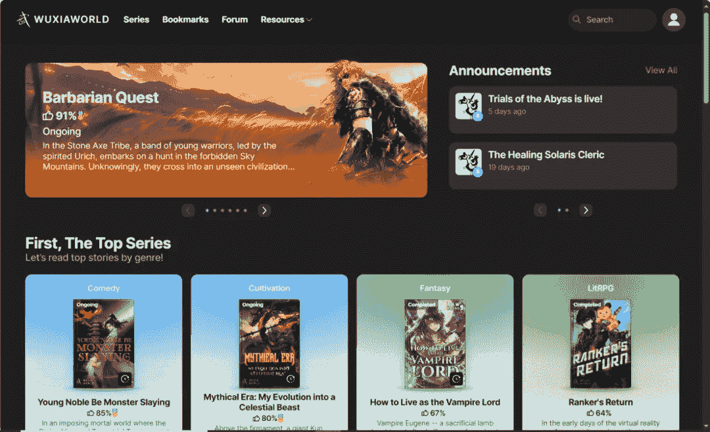
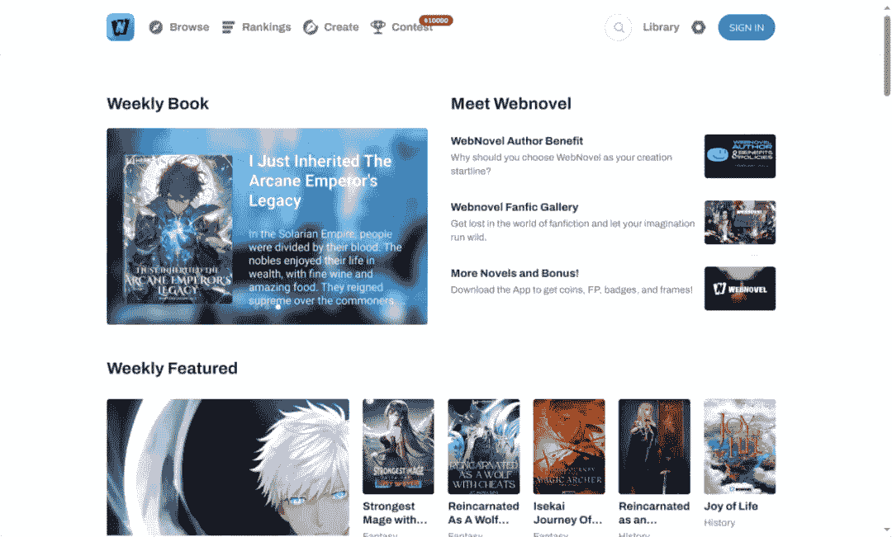
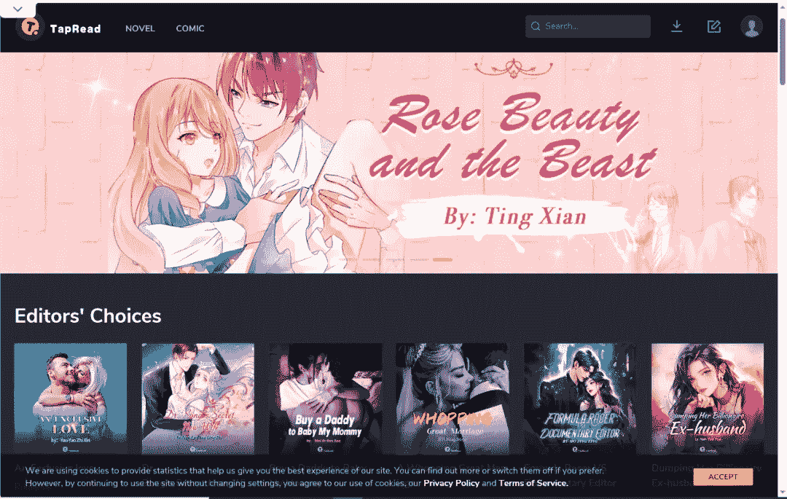
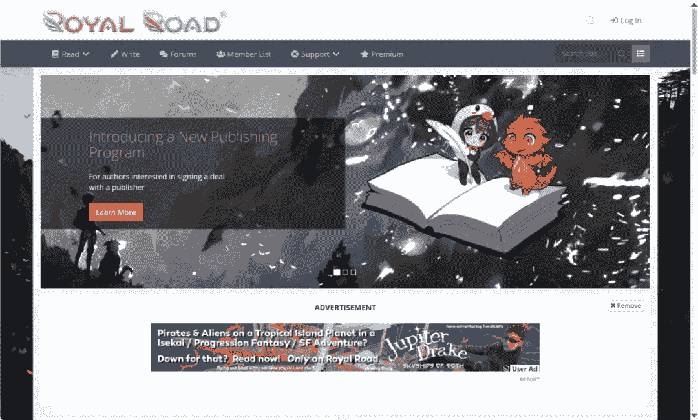
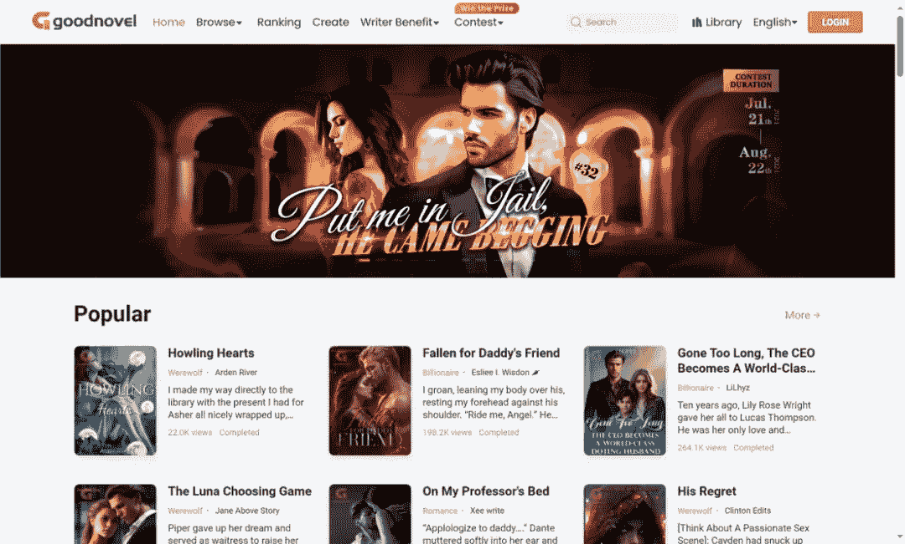

# AI写小说-网文出海七大平台盘点

> 来源：[https://rq547mr4oez.feishu.cn/docx/PyOEdUzNkoc29Ux8njxcr84sn8b](https://rq547mr4oez.feishu.cn/docx/PyOEdUzNkoc29Ux8njxcr84sn8b)

## **一、前言**

> 最近有小伙伴问我，AI写的小说能不能在海外上线，答案当时是能的，毕竟有了AI的加持，语言根本就是小case。

> 现在国外的小说网站市场还是很大的，也不会像国内的小说平台那么卷，

> **据统计，海外网文作者不到50万，目标读**者却有2亿＋，这个供需关系简直不要太香。

> 要想在海外小说网站赚外国人的钱，

> **第一步就是要搞清楚国外的小说网站有哪些，知道大概的受众群**体，才能抓住读者群，实现小说的出海自由。

> 毕竟赚钱主打的就是信息差嘛，搞好了这一步后续的工作就是事半功倍。

## **二、正文**

朋友推荐的七个宝藏海外小说平台，分享给大家。

### **Wattpad**

[**链接点击**](https://www.wattpad.com/)

Wattpad，被称为北美晋江文学，早在2006年就上线了app，作为全球领先的在线阅读和创作社区，支持50种不同的语言。

月活跃用户已达9000万，70%为女性用户，95%在13—35岁之间。适合青少年小说、爱情、科幻等题材。

Wattpad不买断作者版权，可以一稿多投，社交属性强，读者可以在线交流评论。

wattpad的全球性IP开发走在前列，Netflix的《Kissing Booth》系列、电影《Float》和《After》，它们都源自这个平台。

**<Wattpad官网页面>**

### **Wuxiaword**

[**链接点击**](https://www.wuxiaworld.com/)

Wuxiaworld，一个在全球范围内具有显著影响力的中文小说翻译网站。

该网站的诞生与"我吃西红柿"创作的玄幻小说《盘龙（Coiling Dragon）》密切相关。

2014年美国网友“RWX”（任我行）将《盘龙》翻译成英文，并为其建立了这个网站，让中国网文在欧美地区一炮而红。

Wuxiaworld收录了包括武侠、奇幻、历史和冒险等多种类型的网络文学作品，并由专业的翻译团队将其翻译成英文，吸引了全球读者的关注和喜爱。

**<Wuxiaword官网页面>**

### **Webnovel**

[**链接点击**](https://www.webnovel.com/)

阅文集团的海外门户，是全球十大小说网站之一。于2017年五月上线，该网站目前不对国内用户开放，专注于为海外读者提供服务。

2018年4月10日，原创功能开放，海外用户不仅可以阅读翻译的中国作品，还可以进行自己的创作，很多作品受到中国网络文学的影响。

此外，该平台已经扩展到韩语小说领域，并在其站内收录了许多受欢迎的韩语小说作品。站内现有大量热门作品。

建议男频写手，和在阅文有签约写作经验的写手尝试。

**<webnovel官网页面>**

### **Tapread**

[**链接：点击**](https://www.tapread.com/)

纵横中文网2019年建立的其海外门户网站TapRead，并于2020年10月推出了同名的移动应用程序。

尽管TapRead海外覆盖的国家很多，但宣传力度不足，访问量尚未达到预期水平。

内容方面比较丰富，武侠/仙侠、LGBT+、奇幻、浪漫等类别都有，主要依赖于将国内的优秀作品进行翻译。

许多纵横中文网的经典小说，例如乱世狂刀的《刀剑神皇》，青鸾峰上的《一剑独尊》和《无敌剑域》，都已经被搬运上去。

**<Tapread官网页面>**

### **Munpia**

[**链接点击**](https://www.munpia.com/)

Munpia是一个韩国原创网络文学平台，也是国际读者常用的小说网站之一，中国阅文集团在2018年对其进行了战略性投资。

这个平台前身是Go!武林论坛，成立于2003年，2012年转型为一个网络文学网站。

目**前，Munpia目前与**阅文集团付费阅读模式相似，其付费用户数量迅速增长，并且在付费率、复购率和收入方面都在韩国纯网络文学平台中处于领先地位。建议无限流系统文写手。

**<Munpia官网图片>**

### **Royal Road**

[**链接点击**](https://www.royalroad.com/home)

Royal Road 包括网络小说和同人小说。用户主要是奇幻科幻和轻小说风格的作家和读者，专注于网络连载小说。

在这个平台上，你可以遇见许多才华横溢的作者，他们中有些人写作是出于爱好，而另一些则是专业的作家。

目前，Royal Road向读者提供免费的小说阅读，无需支付费用即可享受阅读乐趣。

然而，如果读者希望去除广告，可以选择订阅服务。人气作品也会吸引出版商的关注。

建议长篇连载和异世界冒险题材的作者。

<Royal Road官网图片>

### **GoodNovel**

[**链接点击**](https://www.goodnovel.com/)

GoodNovel是新阅旗下的海外网络平台。以ugc原创书为主，翻译书为辅。可以选择独家合同和非独家合同，有明确的投递入口，写满5000字即可申请签约，有编辑对接。

非独家合同的作品可以获得常规分成，作品在GooodNovel上首发或长度超过12万字，可以获得50美元的额外奖励。

签约奖：达到3万字之后获得100美元。

更新奖：一个月更新25天以上和月更5万字以上，获得150美元奖励。

**建议类目：亿万富翁、狼人文学。三十**万字以下作品建议 GooodNovel。

**<GoodNovel官网图片>**

---

END