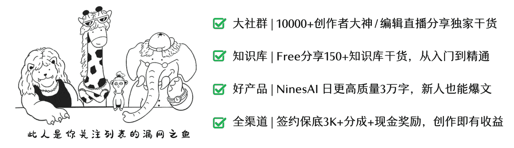

# Nines写作宝典-【写作素材】11大类250+江湖黑话

> 来源：[https://rq547mr4oez.feishu.cn/docx/LrYWdE1cuo6brexepmDcsFBjnmd](https://rq547mr4oez.feishu.cn/docx/LrYWdE1cuo6brexepmDcsFBjnmd)

# 一、前言

> **✅ **【日更博主爆肝整理！写作干货素材库系列来啦！】

> **📚** 想让你的小说秒变 “爆文”？这个系列必须锁死 —— 从江湖黑话到爽虐天花板，包罗万象！居家旅行，写作必备！

>

1.  [Nines写作宝典-【写作素材】300+江湖黑话](https://rq547mr4oez.feishu.cn/wiki/RgqCwi3Xxiynq9kquS6c454vn7d?from=from_copylink)

1.  [Nines写作宝典-【写作素材】200+爽点](https://rq547mr4oez.feishu.cn/wiki/DXrYwur3Pisgawki1pJcIWeznob?from=from_copylink)

1.  [Nines写作宝典-【写作素材】100+罕见魑魅魍魉](https://rq547mr4oez.feishu.cn/wiki/ATr1wkDvZiHNlOkLWDjcEtNjnCd?from=from_copylink)

1.  [Nines写作宝典-【写作素材】200+虐点](https://rq547mr4oez.feishu.cn/wiki/CRPwwVpxiir5hKkdjJjcSJ2cnLh?from=from_copylink)

1.  [Nines写作宝典-【写作素材】200+发糖情节点](https://rq547mr4oez.feishu.cn/wiki/JqKLwP4VWiL1zNkX0dxcFKFBnKe?from=from_copylink)

1.  [Nines写作宝典-【写作素材】200+热梗骚话](https://rq547mr4oez.feishu.cn/wiki/E9kBw8gcuiT5Xgk9Dq6cNG01nCb?from=from_copylink)

1.  ....持续更新ing

**PS：Nines【****写作知识库+AI**产品+投稿渠道+干货交流=全链路】的创作者社群~

# 二、干货内容

1.  **场景适配：****根据故事背景选择术语，**如镖局场景用**“踩盘子”“哑声而过**”，帮派斗争用“结梁子”“递门坎”。

1.  **人物身份：**通过黑话体现角色属性，如“空子”（外行）、“相家”（内行）可暗示人物立场。

1.  **地域特色：**北方帮派多用“**黄典**”，江南势力可融入“**春典**”，增强真实感。

1.  **动态运用：**结合动作描写，如“**扯活！风紧！**”（撤退！情况危急！），提升对话张力。

### 人物称谓类（38个）

### 动作与行为类（40个）

> 1. 孙食：男子

> 2. 果食：媳妇

> 3. 老戗：父亲

> 4. 磨头：母亲

> 5. 苍果：老太太

> 6. 尖斗：大姑娘

> 7. 怎科子：小男孩

> 8. 色唐点：外国人

> 9. 科郎码：乡下人

> 10. 海翅子：大官儿

> 11. 海冷：当兵的

> 12. 冷子点：做官的

> 13. 空子：外行人

> 14. 相家：内行人

> 15. 火点：有钱人

> 16. 水码子：穷人

> 17. 库果：妓女

> 18. 嘴子：野妓

> 19. 总瓢把子：帮派首领

> 20. 并肩子：兄弟、朋友

> 21. 托线孙：保镖人

> 22. 点子：目标、敌人

> 23. 捏班：尼姑

> 24. 线上的朋友：地头蛇

> 25. 老合：盗贼

> 26. 马眼子：识马者/探子

> 27. 白扇：军师、谋士

> 28. 草鞋：跑腿联络者

> 29. 红棍：执法骨干

> 30. 香主：堂口负责人

> 31. 把子：兄弟

> 32. 大爷：帮会首脑

> 33. 圣贤二爷：忠义代表

> 34. 当家三爷：财务主管

> 35. 管事五爷：外交礼仪主管

> 36. 巡风六爷：放哨侦查员

> 37. 执法老幺：制裁叛徒者

> 38. 左玄：洪门普通成员

> 1. 扯：走

> 2. 咧瓢儿：笑

> 3. 抛苏：哭

> 4. 钻钢：骂

> 5. 青：杀

> 6. 挑：卖

> 7. 柳：唱

> 8. 荣：偷

> 9. 升点：叫嚷

> 10. 耳目：打听

> 11. 答钢：答话

> 12. 叩瓢儿：叩头

> 13. 搬柴：拔牙

> 14. 折鞭：挨揍

> 15. 秋鞭：狠揍

> 16. 夹磨：训练

> 17. 挖：敲诈

> 18. 戳朵儿：写字

> 19. 扫苗：理发

> 20. 展杵头儿：借债

> 21. 控銮：赌钱

> 22. 劈雷子：起誓

> 23. 喷子升点儿：放枪

> 24. 肘山：买酒

> 25. 抿山：喝酒

> 26. 串山：喝醉

> 27. 哨个牙淋：喝茶

> 28. 安根：吃饭

> 29. 念啃：挨饿

> 30. 抛山：拉屎

> 31. 戳啃：生病

> 32. 抹作：病愈

> 33. 攒稀：害怕

> 34. 醒攒儿：醒悟

> 35. 吊梭：疼痛

> 36. 吾攻：恼恨

> 37. 受了腥了：上当

> 38. 碰盘：见面

> 39. 扯活：逃跑

> 40. 鼓了盘儿：翻脸

### 身体与服饰类（24个）

### 职业类（32个）

> 1. 瓢把子：头/首领

> 2. 招子：眼睛

> 3. 顺风子：耳朵

> 4. 海子/江子：口

> 5. 金杠子：腿

> 6. 踢杞：脚

> 7. 蚕子/定盘子：心

> 8. 苗西：头发

> 9. 栅栏：胡须

> 10. 盘儿：脸

> 11. 顶笼：帽子

> 12. 通天洒：大褂

> 13. 登空子：裤子

> 14. 踢土儿：鞋子

> 15. 熏筒儿：袜子

> 16. 挂洒：衣裳

> 17. 花腰：腰带刀

> 18. 风子：扇子

> 19. 帖子：信件

> 20. 窑：房子

> 21. 云子：筷子

> 22. 海砂子：私盐

> 23. 海砂窑：盐仓

> 24. 番张子：饼

> 1. 团柴的：说书人

> 2. 柳海轰的：唱大鼓者

> 3. 团春的：说相声者

> 4. 挑厨供的：卖戏法者

> 5. 彩立子：变戏法者

> 6. 签子：戏法带武功者

> 7. 光子：拉洋片者

> 8. 支挂子：护院武师

> 9. 拉挂子：保镖

> 10. 戳挂子：教徒武师

> 11. 点挂子：卖武艺人

> 12. 挑将汉：卖武带卖药者

> 13. 挑汉儿的：卖药人

> 14. 挑招汉的：卖眼药者

> 15. 挑顿子汉的：卖咳嗽药者

> 16. 观炉啃的：卖膏药者

> 17. 挑罕子的：卖药糖者

> 18. 挑粒粒的：卖仁丹者

> 19. 挑薰子汉的：卖闻药者

> 20. 挑汉册子的：卖药书者

> 21. 挑青子汉的：卖刀伤药者

> 22. 挑柴吊汉的：卖牙疼药者

> 23. 撒幅子的：做广告者

> 24. 挑上海宝的：卖特产药者

> 25. 挑火粒的：卖化食丹者

> 26. 挑柳驼的：唱戏卖药者

> 27. 做金点的：算卦者

> 28. 戗盘的：相面者

> 29. 八岔子：算奇门者

> 30. 戳黑的：点痣者

> 31. 雁尾子：行骗集团

> 32. 撇年子的：修脚匠

### 地域差异类（10个）

### 数字与方位类（18个）

> 1. 黄典：北方行话（山东）

> 2. 春典：南方行话（江南）

> 3. 倒埝：东方（北方）

> 4. 阳埝：南方（北方）

> 5. 密埝：北方（北方）

> 6. 切埝：西方（北方）

> 7. 尖局治把：真和尚（北方）

> 8. 里腥治把：假和尚（北方）

> 9. 尖局念把：真尼姑（北方）

> 10. 里腥念把：假尼姑（北方）

> 1. 柳：一

> 2. 月：二

> 3. 汪：三

> 4. 载：四

> 5. 中：五

> 6. 申：六

> 7. 行：七

> 8. 掌：八

> 9. 爱：九

> 10. 句：十

> 11. 倒埝：东方

> 12. 切埝：西方

> 13. 阳埝：南方

> 14. 密埝：北方

> 15. 顶：天

> 16. 躺：地

> 17. 浑天：黑夜

> 18. 青天：白天

###

### 自然与现象类（16个）

### 镖局与帮派类（24个）

> 1. 摆丢子：刮风

> 2. 摆金：下雨

> 3. 摆银：下雪

> 4. 插棚儿：阴天

> 5. 鞭轰儿：打雷

> 6. 亮子：白天

> 7. 月子：夜晚

> 8. 大亮：天大亮

> 9. 小月亮：月初月亮

> 10. 起黑：天刚黑

> 11. 梁子：大道

> 12. 悬梁子：桥

> 13. 土堆子：塔

> 14. 汉壶：药

> 15. 风子：马

> 16. 岔子：牛

> 1. 踩盘子：侦察目标

> 2. 挂柱：入伙

> 3. 拔香头：退伙

> 4. 挂甲：冬刑（冻毙）

> 5. 穿花：夏刑（蚊虫叮咬致死）

> 6. 炮头：抢劫小头目

> 7. 三不住：不住新店、易主店、娼店

> 8. 哑声而过：镖局过山头禁喊镖

> 9. 蜂麻雁雀：江湖骗术四门

> 10. 合吾：同道招呼

> 11. 水漫了：敌人来袭

> 12. 挂彩：受伤

> 13. 土了点儿：死人

> 14. 清了：杀人

> 15. 风紧：情况危急

> 16. 松人：迅速撤退

> 17. 亮盘：照面亮相

> 18. 开山立柜：建立根据地

> 19. 上线开爬：在此地作案

> 20. 点春：说黑话

> 21. 半春不典：半黑话

> 22. 化锅：沿门乞讨

> 23. 卯喽：官府取缔

> 24. 淤楼：军警轰人

### 饮食与生活类（20个）

### 特殊场景类（28个）

### 武器与工具类（20个）

> 1. 上粉子：吃饭

> 2. 马牙：肉

> 3. 水头：水

> 4. 火生：酒

> 5. 啃富：吃好的

> 6. 搬浆：喝汤

> 7. 念了杵：无钱花

> 8. 搬柴：拔牙

> 9. 安根：吃饭

> 10. 念啃：挨饿

> 11. 抛山：拉屎

> 12. 碰盘：见面

> 13. 扯活：逃跑

> 14. 抹盘：丢脸

> 15. 窜轰子：放火

> 16. 控海：吸鸦片

> 17. 挖个点儿：敲诈人

> 18. 郎不正：讨人嫌

> 19. 朝翅子：打官司

> 20. 展杵头儿：借债

> 1. 合字上的朋友：道上兄弟

> 2. 一碗水端来：分赃

> 3. 递门坎：自报门派

> 4. 结梁子：结仇

> 5. 盘道：套话试探

> 6. 挂桩：对上关系

> 7. 对盘：动手对决

> 8. 剪镖：劫财

> 9. 醒攒：被识破

> 10. 七寸子：要害

> 11. 新上跳板：刚出道

> 12. 招子放亮点：警惕

> 13. 朋友踩宽着点：放过对手

> 14. 灯笼扯高一点：眼光放远

> 15. 并肩子，念短吧：弟兄别说话

> 16. 马前点，喂暗青子：准备暗器

> 17. 捏班扎手，扯活：尼姑厉害，撤退

> 18. 招子不昏：眼睛雪亮

> 19. 簧点清：识时务

> 20. 盘儿摄：长相俊

> 21. 念摄：长相丑

> 22. 撮啃：长得美

> 23. 念啃：长得丑

> 24. 挂洒水：穿得破

> 25. 太岁海了：年岁高

> 26. 太岁减着：岁数小

> 27. 伤攒子：做亏心事

> 28. 顶了瓜：叫人害怕

> 1. 青子：刀

> 2. 喷子：火枪

> 3. 花条子：长矛

> 4. 暗青子：暗器

> 5. 海青子：大刀

> 6. 串蔓子：买枪

> 7. 串非子：买子弹

> 8. 蛇儿：兵器代称

> 9. 条子：长枪

> 10. 亮子：照明工具

> 11. 汤钵子：大碗

> 12. 划十子：筷子

> 13. 搬梁：拿筷子

> 14. 扣盅：喝水

> 15. 穿通子/顺腿：袜子

> 16. 提头子/踢士：鞋子

> 17. 飞蛾子：马挂

> 18. 叉叉子/蹬空：裤子

> 19. 顶天：帽子

> 20. 小罗考：衬衣