# 女频耽mei拆书，小白也能学会的高级框架

> 来源：[https://rq547mr4oez.feishu.cn/docx/CTTxdfNBYoPmf4xbyCocugRJn5d](https://rq547mr4oez.feishu.cn/docx/CTTxdfNBYoPmf4xbyCocugRJn5d)

# 0、前言：

之前答应小粉丝的女频拆文，她来咯~

> 这是一篇，被小伙伴强烈安利的晋江耽美文！

> **起初我是抗拒的，作为一个中年男人，对耽美有种天然**的抗拒，但是~~直到我看完前几章，真香~

> 我第一次知道耽美文居然也可以写的如此干净漂亮，作者真TM的是个天才~~

**作为一个写手，一口气看完之后，会仔细想**想，这本书，有哪些我们去值得学习的地儿~

**以下是拆书笔记《**[**全球进化后我站在食物链顶端**](http://www.jjwxc.net/onebook.php?novelid=3858172)**》（韭菜Y日记）**

---

PS：还有哪些问题可以评论或者私信我，我有空也可以解答。

**P**S：盗用这个文章的不要乱引流破坏环境，文章是免费分享给大家。有看见各位顺手举报下。感谢～资料纯分享不易。

**原始出处：**

---

---

# 1、简介

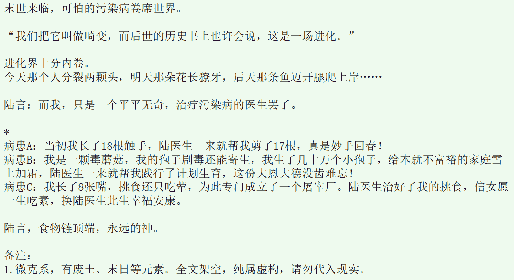

看完是不是非常的吸引人？反正我看完就非常有期待感~

> 这个就是与我们之前说的，如何写简介道理一样。

+   **万能公式：背景 + 主角 + 矛盾冲**突 + 主角目标 + 亮点（韭菜Y日记）

# 2、第一章

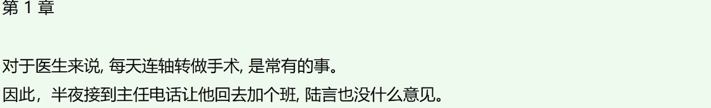

+   开篇的节奏是不是两句话就上来了？主角的信息交代简约而不简单。

+   **现在无论是男频（偏向逻辑），还是女频（偏向情绪调动），**开头套路是类似，都是要快节奏的进入正题。

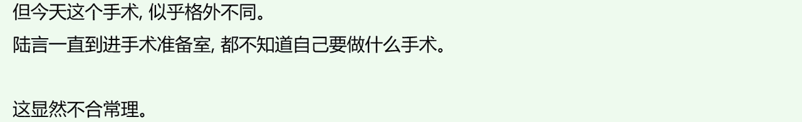

+   开篇的转折来了。来的非常快，同时也很清晰

+   对读者的吸引力是很高，这个写法就是常用的钩子。

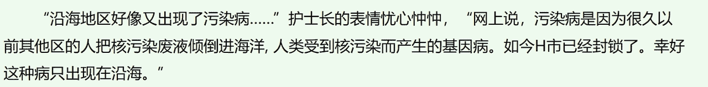

+   **交代本文的框架背景**

+   **高手就是寥寥数笔，就有一个清晰，且能让读者**有想象力空间的方式。同时，紧跟时政热点~

+   **注意：上面的不寻常之后，引导这个事件，故事就是层次递进的带**入。持续吸引你的注意力和好奇心，想看下去

+   **伏笔来了，通过反差的方式**

+   **看后面作者怎么引爆这个伏笔**

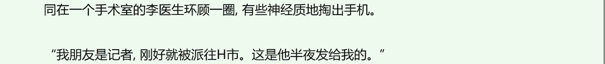

+   **看似一个简单的伏笔，但是开篇这样写**，肯定也是另一个事件镜头（肯定是有作用）

+   “契科夫之枪”的叙事技巧，可以去看下这个技能，非常重要的知识点

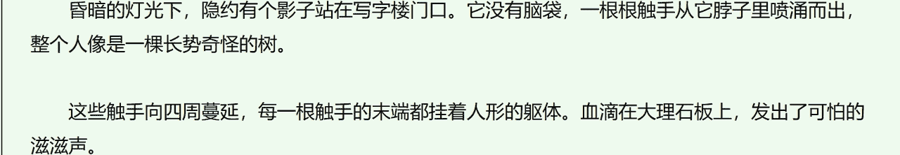

+   看到这里，你估计能猜出来，“加班动手术的病人是什么”

+   作者并没有直接告诉你，但是通过其他的事件，穿插描写，呼之欲出。

+   **高明的方式。**

+   持续的“描写”而非叙述，在之前的基础上，继续层层加码

+   前三章，一定要少用叙述（除非是伏笔）

+   **因果倒置，比直接给出更有冲击感**

+   配角的目的，要么服务剧情，要么增强故事情节

+   **通过对配角的描写继续加码**

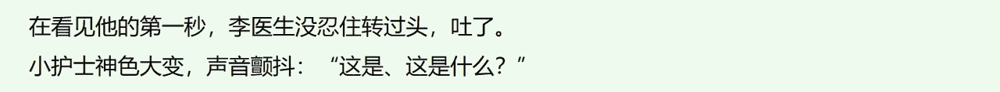

+   女频书中，其实这么直接的描述是比较少

+   看看前面到现在，整篇行文的节奏，突出一个快

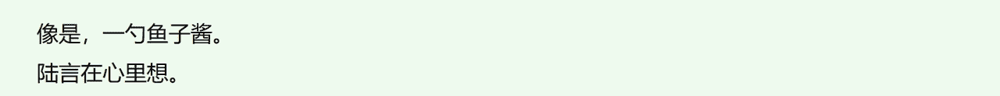

+   这个对比非常Nice，是不是很有画面感？

+   **主角的人设是不是一下立体很多**

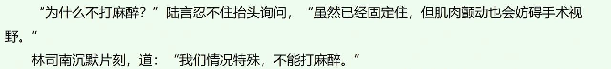

+   再次埋伏笔，是不是感觉后面肯定会有事情发生？

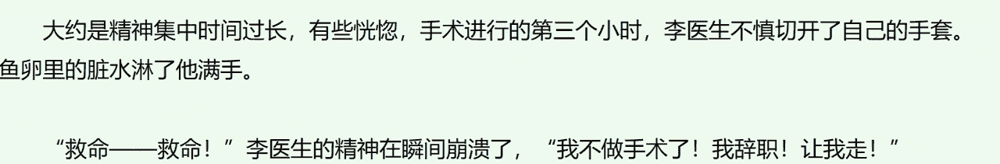

+   想一想，李医生这个配角的目的。肯定不是废话~

+   同时为什么他为什么会一直这么反常？

+   **划重点：这个就是故事的“转”**

+   故事的第一小节，记不记得之前说过“故事不能一下子就完结”

+   与上面的效果一样，通过因果倒置，比直接给出更有冲击感

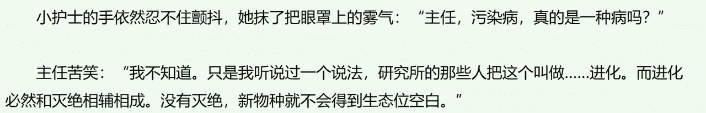

+   **事件持续推进**

+   还是熟悉的小护士配角（她存在的意义），主角怎么能做脏活呢

+   主任就是作者的嘴替，避免平铺直叙

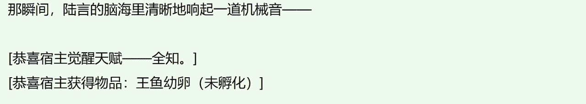

+   文章末尾，进行一个收的环节，留下一个大钩子

+   **经典的断章，欲看下文，翻页**

+   回想一下，全文的伏笔+钩子有多少了？

+   **天灾**

+   **主角与父亲关系**

+   **切破手套的李医生**

+   **金手指**

---

# 3、第二章

+   **文章开头衔接，金手指设定**

+   同时，文笔不多，但是通过对话方式，就大致有个立体人设

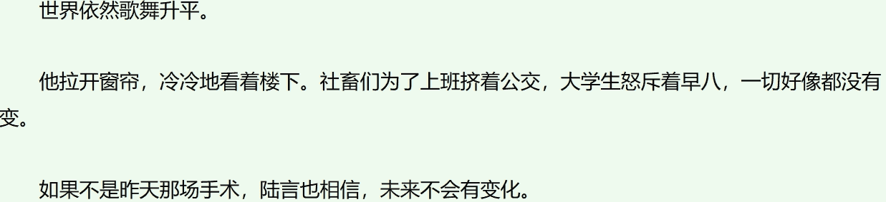

+   通过现实与虚幻对比，穿插拉回视角

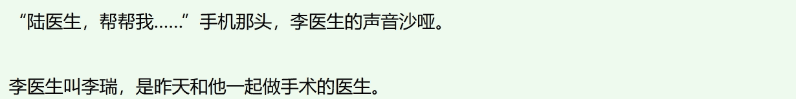

+   **第一章的伏笔，他来了**

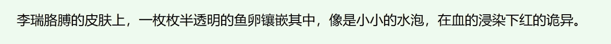

+   **契科夫之枪定理**

> **小细节：**

> 一个角色塑造好了之后,我们之后的描写一定要紧紧贴合。

> **这**个角色从一开始设定就是个沉默寡言,冷静的令人发指的家伙，所以，如果给予他太多的情绪形容词，那么就是最大的败笔。

+   **主角的人设持续加强**

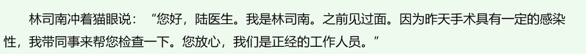

+   前三章的，重要配角；通过第一章的描述，这段就非常合理

+   逻辑合理：这个是最基础但是也是故事最重要的要求！

+   通过这个信息,说明了李瑞被感染的可能性要大很多，林司南不可能不去找他。

+   **划重点：处处可见的伏笔**

+   **伏笔的技巧：通过故事的最终目标，反**推需要哪些要素，将这些要素往你文章前面插

+   通过前面新闻的对比，产生的信息差

+   **主角的驱动力不就来了**

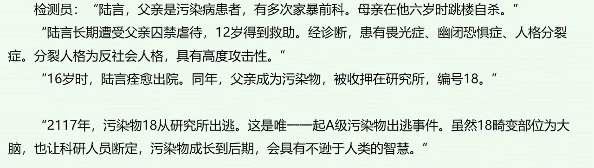

+   **划重点：**

+   **看到这段是不是感觉似曾相识？**

+   **对，就是小郎君的《灵境行者》**

+   **一**个主角后续行为的最大基础不来源于直接对主角的介绍，而是来源于别人的总结。不直接形成结论，而是从驱动的起始点来推导

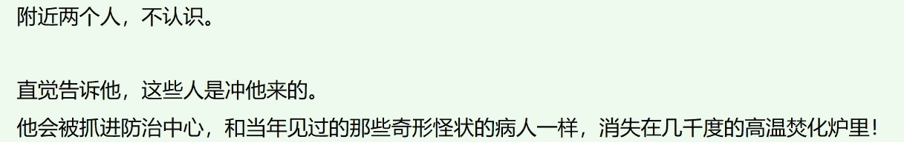

+   结合上面配角1号的出场，这个描述也符合逻辑

+   人物的刻画,其实是从一开始就给到了有效的铺设。

+   从主角和李瑞一登场,截然相反的表现已经给了这里最好的逻辑。

+   所以，这种架构上，逻辑上的水平，才是真正文笔的体现。

+   **末世文或者规则怪谈灵异之类的文,写**线形虫的有很多，但是质量的优劣天差地别。

+   前边对天气的铺垫,也在这里做了阐释,总体来说这个文真的没有多余的点。

+   **短短几个字，给读者以想象力**

---

# 4、第三章

+   **前边也有铺垫，有伏笔。**

+   **划重点：**

+   **正常的网文对于小伏笔，除了主线大剧情之外的反转，**一定要把握好太长了就不是亮点而是败笔了。

+   掌握好一个恰到好处的度,尽量不要超过两章以上的问隔。

+   **为什么是买这些？**

+   **因为前面有写过主角的驱动力**

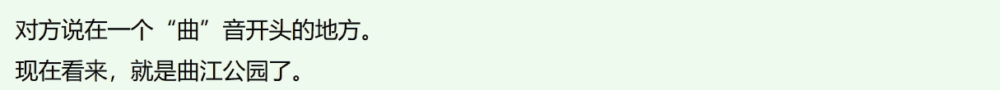

+   你看，作者的剧情就是一个“圆”，总能圆回来。

+   加深主角人设，并且不乏小调侃。同时，如果末日你会不会也这样？

+   **难道作者也被微商伤害过？**

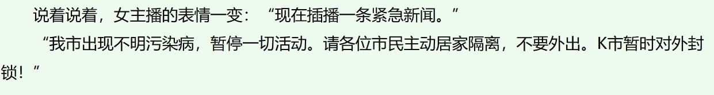

+   **合理的即视感。**

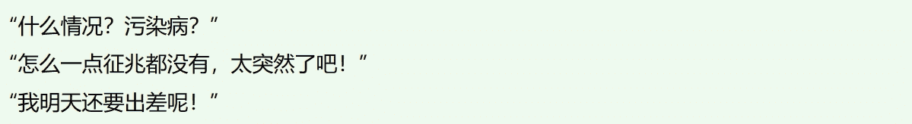

+   **打工狗的悲哀，代入感爆棚**

+   范都市文就要写出普世的内容，读者代入感会好很多

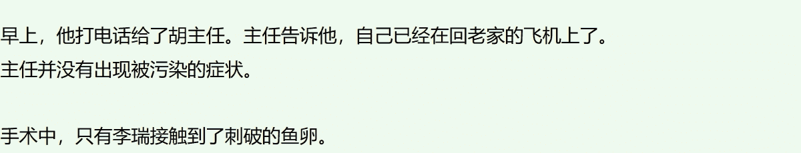

+   林司南或者他背后的组织，跟主角之间的信任基础是不是出现问题了?

+   真正的不圣母，高级感，是这么做出来的。

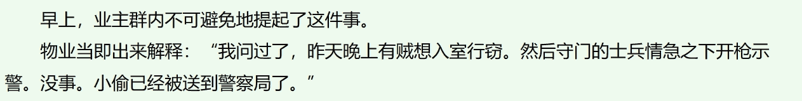

+   众人皆醉我（主角）独醒，高级爽点有木有

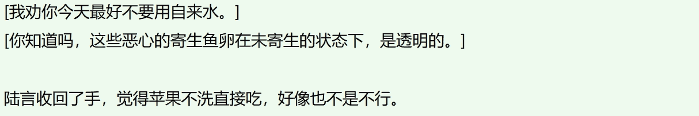

+   到了这里,大家对这个作者的文风是不是已经非常清晰了?

+   **划重点：**

+   对事物更喜欢用一种带有弹性,带有一点幽默感的表现形式，而不是直说。

+   直说就是，主角不想被感染，所以还是别洗了。

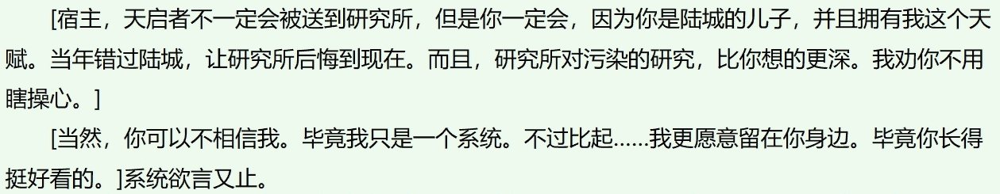

+   主角父亲的身份以及死亡之谜就是故事大主线。

+   **详情请见《灵境行者》。**

+   **划重点：**

+   人物的刻画，是在故事中一点点积累的

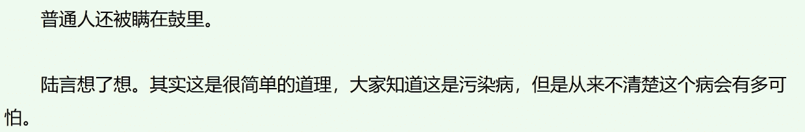

+   **划重点：**

+   **割裂主角和普通人，持续加码**

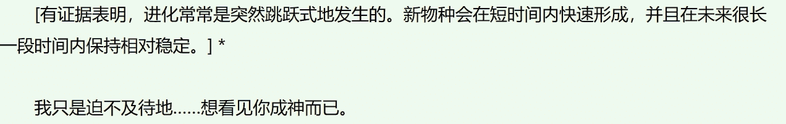

+   **三章，一万一千字。**

+   **将**整个故事背景展开，主角刻画完毕，强大的期待和主线大归纳，有些伏笔，有些未知，还有更多的是想看主角如何面对后续的大爆发。

+   **所有的大小事件都是朝着不同寻常来写的,他们甚至看上去联系不大**,但是最终却因为共同的相性燃了整个开篇。

+   **圆融，激烈，精彩。**