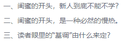

# 《诡秘之主》拆书之爆文框架+Prompt(五万字)下

> 来源：[https://rq547mr4oez.feishu.cn/docx/S3ULdUQn1oAbS1x9yYmcC2finKu](https://rq547mr4oez.feishu.cn/docx/S3ULdUQn1oAbS1x9yYmcC2finKu)

# 前言

---

✌很多小伙伴私信问我，为啥不拆一拆《闺蜜之主》哈哈~，是《诡秘之主》。

**✍模仿，学习大神的套路和框架，无论是新老作者，学会**了⛳网文必能上一个台阶，多多爆文哦👏。

> 比如用AI模仿诡秘框架，设定一个细致的国风式克系

> 后续会把这个propmt放出来，不知道有多少人想要~

☀在回头N刷的时候，每次都有新的感悟🤓。

☀因为这本小说太经典，卷毛狒狒⛹们很多，吹它的人太多，

☀我想了很久，决定从两个方面来吹😁，不，细致拆书~。

**⭐️首先，赞美愚者！👏**

**✅第一角度：上帝视角🧐，从全文的角**度深刻分析好在哪里，对我们写文的启发。

✅第二角度：蚂蚁视角🐜，开头分析为什么这样写。

☢️因为拆书工作量很大，大家多一键三联支持，先感谢🙏🙏🙏~

---

# 第二角度：卷毛狒狒的蚂蚁视角

**目录：**

我是分割线

---

我是老杨，一个持续分享AI和写作干货的中年大叔。

我是分割线

---

## 一、闺蜜**的开头，新人到底不能不学？**

上一篇笔记已经吹了很多，我就不吹整体了。来吹开头。

但关于诡秘的开头有很大争议，（韭菜Y日记）

> 知乎上就有“《诡秘之主》我 为什么读不下去？”的帖子。“被捧成神一样的诡秘，我看了三四十章，完全读不下 去，可能是没有什么代入感。”

> 这并不是提问者一个人的困惑。

> 《诡秘之主》不是“小白文”，同时偏离了网络文学种种营造爽感的要求。

> 风格阴郁，线索隐晦，设定繁杂，升级艰难，叙事多细节，少情感线，虽有升级，但多游历少开挂，虽有战斗，但作者也 经常做“反高潮”处理……上述种种都“回 避”了爽的套路，提高了《诡秘之主》的 “阅读门槛”。

也有很多有经验的写手表示：新人学诡秘开头死路一条。

那么到底能不能学？（韭菜Y日记）

> 首先问个问题：写网文开头（前5章）最重要的目的是什么？

**对于【新人】来说，写开头的最主要目的就是“尽一切办法留住读**者”，就是自媒体常说的2s/5s跳出率。

** **

读者和编辑，对待新人、大神是完全不同的两种态度。

面对新人时，读者看了书名扫了眼简介，**进来打算看看你**到底行不行，这个时候的耐心时间相当短暂。

那么为了达成“尽一切办法留住读者”的目的，之前有大神讲述了几种常见开篇方法，包括但不限于：

> 1.利用金手指/人设结合事件拉起读者期待

> **2.由生死危机而快速爆发冲突**

> 3.完成主角第一个装逼事件，让读者获得阅读满足感，并继续追下去。

然而以上三点，《诡秘之主》完全没做到。

诡秘前面三章全是大量的细节堆砌，气氛营造，设定铺开，很多人对诡秘之主开头的评价是“大神任性”

——**“**金手指没展露清楚，冲突也没爆发，主角上来更没能装什么逼，看的又拖沓压抑，名词设定一大堆的冒出来，实在看不下去。”

所以最后结论：“乌贼是大神，有前期数本（韭菜Y日记） 大火书籍的粉丝累积，开头再烂都不缺人硬着头皮看下去。”

这话其实真没错，铁粉数量极多的作者就是有“任性”的权力，但敢这么做是因为他有信心后面的内容足够吸引人。

> 那么新人直接学习呢？

> 肯定是扑街（Poor Gay）啊，笑~~

但前面这些都是我们经常看到的评论，通常行（韭菜Y日记） 外人也就止步于这一层，那么作为行内人——我肯定也要说这个开头的吸引力真的不咋样，对于“路人”来说确实存在门槛。

## 二、**闺蜜的开头，是一种必然的慢热。**

因为这涉及到了一个文学概念，即“小说基调”。

> 首先说下什么是“基调”，所谓“基调”并不是单纯的某一样东西，

> 如“电影”的滤镜（如灰暗、黑白如《辛德勒的名单》），

> 又或者网文的类型（所谓争霸流、无敌流，又或者仙侠、都市异能之类的分类方式），而是指占据主体的风格、类型。

> 用电影为例，电影是声、（韭菜Y日记） 光、影像剪辑出来的艺术，滤镜只是决定“基调”的因素之一——合适的滤镜匹配了合适的剧情，烘托出了合适的氛围，观众们在观看时才不会出戏、别扭，电影才有可能获得成功。

说到这里，大家应该能大致明白我的意思——相信各位一定看过：

一本书，前期是按照**热血战斗写的**，读者反馈也不错，中期却加了**“种田”内容**，节奏一下子放缓，原本打打杀杀变成了整天苟着发展，由此导致读者哗啦啦走了一堆。

又或者原本前期是玩儿梗**搞笑轻松日常**，中期突然画风一变，开始冷酷阴暗，主要角色死一大片，读者接受不能，纷纷离开。

因为基调变了，所以读者不买账了。

当然这不是说“热血”的网文只能写热血，种田的网文不能写打斗，而是指一部长篇网文的占据大部分篇幅的“文风”、“气氛”、“主线”等，前中后期不发生剧烈变化，读者读起来才能不会有违和感。

## 三、**读者眼里的“基调”由什么来定？**

> **其实就是开头这几万字决定的。**

> 大白话就是：**你开头的剧情风格什么样，那么后续整**本书的内容，都要尽可能保持这个风格才行。

> **各位可以回忆回忆比较成功（韭菜Y**日记） 的网文，是不是都符合这样的特征。

** **

**而如果有“订阅骤降”经历的作者，可以想想**是不是因为自己某段剧情的基调发生了改变？

**其实这种情况多见于“无限流”这种副本切换后风格变化明显的网**文，有过类似经历的作者肯定明白我的意思。

** **

**那么回到《诡秘之主》，只要是**看过后文的人，都知道这本书的“基调”是以克苏鲁恐怖/悬疑风格为主线。

** **

**具体表现就是：**

> 一切刻画都尽量贴合现实背景（英国维多利亚时期），属“真实系”画风；

> **人**设贴近真实，没有做浮夸处理；等级、技能、（韭菜Y日记） 物品设定都以诡异风格为主（包含SCP基金会元素）；

> **剧情并没有以装逼打脸为中心，而是以解密、探索未**知为主。而整个主线里突**出最多的因素，****就**是“克苏鲁恐怖”的核心：源于未知的恐惧。

** **

**所以如果了解COC跑团、克系游戏、小说的人**对此都很熟悉，就算不知道**这些，也应该明白这种风格别说在网文圈，在整个小说圈都是小众类**别（克系小说也就最近几年火了一把，以前真的非常冷门，哪怕它算是一个独立的门派）。

** **

基于以上这些资料，如果我们是作者，来写（韭菜Y日记**） 这种风格的网文小说，首先**基本就排除了无敌碾压流之类的爽文模式。

因**为剧情一**定要不断出现各种诡异的、充满未知的事物，甚至要让主角感受到绝望、无助，才能让读者代入进去，凸显出这种未知恐惧的氛围。

而为了让这种恐惧的代入感更强，我必须尽可能详实的描绘这个世界，让读者沉浸感更强、更难脱离想象带来的刺激。

所以站在作者的角度上，当我定下来的这样的基调后，为了保证前后章节的风格一致，我肯定不能再去选择开篇三章让克莱恩装个大逼，然后一路按着邪神摩擦进行后面的剧情。

这是从“基调”因素上来说。

同时说点别的原因——

乌贼作为起点顶层作者（应该是《一世之尊》后成（韭菜Y日记） 为了白金），开书之前和普通作者那种随便写几张编辑扫一眼就投稿是完全不一样的。

他的存稿、设定、大纲都是金牌编辑们审过的，同时“漫改”、“动画化”、“影视改编”乃至“海外翻译出版”之类的都是发书之前就开始提在日程上的东西，因此从一开始，这本书就不能用“普通网文”的那种推荐流程和评判标准来看待。

只要编辑们能正确认识这本书的价值，并且他们的水平足够，都不会要求乌贼搞出个“黄金三章”之类的开头，去强行破坏这本书原本的基调。

因此我们最终看到的，是和普通爽文截然不同的《诡秘之主》的开篇。

> 而反观没写过书的新人：

+   **你没完整写过几本书，连全文基调是什么个东西都概**念模糊，更别提留着“基调一致”的观念了。

+   **强**行开篇学诡秘搞深沉、铺细节，结果后面又没有乌贼的笔力和缜密，剧情不够装逼来凑→基调和前期不一致→读者走人。

听起来像是吓唬新人，实际情况确实很多人就这么栽了跟头。

但是分析这么一大通，难道就得出个“乌贼开篇不（韭菜Y日记） 能学”的结论么？

**其实我说这**么多，就是希望各位能记住如下两点：

+   仔细思考和理解自己写的书是什么基调。

（它不是三言两语就能概括的，但你的文风、台词风（韭菜Y日记） 格、人设特征、剧情结构等等组合成了独有的基调，它客观存在，需要你自己不断审视和判断。）

+   **《诡秘之主》无论开头、前期、中期还是后期，风格都是一**致的，这也是他维持订阅和质量的重要因素。

**所以当你在脑袋里冒出一些“跳脱”的点子，打算加入到书中**时，一定思考它是否和原本的“基调”统一。

（订阅数字不会骗人，我在这叨叨，最终不如你看着自己的追订思考的多。）

最后絮叨一句：《诡秘之主》的开头纯粹就是实体风（韭菜Y日记） 格，如果你说你实在是喜欢用《诡秘之主》的开头方式来开网文，那就问问自己能不能搞出《诡秘之主》那个级别的繁杂设定和背景，能不能把一个时代大到顶层皇帝贵族、小到贩夫走卒的生活和日常写的活灵活现，能不能将上百个人物描绘的栩栩如生，没有丝毫脸谱感。

最重要的是，能不能在做到这些东西的同时，始终维持高质量不间断更新？

---

END。