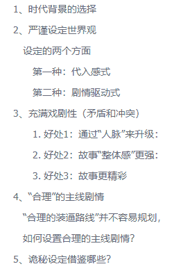
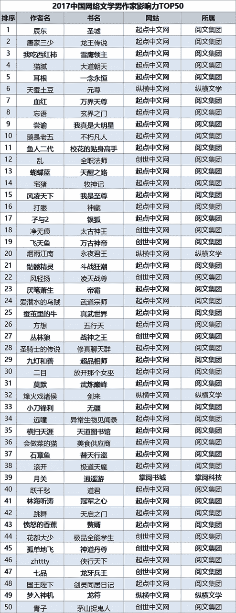
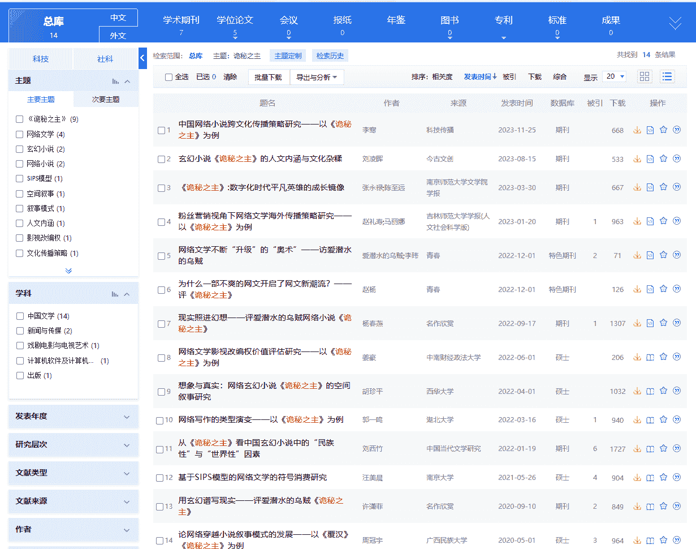
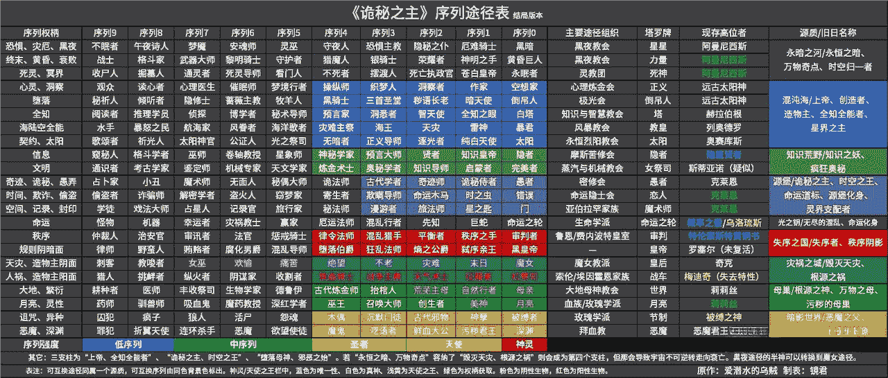
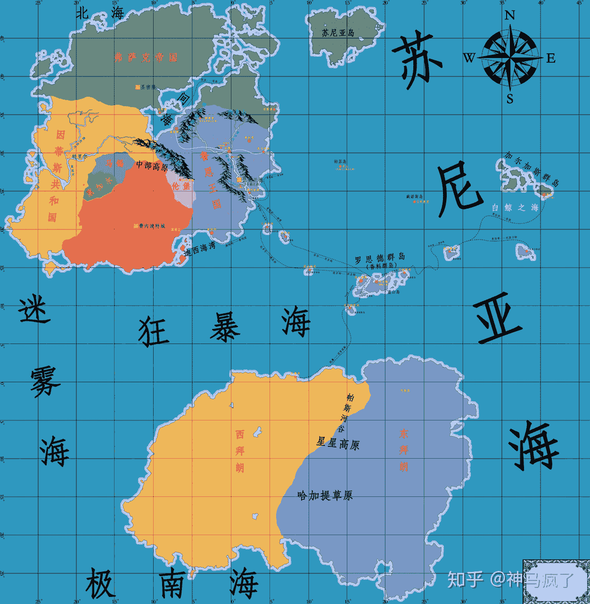
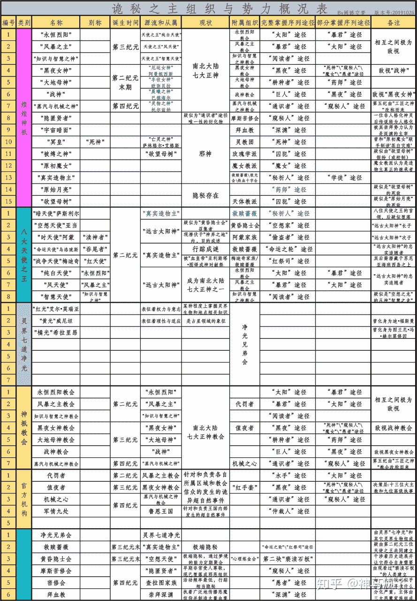
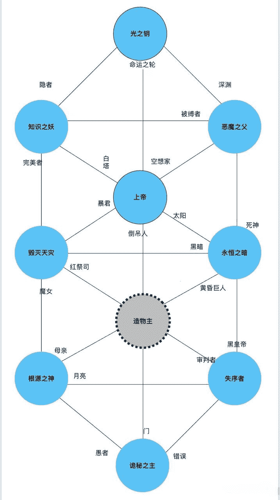
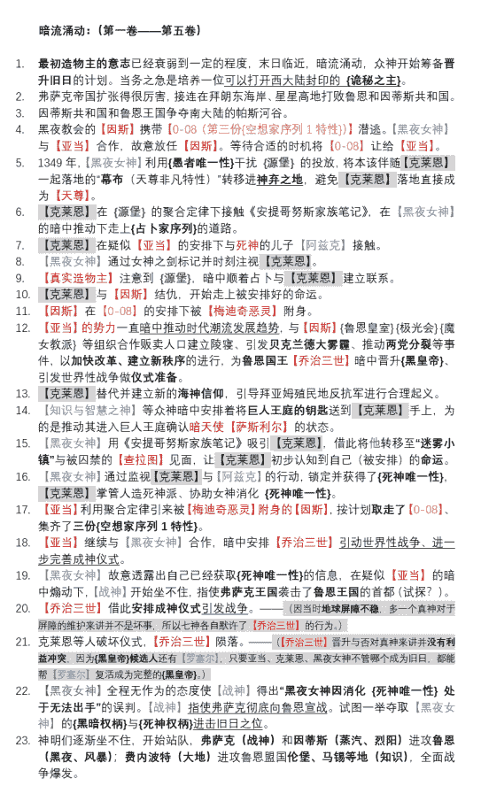
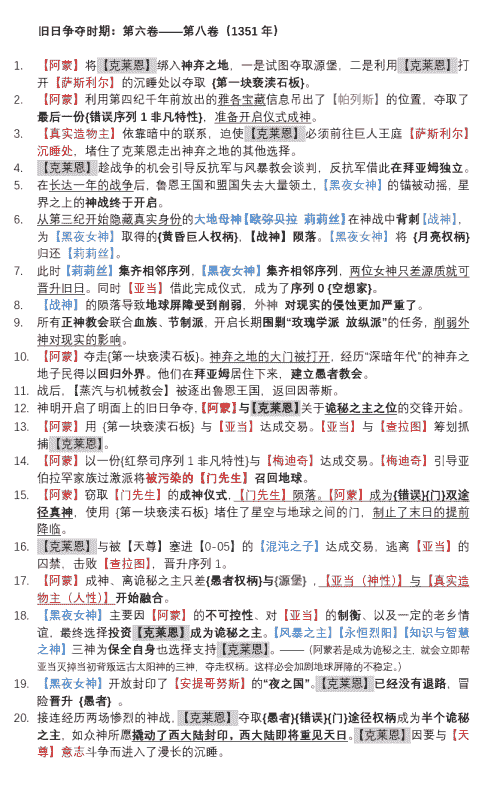

# 《诡秘之主》拆书之爆文框架+Prompt(五万字)上

> 来源：[https://rq547mr4oez.feishu.cn/docx/SyICdDHSVo2sGexY9E4ckaYHnsd](https://rq547mr4oez.feishu.cn/docx/SyICdDHSVo2sGexY9E4ckaYHnsd)

# 前言

---

✌很多小伙伴私信问我，为啥不拆一拆《闺蜜之主》哈哈~，是《诡秘之主》。

**✍模仿，学习大神的套路和框架，无论是新老作者，学会**了⛳网文必能上一个台阶，多多爆文哦👏。

> 比如用AI模仿诡秘框架，设定一个细致的国风式克系

> 后续会把这个propmt放出来，不知道有多少人想要~

☀在回头N刷的时候，每次都有新的感悟🤓。

☀因为这本小说太经典，卷毛狒狒⛹们很多，吹它的人太多，

☀我想了很久，决定从两个方面来吹😁，不，细致拆书~。

**⭐️首先，赞美愚者！👏**

**✅第一角度：上帝视角🧐，从全文的角**度深刻分析好在哪里，对我们写文的启发。

✅第二角度：蚂蚁视角🐜，开头分析为什么这样写。

☢️因为拆书工作量很大，大家多一键三联支持，先感谢🙏🙏🙏~

---

# 第一角度：卷毛狒狒的上帝视角

**目录：**

我是分割线

---

我是老杨，一个持续分享AI和写作干货的中年大叔。

我是分割线

---

## 1、时代背景的选择

回顾2018年之前，网文同质化非常严重，排行榜TOP50基本而且这些小说套路还大致相同 要么是以玄幻为代表的废柴退婚，要么是以仙侠为代表的尔虞我诈；

但再好的书看个100本也吐了

直到2018年才开始好转。

首先是由于同质化过于严重造成了大量的读者逆位 。

**其次是主要的网络小说受众，从八零后逐渐往**九零后偏移，读者的口味发生了剧烈的变化。

所以到了20118年曾经的套路不好用了。无数本传统模式的玄幻和仙侠相继陨落市场，终于是迎来了一次大变革。最大是变化是灵异复苏以及写法逐渐被轻松幽默搞笑所取代，（韭菜Y日记） 仿佛是压抑了多年来的一次爆发这一年好处犹如雨后春笋一般。

诡秘之主就是在这样的环境中诞生，力压各个大神，做到独领风骚。

**包括知网收录的，文学参考分析。**

**是想哪个网文能做到？**

> 文章我都花钱都下载了，有木有需要的小伙伴？

吹了，不，分析了这么多，对写网文有什么帮助？

> **答：这就是为什么写网文，一定要拔**榜，看风向，分析用户画像，和创新的原因。

> 三流的作者是自嗨（韭菜Y日记）

> **二流的作者是用户喜欢**

> **一流的作者是用户和自己都嗨**

> 超一流的是引领用户喜欢（第一代苹果）

## 2、**严谨设定**世界观

首先要我想说的是最最最重要的优点。世界观体系的设计！

为什么？

因为这个世界观会让整个小说，都合理和具象化，代入感爆棚！

无论有多少人对他的剧情或者节奏有异议，但我认为单从“设定”层面来说，它都是网文历史上的一座里程碑。

光看这个等级设定图就能认识到它设定的严（韭菜Y日记） 谨性和复杂性，更不用说等级背后的那些升级条件、非凡设定等等。

### **设定的两个方面**

首先说第一个，由闺蜜我们能看到各种眼花缭乱的设定，但是如果分出两大类。

#### **第一种：代入感式**

这种设定大家很容易理解，

比如乌贼用英国维多利亚时期的许多生活细节来丰满世界，让阅读的时候有了更多的真实感，人物也因为设定更加丰满。

> 维多利亚时代，是一个工业革命促成 的时代，有蒸汽机、机械制造、大航海，亦 有工厂、贫民窟、流浪汉。

> 它是狄更斯笔下 那个“最坏的”也是“最好的”时代，是个体化兴起、科学理性生成的时代，

> 也是种种在喉结不动的情况下，纯粹用本身灵性共鸣 了周围的空气，虚渺的、飘忽的、古怪的 声音随之响起吟诵起英国诗人克莱尔的 《月草》：

她的花一夜开到天明

但待到白昼睁开了眼睛

被凝视羞得无处可躲

她便在晕眩中蔫萎凋落

比如值得称道的是诡秘的货币系统。

经济系统设计不好失控的案例比比皆是，更（韭菜Y日记） 别提随便增发货币的网络小说了。

后期拍卖会/黑市/学院，不弄出个1亿亿亿金币都是给面子。

但是诡秘的物价控制得非常棒，用到现在仍然正常运行，下面是一个物价整理：

**比如严谨的世界地图**

还有其他的种种

这类设定其实你少写也不影响剧情，但写了，小**说给人的印象分**会获得提升，所以我管这种叫代入感式的设定。

#### **第二种：剧情驱动式**

说的更具体一些，就是这些设定能够决定“冲突+矛盾+爆发”的根本原因。

耳熟能详，最典型的两个例子：

+   **非凡特性聚合定律**

+   同一途径的高序列物品会间（韭菜Y日记） 歇性地无意识地吸引中低序列的非凡者来到它的附近，

+   且有彼此聚合在一起的倾向，高序列可以察觉这种吸引。

> **类似的设定其实很多，比如动漫JOJO**里的【替身使者会相互吸引】就是经典案例。

+   **非凡特性守恒定律**

+   每条途径最多一能有一个序列0，有序列0则没有序列1。

+   如果某序列没有序列0，则最多可有三个序列1。高序列多了，低序列便会减少。

> 这两个定律的存在，意味着书中绝大多数“冲突和矛盾”的原因已经在底层逻辑被圆上了。

**很多小说的读者总会吐槽“为什么主角老是遇上**危险”？为什么许多势力非要争个你死我活？

**因为不合理，不符合逻辑！**

在多数作品里，很多作者为了能够在（韭菜Y日记） 这一点上自圆其说，往往要花费大量精力来打补丁和完善逻辑，而诡秘通过这两个底层逻辑定律，完满解决了绝大多数冲突的最根本的原因，也给主角的升级路线提供了非常强有力的支撑。

因为这两条定律背后就是两个字：“吃人”。

只要踏上非凡者道路，就一定要面临其他非凡者带来的危险，最后的结果不是你吞噬对方，就是对方来吞噬你，这种危险是标准的生死危机，带来的都是极其容易展开剧情的冲突矛盾。

**其他那些具有类似意义的设定我就不多说了，比如成为**非凡者必须对抗疯狂、晋级仪式（典型的就是克莱恩出海的最大理由，是晋级仪式需要美人鱼的歌声）等等，都是决定剧情走势的重要推进因素。

## 3、充满戏剧性（矛盾和冲突）

纵观全书，如果我们把全书各个势力、（韭菜Y日记） 组织、神灵等，按照序列、地位和掌控资源这个三个维度从高到低排列，做一个表格图，那么它大概是这样的：

对各教会、邪神组织和家族的历史和架构整理也是非常有趣的，每个设定之间还有渊源。

比如黑夜女神以前是老魔狼的从神，颇有领导退休，然后秘书上位的感觉；

再比如[罗塞尔大帝](https://www.zhihu.com/search?q=%E7%BD%97%E5%A1%9E%E5%B0%94%E5%A4%A7%E5%B8%9D&search_source=Entity&hybrid_search_source=Entity&hybrid_search_extra=%7B%22sourceType%22%3A%22answer%22%2C%22sourceId%22%3A933319540%7D)说，选择序列的一瞬间，你的敌人和朋友就确认了

这个图是把不同实力层级的实力做出了区分，（韭菜Y日记） 并不严谨，只是个大概意思——因为我没办法通过特别简单的表格来把所有势力都划分清楚，这里只想告诉大家诡秘设定体系严谨的好处就在于：

无论在身处哪个层级，平行势力之间都是各自划分出阵营，并且矛盾重重的。

从正神到国家，再到各个教会和组织，平行之间有矛盾，上下又有联系，并且明显体现出了“上层意志辐射（影响）下层行动”的特征，整体可以说是通过设定织出了一张极其严密的“矛盾网”。

而在这样的设定体系之下，**主角只要是踏入了非凡者领域，哪怕是最**底层，也要选择阵营，并面对该阵营的敌人。

** **

**对**于小说而言，这就相当于迅速确定了“反派”（本阵营敌人）和“目标”（击败对手+防止被对方击败等）。（韭菜Y日记）

所以如果你把主角扔进设定好的“矛盾网”当中，那就相当于把飞蛾扔进蜘蛛网，他的任何动作，都会把震动向这个网的方方面面传导，并最终传递到最上层。

（韭菜Y日记）

> **这样有什么好处？**

#### 好处1：通过**“人脉”来升级：**

在故事初期撒伏笔的时候，就能让主角和**高等级角色产生联系，并由此制造爽点剧情**（包括被大佬看好营造主角高深莫测的背景/大佬在高潮情节出手当底牌/其他角色的迪化）等。

#### **好处2：故事“整体感”更强：**

在编织上下矛盾的时候，你必然要补充大量的资料和逻**辑链条，由****此会将主角一路升级和探索的线路逐步完整化。相比**多数新手“写一步看一步”的做法，当你拥有清晰的主线后，正文自然会出现大量的伏笔和铺垫，利用得当时，会显著增加读者的追读率，减少跳订情况发生。

#### **好处3：故事更精彩**

上一步说整体性强必然带来“伏笔多”，而伏笔多往往会让情绪拉动更加丰满，读者沉浸情节后带来的阅读体验更加优异，这都是“设定良好故事主线”带来的好处。

所以我们回过头来，再看很多新人苦恼的“我不知道主线矛盾怎么设置”问题，其根子上就在于自己：

第一没有设定出合适的、不同等级的组织、群体、国家、势力；

第二没有设定好它们之间矛盾冲突的缘由。

## 4、“合理”的主线剧情

所谓主线，就是“给主角一个一路升级装逼的合理路线”。

（韭菜Y日记）

其实**“升级”****的理由通常很好说，在**绝大部分小说里，你只要朝“不升级就要被碾压”，用生存危机作为压力和动机，已经足够。

克莱恩升级的速度非常慢，“近450万字的规模容纳了主角 的10次‘升级’，每次‘升级’要间隔大概40万字”。

缓慢的“升级”背后是克莱恩 自我成长缺少自觉性。

### **“合理的装逼路线”**并不容易规划，

首先你需要让主角以合理的方式和不同的势力发生碰撞——也就是产生冲突，绝不能让主角没头苍蝇一样乱撞，逮着谁就一通装逼，这会让读者感觉莫名其妙。（韭菜Y日记）

所以在看到刚才这张“矛盾网”之后，我们就能意识到如果你设置出了一个合适的“矛盾网”，那么主角只要在这个网内“升级”，就必然要面对层出不穷、来自上下左右各个方向的矛盾。

第一卷到第八卷的“大事记”总结：

从这两张图里，我们基本可以看到从克莱恩还没成为非凡者时（韭菜Y日记**） ，就已经被亚当和黑夜**女神安排的一清二楚，后续所有剧情的大矛盾，根子上都来自于矛盾网最上方的高位者博弈。

**而当中除却高层影响的那些故事，也**都脱离不出克莱恩在每一层级所处的矛盾网。

主角为了回家，为了复仇，为了生存**、为了追寻真相，**就必然要升级（升级的理由），而只要向上升级，就必然更加深陷于这张矛盾网（合理装逼的理由）之中。

所以在具体大纲设置上，我们可以——

第一，以主角每在矛盾网上前进一步为一卷。

**第二，主角从最底层一路升级到最高层，并解决各个主要**矛盾的路线过程，便是全书的“主线剧情”。

（韭菜Y日记）

### 如何设置合理的主线剧情？

> 全书的“主线设置过程”，大概分为以下几步：

>

+   通过底层设定，尽量确定大矛盾的爆发根源。

+   【核心设定可以多参考各类大神书籍或影视作品，根子上很多设定的逻辑其实都是相近的。】

+   围绕设定，详细设置不同层次（等级）的势力

+   【这一步需要修改多次并尽量详实，可以多搞一些“锦上添花式设定”来提升读者的阅读体验，但需要作者对此有一定专业性知识储备，编也是在一定基础上编，不然容易出大BUG。】

+   让不同层级的势力上下交互，形成【矛盾网】

+   【这一步写的越详细，你的剧情展开就越轻松，因为你会发现四处都是矛盾，写哪一个方向都能搞出不错的爽点来，不用愁主角“该干什么”。】

+   以主角踏入网中为故事起点，抵达尽头为故事终点

+   【可以对故事中的“历史”进行一定完善，用以增加故事中一些势力之间的冲突性、一些事件爆发的合理性】

+   每升级（一个阶段）/解决一个主要矛盾为一卷

+   【这个主要矛盾基本就是当前层级中，敌对势力的BOSS。】

+   从底层一路升级至顶层并解决矛盾的过程为主线

+   【这条线想要理顺并不容易，需要在构建过程中一遍一遍的完善，并为主角在每个阶段都增加一些必要性的动机理由，不仅仅是“为了生存”那么简单。同时后期大矛盾大BOSS尽早确定，则要想要解决他们的方式和转折，由此尽早埋伏笔和铺垫。只有这样全书的固始县才算是完整且深刻联系到一起。】（韭菜Y日记）

## 5、诡秘设定借鉴哪些？

阅文的一次颁奖晚会上，[乌贼](https://www.zhihu.com/search?q=%E4%B9%8C%E8%B4%BC&search_source=Entity&hybrid_search_source=Entity&hybrid_search_extra=%7B%22sourceType%22%3A%22answer%22%2C%22sourceId%22%3A2689891662%7D)说他写书到现在，写了5本书，书架上的书换了4次，

写书过程中大概查过300本资料书籍。有段vcr，暂停看了下，能看清的有以下书籍：

《[内在的天空-占星学入门](https://www.zhihu.com/search?q=%E5%86%85%E5%9C%A8%E7%9A%84%E5%A4%A9%E7%A9%BA-%E5%8D%A0%E6%98%9F%E5%AD%A6%E5%85%A5%E9%97%A8&search_source=Entity&hybrid_search_source=Entity&hybrid_search_extra=%7B%22sourceType%22%3A%22answer%22%2C%22sourceId%22%3A2689891662%7D)[《中国古代神话传说](https://www.zhihu.com/search?q=%E3%80%8A%E8%A5%BF%E6%96%B9%E7%A5%9E%E7%A7%98%E5%AD%A6%E6%8C%87%E6%B4%A5%E3%80%8B&search_source=Entity&hybrid_search_source=Entity&hybrid_search_extra=%7B%22sourceType%22%3A%22answer%22%2C%22sourceId%22%3A2689891662%7D)》[《帝国豪门-18世纪史](https://www.zhihu.com/search?q=%E3%80%8A1856%E5%B9%B4%E8%8B%B1%E5%9B%BD%E7%89%A9%E4%BB%B7%E3%80%8B&search_source=Entity&hybrid_search_source=Entity&hybrid_search_extra=%7B%22sourceType%22%3A%22answer%22%2C%22sourceId%22%3A2689891662%7D)》《狄更斯讲英国史》《西方神秘学指津》《炼金术师及其他鬼故事》《大雾霾》《山海经》《平凡的世界》《系统神学》《民国枭雄杜月笙》《英国哲学启蒙时代》《1856年英国物价》《万物简史》《维多利亚时期英国中产阶级婚姻家庭生活研究》......

（韭菜Y日记）

> 1、二十二条途径的内容根据[塔罗牌](https://www.zhihu.com/search?q=%E5%A1%94%E7%BD%97%E7%89%8C&search_source=Entity&hybrid_search_source=Entity&hybrid_search_extra=%7B%22sourceType%22%3A%22answer%22%2C%22sourceId%22%3A2689891662%7D)改编，这个很明显（对塔罗牌牌面的解读，比较公认的一种说法就是，一个愚者的旅程，从愚者开始，到世界结束，看书里的章节名感觉乌贼也借鉴了这个设定）

>

> 2、书中的神之途径基本参考了[卡巴拉生命之树](https://www.zhihu.com/search?q=%E5%8D%A1%E5%B7%B4%E6%8B%89%E7%94%9F%E5%91%BD%E4%B9%8B%E6%A0%91&search_source=Entity&hybrid_search_source=Entity&hybrid_search_extra=%7B%22sourceType%22%3A%22answer%22%2C%22sourceId%22%3A2689891662%7D)[，生](https://www.zhihu.com/search?q=%E5%8E%9F%E8%B4%A8&search_source=Entity&hybrid_search_source=Entity&hybrid_search_extra=%7B%22sourceType%22%3A%22answer%22%2C%22sourceId%22%3A2689891662%7D)命之树大概可以分为三支柱，十个原质，四个世界，二十二路径等基本结构。《旧约·创世记记载，生命之树位于伊甸园中央，而卡巴拉借由此来描述所谓通往神（在卡巴拉教派文献中，通常被称为“耶和华”）的路径，或神从无中创造世界的方式。

> （韭菜Y日记）

> 3、[克苏鲁神话](https://www.zhihu.com/search?q=%E5%85%8B%E8%8B%8F%E9%B2%81%E7%A5%9E%E8%AF%9D&search_source=Entity&hybrid_search_source=Entity&hybrid_search_extra=%7B%22sourceType%22%3A%22answer%22%2C%22sourceId%22%3A2689891662%7D)中[的设定](https://www.zhihu.com/search?q=%E6%98%9F%E4%B9%8B%E5%8C%99&search_source=Entity&hybrid_search_source=Entity&hybrid_search_extra=%7B%22sourceType%22%3A%22answer%22%2C%22sourceId%22%3A2689891662%7D)[，也很明](https://www.zhihu.com/search?q=%E8%AF%A1%E7%A7%98%E4%B9%8B%E4%B8%BB&search_source=Entity&hybrid_search_source=Entity&hybrid_search_extra=%7B%22sourceType%22%3A%22answer%22%2C%22sourceId%22%3A2689891662%7D)显，包括经典的不可直视神，不可逆的污染，也包括外神、旧[日等称呼，](https://www.zhihu.com/search?q=%E5%B0%A4%E6%A0%BC%E7%B4%A2%E6%89%98%E6%96%AF&search_source=Entity&hybrid_search_source=Entity&hybrid_search_extra=%7B%22sourceType%22%3A%22answer%22%2C%22sourceId%22%3A2689891662%7D)以[及书里提](https://www.zhihu.com/search?q=%E9%98%BF%E6%92%92%E6%89%98%E6%96%AF&search_source=Entity&hybrid_search_source=Entity&hybrid_search_extra=%7B%22sourceType%22%3A%22answer%22%2C%22sourceId%22%3A2689891662%7D)到过的群星归位之时、星之匙、泡泡、门等等，熟悉克苏鲁的可以在书里找到大量致敬的地方。诡秘之主里面的三支柱就是把克系的三支柱能力排列组合混搭后的产物，堕落母神部分对应莎布尼古拉斯，上帝对应尤格索托斯的全知全视并升级为全知全能。诡秘之主所在的苟三家是混搭得最散的，尤格索托斯掌控时间空间+奈亚拉托提普千面之神和欺骗之神+阿撒托斯的盲目痴愚

>

> 4、参考了以基督教神话为主的各种神话体系，这一条感觉和第2条重复了，但主（韭菜Y日记）[ 要是书里](https://www.zhihu.com/search?q=%E5%88%87%E5%B0%94%E8%AF%BA%E8%B4%9D%E5%88%A9&search_source=Entity&hybrid_search_source=Entity&hybrid_search_extra=%7B%22sourceType%22%3A%22answer%22%2C%22sourceId%22%3A2689891662%7D)神之途径这个设定过于重要，就单独说了。按书里的说法就是，远古太阳神是从切尔诺贝利走出的旧文明幸存者，很可能是东正教的毛子，再加上全五家确实很像基督教的上帝，所以照搬了基督教的一些设定来发展自己的信仰

>

> 5、主角所处背景参考[维多利亚时代](https://www.zhihu.com/search?q=%E7%BB%B4%E5%A4%9A%E5%88%A9%E4%BA%9A%E6%97%B6%E4%BB%A3&search_source=Entity&hybrid_search_source=Entity&hybrid_search_extra=%7B%22sourceType%22%3A%22answer%22%2C%22sourceId%22%3A2689891662%7D)，比如1英镑等于20先令，1先令等于12便士这种古怪的兑换比率；谷物法案相关的一系列事件；各种物价以及人民收入；尤其是大雾霾事件，相当于明说了贝克兰德就是伦敦。

>

> 6、[赫密斯学派](https://www.zhihu.com/search?q=%E8%B5%AB%E5%AF%86%E6%96%AF%E5%AD%A6%E6%B4%BE&search_source=Entity&hybrid_search_source=Entity&hybrid_search_extra=%7B%22sourceType%22%3A%22answer%22%2C%22sourceId%22%3A2689891662%7D)，作为现实世界中真实存在的一个学派，主要的思想是人类要回归神性。（韭菜Y日记） 另外这个学派好像还是天启宗教们钦定所谓邪恶之邪恶，异端之异端（恰好对应他们的伟大之伟大，智慧之智慧）。

>

> 7、要素黎明参考了[黄金黎明](https://www.zhihu.com/search?q=%E9%BB%84%E9%87%91%E9%BB%8E%E6%98%8E&search_source=Entity&hybrid_search_source=Entity&hybrid_search_extra=%7B%22sourceType%22%3A%22answer%22%2C%22sourceId%22%3A2689891662%7D)[赫密](https://www.zhihu.com/search?q=%E9%9F%A6%E7%89%B9&search_source=Entity&hybrid_search_source=Entity&hybrid_search_extra=%7B%22sourceType%22%3A%22answer%22%2C%22sourceId%22%3A2689891662%7D)斯学派，而现在最流行的这个版本的塔罗牌，创作者韦特刚好出身于黄金黎明赫密斯学派。

>

> 8、灵界七光的原型是现实中的“[神智学](https://www.zhihu.com/search?q=%E7%A5%9E%E6%99%BA%E5%AD%A6&search_source=Entity&hybrid_search_source=Entity&hybrid_search_extra=%7B%22sourceType%22%3A%22answer%22%2C%22sourceId%22%3A2689891662%7D)”这[一神秘](https://www.zhihu.com/search?q=%E6%B5%B7%E4%BC%A6%E5%A8%9C&search_source=Entity&hybrid_search_source=Entity&hybrid_search_extra=%7B%22sourceType%22%3A%22answer%22%2C%22sourceId%22%3A2689891662%7D)学组织，所推崇的神秘学理念，七种对应着不同的领域的灵光，象征着神流溢在凡世间的美德与奇迹（也是因为这个，书里的七光设定上对人类友好）。创始人布拉瓦茨基夫人，就是fgo里的海伦娜

>

> 9、心智体，星灵体，[以太体](https://www.zhihu.com/search?q=%E4%BB%A5%E5%A4%AA%E4%BD%93&search_source=Entity&hybrid_search_source=Entity&hybrid_search_extra=%7B%22sourceType%22%3A%22answer%22%2C%22sourceId%22%3A2689891662%7D)以及灵界、灵性这些概念都是现实中的神秘学经典概念

>

> 10、书里观众途径对应的[集体潜意识](https://www.zhihu.com/search?q=%E9%9B%86%E4%BD%93%E6%BD%9C%E6%84%8F%E8%AF%86&search_source=Entity&hybrid_search_source=Entity&hybrid_search_extra=%7B%22sourceType%22%3A%22answer%22%2C%22sourceId%22%3A2689891662%7D)[大海](https://www.zhihu.com/search?q=%E8%8D%A3%E6%A0%BC&search_source=Entity&hybrid_search_source=Entity&hybrid_search_extra=%7B%22sourceType%22%3A%22answer%22%2C%22sourceId%22%3A2689891662%7D)这个概念现实中也是有相关理论的，提出者是心理学家荣格。

>

> 11、主角经常占卜，而书里涉及的一些占卜知识也是现实中比较经典的，如灵数，星象，塔罗，仪式魔法，卡巴拉，卜杖等等。当然要说最经典的还要属抛硬币。

>

> 12[、书里](https://www.zhihu.com/search?q=%E5%A4%A7%E9%83%A8%E5%A4%B4&search_source=Entity&hybrid_search_source=Entity&hybrid_search_extra=%7B%22sourceType%22%3A%22answer%22%2C%22sourceId%22%3A2689891662%7D)的仪式魔法主要借鉴了现实中的仪式魔法，主要是《威卡（韭菜Y日记） 魔法《力量之环》这两本流传较广的现代魔法书。而且这两本魔法书有中文翻译，写西幻题材的作者如果不想啃英文大部头的话可以从这两本里找灵感。

>

> 13、封印物的不少设定借鉴了scp基金会，scp相关的设定出过一些游戏，知道的人不少，比如那个眨眼就冲过来拧你脖子的羊驼

> （韭菜Y日记）

> 14、还是上面提到的心理学家荣格（曾任国际心理分析学[会会长、国际心理治](https://www.zhihu.com/search?q=%E3%80%8A%E5%BF%83%E7%90%86%E5%AD%A6%E4%B8%8E%E7%82%BC%E9%87%91%E6%9C%AF%E3%80%8B&search_source=Entity&hybrid_search_source=Entity&hybrid_search_extra=%7B%22sourceType%22%3A%22answer%22%2C%22sourceId%22%3A2689891662%7D)疗协会主席），有本书叫《心理学与炼金术》，应该是书里心理炼金学会这个组织的理论原型。

>

> 15、不少设定以及人物参考了[血源诅咒](https://www.zhihu.com/search?q=%E8%A1%80%E6%BA%90%E8%AF%85%E5%92%92&search_source=Entity&hybrid_search_source=Entity&hybrid_search_extra=%7B%22sourceType%22%3A%22answer%22%2C%22sourceId%22%3A2689891662%7D)[，比如第一猎](https://www.zhihu.com/search?q=%E3%80%8A%E8%A1%80%E6%BA%90%E8%AF%85%E5%92%92%E3%80%8B&search_source=Entity&hybrid_search_source=Entity&hybrid_search_extra=%7B%22sourceType%22%3A%22answer%22%2C%22sourceId%22%3A2689891662%7D)人格尔曼等。另外强推《血源诅咒》，如果你是魂系爱好者或者克系爱好者，可以试试。

>

> 16、[道恩·唐泰斯](https://www.zhihu.com/search?q=%E9%81%93%E6%81%A9%C2%B7%E5%94%90%E6%B3%B0%E6%96%AF&search_source=Entity&hybrid_search_source=Entity&hybrid_search_extra=%7B%22sourceType%22%3A%22answer%22%2C%22sourceId%22%3A2689891662%7D)[，这个也很明显](https://www.zhihu.com/search?q=%E7%88%B1%E5%BE%B7%E8%92%99%C2%B7%E5%94%90%E6%B3%B0%E6%96%AF&search_source=Entity&hybrid_search_source=Entity&hybrid_search_extra=%7B%22sourceType%22%3A%22answer%22%2C%22sourceId%22%3A2689891662%7D)，借鉴的基督山伯爵的主角爱德蒙·唐泰斯，基督山伯爵这本书对现代爽文的影响非常大，不少现在网文用滥了的套路都是出自这本书。

>

> 17、战士的序列4猎魔人的能力特点参考了巫师3的猎魔人

>

> 18、大侦探[夏洛特·莫里亚蒂](https://www.zhihu.com/search?q=%E5%A4%8F%E6%B4%9B%E7%89%B9%C2%B7%E8%8E%AB%E9%87%8C%E4%BA%9A%E8%92%82&search_source=Entity&hybrid_search_source=Entity&hybrid_search_extra=%7B%22sourceType%22%3A%22answer%22%2C%22sourceId%22%3A2689891662%7D)，也是经典致敬

>

> [19、关](https://www.zhihu.com/search?q=%E4%B8%8A%E5%8F%A4%E5%8D%B7%E8%BD%B4&search_source=Entity&hybrid_search_source=Entity&hybrid_search_extra=%7B%22sourceType%22%3A%22answer%22%2C%22sourceId%22%3A2689891662%7D)于扮演法借鉴的原型，个人倾向于上古卷轴里面的（韭菜Y日记） 披甲，这两个真的是太像了

---

END