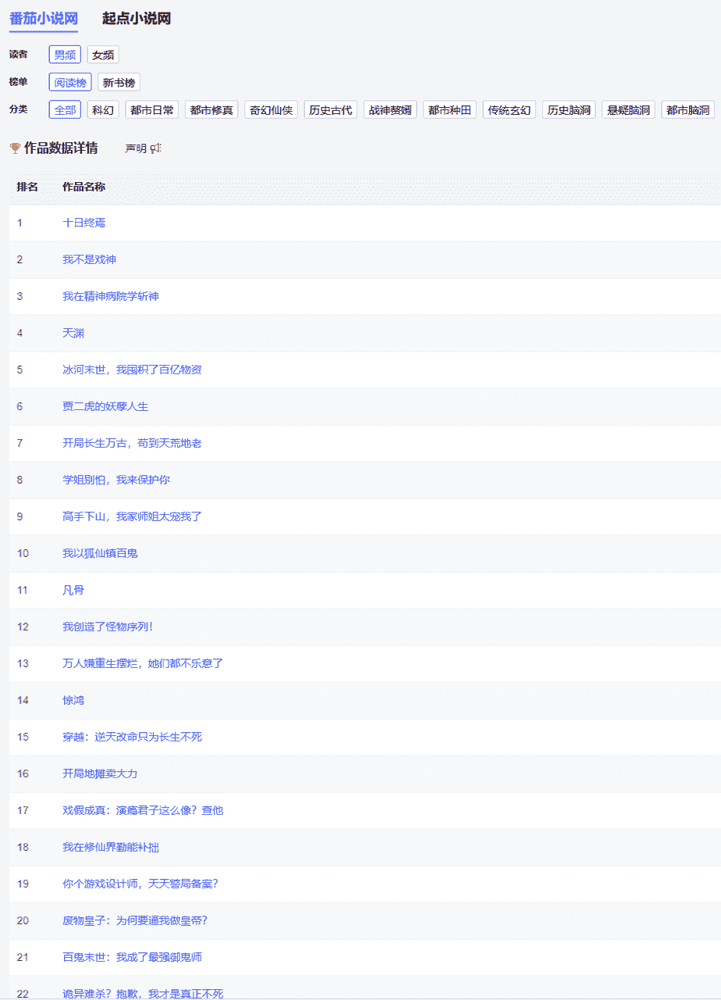
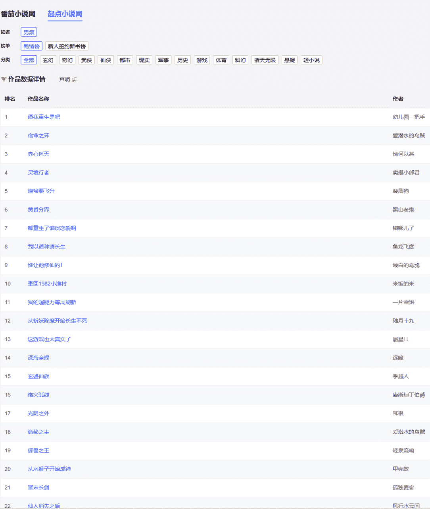
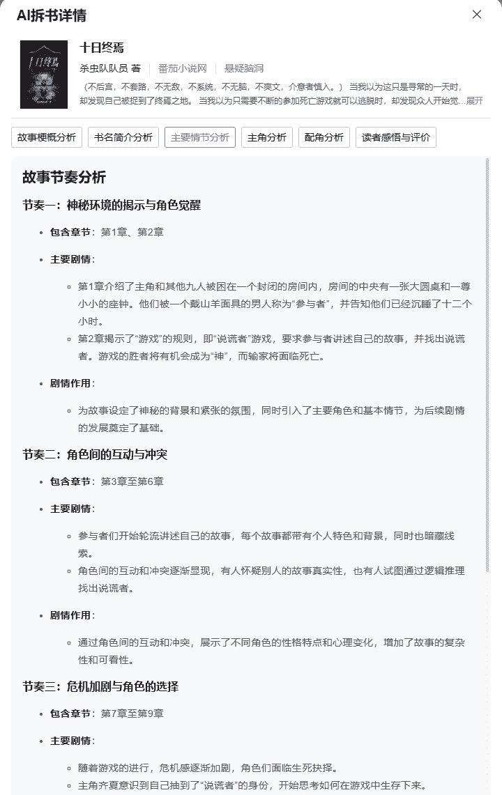
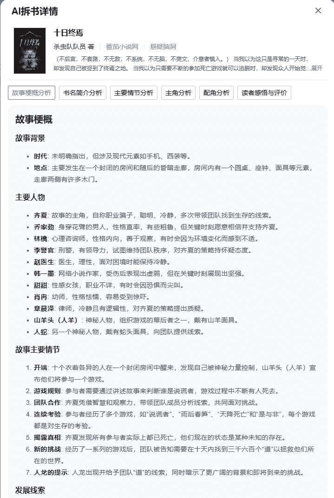

# AI拆小说-全网最全指南（底层思路+pormpt）

> 来源：[https://rq547mr4oez.feishu.cn/docx/Xi8fdcTyBoqoSJxw6IrcQ8nEnSb](https://rq547mr4oez.feishu.cn/docx/Xi8fdcTyBoqoSJxw6IrcQ8nEnSb)

# 一、前言

不知道大家写文章时有没有过这样的感受：

阅读文章时发现一个很有共鸣的点，很想写出来，但是偏偏打开电脑半天敲不出来一个字。

自己脑袋里却一团浆糊，找不到一点头绪。别人的小说，感觉每一篇都逻辑清晰、语言优美、金句频出，但是自己每次写完都读起来干巴巴的，阅读量也一直上不去。

《增广贤文》中写道:“**见者易，学者难**”。

很多事情看起来简单，做起来却并非想象中的那样简单。

做事如此，写文章也是如此。

中国现代著名作家矛盾曾说过：“ 模仿是创造的第一步，模仿又是学习的最初形式。”

学习写文章，就是先模仿、后学习、再创造的过程，想要写出你喜欢的文章，不如从模仿别人的文章开始。

**拆文其实就是把一篇文章像庖丁解牛一样分解出**来，找出自己欠缺的和需要的东西为我所用。

PS：盗用这个文章的不要乱引流破坏环境，文章是免费分享给大家。有看见各位顺手举报下。感谢～资料纯分享不易。

原始出处：

# 二、思路

关于如何拆文这个问题，并没有一个标准答案，因为拆文的方法与文章类型、拆文目的有很大关系，这篇文章主要分享通用的拆文步骤，共八步：

### 第1步：选书

+   **选书。**

+   目的：

+   故事线完整，剧情张弛有度，人物性格鲜明

+   对你有用的，有目的性去选择

+   方法：

+   扫榜：长篇就是起点、番茄、七猫等大小网站；短篇幅就是知乎、ONE等一些知名网站；

### 第2步：**故事梗概**

+   **故事梗概（AI可以帮你搞定）**

+   故事背景.介绍故事发生的时代、地点等背景信息

+   主要人物:列举主要角色，简要描述他们的性格、目标和动机

+   故事情节:按照时间顺序，概述故事的主要情节和发展线索

### 第3步：**主线剧情分析**

+   **主线剧情分析**

+   开篇

+   事的起始事件

+   包括场景、人物和事件

+   引发主要冲突的问题。

+   铺垫

+   高潮之前的重点情节,如何引起读者注意力的?

+   高潮:

+   如何解决主要冲突?

+   重要决策上如何做选择?

+   重大转折点在哪?

+   最紧张的部分怎么写的?

+   结尾:（韭菜Y日记）

+   故事最终结果人物

+   命运的走向

+   给读者印象深刻的点，

### 第4步：支线剧情

+   **支线剧情分析**

+   支线 1:

+   比较支线剧情和主线剧情的差异和相似之处分析这种对比如何增强故事的复杂性。

+   支线 2:支线 3:(同上)

### 第5步：角色分析

+   角色分析

+   主角:（韭菜Y日记）

+   性格特点：分析他的性格特点，标注一些相关情节来体现这点

+   目标动机：想想它们如何推动故事的发展

+   成长转变：自包括他如何面对挑战、克服困难以及思想上的升华

+   配角:

+   角色关系：配角与主角的互动方式、对主角产生啥样的影响

+   性格行为：分析性格，经典的行为，在故事中的作用是什么?对情节的影响

+   情节推动：如何推动故事的发展?增加情节张力?

+   反派:

+   人物背景：有什么样的背景，包括出身、学识、经历等

+   角色冲突：与其他角色之间的冲突，是如何影响故事发展的

+   人物狐线：成长、变化、最终结局

### 第6步：主题与情感

+   **主题与情感分析**

+   主题（韭菜Y日记）

+   爱、人性、战争

+   成长、友谊

+   爽文

+   情感表达

+   角色之间的情感纽带

+   和情感变化

+   正义、勇气.

### 第7步：风格和技巧

+   **写作风格与技巧**

+   叙事风格：视角(第一人称、第三人称有限视角还是全知视角)节奏，以及高潮和低谷的分布。

+   叙事技巧：倒叙、插叙

+   人物刻画：外貌、语言、行为、心理

+   情节构建：悬念、伏笔、意外、转折等手法

### 第8步：感悟与评价

+   **个人感悟与评价**

+   个人感悟：你对情节、人物、主题的理解

+   总结优点：有哪些引人入胜的情节、深刻的角色等

+   不足之处：尝试找错，刻意去找情节漏洞、角色行为不合理的地方

# 三、工具

1、我自己在用的工具不少，最近免费的可以参考的工具推荐一个：

可以直接扒榜，还有概要分析等简单功能。

虽然结果一般，但是可以作为简单拆书的工具（韭菜Y日记）

[**链接直达**](https://writersdesk.net/?from=aihub#/homepage)

2、Kimi、文心、豆包等市场通用的大模型，需要根据需求，做细致的分析。

# 四、实操

我这边以Kimi作为实操，拆的是《十日终焉》

注意：基本的故事梗概，已经通过工具分析完成了。我们做一些深度的拆解

以下pormpt可以不同文章段落反复的使用。

### 我：阅读全文，结合人物的身份设定，男女主的情感发展，按照起承转合概括全文内容，列出具体情节（韭菜Y日记）

+   AI：根据提供的文本内容，全文的概括可以分为以下几个部分：

+   起：故事开始于一个神秘的房间，十个人围绕圆桌而坐，其中九人沉睡后醒来，发现被一个戴山羊头面具的男人（山羊头）所观察。这个房间没有门，只有一尊座钟和一张圆桌，营造出一种压抑和不安的氛围。山羊头自我介绍，并宣布他们将参与一个游戏，目的是创造一个“神”。

+   承：游戏的规则被揭示，称为“说谎者”。每个参与者需要讲述自己来到这里之前最后的故事，其中一人的故事将是谎言。游戏的关键在于找出说谎者，否则将面临死亡。随着故事的进行，参与者们开始分享自己的故事，包括甜甜的不幸遭遇、乔家劲的收债经历、肖冉的教师困境等，每个故事都带有个人背景和情感色彩。

+   转：随着故事的深入，齐夏（主角）发现了游戏的矛盾之处，意识到所有参与者可能都在说谎。他通过逻辑推理和观察，逐渐揭示了游戏的真相。在游戏的“中场休息”期间，齐夏和其他参与者开始怀疑游戏的真正目的和山羊头的真实身份。

+   合：最终，齐夏通过计算和推理，揭示了房间的真相，认识到所有人可能都已经死亡，这个游戏可能是他们灵魂的一种试炼或者是对生死的隐喻。在这一过程中，齐夏和林檎之间的情感逐渐发展，尽管他们来自不同的时间线，但共同的经历和相互支持使他们之间的关系加深。

+   综上所述，全文通过一个神秘的游戏将不同背景的人物聚集在一起，通过他们的故事和互动，展现了人性的复杂性和生存的挑战。同时，主角齐夏的推理和发现，以及他与林檎之间的情感发展，构成了故事的主要情节。

### 我：请按照三幕式划分故事节奏（韭菜Y日记）

+   AI：根据提供的文本内容，我们可以将故事节奏按照传统的三幕式结构进行划分：

+   **第一幕：设定与主题介绍**

+   **开场**：介绍神秘房间和十位参与者的初始状态，以及山羊头面具人的出现。

+   **主题陈述**：山羊头面具人提出游戏的目的是为了创造一个“神”，暗示了游戏的重要性和危险性。

+   **建立背景**：通过参与者的互动和对话，建立故事背景，包括他们被带到房间的方式和当前的困境。

+   **催化剂**：座钟的响起标志着游戏的开始，这是故事的一个转折点。

+   **第二幕：冲突与升级**

+   **升级**：参与者们开始分享自己的故事，每个故事都带有个人背景和情感色彩，同时也增加了悬疑和不确定性。

+   **中点**：齐夏开始怀疑所有人可能都在说谎，这个发现是故事的中点，为接下来的剧情增加了紧张感。

+   **复杂性与挫折**：随着讨论的深入，参与者们之间的信任开始瓦解，冲突开始显现。

+   **转折点**：齐夏通过计算和推理，得出了一个令人震惊的结论，即所有人可能都已经死了，这是故事的一个重要转折点。

+   **第三幕：解决与结局**

+   **高潮**：齐夏公开自己的推理，揭示了游戏的真相，这是故事的高潮部分。

+   **解决**：参与者们面对齐夏的结论，开始接受可能的真相，并准备迎接游戏的最终结果。

+   **结局**：故事以参与者们接受自己可能已经死亡的现实，准备迎接未知的命运作为结尾。

+   在这个故事中，三幕式结构帮助我们理解了故事的发展脉络，从初始的神秘和不确定，到中间的冲突和猜疑，再到最后的真相揭露和角色的接受过程。每个阶段都为故事增加了深度和紧张感，推动了剧情的发展。

### 我：请梳理故事中出现过的所有人物的形象及人物与人物之间的关系（韭菜Y日记）

+   AI：根据提供的文本内容，以下是故事中出现的所有人物的形象及人物与人物之间的关系梳理：

1.  **齐夏**：故事的主角，一个冷静、理智且具有分析能力的年轻人。他在故事中表现出了极强的逻辑思维和推理能力，能够迅速地分析情况并做出判断。齐夏似乎对当前的困境有着自己的理解和计划。

1.  **山羊头**：一个戴着山羊头面具、身穿黑色西服的神秘男人，他是游戏的组织者和规则的宣布者。他的行为和言语给参与者们带来了极大的恐慌和不安。

1.  **甜甜**：一个被称为“技术工作者”的年轻女孩，她的衣着暴露，表现出一种无奈和委屈的态度。甜甜在讲述自己的故事时，遭遇了花臂男的质疑。

1.  **花臂男（乔家劲）**：一个广东人，自称是收债者，他的普通话较差，对甜甜的故事表示怀疑，并指出她可能在撒谎。

1.  **白大褂**：一个中年男人，穿着白大褂，可能是医生或其他医疗工作者。他对清冷女人的推理表示怀疑。

1.  **清冷女人**：一个冷静、有条理的女性，她对山羊头的行为表示反对，并警告他可能构成非法拘禁罪。

1.  **健硕男人**：一个身体强壮的年轻男人，他在讨论中提出了一个让所有人都活下来的策略，但被白大褂质疑其可信度。

1.  **肖冉**：一名幼师，她在讲述自己的故事时表现出了恐惧和紧张，提到了云南大理的崇圣寺三塔。

1.  **赵海博**：一名医生，他在地震中正在为一位女士进行手术，手术被地震打断。

1.  **韩一墨**：一个网络小说作家，他在地震发生时正在家中撰写小说，对外界发生的事情一无所知。

1.  **章晨泽**：一名律师，她在地震前正在整理开庭资料，提到了一个被骗走二百万的当事人。

1.  **李尚武**：一名刑警，他在监视一个诈骗犯时遭遇了地震，并且被人从身后袭击。

1.  **林檎**：一名心理咨询师，她是宁夏人，提到了一个幼师咨询者，但后来因为地震而失去了联系。

这些人物之间的关系主要是通过他们共同参与的这个游戏以及他们各自的故事来建立的。他们之间存在着怀疑、合作和对立的关系，尤其是在尝试找出谁是说谎者的过程中。齐夏作为主角，与其他人物的关系最为紧密，他试图通过逻辑和推理来解决他们面临的困境。

### 我：列出导致人物产生成长变化的具体情节内容（韭菜Y日记）

+   AI：在这个故事中，人物的成长变化主要体现在齐夏的角色上，他通过一系列的事件和线索逐渐揭示了游戏的真相，并引导其他人物面对现实。以下是导致齐夏及其他人物产生成长变化的具体情节内容：

1.  **齐夏的推理**：齐夏通过观察和推理，发现房间的密封性和空气消耗量之间的矛盾，这使他开始怀疑他们的真实状况。他计算了空气消耗量和房间的容积，发现空气量不足以支撑所有人的生存，这引发了他对游戏真相的深入思考。

1.  **甜甜的谎言揭露**：甜甜在讲述自己的故事时，被乔家劲质疑其真实性，这促使齐夏意识到每个人的故事中可能都隐藏着谎言。

1.  **乔家劲的质疑**：乔家劲对甜甜的质疑，以及对齐夏的挑战，推动了齐夏更深入地分析情况，并最终引导他发现了游戏的真相。

1.  **山羊头的规则宣布**：山羊头宣布的“有且只有一个说谎者”的规则，让齐夏开始思考游戏的设计和目的，这成为了他推理的关键线索。

1.  **齐夏的自我揭露**：齐夏在众人面前展示了自己的身份卡，上面写着“说谎者”，这一行为增加了他的可信度，并使他能够在后续的讨论中占据主导地位。

1.  **齐夏的最终解释**：齐夏向众人解释了他的推理过程，揭示了所有人都已经死亡的真相，这一发现极大地改变了所有人对当前状况的认识和心态。

1.  **山羊头的自我制裁**：山羊头的自我制裁行为，即用手枪射击自己，这一行为震惊了所有人，也间接证实了齐夏的推理。

1.  **团队合作的形成**：在齐夏的引导下，众人开始团结起来，共同面对接下来的挑战，这标志着他们从个体的恐惧和猜疑转变为团队的合作和信任。

1.  **对未来的不确定性**：尽管齐夏揭示了游戏的真相，但他们仍面临着未知的未来和可能的新游戏，这种不确定性促使他们保持警惕并准备迎接新的挑战。

通过这些情节内容，人物们的成长变化体现在从最初的恐惧和混乱，到逐渐的理解和接受，再到最终的团结和准备面对未来的心态转变。齐夏的角色尤为突出，他的成长体现在他的逻辑推理能力和领导力的展现上。

### 我：请按照救猫咪十五节拍表划分故事节奏（韭菜Y日记）

+   AI：根据提供的文本内容，我们可以将故事节奏按照“救猫咪十五节拍表”进行划分，该节拍表是一种常见的电影剧本结构，用于描述故事的发展和转折点。以下是根据文本内容划分的节拍表：

1.  开场画面（Setup）：故事开始于一个神秘的房间，十个人围绕圆桌而坐，被一个戴山羊头面具的男人观察。这个场景设定了故事的基调和环境。

1.  主题陈述（Theme Stated）：山羊头自我介绍，并宣布他们将参与一个游戏，目的是创造一个“神”。这里提出了故事的主题，即生存游戏和对“神”的追求。

1.  建立（Set-Up）：参与者们开始苏醒，山羊头解释游戏规则，介绍了“说谎者”游戏的背景。

1.  催化剂（Catalyst）：桌上的座钟响起，标志着游戏的正式开始。

1.  辩论（Debate）：参与者们开始讨论如何进行游戏，提出了不同的策略和担忧。

1.  分裂成两个阵营（Break into Two）：随着游戏的进行，参与者们开始分裂成不同的阵营，有的试图找出说谎者，有的则试图保护自己。

1.  乐趣和游戏（Fun and Games）：故事中的游戏正式开始，参与者们轮流讲述自己的故事，试图迷惑其他人。

1.  中点（Midpoint）：齐夏意识到所有参与者可能都在说谎，并且开始怀疑游戏背后的真实目的。

1.  坏人逼近（Bad Guys Close In）：随着游戏的深入，紧张气氛逐渐升级，山羊头的威胁变得越来越明显。

1.  一切都失去了（All Is Lost）：齐夏通过计算和推理，得出了一个令人震惊的结论，即所有人可能都已经死了。

1.  黑夜的骑士（Dark Night of the Soul）：在认识到可能的真相后，参与者们感到绝望和恐惧，他们开始质疑自己的现实和命运。

1.  分解（Break into Three）：齐夏决定分享他的发现，并试图说服其他人他的理论。

1.  结局（Finale）：在齐夏的解释和说服下，参与者们开始接受可能的真相，并准备面对游戏的最终结果。

1.  最终画面（Final Image）：故事以参与者们接受自己可能已经死亡的现实，准备迎接未知的命运作为结尾。

这个节拍表是根据文本内容的大致情节和转折点进行划分的，具体的节拍可能会根据故事的详细情节有所调整。

### 我：请分析主角产生情绪变化的节点，列出具体情节（韭菜Y日记）

+   AI：在这个故事中，主角齐夏的情绪变化可以通过以下几个关键节点来分析：

1.  **好奇与困惑**：故事开始时，齐夏对周围环境和山羊头的出现感到好奇和困惑。他注意到了房间的异常，比如没有门和奇怪的座钟，这让他心中产生了疑虑。

1.  **紧张与警觉**：当山羊头宣布游戏开始，并且提到了“创造一个神”的时候，齐夏感到紧张，并且对山羊头的真实意图保持警觉。

1.  **怀疑与推理**：在游戏进行中，齐夏开始怀疑每个人的故事，并试图找出其中的矛盾和谎言。他的情绪从紧张转变为更加集中和分析的状态。

1.  **恐惧与震惊**：当齐夏意识到所有人可能都已经死亡的真相时，他感到恐惧和震惊。这个认识让他的心情沉重，同时也让他对整个游戏的残酷性有了更深的理解。

1.  **决断与领导**：在得出结论后，齐夏决定公布自己的发现，并且开始领导其他人进行讨论和决策。此时，他的情绪变得更加坚定和果断。

1.  **无奈与接受**：在故事的最后，当齐夏和其他人物面对新的未知挑战时，他表现出一种无奈和接受的情绪。尽管他尝试了各种方法来解决问题，但面对不断变化的情况，他意识到自己可能无法完全控制事态的发展。

1.  **紧迫与行动**：在故事的高潮部分，当鱼叉开始发射时，齐夏的情绪变得紧迫，他迅速采取行动，指导其他人组成防御阵型，以应对即将到来的危险。

1.  **焦虑与担忧**：在游戏的最后阶段，齐夏对于队友的安危感到焦虑和担忧，特别是当他想到甜甜和林檎可能面临的危险时。

这些情绪变化的节点紧密地与故事情节的发展相连，反映了齐夏在面对未知、危险和道德困境时的心理变化。

### 我：请列出主角的动机、愿望、目标与遭遇的具体危机（韭菜Y日记）

+   AI：根据提供的文本内容，主角齐夏的动机、愿望、目标与遭遇的具体危机如下：

1.  动机：齐夏参与这场神秘游戏的主要动机是为了找到自己的妻子，余念安。他对于妻子的担忧和对团聚的渴望驱使他参与游戏并努力生存下去。

1.  愿望：他的愿望是活着离开这个充满未知和危险的地方，与妻子重聚。文中提到，“他迫不及待的想离开这个鬼地方，去见自己的妻子。去见余念安。去见那个喜欢穿着白衣的女孩。”

1.  目标：齐夏的目标是解开游戏中的谜题，找到生存的方法，并最终获得自由。他通过逻辑推理和观察，试图找出游戏的规则和背后的真相，如文中所述，“齐夏不断回想着山羊头所说过的每一句话。”

1.  遭遇的具体危机：

+   被山羊头面具人困在一个神秘的房间，与其他人一起参与一个名为“说谎者”的游戏，面临生死存亡的威胁。

+   在游戏中，齐夏发现自己手中的卡牌是“说谎者”，这意味着他必须在不被发现的情况下进行游戏。

+   齐夏通过计算和推理，意识到所有人可能都已经死亡，这个游戏可能是他们灵魂的试炼。

+   面对鱼叉的攻击，齐夏需要迅速想出生存策略，保护包括自己在内的所有人。

+   齐夏在与黑熊的对抗中，需要利用智慧和现场资源来制造防御，如文中所述，“齐夏跑到铁板旁边，将这枚沉重的东西扶了起来，在地上慢慢滚动着，仿佛在验证自己计策的可行性。”

+   在游戏的最后阶段，齐夏和其他人面对张山的挑战，他们必须保护自己的“道”，同时考虑是否加入张山的团队，这涉及到信任与合作的问题。

通过上述分析，我们可以看到齐夏在这个故事中经历了多重危机，不仅包括身体上的生存威胁，还有心理上的恐惧和不确定性，以及对于团队合作和信任的考验。

### 我：请具体分析主角面临危机考验时，做出了哪些行动，并收获了什么奖励？（韭菜Y日记）

+   AI：在面对危机考验时，主角齐夏采取了以下行动，并获得了相应的奖励：

1.  **行动：逻辑推理与分析**

+   齐夏通过观察房间的密封性、空气消耗量以及房间的体积，推断出他们所处环境的异常。他计算了空气消耗量和房间的体积，发现空气量不足以支撑所有人的生存，从而得出了一个令人震惊的结论。

1.  **行动：勇敢面对可能的真相**

+   齐夏在意识到所有人可能都已经死亡的真相后，选择公开自己的发现，并引导其他人接受这个可能性。他通过自己的草稿纸和计算，向其他人解释了自己的推理过程。

1.  **行动：领导与决策**

+   在面对鱼叉攻击的危机时，齐夏提出了使用桌板作为盾牌的策略，并指导其他人形成一个防御阵型，以保护每个人不受伤害。

1.  **行动：坚持与果断**

+   齐夏在面对张山的挑战时，坚持自己的立场，不愿意加入张山的团队，并以果断的行动展示了自己的实力和决心。

1.  **奖励：获得‘道’**

+   通过上述行动，齐夏和他的团队在游戏“说谎者”中存活下来，获得了由“人羊”提供的奖励，即一定数量的“道”。这些“道”是金色的小球，代表着他们在游戏中的胜利和生存的权利。

1.  **奖励：生存的机会**

+   齐夏通过自己的智慧和勇气，为自己和同伴争取到了生存的机会。他们在游戏中的表现赢得了“人羊”的认可，从而获得了继续生存和寻找逃离这个地方的机会。

1.  **奖励：团队的信任与合作**

+   经历了一系列的危机和考验后，齐夏在团队中树立了信任和领导地位，他的决策和行动得到了团队成员的认同和支持，这对于他们未来可能面临的挑战是一个宝贵的资产。

通过这些行动和收获的奖励，齐夏不仅展示了他的领导能力和战略思维，也为他自己和他的团队在这场生存游戏中赢得了继续前进的可能性。

### 我：请具体分析主角的人物设定及其反差感（韭菜Y日记）

+   AI：主角齐夏的人物设定及其反差感可以从以下几个方面进行分析：

1.  **身份与行为的反差**：

+   齐夏被设定为一个“骗子”，这通常与不诚实、不可信等负面特质联系在一起。然而，他在故事中展现出了极高的智慧和逻辑推理能力，能够洞察事情的真相，甚至在关键时刻带领团队找到生存的希望。这种身份与行为之间的反差，使得他的人物形象更加立体和有趣。

1.  **冷静与情感的反差**：

+   在面对危机和死亡时，齐夏能够保持冷静，进行理性分析，这与他在紧急情况下的情感反应形成对比。例如，当他头痛欲裂时，他选择了忍耐并迅速恢复正常，这种在极端情况下控制情感的能力，与他作为“骗子”可能具有的情感不稳定性形成了反差。

1.  **个人目标与团队合作的反差**：

+   齐夏明确表示他有“不得不出去的理由”，这暗示了他有强烈的个人目标。尽管如此，他在游戏中多次采取行动帮助团队成员，展现了团队合作精神。这种个人目标与团队行动之间的反差，显示了他的责任感和领导力。

1.  **生存游戏与现实世界的反差**：

+   齐夏和其他角色所处的环境是一个充满未知和危险的生存游戏，这与他们可能来自的现实世界形成了鲜明对比。齐夏在游戏中的行为和决策，与他在现实世界中作为骗子的行为模式可能截然不同，这种反差增加了人物的神秘感和故事的吸引力。

1.  **智慧与道德选择的反差**：

+   齐夏在游戏中展现了出色的智慧和策略，但他也面临着道德选择的挑战。例如，他提出“杀人夺道”的想法来测试队友的道德底线，这种行为与他作为骗子的身份相符合，但同时也揭示了他对于道德和人性的考量，这种智慧与道德选择之间的反差，让他的人物形象更加复杂。

1.  **角色间的相互反差**：

+   齐夏与其他角色相比，他的人物设定更具反差感。例如，与乔家劲的直率和身体力量相比，齐夏更依赖智力和策略；与林檎的心理咨询师身份相比，齐夏的骗子身份更具争议性。这些角色间的相互反差，强化了齐夏的独特性和重要性。

通过上述分析，我们可以看到齐夏的人物设定充满了各种反差，这些反差不仅增加了他的角色深度，也为故事的发展增添了不确定性和悬念。

### 我：阅读前N章内容，列出具体危机情节内容，指出对应爽点以及引起读者情绪上行的情节（韭菜Y日记）

+   AI：

在前50章的内容中，具体的危机情节及其对应的爽点和引起读者情绪上行的情节如下：

1.  **危机情节**：齐夏和其他参与者被困在一个神秘的房间中，山羊头面具人宣布进行一场游戏，游戏的目的是为了创造一个“神”。

+   **对应爽点**：齐夏迅速分析屋内情况，展现出他的冷静和观察力。

+   **情绪上行**：读者对于这个神秘游戏的好奇和对参与者命运的关注开始上升。

1.  **危机情节**：参与者之一的甜甜在讲述自己的故事时，被花臂男质疑其真实性，紧张的气氛开始在参与者之间蔓延。

+   **对应爽点**：甜甜的反击和坚持，展现了她的勇气和尊严。

+   **情绪上行**：读者对于甜甜的故事产生共鸣，同时对花臂男的质疑感到紧张。

1.  **危机情节**：齐夏意识到自己手中的卡牌是“说谎者”，他必须在不被发现的情况下进行游戏。

+   **对应爽点**：齐夏的机智和冷静，他决定使用一个普通的名字“李明”来降低自己被发现的风险。

+   **情绪上行**：读者对齐夏能否成功隐瞒身份感到紧张兴奋。

1.  **危机情节**：在讨论过程中，众人开始怀疑彼此的故事，紧张气氛达到高潮。

+   **对应爽点**：齐夏通过逻辑推理，引导其他人的思考，逐渐掌握局势。

+   **情绪上行**：读者对齐夏能否找出真正的说谎者充满期待。

1.  **危机情节**：齐夏通过计算和推理，得出了一个惊人的结论——所有人都已经死了。

+   **对应爽点**：齐夏的聪明才智和对细节的把握，让他在绝境中找到了真相。

+   **情绪上行**：读者对这一反转感到震惊，同时也对齐夏的推理能力感到佩服。

1.  **危机情节**：在一次致命的鱼叉攻击游戏中，齐夏和其他人必须合作以求生存。

+   **对应爽点**：齐夏提出了“雨后春笋”的防御策略，展现了他的领导力和创新思维。

+   **情绪上行**：读者在紧张的逃脱过程中感到兴奋，对齐夏的策略感到满意和松了一口气。

1.  **危机情节**：齐夏在便利店中遇到了一个行为怪异的女店员，她提出了非分的要求。

+   **对应爽点**：齐夏的果断拒绝和处理方式，保持了道德底线。

+   **情绪上行**：读者对女店员的怪异行为感到不安，同时对齐夏的处理感到认同。

1.  **危机情节**：韩一墨在没有麻药的情况下接受伤口缝合，齐夏和其他人必须分散他的注意力。

+   **对应爽点**：赵医生的冷静和专业，以及韩一墨的坚强。

+   **情绪上行**：读者对韩一墨的坚强和赵医生的专业精神感到敬佩，同时也为他们的安危捏一把汗。

1.  **危机情节**：齐夏在与张山的对峙中，展现了自己的智慧和勇气。

+   **对应爽点**：齐夏利用环境和现场资源，成功地对抗了张山。

+   **情绪上行**：读者对齐夏的机智和勇敢感到兴奋，同时也对张山的真实意图感到好奇。

1.  **危机情节**：在一次烹饪熊肉的过程中，齐夏和其他人发现了来自不同时间线的线索。

+   **对应爽点**：齐夏的沉着冷静和对情况的快速适应。

+   **情绪上行**：读者对这个新发现感到震惊，对团队成员之间的关系和未来的发展充满好奇。

这些危机情节和对应的爽点以及情绪上行的情节，共同构成了一个紧张而充满转折的故事，吸引读者不断翻页，期待下一章的发展。

### 我：阅读前N章，请按照“创伤、训练、考验、胜利”为情节划分节奏（韭菜Y日记）

+   AI：根据提供的文本内容，我们可以将故事的节奏按照“创伤、训练、考验、胜利”四个阶段进行划分：

1.  **创伤（Setup）**：

+   故事开头描述了一个神秘的房间和一场未知的游戏，十个人物在不知情的情况下被卷入其中，体验到了初始的困惑和恐惧。

+   主角齐夏和其他人物一样，面临着突如其来的困境和山羊头面具人所提出的游戏，这构成了他们的初始创伤。

1.  训练（Seuil de Problemes）：

+   齐夏开始观察环境，分析情况，并尝试理解游戏的规则，这是他为了应对即将到来的挑战而进行的心理准备和智力训练。

+   其他人物通过分享各自的故事和背景，也在无形中进行了相互了解和策略讨论，这是他们为了共同生存而进行的团队训练。

1.  考验（Confrontation）：

+   故事中的地震、鱼叉攻击等事件构成了人物们必须面对的一系列考验，他们必须依靠智慧和勇气来克服这些致命的挑战。

+   齐夏在面对鱼叉攻击时，提出了“雨后春笋”的防御策略，这是对他领导能力和危机处理能力的直接考验。

1.  **胜利（Resolution）**：

+   在经历了一系列的考验之后，齐夏和其他人成功地抵御了攻击，保护了团队成员的安全，这可以视为他们共同努力的胜利。

+   故事的最后部分，齐夏在与张山的对峙中展现了自己的智慧和策略，最终赢得了对方的尊重，并且获得了“道”作为奖励，这标志着他们在游戏中取得了初步的胜利。

通过这四个阶段的划分，我们可以看到故事的节奏和人物的成长。齐夏从一个被迫参与游戏的普通人，逐渐成长为一个能够引领团队、制定战略并在危机中保持冷静的领导者。其他人物也在共同的考验中找到了生存的希望和勇气。

### 我：请分析故事中主角的缺点、优势与秘密（韭菜Y日记）

+   AI：根据提供的文本内容，我们可以对主角齐夏的缺点、优势和秘密进行以下分析：

+   缺点：

1.  **冲动**：齐夏在面对女店员的非分要求时，虽然内心不愿意，但在乔家劲的挑衅下，他显得有些冲动，考虑是否要“献身”以换取食物和救治韩一墨所需的鱼钩。

1.  **缺乏情感表达**：在与林檎的对话中，齐夏对于个人情感的表达显得冷淡，甚至在被问及个人生活时表现出生气，这表明他在情感交流上有所欠缺。

1.  **自我中心**：在与林檎的对话中，齐夏强调自己的骗子身份，并以此拒绝林檎的好奇，这可能表明他倾向于以自我为中心，不愿意与他人分享个人事务。

+   优势：

1.  **智慧和策略**：齐夏在面对困境时，能够迅速制定计划，如他提出的“雨后春笋”防御策略，显示了他的智慧和对局势的快速把握。

1.  **冷静和理性**：在多次危机中，齐夏能够保持冷静，如在处理韩一墨的伤口时，他能够冷静地与赵医生交谈，分散韩一墨的注意力。

1.  **领导力**：齐夏在团队中扮演着领导者的角色，他能够在关键时刻做出决策，并引导团队成员采取行动。

+   秘密：

1.  **骗子身份**：齐夏是一个骗子，这可能是他最大的秘密，也是他与其他角色互动时的一个心理负担。

1.  **对妻子的深情**：齐夏提到了他的妻子，表明他内心深处有着对家人的牵挂和情感，这是他在冷漠外表下隐藏的柔情一面。

1.  **对当前情况的理解**：齐夏似乎对整个游戏的性质有着自己的理解和猜测，比如他提出的“杀人夺道”计划，尽管这是一个试探，但也反映出他对游戏规则的深刻洞察。

综上所述，齐夏是一个复杂的角色，他有着明显的缺点和优势，同时也隐藏着一些秘密。他的智慧和领导力在危机中显得尤为重要，而他的个人背景和情感世界则为他的角色增添了深度。

### 我：阅读前N章，请按照紧急危机、外层危机、内层危机、核心危机对内容中主角遭遇的危机进行分析，列出具体情节（韭菜Y日记）

+   AI：在前50章的内容中，主角齐夏遭遇的危机可以从紧急危机、外层危机、内层危机和核心危机四个层面进行分析：

1.  **紧急危机**：

+   齐夏和其他人被神秘组织困在一个未知的房间中，面临着生死游戏的直接威胁。例如，他们需要在限定时间内找到出口，否则会面临生命危险。

+   在与黑熊的对抗中，齐夏和乔家劲需要在黑熊的猛烈攻击下保护其他人，这要求他们迅速做出反应并采取行动。

1.  **外层危机**：

+   齐夏和其他人物之间的信任问题构成了外层危机。例如，他们需要合作以求生存，但同时又要警惕可能存在的背叛和欺骗，如微胖女生潇潇的突然出现和行为。

+   资源的稀缺也是外层危机的一部分，如寻找食物和水源的困难，这直接影响到他们的生存状态。

1.  **内层危机**：

+   齐夏内心的挣扎和道德抉择构成了内层危机。例如，他在考虑是否采取“杀人夺道”的策略时，展现了他内心的冲突和对道德底线的考量。

+   齐夏与林檎的对话中，他对于自己骗子身份的坚持和对妻子的深情，揭示了他内心的柔软和对外界的防备。

1.  **核心危机**：

+   核心危机涉及到齐夏对自己角色和目标的认同问题。他不仅要在游戏中生存下来，还要面对自己的身份认同和对未来的不确定性。例如，他对于是否能够逃离这个地方、是否能够找到“道”以及最终能否与妻子团聚的焦虑和不确定性。

+   齐夏在与其他人物的互动中，不断地评估和调整自己的策略，这反映了他对自我生存策略的核心思考。

通过上述分析，我们可以看到齐夏在故事中面临着多层面的危机，从直接的生存威胁到深层的心理和道德冲突，这些危机相互交织，构成了故事的主要张力。

### 我：阅读前N章，拆解文中的危机，伏笔，悬念，爽点，列出具体情节（韭菜Y日记）

+   AI：在前50章的文本中，作者构建了一个充满紧张气氛和未知元素的故事。以下是对文中的危机、伏笔、悬念、爽点的具体情节的拆解：

1.  **危机**：

+   齐夏和其他人物被困在一个神秘的房间中，面临着未知的危险和生存游戏，这是故事的主要危机。

+   齐夏在与黑熊的对抗中，必须迅速想出策略来保护所有人，这是紧急的危机情境。

1.  **伏笔**：

+   文中提到的“人羊”、“人狗”、“人蛇”等角色暗示了可能存在一个更大的组织或游戏规则，这些角色的提及为后续的故事发展埋下伏笔。

+   齐夏对于“传单”的常识性认知的缺失，暗示了他可能并非来自我们所知的现实世界，或者有着不同寻常的背景。

1.  **悬念**：

+   故事中的“游戏”到底是什么，其规则和目的是什么，构成了整个故事的主要悬念。

+   齐夏和其他人物的真实身份和背景，以及他们是如何被卷入这个游戏的，也是故事中的重要悬念。

1.  **爽点**：

+   齐夏在面对危机时展现出的智慧和勇气，特别是他提出的“雨后春笋”防御策略，是故事中的一个爽点。

+   齐夏在与张山的对峙中，利用智谋和环境优势取得上风，虽然最后并未真正战胜张山，但这种紧张的对决也是读者的爽点之一。

1.  **具体情节**：

+   齐夏和其他人在便利店中寻找物资时，遇到了一个行为怪异的女店员，这个情节不仅增加了故事的紧张气氛，也设置了后续可能发生的冲突。

+   赵医生在没有麻药的情况下为韩一墨缝合伤口，这个情节展示了人物间的相互扶持和人性的光辉。

+   齐夏在与黑熊的对抗中，利用现场的铁板作为防御，这个情节是智慧与勇气的体现，也是故事中的一个紧张而刺激的爽点。

通过上述分析，我们可以看到故事中的危机、伏笔、悬念和爽点相互交织，构成了一个引人入胜的叙事结构，使读者在阅读过程中既感到紧张刺激，又充满期待。

### 我：请从读者角度分析前N章内容的缺点，并列出具体情节与修改建议（韭菜Y日记）

+   AI：从读者的角度分析，前50章的内容虽然构建了一个充满紧张气氛和未知元素的故事，但同时也存在一些缺点，以下是具体情节与修改建议：

1.  **情节复杂性**：

+   **具体情节**：故事中的游戏规则和背景设定较为复杂，如“道”的收集、不同面具人的角色等，可能会让读者感到困惑。

+   **修改建议**：可以通过角色之间的对话或者内心独白，更清晰地解释游戏的基本规则和目标，减少读者的理解负担。

1.  **角色动机不够明确**：

+   **具体情节**：齐夏和其他角色的动机有时候不够明确，比如齐夏对“道”的追求似乎更多出于直觉而非明确的计划。

+   **修改建议**：为主角和其他重要角色提供更深层次的背景故事，明确他们参与游戏的个人动机和目标，使读者更容易产生共鸣。

1.  **悬念设置过于频繁**：

+   **具体情节**：几乎每一章节都以悬念结束，虽然这可以吸引读者继续阅读，但过多的悬念可能会造成读者的疲惫感。

+   **修改建议**：适当减少悬念的使用，或者在设置悬念的同时提供一些解答，让读者有喘息和思考的空间。

1.  **角色发展不够充分**：

+   **具体情节**：故事中的角色，如林檎和甜甜，虽然参与了重要情节，但他们的个性和背景介绍不够充分。

+   **修改建议**：在故事中穿插角色的回忆或者个人经历，让读者对每个角色有更全面的了解。

1.  **逻辑上的不一致性**：

+   **具体情节**：例如，齐夏在某些情况下表现出超乎常人的推理能力，而在其他情况下又显得犹豫不决。

+   **修改建议**：确保主角和配角的行为逻辑一致，避免出现性格上的突然转变，除非这种转变有合理的解释。

1.  **情节推进速度**：

+   **具体情节**：在某些章节中，情节推进较为缓慢，可能会影响读者的阅读兴趣。

+   **修改建议**：可以通过增加一些紧凑的情节或者对话来加快故事节奏，保持读者的阅读兴趣。

1.  **描述过于冗长**：

+   **具体情节**：有些情节的描述过于详细，可能会让读者感到冗长。

+   **修改建议**：精简一些不必要的描述，特别是在紧张情节中，保持语言的简洁和紧凑。

通过对这些缺点的分析和修改，可以提高故事的可读性和吸引力，使读者更加投入于故事之中。

### 我：阅读前N章，根据触发、渴求、回应、奖励分析具体情节内容对于读者的作用（韭菜Y日记）

+   AI：在前50章的内容中，可以通过触发（Trigger）、渴求（Desire）、回应（Response）、奖励（Reward）的叙事结构来分析具体情节内容对于读者的作用：

1.  **触发（Trigger）**：

+   故事的触发点是齐夏和其他角色被困在一个神秘的房间中，山羊头面具人的出现和游戏的宣布，为读者引入了一个充满紧张和未知的情境。

1.  **渴求（Desire）**：

+   读者产生了解谜团的渴求，希望知道角色们如何逃脱、游戏的真正目的以及背后隐藏的秘密。同时，角色们对于生存和揭露真相的渴望也与读者的期待相呼应。

1.  **回应（Response）**：

+   齐夏通过逻辑推理和观察，对游戏的规则和环境做出回应，如他提出的“雨后春笋”防御策略，以及对“说谎者”游戏的破解。读者通过角色的行动和决策感受到紧张气氛的缓解和智力上的挑战。

1.  **奖励（Reward）**：

+   当齐夏成功地引导团队躲避危险或解决问题时，读者会感受到一种心理上的奖励，这种奖励可能来自于对角色智慧的认可、对故事情节的满足感，或是对未知恐惧的克服。

具体情节内容对于读者的作用分析如下：

+   在齐夏和其他人被困的情境中，读者被引入一个充满不确定性和危险的故事世界，激发了读者的好奇心和对角色命运的关注。

+   角色们对生存的渴望和对真相的追求，引发读者的共鸣，使读者在情感上投入故事，希望看到角色们达成目标。

+   齐夏的策略和行动为读者提供了一种解决问题的途径，读者通过角色的智力和勇气得到启发，感受到紧张情绪的释放和成就感。

+   当故事中的危机被解决，角色们获得暂时的安全或者新的线索时，读者会感受到一种心理上的满足和奖励，这种奖励加强了读者对故事的投入和对下一阶段发展的期待。

通过这种结构，故事不仅在情节上吸引读者，而且在情感和心理上与读者产生互动，使读者在阅读过程中体验到紧张、好奇、满足和成就等多种情感。