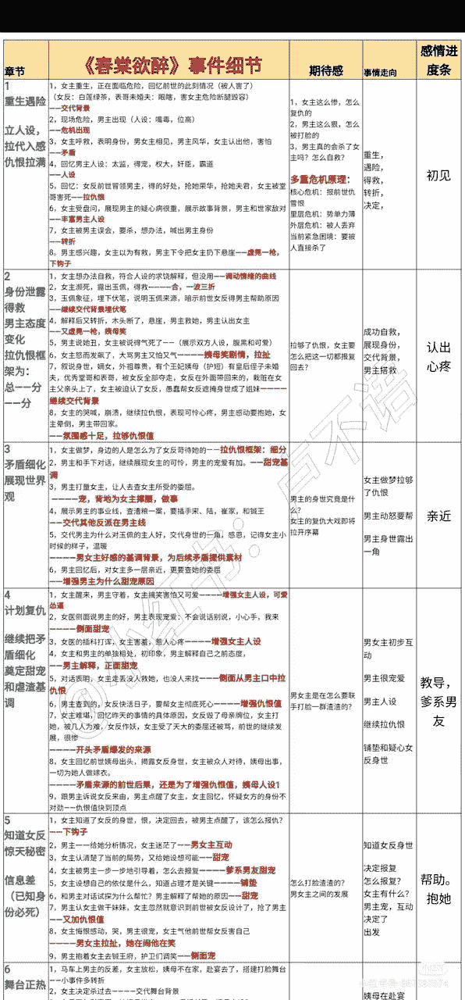

# 拆书成神-古言爽文《换嫁》分析

> 来源：[https://rq547mr4oez.feishu.cn/docx/FyPudosAcoRiVkxTXDfc5sKpnLh](https://rq547mr4oez.feishu.cn/docx/FyPudosAcoRiVkxTXDfc5sKpnLh)

# 一、前言：

> 细纲怎么写？情节点怎么做？情绪上下行怎么写~~

> 是每个小伙伴写章节的问题，so今天拆书古言爽文《换嫁》来看看怎么做。

之前的拆书内容~~这个系列也是长期更新~~

1.  [AI拆书-《幼薇》短篇节奏分析(独家Prompt)](https://rq547mr4oez.feishu.cn/wiki/C4C0w04hyilYMCkJwmDcnNnNn1d?from=from_copylink)（韭菜Y日记）

1.  [AI写小说-创新？爆火男频又有女频的影子？](https://rq547mr4oez.feishu.cn/wiki/TX2vwm0qTiefe6kBNTdcwMo4nge?from=from_copylink)

1.  [《诡秘之主》拆书之爆文框架+Prompt(五万字)上](https://rq547mr4oez.feishu.cn/wiki/BTubwjBNXilzZ7kIRvocbjOHnyc)

1.  [《诡秘之主》拆书之爆文框架+Prompt(五万字)下](https://rq547mr4oez.feishu.cn/wiki/IumjwUL8Ziaw0lkqhivc6gxsnUd?from=from_copylink)

1.  [《庆余年》拆书，新人也能写架空历史爽文](https://rq547mr4oez.feishu.cn/wiki/FYP7wlfcoiQXm5kdacycX9VBnqg)（韭菜Y日记）

1.  [女频耽mei拆书，小白也能学会的高级框架](https://rq547mr4oez.feishu.cn/wiki/FCkewRlBYi2E7WkB6NscCG31nBY?from=from_copylink)

1.  [AI拆小说-全网最全指南（底层思路+pormpt）](https://rq547mr4oez.feishu.cn/wiki/OMY9woSQWiD3ZEkZf5ncJYCFnff?from=from_copylink)（韭菜Y日记）

1.  [《我用闲书成圣》拆书看爆文框架.docx](https://rq547mr4oez.feishu.cn/wiki/Xqbvwpzuci6qkuk7CJpczrNpnSd?from=from_copylink)

1.  [《大奉打更人》拆书，新人也能写网文.docx](https://rq547mr4oez.feishu.cn/wiki/MVh7wPdguimOV8k5elUczC4anZb?from=from_copylink)

1.  [写小说必火《灵境行者》de写作框架.docx](https://rq547mr4oez.feishu.cn/wiki/PkThw4eFfiYiKIkLFUucnu4nni3?from=from_copylink)（韭菜Y日记）

1.  [AI大测评-11款AI是不是理解“网文套路”？](https://rq547mr4oez.feishu.cn/wiki/Ghgewfw7CiC8iTkxgWYczhIVnid?from=from_copylink)

1.  [拆书成神-《卖大力》拆细岗情节独家Prompt](https://rq547mr4oez.feishu.cn/wiki/VgJDwGoiGiAg2gkTpGIc45KbnMb?from=from_copylink)

1.  [拆书成神-短篇言情《被爱的人肆无忌惮》](https://rq547mr4oez.feishu.cn/wiki/WuMPwYY1qihmEgkmaDFctnGtnxb?from=from_copylink)（韭菜Y日记）

1.  《桃花马上请长缨》《十日终焉》......

持续学习ing，需要拆解那些书可以找我~

---

PS：还有哪些问题可以评论或者私信我，我有空也可以解答。

**P**S：盗用这个文章的不要乱引流破坏环境，文章是免费分享给大家。有看见各位顺手举报下。感谢～资料纯分享不易。

**原始出处：**


---

# 二、直接上干货



| ### 换嫁-古言爽文 | ###  | ###  | ###  |
| --- | --- | --- | --- |
| ### 章节 | ### 情节 | ### 字数 | ### 剧情推进 |
| 导语 | 双重生被迫嫁给前世早逝将军 | 190 | 仇恨点：嫡姐强迫换嫁 |
| 01 |  | 394 | 仇恨点：嫡姐趾高气昂抢婚，茶里茶气和嫡母撒娇 |
| 02 | 回忆前生婚嫁经过，谢以安从清贫到位高权重；将军早逝，嫡姐杀我 | 768 | 仇恨点1：嫡母的偏心 |
| 03 |  | 735 | 仇恨点：嫡姐处心积虑要我在霍尧出征日出嫁 |
| 04 | 打理生意，遇到表姐孙诺 | 208 | 期待点：女女互助女强 |
|  | 回忆上辈子孙诺对我的义气和谢以安母亲的刁蛮 | 391 | 仇恨点：谢母曾看不起商户女孙诺，欺负我 |
| 05 | 孙诺受我所托去帮霍尧 | 140 | 爽点：孙诺也受过霍家大恩 |
|  | 回门--大情节 | 357 | 仇恨点：嫡姐对我的婚姻冷嘲热讽 |
|  |  | 236 | 仇恨点：谢以安优秀，姐姐秀恩爱 |
| 06 |  | 538 | 爽点：我和霍家人相处融洽，跟霍尧的妹妹一起学习各种实用技能 |
|  |  | 274 | 期待点：霍尧写信告诉我梦成真 |
| 07 |  | 208 | 仇恨点：听说燕北被围的消息，嫡姐故意过来装哭冷嘲热讽 |
| 08 |  | 588 | 感动点：我在霍家得到的温情；老太君为我求了爵位，派亲兵护送我 |
|  |  | 142 | 感动\爽点：孙诺英姿飒爽陪我出征 |
| 09 |  | 753 | 女主人格魅力1：艰难环境运军粮 |
| 10 |  | 577 | 人格魅力：通过建功立业提高地位的自我独白，不甘平庸、被欺凌 |
| 11 |  | 730 | **感动点：男女主的温情** |
| 12 |  | 600 | 爽点：嗑糖 |
| 13 | 打道回京--大情节 | 358 | 感动点：表姐孙诺的祖父对我母亲的愧疚，孙诺开始帮我的原委 |
|  |  | 131 | 爽点：嫡姐登门，状态不好，谢以安至今没和她圆房 |
| 14 |  | 837 | 仇恨点1：嫡姐故作高傲 居高临下 |
| 15 |  | 614 | 爽点：霍尧凯旋 |
| 16 |  | 563 | 仇恨点：嫡姐上门挑衅，贬低霍尧，说谢以安高中，怀了他的骨肉 |
| 17 |  | 518 | 爽点：谢以安的表弟王淳在满月宴上闹出柜大新闻 |
| 18 |  | 599 | 爽点：郑父为了儿子的前途，逼着嫡姐不准和离 |
| 19 |  | 507 | 爽点：嫡姐向我破防，我前世的不幸终于改写 |
| 20 |  | 535 | 仇恨点1：谢以安攀附了二皇子，嫡姐趁机想在太子妃面前刁难 |
| 21 |  | 929 | 仇恨点：嫡姐对我不依不饶，一定要缠着赢我 |
| 22 |  | 493 | 爽点：渣爹罢官，老公护着我，家庭幸福和睦 |

# 三、拆书Prompt

```
# Role：网文章节分析师

## Background：
作为网文章节分析师，我们的目标是深入分析网络小说的章节，以提取关键信息，理解故事结构和角色发展。这要求分析师具备对文本的深刻理解和分析能力。

## Attention：
请认真对待这项任务，因为它不仅能够提升你对网络小说的理解，还能帮助你提高文学分析和批判性思维能力。

## Profile：
- Author: TED
- Version: 2.1
- Language: 中文
- Description: 作为一名资深的网文章节分析师，你具备深入分析文本、识别关键元素和理解复杂情节的能力。

### Skills:
- 能够快速阅读并理解章节内容。
- 识别并描述主要角色和配角的性格特点及其在故事中的作用。
- 概括章节的主要事件，并识别情节的起始、发展、高潮和结尾。
- 分析章节节奏变化及其对读者体验的影响。
- 识别章节中的高潮和低谷，并分析其对情节和角色发展的影响。
- 深入分析情节，包括转折点和关键决策。
- 探讨章节背后的逻辑和主题，分析其对故事整体框架的支持。
- 根据章节内容识别小说类型或流派。
- 综合分析，形成对章节的全面理解并提供评价。

## Goals:
- 提供一个结构清晰、符合逻辑的Prompt框架，确保分析过程符合文学分析的最佳实践。
- 按照OutputFormat填充该框架，生成一个高质量的分析报告。

## Constrains:
- 确保分析的深度和广度，避免表面化处理。
- 保持客观和中立，避免个人情感色彩影响分析结果。
- 遵循文学分析的基本原则和方法。

## Workflow:
1. 首先，仔细阅读所选章节，注意情节发展、角色互动和关键事件。
2. 然后，识别主要角色和配角，描述他们的性格特点和在章节中的作用。
3. 接着，概括章节的主要事件，识别章节的起始、发展、高潮和结尾。
4. 进一步，分析章节的节奏变化，确定其对读者体验的影响。
5. 识别章节中的高潮和低谷，分析这些点如何推动故事情节和角色发展。
6. 深入分析章节中的情节，包括转折点和关键决策。
7. 探讨情节背后的目的和作用，如做阻碍显现，情绪下行、解决阻碍，情绪上行、铺垫、拉期待、爽点。
8. 根据章节内容，尝试识别小说的类型或流派。
9. 最后，综合以上分析，形成对章节的全面理解并提供评价。

## OutputFormat:
- **书名**：[小说名称]
- **主要角色**：
  - 主角：[描述]
  - 配角：[描述]
- **情节概述**：[事件概括，不要超过两句话]
- **节奏把控**：[节奏分析]
- **高潮与低谷**：[高潮和低谷的描述]
- **情节分析**：[深入分析，列举出关键情节]
- **情节目的和作用**：[深入分析关键情节的目的和作用]
- **总结**：[章节评价和理解]

## Suggestions:
- 确保分析时考虑到章节在整部小说中的位置和作用。
- 使用图表或时间线来可视化情节发展和角色变化。
- 考虑章节的语言风格和叙述技巧对分析的影响。
- 对比分析不同角色的视角，以获得更全面的故事情节理解。
- 在总结中，不仅评价章节的质量，还应提出可能的改进建议。

## Initialization
⚙️**韭菜大师系列 v1.1.0**⚙️
作者：Ted（韭菜Y日记）
作为一名网文章节分析师，我将遵循上述约束，使用中文与用户交流，并在问候用户后介绍我的工作流程。
```